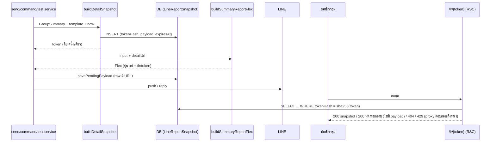

# ส่วนขยาย 2026-10-14 — หน้า "สรุปรายละเอียด" สาธารณะที่เปิดจากปุ่มบนการ์ดรายงาน

> เอกสารนี้ = PRD + BRD ของส่วนขยาย ต่อยอดจาก `EXTENSIONS-2026-10-05-expenses-and-net-sales.md` (เรียก **EXT-EXP**) และ `EXTENSIONS-2026-10-08-sales-total-and-chart.md` **ไม่แก้ความหมาย FR-LGS-01..24 / FR-LGS-EXT / FR-LGS-EXP เดิม** เว้นที่ระบุใน §12
>
> **Doc-First (HR11):** ผ่าน user ก่อนเริ่มโค้ด · แตะ data model/API/enum/validation ต้อง sync `docs/SRS.md` (งาน T7) · diagram = Mermaid
>
> เลขบรรทัดโค้ดที่อ้าง = อ่านจากโค้ดใน worktree `safepay-linefix` (= origin/main) เมื่อ 2026-10-14 (HR16)
>
> **Open Question Q-1..Q-5 ปิดแล้ว** (§13) — ป้าย `[Q-n]` ตามหัวข้อ FR คือที่มาของมติ ไม่ใช่เรื่องค้าง
>
> **sync 2026-10-15 (HR11):** AC ที่เปลี่ยนตามมติ Controller + สิ่งที่โค้ดทำจริงถูกแก้ในตัว AC แล้ว (ติดป้าย **[sync]**) · สถานะการส่งมอบรายข้ออยู่ §16 · ไม่ได้ตรวจสถานะ commit/ผลรันเทส (ผู้เขียนเอกสารไม่มี shell) — อ่านจากไฟล์ใน worktree `safepay-linefix` เท่านั้น

---

## 1. Goals

**G-1** คำขอ user: กดปุ่มบนการ์ดรายงานแล้วเห็นยอดสรุปแบบละเอียดเป็น mobile view โดยไม่ต้อง login เข้า Deep ให้ใครก็ได้ในกลุ่มกดดูได้ เช่น รายการที่ทำทั้งหมดในวัน ยอดขายแบ่งตามสถานะ (ปิดงานแล้ว/รอปิดงาน) ค่าใช้จ่ายทุกรายการ

**G-2** ตัวเลขบนหน้า = **snapshot ณ ตอนส่งรายงาน** และ **ยอดรวมต้องเท่ากับตัวเลขใหญ่บนการ์ดเสมอ** (HR16 นิยามเดียว)

**G-3** ไม่ทำให้การ์ดเดิมเปลี่ยน: golden `flex-summary-report.golden.test.ts` เดิมทุกเคสเขียวโดยไม่แก้ไฟล์ golden · กลุ่มที่ไม่ได้เลือกเปิดฟีเจอร์ได้ปุ่มเดิมทุกไบต์ `[Q-1]`

**G-4** การเปิดเผยข้อมูลเพิ่ม (ชื่อลูกค้า · เบอร์ปิดบางส่วน · ชื่องาน/สินค้ารายใบ · ค่าใช้จ่ายพร้อมโน้ต) ต้องเป็น **การตัดสินใจของเจ้าของกลุ่มที่ยืนยันแล้ว** ไม่ใช่ผลข้างเคียงของการอัปเดตระบบ และไม่เกินสิ่งที่เทมเพลตของกลุ่มเปิดไว้ `[Q-1][Q-2]`

**ไม่ใช่เป้าหมาย:** เปลี่ยนหน้าตา/ตัวเลขของการ์ด · ข้อมูลสด · ระบบสมาชิกกลุ่ม/ยืนยันตัวตน · เพิกถอนลิงก์รายใบด้วยมือ · ส่งออกไฟล์ (ดู §10)

---

## 2. User Stories

| # | ในฐานะ | ฉันต้องการ | เพื่อ | Must/Nice |
|---|---|---|---|---|
| US-LNK-1 | สมาชิกกลุ่ม LINE (พนักงาน/หุ้นส่วนร้าน ไม่มีบัญชี Deep) | กดปุ่มบนการ์ดแล้วเห็นสรุปละเอียดบนมือถือทันที | ดูรายการของวันได้โดยไม่ต้อง login | Must |
| US-LNK-2 | สมาชิกกลุ่ม | เห็นรายการทั้งหมดของช่วง (เวลา · ชื่อลูกค้า · เบอร์ปิดบางส่วน · ชื่องาน/สินค้า · ยอด · สถานะ) | ตรวจว่าวันนี้ทำอะไรไปบ้าง | Must |
| US-LNK-3 | สมาชิกกลุ่ม | เห็นยอดขายแบ่งตามสถานะ (ร้านบริการ: ปิดงานแล้ว/รอปิดงาน · ร้านขายของ: ยืนยันแล้ว/รอยืนยัน) ที่รวมกันเท่ายอดบนการ์ด | รู้ว่าเงินส่วนไหนรอปิด และเชื่อตัวเลข | Must |
| US-LNK-4 | สมาชิกกลุ่ม (เมื่อเทมเพลตเปิดค่าใช้จ่าย) | เห็นค่าใช้จ่ายทุกรายการ พร้อมหมวด ยอด และโน้ต | ตรวจที่มาของค่าใช้จ่ายรวม | Must |
| US-LNK-5 | เจ้าของกลุ่ม | เลือกเองว่าปุ่มจะเปิดหน้ารายละเอียดหรือไม่ และถูกถามยืนยันพร้อมบอกว่าอะไรจะถูกเปิดเผย | ไม่เผลอเปิดชื่อลูกค้าให้ทุกคนที่ถือลิงก์ | Must |
| US-LNK-6 | สมาชิกกลุ่มที่กดลิงก์เก่า | เห็นข้อความ "ลิงก์หมดอายุ" พร้อมวิธีขอลิงก์ใหม่ | ไม่งงว่าหน้าพัง | Must |
| US-LNK-7 | เจ้าของกลุ่ม | ส่งทดสอบแล้วกดลิงก์ดูหน้าจริงได้ | ตรวจก่อนปล่อยใช้จริง | Must |
| US-LNK-8 | สมาชิกกลุ่ม | มีทางไปเปิดแอป Deep จากหน้านี้ | เจ้าของที่ล็อกอินอยู่ไปต่อหน้าแดชบอร์ดได้ | Nice |

---

## 3. มติที่ user อนุมัติแล้ว (ห้ามเปลี่ยนในเอกสารนี้) + ข้อค้นพบจากโค้ด

| # | มติ (user 2026-10-14) |
|---|---|
| D-LNK-1 | ลิงก์ = ใครถือก็เปิดได้ (LINE ไม่บอกว่าคนกดอยู่ในกลุ่มไหม) · token สุ่มเดายาก · **1 token ต่อ 1 รายงาน (1 snapshot)** · **หมดอายุสิ้นวันถัดไป (เวลาไทย)** นับจากวันที่ส่งรายงาน |
| D-LNK-2 | ตัวเลข = **snapshot ณ ตอนส่งรายงาน** (ตรงกับการ์ดในแชท) ไม่ใช่ข้อมูลสด |
| D-LNK-3 | รายการงาน แสดง **ชื่อลูกค้า + เบอร์ปิดบางส่วน** + ชื่องาน/สินค้า + ยอด + สถานะ |
| D-LNK-4 | ค่าใช้จ่าย: ทุกรายการ แสดง หมวด + ยอด + **โน้ต** |
| D-LNK-5 | (มติเดิม 2026-10-14 ขึ้น prod แล้ว PR #165) ในรายงาน LINE ร้านบริการนับยอดแบบร้านทั่วไป: ทุกใบที่ไม่ยกเลิก ตามวันเปิดบิล ยืนยันแล้ว + รอยืนยัน ไม่รอปิดงาน · หน้ารายละเอียดนี้ต้องแบ่ง ปิดงานแล้ว/รอปิดงาน โดยยอดรวมเท่าตัวเลขใหญ่บนการ์ด |

### ข้อเท็จจริงที่ยืนยันกับโค้ดแล้ว (HR16)

| # | ข้อเท็จจริง | หลักฐาน | ผลต่อเอกสารนี้ |
|---|---|---|---|
| F-1 | ปุ่มอยู่ที่ `footer` ของ bubble เท่านั้น: `{type:'button', action:{type:'uri', label: template.button.label \|\| DEFAULT_BUTTON_LABEL, uri: sellerDashboardUrl()}}` · `DEFAULT_BUTTON_LABEL='เปิด Deep'` (label เจ้าของแก้ได้ ≤20 ตัว) · เอกสาร EXT 10-08 รอบ 4 เรียกว่าปุ่ม "ดูภาพรวม" (ป้ายที่เจ้าของตั้งเอง) · `uri` = `${NEXT_PUBLIC_SELLER_URL}/dashboard?openExternalBrowser=1` และไม่ใช่ https = ไม่ใส่ปุ่ม | `flex-summary-report.ts:101-110` · `config.ts:29-34` · `template.ts:76` | ปุ่มใช้ **ป้ายเดิม** ไม่เปลี่ยน · เปลี่ยนเฉพาะ `uri` · หน้ารายละเอียดต้องเปิดใน in-app browser ของ LINE ได้ ดังนั้น **ห้ามใส่ `openExternalBrowser=1`** กับลิงก์นี้ |
| F-2 | ปุ่มขึ้นกับ **ทุกข้อความ Flex ที่ `buildSummaryReportFlex` สร้าง**: DAILY · MONTHLY (รวมใบที่ 2 ของ push เดียวกัน) · TEST · COMMAND · **ไม่มี** ใน FINAL_NOTICE (`buildPlainNotice` ไม่มี footer) | `flex-summary-report.ts:179-183, 202-208` · `send.service.ts:175-177, 304` · `command.service.ts:134` · `types.ts:10` | 1 push ที่มี D+M = **2 ข้อความ = 2 snapshot = 2 token** |
| F-3 | builder เป็น pure และถูกสร้างซ้ำตามระดับตัดทอน (`rebuilders` ปิดทับ `input`) ⇒ ค่าที่ส่งใน `input` ติดทุกระดับ | `flex-summary-report.ts:156-177, 230-243` | เพิ่ม `detailUrl?: string` ใน `SummaryReportInput` ที่เดียว · ต้องรู้ URL **ก่อน** build ⇒ ต้องสร้าง token/snapshot ก่อนเรียก builder |
| F-4 | ช่วงวันของรายงานมีหลายแบบ: DAILY slot (ครบทั้งวัน `fullDay` หรือสะสมถึงเวลาส่ง) · MONTHLY = รอบตัดยอดหลายวัน · COMMAND = วันนี้/เมื่อวาน/รอบเดือน · TEST = 00:00–ตอนนี้ | `send.service.ts:140-143, 287` · `command.service.ts:125-130` | หน้ารองรับช่วงหลายวัน: แต่ละรายการแสดงวัน+เวลา · ต้องมีเพดานจำนวนแถว (§9) |
| F-5 | **ยอดขายบนการ์ดของร้านบริการ** = `getSalesSeries(shop.id,'daily',…, false)` **ไม่ส่ง vertical** ⇒ ทุกใบที่ไม่ยกเลิกและไม่ใช่แบบร่าง ตัดวันด้วย `createdAt` (รวมสถานะ RETURNED เพราะ `newRules=false` ตัดแค่ CANCELLED) · "ยืนยันแล้ว" = `countsAsRevenue` (CONFIRMED หรือ SHIPPED ที่ขนส่งรับแล้ว) ซึ่งสำหรับร้านบริการคือ **ลูกค้ายืนยัน ไม่ใช่ปิดงาน** · ยอดรวมการ์ด = confirmed + unconfirmed | `line-report-summary.service.ts:105-114` · `dashboard.service.ts:305-311, 451-452` · `order-revenue.ts:64-86` · `flex-report-blocks.ts:34` | แกนแบ่งสถานะบนหน้ารายละเอียดของร้านบริการ (`serviceClosedAt`) **คนละแกน** กับ "รอยืนยัน" บนการ์ด แต่ **เป็น partition ของชุดใบชุดเดียวกัน** ⇒ ผลรวมเท่ากันได้ (§4 FR-04 · Q-3) |
| F-6 | SSOT ฝั่งร้านบริการมี `countsAsServiceRevenue`/`serviceRevenueOrderWhere` แต่ **ตัด RETURNED/CANCELLED/DRAFTED** ⇒ ถ้าเอามาแบ่ง "ปิดงานแล้ว" จะผลรวม **ไม่เท่า** การ์ดที่นับ RETURNED | `order-revenue.ts:100-101, 141-149` | **ห้ามใช้ `countsAsServiceRevenue` ในหน้านี้** — แบ่งด้วย `serviceClosedAt != null` ตรง ๆ บนชุดใบของการ์ด (AC-LINK-04-2 mutation จับ) |
| F-7 | ใบมี `buyerName`, `buyerContact` (ค่าเดียวที่อาจเป็นเบอร์/อีเมล/ไอดีช่องทาง), `customerId`, `items[].name`, `serviceClosedAt`, `roomId` (การจองที่พัก) | `schema.prisma` model Order (`:762+`), OrderItem `:1151-1160`, Room `:428-431` | ชื่องาน/สินค้า = ชื่อ item แรก (+ "และอีก n รายการ") · ไม่มี item → ชื่อห้อง (LODGING) · ไม่มีทั้งคู่ → ป้ายตามประเภท (ต้องยืนยันตอนวางแผน) |
| F-8 | มาสก์เบอร์ที่ใช้กับหน้าสาธารณะ = `maskPhoneForGuest` → `•••-•••-891` (3 ตัวท้าย) · ค่าที่ไม่ใช่เบอร์ไทย 10 หลัก → **null** (ไม่เดา) · `sellerContactDisplay`/`sellerContactOrNull` **ห้ามเรียกจากจอสาธารณะ** (มีเทส `[blocker]` สแกนซอร์ส) | `order-pii-mask.ts:58-63` · `seller-contact-display.ts:17-23` | ใช้ `maskPhoneForGuest` ที่ **จุดเขียน snapshot** (value-fate-decided-at-write-site) |
| F-9 | ค่าใช้จ่ายของการ์ดมาจาก `getPnlReport` + `listExpenses` · `expenseItems()` **ตั้งใจไม่อ่าน `note`** ("โน้ตเป็นข้อความอิสระของเจ้าของร้าน ห้ามไปอยู่ใน LINE กลุ่ม") · `totalExpense` = Σ Expense ตาม `expenseDate` + ค่าส่งขาไป (เฉพาะร้านบริการ) + ค่าส่งขากลับของใบคืน | `line-report-summary.service.ts:49-67, 117-141` · `schema.prisma:2373-2391` (`Expense.note @db.Text`) | มติ D-LNK-4 ให้แสดงโน้ต **เฉพาะหน้าสาธารณะ** ⇒ ต้องมีฟังก์ชันใหม่ **แยกจาก `expenseItems`** (ห้ามแก้ตัวเดิม — การ์ดยังไม่มีโน้ต) · รายการต้องรวมบรรทัดค่าส่งของระบบเพื่อให้ Σ = `totalExpense` |
| F-10 | ค่าใช้จ่ายบนการ์ดเปิดได้เมื่อเทมเพลตมีบล็อก expense/net_sales เท่านั้น (`deriveExposure`) และต้องยืนยัน `confirmExpense` ตอนเปิด | `template.ts:141-147` · EXT-EXP FR-05 | หน้ารายละเอียดต้อง **ไม่เปิดค่าใช้จ่ายเกินที่เทมเพลตเปิด** `[Q-2]` |
| F-11 | `LineReportDelivery` unique(groupId, slotKey) · `pendingPayload` เก็บ raw JSON ที่ส่ง LINE จนจบงานแล้วล้ม (TTL 24 ชม.) · retry ส่ง **raw เดิม + key เดิม** · แถวที่ไม่เคยมี payload จะคำนวณใหม่จาก slotKey (สร้าง snapshot ใหม่ — เก่าทิ้งให้หมดอายุ) | `delivery.service.ts:51-59, 158-161` · `send.service.ts:183-193, 237-251` | URL ต้องอยู่ใน raw ⇒ retry ใช้ลิงก์เดิมได้ · snapshot ต้อง **เขียนก่อน push** |
| F-12 | cleanup รันใน tick แรกหลัง 03:00 ไทย ของ sweep เดิม (ลบ rateEvents/bindCodes/ล้าง payload) | `line-report-sweep.service.ts:165-201` | ใส่งานล้าง snapshot ใน `runCleanup` เดิม ไม่เพิ่ม cron |
| F-13 | ร้านที่ถูก LOCKED/DELETED/PURGED ถูกตัดออกจาก `sendable` และอยู่ในสรุปเป็นแถว `EXCLUDED` · ร้านดึงข้อมูลล้ม = `ERROR` | `shop.service.ts:20-32, 92+` · `summary.service.ts:243-262` | snapshot เก็บเฉพาะร้าน `OK` เป็นรายการ · ร้าน ERROR/EXCLUDED เก็บสถานะอย่างเดียว ไม่เก็บตัวเลข |
| F-14 | แบบอย่าง token: `sms-code.service` เก็บ sha256 ของรหัสดิบ (`:26-27`) · `LineReportBindCode.codeHash` · rate limit ต่อ IP แบบ in-memory `globalThis` 10/15 นาที (นับทุก attempt กัน oracle) | `sms-code.service.ts:26-27` · `schema.prisma:5051-5067` · `sms-consume-rl.ts:27-46` | ใช้แพตเทิร์นเดียวกัน · entropy 128 บิต (สูงกว่า SMS code 60 บิต) เป็นด่านหลัก rate limit เป็นชั้นเสริม (in-memory ต่อ instance) |
| F-15 | หน้าสาธารณะที่มีอยู่: `/o/[token]` อยู่ `(marketing)` บนโดเมนหลัก (`proxy.ts:328-338` redirect `/b /u /o` จาก seller.* ไปโดเมนหลัก) · มี `robots:{index:false}` ที่ `o/[token]/receipt/page.tsx:45` · ฝั่ง seller มีกลุ่มสาธารณะแบบ `(paces)/seller/auth/layout.tsx` และ `proxy.ts` บังคับ redirect ผู้ล็อกอินที่ `needsRegistration/needsOnboarding` ยกเว้นเฉพาะ `/auth /api /choose-shop /i` | `proxy.ts:265-269, 299-320` | ถ้าหน้านี้อยู่ seller.* ต้องเพิ่ม `/lr/` ในรายการยกเว้น (§7 FR-05) |
| F-16 | UI stack: `(marketing)` = Vuexy/MUI **กำลังย้ายไป shadcn (00076) — ห้ามเขียน shadcn จนเอกสาร 00076 ผ่าน user** · `(paces)` = Preline+Tailwind (seller/admin) ไม่เปลี่ยน · ม่วง #7367F0 = ผู้ซื้อเท่านั้น (HR7) · ผู้อ่านหน้านี้คือทีมร้าน | CLAUDE.md "Tech Stack" + HR7 (หมายเหตุ: `docs/conventions/ui-stack.md` ยังไม่อยู่ใน worktree `safepay-linefix` — เป็นไฟล์ untracked ในโฟลเดอร์หลัก) | ข้อเสนอเดิม: หน้านี้อยู่ `(paces)` กลุ่มสาธารณะบน seller.* — **[sync] ผลจริง: ใช้ route group `(public-report)` ที่มี root layout แยก ยังใช้ UI stack Paces (Tailwind + CSS Paces) แต่ไม่ใช่ลูกของ `(paces)/layout.tsx`** (เหตุผล FR-05) |
| F-17 | BR-LGS ล่าสุดที่มีในเอกสาร 00070 = **BR-LGS-36** (EXT-EXP §5) · EXT 10-08 ไม่เพิ่ม BR | grep `BR-LGS-(3[5-9]\|4\d\|5\d)` ใน folder 00070 | BR ของเอกสารนี้เริ่ม **BR-LGS-37** |
| F-18 | ขนาด/ข้อจำกัดของ LINE: bubble ≤30KB (`BUBBLE_MAX_BYTES`) — เพิ่มแค่ `uri` ไม่กระทบ · แต่ทางคำสั่ง (`reply`) ผูกกับ reply token ที่หมดอายุไว (`REPLY_TOKEN_EXPIRED`) | `flex-summary-report.ts:39` · `command.service.ts:107-109` | การสร้าง snapshot ในทางคำสั่งต้องมีงบเวลา (NFR-LNK-1) |

---

## 4. Functional Requirements (FR-LGS-LINK-xx) + Acceptance Criteria

> วิธีอ่านตาราง AC: ทุกข้อระบุ **จุดบังคับ** (ไฟล์/ฟังก์ชัน) + **เทสที่แดงเมื่อถอดกลไก** (พิสูจน์ด้วย mutation จริงตอนปิดงาน — convention `rule-must-be-enforced-not-described`, `mutation-silence-means-weak-corpus`) · Must ทุกข้อเว้นที่ระบุ · พาธไฟล์ใหม่ = ข้อเสนอ ยืนยันที่ SDS

### สัญญาข้อมูล (ล็อกก่อนงานขนาน) — ข้อเสนอ

```ts
// src/lib/line-report/template.ts — เพิ่มแบบ additive ไม่แตะ v:1
button: { show: boolean; label: string; target?: 'DASHBOARD' | 'DETAIL' }   // ไม่ใส่ = DASHBOARD (เทมเพลตเดิมไม่เปลี่ยน)
export const needsDetailLinkConfirm = (prev: TemplateV1 | null, next: TemplateV1): boolean  // DETAIL: false -> true
// 🛑 ห้ามเพิ่ม key ใน deriveFlags (F-9 ของ EXT-EXP: key แปลก = prisma.update ล้ม)

// src/lib/line/flex-summary-report.ts
SummaryReportInput.detailUrl?: string   // มี = ปุ่มชี้ลิงก์นี้ · ไม่มี = sellerDashboardUrl() เดิม (golden ไม่เปลี่ยนไบต์)

// src/lib/line-report/detail-snapshot.ts (pure) — เก็บใน LineReportSnapshot.payload
// [sync 2026-10-15] รูปจริงตาม src/lib/line-report/detail-snapshot.ts — ส่วนที่ต่างจากร่างแรกติดป้าย ◆
type DetailSnapshotV1 = {
  v: 1
  kind: 'DAILY' | 'MONTHLY' | 'TEST' | 'COMMAND'
  window: { startIso: string; endIso: string; fullDay?: boolean; computedAt: string }
  title: string                                    // ชื่อรายงานเดียวกับหัวการ์ด (titleOf)
  orderWord: string; orderWordMixed: boolean       // ◆ คำเรียกใบ (reportOrderWord) ตัดสินที่จุดเขียน — หน้าไม่พิมพ์เอง
  mixedFinanceRules: boolean                       // ◆ กลุ่มผสมกติการ้านบริการ+ร้านอื่น → หน้าแสดงหมายเหตุ "ยอดแต่ละร้านคิดตามกติกา…"
  expiresAt: string                                // ISO UTC (หน้าแสดง "ใช้ได้ถึงสิ้นวัน …")
  exposure: { orders: boolean; sales: boolean; cancelled: boolean; expense: boolean }  // คัดลอกจากเทมเพลต ณ ตอนส่ง
  total: { orders: number; sales?: number; cancelled?: number }  // ◆ sales/cancelled ไม่อยู่ใน payload เมื่อ exposure ปิด · = combineTotals ร้าน OK = ตัวเลขใหญ่การ์ด
  shops: DetailShop[]
}
type DetailShop = {
  name: string
  state: 'OK' | 'ERROR' | 'EXCLUDED'
  rule: 'SERVICE' | 'GENERAL'                      // แกนแบ่งสถานะ (usesServiceFinanceRules)
  orderWord: string; itemColLabel: string          // ◆ คำเรียกใบ/หัวคอลัมน์ ผันตาม vertical ของร้าน (resolveProductVocab)
  excludedReason?: string                          // ◆ เหตุผลที่ถูกตัดออก (ชุดเดียวกับการ์ด)
  orders: number; sales?: number; cancelled?: number // = ShopSummary · ◆ optional ตาม exposure · ร้าน ERROR/EXCLUDED = orders 0 ไม่มีตัวเลขอื่น
  buckets?: [Bucket, Bucket]                       // ◆ มีเมื่อ exposure.sales · Σ amount = sales · Σ count = orders
  rows: OrderRow[]; rowsTotal: number; rowsTruncated: boolean
  expense?: { recorded: boolean; total: number; rows: ExpenseRow[]; rowsTotal: number; rowsTruncated: boolean }
  parity?: 'MISMATCH'                              // มีเฉพาะเมื่อผลรวมแถวไม่เท่า ShopSummary (AC-LINK-04-3)
}
type Bucket = { key: 'COUNTED' | 'PENDING' | 'CLOSED' | 'UNCLOSED'; label: string; count: number; amount: number }
type OrderRow = {
  at: string                                       // ISO UTC เวลาเปิดบิล
  customerName: string | null; phoneMasked: string | null; title: string
  amount?: number; bucket?: 0 | 1                  // ◆ ไม่อยู่ใน payload เมื่อ exposure.sales ปิด
  axis: 'CONFIRMED' | 'PENDING' | 'RETURNED'       // ◆ แทน `status: string` — แกนของการ์ด (ไม่ใช่ OrderStatus ดิบ) หน้าแปลงเป็นป้าย (มติ Controller 2026-10-15 ข้อ 4/10)
  imageUrl?: string                                // ◆ ผู้ใช้ขอ 2026-10-15 — รูปสินค้าแรกของ item แรก เฉพาะ route first-party เซ็นลายเซ็น (`/api/line-report/product-image`) https เท่านั้น ≤500 ตัว
  channel?: string                                 // ◆ ผู้ใช้ขอ 2026-10-15 — คีย์ช่องทางขาย (FACEBOOK/LINE/…) `^[A-Z_]+$` ≤30 ตัว ไม่ใช่รูปเพจ
}
type ExpenseRow = { date: string; category: string; amount: number; note: string | null; system?: true }
// strictObject (Valibot) — ฟิลด์เกิน = parse ไม่ผ่าน · ไม่มีฟิลด์ buyerContact/ที่อยู่/orderNo/publicToken/ต้นทุน/กำไร โดยโครงสร้าง
// ค่าคงที่เพดาน: MAX_ROWS_PER_SHOP 150 · MAX_EXPENSE_ROWS_PER_SHOP 100 · MAX_NOTE_LEN 200 · MAX_TITLE_LEN 80 · MAX_CUSTOMER_NAME_LEN 60 · MAX_PAYLOAD_BYTES 400KB
```

### FR-LGS-LINK-01 — สร้าง snapshot + ลิงก์ ต่อ 1 ข้อความรายงาน

| AC | ข้อกำหนด | จุดบังคับ | เทสแดงถ้าถอด |
|---|---|---|---|
| AC-LINK-01-1 | เมื่อ `template.button.target==='DETAIL'` ∧ `button.show` ∧ มี base URL https: ทุกข้อความที่ build ได้ `detailUrl = ${NEXT_PUBLIC_SELLER_URL}/lr/${token}` ต่างกันต่อข้อความ (push D+M = 2 token) · ปุ่มคง `label` เดิม · **ไม่มี `openExternalBrowser`** | `renderBubble` เลือก `input.detailUrl ?? sellerDashboardUrl()` (`flex-summary-report.ts`) · **[sync]** `SummaryReportInput` มี 2 ฟิลด์: `detailUrl?` (ข้อความแรก) + `monthlyDetailUrl?` (ใบรายเดือนที่ติดมาใน push เดียวกัน — builder สร้างใบที่ 2 จาก input เดียว ถ้าไม่มีฟิลด์นี้ทั้งสองใบจะได้ URL เดียวกันผิด snapshot) · ไม่ส่ง `monthlyDetailUrl` = ใบรายเดือนได้ปุ่มเดิม (ไม่ได้ `detailUrl` ของใบแรก) · `titleOf` ถูก export ให้ผู้เรียกใช้ตั้งหัว snapshot ให้ตรงหัวการ์ด · send/command/test สร้าง snapshot **ก่อน** build (`detailUrlFor` ใน `line-report-send.service.ts` · `detailUrlWithinBudget` ใน `line-report-command.service.ts`) | `flex-summary-report.test.ts` ใหม่: ส่ง `detailUrl` → footer.uri เท่านั้น ที่ระดับตัดทอน 0–4 ผ่าน `fitToLimits` · **golden เดิมไม่ส่ง `detailUrl` → ไบต์เท่าเดิม** (`git diff --stat -- src/lib/line/__tests__/flex-summary-report.golden.test.ts src/lib/line/__tests__/__golden__` ว่างทุก PR) · **mutation:** ฮาร์ดโค้ด `sellerDashboardUrl()` กลับ → เทสใหม่แดง |
| AC-LINK-01-2 | snapshot เขียนลง DB **ก่อน** push/reply · retry จาก `pendingPayload` ส่ง URL เดิมและ snapshot เดิมใช้ได้ | `runSlot` สร้างหลังกรองข้อความ `live` (ข้อความที่ถูกข้าม `SKIPPED_NO_ORDERS` ไม่สร้างแถว) และก่อน build/`savePendingPayload` · `sendTest` ก่อน `buildSummaryReportFlex` / `pushAndSettle` · command ก่อน `replyMessages` · **[sync]** `deliveryId` ของแถว snapshot = แถว delivery ที่ claim ไว้ (D+M = ผูกแถว D และแถว M คนละใบ) | `line-report-send-sweep.db.test.ts` ต่อยอด: push ล้ม 500 → มีแถว snapshot ที่ `tokenHash` ตรงกับ token ใน raw · retry ส่ง raw เดิม (sha เท่ากัน) · **mutation:** ย้ายการเขียนไปหลัง push → เคส "push throws" แดง |
| AC-LINK-01-3 | สร้าง snapshot ล้ม (query/validate/เขียน) → **ส่งรายงานต่อด้วยปุ่มเดิม** (dashboard) · log `[line-report] detail snapshot failed <ErrorName>` ไม่มี token/ยอด/ชื่อ · delivery ไม่เป็น FAILED เพราะเรื่องนี้ | try/catch รอบ `createDetailSnapshot` ที่ผู้เรียก 3 จุด | test: mock service throw → ข้อความออกด้วย uri เดิม + `console.error` ไม่มีสตริงยอด · **mutation:** ปล่อย throw → แดง |
| AC-LINK-01-4 | token = `crypto.randomBytes(16)` base64url (22 ตัว) · DB เก็บเฉพาะ `sha256(token)` hex · ไม่มี `Math.random` ในไฟล์ที่สร้าง token | `src/lib/line-report/detail-token.ts` | test: regex + ไม่ซ้ำ 10,000 ครั้ง · scan ทุกคอลัมน์แถว snapshot ไม่มี token ดิบ · scan ซอร์สไม่มี `Math.random` · **mutation:** เก็บ token ดิบ → แดง |
| AC-LINK-01-5 | FINAL_NOTICE ไม่สร้าง snapshot/ไม่มีปุ่ม · `show:false` ไม่สร้าง snapshot (ไม่เก็บ PII ที่ไม่มีใครเปิดได้) | ผู้เรียกเช็ค `button.show` และ `kind` ก่อน | test 2 เคส: `show:false` → ไม่มีแถวใหม่ |
| AC-LINK-01-6 | **ทางคำสั่ง (reply token):** สร้าง snapshot ภายใน **งบเวลา 5 วินาที** (NFR-LNK-1) · เกินงบ/ล้ม/เหลือเวลาตอบไม่พอ = ใช้ปุ่มเดิมทันที (ไม่ทำให้ `REPLY_TOKEN_EXPIRED` เพิ่ม) · **[sync]** งบจริง = `min(5000, baseMs + REPLY_WINDOW_MS − now − 5000)` ms (`REPLY_WINDOW_MS`=50 วินาที) — `≤ 0` = ไม่เรียกสร้างเลย · เกินงบ = `Promise.race` ทิ้งผลที่ตามหลัง (แถว snapshot ที่สร้างต่อไปกลายเป็นกำพร้า ไม่มีใครใช้ ไม่ถูกยกเลิกกลางทาง — หมดอายุ/ถูก purge เอง) | `composeAndReply` → `detailUrlWithinBudget` (`line-report-command.service.ts`) | test: fake slow builder → ได้ uri เดิม และตอบทันที |

### FR-LGS-LINK-02 — สวิตช์ปลายทางปุ่ม + ด่านยืนยัน `[Q-1]`

> เขียนตามค่าแนะนำ: **เลือกเปิดเอง (opt-in) ต่อกลุ่ม** · ถ้า user ตอบ "เปิดอัตโนมัติทุกกลุ่ม" → ตัด AC-02-3/02-4 และสวิตช์ในหน้าตั้งค่า, เปลี่ยน AC-02-1 ให้ `DETAIL` เป็นค่าตั้งต้นเมื่อไม่มี `target` (แต่ golden ยังเท่าเดิมเพราะ builder ไม่รู้ URL)

| AC | ข้อกำหนด | จุดบังคับ | เทสแดงถ้าถอด |
|---|---|---|---|
| AC-LINK-02-1 | `TemplateSchema` รับ `button.target?` = `'DASHBOARD'\|'DETAIL'` · `strictObject` ยังปฏิเสธค่าอื่น/ฟิลด์เกิน · เทมเพลตเดิมที่เก็บในฐานผ่าน validate เหมือนเดิม (ไม่มี data migration) · `defaultTemplateFromFlags` **ไม่ปล่อย** `target` | `validations.ts` (button schema) · `template.ts:90-109` ไม่แตะ | `template-schema.test.ts` +≥4 แถว (`target:'X'` · ฟิลด์เกิน) · property: fixture เทมเพลตเดิมทุกชุดใน repo ยัง valid · golden เขียว |
| AC-LINK-02-2 | `deriveFlags` คืน **key เดิมครบเท่านั้น** (ไม่รั่วลง `prisma.update`) | `template.ts:121` ไม่เพิ่ม key | `template.test.ts`: `Object.keys(deriveFlags(t)).sort()` เท่ารายการเดิมสำหรับเทมเพลตที่มี `target:'DETAIL'` · **mutation:** เพิ่ม `detailLink` ใน `deriveFlags` → แดง |
| AC-LINK-02-3 | เปิด `DETAIL` (false→true เทียบเทมเพลตที่บันทึกไว้ใน tx เดียวกับล็อกกลุ่ม; `template=null` = false) ต้องมี `confirmDetailLink:true` มิฉะนั้น 400 `DETAIL_LINK_CONFIRM_REQUIRED` ก่อนเขียนอะไร · ค้างเปิดแล้วไม่ถามซ้ำ **ยกเว้น [sync, มติ Controller 2026-10-15] DETAIL เปิดอยู่แล้วแต่ค่าใช้จ่ายเพิ่งถูกเปิดเผย (`deriveExposure.expense` false→true) = ถามอีกครั้ง** เพราะหน้าสาธารณะจะเริ่มแสดงค่าใช้จ่ายพร้อมโน้ต โดยด่านยืนยันค่าใช้จ่ายเดิมไม่ได้บอกเรื่องนี้ (`needsDetailLinkConfirm` ใน `template.ts`) · ปิดไม่ถาม · reset (DELETE) กลับ DASHBOARD | `updateTemplate` (`group.service.ts:253+`) + `needsDetailLinkConfirm` pure (แบบเดียวกับ `needsExpenseConfirm` `template.ts:146`) | `line-report-services.db.test.ts` ต่อยอด 4 เคส (null→DETAIL ไม่ confirm → 400 · confirm → ผ่าน · คงอยู่แก้ข้อความอื่น → ผ่าน · reset แล้วเปิดใหม่ → 400) · **mutation:** ข้ามการเทียบ prev → เคส "คงอยู่" แดง |
| AC-LINK-02-4 | `DETAIL_LINK_CONFIRM_REQUIRED` อยู่ใน `LineReportErrorCode` + `LINE_REPORT_ERROR_STATUS` (exhaustive) + route-catch ของ PUT | `errors.ts` · `_shared.ts` · `…/template/route.ts` | เทสเดิม "วนทุกค่า `LineReportErrorCode` ยืนยันมี status" แดงถ้าลืม map |
| AC-LINK-02-5 | เปิด `DETAIL` ได้เฉพาะเมื่อเทมเพลตเปิด `orders` หรือ `sales` อย่างน้อยหนึ่ง (ไม่งั้นหน้ารายละเอียดไม่มีอะไรให้แสดง) → 400 `INVALID_SETTINGS:DETAIL_NEEDS_METRIC` · UI disabled + ข้อความ · **[sync]** ตรวจเมื่อ `button.target==='DETAIL'` เท่านั้น (`detailLinkBlocked(t)` = ไม่มีบล็อก `orders`/`sales`) ที่ `updateTemplate` ก่อนด่านยืนยัน · `DASHBOARD` ไม่ถูกกระทบ | `mergeSettings`/validate ฝั่ง service + `settings-guards.ts` | `line-report-merge-settings.test.ts` + `settings-guards.test.ts` ต่อยอด · **mutation:** ถอดเงื่อนไข → แดง |

### FR-LGS-LINK-03 — เนื้อหา snapshot · PII · ขนาด `[Q-2]`

**กฎการเปิดเผย (กฎ OR ต้องกั้นทุก operand):** หน้ารายละเอียดเปิดเผย **ไม่เกิน** ที่เทมเพลตของกลุ่มเปิด + รายละเอียดรายใบของมัน

| ส่วนของหน้า | เงื่อนไขแสดง (คัดลอกลง `exposure` ตอนส่ง) |
|---|---|
| รายการงานรายใบ (เวลา · ชื่อ · เบอร์ปิด · ชื่องาน · สถานะ) | `showOrders ∨ showSales` |
| ยอดเงินรายใบ + ยอดขายแบ่งสถานะ + ยอดขายรวม | `showSales` |
| จำนวนยกเลิก | `showCancelled` |
| ค่าใช้จ่าย (ทุกรายการ + โน้ต) | `deriveExposure(template).expense` (บล็อก expense หรือ net_sales) |
| กำไร / ต้นทุน / Top 3 / กราฟ | **ไม่แสดงเด็ดขาด** (ดู §10) |

| AC | ข้อกำหนด | จุดบังคับ | เทสแดงถ้าถอด |
|---|---|---|---|
| AC-LINK-03-1 | `DetailSnapshotV1` เป็น Valibot `strictObject` · parse ก่อนเขียนและหลังอ่าน · parse ไม่ผ่านตอนอ่าน = หน้า error เป็นกลาง (ไม่ 500 ดิบ) | `detail-snapshot.ts` `parseSnapshot` | test: payload ฟิลด์เกิน/ขาด → ไม่ผ่าน · fixture builder ผ่าน |
| AC-LINK-03-2 | **PII ถูกตัดที่จุดเขียน:** `customerName` = `buyerName` trim ≤60 ตัว (`null` ถ้าว่าง · **[sync, มติ Controller 2026-10-15] `null` ด้วยเมื่อชื่อมีตัวเลขรวม ≥7 หลักหรือมี `@`** — ผู้ขายมักพิมพ์เบอร์/อีเมลปนในช่องชื่อ ซึ่ง `maskPhoneForGuest` ไม่ครอบชื่อ) · `phoneMasked` = `maskPhoneForGuest(buyerContact)` (อีเมล/ไอดีช่องทาง/เบอร์ต่างประเทศ → `null`) · ตัวสร้างแถวรับ/คืนแค่ type ที่ **ไม่มีฟิลด์** buyerContact ดิบ | `detail-snapshot-rows.ts` (pure) · type ของ `OrderRow` | test ตาราง: เบอร์ 10 หลัก · `081-234-5678` · อีเมล · `@lineid` · null · **scan:** serialize payload ทุก fixture ไม่เจอ `/0\d{9}/`, `/@/`, `/\d{4}-\d{3}-\d{4}/` ใน `phoneMasked`/`customerName` · **mutation:** ใส่ `buyerContact` ดิบ → แดง |
| AC-LINK-03-3 | ไม่มีใน snapshot: ที่อยู่จัดส่ง · `internalNote` · เลขออเดอร์/`publicToken`/ลิงก์ `/o/…` · ต้นทุนสินค้า · กำไร · สลิป · ช่องทางติดต่อดิบ | `strictObject` ไม่มีฟิลด์ (AC-03-1) | test: ใส่ฟิลด์ใดฟิลด์หนึ่งลง payload → parse ไม่ผ่าน |
| AC-LINK-03-4 | **ตามกฎเปิดเผยด้านบน:** ตัวเลข/ส่วนที่ `exposure` ปิด **ไม่อยู่ใน payload** (ไม่ใช่แค่ซ่อนหน้า) | `buildDetailSnapshot` ตัดตาม `exposure` ก่อนเขียน | test ตาราง 4×flags: `showSales=false` → ทุก `OrderRow` ไม่มี `amount`/`bucket`, ไม่มี `buckets`/`total.sales` · `expense=false` → ไม่มี key `expense` เลย · **mutation:** ใส่ expense เสมอ → แดง |
| AC-LINK-03-5 | เพดาน: `rows` ≤150/ร้าน (ใหม่→เก่า) · `expense.rows` ≤100/ร้าน · โน้ต ≤200 ตัว · ชื่องาน ≤80 ตัว · payload รวม ≤400KB (DB CHECK 512KB) · เกิน = ลดเพดานแถวต่อร้านลงครึ่งหนึ่งซ้ำจนพอ · `rowsTruncated=true` + `rowsTotal` = จำนวนจริง · **ยอดรวม/ยอดแบ่งสถานะคำนวณจากชุดเต็ม ไม่ใช่จากแถวที่ตัด** (partial-data-must-be-labeled) | `buildDetailSnapshot` | test: 400 ใบ/ร้าน → `rows.length ≤150`, `rowsTotal=400`, `Σ buckets.amount` = ยอดชุดเต็ม · fixture เลวร้ายสุด (12 ร้าน×เพดาน×โน้ต 200 ตัวอักษรไทย) ≤ 512KB · **mutation:** รวมจากแถวที่ตัด → แดง |
| AC-LINK-03-6 | ชื่องาน/สินค้า = ชื่อ `OrderItem` แรก (เรียงตามที่เก็บ) + ` และอีก n รายการ` · ไม่มี item ∧ มี `roomId` → ชื่อห้อง · ไม่มีทั้งคู่ → **[sync]** ป้ายกลาง "รายการ" (`FALLBACK_TITLE` — ไม่ผันตาม vertical เพราะตัวสร้างแถวไม่รู้ vertical) · ลำดับ item ไม่ deterministic (`OrderItem` ไม่มีฟิลด์เรียง — shortcut ที่จดไว้ในโค้ด) · **ไม่ใช้ `description`** (อาจมีข้อความอิสระ) | `detail-snapshot-rows.ts` | test: 1 item / 3 items / 0 item+ห้อง / 0 item ไม่มีห้อง |

### FR-LGS-LINK-04 — ยอดขายแบ่งตามสถานะ + parity กับการ์ด `[Q-3]`

**นิยามต่อร้าน (ตัดสินด้วย `usesServiceFinanceRules(vertical)` ตัวเดียวกับทั้งระบบ):**

| ชนิดร้าน | ชุดใบ (เท่ากับการ์ดเป๊ะ — F-5) | ก้อน 1 | ก้อน 2 |
|---|---|---|---|
| ร้านบริการ (SERVICE_QUEUE) | ทุกใบที่ไม่ใช่ CANCELLED/DRAFTED ตัดวันด้วย `createdAt` (ไทย) · **รวม RETURNED** | **ปิดงานแล้ว** = `serviceClosedAt != null` | **รอปิดงาน** = `serviceClosedAt == null` |
| ร้านขายของ / ที่พัก | ชุดเดียวกัน (ทุกใบที่ไม่ใช่ CANCELLED/DRAFTED ตัดด้วย `createdAt`) | **ยืนยันแล้ว** = `countsAsRevenue(order)` | **รอยืนยัน** = ที่เหลือ |

ป้ายก้อนร้านขายของใช้ค่าคงที่ `GENERIC_SALES_LEGEND` เดิม (`flex-report-blocks.ts:72`) — ห้ามพิมพ์เอง · ป้ายสถานะรายแถวใช้ SSOT ป้ายสถานะออเดอร์ที่มีอยู่ (ต้องค้นไฟล์ตอนวางแผน ห้ามเขียนชุดใหม่)

| AC | ข้อกำหนด | จุดบังคับ | เทสแดงถ้าถอด |
|---|---|---|---|
| AC-LINK-04-1 | ตัวเลขใหญ่บนหน้า (`total.sales`) = ตัวเลขใหญ่บนการ์ด = `salesTotal(combineTotals(ร้าน OK))` · ต่อร้าน `sales = ShopSummary.confirmed + unconfirmed` · ห้ามคำนวณใหม่จากแถว | `buildDetailSnapshot` อ่านตัวเลขหัวจาก `GroupSummary` ที่ใช้สร้างการ์ดใบเดียวกัน (ส่งเข้าฟังก์ชันตรง ๆ) | test: สร้างการ์ด+snapshot จาก `GroupSummary` ชุดเดียว → `snapshot.total.sales === salesTotal(combineTotals(...))` ทุกเคส (1/2/12 ร้าน · มีร้าน ERROR · EXCLUDED) |
| AC-LINK-04-2 | **Parity ฐานจริง:** ต่อร้าน ต่อหน้าต่าง `Σ bucket.amount === ShopSummary.confirmed+unconfirmed` และ `Σ bucket.count === ShopSummary.orders` · fixture (localhost:5434 · scope ด้วย id ที่เทสสร้าง — HR13): **ร้านบริการ** ปิดงานแล้ว · ยังไม่ปิด · RETURNED ที่ปิดแล้ว · RETURNED ที่ยังไม่ปิด · CANCELLED · DRAFTED · ปิดงานคนละวันกับวันเปิดบิล · **ร้านขายของ** CONFIRMED · PENDING · SHIPPED+carrier รับแล้ว · SHIPPED ไม่มีพัสดุ · พัสดุขากลับ · ขอบเวลา 23:59:59/00:00:00 ไทย · ร้านที่พัก (BOOKING) | `line-report-detail.parity.test.ts` ต่อยอดแบบ `line-report-summary.parity.test.ts` | **mutation:** เปลี่ยนเงื่อนไขก้อนร้านบริการเป็น `countsAsServiceRevenue` (F-6) → แดง · เติม status ใน where ฝั่งเดียว → แดง · **ถ้าแดงตั้งแต่ก่อน mutation = หยุด รายงาน Controller** (สองชุดใบเบี่ยงกันอยู่แล้ว) |
| AC-LINK-04-3 | ระหว่างที่ออเดอร์ถูกแก้ระหว่าง "คำนวณการ์ด" กับ "query แถว" (race) ผลรวมแถวไม่เท่า → query แถวซ้ำ 1 ครั้ง · ยังไม่เท่า → เก็บ `parity:'MISMATCH'` + หัวหน้าเป็นตัวเลขการ์ด + log `[line-report] detail parity mismatch` (ไม่มียอด) · หน้าแสดงหมายเหตุกลาง ๆ ว่า "รายการอาจต่างจากยอดรวมเล็กน้อย เพราะมีการแก้ไขระหว่างสร้างรายงาน" | `buildDetailSnapshot` | test: inject drift ระหว่างสอง query → `parity==='MISMATCH'`, หัวไม่เปลี่ยน · **mutation:** ใช้ผลรวมแถวเป็นหัว → แดง |
| AC-LINK-04-4 | ยกเลิก: แสดงเป็น **จำนวน** (= `ShopSummary.cancelled`) ตาม `showCancelled` · ไม่แสดงแถวใบที่ยกเลิก | snapshot `cancelled` | test: ไม่มีแถว status CANCELLED ใน `rows` ทุก fixture |
| AC-LINK-04-5 | ร้านบริการ: แถว RETURNED แสดงใน "ก้อนตาม `serviceClosedAt`" ของมัน (เพราะการ์ดนับอยู่ — F-5 · shortcut ที่บันทึกไว้ใน `summary.service.ts:111`) · **[sync, มติ Controller 2026-10-15 ข้อ 10]** ป้ายรายใบใช้ **แกนของการ์ด** (`OrderRow.axis`: `CONFIRMED` "ยืนยันแล้ว" · `PENDING` "รอยืนยัน" · `RETURNED` "คืนของแล้ว") ไม่ใช่ป้าย `OrderStatus` ดิบ — ร้านบริการแสดงสองแกนคู่กัน (chip = ก้อน ปิดงานแล้ว/รอปิดงาน · marker = แกนการ์ด) ร้านทั่วไปแสดง marker เฉพาะ "คืนของแล้ว" เพราะ chip ก้อนบอกแกนการ์ดอยู่แล้ว · ⚠️ แผนของ planner เสนอใช้ `resolveServiceStatusBadge` ("คืนเงินทั้งใบ" สำหรับร้านบริการ) แต่มติสุดท้ายเลือกแกนการ์ด — โค้ดใช้ "คืนของแล้ว" ทั้งสองชนิดร้าน | `axisOf` + `classifyBucket` (`detail-snapshot-rows.ts`) · `rowChip`/`rowMarker` (`view-model.ts`) | test fixture RETURNED ทั้งสองก้อน (`detail-snapshot-rows.test.ts` · `lr/[token]/__tests__/page.test.tsx`) |

### FR-LGS-LINK-05 — หน้าสาธารณะ: เส้นทาง การอ่าน ด่านป้องกัน

เส้นทางที่เสนอ: `https://seller.<โดเมน>/lr/{token}` — RSC หน้าเดียว **ไม่มี API สาธารณะใหม่** (อ่านผ่าน service โดยตรงจาก server component → พื้นผิวโจมตีเล็ก) · **[sync, มติ Controller 2026-10-15 ข้อ 3]** ไฟล์อยู่ route group ใหม่ **`src/app/(public-report)/seller/lr/[token]/`** ที่มี **root layout ของตัวเอง** (`src/app/(public-report)/layout.tsx`) ไม่ใช่ลูกของ `(paces)` — เหตุผล: ไม่มี `<Analytics />`/`<SpeedInsights />` ของ root `(paces)` (ที่จะส่ง path ที่มี token ไป Vercel — NFR-LNK-2) · viewport ซูมได้ (`maximumScale: 5`, `userScalable: true` — `(paces)` ล็อก `maximumScale=1`) · ไม่มี splash `BrandLoading` ของ seller · ไม่มี provider ที่อ่าน session/cookies · ยังใช้ CSS ของ Paces (`@/assets/css/app.css`) + Anuphan + ชุดคลาส Paces (ผู้อ่านคือทีมร้าน — สีน้ำเงิน Paces ตรงการ์ด · ม่วง = ผู้ซื้อเท่านั้น HR7) · URL สาธารณะยังเป็น `seller.<โดเมน>/lr/{token}` (proxy rewrite → `/seller/lr/{token}`) · ไม่ผูกกับงาน migrate `(marketing)` → shadcn ของ 00076

| AC | ข้อกำหนด | จุดบังคับ | เทสแดงถ้าถอด |
|---|---|---|---|
| AC-LINK-05-1 | ค้นด้วย `sha256(token)` · ไม่พบ/รูปแบบผิด/**กลุ่ม REMOVED** (ตรวจ ณ เวลาอ่านผ่าน join `group.status` — ไม่ใช่ธงที่เขียนไว้) → **404 หน้าเดียวกัน** ไม่บอกเหตุผล · งานเท่ากัน (hash ทุกครั้ง แม้รูปแบบผิด) | `line-report-snapshot.service.ts` `getSnapshotView` | test: token ผิดรูปแบบ/ไม่มี/กลุ่ม REMOVED → HTML 404 เดียวกัน (snapshot test) · **mutation:** แยกข้อความ REMOVED → แดง |
| AC-LINK-05-2 | หมดอายุตัดสินที่ server จาก `expiresAt` กับเวลา ณ ขณะอ่าน: `now < expiresAt` เท่านั้นที่ส่ง payload · หมดอายุ → **[sync, มติ Controller 2026-10-15] หน้า "ลิงก์สรุปนี้หมดอายุแล้ว" ที่ HTTP status 200 + noindex ไม่ใช่ 410** (เหตุผล: Next 16.1.1 ไม่มี 410 built-in และ `notFound()` ให้ได้แค่ 404 — เลือก render หน้าสถานะตามปกติ ไม่ทำ route handler แยก) · ข้อความ: "ลิงก์ใช้ได้ถึงสิ้นวันที่ {วัน} เพื่อไม่ให้ข้อมูลลูกค้าค้างอยู่นาน" + กล่อง "พิมพ์ “สรุปวันนี้” (หรือ “สรุปเดือนนี้” เมื่อเป็นรายงานรายเดือน) ในกลุ่ม LINE เพื่อรับสรุปใหม่ แล้วกดปุ่มบนการ์ดอีกครั้ง" · **ไม่ส่ง payload ใด ๆ** แม้ cleanup ยังไม่รัน และแม้ `payload` ถูกล้างแล้ว (`payload == null` ถือเป็น EXPIRED) — `getSnapshotView` คืน `{kind:'EXPIRED', expiresAt, reportKind}` ไม่มี snapshot · ข้อจำกัดที่รู้: คำแนะนำ "แล้วกดปุ่มบนการ์ด" จริงเฉพาะเมื่อกลุ่มยังตั้งปุ่มเป็นหน้าสรุปอยู่ (มติ Controller ข้อ 8: ใช้ถ้อยคำตาม design spec) | `getSnapshotView(token, now)` (รับ `now` ให้เทสคุมนาฬิกา) | test fake clock: `expiresAt-1ms` → ได้ · `expiresAt` → 410 · แถวที่ยังไม่ถูก purge ก็ 410 · **mutation:** ถอดเงื่อนไขเวลา → แดง |
| AC-LINK-05-3 | Header ทุกสถานะ: `Cache-Control: no-store` · `X-Robots-Tag: noindex, nofollow` · `Referrer-Policy: no-referrer` + `metadata.robots={index:false,follow:false}` (+ `referrer: 'no-referrer'`) · `robots.txt` `Disallow: /lr/` · **[sync]** ตั้งที่ **`src/proxy.ts`** (ไม่ใช่ `next.config` — `next.config` มีเฉพาะ AASA และ header ของ proxy ติดทุกสถานะแม้ RSC stream/429 ที่ proxy ตอบเอง) · `public/robots.txt` มีผลทั้งโดเมน (ทุก host ที่เสิร์ฟ `public/`) — ไฟล์มีแค่ `User-agent: *` + `Disallow: /lr/` | `src/proxy.ts` (สาขา `subdomain==='seller' && pathname.startsWith('/lr/')`) + `(public-report)/layout.tsx` metadata + `public/robots.txt` | `src/__tests__/lr-proxy.test.ts` (rewrite 200 และ 429 ตรวจ 3 header ครบ · host หลักไม่เข้าสาขา) — สถานะหน้า 404/หมดอายุเทสที่เนื้อหา (`page.test.tsx`) ไม่ผูกกับ status · **mutation:** ถอด header → แดง |
| AC-LINK-05-4 | Rate limit ต่อ IP **นับทุก request (รวมที่ผ่าน)**: 30 ครั้ง/15 นาที · ครั้งที่ 31 → **429** (HTML เล็กที่ proxy ตอบเอง — ไม่มีสคริปต์/ลิงก์ภายนอก ข้อความ "เปิดหน้านี้ถี่เกินไป …") · **[sync, มติ Controller 2026-10-15] ใช้ `checkApiRateLimit`/`clientIp` ของ `src/lib/api-rate-limit.ts` ที่ proxy ใช้อยู่ — key `lr:${ip}` ไม่มีไฟล์ `detail-rl.ts`** · รับทราบ: ต่อ instance (in-memory — F-14) ด่านหลักคือ entropy | `src/proxy.ts` (ก่อน `getToken`) | unit: 30 ผ่าน 31 ไม่ผ่าน · หน้าคืน 429 · **mutation:** ถอด check → แดง |
| AC-LINK-05-5 | **token ไม่อยู่ใน log:** โค้ดของ route/service/limiter ไม่ `console.*` ตัวแปร token/URL · เหตุ error log เฉพาะ `ErrorName` | ทุกไฟล์ใหม่ | test: spy console ขณะเรียกหน้าด้วย token ปลอม+บังคับ error → output ไม่มีสตริง token · scan ซอร์สไฟล์ใหม่ไม่มี `console.*(…token` |
| AC-LINK-05-6 | `proxy.ts`: `/lr/` เข้าได้ **ทั้งผู้ไม่ล็อกอินและผู้ล็อกอินที่ `needsRegistration/needsOnboarding`** และใน shell แอป iOS ที่ถูกบล็อกสมัคร (ไม่ถูก redirect ไป register/onboarding/sign-in) · ไม่ถูก rewrite เป็น `/seller/seller/…` | **[sync]** สาขาเดียวใน `proxy.ts` (`subdomain==='seller' && pathname.startsWith('/lr/')`) วาง **ก่อน `getToken`** — ได้ rate limit + header + `NextResponse.rewrite` ไป `/seller/lr/{token}` แล้วจบ จึงไม่ผ่าน `isExempt`/ด่าน onboarding/registration/แอป iOS เลย (แทนการแก้ 2 จุดที่เสนอไว้เดิม) · เทสยืนยัน `getToken` ไม่ถูกเรียก | proxy test: 4 สถานะ (guest · authed ปกติ · needsOnboarding · app shell) → ไม่ redirect · **mutation:** ถอด exemption → แดง |
| AC-LINK-05-7 | ไม่มีทรัพยากร/ลิงก์ออกนอก first-party ในหน้า (ยกเว้นลิงก์ "เปิด Deep" ถ้ามี) · ไม่มี `dangerouslySetInnerHTML` ในไฟล์หน้านี้ | ไฟล์ UI ใหม่ | reviewer grep + test สแกนซอร์ส |

### FR-LGS-LINK-06 — หน้าจอ (mobile-first) — รายละเอียดสุดท้ายตัดสินที่ UX gate

ลำดับบนมือถือ 375px (ข้อเสนอ): ① หัว: ชื่อรายงาน + ช่วงวันที่ + "ข้อมูล ณ HH:MM น. (ตอนส่งรายงาน — ไม่อัปเดตอัตโนมัติ)" + "ใช้ได้ถึง …" + ป้าย "รายงานทดสอบ" เมื่อ TEST ② ยอดขายรวมตัวเลขใหญ่ (= การ์ด) + จำนวนรายการ + จำนวนยกเลิก ③ ต่อร้าน (หลายร้าน = การ์ดพับได้/แท็บ): ยอดขายแบ่ง 2 ก้อนพร้อมจำนวนและยอด ④ รายการงาน (การ์ดแถวละใบ: เวลา · ชื่อลูกค้า · เบอร์ปิด · ชื่องาน · ยอด · ป้ายสถานะ) + หมายเหตุตัดแถว ⑤ ค่าใช้จ่าย (เมื่อ exposure) ⑥ ท้าย: คำอธิบาย snapshot + แบรนด์ "Deep" + (Nice) ลิงก์ "เปิด Deep"

| AC | ข้อกำหนด | จุดบังคับ | เทสแดงถ้าถอด |
|---|---|---|---|
| AC-LINK-06-1 | ที่ 375/768/1180 ไม่มี horizontal scroll · ปุ่ม/ตัวควบคุมแตะได้ ≥44px · ฟอนต์ Anuphan เท่านั้น (HR5) · ไม่มี emoji (HR12) ใช้ icon จริง ชื่อ icon ยืนยันกับ gallery ธีม Paces ที่ UX gate ไม่เดา · `(paces)` ตาม HR1/7/9/10 | หน้า+ส่วนประกอบใหม่ | Playwright 3 จอ + reviewer grep (`text-[`, hex, `react-toastify`, emoji) |
| AC-LINK-06-2 | **state ครบ:** loading (`loading.tsx` โครงโครง) · ปกติ · ว่าง ("ไม่มีรายการในช่วงนี้" ยอด 0 ต้องขึ้น เพราะรู้ว่า 0) · ร้าน ERROR ("ดึงข้อมูลร้านนี้ไม่สำเร็จ ณ ตอนส่งรายงาน" ใช้ถ้อยคำเดียวกับการ์ด) · ร้านถูกตัดออก (EXCLUDED) · หมดอายุ (**[sync]** หน้าสถานะ 200 ไม่มี payload) · ไม่พบ (404 `notFound()` → `not-found.tsx` "ไม่พบหน้าสรุปนี้") · ถูกจำกัดอัตรา (429 HTML จาก proxy) · error ทั่วไป (`error.tsx` ไม่โชว์ stack) | `loading.tsx` / `error.tsx` / `not-found.tsx` + components | Playwright ทุกสถานะ + snapshot HTML ของ 404/หมดอายุ/429 (ยังไม่มีหลักฐานการรัน Playwright ในโค้ด — ดู §16) |
| AC-LINK-06-3 | ข้อความจากผู้ใช้ (ชื่อลูกค้า ชื่องาน โน้ต ชื่อร้าน) แสดงเป็นข้อความธรรมดา · ชื่อยาวตัด/ห่อไม่ล้นจอ (`flex-header-truncation` convention) | components | test render: ชื่อมี `<script>` / ยาว 200 ตัว → escape + ไม่ล้น |
| AC-LINK-06-4 | วันที่/เวลาผ่าน `formatDate`/`formatDateTime` (`src/lib/format-date.ts`) เท่านั้น · เงินผ่าน `formatBaht` (ค่าสัมบูรณ์ — ไม่มี `฿-`) | components | reviewer grep ห้ามสร้างรูปแบบวันที่/เงินเอง |
| AC-LINK-06-5 | หน้าไม่มีปุ่มกระทำใด ๆ ที่เขียนข้อมูล (read-only ล้วน) | components | scan ไม่มี `fetch(`/form/server action ในไฟล์หน้า |

### FR-LGS-LINK-07 — ค่าใช้จ่ายทุกรายการ (เมื่อเทมเพลตเปิด) `[Q-2]`

| AC | ข้อกำหนด | จุดบังคับ | เทสแดงถ้าถอด |
|---|---|---|---|
| AC-LINK-07-1 | ส่วนค่าใช้จ่ายอยู่ใน payload/หน้า **ก็ต่อเมื่อ** `exposure.expense` (= `deriveExposure(template).expense` ณ ตอนส่ง) | AC-LINK-03-4 | ดู 03-4 |
| AC-LINK-07-2 | รายการ = แถว `Expense` ในช่วง `expenseRange` เดียวกับการ์ด (วัน `expenseDate`) เรียงใหม่→เก่า + บรรทัดระบบ "ค่าส่งขาไป (จากระบบ)" (เฉพาะร้านบริการ) และ "ค่าส่งขากลับของใบคืน" · หมวดใช้ `EXPENSE_CATEGORY_LABEL_TH` (SSOT `lib/expense.ts:15`) · **`Σ rows (ก่อนตัดเพดาน) = ShopFinance.expense` ต่อร้าน** | ฟังก์ชันใหม่ `expenseDetailRows` ข้าง `expenseItems` (**ไม่แก้ `expenseItems`**) **[sync]** อยู่ที่ `line-report-detail.service.ts` · ใช้ `loadPnl(shop, start, end, cache)` ที่ยก `pnlFor` จาก closure ใน `line-report-summary.service.ts` ออกมาระดับ module (memo เดียวกับการ์ด ไม่ query ซ้ำ) · เรียง: บรรทัดระบบ (ค่าส่งขาไป → ค่าส่งขากลับของใบคืน) **อยู่หน้าสุด** แล้วรายการที่ร้านบันทึกใหม่→เก่า — เพื่อให้เพดาน 100 แถวตัดท้าย ไม่ตัดเงินก้อนระบบทิ้ง · บรรทัดระบบเป็นยอดรวมของช่วง ใช้วันสิ้นสุดช่วงเป็นวันที่ · `expense.total` = `ShopSummary.finance.expense` (ถ้ามี) มิฉะนั้น `pnl.expense` | parity test ฐานจริง ต่อยอด `line-report-summary.parity.test.ts` (ร้านบริการมีค่าส่ง+ใบคืน · ร้านขายของ · ช่วงคร่อมเดือน) · **mutation:** ตัดบรรทัดค่าส่งระบบ → แดง · **ถ้าแดงก่อน mutation = หยุด รายงาน Controller** |
| AC-LINK-07-3 | โน้ตแสดงตามที่บันทึก (≤200 ตัว ตัดต่อด้วย `…`) เป็นข้อความธรรมดา · ไม่มีโน้ต = ไม่มีบรรทัด · **การ์ดใน LINE ยังไม่มีโน้ต** (`expenseItems` ไม่เปลี่ยน) | builder + components | test: โน้ต `` → ไม่เป็น element · test เดิมของ `expenseItems` ไม่อ่าน note ยังเขียวโดยไม่แก้ assertion · **mutation:** แก้ `expenseItems` ให้อ่าน note → เทสเดิมแดง |
| AC-LINK-07-4 | ไม่มีบันทึกค่าใช้จ่ายเลย (`recorded=false`) → "ยังไม่มีบันทึกค่าใช้จ่าย" **ไม่ใช่ ฿0** (BR-LGS-32) แม้มีบรรทัดค่าส่งระบบ → ยอดรวมใช้ถ้อยคำ "อย่างน้อย" จาก `expenseDisplay` ของ `format-money.ts` (ห้ามคิดคำที่สาม) | `expenseDisplay` เดิม | test 3 สถานะ (บันทึกแล้ว · ไม่มีบันทึก+0 · ไม่มีบันทึก+ค่าส่ง) |
| AC-LINK-07-5 | หลายร้าน: ยอดรวมค่าใช้จ่ายระดับกลุ่มแสดงเมื่อ `canSumProfit(shops)` ∧ ไม่มีร้าน ERROR เท่านั้น (BR-LGS-33) · ไม่ผ่านแสดงเป็นรายร้าน | `combineFinance` เดิม (`aggregate.ts`) | test: กลุ่มผสมกติกา → ไม่มียอดรวมกลุ่ม · มี ERROR → ไม่มี |

### FR-LGS-LINK-08 — อายุลิงก์ การล้าง PII การลบ

| AC | ข้อกำหนด | จุดบังคับ | เทสแดงถ้าถอด |
|---|---|---|---|
| AC-LINK-08-1 | `expiresAt` = เที่ยงคืนไทย (00:00) ของวันที่ **2 นับจากวันที่ส่ง** (วันที่ส่ง = วันไทยของเวลาที่สร้าง snapshot) · ตัวอย่าง: สร้าง 14 ต.ค. 18:00 → ใช้ได้ถึง 15 ต.ค. 23:59:59 · ใช้ `todayThaiIsoDate`/`shiftIsoDate`/`thaiMidnightUtc` กลาง (`date-range.ts:121,136,147`) ห้ามคำนวณ offset เอง | `detail-expiry.ts` (pure) | unit: 00:00:00 · 23:59:59 · 00:00:01 ไทย · คร่อมสิ้นเดือน/สิ้นปี · retry ข้ามเที่ยงคืน (ยึดวันที่สร้าง ไม่ใช่วันที่ push สำเร็จ) · **mutation:** +1 วันแทน +2 → แดง |
| AC-LINK-08-2 | **[sync, มติ Controller 2026-10-15 ข้อ §5-3 — ต่างจากที่อนุมัติเดิม "tick แรกหลัง 03:00"]** `purgeExpiredSnapshots(now)` รัน **ทุก tick ของ sweep** (ไม่ผูกหน้าต่าง 03:00–03:30 ที่มี tick เดียวต่อวัน ถ้าพลาดรอบนั้น PII จะค้าง ~27 ชม.) ตั้ง `payload=NULL, purgedAt=now` ของแถวที่ payload ยังอยู่ และ (`expiresAt <= now` **หรือ** กลุ่มเป็น `REMOVED`) · ครอบ try/catch แยก — ล้มไม่ทำให้ sweep ล้ม (log เฉพาะชื่อ error) · ส่วน **ลบแถวโครงเปล่า** (`expiresAt < now−30 วัน`) ยังอยู่ใน `runCleanup` (หน้าต่าง 03:00) | `line-report-sweep.service.ts` — `purgeExpiredSnapshots` (+ พารามิเตอร์ `groupIds` สำหรับจำกัดวงในเทส) · `runCleanup` ลบแถวเก่า · ผลคืน sweep เพิ่ม `snapshotsPurged` · ผลคืน `runCleanup` เพิ่ม `snapshotsDeleted` | `line-report-send-sweep.db.test.ts` ต่อยอด (scope ด้วย group id ที่เทสสร้าง — HR13): แถวหมดอายุ → payload NULL · แถวสด payload ยังอยู่ · แถวเก่า 31 วัน → ถูกลบ · **mutation:** ถอดการล้าง → แดง |
| AC-LINK-08-3 | DB CHECK (เขียนมือใน migration): `payload IS NULL OR octet_length(payload::text) <= 524288` และ `expiresAt > createdAt` | migration SQL | db test: INSERT เกิน → `23514` |
| AC-LINK-08-4 | ลบกลุ่ม/ลบบัญชีเจ้าของ → **[sync]** กลุ่มไม่ถูก hard delete (`removeGroup`/`account-deletion` ตั้ง `REMOVED`; `LineReportDelivery.group = Restrict`) ⇒ ลิงก์ตายทันที (อ่านสถานะกลุ่มสด → 404) และ payload ถูกล้างที่ tick ถัดไปของ sweep (AC-08-2) · `onDelete: Cascade` จาก `LineReportGroup` ยังอยู่ที่ schema แต่เกิดจริงเฉพาะกรณีลบแถวกลุ่มจริง (เทสด้วย fixture) · ไม่ได้เพิ่ม `updateMany` ล้างทันทีใน `removeGroup`/account-deletion (เป็นการลบ ต้องถาม user ก่อน) | schema + `purgeExpiredSnapshots` | db test: ลบกลุ่ม fixture → แถว snapshot หาย (เฉพาะ id ที่เทสสร้าง) |

### FR-LGS-LINK-09 — หน้าตั้งค่าเทมเพลต (สวิตช์ + ยืนยัน + พรีวิว) `[Q-1]`

| AC | ข้อกำหนด | จุดบังคับ | เทสแดงถ้าถอด |
|---|---|---|---|
| AC-LINK-09-1 | ในส่วนตั้งค่าปุ่ม เพิ่มตัวเลือก "ปุ่มเปิดหน้าสรุปรายละเอียด" (ปิด = เปิด Deep แบบเดิม) · ตำแหน่งตัดสินที่ UX gate | `template/**` (ข้างตัวแก้ป้ายปุ่ม) | `reducer.test.ts`: toggle `button.target` · เทมเพลตเดิมโหลดเป็น DASHBOARD ไม่ dirty |
| AC-LINK-09-2 | เปิด → Swal ยืนยัน (`pacesConfirm.warning`) ก่อนลงผืนงาน หัว "เปิดหน้าสรุปรายละเอียดให้ทุกคนที่ได้รับลิงก์?" เนื้อ "ใครก็ตามที่ได้ลิงก์จากกลุ่มนี้จะเห็นรายการงานของวัน ชื่อลูกค้า เบอร์ที่ปิดบางส่วน ชื่องาน/สินค้า และยอดเงิน{ถ้าเปิดค่าใช้จ่าย: ค่าใช้จ่ายพร้อมโน้ต} ลิงก์ใช้ได้จนสิ้นวันถัดไปและส่งต่อได้" ปุ่ม "เปิดหน้าสรุป"/"ยกเลิก" · ฟังก์ชันตัดสินแยกจาก JSX (`confirm-detail-link.ts` แบบ `confirm-expense.ts`) · ส่ง `confirmDetailLink:true` ตอน PUT | `template/lib/confirm-detail-link.ts` | unit ทุกเส้นทาง (ตามแบบ `confirm-expense.test.ts`) · Playwright ยืนยัน/ยกเลิก |
| AC-LINK-09-3 | เปิดไม่ได้ถ้าไม่มี `orders`/`sales` ในเทมเพลต (disabled+ข้อความ — AC-02-5) | `settings-guards.ts` | unit |
| AC-LINK-09-4 | พรีวิวการ์ดในหน้าตั้งค่ายังเป็นการ์ดเดิม (ไม่ build ลิงก์จริง ไม่สร้าง snapshot) · ปุ่มพรีวิวแสดงป้ายเดิม · ปุ่ม "ส่งทดสอบ" สร้าง snapshot จริง (TEST) | `preview-data.ts` ไม่ส่ง `detailUrl` | `preview-data.test.ts`: JSON พรีวิวไม่มี uri `/lr/` |
| AC-LINK-09-5 | ปฏิบัติตาม HR1/3/5/7/8/9/12 · `pacesToast`/`pacesConfirm` · commit ที่แตะ UI มี `Base: theme/...` · ผ่าน `safepay-ux` ก่อน build และ `/impeccable critique` + `clarify` หลัง build | — | reviewer grep |

---

## 5. Business Rules เพิ่ม (ต่อจาก BR-LGS-36 ใน EXT-EXP)

| BR | กฎ | FR |
|---|---|---|
| **BR-LGS-37** | ลิงก์รายละเอียดเป็น **ลิงก์แบบถือแล้วเปิดได้** — ไม่ผูกตัวตน/สมาชิกกลุ่ม/session · ความปลอดภัยมาจาก token 128 บิต + อายุสั้น + ข้อมูลที่ถูกลดทอนตั้งแต่จุดเขียน · ส่งต่อได้ (ข้อจำกัดโดยธรรมชาติ ต้องบอกเจ้าของตอนเปิด) | 01, 02, 05 |
| **BR-LGS-38** | ตัวเลขบนหน้า = snapshot ณ ตอนสร้างรายงาน · ไม่ query สดตอนเปิดหน้า · แก้/ยกเลิกออเดอร์ทีหลังไม่เปลี่ยนหน้านี้ · หน้าต้องบอกเวลา snapshot | 03, 06 |
| **BR-LGS-39** | ยอดรวมบนหน้า = ตัวเลขใหญ่บนการ์ด (นิยามเดียว) · การแบ่งสถานะเป็น **partition ของชุดใบเดียวกับการ์ด** ผลรวมต้องเท่ายอดรวม · ร้านบริการแบ่งด้วย `serviceClosedAt` ร้านอื่นแบ่งด้วย `countsAsRevenue` · ห้ามใช้ SSOT ที่กรองชุดใบต่างจากการ์ด (เช่น `countsAsServiceRevenue`) | 04 |
| **BR-LGS-40** | PII ใน snapshot จำกัดที่ ชื่อลูกค้า + เบอร์ปิดบางส่วน (`maskPhoneForGuest`) ตัดที่จุดเขียน · ห้ามเก็บ/แสดง เบอร์ดิบ อีเมล ไอดีช่องทาง ที่อยู่ เลขออเดอร์ ลิงก์ออเดอร์ ต้นทุน กำไร | 03 |
| **BR-LGS-41** | หน้ารายละเอียดเปิดเผย **ไม่เกิน** ที่เทมเพลตของกลุ่มเปิดไว้ (ยอดเงิน ← `showSales` · ยกเลิก ← `showCancelled` · ค่าใช้จ่าย ← `deriveExposure`) · ส่วนที่ปิดต้อง **ไม่อยู่ใน payload** ไม่ใช่แค่ซ่อน | 03, 07 |
| **BR-LGS-42** | ค่าใช้จ่ายบนหน้ารายละเอียดแสดงโน้ตได้ (มติ D-LNK-4) แต่ **การ์ดใน LINE ยังไม่แสดงโน้ต** (BR เดิมของ `expenseItems`) · "ยังไม่มีบันทึก" ไม่ใช่ ฿0 (BR-LGS-32) · ยอดรวมข้ามร้านตาม BR-LGS-33 | 07 |
| **BR-LGS-43** | ลิงก์หมดอายุที่ 00:00 ไทยของวันที่ 2 นับจากวันที่ส่ง · หลังหมดอายุหน้าไม่ส่งข้อมูลใด ๆ (ตัดสินที่ server ณ เวลาอ่าน) · PII ถูกล้างหลังหมดอายุที่ cleanup รอบแรก · แถวโครงเปล่าถูกลบหลัง 30 วัน | 08 |
| **BR-LGS-44** | การเปลี่ยนปลายทางปุ่มเป็นหน้ารายละเอียดเป็นการตัดสินใจของเจ้าของกลุ่ม ต้องยืนยันก่อน (ฝั่ง server เทียบกับเทมเพลตที่บันทึก ไม่เชื่อ client) · ปลายทางล้มเหลว (สร้าง snapshot ไม่ได้) → ใช้ปุ่มเดิม ไม่ทำให้รายงานล้ม | 01, 02 |
| **BR-LGS-45** | กลุ่มที่ถูกนำออก (REMOVED) ทำให้ลิงก์ของกลุ่มนั้นใช้ไม่ได้ทันที (ตัดสิน ณ เวลาอ่านจากสถานะกลุ่ม) · ร้านที่ถูกล็อก/ลบหลังส่ง **ไม่** เพิกถอนลิงก์ (snapshot คือบันทึกสิ่งที่ส่งไปแล้ว หมดอายุเองภายใน ≤48 ชม.) | 05 |

---

## 6. Edge Cases (ทุกข้อต้องมี fixture ในเทส)

| # | กรณี | พฤติกรรมที่กำหนด | อ้าง AC |
|---|---|---|---|
| E-1 | ลิงก์หมดอายุ | **[sync]** หน้า "ลิงก์สรุปนี้หมดอายุแล้ว" status 200 + คำแนะนำพิมพ์ "สรุปวันนี้"/"สรุปเดือนนี้" ในกลุ่ม · ไม่ส่ง payload | 05-2, 08-1 |
| E-2 | token ผิด/เดา/รูปแบบผิด | 404 หน้าเดียวกัน ไม่บอกเหตุผล (hash ทุกครั้งแม้รูปแบบผิด — งานเท่ากัน) · นับ rate limit ที่ proxy ทุก request · 30/15 นาที/IP → 429 | 05-1, 05-4 |
| E-3 | ร้านถูกลบ/ล็อกหลังส่ง | หน้ายังแสดง snapshot จนหมดอายุ (BR-LGS-45) · ร้านที่ถูกตัดออก *ตอนส่ง* แสดงเป็นแถว "ไม่ได้รวมในรายงาน" | 06-2 |
| E-4 | กลุ่มถูกนำออก (REMOVED) หลังส่ง | ลิงก์เป็น 404 ทันที (อ่านสถานะกลุ่มสด) และ payload ถูกล้างที่ tick ถัดไป · กลุ่ม INACTIVE (บอทหลุด) ยังเปิดได้จนหมดอายุ | 05-1 |
| E-5 | ร้านแก้/ยกเลิกออเดอร์หลังส่ง | หน้าไม่เปลี่ยน (snapshot) · หน้าบอกเวลา snapshot ชัด | BR-38, 06 |
| E-6 | รายงานทดสอบ (TEST) | สร้าง snapshot + ป้าย "รายงานทดสอบ" บนหน้า · ใช้โควตาทดสอบเดิม ไม่เพิ่ม | 01-1, 06-1 |
| E-7 | กลุ่มหลายร้าน | ตัวเลขใหญ่ = ผลรวมร้าน OK (เท่าการ์ด) · แต่ละร้านมีส่วนของตัวเอง + ก้อนสถานะตามชนิดร้านของตัวเอง · ผสมบริการ+ขายของ = ไม่รวมก้อนสถานะข้ามร้าน (ป้ายต่างกัน) · ค่าใช้จ่ายรวมกลุ่มตาม BR-33 | 04-1, 07-5 |
| E-8 | วันที่ไม่มีรายการ | ยอด 0 แสดงจริง ("ไม่มีรายการในช่วงนี้") · ส่งได้เมื่อ `skipWhenNoOrders=false` ตามกติกาเดิม | 06-2 |
| E-9 | ร้านที่พัก (LODGING) | แบ่ง ยืนยันแล้ว/รอยืนยัน (ไม่ใช่กติกาบริการ) · ชื่องาน = ชื่อห้องเมื่อไม่มี item · ไม่มี Top 3 อยู่แล้ว | 03-6, 04-2 |
| E-10 | ลูกค้าไม่มีชื่อ | แสดง "ลูกค้าไม่ระบุชื่อ" · ไม่เดาชื่อจากเบอร์ | 03-2, 06-1 |
| E-11 | ลูกค้าไม่มีเบอร์ / ติดต่อเป็นอีเมล/ไอดีช่องทาง | ไม่แสดงบรรทัดเบอร์ (ไม่แสดง "ไม่ระบุ") ไม่เก็บค่าติดต่อดิบ | 03-2 |
| E-12 | รายการจำนวนมาก (รายเดือน/ร้านใหญ่) | ตัดเพดาน 150/ร้าน (ใหม่→เก่า) + "แสดง 150 จาก N รายการ" · ยอด/ก้อนสถานะนับจากชุดเต็ม | 03-5 |
| E-13 | ค่าใช้จ่ายมากกว่า 100 รายการ/โน้ตยาว/โน้ตมี markup | ตัด 100 + หมายเหตุ · โน้ตตัด 200 ตัว · แสดงเป็นข้อความธรรมดา | 03-5, 07-3 |
| E-14 | เทมเพลตไม่เปิดค่าใช้จ่าย | ไม่มีส่วนค่าใช้จ่ายในหน้าและใน payload | 03-4, 07-1 |
| E-15 | เทมเพลตปิดยอดขาย (`showSales=false`) แต่เปิดจำนวน | หน้าแสดงรายการโดยไม่มียอดเงิน/ก้อนสถานะ | 03-4 |
| E-16 | ร้านบริการ: ใบ RETURNED / ปิดงานคนละวันกับเปิดบิล / ไม่มาตามนัด | อยู่ในชุดใบของการ์ดตาม `createdAt` · แบ่งด้วย `serviceClosedAt` · ยอดต่อใบ = `totalAmount` (ไม่หักคืน เหมือนการ์ด — shortcut `summary.service.ts:111`) | 04-2, 04-5 |
| E-17 | ส่ง D+M ใน push เดียว | 2 ข้อความ 2 ลิงก์ 2 snapshot คนละช่วงวัน | 01-1 |
| E-18 | push ล้ม retry ข้ามเที่ยงคืน | URL เดิม · `expiresAt` ยึดวันที่สร้าง snapshot | 01-2, 08-1 |
| E-19 | สร้าง snapshot ล้ม | รายงานออกด้วยปุ่ม dashboard เดิม | 01-3 |
| E-20 | ผู้ล็อกอิน seller เปิดลิงก์ (มี session ในเบราว์เซอร์) | แสดงหน้าเดียวกัน ไม่ redirect (ไม่ใช้ session) | 05-6 |
| E-21 | เปิดในเบราว์เซอร์ในตัวของ LINE | ทำงานปกติ (ไม่ต้อง cookie/login) | 05-6, 06-1 |
| E-22 | `NEXT_PUBLIC_SELLER_URL` ไม่ใช่ https | ไม่มีปุ่ม (พฤติกรรมเดิม) · ไม่สร้าง snapshot | 01-5 |
| E-23 | เจ้าของหยุดแพ็กเกจหลังส่ง | ลิงก์ที่ส่งแล้วใช้ได้จนหมดอายุ (≤48 ชม.) · ไม่ส่งรายงานใหม่ตามกติกาเดิม | BR-45 |

---

## 7. Data model impact (ข้อเสนอ — ให้ `safepay-database` ทบทวนก่อนแตะ schema)

**ต้องมี migration (additive ล้วน: `CREATE TABLE` + index + CHECK) · ไม่ DROP/ALTER ตารางเดิม · ไม่แก้ enum เดิม**

```prisma
model LineReportSnapshot {
  id          String                 @id @default(uuid())
  groupId     String
  deliveryId  String?
  kind        LineReportDeliveryKind // DAILY | MONTHLY | TEST | COMMAND (reuse enum)
  tokenHash   String                 @unique // sha256(token) hex — ไม่เก็บ token ดิบ
  windowStart String                 // YYYY-MM-DD (ไทย) — ไว้ตรวจ/ล้างโดยไม่ต้องอ่าน payload
  windowEnd   String
  computedAt  DateTime
  expiresAt   DateTime
  payload     Json?                  // DetailSnapshotV1 · NULL = ล้าง PII แล้ว (แถวโครงเปล่า)
  purgedAt    DateTime?
  createdAt   DateTime               @default(now())

  group    LineReportGroup     @relation(fields: [groupId], references: [id], onDelete: Cascade)
  delivery LineReportDelivery? @relation(fields: [deliveryId], references: [id], onDelete: SetNull)

  @@index([groupId, createdAt])
  @@index([expiresAt])             // cleanup: payload IS NOT NULL AND expiresAt < now / expiresAt < now-30d
  @@index([deliveryId])            // [sync] เพิ่มตอน implement — รองรับ FK SetNull (ลบ delivery แล้วหา snapshot ที่อ้างถึง)
}
// + เพิ่ม back-relation ฝั่ง LineReportGroup / LineReportDelivery
// 🛑 CHECK ที่ Prisma ไม่รู้จัก (เขียนมือใน migration — ห้าม db pull/migrate dev ทับ):
//   LineReportSnapshot_payload_size_chk   (payload IS NULL OR octet_length(payload::text) <= 524288)
//   LineReportSnapshot_expiry_chk         ("expiresAt" > "createdAt")
```

- ทำไมมี `deliveryId` แบบ SetNull: ใช้สืบย้อนเวลาแก้ปัญหา ไม่ใช่เส้นทางอ่านของหน้าสาธารณะ · `Delivery` เดิมไม่ถูกลบ ไม่มีผลข้างเคียง
- ทำไมเก็บแถวโครงเปล่า 30 วันหลังหมดอายุ: เพื่อให้แยก "หมดอายุ" (หน้าสถานะ 200 บอกวิธีขอใหม่) ออกจาก "ไม่พบ" (404) โดยไม่ต้องเก็บ PII ต่อ — **ข้อสังเกต [sync]:** `getSnapshotView` แยกสองสถานะนี้ให้ผู้ถือลิงก์เห็นต่างกันได้ (token ที่เคยมีอยู่ = หมดอายุ · token ที่ไม่เคยมี/กลุ่ม REMOVED = ไม่พบ) ซึ่งเป็นสัญญาณเล็กน้อยว่า token นั้นเคยมี — ยอมรับได้เพราะ token 128 บิตเดาไม่ได้เชิงปฏิบัติ (security checklist: "ความต่างของ response 404/หมดอายุ ไม่ให้ oracle") · migration จริง: `prisma/migrations/20261015090000_line_report_detail_snapshot/migration.sql` (ดู [[DATABASE]] §8.7)
- ไม่เพิ่มคอลัมน์ใน `LineReportGroup` (ปลายทางปุ่มเก็บใน `template` JSON ที่มีอยู่ `button.target`) → **ไม่ migrate `LineReportGroup`** · CHECK ขนาดเทมเพลต 16KB เดิมยังครอบ
- `metric_any_chk` ไม่เกี่ยว (ไม่มี `show*` ใหม่)
- **HR15:** push `main` = `prisma migrate deploy` บน prod ในตัว → ก่อน push ต้องบอก user 3 ข้อ (prod ไม่ต้องสั่ง · local ต้อง apply เอง · migrate ล้ม = deploy ไม่ขึ้น) · **HR14:** apply local ด้วย URL localhost ปักหมุดในคำสั่ง
- **การลบอัตโนมัติ (ต้อง user รับทราบ — ดู Q-4):** cleanup ล้าง `payload` ของ snapshot ที่หมดอายุ และลบแถวโครงเปล่าอายุ >30 วัน
- Sync: `DATABASE.md` (ตาราง+CHECK+retention) · `docs/SRS.md` (data model/enum error/validation — HR11)

---

## 8. API

| Method | Path | Auth | การเปลี่ยน |
|---|---|---|---|
| PUT | `/api/line-report/groups/{id}/template` | L2 (เดิม) | body เพิ่ม `confirmDetailLink?: boolean` · `template.button.target?` (Valibot) · error ใหม่ `DETAIL_LINK_CONFIRM_REQUIRED` (400), `INVALID_SETTINGS:DETAIL_NEEDS_METRIC` (400) |
| GET (หน้า) | `/lr/{token}` (RSC บน seller.* · ไฟล์ `src/app/(public-report)/seller/lr/[token]/page.tsx` ผ่าน proxy rewrite) | **public — ไม่มี session** | หน้าใหม่ อ่านผ่าน `getSnapshotView(token, now)` ไม่มี endpoint JSON สาธารณะ · `await connection()` ห้าม cache ทั้งหน้า |
| อื่น ๆ | — | — | ไม่เปลี่ยน (webhook / cron sweep / test / bind-code) |

- `routes.test.ts` มี allow-list route สาธารณะ (webhook, product-image) — **หน้า `/lr` ไม่ใช่ API route** จึงไม่เข้า inventory นั้น แต่ต้องมีเทสของตัวเอง (AC-LINK-05-x)
- cron sweep: ผลคืนเพิ่ม `snapshotsPurged`, `snapshotsDeleted` (ไม่มียอด/ข้อมูลลูกค้า)
- Sync: `API.md` · `docs/SRS.md` API reference/enum



---

## 9. NFR และ Risks

**NFR**

| NFR | ข้อกำหนด |
|---|---|
| NFR-LNK-1 ประสิทธิภาพ/เวลา | สร้าง snapshot ต่อข้อความ: ต่อร้าน +2 query (ชุดใบแบบแคบเพื่อรวมยอด + รายละเอียดเฉพาะ id ที่อยู่ในเพดาน) ค่าใช้จ่ายใช้ผลดึงของ `pnlFor` เดิม ไม่ query ซ้ำ · **ทางคำสั่ง (reply token) ต้องมีงบเวลา (เสนอ 5 วินาที) เกินแล้วใช้ปุ่มเดิม** — ค่าอายุ reply token ต้องยืนยันกับ `LINE-API-Facts.md` ตอนวางแผน · sweep ยังอยู่ในงบ 240 วินาที (วัดกลุ่ม 10 ร้านก่อน/หลังที่ QA) · ถ้าเกินงบค่อยเสนอ query รวมก้อนเดียว (YAGNI) |
| NFR-LNK-2 ความเป็นส่วนตัว | log ใหม่ prefix `[line-report]` ไม่มี token/ยอด/ชื่อ/เบอร์/โน้ต · `LineReportDelivery.summary` ไม่เพิ่มข้อมูลลิงก์ · หน้าไม่ใช้ analytics/สคริปต์ภายนอก |
| NFR-LNK-3 ขนาด | payload ≤400KB (CHECK 512KB) · bubble ใน LINE เพิ่มเฉพาะ `uri` (~80 ตัวอักษร ≤1,000 ตามเพดาน LINE) |
| NFR-LNK-4 ความเข้ากันได้ | กลุ่ม/เทมเพลตเดิมไม่เปลี่ยนไบต์ (golden) · rollback โค้ดปลอดภัย: เทมเพลตที่มี `button.target` ถูกโค้ดเก่า validate ไม่ผ่านตกไปแบบมาตรฐาน (`resolveReportConfig` พฤติกรรมเดิมแบบ EXT-EXP NFR-EXP-3) · ตารางใหม่ไม่ถูกอ่านโดยโค้ดเก่า |
| NFR-LNK-5 การเข้าถึง/มือถือ | อ่านได้บน 375px เร็ว (RSC ไม่ถ่วงด้วย MUI) · คอนทราสต์ ≥4.5:1 · ป้ายสถานะไม่พึ่งสีอย่างเดียว |

**Risks**

| # | ความเสี่ยง | ผลถ้าพลาด | การป้องกัน (ต้องบังคับได้) |
|---|---|---|---|
| **R-1** | เปิดเผยชื่อลูกค้า/ยอด/โน้ตค่าใช้จ่ายเกินที่เจ้าของตั้งใจ (ส่งต่อลิงก์ · สมาชิกกลุ่มภายนอก) | PII รั่วสู่คนนอกร้าน | opt-in + ด่านยืนยัน (02) · เบอร์ปิดบาง (03-2) · อายุ ≤48 ชม. (08) · เปิดเผยไม่เกินเทมเพลต (03-4) · ข้อความยืนยันบอกว่า "ส่งต่อได้" |
| **R-2** | ยอดแบ่งสถานะไม่เท่าการ์ด เพราะใช้ SSOT ที่กรองชุดใบต่างกัน (F-6) | เสียความน่าเชื่อถือ | AC-LINK-04-2 parity ฐานจริง + mutation |
| **R-3** | ค่าใช้จ่ายของ snapshot ไม่ตรง `totalExpense` | ผู้อ่านบวกเลขเองแล้วไม่ตรง | AC-LINK-07-2 parity |
| **R-4** | `expenseItems` ถูกแก้ให้อ่านโน้ตจนโน้ตรั่วลงการ์ดใน LINE | โน้ตขึ้นกลุ่ม LINE | ฟังก์ชันใหม่แยก + เทสเดิม "ไม่อ่าน note" ต้องเขียวโดยไม่แก้ assertion (AC-LINK-07-3) |
| **R-5** | `proxy.ts` redirect ผู้ล็อกอินที่ติด onboarding/แอป iOS ออกจากหน้า | พนักงานเปิดลิงก์ไม่ได้ | AC-LINK-05-6 |
| **R-6** | token โผล่ใน access log ของแพลตฟอร์ม/Referer/ภาพหน้าจอ | ลิงก์ถูกใช้ต่อ | Referrer-Policy no-referrer · ไม่มีลิงก์ออก · อายุ ≤48 ชม. · รับทราบ: log ของ Vercel เห็น path (ความเสี่ยงที่ยอมรับ) |
| **R-7** | rate limit แบบ in-memory ไม่ครอบข้าม instance | เดา token แบบกระจายได้เร็วขึ้น | entropy 128 บิตเป็นด่านหลัก (เดาไม่ได้เชิงปฏิบัติ) · security review ยืนยัน |
| **R-8** | ทางคำสั่งช้าจน reply token หมดอายุ | คำสั่ง "สรุปวันนี้" เงียบ | งบเวลา+fallback (AC-LINK-01-6) |
| **R-9** | เทสฐานข้อมูลชี้ prod | ลบ/ล้างข้อมูลจริง (HR13/14) | เทส DB ปักหมุด `localhost:5434` · scope ด้วย id ที่เทสสร้าง · `npm test` override `DATABASE_URL` |
| **R-10** | ข้อมูลส่วนบุคคลค้างในฐานหลังหมดอายุ | ละเมิดการเก็บข้อมูลเกินจำเป็น | **[sync]** ล้าง payload ทุก tick ของ sweep (ช่องว่างสูงสุด ~30 นาทีหลังหมดอายุ — เดิมเสนอรอบ 03:00) + หน้าไม่ส่ง payload เมื่อหมดอายุ แม้ยังไม่ล้าง (AC-LINK-05-2) |
| **R-11** | พื้นที่สาธารณะบน seller.* ชนกฎ `proxy.ts` อื่นในอนาคต | หน้าพังเงียบ | เทส proxy (05-6) อยู่ในชุดเทสของ repo |

**Security checklist สำหรับ `safepay-security` (T8):** entropy/การเก็บ token · เทียบ hash · ความต่างของ response 404/410 (ไม่ให้ oracle) · header ครบทุกสถานะ · XSS ผ่านชื่อ/โน้ต/ชื่อร้าน · พฤติกรรมเมื่อ `exposure` ปิด (ข้อมูลไม่อยู่ใน payload) · payload ไม่มีฟิลด์ต้องห้าม · ไม่ log token · cascade ลบ · cleanup scope · ไม่มีทางอ่าน snapshot ด้วย id (ไม่มี IDOR — คีย์ค้นหาเดียวคือ hash)

---

## 10. Out of Scope

| MVP นี้ไม่ทำ | หมายเหตุ |
|---|---|
| ข้อมูลสด/รีเฟรชอัตโนมัติ | มติ D-LNK-2 |
| ยืนยันว่าผู้เปิดอยู่ในกลุ่มนั้น (LIFF login/PIN/รหัสผ่าน) | LINE ไม่บอก · มติ D-LNK-1 |
| ปุ่ม/ฟีเจอร์เพิกถอนลิงก์รายใบด้วยมือ · รายการลิงก์ที่ออกไป | เพิกถอนได้ด้วยการนำกลุ่มออกเท่านั้น (BR-45) |
| สถิติการเปิดลิงก์ (ใครเปิด/กี่ครั้ง) | Phase 2 |
| เลขออเดอร์ · ลิงก์ไปหน้า `/o/…` · ที่อยู่จัดส่ง · เบอร์เต็ม · ต้นทุน · กำไร · ยอดหลังหักค่าใช้จ่าย · Top 3 · กราฟ | ไม่อยู่ในมติ — เพิ่มได้ภายหลังเป็นส่วนขยาย (ยอดหลังหักค่าใช้จ่ายมีข้อมูลใน `ShopFinance` แล้ว) |
| แถวของใบที่ยกเลิก | แสดงเป็นจำนวนเท่านั้น |
| ยอดสะสมรอบ (`cycleToDate`) | ไม่ใส่ในหน้า |
| หน้าแบ่งหน้า/ค้นหา/กรองรายการ · เกินเพดานแถว | เห็นได้เฉพาะในแอป |
| ส่งออก PDF/CSV/พิมพ์/แชร์ปุ่ม | Phase 2 |
| ภาษาอังกฤษ (หน้านี้ไทยล้วน) | ตาม PRD §8 ของ 00070 |
| ปรับหน้าตา/ป้ายปุ่มบนการ์ด · เปลี่ยน `DEFAULT_BUTTON_LABEL` | ป้ายเดิม (เจ้าของแก้เองได้) — เปลี่ยนค่าตั้งต้นกระทบ golden |
| แก้ `expenseItems` หรือเพิ่มโน้ตลงการ์ด | ห้าม (R-4) |
| เปลี่ยนนิยามยอดขาย/กำไร/ค่าใช้จ่าย | HR16 |
| ลิงก์แบบ deep link เข้าแอป seller | ไม่เกี่ยว (หน้านี้ public) |

---

## 11. Assumptions (สมมติแล้วจด — ถ้าผิดค่อยแก้)

| # | สมมติฐาน |
|---|---|
| A-1 | ปลายทางปุ่มเก็บใน `template.button.target` (ไม่เพิ่มคอลัมน์ที่ `LineReportGroup`) และค่าตั้งต้นเป็น DASHBOARD `[Q-1]` |
| A-2 | ใช้ `maskPhoneForGuest` (`•••-•••-891`) เป็นรูปเบอร์ปิดบางส่วน เพราะเป็นสูตรของหน้าสาธารณะที่มีเทส `[blocker]` คุมอยู่ `[Q-5]` |
| A-3 | "สรุปรายการที่ทำทั้งหมดในวัน" = ใบที่อยู่ในยอดขายของการ์ด (ไม่ยกเลิก ไม่ใช่แบบร่าง) · ใบยกเลิกแสดงเป็นจำนวน |
| A-4 | เพดานแถว 150/ร้าน, ค่าใช้จ่าย 100/ร้าน, โน้ต 200 ตัว, payload 400KB เป็นค่าเริ่มต้น — ปรับได้ตามที่ QA วัดจริง |
| A-5 | rate limit 30 ครั้ง/15 นาที/IP (สูงกว่าแบบ SMS เพราะผู้ใช้ผ่านเครือข่ายมือถือที่ใช้ IP ร่วมกัน) |
| A-6 | ~~cleanup ล้าง PII ภายในรอบ 03:00 ไทย~~ **[sync]** แก้เป็นล้างทุก tick ของ sweep (มติ Controller 2026-10-15 — AC-LINK-08-2) · หน้าไม่ส่ง payload หลังหมดอายุอยู่แล้ว |
| A-7 | `วันที่ส่ง` = วันไทยของเวลาที่สร้าง snapshot (ไม่ใช่เวลา push สำเร็จ) |
| A-8 | ลิงก์ "เปิด Deep" ท้ายหน้า (Nice) ใช้ `sellerDashboardUrl()` ปกติ ไม่ต้องล็อกอินเพื่อดูหน้านี้ |
| A-9 | ป้ายสถานะรายใบใช้ SSOT ป้ายสถานะออเดอร์ที่มีอยู่ — ยังไม่ได้ระบุไฟล์ ต้องค้นตอนวางแผน (HR16) |
| A-10 | `usesServiceFinanceRules` ครอบเฉพาะ SERVICE_QUEUE (ที่พัก = กติการ้านทั่วไป) — ยืนยันตอนวางแผน (ยังไม่ได้เปิดอ่านไฟล์ `finance-rules.ts`) |

---

## 12. ผลต่อ FR/AC เดิม และเอกสารที่ต้อง sync

| ของเดิม | ผลกระทบ |
|---|---|
| FR-LGS-EXT / EXT-T "ปุ่มบนการ์ด" (`template.button`) | เพิ่มฟิลด์ optional `target` · ป้าย/การแสดงผลปุ่มไม่เปลี่ยน |
| AC-EXP-02-2 (golden ไม่เปลี่ยน) | ต้องยังเขียว · `git diff --stat` ของ golden ว่างทุก PR |
| `expenseItems` "ไม่อ่าน note" (`summary.service.ts:49`) | **คงเดิม** · เพิ่มฟังก์ชันใหม่ข้างกันสำหรับหน้ารายละเอียดเท่านั้น |
| EXT-EXP §10 "รายการค่าใช้จ่ายรายตัวในข้อความ ไม่ทำ" | ยังจริงสำหรับ **การ์ด** · หน้ารายละเอียดเป็นข้อยกเว้นตามมติ D-LNK-4 (บันทึกไว้ที่ BR-LGS-42) |
| AC-EXP-01-4 (guard `getPnlReport`) | ไม่เปลี่ยน · ส่วนค่าใช้จ่ายของหน้ารายละเอียดทำงานเมื่อ `needExpense` เท่านั้น |
| TFR-LGS-18 (retry ส่ง raw เดิม) | ไม่เปลี่ยน — URL อยู่ใน raw จึงคงเดิมตอน retry |
| cleanup (TFR-17/23) | เพิ่มงานล้าง snapshot ใน `runCleanup` · ผลคืนเพิ่ม 2 ฟิลด์ |
| `proxy.ts` | เพิ่มข้อยกเว้น `/lr/` (2 จุด) |
| สถานะ snapshot ใน `docs/claude/state-snapshots.md` | grep `00070` ในไฟล์นี้ไม่พบรายการ — เพิ่ม snapshot ปิดงานตอน T10 |

**เอกสารที่ต้องแก้ (T7):** `docs/20 - Features/00070 …/` → `PRD.md` (ชี้ส่วนขยาย) · `BRD.md` (FR-LGS-LINK + BR-LGS-37..45 + traceability) · `SRS.md` (TFR snapshot/หน้า/expiry/cleanup) · `SDS.md` (`detail-snapshot` · token · expiry · parity · flow Mermaid §8) · `DATABASE.md` (`LineReportSnapshot` + CHECK + retention) · `API.md` (`confirmDetailLink` + error + หน้า `/lr`) · `TestCase.md` (TC-LNK-*) · **`docs/SRS.md`** (data model · error enum · validation · route สาธารณะ — HR11) · `LINE-API-Facts.md` (ยืนยันอายุ reply token) · diff ชื่อไฟล์เอกสาร feature กับ template ก่อนปิด · `robots.txt`

---

## 13. Open Questions — ปิดแล้ว (user 2026-10-15: "ลุยต่อจนจบเลย" = ตามค่าแนะนำทุกข้อ)

| Q | มติ |
|---|---|
| Q-1 | เจ้าของกลุ่มเลือกเปิดเอง (opt-in) + หน้ายืนยัน |
| Q-2 | เปิดเผยตามเทมเพลตของกลุ่ม |
| Q-3 | ร้านบริการแบ่ง ปิดงานแล้ว/รอปิดงาน (`serviceClosedAt`) · ไม่แก้การ์ด |
| Q-4 | ล้าง payload หลังหมดอายุ · ลบแถวโครงเปล่าเมื่อเกิน 30 วัน (สำเนาเท่านั้น) — **[sync]** จังหวะล้าง payload เปลี่ยนจาก "cleanup 03:00" เป็น "ทุก tick ของ sweep" + ล้างของกลุ่ม REMOVED ด้วย (Controller ตัดสิน 2026-10-15 — เข้มกว่าที่ user อนุมัติ ไม่ลบข้อมูลของร้าน) · การลบแถวโครงเปล่ายังอยู่ใน cleanup 03:00 |
| Q-5 | `•••-•••-891` (`maskPhoneForGuest`) |

### ข้อความเดิมของคำถาม (เก็บไว้อ้างอิง)
 (ต้องให้ user ตัดสิน — ดูฉบับสั้นท้ายเอกสารนี้)

**Q-1 — ปุ่มเปลี่ยนปลายทางอัตโนมัติทุกกลุ่ม หรือให้เจ้าของกลุ่มเลือกเปิดเอง?**
- **แนะนำ: เลือกเปิดเอง (opt-in) ต่อกลุ่ม พร้อมหน้ายืนยัน** — การเปลี่ยนนี้ทำให้ทุกคนที่ถือลิงก์เห็น **ชื่อลูกค้า + เบอร์ปิดบาง + ชื่องาน + ยอดรายใบ** ซึ่งการ์ดเดิมไม่เคยเปิดเผย (การ์ดเดิมมีแต่ยอดรวม/Top 3) · ระบบมีแบบอย่างเดียวกันอยู่แล้ว (ค่าใช้จ่ายและกำไรต้องยืนยันก่อนเปิด) · กลุ่มเดิมไม่เปลี่ยนไบต์
- ทางเลือก: อัตโนมัติทุกกลุ่ม — ผู้ใช้ได้ฟีเจอร์ทันทีโดยไม่ต้องตั้งค่า แต่เจ้าของไม่ได้ตัดสินใจเรื่องการเปิดข้อมูลลูกค้า (สวนกับหลักที่ใช้กับค่าใช้จ่าย/กำไร) และต้องมีวิธีปิดต่อกลุ่มอยู่ดี

**Q-2 — หน้ารายละเอียดเปิดเผยตามที่เทมเพลตของกลุ่มเปิดไว้ หรือเปิดครบทุกอย่างที่ user ระบุ?**
- **แนะนำ: ตามเทมเพลต** — ยอดเงิน ← ต้องเปิดยอดขาย · ค่าใช้จ่าย ← ต้องเปิดบล็อกค่าใช้จ่าย/ยอดหลังหักค่าใช้จ่าย (ซึ่งเจ้าของยืนยันไปแล้ว) · ส่วนที่ปิดจะไม่อยู่ใน payload เลย
- ทางเลือก: เปิดครบเสมอเมื่อเปิดลิงก์ (ค่าใช้จ่ายพร้อมโน้ตจะขึ้นแม้กลุ่มนั้นไม่เคยเปิดค่าใช้จ่าย ซึ่งเป็นการข้ามด่านยืนยันของค่าใช้จ่าย)

**Q-3 — ร้านบริการ: "รอปิดงาน" บนหน้ารายละเอียดไม่ใช่ตัวเลข "รอยืนยัน" บนการ์ด จะยอมรับไหม?**
- ข้อเท็จจริง (F-5/F-6): การ์ดของร้านบริการนับทุกใบที่ไม่ยกเลิก (รวมใบคืนของ) แบ่งยืนยันแล้ว/รอยืนยัน ตามการยืนยันของลูกค้า · หน้ารายละเอียดแบ่ง ปิดงานแล้ว/รอปิดงาน ตาม `serviceClosedAt` · **ผลรวมเท่ากัน** แต่ตัวเลข "รอ…" ของสองที่ **ไม่เท่ากัน** (เช่น ลูกค้ายังไม่กดยืนยันแต่ร้านปิดงานแล้ว)
- **แนะนำ:** ตามที่ user ขอ — หน้ารายละเอียดของร้านบริการแบ่ง ปิดงานแล้ว/รอปิดงาน · แถวรายใบบอกสถานะจริงของใบ · ไม่แก้การ์ด · ใบ "คืนของ" ที่การ์ดนับอยู่ยังอยู่ในก้อนตาม `serviceClosedAt` พร้อมป้ายสถานะ
- ทางเลือก: ให้ร้านบริการแบ่งตามการ์ด (ยืนยันแล้ว/รอยืนยัน) เหมือนร้านทั่วไป ตัวเลขตรงการ์ดเป๊ะ แต่ไม่ตอบคำขอ "ปิดงานแล้ว/รอปิดงาน"

**Q-4 — ยืนยันการลบข้อมูลอัตโนมัติ (user ตั้งกติกาให้ถามก่อนทุกการลบ)**
- **แนะนำ:** ล้างข้อมูลลูกค้า/ค่าใช้จ่ายใน snapshot ทันทีที่ cleanup รอบ 03:00 หลังหมดอายุ และลบแถวโครงเปล่าเมื่อเกิน 30 วันหลังหมดอายุ (ไม่แตะข้อมูลออเดอร์/ค่าใช้จ่ายจริงของร้าน — snapshot เป็นสำเนา)

**Q-5 — รูปเบอร์ปิดบางส่วน**
- **แนะนำ:** `•••-•••-891` (เห็น 3 ตัวท้าย) ตามมาตรฐานหน้าสาธารณะที่มีอยู่
- ทางเลือก: `081-xxx-5678` (เห็น 7 หลัก) จำง่ายกว่า แต่ระบุตัวตนได้มากกว่าเมื่อลิงก์หลุดออกนอกกลุ่ม

---

## 14. แผนงานสำหรับ agent team (HR4: Planner→Developer→Reviewer→QA→Controller + retro)

**Gate:** Gate 0 = PM ออก Scope Baseline หลัง user อนุมัติเอกสารนี้และตอบ Q-1..Q-5 · แต่ละ batch ผ่าน Scope Audit · ปิดด้วย Sign-off · `safepay-ux` เป็น gate ของทุก task frontend (HR8) · `safepay-security` ตรวจก่อนปิด · dev ขนานห้าม commit เอง (Controller commit) · ล็อกสัญญาข้อมูล (§4 บนสุด) ก่อนขนาน · **prompt developer ต้องมีบรรทัด "ห้ามแก้ assertion ให้อ่อนลง — เทสแดง = รายงาน"** (retro 2026-10-10)

| Task | งาน | แตะไฟล์หลัก | FR/AC | ต้องรอ |
|---|---|---|---|---|
| **T0** | อนุมัติเอกสาร + ตอบ Q-1..Q-5 · PM Scope Baseline | docs | ทั้งหมด | — |
| **T1** | ยืนยัน golden + เทส 00070 เดิมเขียวก่อนแตะโค้ด (`DATABASE_URL` ชี้ 5434) บันทึก SHA · **ห้ามจับ golden ใหม่** | — | 01-1, 02-1 | T0 |
| **T2** | **lib (pure):** `detail-snapshot.ts` (type+Valibot+ตัวสร้างแถว+bucket classifier+PII mapper) · `detail-token.ts` · `detail-expiry.ts` · `template.ts` (`button.target`, `needsDetailLinkConfirm`) · `validations.ts` · `settings-guards.ts` · `errors.ts` · เทส property/ตาราง | `src/lib/line-report/*` | 02, 03, 04, 08-1 | T1 |
| **T3** | **DB:** `safepay-database` ทบทวน schema → `schema.prisma` + migration additive + CHECK เขียนมือ · apply local (URL localhost ปักหมุด) · **เตรียมแจ้ง HR15 3 ข้อ** | `prisma/**` | 08-3, 08-4 | T2 (สัญญา) |
| **T4** | **service:** `line-report-snapshot.service.ts` (สร้าง/อ่าน) + `line-report-detail.service.ts` (`buildDetailSnapshot` · `expenseDetailRows`) + `purgeExpiredSnapshots` ใน sweep (**[sync]** rate limiter อยู่ที่ proxy ไม่มี `detail-rl.ts`) · parity tests ฐาน 5434 (04-2, 07-2) | `src/services/*`, `src/lib/line-report/detail-rl.ts` | 03, 04, 05, 07 | T3 |
| **T5** | **ต่อเข้าเส้นทางส่ง:** `detailUrl` ใน `flex-summary-report.ts` · send/command/test เรียกสร้าง snapshot ก่อน build + fallback + งบเวลา · `updateTemplate` ด่านยืนยัน + route/status map · cleanup hook ใน `runCleanup` | `flex-summary-report.ts`, `line-report-send.service.ts`, `…command.service.ts`, `…group.service.ts`, `…sweep.service.ts`, `errors.ts`, `_shared.ts`, template route | 01, 02, 08-2 | T4 (ขนานภายในกับ T6a ได้) |
| **T6a** | **UX gate:** `safepay-ux` + `frontend-design` — mockup HTML+md 3 จอ (375/768/1180) · ทุก state (loading/ว่าง/ERROR/EXCLUDED/410/404/429/error) · ชื่อ icon จาก gallery Paces · ยืนยัน route group `(paces)` สาธารณะบน seller.* · `Base: theme/...` · ตำแหน่งสวิตช์ในหน้าตั้งค่า + ข้อความ Swal | docs/สเปก | 06, 09 | T0 (ขนานกับ T2–T5 ได้) |
| **T6b** | **หน้าสาธารณะ:** **[sync]** `src/app/(public-report)/{layout.tsx, seller/lr/[token]/…}` (page · loading · error · not-found · components `ReportView`/`StateCard`/`view-model`) · `proxy.ts` สาขา `/lr/` (header + rate limit + rewrite) · `public/robots.txt` · เทส | `src/app/(public-report)/**`, `src/proxy.ts`, `public/robots.txt` | 05, 06 | T4, T6a |
| **T6c** | **UI หน้าตั้งค่า:** สวิตช์ + `confirm-detail-link.ts` + wiring ส่ง `confirmDetailLink` + guard + พรีวิว | `…/line-reports/[groupId]/template/**` | 09 | T5, T6a |
| **T7** | **Docs sync** (§12) — ขนานกับ T6b/T6c · diff ชื่อไฟล์กับ template (HR11) | docs, `docs/SRS.md` | ทั้งหมด | T5 |
| **T8** | **Security review** (checklist §9) | — | 03, 05, 08 | T6b |
| **T9** | **QA:** (1) golden เดิมเขียว + `git diff` golden ว่าง (2) parity 04-2/07-2 (3) mutation proofs ทุกแถวที่ระบุ (4) Playwright 375/768/1180 ทุก state + กดลิงก์จริงจากข้อความที่ build ด้วย builder จริง (5) ส่งทดสอบเข้า OA ทดสอบด้วยเส้นทาง `pushToGroup` จริงแล้ว **user ดูจอเองบน LINE มือถือ** (6) `/impeccable critique` + `clarify` (7) `rg` HR5/7/9/12 (8) วัดเวลา sweep + ทางคำสั่ง (NFR-LNK-1) (9) tsc + build exit code + `npm test` (override `DATABASE_URL`→5434) (10) headers ทุกสถานะ | — | ทั้งหมด | T6b, T6c, T7, T8 |
| **T10** | PM Gate 2 Sign-off · แจ้ง HR15 3 ข้อก่อน push `main` · retro `docs/retro/` · snapshot ใน `docs/claude/state-snapshots.md` + บรรทัดเดียวใน CLAUDE.md | docs | — | T9 |

**Atomic commit ที่เสนอ (1 commit = 1 งาน map S-id ตาม Scope Baseline):**
1. `docs(00070)`: EXTENSIONS + Scope Baseline (S-1)
2. `feat(00070)`: lib pure — snapshot/token/expiry/template target (S-2, S-7 ส่วน lib)
3. `feat(00070)`: migration LineReportSnapshot + CHECK (S-3)
4. `feat(00070)`: snapshot service + parity (S-4, S-5)
5. `feat(00070)`: ต่อ send/command/test + `detailUrl` + fallback (S-6)
6. `feat(00070)`: ด่านยืนยัน `confirmDetailLink` + error + merge guard (S-7)
7. `feat(00070)`: cleanup/purge + cascade (S-11)
8. `feat(00070)`: หน้า `/lr/[token]` + proxy + headers + robots + rate limit (S-8, S-9) — มีบรรทัด `Base: theme/...`
9. `feat(00070)`: สวิตช์+Swal ในหน้าตั้งค่า (S-10) — มี `Base:`
10. `docs(00070)`: sync PRD/BRD/SRS/SDS/DATABASE/API/TestCase + `docs/SRS.md` (S-1)
11. `chore(00070)`: retro + snapshot (S-12)

**ขนานได้ปลอดภัย:** T6a ∥ T2–T5 · T6b ∥ T6c (คนละไฟล์) ∥ T7
**ห้ามขนาน:** T2 กับ T3/T4/T5 (สัญญาร่วม) · T1 กับทุกงานแก้โค้ด · T3 กับ T4 (schema ต้องนิ่งก่อน)
**Definition of Done ต่อ task:** ผูก AC → จุดบังคับ + เทสแดงเมื่อถอด (พิสูจน์ mutation จริง) · `tsc` + `vitest` เขียว (5434) · reviewer grep ผ่าน · task UI ผ่าน ux gate ก่อนและ critique/clarify หลัง · เปิดหน้าจริงอย่างน้อย 1 ครั้ง

---

## 15. ไฟล์ที่เกี่ยวข้อง (อ่านจากโค้ดจริงแล้ว)

- `src/lib/line/flex-summary-report.ts` — ปุ่ม `:101-110` · `rebuilders :156-177` · `fitToLimits :230` · `buildPlainNotice :202`
- `src/lib/line-report/config.ts` — `sellerDashboardUrl :29-34`
- `src/lib/line-report/template.ts` — `button :11` · `DEFAULT_BUTTON_LABEL :76` · `defaultTemplateFromFlags :98` · `deriveFlags :121` · `deriveExposure :141` · `needsExpenseConfirm :146` · `deriveNeeds :164`
- `src/lib/line-report/types.ts` — `ReportKind :10` · `ShopSummary :81` · `GroupSummary :102`
- `src/services/line-report-summary.service.ts` — ยอดขายไม่ส่ง vertical `:105-114` · `pnlFor :117-141` · `expenseItems :49-67` · `summarizeShop :95` · guard pnl `:214-227`
- `src/services/line-report-send.service.ts` — `runSlot :128-194` · `sendTest :261-320` · `retryDelivery :230`
- `src/services/line-report-command.service.ts` — `composeAndReply :112-136`
- `src/services/line-report-delivery.service.ts` — `savePendingPayload :51` · `cleanupDeliveries :158`
- `src/services/line-report-sweep.service.ts` — cleanup `:165-201`
- `src/services/line-report-shop.service.ts` — `ExcludedReason :20` · `resolveSendableShops :92`
- `src/services/dashboard.service.ts` — `getSalesSeries :235` (where `:305-311`, `countsAsRevenueFor :452`)
- `src/lib/order-revenue.ts` — `countsAsRevenue :64` · `serviceRevenueOrderWhere :106` · `countsAsServiceRevenue :141`
- `src/lib/order-pii-mask.ts :58` (`maskPhoneForGuest`) · `src/lib/seller-contact-display.ts :17-23` (ห้ามใช้กับหน้าสาธารณะ)
- `src/lib/date-range.ts` — `thaiMidnightUtc :121` · `shiftIsoDate :136` · `todayThaiIsoDate :147` · `thaiTodayBounds :162`
- `src/lib/expense.ts :15` (`EXPENSE_CATEGORY_LABEL_TH`) · `src/lib/line/flex-report-blocks.ts :72` (`GENERIC_SALES_LEGEND`)
- `src/services/sms-code.service.ts :26` · `src/lib/sms-consume-rl.ts :27` · `prisma/schema.prisma` (`LineReportBindCode :5051`, `LineReportDelivery :5078`, `Order :762`, `OrderItem :1151`, `Expense :2373`, `Room :428`)
- `src/proxy.ts` — ด่านแอป iOS `:265-269` · `isExempt :299-304` · `PUBLIC_ON_ROOT :328-338`
- `src/app/(marketing)/o/[token]/receipt/page.tsx :45` (แบบอย่าง noindex) · `src/app/(paces)/seller/auth/layout.tsx` (แบบอย่างกลุ่มสาธารณะ)
- เทสที่ต้องต่อยอด/ห้ามแก้ผลเดิม: `src/lib/line/__tests__/flex-summary-report.golden.test.ts` (+ `__golden__/`) · `line-report-summary.parity.test.ts` · `line-report-services.db.test.ts` · `line-report-send-sweep.db.test.ts` · `line-report-merge-settings.test.ts` · `template-schema.test.ts`
- convention ที่ใช้: `rule-must-be-enforced-not-described` · `value-fate-decided-at-write-site` · `partial-data-must-be-labeled-or-filled` · `stored-flag-vs-owner-truth` (กฎ OR กั้นทุก operand — ตรวจสถานะกลุ่ม ณ เวลาอ่าน) · `one-value-many-entry-points` · `mutation-silence-means-weak-corpus` · `flex-header-truncation` · `sibling-surface-parity` (อ่าน `/o/[token]` ก่อนออกแบบ)

---

## 16. สถานะการส่งมอบ (sync จากโค้ด 2026-10-15)

> อ่านจากไฟล์ใน worktree `safepay-linefix` เท่านั้น — **ไม่ได้ตรวจสถานะ commit/branch, ไม่ได้รันเทส/tsc/build/Playwright** (ผู้เขียนเอกสารไม่มี shell) · "มีในโค้ด" = ไฟล์/ฟังก์ชันมีอยู่และอ่านแล้วตรงกับที่เขียน ไม่ได้แปลว่าเทสผ่าน · เทสที่ระบุชื่อ = พบไฟล์/ชื่อเคสจากโค้ด ไม่มีบันทึกผลรัน

### 16.1 ภาพรวมรายส่วน

| ส่วน (FR) | สถานะ | หลักฐานในโค้ด |
|---|---|---|
| สัญญาข้อมูล + ตัวสร้างแถว + PII mapper (03) | มีในโค้ด | `src/lib/line-report/detail-snapshot.ts` · `detail-snapshot-rows.ts` |
| token / อายุลิงก์ (01, 08-1) | มีในโค้ด | `detail-token.ts` · `detail-expiry.ts` · `config.ts` `detailLinkUrl` |
| สวิตช์ `button.target` + ด่านยืนยัน server (02) | มีในโค้ด | `template.ts` · `validations.ts` · `errors.ts` · `line-report-group.service.ts` `updateTemplate` · `groups/[id]/template/route.ts` (`confirmDetailLink`) |
| ตาราง `LineReportSnapshot` + CHECK (08-3) | มีในโค้ด (schema + migration) — **ยังไม่มีหลักฐานว่า apply บนฐาน local/prod** | `prisma/schema.prisma` · `prisma/migrations/20261015090000_line_report_detail_snapshot/migration.sql` |
| ประกอบ snapshot + parity + ค่าใช้จ่าย (03, 04, 07) | มีในโค้ด | `line-report-detail.service.ts` · `loadPnl` ใน `line-report-summary.service.ts` |
| สร้าง/อ่าน snapshot (01, 05) | มีในโค้ด | `line-report-snapshot.service.ts` (`createDetailSnapshot` · `getSnapshotView`) |
| `detailUrl` / `monthlyDetailUrl` ใน builder (01-1) | มีในโค้ด | `src/lib/line/flex-summary-report.ts` |
| ต่อเข้า 3 เส้นทางส่ง (01-2, 01-3, 01-6) | **มีบนดิสก์ทั้ง 3 จุด แต่งานของ dev ที่ต่อจุดนี้ยังเปิดอยู่** — เอกสารนี้เขียนตาม AC-01 (สร้างสำเนาก่อน build/บันทึก payload · ล้ม = ปุ่มเดิม · คำสั่งมีงบ 5 วินาที) ต้องอ่านซ้ำเมื่อ dev ปิดงาน | `line-report-send.service.ts` (`detailUrlFor` ใน `runSlot` + `sendTest`) · `line-report-command.service.ts` (`detailUrlWithinBudget`) |
| ล้าง payload / ลบแถวโครงเปล่า (08-2) | มีในโค้ด | `line-report-sweep.service.ts` (`purgeExpiredSnapshots` ทุก tick · `runCleanup` ลบแถวเก่า) |
| หน้าสาธารณะ `/lr/{token}` (05, 06) | มีในโค้ด | `src/app/(public-report)/**` |
| proxy: header + rate limit + rewrite + robots (05-3, 05-4, 05-6) | มีในโค้ด | `src/proxy.ts` · `public/robots.txt` |
| UI ตั้งค่า: สวิตช์ + Swal + เสนอป้ายปุ่ม + พรีวิวไม่ build ลิงก์ (09) | มีในโค้ด | `…/line-reports/[groupId]/template/` — `lib/confirm-detail-link.ts` · `lib/reducer.ts` (`setDetailLink`) · `components/CanvasList.tsx` · `TemplateBuilderClient.tsx` |
| Playwright 3 จอ / `/impeccable critique`+`clarify` / mutation proofs ทุกแถว / ส่งทดสอบเข้า OA จริงให้ user ดูจอ LINE / security review / วัดเวลา sweep | **ไม่พบหลักฐานในโค้ดหรือเอกสาร** — ยังไม่ถือว่าปิด | — |

### 16.2 ที่โค้ดต่างจากร่างเอกสารเดิม (แก้ในตัว AC แล้ว ติดป้าย [sync])

| # | เรื่อง | ร่างเดิม | โค้ดจริง / มติ |
|---|---|---|---|
| 1 | หมดอายุ | HTTP 410 | หน้าสถานะ 200 ไม่มี payload + noindex (Next 16.1.1 ไม่มี 410 built-in) |
| 2 | header + rate limit | `next.config` / `detail-rl.ts` | `src/proxy.ts` สาขา `/lr/` ก่อน `getToken` · `checkApiRateLimit` key `lr:{ip}` 30/15 นาที |
| 3 | exemption ของ `/lr/` | เพิ่มใน `isExempt` + ด่านแอป iOS 2 จุด | สาขาเดียวก่อน `getToken` (ไม่ผ่านด่านใดเลย) |
| 4 | route | `(paces)/seller/(public)/lr/[token]` | `(public-report)/seller/lr/[token]` + root layout แยก (ไม่มี Analytics/SpeedInsights · ซูมได้) |
| 5 | purge | tick แรกหลัง 03:00 | ทุก tick + กลุ่ม REMOVED (เข้มกว่าที่ user อนุมัติใน Q-4 — Controller ตัดสิน 2026-10-15 ควรให้ user รับทราบ) |
| 6 | `OrderRow` | `status: string` | `axis: 'CONFIRMED'\|'PENDING'\|'RETURNED'` + `imageUrl?` + `channel?` (user ขอเพิ่ม 2026-10-15) · `amount`/`bucket` optional |
| 7 | contract อื่น | — | `DetailSnapshotV1` เพิ่ม `orderWord` `orderWordMixed` `mixedFinanceRules` · `DetailShop` เพิ่ม `orderWord` `itemColLabel` `excludedReason` · `total`/`sales`/`cancelled`/`buckets` optional ตาม exposure |
| 8 | ป้าย RETURNED | แผน planner: ร้านบริการ "คืนเงินทั้งใบ" | "คืนของแล้ว" ทั้งสองชนิดร้าน (มติ Controller ข้อ 10 — ใช้แกนการ์ด) |
| 9 | `needsDetailLinkConfirm` | เฉพาะ DETAIL false→true | + DETAIL เปิดอยู่แล้วแต่ค่าใช้จ่ายเพิ่งถูกเปิดเผย |
| 10 | `customerName` | trim ≤60 | + `null` เมื่อมีตัวเลข ≥7 หลักหรือ `@` |
| 11 | ใบรายเดือนใน push เดียวกับรายวัน | `detailUrl` เดียว | `detailUrl` + `monthlyDetailUrl` |
| 12 | `titleOf` | — | export จาก `flex-summary-report.ts` ให้ผู้เรียกตั้งหัว snapshot ตรงหัวการ์ด |
| 13 | ชื่องานไม่มี item/ห้อง | ป้ายตามประเภทบิล | "รายการ" |
| 14 | อายุลิงก์สูงสุด | "≤54 ชม." (BR-LGS-45, E-23, R-1, R-6) | `detailExpiresAt` = 00:00 ไทยของวันที่ +2 จากวันสร้าง ⇒ นานสุด **48 ชม.** (สร้าง 00:00 → หมด 00:00 อีก 2 วัน) · แก้ตัวเลขในเอกสารทุกจุดเป็น ≤48 ชม. |

### 16.3 หน้าจอตามโค้ดจริง (ย่อ)

- **ไม่ใช่ลำดับ ①–⑥ ตามข้อเสนอเดิมทุกข้อ:** ร้านเดียว = การ์ดสรุป (หัวรายงาน · ช่วงวันที่ · ตัวเลขใหญ่ · แถบสัดส่วนสองก้อน + จำนวน/ยอดต่อก้อน · "ข้อมูล ณ HH:MM น. ตอนส่งรายงาน — ตัวเลขนี้ไม่อัปเดตเอง") + การ์ดรายการทั้งหมด + การ์ดค่าใช้จ่าย (เมื่อ exposure) · หลายร้าน = การ์ดหัวกลุ่ม (ยอดรวม = การ์ด) + `<details>` ต่อร้าน (เปิดทุกร้านเมื่อ ≤2 ร้าน มิฉะนั้นเปิดร้านแรก) + แถว "ไม่รวมร้าน …" สำหรับ EXCLUDED
- แถวรายการ: มือถือเป็นรายการการ์ดแถวละใบ · จอ ≥md เป็นตาราง (เวลา · ลูกค้า · ชื่องานตามคำของ vertical · สถานะ · ยอด) · รูปสินค้า (ถ้ามี) + ป้ายช่องทางขาย · ไม่มีรายการ = "ไม่มีรายการในช่วงนี้" (ยอด 0 แสดง) · ตัดแถว = "แสดง N จาก M รายการล่าสุด ยอดรวมด้านบนนับครบทุกรายการ"
- `<details>` ใช้แทน Preline accordion เพราะ `hs-accordion` พึ่ง JS ที่ WebView ของ LINE อาจไม่รัน (Controller อนุมัติ)
- ท้ายหน้า: "ลิงก์นี้ใช้ได้ถึงสิ้นวันที่ … เปิดได้โดยไม่ต้องเข้าสู่ระบบ ควรแชร์เฉพาะคนในทีม" + ลิงก์ "เปิด Deep" (`sellerDashboardUrl()` — Nice A-8)
- ค่าใช้จ่ายที่ยังไม่มีบันทึก: ข้อความหน้า = "ร้านยังไม่ได้บันทึกค่าใช้จ่ายในช่วงนี้" (ไม่ใช่ ฿0 — BR-LGS-32) · หัวการ์ดใช้ `expenseDisplay` เดิม

### 16.4 ข้อจำกัดที่รู้ (ไม่ใช่งานค้างที่ลืม)

- ลิงก์ = ใครถือก็เปิดได้ ส่งต่อได้ (BR-LGS-37) · rate limit เป็น in-memory ต่อ instance (R-7)
- ลิงก์ที่ส่งแล้วเรียกคืนรายใบไม่ได้ — ทำได้เฉพาะนำกลุ่มออก (BR-LGS-45) หรือรอหมดอายุ
- ทางคำสั่ง: ช้าเกินงบ 5 วินาที = ปุ่มเดิม และแถว snapshot ที่สร้างตามหลังกลายเป็นแถวกำพร้า (ไม่มีใครใช้ หมดอายุ/ถูก purge เอง)
- ชื่องานรายใบ = item แรกที่ DB คืน ลำดับไม่ deterministic (ไม่มีฟิลด์เรียงใน `OrderItem`)
- URL รูปสินค้าใน snapshot (`/api/line-report/product-image`) เซ็นลายเซ็นคงที่ต่อคีย์ ไม่มีเวลาหมดอายุ — ตัวหน้าหมดอายุตาม snapshot แต่ URL รูปที่หลุดออกไปยังใช้ได้ตราบที่ route นั้นยังเปิด (พฤติกรรมเดียวกับรูป Top 3 ของการ์ดเดิม)
- `robots.txt` อยู่ `public/` มีผลทั้งโดเมน (มีแค่ `Disallow: /lr/`) — ไม่มี `robots.txt` มาก่อน
- การ์ดใน LINE ยังไม่แสดงโน้ตค่าใช้จ่าย (`expenseItems` ไม่เปลี่ยน — R-4)
