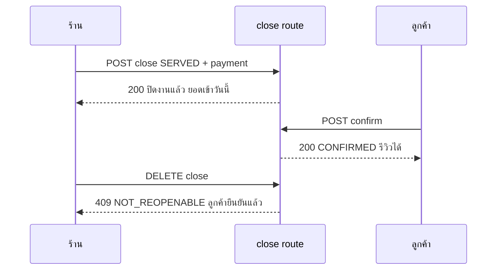

> **โมดูล:** 00073 - Service Four-Step Flow
> **ประเภทเอกสาร:** API Contract
> **เวอร์ชัน:** 1.0
> **วันที่จัดทำ:** 2026-10-11
> **สถานะ:** Draft — ตรงกับโค้ด (ยังไม่ commit)
> **เจ้าของเอกสาร:** SA (ดู [[Feature-Docs-Ownership]])

# API Contract: งานบริการ 4 ขั้น

## 1. Overview
endpoint ใหม่ 1 เส้น (3 เมธอด) + พฤติกรรมใหม่ของเส้นเดิม 4 เส้น — ร้านบริการเท่านั้น

## 2. Authentication
session ผู้ขาย + `requireShopCapability` (00071) · `?shopId=` optional (แชทเปิดเธรดของอีกร้านได้) · ลงทะเบียน `src/lib/route-capabilities.ts`: `close/route.ts → { GET: 'O4', POST: 'O4', DELETE: 'O6' }`

## 3. Endpoint List
| Method | Path | Cap | สถานะ |
|---|---|---|---|
| GET | `/api/orders/[token]/close` | O4 (เงินเฉพาะ O5) | ใหม่ |
| POST | `/api/orders/[token]/close` | O4 (+O5 payment · +O6 คืนมัดจำ) | ใหม่ |
| DELETE | `/api/orders/[token]/close` | O6 | ใหม่ |
| POST | `/api/orders/[token]/appointment/outcome` | O4 | พฤติกรรมเปลี่ยน |
| POST | `/api/orders/[token]/cancel` | O6 / ผู้ซื้อ | ด่านเพิ่ม |
| POST | `/api/orders/[token]/confirm` · `/api/app/orders/[id]/confirm` | ผู้ซื้อ | ด่านเพิ่ม |
| PATCH | `/api/orders/[token]` | O3 | ด่านเพิ่ม |
| POST | `/api/orders/[token]/receipt/buyer` | ผู้ซื้อ (เจ้าของงาน) | ใหม่ (FR-013) |
| GET/PATCH | `/api/shops/current/report-settings` | F1 | ใหม่ (FR-010 เฟส B) |
| GET | `/api/seller/finance-chart` | F1 | ใหม่ (FR-011 เฟส B) |
| POST | `/api/orders/[token]/review` · `/api/app/orders/[id]/review` | ผู้ซื้อ | พฤติกรรมเปลี่ยน (FR-012) |

## 4. Endpoint Detail

### 4.1 `GET /api/orders/[token]/close`
- 200 `{ money: OrderMoney }` (มี O5) · `{ money: null }` (ไม่มี O5) · 404 `SERVICE_JOB_NOT_FOUND`

### 4.2 `POST /api/orders/[token]/close`
Request (`CloseServiceJobSchema`):
```json
{ "outcome": "SERVED", "payment": { "amount": 3000, "method": "CASH", "slipFileId": null, "note": null }, "deposit": "KEEP" }
```
- `outcome`: `SERVED` | `NO_SHOW` · `payment` (optional/null): amount 0.01–99,999,999 · method `TRANSFER`|`CASH`|`OTHER` (default TRANSFER) · ใช้เฉพาะ SERVED · `deposit`: `KEEP` (default) | `REFUND` ใช้เฉพาะ NO_SHOW
- 200 `{ serviceClosedAt, appointmentStatus, money? }` — `money` เฉพาะผู้มี O5
- ด่านที่ route: มี payment แต่ไม่มี O5 → 403 `FORBIDDEN_ROLE` · REFUND แต่ไม่มี O6 → 403

### 4.3 `DELETE /api/orders/[token]/close`
200 `{ serviceClosedAt: null }` · 409 `SERVICE_JOB_NOT_REOPENABLE`

### 4.4 พฤติกรรมเปลี่ยนของเส้นเดิม
- `/appointment/outcome` `{outcome: COMPLETED|NO_SHOW}` = ปิดงาน (SERVED/NO_SHOW เก็บมัดจำ) ไม่มีเงิน · คืน `{ appointmentStatus, serviceClosedAt }`
- `/cancel` งานร้านบริการที่ปิดแล้ว → 409 · เหตุผล `BUYER_NO_SHOW` สำหรับร้านบริการ → 400 `เหตุผลที่เลือกไม่อยู่ในรายการ`
- `/confirm` งานร้านบริการที่ปิดแบบไม่มาตามนัด → 409
- `PATCH /api/orders/[token]` งานที่ปิดแล้ว → 409

### 4.5 `POST /api/orders/[token]/receipt/buyer` (FR-013)
- ไม่มี body · 200 `{ receiptNo, issuedAt }` · 401 ไม่ล็อกอิน · 404 `{ error, code: ORDER_NOT_FOUND }` (ไม่ใช่เจ้าของ/ไม่ใช่ร้านบริการ — หาไม่เจอ ไม่บอกว่ามีอยู่) · 409 `ORDER_NOT_ISSUABLE` "ใบเสร็จจะเปิดได้เมื่อร้านปิดงานและชำระครบแล้ว"

### 4.6 `POST review` (FR-012)
- งานร้านบริการที่ร้านปิดแล้ว (ไม่ใช่ไม่มาตามนัด) + ลูกค้ายังไม่ยืนยัน ⇒ ยืนยันให้ก่อน (`confirmOrder`) แล้วสร้างรีวิว · 201 เหมือนเดิม · ยังไม่ปิด ⇒ 409 "ให้คะแนนได้หลังร้านปิดงานแล้ว" (ร้านอื่นคำเดิม)

### 4.7 `GET/PATCH /api/shops/current/report-settings` (FR-010)
- GET 200 `ReportSettings` (ครบทุกช่อง) · PATCH body = ช่องที่เปลี่ยน (`UpdateReportSettingsSchema` — boolean 6 ช่อง · `chartStyle` STACKED/GROUPED/LINE/AREA · `defaultRange` MONTH/M3/M6/M12/YEAR) → 200 ค่าใหม่ครบทุกช่อง · 400 `VALIDATION_ERROR` · 403 `FORBIDDEN_ROLE` (ไม่ใช่เจ้าของ) / `FEATURE_NOT_AVAILABLE` (ไม่ใช่ร้านบริการ)

### 4.8 `GET /api/seller/finance-chart` (FR-011)
- query `range` (บังคับ) · `year` · `month` (ไม่ส่ง = ปัจจุบัน · เกินปัจจุบันถูกปัดลง) · `advance=1` แนบมัดจำล่วงหน้า
- 200 `{ range, anchor, rangeLabel, buckets[{label, sales, received, outstanding, unrecorded, jobs, cost, expense}], futureFromIndex, totals, hasMissingCost, isCurrent, advance }` · 400 พารามิเตอร์ผิด · 403 ไม่ใช่เจ้าของ · 404 ไม่ใช่ร้านบริการ

## 5. Error Code Table
| code | HTTP | ข้อความ |
|---|---|---|
| `SERVICE_JOB_NOT_FOUND` | 404 | ไม่พบงานนี้ในร้าน |
| `SERVICE_JOB_ALREADY_CLOSED` | 409 | งานนี้ปิดไปแล้ว |
| `SERVICE_JOB_NOT_CLOSABLE` | 409 | งานนี้ถูกยกเลิกหรือยังเป็นร่าง จึงปิดงานไม่ได้ |
| `SERVICE_JOB_NO_SHOW_WITHOUT_APPOINTMENT` | 400 | งานที่ไม่มีนัดบันทึกว่าไม่มาตามนัดไม่ได้ |
| `SERVICE_JOB_NOT_REOPENABLE` | 409 | เปิดงานอีกครั้งได้เฉพาะงานที่ปิดแล้วและลูกค้ายังไม่ยืนยัน |
| `SERVICE_JOB_CLOSED_LOCKED` | 409 | งานนี้ปิดแล้ว — กด "เปิดงานอีกครั้ง" ก่อนถ้าต้องการแก้ไข |
| `SERVICE_JOB_NO_SHOW_CONFIRM` | 409 | ร้านบันทึกว่างานนี้ไม่ได้เข้ารับบริการ จึงยืนยันรับบริการไม่ได้ |
| `APPOINTMENT_NOT_STARTED` | 409 | (เดิม) ยังไม่ถึงเวลานัด |
| `FEATURE_NOT_AVAILABLE` | 403 | (เดิม) ร้านที่ไม่ใช่ร้านบริการ |
| `AMOUNT_INVALID` / `VALIDATION_ERROR` | 400 | ยอดเงินไม่ถูกต้อง |

## 6. Sequence


## 7. Traceability
BRD FR-001..005, FR-009 · SRS TFR-002..004

## 8. สรุป (Summary)
ปิดงาน/เปิดงานอีกครั้งผ่านเส้นเดียว · เส้นเดิมได้ด่านที่ทำให้โปรไฟล์จริงและงานที่ปิดแล้วนิ่ง
