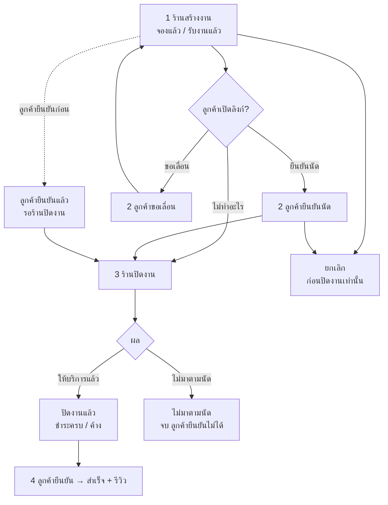
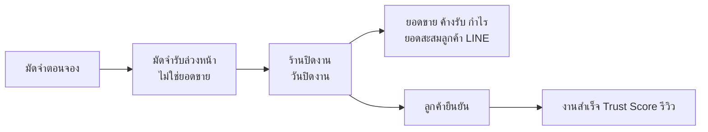

> **โมดูล:** 00073 - Service Four-Step Flow
> **ประเภทเอกสาร:** Business Requirements Document (BRD) - NON-TECHNICAL
> **เวอร์ชัน:** 1.0
> **วันที่จัดทำ:** 2026-10-11
> **สถานะ:** Approved — user อนุมัติ 2026-10-11 (รวมมติ: ร้านสินค้า/ที่พักใช้กติกาปัจจุบันเป็นค่าตั้งต้นถาวร · ทำร้านบริการก่อน)
> **เจ้าของเอกสาร:** BA (ดู [[Feature-Docs-Ownership]])

# BRD: งานบริการ 4 ขั้น + ตั้งค่ารายงานการเงิน (Business Requirements Document)

---

## 1. บทนำ

### 1.1 วัตถุประสงค์ของเอกสาร

เอกสารนี้มีวัตถุประสงค์เพื่อ:
1. กำหนด flow งานบริการ 4 ขั้นและจุดที่เงินถูกนับ
2. กำหนดขอบเขต: เฉพาะร้านบริการ ร้านประเภทอื่นไม่เปลี่ยน
3. กำหนดป้ายสถานะ คำ และสิทธิ์ของแต่ละขั้น
4. ให้ทีมธุรกิจและทีมพัฒนาตรวจรับได้จากเกณฑ์ที่วัดได้

### 1.2 ขอบเขตของระบบ

**งานบริการ 4 ขั้น** คือ วงจรของงานในร้านบริการ ตั้งแต่ร้านสร้างงานจนลูกค้ายืนยันรับบริการ โดยมี "ปิดงาน" เป็นจุดที่ร้านรับรู้รายได้

**เข้าสู่ระบบ (Input):**
- งาน/นัดที่ร้านสร้าง · การกดของลูกค้า (ยืนยันนัด ขอเลื่อน ยืนยันรับบริการ) · การปิดงานของร้าน (ผล + เงิน) · ค่าตั้งค่ารายงานของเจ้าของ

**ออกจากระบบ (Output):**
- ป้ายสถานะชุดเดียว · ยอดขาย/ค้างรับ/มัดจำล่วงหน้า/กำไรขาดทุนตามวันปิดงาน · ยอดสะสมลูกค้า · สถิติสาธารณะ · รายงานกลุ่ม LINE

**ระบบที่เกี่ยวข้อง:**
- ออเดอร์/นัด (OMS) · การชำระบางส่วน (00034) · บทบาทและสิทธิ์ (00071) · รายงาน LINE (00070) · Trust Score · รีวิว · ลิงก์ลูกค้า `/o/{token}`

### 1.3 กลุ่มผู้ใช้งาน

| กลุ่มผู้ใช้ | บทบาท | สิทธิ์การใช้งาน |
|-----------|--------|----------------|
| **เจ้าของร้าน** | OWNER | ทุกอย่าง · ตั้งค่ารายงาน · เห็นเงินเต็ม (F1) |
| **ผู้จัดการ** | MANAGER | ปิดงานครบ (O4+O5) · ยกเลิก (O6) |
| **ช่าง** | TECHNICIAN | ปิดงานส่วนผล (O4) · ไม่เห็นช่องรับเงิน |
| **ฝ่ายบิล** | BILLING | รับเงิน (O5) · ปิดงานไม่ได้ |
| **ลูกค้า** | ผู้ถือลิงก์ + OTP | ยืนยันนัด · ขอเลื่อน · ยืนยันรับบริการ · รีวิว |

---

## 2. ความต้องการหลัก (Functional Requirements)

### 2.1 Flow และการปิดงาน

#### FR-001: ปิดงานกดครั้งเดียว

**User Story:**
> ในฐานะร้านบริการ ฉันต้องการปิดงานในหน้าเดียว (เลือกผล + รับเงินที่เหลือ) เพื่อไม่ต้องกดหลายที่และให้ยอดขึ้นทันที

**Acceptance Criteria:**
- [ ] ปุ่ม "ปิดงาน" อยู่ในหน้างาน และในการ์ดงานของตารางงาน
- [ ] เลือกผลได้ 2 อย่าง: ให้บริการแล้ว / ไม่มาตามนัด
- [ ] ให้บริการแล้ว: แสดงยอดคงเหลือ ช่องรับเงิน (ค่าเริ่มต้น = ยอดคงเหลือ) วิธีรับเงิน · ปิดได้แม้รับไม่ครบ (ค้างรับ)
- [ ] ไม่มาตามนัด: ถ้ามีมัดจำ เลือก เก็บมัดจำ / คืนมัดจำ
- [ ] บันทึกวันเวลาปิดงาน + เหตุการณ์ "ปิดงาน" ในประวัติงาน
- [ ] ผู้ไม่มีสิทธิ์รับเงิน (O5) ไม่เห็นส่วนรับเงิน · ผู้ไม่มีสิทธิ์ลงผล (O4) ไม่เห็นปุ่มปิดงาน
- [ ] ปิดงานที่ยกเลิกแล้ว หรือปิดซ้ำ ไม่ได้

**Business Flow:**
1. ร้านกด ปิดงาน → เลือกผล → (ถ้ามีสิทธิ์) กรอกเงิน → ยืนยัน
2. ระบบบันทึกผล เงิน วันปิดงาน ในครั้งเดียว (สำเร็จทั้งหมดหรือไม่บันทึกเลย)

**Example:**
```
งาน ฿3,500 มัดจำ ฿500 → ปิดงาน "ให้บริการแล้ว" รับ ฿2,000
→ ป้าย "ปิดงานแล้ว · ค้าง ฿1,000" · ยอดขายวันนี้ +฿3,500 · ค้างรับ ฿1,000
```

#### FR-002: ไม่มาตามนัดทางเดียว

**User Story:**
> ในฐานะร้าน ฉันต้องการบันทึกลูกค้าไม่มาผ่านการปิดงาน เพื่อจัดการมัดจำให้ถูก

**Acceptance Criteria:**
- [ ] หน้ายกเลิกของร้านบริการไม่มีเหตุผล "ลูกค้าไม่มา"
- [ ] ไม่มาตามนัด + เก็บมัดจำ → มัดจำเป็นยอดขาย ณ วันปิดงาน · คืน → ยอด ฿0
- [ ] ลูกค้าไม่เห็นปุ่มยืนยันรับบริการเมื่อร้านปิดแบบไม่มาตามนัด และระบบปฏิเสธถ้ายิงตรง

#### FR-003: ลูกค้ายืนยันรับบริการ

**User Story:**
> ในฐานะลูกค้า ฉันต้องการยืนยันว่ารับบริการแล้วและรีวิวได้ทันที

**Acceptance Criteria:**
- [ ] กดได้ทั้งก่อนและหลังร้านปิดงาน (ยกเว้นไม่มาตามนัด / ยกเลิก)
- [ ] กดแล้วเปิดฟอร์มรีวิวทันที
- [ ] ลูกค้ากดก่อนร้านปิด → ร้านเห็น "ลูกค้ายืนยันแล้ว · รอร้านปิดงาน" · ยอดยังไม่เข้า จนร้านปิดงาน
- [ ] งานสำเร็จนับบนหน้าร้านสาธารณะ ตอนลูกค้ายืนยัน (ไม่เปลี่ยน)

#### FR-004: ยกเลิก

**Acceptance Criteria:**
- [ ] ยกเลิกได้เฉพาะก่อนร้านปิดงาน (ทั้งร้านและลูกค้า)
- [ ] ร้านต้องมีสิทธิ์ O6

#### FR-005: ไม่มีขั้น "เริ่มให้บริการแล้ว" และไม่มียืนยันอัตโนมัติ

**Acceptance Criteria:**
- [ ] ร้านบริการไม่มีปุ่ม/การ์ด/ตัวกรอง "เริ่มให้บริการแล้ว"
- [ ] cron ยืนยันอัตโนมัติ 3 ตัว (ส่งถึง+7 วัน · รับที่ร้าน+48 ชม. · COD) ข้ามงานของร้านบริการ
- [ ] ร้านขายของ/ที่พัก cron ทำงานเหมือนเดิม (เทส)

### 2.2 เงินและรายงาน

#### FR-006: เงินภายในนับที่วันปิดงาน

**User Story:**
> ในฐานะเจ้าของร้านบริการ ฉันต้องการเห็นยอดขายทันทีที่ปิดงาน และทุกหน้าตรงกัน

**Acceptance Criteria:**
- [ ] ยอดขาย กำไรขาดทุน ยอดสะสมลูกค้า แดชบอร์ด ชีตการเงิน รายงานแอดมิน Portfolio รายงาน LINE สถิติสินค้า ใช้ "งานที่ปิดแล้ว" และ "วันปิดงาน"
- [ ] มัดจำของงานที่ยังไม่ปิด แสดงเป็น "มัดจำรับล่วงหน้า" ไม่ปนยอดขาย
- [ ] ผลรวมยอดสะสมลูกค้า = ยอดขายช่วงเดียวกัน (ไม่รวมงานยกเลิก)
- [ ] ร้านขายของ/ที่พักได้ตัวเลขเท่าเดิมทุกจอ

#### FR-007: ปิดย้อนหลังครั้งเดียว

**Acceptance Criteria:**
- [ ] งานร้านบริการที่ลูกค้ายืนยันแล้วแต่ไม่มีวันปิด → วันปิด = วันลูกค้ายืนยัน
- [ ] งานร้านบริการที่ร้านกด "ให้บริการแล้ว"/"ไม่มาตามนัด" แล้ว → วันปิด = วันที่ลงผล (ถ้าไม่รู้ ใช้วันแก้ไขล่าสุด)
- [ ] งานร้านบริการที่ค้าง "เริ่มให้บริการแล้ว" → ปิดย้อนหลัง
- [ ] ไม่แตะงานของร้านประเภทอื่น

### 2.3 ป้ายสถานะและคำ

#### FR-008: ป้ายชุดเดียว 10 ป้าย

**Acceptance Criteria:**
- [ ] ทุกจอของร้านบริการ (รายการงาน หน้างาน ตารางงาน ลูกค้า แชท มือถือ) ใช้ป้ายจากที่เดียว ตามตาราง PRD §3.3
- [ ] หน้าลิงก์ลูกค้าใช้คำฝั่งลูกค้าของป้ายเดียวกัน
- [ ] ไม่มีคำของร้านขายของในร้านบริการ · ร้านอื่นคำไม่เปลี่ยน

### 2.4 บัญชีลูกค้า

#### FR-009: ชื่อบัญชีจากงาน

**Acceptance Criteria:**
- [ ] ลูกค้าเบอร์ใหม่เข้าด้วย OTP จากลิงก์งาน → บัญชีใหม่ใช้ชื่อลูกค้าในงาน · ไม่มีชื่อ → `User_xxxx` เหมือนเดิม
- [ ] บัญชีที่มีอยู่แล้วไม่ถูกเปลี่ยนชื่อ

### 2.4.1 หลังร้านปิดงาน (มติ user 2026-10-11 รอบ 2)

#### FR-012: ส่งคะแนน = ยืนยันรับบริการ

**User Story:**
> ในฐานะลูกค้า เมื่อร้านปิดงานแล้ว ฉันต้องการให้คะแนนได้ทันทีในครั้งเดียว

**Acceptance Criteria:**
- [ ] ร้านปิดงาน (ให้บริการแล้ว) + ลูกค้ายังไม่ยืนยัน + ยังไม่รีวิว ⇒ ปุ่มหลัก "ให้คะแนนบริการ" เปิดแผ่นให้คะแนน
- [ ] ส่งคะแนนสำเร็จ ⇒ งานเป็น "ลูกค้ายืนยันแล้ว" (CONFIRMED) + มีรีวิว · บันทึกเหตุการณ์ยืนยันเหมือนกดยืนยันเอง
- [ ] มีทาง "ยืนยันรับบริการโดยไม่ให้คะแนน" (ผ่านกล่องยืนยันเดิม)
- [ ] ไม่มาตามนัด / ยกเลิก / ยังไม่ปิดงาน ⇒ ส่งคะแนนไม่ได้ (เหมือนเดิม: ต้องยืนยันก่อน)
- [ ] [blocker] ร้านขายของ/ที่พัก: รีวิวได้หลังยืนยันเท่านั้นเหมือนเดิม

#### FR-013: ลูกค้าดูใบเสร็จเอง

**Acceptance Criteria:**
- [ ] ปุ่ม "ดูใบเสร็จ" ขึ้นในหน้างานของลูกค้าเมื่อ: ร้านบริการ · ปิดงานแล้ว · ไม่ใช่ไม่มาตามนัด · ไม่ยกเลิก/คืน · ค้างชำระ = 0
- [ ] กดแล้วได้ใบเดียวกับฝั่งร้าน (เลขเดียวกัน) · ร้านยังไม่เคยออก ⇒ ระบบออกเลขให้ตอนลูกค้ากด
- [ ] เฉพาะลูกค้าเจ้าของงานที่เข้าสู่ระบบ · คนอื่น/ไม่ล็อกอินเปิดไม่ได้
- [ ] ฝั่งร้านไม่เปลี่ยน (ใครกดได้ + สถานะที่ออกได้ ตาม 00065)

### 2.5 ตั้งค่ารายงาน (เฟส B — ลงโค้ดแล้ว 2026-10-12 · ดู SRS TFR-010/011)

#### FR-010: หน้าตั้งค่ารายงาน

**Acceptance Criteria:**
- [ ] เมนู ตั้งค่า › รายงาน เห็นเฉพาะเจ้าของร้านบริการ
- [ ] สวิตช์ตาม PRD §3.6 · ค่าเริ่มต้น = เหมือนวันนี้ (มัดจำล่วงหน้าปิด)
- [ ] ทุกจอการเงินของร้านอ่านค่านี้ · รายงานกลุ่ม LINE ไม่อ่าน

#### FR-010a: ตัวเลขหลักบนการ์ด (มติ user 2026-10-12)

**Acceptance Criteria:**
- [ ] ตัวเลือก ยอดขาย (ค่าเริ่มต้น = เหมือนเดิม) · รับเงินแล้ว · กำไรสุทธิ — ตัวที่สวิตช์ต้นทางปิดอยู่เลือกไม่ได้ และถ้าภายหลังปิดสวิตช์ ⇒ ถอยเป็นยอดขาย
- [ ] การ์ดยอดขายหน้าแรก (มือถือ) และการ์ดยอดขายภาพรวมร้าน (คอม) แสดงตัวเลขที่เลือก พร้อมป้ายบอกว่าเป็นตัวไหน (ยกเว้นยอดขาย = หน้าตาเดิม)
- [ ] รับเงินแล้ว = เงินที่รับของงานที่ปิดในช่วงนั้น (นิยามเดียวกับกราฟ) · กำไรสุทธิ = getPnlReport ของช่วงเดียวกัน หักตามสวิตช์ (ป้าย "หักไม่ครบ" เมื่อปิดต้นทุน/ค่าใช้จ่าย)
- [ ] ไม่มี % เทียบช่วงก่อนสำหรับรับเงินแล้ว/กำไรสุทธิ (ไม่มีฐานเทียบชุดเดียวกัน)
- [ ] เลือกกำไรสุทธิ ⇒ ชีตการเงินมือถือเปิดที่แท็บกำไรขาดทุน

#### FR-011: กราฟ 3 แท็บ

**Acceptance Criteria:**
- [ ] แท็บยอดขาย: แท่งเดียว รับแล้ว+ค้างรับ · กดแท่งเห็นยอดสองส่วน · ยอดรวม + แถบสัดส่วน
- [ ] แท็บค่าใช้จ่าย: ค่าใช้จ่ายร้าน + ต้นทุนอะไหล่
- [ ] แท็บสรุป: ยอดขายเทียบค่าใช้จ่าย + ส่วนต่าง

---

## 3. Acceptance Criteria สรุป

### 3.1 ร้านบริการ

**เมื่อระบบทำงานถูกต้อง:**
- ✅ ปิดงานแล้วยอดขาย/ยอดสะสมลูกค้าขึ้นทันทีด้วยวันปิดงาน
- ✅ ทุกจอแสดงป้ายชุดเดียวกัน คำของงานบริการ
- ✅ ช่องโหว่ 3 จุดปิดแล้ว (ยืนยันงานไม่มา · ยกเลิกหลังปิด · ลงผลงานยกเลิก)
- ✅ ร้านปิดงานแล้ว ลูกค้าให้คะแนน (= ยืนยัน) และดูใบเสร็จเองได้ (เมื่อชำระครบ)

### 3.2 ร้านประเภทอื่น

**เมื่อร้านเป็นร้านขายของหรือที่พัก:**
- ✅ ตัวเลข สถานะ คำ cron เหมือนก่อนแก้ทุกอย่าง

---

## 4. Business Flows (กระบวนการทำงาน)

### 4.1 Flow หลัก: งานบริการ 4 ขั้น



### 4.2 เงินนับตอนไหน



---

## 5. Use Case Scenarios (สถานการณ์การใช้งานจริง)

### Scenario 1: นัดปกติ ลูกค้ายืนยันครบ

**ผู้เกี่ยวข้อง:** เจ้าของร้าน · ลูกค้า

**เงื่อนไขเริ่มต้น:**
- งาน ฿3,500 มัดจำ ฿500

**ขั้นตอน:**
1. ลูกค้ายืนยันนัด
2. ร้านปิดงาน ให้บริการแล้ว รับ ฿3,000
3. ลูกค้ายืนยันรับบริการ รีวิว 5 ดาว

**ผลลัพธ์:**
- ยอดขาย ฿3,500 ณ วันปิดงาน · ยอดสะสมลูกค้า ฿3,500 · สำเร็จ · งานสำเร็จสาธารณะ +1

### Scenario 2: ลูกค้าไม่มา เก็บมัดจำ

**ผู้เกี่ยวข้อง:** ผู้จัดการร้าน

**เงื่อนไขเริ่มต้น:**
- งาน ฿2,000 มัดจำ ฿300

**ขั้นตอน:**
1. ร้านปิดงาน → ไม่มาตามนัด → เก็บมัดจำ

**ผลลัพธ์:**
- ป้าย "ไม่มาตามนัด" · ยอดขาย ฿300 · ลูกค้ากดยืนยันรับบริการไม่ได้

### Scenario 3: ลูกค้ากดก่อน

**ผู้เกี่ยวข้อง:** ลูกค้า · ช่าง

**ขั้นตอน:**
1. ลูกค้าเบอร์ใหม่เปิดลิงก์ → OTP → ได้บัญชีชื่อตามงาน → ยืนยันรับบริการ → รีวิว
2. ร้านเห็น "ลูกค้ายืนยันแล้ว · รอร้านปิดงาน"
3. ช่างกดปิดงาน (ไม่เห็นช่องรับเงิน) → เจ้าของรับเงินภายหลัง

**ผลลัพธ์:**
- ยอดขายเข้า ณ วันที่ช่างปิดงาน · ค้างรับจนเจ้าของรับเงิน

### Scenario 4: ร้านขายของออนไลน์

**ผลลัพธ์:**
- ไม่มีอะไรเปลี่ยน — ยอดขายยังนับตามกติกาเดิม cron ยืนยันอัตโนมัติยังทำงาน

---

## 6. ความต้องการด้านคุณภาพ (Quality Requirements)

### 6.1 ความถูกต้องของข้อมูล
- ปิดงาน = ผล + เงิน + วันปิด บันทึกพร้อมกันใน transaction เดียว
- นิยามยอดขายร้านบริการอยู่ที่เดียวและทุกจอเรียกใช้

### 6.2 ความรวดเร็ว
- การแยก vertical ตัดสินครั้งเดียวต่อคำขอ ไม่ query เพิ่มต่อแถว · รายงานใช้ index บนวันปิดงาน

### 6.3 ความน่าเชื่อถือ
- migration เพิ่มอย่างเดียว · ปิดย้อนหลังรันซ้ำได้ไม่ซ้ำผล

### 6.4 ความปลอดภัย
- ตรวจสิทธิ์ O4/O5/O6/F1 ฝั่ง server ทุก endpoint
- ลูกค้ายืนยันได้เฉพาะงานของเบอร์ตัวเองหลัง OTP

### 6.5 ความสะดวกในการใช้งาน (Usability)
- ปิดงานจากมือถือได้ใน 3 แตะ · คำตรงกับงานบริการทุกจอ

---

## 7. ข้อจำกัด (Constraints)

### 7.1 ข้อจำกัดทางธุรกิจ
- ห้าม deploy ระหว่างแอป iOS รอรีวิว · โค้ดอยู่ใน branch จนผ่าน review
- ส่วน `(paces)/**` แจ้งหัวหน้าก่อน merge

### 7.2 ข้อจำกัดทางเทคนิค
- `Expense` ไม่มีสถานะจ่าย — ไม่ทำค้างจ่าย
- `OrderEvent.type` มี CHECK constraint — เพิ่มประเภทต้องผ่าน migration

---

## 8. กฎทางธุรกิจ (Business Rules)

### 8.1 กฎการปิดงาน
- ปิดได้ครั้งเดียว · ไม่ได้ถ้ายกเลิกแล้ว · ปิดแล้วยกเลิกไม่ได้
- ปิดได้ทั้งที่ค้างเงิน

### 8.2 กฎการนับเงิน
- ยอดขายร้านบริการ = งานที่ปิดแล้ว (ให้บริการแล้ว = ยอดเต็ม · ไม่มาตามนัด = มัดจำที่เก็บ) ณ วันปิดงาน
- สถิติสาธารณะนับเฉพาะลูกค้ายืนยัน

### 8.3 กฎการแยก vertical
- ทุกกิ่งใหม่ผ่านฟังก์ชันตัดสินใน `src/lib` · ห้ามเขียนเทียบ vertical ตรง ๆ ในหน้า
- คำทุกคำของร้านบริการมาจากชุดคำของร้านบริการ

---

## 9. อภิธานศัพท์ (Glossary)

| คำศัพท์ | ความหมาย |
|---------|----------|
| **ปิดงาน** | ร้านลงผล + รับเงินที่เหลือ กดครั้งเดียว |
| **วันปิดงาน** | วันที่ของยอดขายร้านบริการ |
| **มัดจำรับล่วงหน้า** | มัดจำของงานที่ยังไม่ปิด |
| **ค้างรับ** | ยอดงานที่ปิดแล้วที่ยังไม่ได้รับเงิน |

---

## 10. สรุป

เอกสาร BRD นี้อธิบายความต้องการหลักของ **งานบริการ 4 ขั้น** แบบไม่ใช่เทคนิค

**จุดเด่นของระบบ:**
- ปิดงานกดครั้งเดียว · ยอดขึ้นทันที · ป้ายชุดเดียว คำของงานบริการ · ลูกค้าเข้า OTP แล้วกดได้เลย

**ผลลัพธ์ที่คาดหวัง:**
- ยอดสะสม ฿0 ที่ผิดหายไป · ตัวเลขทุกจอตรงกัน · ร้านประเภทอื่นไม่ได้รับผลกระทบ

---

### 2.6 ภาคต่อ 2026-10-12 (user อนุมัติ)

#### FR-014: ยอด "ยังไม่ปิดงาน" (สีเหลือง)
- ร้านบริการเท่านั้น · แสดงผลอย่างเดียว — ไม่แก้ข้อมูล ไม่เปลี่ยนนิยามยอดขาย (ยังนับตอนปิดงาน)
- นิยาม: งานที่ `serviceClosedAt` ว่าง และสถานะไม่ใช่ ยกเลิก/ร่าง/คืน · วันที่ = วันเปิดบิล (createdAt)
- AC-014-1 การ์ดมือถือ: ตัวเลขใหญ่ = ปิดงานแล้ว + ยังไม่ปิดงาน · แท่งซ้อนเขียว/เหลือง · legend "ปิดงานแล้ว" + "ยังไม่ปิดงาน" · % เทียบเดือนก่อน/ค่าเฉลี่ย 14 วัน ใช้ยอดรวมแบบเดียวกัน
- AC-014-2 การ์ด "รายได้" (คอม) = ตัวเลขเดียวกับการ์ดมือถือของช่วงเดียวกัน
- AC-014-3 ชีตมือถือ (แท็บยอดเก็บเงิน) + /sales: "ยังไม่ปิดงาน ฿X · N งาน" พร้อมคำอธิบาย "ยังไม่นับเป็นยอดขาย — นับเมื่อกดปิดงาน" · ยอดขาย/รับจริง/ค้างรับ/กราฟการเงินเดิมไม่เปลี่ยน
- AC-014-4 ร้านขายสินค้า/ที่พัก ไม่เปลี่ยนแม้แต่จุดเดียว · รายงาน LINE ไม่เปลี่ยน

#### FR-015: ทางเข้าตั้งค่ารายงานบนมือถือ
- แท็บ ร้านค้า มีแถว "ตั้งค่ารายงาน" (คำเดียวกับเมนูคอม) · เห็นตามเมนูจริง (เจ้าของร้านบริการ)

#### FR-016: ตั้งค่างานที่ยังไม่ปิด + สีตัวกลาง + รายงาน LINE (ภาคต่อ 2 · user อนุมัติ 2026-10-12)
- AC-016-1 ตั้งค่า `unclosedDisplay` = OFF / CARD (ค่าตั้งต้น) / ALL · ร้านอื่นค่าตั้งต้นเสมอ
- AC-016-2 OFF: การ์ด/คอมไม่มีเหลือง (= งานปิดแล้ว) · ไม่มีแถว/การ์ดสรุป · CARD: เหมือนหลัง #156 · ALL: + ก้อนเหลืองในกราฟชีต/กราฟการเงิน + คอลัมน์ "ยังไม่ปิด" ในตารางชีต//sales (ไม่บวกในยอดขาย)
- AC-016-3 สีจากตัวกลางเดียว: เหลือง = ยังไม่ปิด/ยังไม่นับ เท่านั้น · ค้างรับ = ฟ้า · ตัวเลขที่ไม่ใช่สถานะเงิน = เทา · LINE ใช้เหลืองค่าเดียวกัน (ข้อความกลุ่มร้านขายของเหมือนเดิมทุกไบต์)
- AC-016-4 รายงาน LINE: กลุ่มร้านบริการมีบรรทัด "ยังไม่ปิดงาน ฿X" เมื่อ > 0 · ร้านขายของไม่มี — 🛑 **ถอนแล้ว 2026-10-14 (user):** รายงานกลุ่ม LINE ของร้านบริการไม่รอปิดงานแล้ว นับยอดแบบร้านทั่วไป (ทุกใบที่ไม่ยกเลิก ตามวันเปิดบิล · ยืนยันแล้ว + รอยืนยัน · ป้ายเหลือง "รอยืนยัน") — `line-report-summary.service` เรียก `getSalesSeries` โดยไม่ส่ง vertical · หน้าในแอปยังนับตามวันปิดงานเหมือนเดิม
- AC-016-5 ร้านขายสินค้า: ทุกจอเหมือนเดิม (ข้อความ + พิกเซล)
