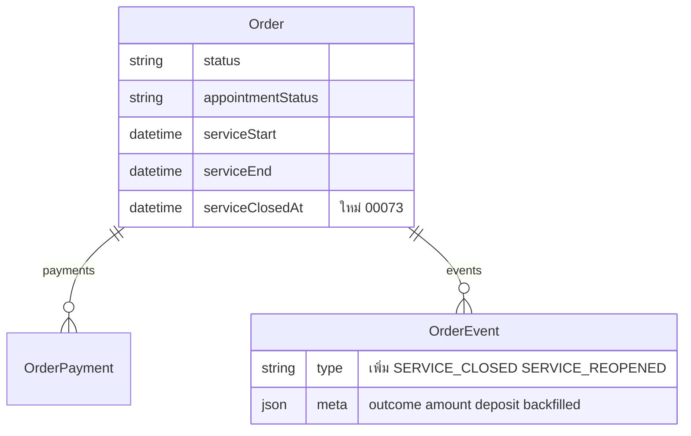

> **โมดูล:** 00073 - Service Four-Step Flow
> **ประเภทเอกสาร:** DATABASE Design
> **เวอร์ชัน:** 1.0
> **วันที่จัดทำ:** 2026-10-11
> **สถานะ:** Draft — migration ทดสอบบนฐาน local 5434 แล้ว (ยังไม่ commit)
> **เจ้าของเอกสาร:** SA (ดู [[Feature-Docs-Ownership]])

# DATABASE: งานบริการ 4 ขั้น

## 1. Overview
เพิ่มอย่างเดียว (additive): 1 คอลัมน์ · 1 index · 2 ค่าใน CHECK ของ `OrderEvent.type` · ปิดงานย้อนหลังครั้งเดียวสำหรับร้านบริการ

## 2. ERD

## 3. Tables

### 3.1 `Order` (Postgres)
| คอลัมน์ | ชนิด | หมายเหตุ |
|---|---|---|
| `serviceClosedAt` | `TIMESTAMPTZ(3)` NULL | ร้านบริการปิดงานเมื่อไร · วันที่ของยอดขายร้านบริการ · ร้านอื่น NULL เสมอ |

### 3.2 `OrderEvent.type` (CHECK `OrderEvent_type_check`)
เพิ่ม `SERVICE_CLOSED` · `SERVICE_REOPENED` (รวม 27 ค่า)

### 3.3 `Shop.reportSettings` (เฟส B)
| คอลัมน์ | ชนิด | หมายเหตุ |
|---|---|---|
| `reportSettings` | `JSONB` NULL | ตั้งค่ารายงานการเงินของร้านบริการ · NULL = ค่าตั้งต้น · โครงสร้าง/การอ่าน `src/lib/report-settings.ts` · migration `20261012090000_shop_report_settings` (ADD COLUMN IF NOT EXISTS · ไม่มี backfill) · เก็บบนแถวร้านเพราะ layout โหลดแถวนี้อยู่แล้ว ⇒ เมนูอ่านได้ไม่เพิ่ม query |

## 4. Indexes
| ชื่อ | คอลัมน์ | ใช้กับ |
|---|---|---|
| `Order_shopId_serviceClosedAt_idx` | `(shopId, serviceClosedAt)` | ยอดขาย/ค้างรับ/ชีตของร้านบริการตามวันปิดงาน |

## 5. Migration Plan

### 5.1 ลำดับการ Migrate
ไฟล์ `prisma/migrations/20261011120000_service_closed_at/migration.sql`
1. `ADD COLUMN IF NOT EXISTS` + `CREATE INDEX IF NOT EXISTS`
2. CHECK แบบ additive (อ่านของเดิมจาก `pg_constraint` · ด่านนับ quote) — `docs/conventions/migration-check-constraint-additive.md`
3. ปิดย้อนหลัง **เฉพาะร้าน `vertical='SERVICE_QUEUE'`** และ `serviceClosedAt IS NULL` และไม่ใช่ CANCELLED/DRAFTED:
   - a) ลงผลนัดแล้ว (`COMPLETED`/`NO_SHOW`) → `serviceEnd` (ไม่มี → `updatedAt` — ทุกแถวที่ลงผลแล้วต้องได้วันปิด ไม่งั้นป้าย "ปิดงานแล้ว" กับยอดขายไม่ตรงกัน)
   - b) `status=CONFIRMED` → เวลา event `BUYER_CONFIRMED`/`SYSTEM_CONFIRMED` แรก (ไม่มี → `updatedAt`)
   - b2) `CONFIRMED` ที่สถานะนัดยังค้าง (`SCHEDULED`/`CONFIRMED_BY_BUYER`/`RESCHEDULE_REQUESTED`) → `appointmentStatus='COMPLETED'`
   - c) `status=SHIPPED` (ข้อมูลเก่า) → เวลา `TRACKING_ADDED` (ไม่มี → `updatedAt`)
   - d) INSERT event `SERVICE_CLOSED` `meta.backfilled=true` ให้งานที่ปิดแล้วแต่ยังไม่มี event
4. ทุกขั้นรันซ้ำได้ (ทดสอบรันซ้ำแล้ว — event ไม่ซ้ำ)

**ผลบนฐาน local (2026-10-11):** ร้านบริการ 30 งานถูกปิดย้อนหลัง · ร้านขายของ hash ของทุกแถว `Order` (ไม่นับคอลัมน์ใหม่) ก่อน/หลัง **เท่ากัน** · `OrderEvent` ของร้านขายของ 942 แถว ก่อน/หลังเท่ากัน

### 5.2 Rollback
ไม่ต้อง DROP — คอลัมน์ nullable ที่ร้านอื่นไม่อ่าน · ถอยโค้ดแล้วคอลัมน์อยู่เฉย ๆ ได้ · event ค่าใหม่อยู่ใน CHECK ได้ไม่กระทบ

### 5.3 ผลกระทบ (Impact)
- ยอดขายร้านบริการย้อนหลังขยับ (งานที่ร้านลงผลแล้วแต่ลูกค้าไม่ยืนยันเข้ายอด ณ เวลาจบนัด) — ตั้งใจ
- push main = migrate prod อัตโนมัติ (HR15) · local ต้อง `prisma migrate deploy` เอง (ปักหมุด localhost)

## 6. Retention / ข้อควรระวัง
- ห้าม `prisma db pull`/`migrate dev` (CHECK เป็น unmanaged)
- ข้อมูลเก่า: วันปิด = `serviceEnd` เป็นค่าประมาณที่ดีที่สุด (เดิมไม่มี event ลงผล)

## 7. Traceability
PRD §3.2 มติ 5 · BRD FR-007 · SRS TFR-001

## 8. สรุป (Summary)
คอลัมน์เดียว + index + 2 event type · ปิดย้อนหลังแตะเฉพาะร้านบริการ พิสูจน์แล้วว่าร้านอื่นไม่ถูกแตะ
