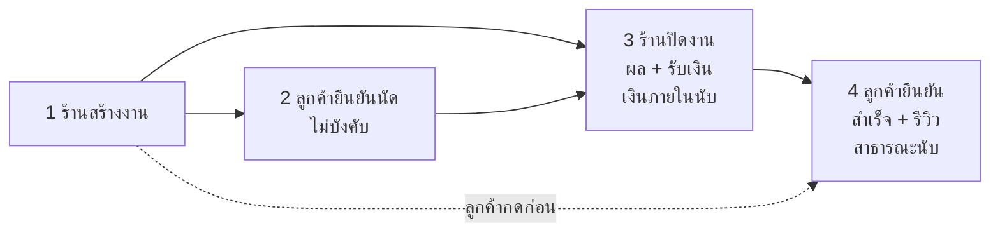

> **โมดูล:** 00073 - Service Four-Step Flow
> **ประเภทเอกสาร:** Product Requirements Document (PRD)
> **เวอร์ชัน:** 1.0
> **วันที่จัดทำ:** 2026-10-11
> **สถานะ:** Approved — user อนุมัติ 2026-10-11 (รวมมติ: ร้านสินค้า/ที่พักใช้กติกาปัจจุบันเป็นค่าตั้งต้นถาวร · ทำร้านบริการก่อน)
> **เจ้าของเอกสาร:** BA + PO + PM (ดู [[Feature-Docs-Ownership]])
>
> ที่มา: spec `docs/superpowers/specs/2026-10-11-service-four-step-flow-spec.md` · ดีไซน์ + ภาพเทียบของจริง https://claude.ai/artifact/UKPrPYKWbJB8ScX4USBEdR (ส่วนตัว)

# PRD: งานบริการ 4 ขั้น + ตั้งค่ารายงานการเงิน (เฉพาะร้านบริการ)

---

## Executive Summary

ร้านบริการ (vertical `SERVICE_QUEUE` — ร้านซ่อม ร้านทำผม คลินิก ฯลฯ) วันนี้นับเงินทุกตัว (ยอดขาย กำไรขาดทุน ยอดสะสมลูกค้า รายงาน LINE) ตอน **ลูกค้ากดยืนยันรับบริการ** เท่านั้น แต่ลูกค้าบริการส่วนใหญ่ไม่เคยกด ร้านจึงเห็นยอดสะสมลูกค้า ฿0 ทั้งที่รับเงินไปแล้ว และตัวเลขแต่ละหน้าไม่ตรงกัน นอกจากนี้ร้านต้องกด "ผลนัด" กับ "รับเงิน" แยกคนละที่ ป้ายสถานะมี 4 ชุดที่ใช้คำไม่ตรงกันระหว่างหน้าร้านกับหน้าลูกค้า และยังมีขั้น "เริ่มให้บริการแล้ว" ที่ยืมมาจากร้านขายของ (จัดส่ง)

ฟีเจอร์นี้วางงานบริการเป็น **4 ขั้นชุดเดียว** — ร้านสร้างงาน → ลูกค้ายืนยันนัด (ไม่บังคับ) → **ร้านปิดงานกดครั้งเดียว** (ผล + รับเงินที่เหลือ) → ลูกค้ายืนยันรับบริการและรีวิว — โดย **เงินภายในร้านนับที่ขั้น 3 (ร้านปิดงาน)** และ **หน้าร้านสาธารณะนับที่ขั้น 4 (ลูกค้ายืนยัน)** พร้อมหน้าตั้งค่ารายงานให้เจ้าของเลือกว่าจะเห็นตัวเลขอะไร แบบกราฟไหน · **ร้านขายของออนไลน์และที่พักไม่เปลี่ยนแม้แต่คำเดียว**

---

## 1. Business Goals & KPIs

### 1.1 เป้าหมายทางธุรกิจ

| เป้าหมาย | รายละเอียด |
|----------|-----------|
| **ตัวเลขเงินตรงกับความจริงของร้าน** | ยอดขาย/ยอดสะสมขึ้นทันทีที่ร้านปิดงาน ไม่ต้องรอลูกค้ากด · ทุกหน้าใช้นิยามเดียวกัน (Hard Rule 16) |
| **ปิดงานจบในที่เดียว** | ร้านกด "ปิดงาน" ครั้งเดียว = ลงผล + รับเงินที่เหลือ + บันทึกเวลา |
| **สถานะชุดเดียว คำของงานบริการ** | ป้ายสถานะชุดเดียวทั้งหน้าร้าน ตารางงาน ลูกค้า แชท และหน้าลิงก์ลูกค้า ใช้คำ งาน/นัด/ปิดงาน/รับบริการ |
| **ความน่าเชื่อถือสาธารณะยังมาจากลูกค้า** | งานสำเร็จ Trust Score และรีวิวยังนับเฉพาะที่ลูกค้ายืนยัน — ร้านปั่นเองไม่ได้ |
| **เจ้าของเลือกมุมมองรายงานได้** | เปิด/ปิดตัวเลข เลือกแบบกราฟ โดยไม่เปลี่ยนวิธีนับเงิน |

### 1.2 ตัวชี้วัดความสำเร็จ (KPIs)

| KPI | คำอธิบาย | เป้าหมาย |
|-----|----------|---------|
| **ลูกค้าที่ยอดสะสม ฿0 ทั้งที่มีงานปิดแล้ว** | นับลูกค้าของร้านบริการที่มีงานปิดแล้วแต่ยอดสะสม = 0 | 0 ราย |
| **ยอดขายตรงกันข้ามหน้า** | แดชบอร์ด = การเงินร้าน = รายงาน LINE = ผลรวมยอดสะสมลูกค้า (ช่วงเดียวกัน) | ต่างกัน ฿0 |
| **งานที่ปิดภายในวันนัด** | งานที่ `วันปิดงาน − วันนัด ≤ 1 วัน` | ≥ 80% หลังใช้ 1 เดือน |
| **ร้านประเภทอื่นได้รับผลกระทบ** | ตัวเลข/สถานะ/cron ของร้านขายของและที่พักก่อน-หลัง | ไม่เปลี่ยนเลย (เทสทั้งสองฝั่ง) |

---

## 2. User Personas (กลุ่มผู้ใช้งาน)

### 2.1 เจ้าของร้านบริการ (OWNER)

**ข้อมูลพื้นฐาน:**
- เปิดร้านซ่อม/ทำผม/คลินิก มีนัดวันละหลายงาน ใช้มือถือเป็นหลัก

**เป้าหมาย:**
- รู้ยอดขาย ค้างรับ และกำไรจริงของวันนี้/เดือนนี้

**ความต้องการ:**
- ตัวเลขขึ้นทันทีที่ปิดงาน · เลือกได้ว่าจะดูตัวเลขอะไร · กราฟรับแล้ว+ค้างรับในแท่งเดียว

**จุดปวด (Pain Points):**
- ยอดสะสมลูกค้า ฿0 · ตัวเลขแต่ละหน้าไม่ตรงกัน · ต้องกดหลายที่กว่าจะจบงาน

### 2.2 ทีมงานร้าน (MANAGER / BILLING / TECHNICIAN / CHAT — 00071)

**ข้อมูลพื้นฐาน:**
- ช่างลงผลงาน (O4) · ฝ่ายบิลรับเงิน (O5) · ผู้จัดการทำได้ทั้งสอง

**เป้าหมาย:**
- ปิดงานให้เร็ว ไม่ต้องรู้ตัวเลขการเงินรวมของร้าน

**ความต้องการ:**
- ฟอร์มปิดงานแสดงเฉพาะส่วนที่ตัวเองมีสิทธิ์

**จุดปวด (Pain Points):**
- ปุ่มผลนัดกับรับเงินอยู่คนละที่ · คำสถานะสับสน ("ยืนยันแล้ว" ใครยืนยัน?)

### 2.3 ลูกค้าของร้านบริการ

**ข้อมูลพื้นฐาน:**
- ได้รับลิงก์งานทาง LINE/SMS · ส่วนใหญ่ยังไม่มีบัญชี Deep

**เป้าหมาย:**
- ยืนยันนัด/ขอเลื่อน · ยืนยันว่ารับบริการแล้วและรีวิว

**ความต้องการ:**
- เข้าด้วย OTP ครั้งเดียวแล้วกดได้เลย ไม่ต้องสมัครแยก

**จุดปวด (Pain Points):**
- หน้าลิงก์ใช้คำต่างจากที่ร้านพูด · ยืนยันงานที่ตัวเองไม่ได้มาได้

---

## 3. Business Requirements

### 3.1 Flow 4 ขั้น

**ความต้องการ:**
- ขั้น 1 ร้านสร้างงาน/จองนัด (หรือ walk-in) แล้วส่งลิงก์ให้ลูกค้า
- ขั้น 2 ลูกค้ายืนยันนัดหรือขอเลื่อน (ไม่บังคับ)
- ขั้น 3 ร้าน **ปิดงาน** กดครั้งเดียว: เลือกผล (ให้บริการแล้ว / ไม่มาตามนัด) + บันทึกเงินที่เหลือ (ถ้ามีสิทธิ์รับเงิน) — ระบบบันทึกวันเวลาปิดงาน
- ขั้น 4 ลูกค้ายืนยันรับบริการ = งานสำเร็จ → รีวิวได้ทันที · ลูกค้ากดขั้น 4 ได้เลยโดยข้ามขั้น 2–3

**Business Rules:**
- ร้านบริการไม่มีขั้น "เริ่มให้บริการแล้ว" (ตัดออก)
- ไม่มาตามนัด ทำได้ทางเดียวคือ ปิดงาน → ไม่มาตามนัด (เก็บหรือคืนมัดจำ) · ไม่ใช้ "ยกเลิก + เหตุผลลูกค้าไม่มา" ในร้านบริการ
- งานที่ปิดแบบไม่มาตามนัด ลูกค้ากดยืนยันรับบริการไม่ได้
- งานที่ร้านปิดแล้ว ยกเลิกไม่ได้ (ทั้งร้านและลูกค้า)
- ปิดงาน/ลงผลกับงานที่ยกเลิกแล้วไม่ได้
- งานบริการจบเป็น "สำเร็จ" ได้จากลูกค้ากดเองเท่านั้น — ไม่มีการยืนยันอัตโนมัติ (ส่งถึง+7 วัน · รับที่ร้าน+48 ชม. · COD จากขนส่ง ไม่ใช้กับร้านบริการ)
- ลูกค้าขอเลื่อน → อยู่ในขั้น 2 จนร้านเลือกเวลาใหม่ แล้วกลับเป็น "จองแล้ว"
- walk-in ข้ามจากขั้น 1 ไปปิดงานได้ทันที

**เหตุผล:**
- ร้านคือคนที่รู้ว่างานเสร็จและเงินเข้าแล้ว ส่วนลูกค้าคือคนรับรองต่อสาธารณะ — แยกสองบทบาทให้ชัด

### 3.2 เงินนับตอนไหน

**ความต้องการ:**
- เงินภายในร้านทุกจอนับที่ขั้น 3 และใช้ **วันปิดงาน** เป็นวันที่ของยอด: การ์ดยอดขาย/ภาพรวม · การเงินร้าน (ยอดเก็บเงิน กำไรขาดทุน) · ชีตการเงินมือถือ · ยอดสะสมลูกค้า · รายงานแอดมิน/ตอบแชท · Portfolio หลายธุรกิจ · รายงานกลุ่ม LINE · สถิติสินค้า/หมวด
- หน้าร้านสาธารณะนับที่ขั้น 4 (งานสำเร็จ · อัตราสำเร็จ · Trust Score · รีวิว) — ไม่เปลี่ยน

**Business Rules:**
- มัดจำที่รับตอนจองนับเข้ายอดขาย **ทั้งก้อนตอนปิดงาน** · ก่อนปิดแสดงแยกเป็น "มัดจำรับล่วงหน้า" ไม่ปนยอดขาย
- ปิดแบบไม่มาตามนัด + เก็บมัดจำ → มัดจำที่เก็บเป็นยอดขาย ณ วันปิดงาน · คืนมัดจำ → ไม่มียอด
- ปิดงานทั้งที่ยังค้างเงินได้ (ตามกติกาเดิม `ALLOW_COMPLETE_WITH_OUTSTANDING`) → ยอดขายเต็ม · ส่วนที่ยังไม่รับเป็น "ค้างรับ"
- งานเก่าที่ลูกค้ายืนยันแล้วแต่ร้านไม่เคยปิด → ปิดย้อนหลังอัตโนมัติครั้งเดียว วันปิด = วันลูกค้ายืนยัน · งานเก่าที่ค้างใน "เริ่มให้บริการแล้ว" → ปิดย้อนหลัง วันปิด = วันที่เปลี่ยนเป็นสถานะนั้น

**เหตุผล:**
- ทำให้ยอดสะสมลูกค้า ฿0 หายไป และทุกหน้าได้ตัวเลขเดียวกัน

### 3.3 ป้ายสถานะชุดเดียว (10 ป้าย) และคำของงานบริการ

**ความต้องการ:**
- ใช้ป้ายชุดเดียวทุกจอของร้านบริการ (ฝั่งร้านและฝั่งลูกค้าใช้คำคู่กันที่สื่อความเดียวกัน)

**สถานะที่ต้องรองรับ:**

| ป้าย (ร้าน) | ป้าย (ลูกค้า) | ขั้น | เกิดเมื่อ |
|---|---|---|---|
| **จองแล้ว** | จองบริการแล้ว | 1 | ร้านสร้างงานที่มีนัด |
| **รับงานแล้ว** | รับงานแล้ว | 1 | walk-in (ไม่มีนัด) |
| **ลูกค้าขอเลื่อน** | ขอเลื่อนนัดแล้ว | 2 | ลูกค้ากดขอเลื่อน |
| **ลูกค้ายืนยันนัด** | ยืนยันนัดแล้ว | 2 | ลูกค้ากดยืนยันนัด |
| **ปิดงานแล้ว · ชำระครบ** | ร้านให้บริการแล้ว | 3 | ร้านปิดงาน ไม่ค้างเงิน |
| **ปิดงานแล้ว · ค้าง ฿X** | ร้านให้บริการแล้ว | 3 | ร้านปิดงาน ยังค้างเงิน |
| **ไม่มาตามนัด** | ไม่ได้เข้ารับบริการ | 3 | ร้านปิดงานแบบไม่มาตามนัด |
| **ลูกค้ายืนยันแล้ว · รอร้านปิดงาน** | ยืนยันรับบริการแล้ว | 4 ก่อน 3 | ลูกค้ากดก่อนร้านปิด |
| **สำเร็จ** | สำเร็จ | 4 | ร้านปิดแล้ว + ลูกค้ายืนยัน |
| **ยกเลิก** | ยกเลิก | — | ยกเลิกก่อนร้านปิดงาน |

**Business Rules:**
- คำในร้านบริการใช้ งาน/นัด/ปิดงาน/รับบริการ — ห้ามคำของร้านขายของ (คำสั่งซื้อ/จัดส่ง/ได้รับสินค้า) และห้ามแก้คำของ vertical อื่น
- ไทล์ 4 ขั้นในหน้ารายการงาน (#141) เปลี่ยนป้าย "ยืนยันแล้ว" → "ลูกค้ายืนยันนัด" และนับ "ไม่มาตามนัด" ว่าปิดงานแล้ว

**เหตุผล:**
- วันนี้มี 4 ชุดที่ขัดกัน (`resolveServiceOrderBadge`, `getServiceTimeline`, `APPOINTMENT_STATUS_LABEL`, ไทล์ #141)

### 3.4 สิทธิ์ (ต่อยอด 00071)

**ความต้องการ:**
- ปิดงานต้องมีสิทธิ์ลงผลงาน (O4) · ส่วนรับเงินต้องมีสิทธิ์รับเงิน (O5) · ยกเลิกต้องมี O6

**Business Rules:**
- ช่าง (O4 ไม่มี O5) ปิดงานได้แต่ไม่เห็นช่องรับเงิน · ฝ่ายบิล (O5 ไม่มี O4) รับเงินได้ตามเดิมแต่ปิดงานไม่ได้
- หน้าตั้งค่ารายงานเป็นของเจ้าของเท่านั้น (F1) และต้องลงทะเบียนใน route-capabilities

**เหตุผล:**
- ตาม 00071 ตัวเลขเงินเต็มเป็นของเจ้าของ

### 3.5 ลูกค้ายืนยันด้วย OTP = สมัครให้อัตโนมัติ

**ความต้องการ:**
- ลูกค้าที่เปิดลิงก์งานแล้วเข้าด้วย OTP เบอร์ใหม่ ได้บัญชีทันทีและผูกประวัติงานเดิมของเบอร์นั้น (ระบบทำอยู่แล้ว) — เพิ่ม: ตั้งชื่อบัญชีจากชื่อลูกค้าที่ร้านกรอกในงาน แทน `User_xxxx`

**Business Rules:**
- ใช้ชื่อจากงานเฉพาะตอนสร้างบัญชีใหม่ · บัญชีเดิมไม่ถูกเปลี่ยนชื่อ

**เหตุผล:**
- ลดขั้นตอน ลูกค้ากดยืนยันได้ภายในครั้งเดียว

### 3.5.1 หลังร้านปิดงาน: ลูกค้ารีวิวได้ทันที + ดูใบเสร็จเอง (มติ user 2026-10-11 รอบ 2)

**ความต้องการ:**
- ร้านปิดงานว่า "ให้บริการแล้ว" ⇒ หน้างานของลูกค้าขึ้นปุ่ม **"ให้คะแนนบริการ"** ทันที · กดส่งคะแนนครั้งเดียว = ยืนยันรับบริการไปในตัว (ขั้น 4 จบ) ไม่ต้องกดสองปุ่ม · ยังมีทาง "ยืนยันรับบริการโดยไม่ให้คะแนน" สำหรับคนที่ไม่อยากรีวิว
- ลูกค้ากด **"ดูใบเสร็จ"** เองได้ในหน้างานของตัวเอง เมื่อร้าน **ปิดงานแล้ว + ชำระครบ** (ใบเดียวกับที่ร้านพิมพ์ เลขเดียวกัน · ร้านยังไม่เคยออก = ลูกค้ากดแล้วระบบออกเลขให้)
- ฝั่งร้านคงกติกาใบเสร็จเดิม (00065: เจ้าของ/ผู้จัดการ/แอดมินแชท/ฝ่ายบิล · ทุกสถานะยกเว้นยกเลิก/ร่าง)

**Business Rules:**
- ไม่มาตามนัด ⇒ ไม่มีปุ่มให้คะแนน ไม่มีใบเสร็จฝั่งลูกค้า
- ยังค้างเงิน ⇒ ไม่มีปุ่มใบเสร็จฝั่งลูกค้า (ใบเสร็จ = หลักฐานว่าร้านได้เงินครบ) · ร้านรับเงินครบเมื่อไร ปุ่มขึ้นเอง
- ต้องเข้าสู่ระบบและเป็นเจ้าของงาน (ด่านเดียวกับยืนยัน/รีวิว)
- โปรไฟล์สาธารณะยังนับตอนลูกค้ายืนยัน (การส่งคะแนน = การยืนยัน) — มติขั้น 4 ไม่เปลี่ยน

**เหตุผล:**
- ร้านกดปิดงาน = งานจบในมุมร้านแล้ว ลูกค้าไม่ควรต้องกดหลายขั้น · ลูกค้าได้หลักฐานการจ่ายเงินโดยไม่ต้องขอร้าน

### 3.6 ตั้งค่ารายงานการเงิน (เฟส B — ลงโค้ดแล้ว 2026-10-12 · ดู SRS TFR-010/011)

**ความต้องการ:**
- หน้าใหม่ ตั้งค่า › รายงาน (เฉพาะร้านบริการ · เฉพาะเจ้าของ): สวิตช์ ยอดขาย (เปิดเสมอ) · รับเงินแล้ว/ค้างรับ · มัดจำรับล่วงหน้า · จำนวนงาน · ต้นทุนอะไหล่ · ค่าใช้จ่ายร้าน · กำไรขาดทุน · แบบกราฟ (แท่งซ้อน · แท่งคู่ · เส้น · พื้นที่) · ช่วงเวลาเริ่มต้น
- กราฟการเงิน 3 แท็บ: ยอดขาย (แท่งเดียว รับแล้ว+ค้างรับ กดแท่งดูยอด) · ค่าใช้จ่าย (ค่าใช้จ่ายร้าน+ต้นทุน) · สรุปภาพรวม

- **ตัวเลขหลักบนการ์ด** (มติ user 2026-10-12): ยอดขาย (ค่าเริ่มต้น) · รับเงินแล้ว (ต้องเปิดรับเงิน/ค้างรับ) · กำไรสุทธิ (ต้องเปิดกำไรขาดทุน) — ใช้กับการ์ดยอดขายหน้าแรก (มือถือ) + การ์ดยอดขายภาพรวมร้าน (คอม) · เลือกกำไรสุทธิ ⇒ ชีตการเงินมือถือเปิดที่แท็บกำไรขาดทุนก่อน

**Business Rules:**
- ยังไม่เคยตั้ง = เห็นเหมือนวันนี้ทุกอย่าง ยกเว้นมัดจำรับล่วงหน้า (ปิด)
- เปลี่ยนแค่ "แสดงอะไร แบบไหน" — วิธีนับเงินไม่เปลี่ยน · ปิด = ซ่อน ไม่ลบข้อมูล
- รายงานกลุ่ม LINE ใช้สวิตช์ของแต่ละกลุ่มเดิม (00070) ไม่ถูกทับ

**เหตุผล:**
- ร้านเล็กไม่ได้ใช้ต้นทุน/ค่าใช้จ่ายทุกร้าน — ซ่อนสิ่งที่ไม่ใช้ให้หน้าสะอาด

---

## 4. Business Rules & Constraints

### 4.1 กฎทางธุรกิจหลัก

| กฎ | คำอธิบาย |
|----|----------|
| **เฉพาะร้านบริการ** | ทุกพฤติกรรมใหม่ผ่านฟังก์ชันตัดสินใน `src/lib` (ต่อยอด `usesServiceFinanceRules`) · ร้านขายของ/ที่พักใช้กิ่งเดิม |
| **นิยามเงินเดียว** | "ยอดขาย" ของร้านบริการ = งานที่ปิดแล้ว ณ วันปิดงาน — ใช้ทุกจอ |
| **สาธารณะมาจากลูกค้า** | งานสำเร็จ/Trust Score/รีวิว นับเฉพาะลูกค้ายืนยัน |
| **ปิดแล้วยกเลิกไม่ได้** | งานที่มีวันปิดงานแล้วห้ามยกเลิก |

### 4.2 ข้อจำกัดทางธุรกิจ

| ข้อจำกัด | รายละเอียด |
|---------|-----------|
| **App Review freeze** | ระหว่างแอป iOS รอรีวิว ห้าม deploy deep-web (โค้ดทำได้ แต่ห้าม merge) |
| **โซนหัวหน้า** | ส่วนใหญ่อยู่ `(paces)/**` · #141 และ 00071 เพิ่งเข้า main — แจ้งเจ้าของงานก่อน merge |
| **ค่าใช้จ่ายไม่มีสถานะจ่าย** | ยังทำ "ค่าใช้จ่ายค้างจ่าย" ไม่ได้ (นอกขอบเขต) |

---

## 5. Out of Scope (นอกขอบเขต)

| หัวข้อ | คำอธิบาย |
|--------|----------|
| **ร้านขายของออนไลน์ / ที่พัก** | ไม่เปลี่ยนตัวเลข สถานะ คำ หรือ cron — กติกาปัจจุบันคือค่าตั้งต้นถาวร (user ยืนยัน 2026-10-11) · ล็อกด้วยเทสเทียบตัวเลขก่อน/หลัง |
| **เปิดตั้งค่ารายงาน/กราฟให้ร้านสินค้า (เฟส C)** | เฟส B เขียนให้รับชุดตัวเลขต่อ vertical ได้ แต่เปิดเฉพาะร้านบริการ · ร้านสินค้าเป็นงานแยกภายหลัง ต้องมี PRD ของตัวเองและ user อนุมัติ (เช่น "ค้างรับ" ของสินค้า = COD ที่ขนส่งยังไม่โอน) |
| **ค่าใช้จ่ายค้างจ่าย** | ต้องเพิ่ม `Expense.paidAt` — งานแยก |
| **แก้งานยกเลิกเก่าที่ใช้เหตุผลลูกค้าไม่มา** | คงเป็น "ยกเลิก" ไม่แก้ย้อนหลัง |
| **สวิตช์รายงานกลุ่ม LINE** | ใช้ของ 00070 เดิม |

---

## 6. Risks & Mitigation (ความเสี่ยงและแนวทางแก้ไข)

### 6.1 ความเสี่ยงทางธุรกิจ

| ความเสี่ยง | ผลกระทบ | ระดับความรุนแรง | แนวทางแก้ไข |
|-----------|---------|-----------------|-------------|
| **ยอดย้อนหลังเปลี่ยนหลัง deploy** | ร้านเห็นยอดเดือนก่อน ๆ ขยับ (งานที่ร้านกดให้บริการแล้วแต่ลูกค้าไม่ยืนยันจะเข้ายอด) | กลาง | แจ้งร้านบริการก่อน · ตัวเลขใหม่คือความจริงที่ควรเป็น |
| **ร้านลืมปิดงาน** | ยอดไม่ขึ้น | กลาง | ไทล์ "รอปิดงาน" + ปุ่มปิดงานในตารางงาน |

### 6.2 ความเสี่ยงทางเทคนิค

| ความเสี่ยง | ผลกระทบ | แนวทางแก้ไข |
|-----------|---------|-------------|
| **จุดคิดเงินกระจาย ~60–70 ไฟล์** | หลุดบางจอ → ตัวเลขไม่ตรง | รวมที่ `order-revenue.ts` ตัวเดียว + เทส finance-single-definition / parity |
| **กระทบ vertical อื่น** | ร้านขายของตัวเลขเปลี่ยน | เทสทั้งสองฝั่ง + mutation (ถอดด่านแล้วต้องแดง) |
| **ประวัติลูกค้าไม่มาหาย** | `buyer-reputation.ts` นับ "ลูกค้าไม่มา" จากการยกเลิกด้วยเหตุผล `BUYER_NO_SHOW` — เลิกใช้ทางนั้นแล้วคะแนนลูกค้าจะไม่เห็นงานที่ไม่มา | นับงานที่ปิดแบบไม่มาตามนัด (`appointmentStatus NO_SHOW`) เป็นความผิดลูกค้าด้วย ในกิ่งร้านบริการ |
| **migration ย้อนหลังบน prod** | deploy ล้ม | migration เพิ่มอย่างเดียว · data update scope เฉพาะร้าน SERVICE_QUEUE · ทดสอบบนฐาน local ก่อน |

---

## 7. Glossary (อภิธานศัพท์)

| คำศัพท์ | ความหมาย |
|---------|----------|
| **ปิดงาน** | ร้านลงผล (ให้บริการแล้ว/ไม่มาตามนัด) + รับเงินที่เหลือ กดครั้งเดียว · เกิด "วันปิดงาน" |
| **วันปิดงาน** | วันที่ของยอดขายร้านบริการ (`Order.serviceClosedAt`) |
| **ยืนยันรับบริการ** | ลูกค้ากดว่างานเสร็จ = สำเร็จ · เปิดรีวิว |
| **มัดจำรับล่วงหน้า** | มัดจำของงานที่ยังไม่ปิด — ไม่นับเป็นยอดขาย |
| **ค้างรับ** | ยอดงานที่ปิดแล้ว − เงินที่รับแล้ว |

---

## 8. Success Metrics (ตัวชี้วัดความสำเร็จ)

| ตัวชี้วัด | ค่าที่คาดหวัง | วิธีวัด |
|----------|---------------|--------|
| **ยอดสะสม ฿0 ที่ผิด** | 0 | query ลูกค้าร้านบริการที่มีงานปิดแล้ว |
| **ตัวเลขข้ามหน้า** | ตรงกัน | เทส parity + เปิดเทียบ 4 จอ |
| **ร้านประเภทอื่น** | ไม่เปลี่ยน | เทส regression ร้านขายของ/ที่พัก |

---

## 9. Dependencies & Assumptions

### 9.1 สิ่งที่ต้องพึ่งพา (Dependencies)

| ระบบ/ส่วนประกอบ | ความสัมพันธ์ |
|-----------------|-------------|
| **00034 มัดจำ/ชำระบางส่วน** | `OrderPayment` DEPOSIT/BALANCE · `computeOrderMoney` |
| **00071 บทบาทและสิทธิ์** | O4/O5/O6/F1 · route-capabilities |
| **#141 ไทล์ 4 ขั้น** | `service-work-stage.ts` |
| **00070 รายงานกลุ่ม LINE** | ใช้นิยามเงินใหม่ · สวิตช์กลุ่มเดิม |

### 9.2 สมมติฐาน (Assumptions)

- ร้านบริการระบุได้จาก vertical ของร้าน (`usesServiceFinanceRules`)
- ลูกค้าเข้าได้ด้วย OTP เบอร์โทร (มีแล้ว)

---

## 10. Appendix

### 10.1 ตัวอย่าง User Journey

**Scenario: ร้านทำผม จองนัด มัดจำ ฿500 ค่าบริการ ฿3,500**

1. ร้านสร้างงาน นัด อ. 14 ต.ค. 14:00 รับมัดจำ ฿500 → ป้าย "จองแล้ว" · การ์ดมัดจำรับล่วงหน้า ฿500 · ยอดขาย ฿0
2. ลูกค้าเปิดลิงก์ → OTP (เบอร์ใหม่ → ได้บัญชีชื่อตามงาน) → ยืนยันนัด → ป้าย "ลูกค้ายืนยันนัด"
3. 14 ต.ค. ร้านกด ปิดงาน → ให้บริการแล้ว → รับ ฿3,000 → ป้าย "ปิดงานแล้ว · ชำระครบ" · ยอดขาย 14 ต.ค. +฿3,500 · ยอดสะสมลูกค้า ฿3,500
4. ลูกค้ากดยืนยันรับบริการ → "สำเร็จ" · รีวิวได้ · หน้าร้านสาธารณะ งานสำเร็จ +1

### 10.2 การแบ่งเฟส

- **เฟส A (หลัก):** flow 4 ขั้น · ปิดงาน · เงินนับขั้น 3 · ป้าย 10 ตัว · ช่องโหว่ · ปิด auto-confirm · migration + ปิดย้อนหลัง · ชื่อบัญชีจาก OTP
- **เฟส B:** หน้าตั้งค่ารายงาน + กราฟ 3 แท็บ

---

**หมายเหตุ:**
เอกสารนี้เป็นการบันทึกความต้องการทางธุรกิจ (Business Requirements) โดยไม่มีรายละเอียดทางเทคนิค
สำหรับ Functional Requirements / User Story / Acceptance Criteria ดู [[BRD]] ของโมดูลนี้
สำหรับ technical specification ดู [[SRS]] ของโมดูลนี้
