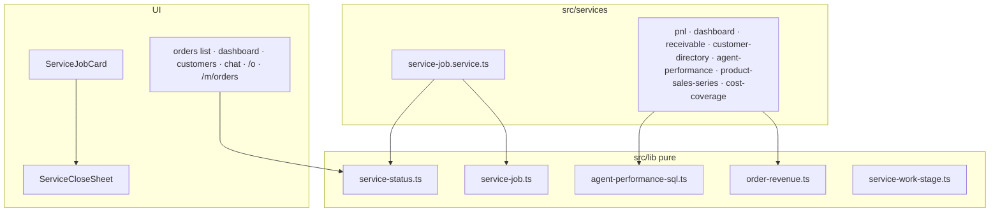
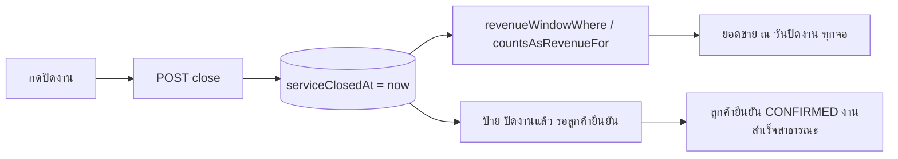

> **โมดูล:** 00073 - Service Four-Step Flow
> **ประเภทเอกสาร:** System Design Spec (SDS)
> **เวอร์ชัน:** 1.0
> **วันที่จัดทำ:** 2026-10-11
> **สถานะ:** Draft — ตรงกับโค้ดใน branch (ยังไม่ commit)
> **เจ้าของเอกสาร:** SA (ดู [[Feature-Docs-Ownership]])

# SDS: งานบริการ 4 ขั้น — เฟส A (System Design Spec)

## 1. บทนำ & References

### 1.1 วัตถุประสงค์
ออกแบบให้ "ร้านปิดงาน" เป็นจุดนับเงินของร้านบริการ โดยร้านประเภทอื่นไม่ขยับ

### 1.2 ขอบเขตการออกแบบ
ชั้นข้อมูล · ตัวตัดสินรายได้ · service ปิดงาน · ด่าน · ป้ายสถานะ · UI 3 จุดปิดงาน + จอสถานะทั้งสองฝั่ง

### 1.3 เอกสารอ้างอิง
[[PRD]] · [[BRD]] · [[SRS]] · ดีไซน์ claude.ai/artifact/UKPrPYKWbJB8ScX4USBEdR (บอร์ด 2, 3, 6)

## 2. Architecture Overview

### 2.1 มุมมองสถาปัตยกรรม

### 2.2 มุมมองการ Deploy
ไม่เปลี่ยน

## 3. Component Design
| Component | ออกแบบ |
|---|---|
| `order-revenue.ts` | ของเดิม (`revenueOrderWhere`/`countsAsRevenue`) **ไม่แก้** · เพิ่มชุด `...For(vertical)` ที่คืนของเดิมเมื่อไม่ใช่ร้านบริการ · `serviceClosedAt` **บังคับ** ใน type (ลืม select = compile ไม่ผ่าน) |
| `service-status.ts` | key 12 ตัว + meta (seller/buyer/cls/icon/tone) · ไอคอนจากชุดที่ระบบใช้อยู่ (HR12) · "ค้าง ฿X" ประกอบที่ `serviceStatusLabel` |
| `service-job.service.ts` | ทรานแซกชันเดียว · `updateMany` + เงื่อนไขซ้ำใน where กันแข่ง · สิทธิ์ตรวจที่ route |
| `ServiceCloseSheet` | Base `RecordPaymentSheet` · `money` ไม่ส่ง = โหลดเองจาก GET /close · ส่วนเงินซ่อนเมื่อ null · ยอด ฿0 เตือน + ลิงก์แก้ไข |
| `ServiceJobCard` | ทุกงานร้านบริการ (รวม walk-in) · ปิดงาน (O4) ปลดล็อกเองเมื่อถึงเวลานัด · เปิดงานอีกครั้ง (O6) |
| `AppointmentCard` | ถอดปุ่มผลนัด (ย้ายไป ServiceJobCard) · เลื่อนนัดซ่อนเมื่อปิดแล้ว |
| chat | `chatOrderActions` รับ `serviceClosed` (บังคับ) · MARK_SERVED = "ปิดงาน" ทุกงานที่ยังไม่ปิด รวม walk-in · เปิดชีตแทน `markServedFlow` (ลบไฟล์ + `appointment-outcome.ts`) |
| vocab | `ORDER_VOCAB.SERVICE_QUEUE.fulfillLabel/shippedStatusLabel = 'ปิดงานแล้ว'` · `hasShippedStatus=false` ⇒ ไม่มีแท็บ/ตัวกรอง SHIPPED |

## 4. Data Flow

### 4.1 Flow หลัก: ปิดงาน → ตัวเลข

### 4.2 Flow กรณีล้มเหลว / ชดเชย
- ปิดผิด → `DELETE /close` (O6) ก่อนลูกค้ายืนยัน → ยอดถอยออก · บันทึก event
- ลูกค้ายืนยันแทรกระหว่างเปิดงานอีกครั้ง → where ไม่ตรง → 409 ไม่เปลี่ยนอะไร

## 5. Integration Points
| ระบบ | จุดเชื่อม |
|---|---|
| 00034 OrderPayment | ปิดงานสร้าง BALANCE · คืนมัดจำ = void |
| 00071 สิทธิ์ | O4/O5/O6 · `route-capabilities` (`close/route.ts`) · จอช่างไม่มีคีย์เงิน |
| 00070 รายงาน LINE | ผ่าน `getSalesSeries`/`getPnlReport` (ไม่แก้ไฟล์รายงาน) |
| #141 ไทล์งาน | `deriveServiceWorkStage` รับ `serviceClosedAt` (บังคับ) |
| Auth | `nameAccountFromServiceJob` หลังผูกประวัติ |

### 5.1 หลังร้านปิดงาน (FR-012/013)
| ส่วน | ออกแบบ |
|---|---|
| `createReview` | `reviewConfirmsServiceJob` ⇒ `confirmOrder` ก่อนสร้างรีวิว (ใช้ตัวเดิมทั้งก้อน ไม่เขียนสถานะเอง) |
| `receipt.service` | แยก `issueReceiptRow` (ตัวนับ+แถว) ใช้ร่วม · `gateBuyerReceipt` = ด่านเดียวของออกเลข+อ่าน |
| `receipt-data.ts` | ประกอบกระดาษจาก `ReceiptView` — ย้ายจาก page ฝั่งร้าน ใช้ทั้งสองฝั่ง (HR16) |
| `/o/[token]` | `receiptAvailable` (server) → การ์ด "ใบเสร็จรับเงิน" · `reviewConfirms` → ปุ่มหลักเปิดแผ่นให้คะแนน |

### 5.2 เฟส B — ตั้งค่ารายงาน + กราฟ
| ส่วน | ออกแบบ |
|---|---|
| `src/lib/report-settings.ts` | นิยาม + ค่าตั้งต้น + ตัวตัดสินการแสดงผลทุกตัว (แท็บ · กำไรที่แสดง · ป้ายหักไม่ครบ · ป้ายแท็บ) — บริสุทธิ์ มีเทส |
| `Shop.reportSettings` | JSON บนแถวร้าน (TD-008) |
| `finance-chart.service` | ช่องรายวัน/รายเดือน ต่อจาก `getSalesSeries` (ช่วงข้ามปี = สองปีแล้วตัด) + Expense + ค่าส่งคืน · ไม่มีนิยามเงินใหม่ |
| `ServiceFinanceChart` | client · ApexChart wrapper · `period` ส่งมา = ช่วงคุมโดยผู้เรียก (ชีต) |
| จอ | `/sales` (FinanceTabs `tabs`/`collectLabel` · SalesChart `serviceOpts` · SalesTable `moneyOpts` · PnlReportCard/ExpenseWorkspace `settings`) · ชีต (`reportSettings`/`advance` ผ่าน CommandCenterData) · FinancePanels `settings` · การ์ดหน้าแรก (จำนวนงาน · ตัวเลขหลัก `headline` ผ่าน `resolveHeadline` คำนวณใน dashboard/page.tsx) · ไทล์คอม · เมนู (`applyFinanceMenu`) · หน้างาน (การ์ดกำไรรายใบ) |

## 6. Technical Decisions

### TD-001: คอลัมน์ `serviceClosedAt` แทนการใช้ `Order.status`
แยก "ร้านปิดงาน" (เงินภายใน) ออกจาก "ลูกค้ายืนยัน" (สาธารณะ) — ใช้ status เดียว ร้านจะปั่นงานสำเร็จสาธารณะได้

### TD-002: ไม่มาตามนัด = เงินที่ไม่ถูก void (คิดสด ไม่ snapshot)
ทุกจอได้ตัวเลขเดียวกันโดยไม่มีคอลัมน์เงินซ้ำ · คืนมัดจำใช้ void เดิม (มีเหตุผล/ผู้กด/เวลา)

### TD-003: ไม่แก้ cron ยืนยันอัตโนมัติ
ทั้ง 3 ตัวต้องมีพัสดุ/PICKUP ของ ONLINE_SALES ⇒ ไม่แตะร้านบริการโดยโครงสร้าง · แก้ไฟล์ร่วม = เสี่ยงโดยไม่ได้อะไร

### TD-004: `/appointment/outcome` = ปิดงานแบบไม่มีเงิน
ปุ่ม/แอปที่ยังเรียกทางเดิมได้วันปิดงาน ไม่มีสองทางให้ผลต่างกัน

### TD-005: ป้ายสถานะ derive ที่ server
ยอดค้างในป้ายเฉพาะผู้มี O5 · client ไม่ต้องรู้กติกา · จอช่างได้ป้ายไม่มีเงิน

### TD-006: ส่งคะแนน = ยืนยัน (ไม่ใช่ให้รีวิวโดยไม่ยืนยัน)
รีวิวป้อนโปรไฟล์สาธารณะ — มติขั้น 4 (โปรไฟล์นับตอนลูกค้ายืนยัน) ต้องไม่ถูกเลี่ยง จึงให้การส่งคะแนนเป็นการยืนยันไปในตัว ลูกค้ากดครั้งเดียวและโปรไฟล์ยังจริง

### TD-007: ใบเสร็จลูกค้าต้องชำระครบ + ตรวจสด
ใบเสร็จคือหลักฐานรับเงิน — ค้างอยู่ = ไม่ออกให้ลูกค้า · ร้านเปิดงานอีกครั้ง/ยกเลิกเงินภายหลัง ลูกค้าต้องเลิกเห็น (ฝั่งร้านยังเปิดใบเดิมได้ตาม 00065)

### TD-008: ตั้งค่าเก็บเป็น JSON บนแถว Shop (ไม่ใช่ตารางแยก)
layout โหลดแถวร้านเต็มแถวอยู่แล้วทุกหน้า (`requireActiveShop`) ⇒ เมนูค่าใช้จ่ายอ่านตั้งค่าได้โดยไม่เพิ่ม query · ค่าตั้งต้นอยู่ในโค้ด (NULL = ค่าตั้งต้น) จึงไม่ต้อง backfill

### TD-009: กำไรที่หักไม่ครบไม่ใช่ "กำไรสุทธิ"
ปิดต้นทุน/ค่าใช้จ่ายแล้ว ตัวเลขต่างจากนิยามระบบ (HR16) ⇒ ป้าย "กำไรก่อนหัก…/หักไม่ครบ" + หมายเหตุสิ่งที่ไม่ได้หัก · ไม่เทียบ % กับช่วงก่อน (คนละฐาน)

### TD-010: ชีตมือถือไม่มีตัวเลือกช่วงของกราฟซ้อน
จอเดียวมีตัวเลือกช่วงสองชุดที่พูดคนละช่วง = สับสน (พบตอนทดสอบบน iPhone) ⇒ กราฟในชีตตามช่วงของชีต · 3/6/12 เดือนอยู่ที่ /sales

## 7. Traceability
| BRD | ออกแบบ |
|---|---|
| FR-001/002 | service-job.service · ServiceCloseSheet · close route |
| FR-003/004 | confirmOrder · cancelOrder · ป้ายฝั่งลูกค้า |
| FR-005 | vocab `hasShippedStatus=false` · TD-003 |
| FR-006/007 | order-revenue + จอเงิน · migration |
| FR-008 | service-status.ts |
| FR-009 | account-name.service |

## 8. สรุป (Summary)
ตัวตัดสินรายได้ที่เดียว + คอลัมน์เดียว ทำให้ทุกจอของร้านบริการนับตอนปิดงานด้วยวันเดียวกัน ร้านอื่นวิ่งกิ่งเดิมทุกบรรทัด
