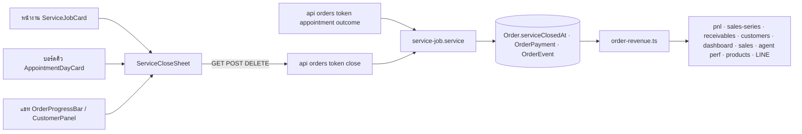
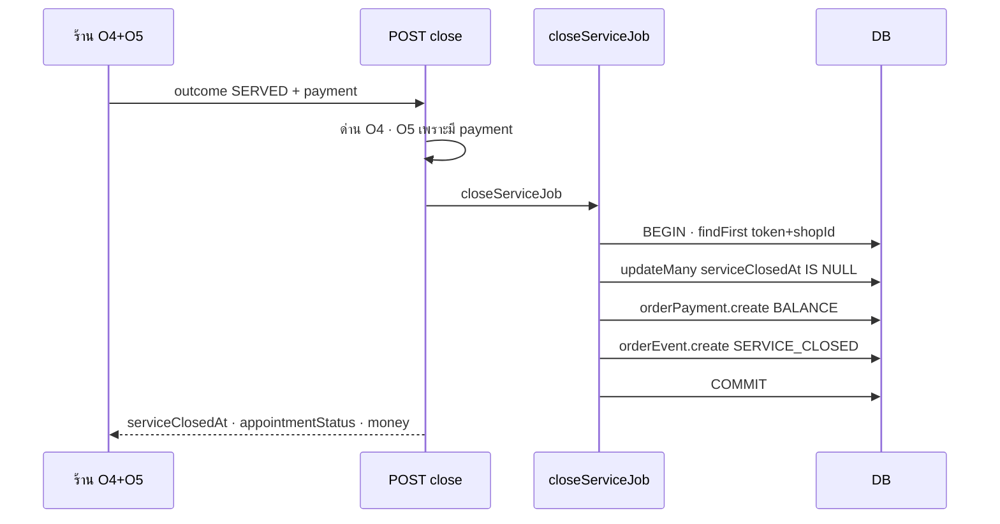

> **โมดูล:** 00073 - Service Four-Step Flow
> **ประเภทเอกสาร:** Software Requirements Specification (SRS) - TECHNICAL
> **เวอร์ชัน:** 1.0
> **วันที่จัดทำ:** 2026-10-11
> **สถานะ:** Draft — ตรงกับโค้ดใน branch `feat/00073-service-four-step-flow` (ยังไม่ commit · รอ user รีวิว)
> **เจ้าของเอกสาร:** SA (ดู [[Feature-Docs-Ownership]])

# SRS: งานบริการ 4 ขั้น — เฟส A (Software Requirements Specification — Technical)

## 1. บทนำ (Introduction)

### 1.1 วัตถุประสงค์ของเอกสาร
ข้อกำหนดเชิงเทคนิคของเฟส A: วันปิดงาน · ปิดงาน/เปิดงานอีกครั้ง · ยอดขายร้านบริการตามวันปิดงาน · ป้ายสถานะชุดเดียว · ด่านที่ทำให้โปรไฟล์จริง · ชื่อบัญชีจาก OTP

### 1.2 ขอบเขตเชิงระบบ (System Scope)
- **เฉพาะร้าน `Shop.vertical = 'SERVICE_QUEUE'`** — ตัวตัดสิน `usesServiceFinanceRules()` / `canUseAppointments()`
- ONLINE_SALES / LODGING: ตัวเลข สถานะ คำ cron เหมือนเดิมทุกอย่าง (มติ user 2026-10-11 — ค่าตั้งต้นถาวร)
- เฟส B (ตั้งค่ารายงาน + กราฟ 3 แบบ) ทำแล้ว — TFR-010/011 · เหตุการณ์ "ปิดงาน" ในฟีดกิจกรรม ทำแล้ว (ไอคอน ✓ ในวงกลม — user เลือก 2026-10-11)
- นอกขอบเขต: ค่าใช้จ่ายค้างจ่าย · ตัวเลขหลักบนการ์ด ทำแล้ว 2026-10-12 (user เคาะ "เอา" · PRD §3.6 / BRD FR-010a)

### 1.3 เอกสารอ้างอิง (References)
PRD/BRD 00073 · `docs/superpowers/plans/2026-10-11-00073-phase-a-plan.md` · 00034 · 00071 · 00070 · `docs/SRS.md` §2.2

### 1.4 นิยามและตัวย่อ
| คำ | ความหมาย |
|---|---|
| ปิดงาน | `closeServiceJob` — ตั้ง `serviceClosedAt` + ผลนัด + เงิน + event ในทรานแซกชันเดียว |
| วันปิดงาน | `Order.serviceClosedAt` — วันที่ของยอดขายร้านบริการ |
| O4/O5/O6/F1 | capability 00071 (ลงผล / รับเงิน / ยกเลิก-คืน / เงินเต็ม) |

## 2. ภาพรวมสถาปัตยกรรม (Architecture Overview)

### 2.1 บริบทระบบ

### 2.2 องค์ประกอบหลัก
| ไฟล์ | หน้าที่ |
|---|---|
| `src/lib/order-revenue.ts` | ตัวตัดสินรายได้ร้านบริการ: `serviceRevenueOrderWhere` · `revenueWindowWhere` · `countsAsRevenueFor` · `revenueDateFor` · `isServiceNoShow`/`serviceNoShowRevenue` · `serviceDeliveredOrderWhere`/`soldItemsWindowWhere` · `countsAsSoldFor` |
| `src/lib/agent-performance-sql.ts` | คู่แฝด SQL `serviceRevenueOrderSql` · `revenueOrderSqlFor` · `serviceNoShowRevenueSql` |
| `src/lib/service-status.ts` | ป้ายชุดเดียว ฝั่งร้าน/ลูกค้า · `canCloseServiceJob`/`canReopenServiceJob` |
| `src/lib/service-job.ts` · `service-job-api.ts` | error + ข้อความ + แปลง HTTP |
| `src/services/service-job.service.ts` | `closeServiceJob` · `reopenServiceJob` |
| `src/services/account-name.service.ts` | ชื่อบัญชีจากงานร้านบริการ |
| `src/components/safepay/service-close/ServiceCloseSheet.tsx` | ชีตปิดงาน (ใช้ร่วม 3 จุด) |

### 2.3 มุมมองการ Deploy
ไม่มี infra ใหม่ · migration 1 ไฟล์ รันโดย `prisma migrate deploy` ตอน deploy (HR15)

## 3. ข้อกำหนดเชิงฟังก์ชันเชิงเทคนิค

### TFR-001: วันปิดงาน
`Order.serviceClosedAt Timestamptz(3)?` + index `(shopId, serviceClosedAt)` · ตั้งทางเดียว `closeServiceJob` · ล้างทางเดียว `reopenServiceJob`

### TFR-002: ปิดงาน (`closeServiceJob`)
- กั้นร้านบริการ (`assertShopCanUseAppointments`) · หาแถวด้วย `publicToken + shopId`
- ปิดได้เมื่อ `serviceClosedAt IS NULL` และ `status ∈ {PENDING, CONFIRMED, SHIPPED}` · ไม่มาตามนัดต้องมีนัด · มีนัดต้องถึงเวลาเริ่ม (BR-RSV-34)
- `updateMany ... where serviceClosedAt IS NULL AND status IN (...)` กันแข่ง → count 0 = `ALREADY_CLOSED`
- SERVED + payment → `OrderPayment(BALANCE)` · NO_SHOW + REFUND → void ทุกรายการที่ใช้อยู่ (`NO_SHOW_REFUND_REASON`) · NO_SHOW ไม่รับเงินค่าบริการ
- event `SERVICE_CLOSED { outcome, amount?, deposit? }` ในทรานแซกชันเดียว · ไม่แตะ `Order.status`

### TFR-003: เปิดงานอีกครั้ง (`reopenServiceJob`)
ได้เมื่อปิดแล้วและ `status ∉ {CONFIRMED, CANCELLED, RETURNED}` (เงื่อนไขซ้ำใน where) · ล้าง `serviceClosedAt` · `appointmentStatus` กลับ `CONFIRMED_BY_BUYER`/`SCHEDULED` · event `SERVICE_REOPENED` · ไม่ย้อน void

### TFR-004: ด่าน
| ด่าน | ที่ | error |
|---|---|---|
| ลูกค้ายืนยันงาน NO_SHOW | `confirmOrder` (เว็บ + แอป) | `ServiceJobNoShowConfirmError` 409 |
| ยกเลิกงานที่ปิดแล้ว | `cancelOrder` (+ updateMany กันแข่ง) | `ServiceJobClosedLockedError` 409 |
| แก้ไขงานที่ปิดแล้ว | `updateOrder` | 409 |
| ปุ่มแก้ไข/ยกเลิกในเมนู ⋮ (หน้างาน · รายการ · แชท) | `getOrderActionSet({ serviceClosed })` · `OrderCardMenu` | ซ่อน (ให้ตรงกับ 409) |
| เลื่อนนัดงานที่ปิดแล้ว | `setOrRescheduleAppointment` | 409 |
| เหตุผลยกเลิก `BUYER_NO_SHOW` | ถอดจาก `CANCEL_REASONS_BY_VERTICAL.SERVICE_QUEUE` (ป้ายงานเก่า: `LEGACY_CANCEL_REASON_LABELS`) | `InvalidCancelReasonError` |

### TFR-005: ยอดขายตามวันปิดงาน (ร้านบริการ)
- นิยาม: `serviceClosedAt IS NOT NULL AND status NOT IN (CANCELLED, RETURNED, DRAFTED)` ตัดช่วงด้วย `serviceClosedAt`
- ยอด: SERVED = ยอดบิลหักคืนบางส่วน · NO_SHOW = ผลรวม OrderPayment ที่ไม่ถูก void · ต้นทุน NO_SHOW = 0 · ของที่ขายออก (สินค้า/หมวด/Top 3) ไม่นับ NO_SHOW
- จอ: `getPnlReport` · `getCostCoverage` (vertical บังคับ) · `getSalesSeries` (เฉพาะงานที่ปิดในช่วง · `unconfirmedValues` = 0 · `jobStatusCounts` นับปิดงาน) · `getReceivables` · `/sales` · `/dashboard` · `aggregateShopCustomers` + `getServiceCustomerSpend` (แผงแชท) · `fetchOrders` (แอดมิน) · `getProductSalesMonth` · `/products` · `/products/[id]` · `/categories` · การ์ดกำไรรายใบ
- ตามมาเอง: business overview · Portfolio · sales-series API · รายงานกลุ่ม LINE

### TFR-006: ป้ายสถานะชุดเดียว
`deriveServiceStatus`: DRAFTED → CANCELLED → RETURNED → NO_SHOW → CONFIRMED (ปิด=DONE · ไม่ปิด=BUYER_CONFIRMED_AWAITING_CLOSE) → ปิดแล้ว (ค้าง/ครบ) → walk-in → ขอเลื่อน → ยืนยันนัด → จองแล้ว · ผู้ไม่เห็นเงิน = "ปิดงานแล้ว" (โทน info ไม่อ้างชำระครบ)

### TFR-007: คะแนนลูกค้า
evidence มี `appointmentStatus` (บังคับ) · NO_SHOW (ไม่ยกเลิก) = นับเหมือนยกเลิกด้วย `BUYER_NO_SHOW` เดิมเป๊ะ

### TFR-008: ชื่อบัญชีจาก OTP
`nameAccountFromServiceJob` หลัง `linkBuyerHistory` (phone-otp ที่ผู้ใช้ไม่ได้ตั้งชื่อ) และหลัง `guaranteeOrderLink` (sms-link) · แตะเฉพาะชื่อ placeholder · ใช้ `buyerName` ของงานร้านบริการล่าสุด · best-effort

### TFR-009: หลังร้านปิดงาน (มติ user 2026-10-11 รอบ 2)
- **ส่งคะแนน = ยืนยัน (FR-012):** `createReview` — ถ้า `reviewConfirmsServiceJob` (`src/lib/service-status.ts`: ร้านบริการ · ปิดแล้ว · ไม่ใช่ `NO_SHOW` · `status ∈ {PENDING, SHIPPED}`) เรียก `confirmOrder` ตัวเดิมก่อน (ด่านเจ้าของ + event `BUYER_CONFIRMED` + badge) แล้วจึงสร้างรีวิว · อยู่ใน service ⇒ เว็บ + `api/app/orders/[id]/review` ได้พร้อมกัน · ไม่ atomic ข้ามสองขั้น: ยืนยันสำเร็จแต่รีวิวล้ม = งาน CONFIRMED ไม่มีรีวิว (เขียนรีวิวต่อได้ตามปกติ)
- **ใบเสร็จลูกค้า (FR-013):** `canBuyerViewReceipt` (`src/lib/receipt.ts`) · `issueOrReadReceiptForBuyer` / `getReceiptViewForBuyer` (`receipt.service.ts` — `buyerUserId` ใน WHERE · ตรวจสดทุกครั้ง) · ออกเลขผ่าน `issueReceiptRow` ตัวเดียวกับฝั่งร้าน · `POST /api/orders/[token]/receipt/buyer` (BUYER ใน route-capabilities) · หน้า `src/app/(marketing)/o/[token]/receipt/page.tsx` ใช้ `ReceiptSheet` + `buildReceiptSheet` (`receipt-data.ts`) ตัวเดียวกับฝั่งร้าน
- **จอลูกค้า:** `receiptAvailable` จาก server · ปุ่มหลัก "ให้คะแนนบริการ" + ปุ่มรอง "ยืนยันรับบริการโดยไม่ให้คะแนน" · การ์ดรีวิว/แผ่นให้คะแนนบอกว่า "ส่งคะแนน = ยืนยัน (ย้อนไม่ได้)"

### TFR-010: ตั้งค่ารายงาน (เฟส B · FR-010)
- เก็บ `Shop.reportSettings Json?` (migration `20261012090000_shop_report_settings` — additive, ไม่มี backfill) · อ่านผ่าน `resolveReportSettings(raw, vertical)` เท่านั้น (ค่าเพี้ยน → ค่าตั้งต้นรายช่อง · ร้านอื่น → ค่าตั้งต้นเสมอ)
- ค่าตั้งต้น: รับเงิน/ค้างรับ ✓ · มัดจำล่วงหน้า ✗ · จำนวนงาน ✓ · ต้นทุน ✓ · ค่าใช้จ่ายร้าน ✓ · กำไรขาดทุน ✓ · แท่งซ้อน · รายวันของเดือนนี้
- หน้า `/settings/reports` (F1 · ร้านบริการ — อื่น notFound) · เมนู "ตั้งค่ารายงาน" (`seller:settings-reports` ใน SERVICE_QUEUE_ONLY_SLUGS) · API `GET/PATCH /api/shops/current/report-settings`
- ผลต่อจอ: แท็บการเงิน `visibleFinanceTabs`/`resolveVisibleFinanceTab` (ปิดกำไรขาดทุน/ค่าใช้จ่าย ⇒ แท็บหาย · URL ถอยแท็บที่เห็น) · เมนู "ค่าใช้จ่าย" หาย (`applyFinanceMenu`) · การ์ด/คอลัมน์รับจริง-ค้างรับ + "ต้องตามเก็บ" · จำนวนงาน (การ์ด · คอลัมน์ · เส้น · ไทล์คอม) · การ์ดต้นทุน/ค่าใช้จ่าย · กำไรที่แสดง = `profitShown` + ป้าย `profitExclusionNote` (ห้ามเรียกกำไรสุทธิเมื่อหักไม่ครบ) · การ์ดกำไรรายใบซ่อนเมื่อปิดกำไรขาดทุนหรือต้นทุน · มัดจำล่วงหน้า (`getAdvanceDeposits`)
- ตัวเลขหลักบนการ์ด (FR-010a): `headline` = SALES (ค่าตั้งต้น) / RECEIVED / NET_PROFIT · อ่านผ่าน `resolveHeadline` เท่านั้น (ปิดรับเงิน/ค้างรับ ⇒ RECEIVED ถอยเป็น SALES · ปิดกำไรขาดทุน ⇒ NET_PROFIT ถอยเป็น SALES) · RECEIVED = `receivedValues` ของ `getSalesSeries` (วันนี้/เดือนนี้) · NET_PROFIT = `getPnlReport` ช่วงวันนี้/เดือนนี้ ผ่าน `profitShown` + ป้าย `profitExclusionNote` · ใช้กับการ์ดยอดขายหน้าแรก (มือถือ) + การ์ดสถิติภาพรวม (คอม) · ตัวหลักไม่ใช่ยอดขาย ⇒ ไม่แสดง % เทียบ · กำไรติดลบเป็นสีแดง · NET_PROFIT ⇒ ชีตมือถือเปิดแท็บกำไรขาดทุน · ส่งผ่าน CommandCenterData `headline` (ถูก redact เมื่อไม่ใช่เจ้าของ)
- ไม่แตะ: วิธีนับเงิน · รายงานกลุ่ม LINE · จำนวนครั้งในโปรไฟล์ลูกค้า (ข้อมูลความสัมพันธ์ ไม่ใช่รายงานเงิน)

### TFR-011: กราฟการเงิน 3 แบบ (เฟส B · FR-011)
- `ServiceFinanceChart` (sales = รับแล้ว+ค้างรับ · expense = ค่าใช้จ่ายร้าน+ต้นทุน · overview = ยอดขาย vs รายจ่าย + ส่วนต่าง) · กดแท่งดูยอด · ยอดรวม + แถบสัดส่วน · รูปแบบตามตั้งค่า (สรุปภาพรวมเป็นแท่งคู่เสมอ)
- `/sales`: แท็บละกราฟ มีตัวเลือกช่วงของกราฟเอง (เริ่มตามตั้งค่า) · ชีตมือถือ: กราฟตามช่วงของชีต (รายวัน = เดือน · รายเดือน = ทั้งปี) ไม่มีตัวเลือกซ้อน — ตั้งค่าช่วงเริ่มต้นที่ไม่ใช่ "เดือนนี้" = ชีตเริ่มที่รายเดือน
- ข้อมูล: `GET /api/seller/finance-chart` — ไม่มีนิยามเงินใหม่ (ต่อ `getSalesSeries` ปีต่อปีสำหรับช่วงข้ามปี)

### TFR-014: แก้ 4 จุดในโซนหัวหน้า (user สั่ง 2026-10-12 · ไม่ใช่บั๊กจาก branch นี้ · แจ้งหัวหน้าก่อน merge)
1. **เช็กลิสต์ตั้งค่าร้าน**: ทั้งชุดเป็นของร้านส่วนตัว (อ่าน + ปุ่มบันทึกทุกตัวหาแถว `kind: PERSONAL`) ⇒ ร้านบริการแบบธุรกิจ**ไม่ mount** `OnboardingGate` — ตัวตัดสิน `showsPersonalSetupChecklist` (`src/lib/onboarding-gate.ts`) · ไม่แก้ API ให้อ่านร้านที่สลับ (บันทึกยังเขียนร้านส่วนตัว ⇒ ไม่มีวันครบ) · ร้านธุรกิจ vertical อื่นคงเดิม
2. **ป้ายเมนูการเงิน**: `applyMenuLocale` (รันนอกสุด) แปลทับ "การเงินร้าน" กลับเป็น "ภาพรวมกำไร/ขาดทุน" ⇒ ใช้ `menu.salesFinance` เมื่อ `mergesFinanceMenu(vertical)` (ตัวตัดสินเดียวกับ `applyFinanceMenu`) · `th.menu.salesFinance === FINANCE_MENU_LABEL` (เทสคุม)
3. **hydration ของจุดสี legend** (`SalesChannelDonut` + `ProvinceSalesMap`): `getColor` บนเซิร์ฟเวอร์คืนสีสำรอง ⇒ style ใน JSX ใช้ `colorVar()` (`var(--color-…)`) · alpha ใช้ `opacity` · ด่านสแกน `no-getcolor-in-jsx-style.test.ts`
4. **รายงานกลุ่ม LINE**: คำอธิบายสีแท่งยอดขายผ่าน `reportSalesLegend(shops)` — ร้านบริการล้วน = "ปิดงานแล้ว" ไม่มี "รอยืนยัน" (ยอด = งานที่ปิดแล้ว ก้อนรอเป็น 0 เสมอ) · ร้านอื่น/ผสม คำเดิม · ตัวเลขไม่เปลี่ยน — 🛑 **ถอนแล้ว 2026-10-14 (user):** รายงานกลุ่ม LINE ของร้านบริการไม่รอปิดงานแล้ว นับยอดแบบร้านทั่วไป (ทุกใบที่ไม่ยกเลิก ตามวันเปิดบิล · ยืนยันแล้ว + รอยืนยัน · ป้ายเหลือง "รอยืนยัน") — `line-report-summary.service` เรียก `getSalesSeries` โดยไม่ส่ง vertical · หน้าในแอปยังนับตามวันปิดงานเหมือนเดิม

### TFR-015: ยอด "ยังไม่ปิดงาน" + ทางเข้าตั้งค่ารายงานบนมือถือ (ภาคต่อ 2026-10-12 · FR-014/015)
- นิยามเดียว: `serviceUnclosedOrderWhere` (query) / `isServiceUnclosed` (หน่วยความจำ) — `serviceClosedAt` ว่าง + สถานะไม่ใช่ CANCELLED/RETURNED/DRAFTED · วันที่ = createdAt · หักคืนด้วย returnAdj ตัวเดียวกับยอดขาย
- `getSalesSeries` (ร้านบริการเท่านั้น): `unclosedValues/unclosedTotal/unclosedCount/prevUnclosedToDate/last14Unclosed` — **ไม่อยู่ใน values/total** (นิยามยอดขาย/กำไร/LINE/P&L ไม่เปลี่ยน) · ร้านอื่น undefined + ไม่ query
- การ์ดมือถือ: ก้อนเหลือง = ยังไม่ปิดงาน (`chartUnclosed`) · ตัวเลขใหญ่/% = ปิดแล้ว + ยังไม่ปิด · ร้านอื่นใช้ unconfirmed/total เดิม · การ์ด "รายได้" คอม = ตัวเลขเดียวกัน · ชีต (แท็บยอดเก็บเงิน) แถว "ยังไม่ปิดงาน N งาน ฿X" (ไอคอนนาฬิกา — สีเหลืองในชีต = ค้างรับ) · /sales การ์ด "ยังไม่ปิดงาน" (แท็บยอดเก็บเงิน)
- มือถือ: `/settings/reports` ใน `QUICK_LINK_URLS` + แถวใน ShopQuickLinks (กรองด้วยเมนูจริง)
- ที่มา: prod 2026-10-12 บิลไม่มีนัดที่ไม่เคยปิดหลุดจากการปิดย้อนหลัง (2 ร้าน 124 บิล ≈ ฿1 ล้าน) — **ไม่แก้ข้อมูล** (มติทีม)

### TFR-016: ตั้งค่างานที่ยังไม่ปิด + สีตัวกลาง + LINE (ภาคต่อ 2 · FR-016)
- `ReportSettings.unclosedDisplay` ('OFF'|'CARD'|'ALL', ค่าตั้งต้น CARD) · ตัวตัดสิน `showsUnclosedOnCard` / `showsUnclosedSummary` / `showsUnclosedInCharts`
- การ์ด/คอม อ่าน OnCard · ชีตแถวสรุป + /sales การ์ด อ่าน Summary · ชีตกราฟ (`buildSalesChartOptions(..., { unclosed })` — ดัชนีซีรีส์นับไดนามิก) + คอลัมน์ "ยังไม่ปิด" + `ServiceFinanceChart` (kind sales) + SalesTable คอลัมน์ อ่าน InCharts
- `getFinanceChartData`: `bucket.unclosed` / `totals.unclosed` จาก `SalesSeries.unclosedValues` (ไม่อยู่ใน sales)
- สี: `src/lib/finance-colors.ts` (`FINANCE_COLORS`) — counted success · notCounted warning (+lineHex) · outstanding info · count primary · neutral default · LINE `PENDING_YELLOW/PENDING_TEXT` อ้างตัวกลาง (ค่าเดิม)
- LINE: `ShopSummary.unclosed` / `Totals.unclosed` (optional — ร้านอื่นไม่มีคีย์) · `renderHero` + altText บรรทัด "ยังไม่ปิดงาน" — 🛑 **ถอนแล้ว 2026-10-14 (user):** รายงานกลุ่ม LINE ของร้านบริการไม่รอปิดงานแล้ว นับยอดแบบร้านทั่วไป (ทุกใบที่ไม่ยกเลิก ตามวันเปิดบิล · ยืนยันแล้ว + รอยืนยัน · ป้ายเหลือง "รอยืนยัน") — `line-report-summary.service` เรียก `getSalesSeries` โดยไม่ส่ง vertical · หน้าในแอปยังนับตามวันปิดงานเหมือนเดิม
- รายงานยอดขาย (คอม): `SalesSeriesPoint.unclosed` / `SalesSummary.unclosedTotal` (ร้านบริการ + เห็นเงินเต็ม + OnCard) — เส้นเหลืองรายเดือนตามเดือนเปิดบิล + ช่องสรุป · สีร้านบริการจากตัวกลาง (รายได้ เขียว · จำนวนงาน น้ำเงิน) · ร้านอื่นสีธีมเดิม
- สีจอข้างในร้านบริการผ่านตัวกลางทั้งหมด: กราฟสรุปภาพรวม ยอดขาย เขียว (เดิมน้ำเงิน) · รายจ่าย `outflow` · ต้นทุน `cost` (แผงการเงิน เดิมจุดเหลือง) · การ์ดเฉลี่ย/งาน + มัดจำล่วงหน้า `neutral` (เดิมฟ้า)
- ไม่มี migration (reportSettings เป็น JSON)

## 4. ข้อกำหนดส่วนต่อประสาน
ดู [[API]]

### 4.4 Sequence: ปิดงานพร้อมรับเงิน

## 5. ข้อกำหนดด้านข้อมูล
ดู [[DATABASE]]

## 6. ข้อกำหนดที่ไม่ใช่ฟังก์ชัน
- ความถูกต้อง: ปิดงาน = ทรานแซกชันเดียว · ตัวตัดสินรายได้ที่เดียว (+ คู่แฝด SQL มีเทส)
- ประสิทธิภาพ: ตัดสิน vertical ครั้งเดียวต่อคำขอ · index `(shopId, serviceClosedAt)` · ชีตยอดขายร้านบริการดึงเฉพาะงานที่ปิดในช่วง
- ความปลอดภัย: O4/O5/O6 ตรวจที่ server ทุกส่วน · จอช่างไม่มีคีย์ `money`

## 7. ข้อจำกัดทางเทคนิคและการพึ่งพา
- `OrderEvent_type_check` เป็น unmanaged SQL — เพิ่มค่าแบบ additive
- ห้าม deploy ระหว่างแอป iOS รอรีวิว · `(paces)/**` แจ้งหัวหน้าก่อน merge
- ข้อมูลเก่าที่ลงผลแล้ว วันปิด = `serviceEnd` (ไม่มี event เดิมให้อ้าง)
