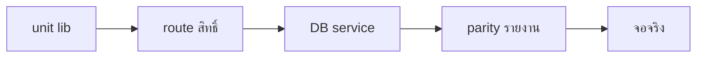

> **โมดูล:** 00073 - Service Four-Step Flow
> **ประเภทเอกสาร:** Test Case
> **เวอร์ชัน:** 1.0
> **วันที่จัดทำ:** 2026-10-11
> **สถานะ:** Draft — เทสอัตโนมัติผ่านครบบนฐาน local
> **เจ้าของเอกสาร:** QA (ดู [[Feature-Docs-Ownership]])

# Test Case: งานบริการ 4 ขั้น

## 1. Overview
ครอบทั้งสองฝั่ง: ร้านบริการได้พฤติกรรมใหม่ · ร้านขายของ/ที่พักเหมือนเดิม ([blocker])

## 2. Test Scenarios
| TC | Scenario | ไฟล์เทส |
|---|---|---|
| TC-001 | ปิดงาน SERVED + รับเงิน → วันปิด · COMPLETED · เงิน · event · Order.status ไม่เปลี่ยน | `tests/services/service-job.test.ts` |
| TC-002 | ปิดทั้งที่ค้างได้ | 〃 |
| TC-003 | walk-in ปิดได้ · ไม่มาตามนัดไม่ได้ | 〃 |
| TC-004 | ไม่มาตามนัด เก็บมัดจำ (meta KEPT) / คืนมัดจำ (void พร้อมเหตุผล · REFUNDED) · ไม่รับเงินค่าบริการ | 〃 |
| TC-005 | ปิดซ้ำ · ปิดงานยกเลิก · ปิดก่อนเวลานัด → ปฏิเสธ | 〃 |
| TC-006 | ลูกค้ายืนยันก่อน แล้วร้านปิดได้ | 〃 |
| TC-007 | [blocker] ร้านขายของปิดงานไม่ได้ | 〃 |
| TC-008 | เปิดงานอีกครั้ง: ล้างวันปิด · สถานะนัดกลับ · event · ไม่ย้อน void · ลูกค้ายืนยันแล้ว/ยังไม่ปิด → ปฏิเสธ | 〃 |
| TC-009 | ลูกค้ายืนยันงาน NO_SHOW ไม่ได้ · งานที่ให้บริการยืนยันได้ | 〃 |
| TC-010 | ยกเลิกงานที่ปิดแล้วไม่ได้ (ทั้งสองฝั่ง) · เปิดงานอีกครั้งแล้วยกเลิกได้ · เหตุผล BUYER_NO_SHOW ใช้ไม่ได้ · แก้ไขงานที่ปิดแล้วไม่ได้ · ปุ่มแก้ไข/ยกเลิกหายจากเมนู ⋮ เมื่อปิดแล้ว | 〃 · `order-action-set.test.ts` |
| TC-011 | [blocker] ร้านขายของยืนยัน/ยกเลิกเหมือนเดิม | 〃 |
| TC-012 | ยอดขายร้านบริการ ต.ค. = ฿3,800 ตรงกัน P&L · ชีต · ค้างรับ · ยอดสะสมลูกค้า (หน้าลูกค้า = แผงแชท) · งานสร้าง ก.ย. ปิด ต.ค. อยู่ ต.ค. · ไม่มี "รอยืนยัน" | `tests/services/service-revenue-reports.test.ts` |
| TC-013 | [blocker] ร้านขายของ P&L/ชีตเลขเดิม ไม่อ่านวันปิดงาน | 〃 |
| TC-014 | ตัวตัดสินรายได้ + คู่แฝด SQL + แยก vertical + ไม่มาตามนัด | `src/lib/__tests__/service-revenue.test.ts` |
| TC-015 | ป้าย 10 ตัว · คำฝั่งลูกค้า · [blocker] ไม่มีคำร้านขายของ · ไม่เห็นเงินไม่อ้างชำระครบ | `src/lib/__tests__/service-status.test.ts` |
| TC-016 | ไทล์งาน 4 ขั้นอ่านวันปิดงาน | `src/lib/__tests__/service-work-stage.test.ts` |
| TC-017 | คะแนนลูกค้า: ไม่มาตามนัดผ่านการปิด = เท่ายกเลิก BUYER_NO_SHOW เดิม | `buyer-reputation.test.ts` · `customer-behavior.test.ts` |
| TC-018 | สิทธิ์ route: ช่างปิดได้ไม่มีเงิน · ช่างส่งเงิน 403 · ฝ่ายบิลปิดไม่ได้ · CHAT คืนมัดจำ 403 · ผู้จัดการครบ · ช่างเปิดงานอีกครั้ง 403 | `src/app/api/orders/__tests__/role-gates.route.test.ts` |
| TC-019 | จอช่างไม่มีคีย์เงิน (การ์ดงานไม่มี `money`) | `technician-no-money.page.test.tsx` |
| TC-020 | ปุ่มในแชท: walk-in ปิดงานได้ · ปิดแล้วเหลือรับเงิน | `chat-order-actions.test.ts` · `chat-order-surfaces.test.ts` |
| TC-021 | แชท: ปิดแล้ว = DONE · ลูกค้ายืนยันก่อน = AWAITING_CLOSE | `chat-service-progress.test.ts` |
| TC-022 | หน้าลูกค้าก่อนล็อกอิน: หัวข้อคำฝั่งลูกค้า · ร้านอื่น null · allow-list | `guest-order-data.test.ts` |
| TC-023 | ชื่อบัญชีจาก OTP: ใช้ชื่องานร้านบริการ · ไม่ทับชื่อที่ตั้งเอง · [blocker] ร้านขายของไม่ใช้ | `tests/services/account-name.test.ts` |
| TC-024 | รายงาน LINE parity ร้านบริการ (ฟิกซ์เจอร์มีวันปิด) | `line-report-summary.parity.test.ts` |
| TC-025 | migration: ร้านอื่นไม่ถูกแตะ (hash ก่อน/หลัง) · รันซ้ำไม่ซ้ำ | ตรวจด้วยมือบนฐาน local (ดู [[DATABASE]] §5.1) |
| TC-027 | FR-012 ส่งคะแนนงานที่ร้านปิดแล้ว = CONFIRMED + รีวิว + BUYER_CONFIRMED · ค้างเงินก็ให้คะแนนได้ · ยังไม่ปิด/ไม่มาตามนัด/เปิดงานอีกครั้ง/คนอื่น → ไม่ได้ · [blocker] ร้านขายของเหมือนเดิม | `tests/services/service-after-close.test.ts` · `service-status.test.ts` |
| TC-028 | FR-013 ใบเสร็จลูกค้า: ปิด+ครบ ได้เลข = เลขฝั่งร้าน · ร้านออกก่อนได้ใบเดิม · ค้าง/ยังไม่ปิด/ไม่มาตามนัด → ไม่ได้ · คนอื่นหาไม่เจอ · เปิดงานอีกครั้งแล้วลูกค้าเลิกเห็น · [blocker] ร้านอื่น false | `tests/services/service-after-close.test.ts` · `receipt.test.ts` |
| TC-029 | คำของร้านบริการบนจอการเงิน: "ยอดขายจากงานที่ปิดแล้ว" · ฐาน "คิดจากงานที่ร้านปิดแล้ว" · การ์ดลูกค้า "ใช้บริการร้านนี้" · [blocker] ร้านขายของยัง "ยอดขายที่ยืนยันแล้ว/รอยืนยัน" | Playwright (คอม/iPhone WebKit/Android) บนฐาน local |
| TC-030 | ล็อกอินผู้ซื้อด้วยบัญชีทดสอบ 000000000X นอก production (`isLoginPhone` ตัวเดียวกับฝั่งร้าน) · โลโก้ร้านโหลดไม่ได้ถอยเป็นอักษรแรก | Playwright 3 อุปกรณ์ |
| TC-031 | เฟส B ตั้งค่ารายงาน: ค่าตั้งต้น = เหมือนเดิม · [blocker] ร้านอื่นได้ค่าตั้งต้นเสมอ · ค่าเพี้ยนไม่พัง · แท็บตามสวิตช์ + URL ถอย · กำไรหักเฉพาะที่เปิด + ป้าย | `src/lib/__tests__/report-settings.test.ts` |
| TC-032 | เฟส B กราฟ: [blocker] ผลรวมเท่า getPnlReport (ยอดขาย/ต้นทุน/ค่าใช้จ่าย/จำนวนงาน) · รับแล้ว+ค้างรับ = ยอดขาย · 6 เดือน/ปี · มัดจำล่วงหน้า · ป้ายช่วง/เลื่อนช่วง | `tests/services/finance-chart.test.ts` |
| TC-033 | เฟส B จอจริง: หน้าตั้งค่า (คอม/iPhone) · ปิดกำไรขาดทุน+ค้างรับ เปิดมัดจำ → /sales แท็บ/การ์ด/รายการตามเก็บเปลี่ยนตาม · ชีตมือถือ (iPhone/Android) แท็บ+กราฟ+ป้ายหักไม่ครบ · [blocker] ร้านขายของไม่เปลี่ยน + API 403/404 | Playwright บนฐาน local |
| TC-034 | สินค้า/บริการขายดี + "ขายแล้ว" หน้าร้าน ของร้านบริการนับเฉพาะงานที่ให้บริการจริง · ฟีดกิจกรรม SERVICE_CLOSED (ร้านอื่นไม่ query) | `finance-single-definition.test.ts` · `activity.service.test.ts` · `role-contract.test.ts` |
| TC-035 | ใบเสร็จ: ช่อง วันที่/จำนวนเงิน เติมจากรายการโอนที่ไม่ถูกยกเลิก (เงินสดล้วน = ช่องเขียนมือ · ธนาคาร/เลขที่ไม่เติม) · หน้าใบเสร็จลูกค้า แถบหัวกว้างเท่ากระดาษ (คอม 794px · มือถือ 333px ตรงขอบ) | `receipt.test.ts` · Playwright 3 อุปกรณ์ |
| TC-036 | ด่านดีไซน์ (HR8) 2026-10-12: `npx impeccable detect` ไฟล์ UI ที่แก้ทั้ง 65 ไฟล์ = 0 ข้อ · critique บนจอจริง แก้ 4 จุด: งานบริการชำระครบไม่ขึ้นการ์ดแนบสลิป/ช่องทางชำระ · กราฟไม่วาดจำนวนงานทับแท่ง (ย้ายไปกล่องยอด) · ช่องที่เลือกเริ่มที่ช่องล่าสุดที่มียอด · ฿0 ในคอลัมน์รับจริงไม่เป็นสีเขียว | Playwright (คอม/iPhone) + วัดตำแหน่งแท่งใน DOM |
| TC-037 | ตัวเลขหลักบนการ์ด: `resolveHeadline` ถอยเป็นยอดขายเมื่อสวิตช์ที่ต้องใช้ปิด · ร้านอื่นได้ยอดขายเสมอ · จอจริง RECEIVED/NET_PROFIT/SALES บน iPhone (WebKit) + คอม → การ์ดขึ้น "รับเงินแล้ว"/"กำไรสุทธิ" · ชีตเปิดแท็บกำไรขาดทุนเมื่อเลือกกำไรสุทธิ · `headline` ถูก redact เมื่อไม่ใช่เจ้าของ | `report-settings.test.ts` · `role-contract.test.ts` · Playwright 2026-10-12 |
| TC-038 | เช็กลิสต์: `showsPersonalSetupChecklist` ร้านบริการธุรกิจ=false · ส่วนตัว/ธุรกิจอื่น=true · layout ใช้ตัวตัดสิน · จอจริง: ร้านบริการไม่ fetch checklist ไม่มีเช็กลิสต์ · ร้านขายของธุรกิจยังขึ้น | `onboarding-gate.test.ts` · Playwright |
| TC-039 | ป้ายเมนู: หลัง applyMenuLocale ร้านบริการ = "การเงินร้าน" (th/en) · ร้านขายของ/ที่พัก ป้ายเดิม · จอจริง เมนู = หัวหน้า /sales | `seller-menu.test.ts` (mutation แดง) · Playwright |
| TC-040 | hydration: ไม่มี getColor ใน style ของ JSX · จุด legend = var(--color-chart-gray) → #edeff3 · console ไม่มี hydration | `no-getcolor-in-jsx-style.test.ts` · Playwright |
| TC-041 | LINE: กลุ่มร้านบริการล้วน legend "ปิดงานแล้ว" (ทั้งกราฟ 7 วัน + เทียบรายร้าน) ไม่มี "ยืนยันแล้ว/รอยืนยัน" · ร้านขายของ/ที่พัก/ผสม คำเดิม | `flex-report-charts.test.ts` (mutation แดง) |
| TC-042 | ยังไม่ปิดงาน (ฐานจริง): เขียวเท่าเดิม · เหลืองตามวันเปิดบิล · ยกเลิก/ร่างไม่นับ · ช่วงก่อนหน้า · ร้านขายของไม่มีฟิลด์ (mutation แดง) | `tests/services/sales-series-unclosed.test.ts` |
| TC-043 | นิยามเดียว query/หน่วยความจำ · การ์ดร้านอื่นใช้ unconfirmed/total เดิม · แถวตั้งค่ารายงานในแท็บร้านค้า | `src/lib/__tests__/service-unclosed.test.ts` |
| TC-044 | จอจริง: ร้านสินค้าเหมือนเดิม 100% (ข้อความทุกจอ + API เทียบ main) · ร้านบริการ การ์ด 3,500→6,900 (เขียว 3,500 + เหลือง 3,400) · คอม ฿6.90k · ชีต ส.ค. "ยังไม่ปิดงาน 27 งาน 60,900" · /sales การ์ด ฿60,900 · แท็บร้านค้ามีตั้งค่ารายงาน | Playwright (Chromium + iPhone WebKit) |
| TC-026 | จอจริง (Playwright · local): ชีตปิดงาน คอม/มือถือ · การ์ดงาน · ป้าย "ปิดงานแล้ว · ค้าง ฿900" · ประวัติ "ร้านปิดงาน · บันทึกย้อนหลัง" · รายการงาน + การ์ดสถิติ · หน้าลูกค้า "ร้านให้บริการแล้ว" | screenshot ใน scratchpad (ไม่เก็บใน repo) |

## 3. Traceability Matrix
| BRD | TC |
|---|---|
| FR-001 | 001–006, 018, 026 |
| FR-002 | 004, 010 |
| FR-003 | 006, 009 |
| FR-004 | 010 |
| FR-005 | 011, 013 |
| FR-006 | 012–014, 024 |
| FR-007 | 025 |
| FR-008 | 015, 016, 021, 022 |
| FR-009 | 023 |
| FR-012 | 027 |
| FR-013 | 028 |
| FR-010 | 031, 033 |
| FR-010a | 037 |
| FR-011 | 032, 033 |

## 4. Flow

## 5. ผลล่าสุด
2026-10-11 · ฐาน local 5434 · `vitest run` ทั้งชุด: **753 ไฟล์ / 9,752 เทส ผ่านทั้งหมด** (รวมเฟส B) · จอจริง Playwright: คอม · iPhone (WebKit) · Android (Pixel 7)

## 6. สรุป (Summary)
พฤติกรรมใหม่ของร้านบริการมีเทสทุกข้อของ BRD · ด่าน [blocker] ยืนยันร้านอื่นเหมือนเดิม
