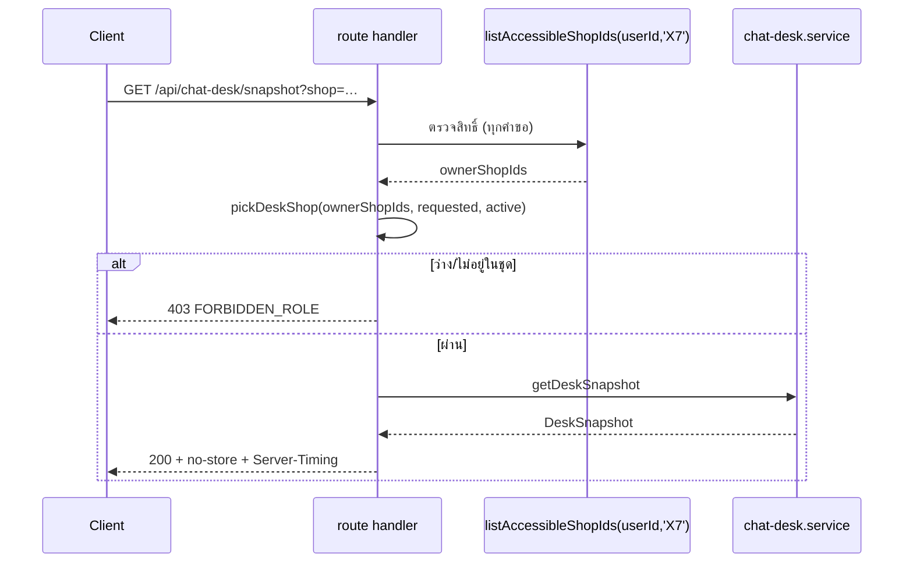

> **โมดูล:** 00077 - Chat Desk · **ประเภท:** API Contract · **เวอร์ชัน:** 1.0 · **วันที่:** 2026-10-16 · **สถานะ:** Draft
> **เจ้าของเอกสาร:** SA (ดู [[Feature-Docs-Ownership]])

# API Contract: โต๊ะแชท

## 1. Overview
API 3 เส้น provider คือ Next.js route handler (`src/app/api/**`) ของแอปนี้ ผู้บริโภคคือ client component ของหน้า `/chat-desk` และ layout `(chat)` ทั้งหมดเป็น `GET` อ่านอย่างเดียว

- **เอกสารออกแบบต้นทาง:** [[SDS]] §3, §7, §8, §11
- **Base URL:** same-origin บน `seller.<domain>` (เช่น `http://seller.deepth.local:4000`) `/api/*` ไม่ถูก rewrite ตาม subdomain
- **Content-Type:** `application/json; charset=utf-8`
- **Convention:** ตาม route เดิมของ `/api/chat/**` คือ body ผิดพลาดเป็น `{ "error": "<CODE>" }` (สตริงเดียว ไม่ใช่ envelope `{error:{code}}` ของ template) และ header `Cache-Control: private, no-store, max-age=0, must-revalidate` + `export const dynamic = 'force-dynamic'`
- **Rate-limit (proxy):** GET 120/นาที/IP สำหรับผู้ล็อกอิน รวมทุก endpoint → 429 `{error:'Rate limit exceeded'}` + `Retry-After: 60`

## 2. Authentication
| รายการ | ค่า |
|---|---|
| วิธี | NextAuth v4 cookie session (JWT) |
| Header | cookie ของ subdomain (ไม่ต้องส่ง Authorization) |
| ตัวตน | `sessionUserId(session)` เท่านั้น (ห้าม cast) |
| สิทธิ์ | snapshot/preview: capability `X7` (OWNER หลัก/ร่วม ของร้านนั้น) ตรวจสดทุกคำขอ · presence-keys: capability `H1` |
| ไม่ผ่าน | 401 / 403 / 404 ตามตาราง §5 |

## 3. Endpoint List
| Method | Path | คำอธิบาย |
|---|---|---|
| `GET` | `/api/chat-desk/snapshot` | snapshot ห้องแชท/โต๊ะ/ตัวเลขของร้านหนึ่งร้าน |
| `GET` | `/api/chat-desk/rooms/{id}/preview` | 30 ข้อความล่าสุดของห้อง อ่านอย่างเดียว |
| `GET` | `/api/chat/presence-keys` | คีย์ presence ทึบของผู้เรียกในทุกร้านในขอบเขตแชท |

---

## 4. Endpoint Detail

### 4.1 `GET /api/chat-desk/snapshot`
คำนวณสถานะ ณ ตอนนี้ของร้านที่เลือก ไม่มีผลข้างเคียง ไม่ idempotency key client เรียกทุก 8 วินาที (และจาก signal ไม่ถี่กว่าทุก 2 วินาที)

**Request**
| ส่วน | ฟิลด์ | ชนิด | บังคับ | คำอธิบาย |
|---|---|---|---|---|
| Query | `shopId` | uuid | no | ไม่ส่ง = ร้าน active ถ้าเป็นเจ้าของ ไม่งั้นร้านแรกของชุดเจ้าของ (เรียงตามชื่อ) รูปแบบผิด → 400 |
| Query | `platforms` | CSV | no | ย่อยของ `DEEP,MESSENGER,INSTAGRAM,LINE` ค่าอื่นถูกทิ้ง |
| Query | `pages` | CSV uuid | no | `ShopChannel.id` ค่าที่ไม่อยู่ในร้านถูกทิ้ง สูงสุด 50 |
| Query | `admins` | CSV uuid | no | `User.id` ของสมาชิกร้าน ค่าที่ไม่ใช่สมาชิกถูกทิ้ง สูงสุด 50 |

**Response — Success (200) `DeskSnapshot` v1**
| ฟิลด์ | ชนิด | คำอธิบาย |
|---|---|---|
| `v` | `1` | เวอร์ชัน schema |
| `serverNow` | number (epoch ms) | นาฬิกา server ที่ใช้คำนวณ client ชดเชย skew |
| `shop` | `{id,name,kind}` | `kind` = PERSONAL/BUSINESS |
| `sla` | `{firstResponseSec,source}` | จาก `resolveSlaConfig` |
| `filters` | `{platforms,pages,admins}` | ตัวกรองที่ sanitize แล้ว (client เขียนทับ URL) |
| `awaiting` | `{capped:boolean}` | `true` = มีห้องรอ ≥ 201 แสดง "200+" |
| `rooms[]` | `DeskRoom` | เลานจ์ + หน้าโต๊ะ ดูล่าง |
| `members[]` | `DeskMember` | สมาชิกทุกคนรวมเจ้าของ (นับคนเดียว) |
| `channels[]` | `{id,name,provider}` | เพจของร้าน (ตัวเลือกตัวกรอง) ไม่มี token |
| `daily` | `DeskDaily` | ตัวเลขรายวัน (ทั้งร้าน) |

`DeskRoom`: `id` · `name` (ชื่อแสดง ไม่ใช่เบอร์) · `platform` (`DEEP|MESSENGER|INSTAGRAM|LINE`) · `pageId` (`ShopChannel.id` หรือ null) · `state` (`WAITING|AT_DESK`) · `askedAt` (ISO หรือ null เฉพาะ WAITING) · `lastInboundAt` (ISO|null) · `repliedAt` (ISO|null เฉพาะ AT_DESK) · `desk` (null ถ้า WAITING; ไม่งั้น `{kind:'ADMIN',userId}|{kind:'EXTERNAL'}|{kind:'META_AI'}|{kind:'BOT'}`)

`DeskMember`: `userId` · `name` · `role` (`OWNER|ADMIN`) · `canChat` (boolean) · `presenceKey` (คีย์ทึบ)

`DeskDaily`: `status` (`OK|UNAVAILABLE`) · `asOf` (ISO) · `firstResponseAvgSec` (int|null) · `responseAvgSec` (int|null) · `responseSampleCount` · `unattributedReplyCount` · `answeredOutsideSystemConversations` · `resolvedToday` — null = ไม่มีตัวอย่าง UI แสดง "—" ห้ามแสดง 0 · ช่วง = วันนี้ตามเวลาไทย cohort ตาม 00059 (ห้องที่เปิดวันนี้)

ห้ามมี: เบอร์โทร อีเมล token avatar เนื้อข้อความ

**Response — Error:** 400 `INVALID_QUERY` · 401 `unauthorized` · 403 `FORBIDDEN_ROLE` · 429 · 500 `INTERNAL`

**Response header พิเศษ:** `Server-Timing: guard;dur=…, directory;dur=…, rooms;dur=…, daily;dur=…`

**ตัวอย่าง JSON**
```json
{
  "v": 1,
  "serverNow": 1760600000000,
  "shop": { "id": "9b1c…", "name": "ร้านตัวอย่าง", "kind": "BUSINESS" },
  "sla": { "firstResponseSec": 300, "source": "SYSTEM_DEFAULT" },
  "filters": { "platforms": ["MESSENGER"], "pages": [], "admins": [] },
  "awaiting": { "capped": false },
  "rooms": [
    { "id": "c1…", "name": "คุณเอ", "platform": "MESSENGER", "pageId": "p1…", "state": "WAITING",
      "askedAt": "2026-10-16T07:00:00.000Z", "lastInboundAt": "2026-10-16T07:01:10.000Z", "repliedAt": null, "desk": null },
    { "id": "c2…", "name": "คุณบี", "platform": "LINE", "pageId": "p2…", "state": "AT_DESK",
      "askedAt": null, "lastInboundAt": "2026-10-16T06:55:00.000Z", "repliedAt": "2026-10-16T07:02:00.000Z",
      "desk": { "kind": "EXTERNAL" } }
  ],
  "members": [ { "userId": "u1…", "name": "เจ้าของ", "role": "OWNER", "canChat": true, "presenceKey": "x8Qk…" } ],
  "channels": [ { "id": "p1…", "name": "เพจหลัก", "provider": "MESSENGER" } ],
  "daily": { "status": "OK", "asOf": "2026-10-16T07:02:10.000Z", "firstResponseAvgSec": null, "responseAvgSec": 84,
             "responseSampleCount": 12, "unattributedReplyCount": 41, "answeredOutsideSystemConversations": 9, "resolvedToday": 5 }
}
```

### 4.2 `GET /api/chat-desk/rooms/{id}/preview`
อ่าน 30 ข้อความล่าสุดของห้อง **ไม่แตะ** `shopLastReadAt` ไม่ส่ง seen/sender action ไป Meta/LINE ไม่เรียก `markRead`

**Request**
| ส่วน | ฟิลด์ | ชนิด | บังคับ | คำอธิบาย |
|---|---|---|---|---|
| Path | `id` | uuid | yes | `Conversation.id` |

**Response — Success (200)**
| ฟิลด์ | ชนิด | คำอธิบาย |
|---|---|---|
| `room` | `{id,name,platform,pageName}` | `pageName` ไม่มี token |
| `messages[]` | เรียงเก่า → ใหม่ ≤ 30 | `{id, senderRole:'BUYER'|'SHOP', by, type, body, isDeleted, createdAt}` |
| `truncated` | boolean | มีข้อความเก่ากว่านี้อีก |

`by` (เฉพาะ SHOP): `{kind:'ADMIN',name}` · `{kind:'EXTERNAL'}` · `{kind:'META_AI'}` · `{kind:'BOT'}` · `null` ฝั่งลูกค้า · `body`: ตัดที่ 2000 ตัวอักษร · `null` เมื่อ `isDeleted=true` หรือไม่ใช่ข้อความตัวอักษร (UI แสดง "ข้อความถูกลบ" / ป้ายตามชนิดผ่าน `previewBodyLabel`) · กรอง `INTERNAL_MESSAGE_TYPES` ทิ้ง · ไม่มี URL ไฟล์/รูป

**Response — Error:** 400 `INVALID_ID` · 401 `unauthorized` · 404 `NOT_FOUND` (รวม ADMIN, ห้องร้านอื่น, ไม่มีห้อง) · 429 · 500 `INTERNAL`

```json
{ "room": { "id": "c1…", "name": "คุณเอ", "platform": "MESSENGER", "pageName": "เพจหลัก" },
  "messages": [ { "id": "m1…", "senderRole": "BUYER", "by": null, "type": "TEXT", "body": "สนใจสินค้าครับ", "isDeleted": false, "createdAt": "2026-10-16T07:00:00.000Z" } ],
  "truncated": false }
```

### 4.3 `GET /api/chat/presence-keys`
คืนคีย์ทึบของ **ผู้เรียก** ในทุกร้านใน `resolveChatScope(session,'H1').shopIds` ใช้โดย tracker ใน `(chat)` layout (ADMIN ที่แชทได้เรียกได้ ตรง BRD §5) ไม่ cache

**Request:** ไม่มีพารามิเตอร์

**Response — Success (200)**
| ฟิลด์ | ชนิด | คำอธิบาย |
|---|---|---|
| `keys[]` | `{shopId:string,key:string}` | `key` = HMAC ทึบ 22 ตัวอักษร (SDS TD-07) |

**Response — Error:** 401 `unauthorized` · 403 `FORBIDDEN_ROLE` (ร้านมีแต่ไม่ถือ H1) · 404 `{error:"ไม่พบร้านที่กำลังใช้งาน"}` (ตาม `chatScopeOrDeny` เดิม) · 429 · 500 `INTERNAL`

```json
{ "keys": [ { "shopId": "9b1c…", "key": "x8QkVv3m1ZpT0aLw9Rbd2A" } ] }
```

---

## 5. Error Code Table
| Error Code | HTTP | ความหมาย / เงื่อนไข |
|---|---|---|
| `unauthorized` | 401 | ไม่มี session หรือไม่มี user id |
| `FORBIDDEN_ROLE` | 403 | ไม่ถือ `X7` (snapshot) / ไม่ถือ `H1` (presence-keys) / `shopId` ไม่อยู่ในชุดเจ้าของ |
| `NOT_FOUND` | 404 | preview: ห้องไม่พบ หรือไม่อยู่ร้านที่ผู้เรียกเป็นเจ้าของ (รวม ADMIN) |
| `INVALID_QUERY` | 400 | snapshot: `shopId` ไม่ใช่ uuid |
| `INVALID_ID` | 400 | preview: `id` ไม่ใช่ uuid |
| `Rate limit exceeded` | 429 | proxy: เกิน 120 GET/นาที/IP |
| `INTERNAL` | 500 | DB ล้ม / `NEXTAUTH_SECRET` ขาด |

```json
{ "error": "FORBIDDEN_ROLE" }
```

## 6. Sequence


## 7. Traceability
| Endpoint | SDS Component / Decision | BRD FR |
|---|---|---|
| `GET /api/chat-desk/snapshot` | §7, TD-02, TD-04..06, TD-13, TD-15 | FR-CD-01, 03..05, 10, 15, 17, 19, 21 |
| `GET /api/chat-desk/rooms/{id}/preview` | §11, `getRoomPreview` | FR-CD-14 |
| `GET /api/chat/presence-keys` | §8, TD-07, TD-08 | FR-CD-06, 18 |

## 8. สรุป
สัญญานี้กำหนดรูปร่าง request/response และ error ให้ DEV ทำได้โดยไม่ต้องตัดสินใจใหม่ ทุก endpoint เป็น `GET` (AC-CD-39) และ trace กลับ [[SDS]] ได้ · ต้อง sync ส่วน API reference ของ `docs/SRS.md` (S-15)

**Open Questions:** OQ-9 (พารามิเตอร์ URL ของหน้า `shop`/`view` ไม่ใช่ของ API; `shopId` ของ API คือค่าเดียวกับ `shop` ที่ client ส่งต่อ)
