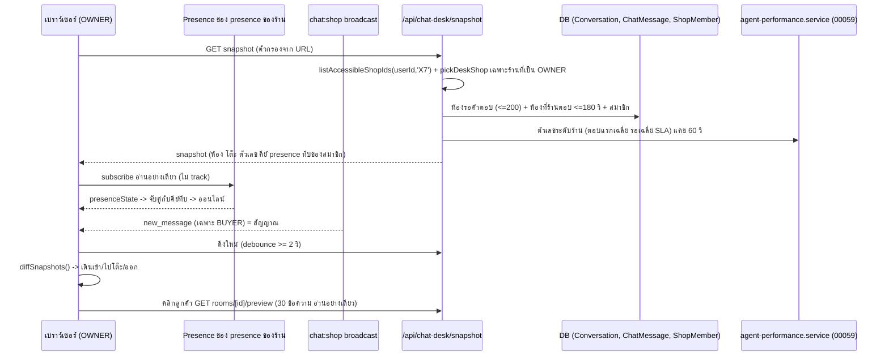
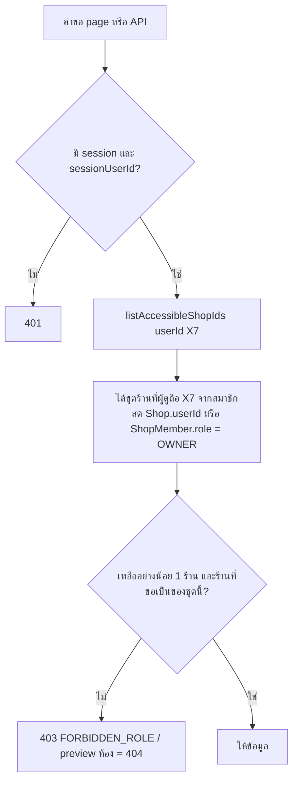

> **โมดูล:** 00077 - Chat Desk (โต๊ะแชท 3D)
> **ประเภทเอกสาร:** Business Requirements Document (BRD)
> **เวอร์ชัน:** 1.0
> **วันที่จัดทำ:** 2026-10-16
> **สถานะ:** Approved 2026-10-16
> **เจ้าของเอกสาร:** BA (ดู [[Feature-Docs-Ownership]])
> **ต้นแบบ:** gochat-v3 `doc-library/modules/assignment/BRD.md` BR-ASSIGNMENT-069 (บรรทัด 1208-1260)

# BRD: โต๊ะแชท 3D (Business Requirements Document)

> **สถานะการบังคับ** ยังไม่มีโค้ด ทุก AC ในเอกสารนี้ระบุตำแหน่งที่ "จะบังคับ" และเทสที่ต้องแดงเมื่อถอดบรรทัดนั้น ตามกติกา `docs/conventions/rule-must-be-enforced-not-described.md` ชื่อไฟล์/ฟังก์ชันที่ขึ้นต้นด้วย (ใหม่) เป็นข้อเสนอที่ SDS ยืนยัน ก่อน mark AC ว่าเสร็จต้องชี้บรรทัดจริงและผลรัน mutation

---

## 1. บทนำ

### 1.1 วัตถุประสงค์ของเอกสาร
1. กำหนดนิยามที่ทดสอบได้ของ "รอคำตอบ" "คนตอบล่าสุด" "เกินเวลาตอบ" "ออนไลน์"
2. กำหนดสิทธิ์ (OWNER เท่านั้น) และขอบเขตข้อมูลหลายร้าน
3. ระบุว่าตัวเลขทุกตัวใช้นิยามเดิมจากไหน (HR16)
4. ยืนยันว่าไม่มี schema change

### 1.2 ขอบเขตของระบบ

**เข้า (Input):** ห้องแชท (`Conversation`) และข้อความ (`ChatMessage`) ของร้านที่ผู้ดูเป็น OWNER · รายชื่อสมาชิกร้าน · สัญญาณ Presence · broadcast `new_message`

**ออก (Output):** ฉาก 3D + การ์ดตัวเลข + รายการ 2D + กล่องแชทอ่านอย่างเดียว

**ระบบที่เกี่ยวข้อง:** 00059, 00037, 00071, `chat.service.ts`, `thread-agents.service.ts`

### 1.3 กลุ่มผู้ใช้งาน

| กลุ่ม | สิทธิ์ |
|---|---|
| เจ้าของหลัก / เจ้าของร่วม (OWNER) | เปิดโต๊ะแชทของร้านที่ตนเป็น OWNER |
| ผู้ดูแล (ADMIN) | ไม่เห็นเมนู ถูกปฏิเสธที่ server |
| ผู้ไม่ล็อกอิน | ถูกปฏิเสธ |

---

## 2. ความต้องการหลัก

### 2.1 นิยามห้องบนฉาก
ดู §8.1 (BR-CD-01..08) ฉากแบ่งห้องเป็นสองกลุ่มที่ไม่ซ้อนกัน คือ รอคำตอบ (เลานจ์) กับ ร้านเพิ่งตอบ (หน้าโต๊ะ)

### 2.2 ตัวเลขภาพรวม
ดู §8.2 (BR-CD-09..13) และตารางนิยามเดียว §9

### 2.3 สิทธิ์และขอบเขตร้าน
ดู §8.3 (BR-CD-14..18) และ §5 ตารางสิทธิ์

### 2.4 ออนไลน์ (Presence)
ดู §8.4 (BR-CD-19..22)

### 2.5 การรีเฟรชและเหตุการณ์ในฉาก
ดู §8.5 (BR-CD-23..27)

### 2.6 อ่านอย่างเดียวและกล่องแชท
ดู §8.6 (BR-CD-28..31)

### 2.7 การแสดงผลและ fallback
ดู §8.7 (BR-CD-32..37)

---

## 3. Acceptance Criteria

> รูปแบบ **เมื่อ ... แล้ว ...** · คอลัมน์ "บังคับที่" ชี้ที่ที่จะมีโค้ดบังคับ · คอลัมน์ "เทสที่ต้องแดง" คือเทสที่ต้องล้มเมื่อถอดบรรทัดนั้น (พิสูจน์ด้วย mutation ตอนทำจริง)
> ชื่อไฟล์เสนอ `src/lib/chat-desk/rules.ts` (กฎล้วน ไม่แตะ DB) · `src/lib/chat-desk/scene-model.ts` · `src/lib/chat-desk/owner-scope.ts` · `src/services/chat-desk.service.ts` · `src/app/api/chat-desk/**` (ใหม่ทั้งหมด)

### 3.1 นิยามห้อง

| AC | เมื่อ ... แล้ว ... | บังคับที่ | เทสที่ต้องแดง |
|---|---|---|---|
| AC-CD-01 | ห้องเปิด ไม่ spam ไม่ hidden `lastSenderRole='BUYER'` และ `lastInboundAt` ไม่เกิน 7 วัน แล้ว ห้องนั้นอยู่เลานจ์ | `rules.ts` `classifyRoom()` + WHERE ใน `chat-desk.service.ts` | `rules.test.ts` ชุดเคส ปิดงาน/hidden/spam/8 วัน/ข้อความล่าสุดเป็น SHOP ต้องไม่เข้าเลานจ์ ทีละเงื่อนไข |
| AC-CD-02 | มีห้องรอคำตอบเกิน 200 ห้อง แล้ว เลือก 200 ห้องที่รอนานสุด และส่ง `awaitingTotalCapped=true` ป้ายขึ้น "200+" | `chat-desk.service.ts` (`take: 200` เรียง `lastInboundAt asc`) | เทส service 201 ห้อง: payload มี 200 และ flag เป็น true |
| AC-CD-03 | ร้านตอบห้องที่เปิดอยู่ภายใน 180 วินาที (ข้อความฝั่งร้านล่าสุดที่ไม่ใช่บรรทัดระบบ) แล้ว ห้องนั้นอยู่หน้าโต๊ะผู้ตอบ ไม่อยู่เลานจ์ | `rules.ts` `classifyRoom()` `RECENT_REPLY_WINDOW_SEC=180` | เทสขอบเขต 179/180/181 วินาที |
| AC-CD-04 | ข้อความฝั่งร้านล่าสุดเป็นบรรทัดระบบ (`AUTO_ORDER_RESULT` หรือ `META_NOTICE`) แล้ว ไม่นับเป็นคนตอบ ใช้ข้อความฝั่งร้านก่อนหน้าที่ไม่ใช่บรรทัดระบบแทน ถ้าไม่มีเลยไม่ขึ้นหน้าโต๊ะ | `chat-desk.service.ts` query ข้อความล่าสุดต้องกรอง `type NOT IN (INTERNAL_MESSAGE_TYPES)` (ทั้ง 2 ชนิด) | เทส service: ห้องมี SHOP จริง 1 ใบ + บรรทัดระบบใหม่กว่า -> โต๊ะตามใบจริง ลบเงื่อนไข type แล้วแดง |
| AC-CD-05 | ข้อความฝั่งร้านล่าสุดมี `autoReplyKind` ไม่ใช่ null แล้ว ลูกค้ายืนโต๊ะ "บอท Deep" | `rules.ts` `pickDesk()` ลำดับที่ 1 | เทสตาราง `pickDesk` ครบ 4 ชนิด + เคสชน (autoReplyKind และ viaStandby พร้อมกัน -> บอท) |
| AC-CD-06 | `viaStandby=true` และ `autoReplyKind=null` แล้ว โต๊ะ "Meta AI / กล่องของเพจ" | `pickDesk()` ลำดับที่ 2 | เทสเดียวกัน |
| AC-CD-07 | `senderUserId` เป็นสมาชิก/เจ้าของร้านนี้ แล้ว โต๊ะแอดมินคนนั้น | `pickDesk()` ลำดับที่ 3 | เทสเดียวกัน |
| AC-CD-08 | `senderUserId = null` (หรือไม่ใช่สมาชิกแล้ว) และไม่เข้าข้อ 05/06 แล้ว โต๊ะ "ตอบจากนอกระบบ" | `pickDesk()` ลำดับที่ 4 (ที่เหลือ) | เทสเดียวกัน |
| AC-CD-09 | ห้องหนึ่งเข้าได้ทั้งเลานจ์และหน้าโต๊ะ แล้ว เป็นของเลานจ์ (ข้อความล่าสุดเป็นลูกค้า = ยังไม่ถูกตอบ) | `classifyRoom()` ตรวจ awaiting ก่อน | เทส: ห้องที่ลูกค้าเพิ่งส่งหลังร้านตอบ 30 วินาที -> เลานจ์ |
| AC-CD-10 | ลูกค้าอยู่หน้าโต๊ะเกิน 3 คน แล้ว แสดง 3 คน ที่เหลือเป็น "+N" บนป้ายโต๊ะ | `scene-model.ts` `layoutDesk()` | `scene-model.test.ts` 0/3/4/10 คน |
| AC-CD-11 | ร้านไม่มีแอดมินในระบบเลย (เจ้าของคนเดียว) แล้ว ฉากแสดงโต๊ะเจ้าของ + โต๊ะตอบจากนอกระบบ ครบ ไม่ error | `scene-model.ts` | เทสร้านสมาชิก 1 คน + ห้องทุกชนิด |

### 3.2 ตัวเลข

| AC | เมื่อ ... แล้ว ... | บังคับที่ | เทสที่ต้องแดง |
|---|---|---|---|
| AC-CD-12 | เปิดหน้าช่วงเวลาเดียวกับ `/reports/agents` (ร้านและช่วง "วันนี้") แล้ว "ตอบแรกเฉลี่ย" และ "รอเฉลี่ย" เท่ากับค่าของรายงานทุกวินาที | `chat-desk.service.ts` เรียก `getShopResponseSummary` (export ใหม่ใน `agent-performance.service.ts` เพิ่มอย่างเดียว — ใช้ `summarizeShop` ตัวเดียวกับ `getAgentPerformanceOverview` ข้าม `fetchOrders`; ไม่มีฟังก์ชันระดับร้านมาก่อน) ห้ามคำนวณเอง | เทส parity (แพตเทิร์นเดียวกับ `agent-performance-sql-parity.test.ts`) ถ้าแทนด้วยสูตรเองต้องแดง + เทสสแกนซอร์สว่า `chat-desk.service.ts` ไม่มี `computeResponsePairs(` ที่เรียกซ้ำเอง และไม่มีการ AVG เอง |
| AC-CD-13 | ไม่มีตัวอย่างในช่วง (ไม่มีห้องที่ถูกตอบ) แล้ว แสดง "-" ห้ามแสดง 0 | `chat-desk.service.ts` คืน `null` + UI `formatDuration(null)` | เทสคืน null และเทส component |
| AC-CD-14 | ในช่วงมีคำตอบที่ระบุตัวคนไม่ได้ แล้ว ใต้ไทล์เวลาแสดง "นับเฉพาะคำตอบที่ระบุตัวคนได้ - ตอบจากนอกระบบ n ข้อความไม่รวม" ทุกครั้งที่ n > 0 | `chat-desk.service.ts` ส่ง `unattributedReplyCount` (จาก `summarizeShop`) + component ไทล์ | เทส component: n>0 ต้องมีป้าย n=0 ไม่มี |
| AC-CD-15 | เกินเวลาตอบ แล้ว นับห้องเลานจ์ที่ (เวลาปัจจุบัน - เวลาข้อความลูกค้าใบแรกของรอบที่ยังไม่ถูกตอบ) มากกว่า SLA จาก `resolveSlaConfig(shop)` (ปัจจุบัน 300 วินาที) | `rules.ts` `isOverdue(askedAt, now, slaSec)` | เทสขอบเขต SLA-1/SLA/SLA+1 และเทสสแกนซอร์สว่า `chat-desk.service.ts` เรียก `resolveSlaConfig(` และไม่มีเลข 300 ฮาร์ดโค้ด |
| AC-CD-16 | เวลาข้ามเที่ยงคืนไทย (เช่น 23:59:59 / 00:00:00 +07) แล้ว ตัวเลขรายวันเริ่มรอบใหม่ตามเวลาไทย ไม่ใช่ UTC | `thaiTodayBounds(now)` จาก `src/lib/date-range.ts` (นิยามเดียวของ "วันนี้" ไม่สร้าง `startOfBangkokDay` ใหม่) | เทสที่เวลา 16:59:59Z และ 17:00:00Z |
| AC-CD-17 | ออนไลน์ n/N แล้ว N = จำนวนสมาชิกที่ **`canChat`** (ถือ H1 — รวมเจ้าของ นับคนเดียวเมื่อซ้ำในสองตาราง; ผู้ดูแลที่ไม่มี H1 เช่น เปิดบิล/ช่าง ออนไลน์ใน presence ไม่ได้จึงไม่นับเข้า N) n = จำนวนที่ presence key ตรงสมาชิกกลุ่มนั้น | `chat-desk.service.ts` `loadDeskMembers()` (`canChat = can(effectiveRoles(...),'H1')`) + `scene-model.ts` | เทส: เจ้าของร้าน BUSINESS ที่มีแถว ShopMember ของตัวเองด้วย นับ 1 ไม่ใช่ 2 · สมาชิกไม่มี H1 ไม่อยู่ใน N |
| AC-CD-18 | ว่างรับแชท แล้ว = สมาชิกที่ออนไลน์ และจำนวนแชทในมือ = 0 (ไม่มีระบบมอบแชท จึงไม่มี "ว่างตามโควตา") | `scene-model.ts` `summarize()` | เทสตาราง ออนไลน์/แชทในมือ |
| AC-CD-19 | กำลังคุย แล้ว = จำนวนห้องหน้าโต๊ะแอดมินและโต๊ะตอบจากนอกระบบ ไม่นับ Meta AI และบอท | `scene-model.ts` `summarize()` | เทส ห้องโต๊ะ AI/บอทไม่เพิ่มตัวเลข |
| AC-CD-20 | ปิดงานวันนี้ (ตามคำตอบ Q-2) แล้ว นับห้อง `resolvedAt` ตั้งแต่ 00:00 ไทย และ `resolvedAt` ยังไม่ null (ห้องที่ลูกค้าทักกลับถูกล้างแล้ว ไม่นับ) | `chat-desk.service.ts` `countResolvedToday()` | เทส service ห้องปิดแล้วถูกล้าง -> ไม่นับ |

### 3.3 สิทธิ์

| AC | เมื่อ ... แล้ว ... | บังคับที่ | เทสที่ต้องแดง |
|---|---|---|---|
| AC-CD-21 | ADMIN เรียก `GET /api/chat-desk/snapshot` แล้ว 403 `FORBIDDEN_ROLE` ไม่มีข้อมูลใน body | route เรียก `listAccessibleShopIds(userId,'X7')` (`shop-capability.ts`) ก่อน query ข้อมูลใด ๆ ของทุก route + `pickDeskShop` (`owner-scope.ts` pure) | เทส route 3 บัญชี (OWNER 200 / ADMIN 403 / ไม่ล็อกอิน 401) |
| AC-CD-22 | ADMIN เปิดหน้า `/seller/chat-desk` โดยตรง แล้ว ถูกเปลี่ยนเส้นทาง/แสดงหน้าไม่มีสิทธิ์ ไม่มีข้อมูลร้านใน HTML (ไม่พึ่ง layout เป็นด่านสิทธิ์) | `page.tsx` ของหน้าเรียก `listAccessibleShopIds(userId,'X7')` เอง (ว่าง → `NoPermissionCard`) | เทส + QA browser |
| AC-CD-23 | ผู้ดูเป็น OWNER ร้าน A และ ADMIN ร้าน B (โหมดรวมแชท) แล้ว ฉากมีเฉพาะร้าน A ส่ง `shopId` ของ B ใน query -> 403/ถูกตัดทิ้ง | ชุดร้านมาจาก `listAccessibleShopIds(userId,'X7')` (อ่านสมาชิกสด ตั้งแต่ query แรก) แล้ว `pickDeskShop(owned, requested, active)` คืน null เมื่อร้านที่ขอไม่อยู่ในชุด → 403 ห้าม post-check | เทส: ส่ง shopId ของร้านที่เป็น ADMIN แล้วต้องไม่ได้ข้อมูล ถอดการกรองแล้วแดง |
| AC-CD-24 | ผู้ดูถูกถอดจาก OWNER ระหว่างเปิดหน้า แล้ว รอบ polling ถัดไป 403 และหน้าแสดงสถานะไม่มีสิทธิ์ ไม่ค้างข้อมูลเก่า | route ตรวจสิทธิ์ทุกคำขอ (ไม่ cache สิทธิ์ใน JWT) | เทส route สลับ role ระหว่างสองคำขอ |
| AC-CD-25 | เมนู "โต๊ะแชท" แล้ว ขึ้นเฉพาะ OWNER ของร้าน active | `seller-menu.ts` CHAT group + `BY_SLUG` | `chat-nav-rail-guard.test.ts` (มีอยู่) ขยายให้ครอบ slug ใหม่ + เทสว่า ADMIN ไม่เห็น |
| AC-CD-26 | preview ห้อง (`GET /api/chat-desk/rooms/[id]/preview`) ของร้านที่ผู้ดูไม่ใช่ OWNER แล้ว 404 (ไม่ใช่ 403 ไม่บอกว่าห้องมีอยู่) | `getRoomPreview(ownedShopIds, id)` ผูก `Conversation.shopId IN (ร้านที่ถือ X7)` ใน WHERE ของ query แรก ชุดว่าง/ไม่พบ → 404 เหมือนกันหมด | เทส route ห้องของร้านอื่น |

### 3.4 Presence

| AC | เมื่อ ... แล้ว ... | บังคับที่ | เทสที่ต้องแดง |
|---|---|---|---|
| AC-CD-27 | OWNER/ADMIN เปิดหน้าแชทของร้าน แล้ว ลงชื่อ presence ของร้านนั้น (ทุกร้านในขอบเขตแชทของผู้ใช้) | `useChatPresenceTracker` (ใหม่) ใน layout ของ `(chat)` | เทส hook (mock supabase client) ว่าเรียก `channel.track` ต่อร้าน |
| AC-CD-28 | ผู้ใช้เปิดแท็บแชทสองแท็บ แล้ว นับเป็น 1 คน (key ต่อคน ไม่ใช่ต่อแท็บ) ต่างจาก `useAuctionPresence` | `useChatPresenceTracker` ตั้ง `presence.key` = presence key ต่อคน | เทส: สอง instance key เดียวกัน -> `presenceState()` มี 1 key |
| AC-CD-29 | ผู้ดูหน้าโต๊ะแชทเปิดหน้าโดยไม่ได้เปิดหน้าแชท แล้ว ไม่ถูกนับออนไลน์ (หน้าโต๊ะ subscribe อ่านอย่างเดียว ไม่เรียก `track`) | `useChatDeskPresence` (ใหม่) ห้ามเรียก `.track(` | เทสสแกนซอร์สว่าไฟล์ไม่มี `.track(` + เทส hook |
| AC-CD-30 | presence key ที่ออกไปฝั่งเบราว์เซอร์ แล้ว ไม่เผย `userId` จริง (คีย์ทึบที่ server ออกให้ HMAC ของ `shopId:userId`) ผู้ที่รู้ `shopId` เข้าช่อง presence ไปก็อ่าน userId ของสมาชิกไม่ได้ | `src/lib/chat-desk/presence-key.ts` `presenceKeyFor()` + `GET /api/chat/presence-keys` (พหูพจน์ คืนคีย์ของตนเองทุกร้านในครั้งเดียว) | เทส: คีย์ต่างกันต่อร้าน และไม่มี userId อยู่ในสตริง |
| AC-CD-31 | Presence ล่ม/ต่อไม่ได้ แล้ว หน้าไม่ล้ม ออนไลน์แสดง "-" พร้อมป้ายว่าตรวจสถานะไม่ได้ ห้ามแสดง 0/N | `useChatDeskPresence` คืน `status: 'unavailable'` | เทส hook + component |

### 3.5 รีเฟรชและเหตุการณ์

| AC | เมื่อ ... แล้ว ... | บังคับที่ | เทสที่ต้องแดง |
|---|---|---|---|
| AC-CD-32 | เปิดหน้า แล้ว ดึง snapshot ทุก 8 วินาที (ค่า 5-10 ปรับได้ที่ค่าคงที่เดียว) | `useDeskSnapshot` (ใหม่) `POLL_INTERVAL_MS` | เทส fake timers |
| AC-CD-33 | แท็บถูกซ่อน แล้ว หยุด polling และหยุด requestAnimationFrame กลับมาแสดงแล้วดึงทันทีและวางฉากตามสถานะล่าสุดโดยไม่เล่นอนิเมชันย้อนหลัง | `useDeskSnapshot` + `DeskCanvas` ฟัง `visibilitychange` | เทส fake timers + `document.hidden` |
| AC-CD-34 | broadcast `new_message` ของร้านมาถึง แล้ว ดึง snapshot ใหม่ทันที (debounce ไม่น้อยกว่า 2 วินาที) payload ของ broadcast ใช้เป็นแค่คีย์ ต้องดึงผ่าน GET เสมอ ห้ามเชื่อเนื้อ | `useDeskSnapshot` ใช้ `subscribeShopChat()` ของ `chat-shop-realtime.ts` | เทส: ยิง signal 5 ครั้งใน 1 วินาที ได้ fetch 1 ครั้ง |
| AC-CD-35 | snapshot ซ้ำสองรอบเหมือนกัน แล้ว ไม่เกิดลูกค้าซ้ำและไม่มีเหตุการณ์ | `scene-model.ts` `diffSnapshots()` ใช้ id ห้องเป็นคีย์ | เทส: diff(a, a) = [] |
| AC-CD-36 | ห้องใหม่ในเลานจ์ แล้ว เหตุการณ์ "เดินเข้า" · ห้องย้ายจากเลานจ์ไปโต๊ะ แล้ว "เดินไปโต๊ะ" · ห้องหายจากชุด แล้ว "เดินออก" | `diffSnapshots()` | เทสตารางเหตุการณ์ |
| AC-CD-37 | snapshot แรกหลังเปิดหน้า แล้ว วางตัวละครตามตำแหน่งทันที ไม่เล่นเดินเข้าทั้งหมด และถ้าเหตุการณ์ในรอบเดียวมากกว่า 20 รายการ แล้ว เล่นเฉพาะ 20 ที่เหลือวาง ณ ตำแหน่ง | `diffSnapshots()` / `DeskCanvas` | เทส |
| AC-CD-38 | หน้าไม่มีสัญญาณสดฝั่งแอดมิน แล้ว ไม่มี UI ป้ายกำลังพิมพ์ เส้นแอดมินไปลูกค้า หรือฟองขาออก | ไม่มีโค้ด (OOS-2) | เทสสแกนซอร์ส: ไม่มี event `typing` / `viewing` ในโมดูล `chat-desk` |

### 3.6 อ่านอย่างเดียว

| AC | เมื่อ ... แล้ว ... | บังคับที่ | เทสที่ต้องแดง |
|---|---|---|---|
| AC-CD-39 | คลิกลูกค้า/แอดมิน แล้ว ไม่มีการเปลี่ยนแปลงข้อมูลใด (ไม่มี POST/PUT/PATCH/DELETE) | route ทั้งหมดใต้ `/api/chat-desk/` export เฉพาะ `GET` | เทสสแกนซอร์สทุกไฟล์ใต้ `src/app/api/chat-desk/**` ว่า export เฉพาะ `GET` (สแกนจากซอร์สจริง ไม่ใช่รายชื่อ hardcode) |
| AC-CD-40 | เปิดกล่องแชทอ่านอย่างเดียว แล้ว ห้องนั้นยังเป็น "ยังไม่อ่าน" (`shopLastReadAt` ไม่เปลี่ยน) และไม่ส่ง "seen"/sender action ไป Meta/LINE | route preview ไม่เรียก mark-read/`sendSenderAction`; query ล้วน `findMany` | เทส service: `shopLastReadAt` ก่อน-หลังเท่ากัน + เทสสแกนซอร์สว่าไม่มี `markRead`, `shopLastReadAt:` ในการเขียน, `sendSenderAction` |
| AC-CD-41 | กล่องแชท แล้ว แสดงไม่เกิน 30 ข้อความล่าสุด เรียงเก่าไปใหม่ ไม่มีช่องพิมพ์ ไม่มีปุ่มส่ง/ย้าย/มอบ/ปิดงาน | route `take: 30` + component | เทส route 31 ข้อความได้ 30 + เทส component ไม่มี textarea/button ส่ง |
| AC-CD-42 | ข้อความถูกลบ (`isDeleted`) แล้ว ไม่แสดงเนื้อหา แสดงเป็น "ข้อความถูกลบ" | route select/แปลงที่ server | เทส route |
| AC-CD-43 | payload ของ snapshot/preview แล้ว ไม่มีเบอร์โทร อีเมล หรือ token ใด ๆ ของลูกค้า | `chat-desk.service.ts` select เฉพาะฟิลด์ที่ระบุ | เทส payload (ตรวจ key ที่อนุญาตเท่านั้น allow-list) |
| AC-CD-44 | ปุ่ม "เปิดในหน้าข้อความ" แล้ว ไปที่ห้องนั้นของร้านนั้นในกล่องแชท (รวมกรณีสลับร้านถ้าจำเป็น) | component ลิงก์ผ่าน `LinkButton` | QA browser |

### 3.7 การแสดงผลและ fallback

| AC | เมื่อ ... แล้ว ... | บังคับที่ | เทสที่ต้องแดง |
|---|---|---|---|
| AC-CD-45 | เครื่องไม่มี WebGL หรือ Canvas ล้ม (error boundary) แล้ว เห็นโหมดรายการ 2D ที่มีตัวเลขและรายชื่อครบเท่า 3D | `DeskSceneBoundary` (ใหม่) + `DeskList2D` | E2E ปิด WebGL (flag เบราว์เซอร์) + เทส component ที่ throw ใน child |
| AC-CD-46 | asset 3D โหลดไม่ได้ (404/ใบอนุญาต/เครือข่าย) แล้ว ใช้แคปซูลแทน ฉากยังทำงาน | `useGLTF` ห่อ error boundary ระดับโมเดล | E2E บล็อกไฟล์ `.glb` |
| AC-CD-47 | ลูกค้าเกินเวลาตอบ แล้ว ตัวแดง + วงกะพริบ + ไอคอน tabler (ไม่ใช่ตัวอักษร emoji) บนป้าย และ `prefers-reduced-motion` แล้ว ไม่กะพริบ (แดงนิ่ง) | `DeskScene` | เทส component + `rg` emoji = 0 |
| AC-CD-48 | ตั้งตัวกรองเพจ/แพลตฟอร์ม/แอดมิน แล้ว ค่าอยู่ใน URL (`?platforms=…&pages=…&admins=…`) รีเฟรชแล้วยังอยู่ และฉาก ตัวเลข การ์ดช่องทาง ความเคลื่อนไหวกรองตามกัน | `src/lib/chat-desk/filters.ts` (ใหม่) `parseDeskFilters()` + `applyFilters()` | เทสตารางตัวกรอง (แพตเทิร์น `filterInput` ของต้นแบบ) |
| AC-CD-49 | ค่าตัวกรองไม่ถูกต้อง หรือชี้ไปเพจ/แอดมินที่ไม่อยู่ในร้านที่ผู้ดูเป็น OWNER แล้ว ถูกทิ้งเงียบ ฉากยังขึ้น (ไม่ 500) และ server ไม่คืนข้อมูลนอกขอบเขต | `parseDeskFilters()` (Valibot) + `chat-desk.service.ts` WHERE | เทส: id แปลกปลอม ไม่เพิ่มข้อมูล ไม่ error |
| AC-CD-50 | เลานจ์มีลูกค้ามากกว่า 24 แล้ว แสดง 24 ที่เหลือเป็นตัวเลขบนป้ายเลานจ์ ป้ายนั้นเป็นปุ่มเปิดรายชื่อได้ด้วยคีย์บอร์ด | `scene-model.ts` `LOUNGE_SEATS=24` + component | เทสโมเดล + E2E คีย์บอร์ด |
| AC-CD-51 | ผู้ใช้เลือก "ซ่อนตัวเลข" แล้ว ซ่อนป้ายตัวเลขบนฉากเท่านั้น การ์ดซ้ายยังอยู่ | component | E2E |
| AC-CD-52 | มือถือ (<768px) แล้ว เปิดเป็นโหมด 2D (ตามคำตอบ Q-1) พื้นที่แตะอย่างน้อย 44px | `DeskPage` | E2E 3 จอ |
| AC-CD-53 | three.js แล้ว โหลดเฉพาะหน้านี้ | `DeskCanvas` ผ่าน `next/dynamic` `ssr:false` ไม่ import `three`/`@react-three/*` จากไฟล์นอกโฟลเดอร์ของหน้า | เทสสแกนซอร์สทั้ง `src/` ว่ามี import `three` เฉพาะใต้โฟลเดอร์โต๊ะแชท + ตรวจ bundle |
| AC-CD-54 | ข้อความทุกตัวบนฉากแล้ว ใช้ Anuphan (DOM overlay) | `DeskLabel` | `rg` ฟอนต์ + ดูจริงในเบราว์เซอร์ |

### 3.8 ไม่มี schema change

| AC | เมื่อ ... แล้ว ... | บังคับที่ | เทสที่ต้องแดง |
|---|---|---|---|
| AC-CD-55 | merge ฟีเจอร์ แล้ว `git diff main -- prisma/` ว่างเปล่า (ไม่มีไฟล์ใหม่ใน `prisma/migrations/` ไม่แก้ `schema.prisma`) | ขั้นตอน sign-off | คำสั่ง `git diff --stat main -- prisma/` = 0 ไฟล์ บันทึกใน sign-off |
| AC-CD-56 | ปิดงานแล้ว push `main` แล้ว การ deploy ไม่รัน migration ใด ๆ ของฟีเจอร์นี้ (ไม่ต้องแจ้งเรื่อง HR15 ว่ามี migrate) | - | บันทึกใน PR |

---

## 4. Business Flows

### 4.1 Flow หลัก: ข้อมูลไหลจาก DB ถึงฉาก

### 4.2 Flow: ตัดสินสิทธิ์

---

## 5. Authorization Matrix

| การกระทำ | OWNER (หลัก/ร่วม) ของร้านนั้น | ADMIN ของร้านนั้น | ไม่ล็อกอิน |
|---|---|---|---|
| เห็นเมนู "โต๊ะแชท" | ใช่ | ไม่ | - |
| เปิดหน้า `/seller/chat-desk` | ใช่ | ไม่ (ไม่มีข้อมูลใน HTML) | ไม่ (ส่งไป sign-in) |
| `GET /api/chat-desk/snapshot` | 200 | 403 | 401 |
| `GET /api/chat-desk/rooms/[id]/preview` | 200 (ห้องของร้านที่เป็น OWNER) | 404 | 401 |
| `GET /api/chat/presence-keys` ออกคีย์ presence ของตน (อยู่ใต้ `/api/chat/` ไม่ใช่ `/api/chat-desk/` · capability H1) | 200 | 200 (ต้องลงชื่อ presence ได้ ดู BR-CD-20) | 401 |
| เขียนข้อมูลใด ๆ จากโต๊ะแชท | ไม่มี endpoint | ไม่มี | ไม่มี |

> หมายเหตุ ADMIN ลงชื่อ Presence ได้ (ต้องได้ เพื่อให้เจ้าของเห็นว่าแอดมินออนไลน์) แต่ไม่เปิดโต๊ะแชท จึงต้องแยก "ออกคีย์ presence ของตน" ออกจาก API ของโต๊ะแชท (ADMIN ต้องเรียกได้) — ข้อนี้ผูกกับ AC-CD-27, AC-CD-30

---

## 6. Use Case Scenarios

### Scenario 1: ร้านตอบจากนอกระบบ เป็นหลัก
ร้าน X มีเจ้าของคนเดียวตอบจากแอป Messenger ลูกค้า 3 คนได้รับคำตอบเมื่อ 1 นาทีก่อน -> ยืนหน้าโต๊ะ "ตอบจากนอกระบบ" ไม่มีโต๊ะแอดมินอื่น ไทล์ "ตอบแรกเฉลี่ย" แสดง "-" พร้อมป้าย "ตอบจากนอกระบบ 41 ข้อความไม่รวม"

### Scenario 2: แอดมิน A ตอบห้อง Y และห้อง Z
ทั้งสองห้องยืนหน้าโต๊ะ A ป้ายโต๊ะ "แชทในมือ 2" A ออนไลน์ (เปิดหน้าแชท) หลัง 3 นาที ถ้าไม่มีข้อความใหม่ ลูกค้าทั้งสองเดินออก ป้าย "แชทในมือ 0" A "ว่างรับแชท"

### Scenario 3: ลูกค้ารอเกิน SLA
ลูกค้าส่งข้อความ 14:00 ไม่มีใครตอบ 14:06 (SLA 5 นาที) ตัวแดง วงกะพริบ ไอคอนเตือน ไทล์ "เกินเวลาตอบ 1"

### Scenario 4: ผู้ดูแลถูกถอดสิทธิ์ระหว่างเปิดหน้า
เจ้าของร่วมถูกลดเป็น ADMIN ขณะเปิดโต๊ะแชท -> รอบดึงถัดไปได้ 403 หน้าเปลี่ยนเป็นสถานะไม่มีสิทธิ์

### Scenario 5: เจ้าของหลายร้าน
OWNER ร้าน A และ ADMIN ร้าน B ในโหมดรวมแชท -> ตัวสลับร้านมีเฉพาะ A

---

## 7. ความต้องการด้านคุณภาพ

| ด้าน | ความต้องการ |
|---|---|
| ความถูกต้อง | ตัวเลขเท่ากับ `/reports/agents` (AC-CD-12) นับไม่ครบต้องบอก (AC-CD-14, 02) |
| ความรวดเร็ว | snapshot เส้นทางปกติ (แคชรายวันโดน) = 3 การเรียก Prisma, แคชพลาด = 6 · SQL จริงที่วัดจาก `log:query` = 6 / 9 (Prisma แตก relation เป็น SQL แยก; ผลวัด SDS §7.4) — ตีความ "<= 4" เป็นเส้นทางปกติตาม SDS OQ-5 · ตัวเลขรายวันแคช 60 วินาทีต่อร้าน · three.js lazy |
| ความปลอดภัย | OWNER เท่านั้น ที่ server · WHERE ผูกร้านตั้งแต่ query แรก · PII ไม่ออกจาก server · presence key ทึบ |
| ความน่าเชื่อถือ | WebGL/asset/presence ล้ม = degrade ไม่ล้มทั้งหน้า |
| ใช้งานได้ | คีย์บอร์ด · 2D เป็นทางเลือก · reduced-motion |

---

## 8. กฎทางธุรกิจ (Business Rules) — SSOT ของฟีเจอร์

### 8.1 นิยามห้อง

| ID | กฎ |
|---|---|
| BR-CD-01 | ห้องที่นำมาพิจารณา = `Conversation` ของร้านที่เลือก `resolvedAt IS NULL` `isHidden=false` `isSpam=false` |
| BR-CD-02 | **รอคำตอบ** = ห้องตาม BR-CD-01 และ `lastSenderRole = 'BUYER'` และ `lastInboundAt` อยู่ภายใน 7 วันก่อนเวลาปัจจุบัน เลือกไม่เกิน 200 ห้องที่รอนานสุด (เรียง `lastInboundAt` น้อยไปมาก) ถ้าครบ 200 แสดง "200+" |
| BR-CD-03 | บรรทัดระบบ (`ChatMessage.type` อยู่ใน `INTERNAL_MESSAGE_TYPES` ของ `src/lib/auto-order-message-type.ts` = **2 ชนิด**: `AUTO_ORDER_RESULT` และ `META_NOTICE`) ไม่นับเป็นข้อความฝั่งร้านเลย (ไม่ใช่คนตอบ ไม่ตัดสินโต๊ะ ไม่ปิดการรอ) อ้างต้นแบบ `chat-metrics.service.ts` และ AC-ACO-61 ที่ระบุว่าบรรทัดระบบไม่แตะ `lastSenderRole`/`lastMessageAt` |
| BR-CD-04 | ข้อความที่ถูกลบ (`isDeleted`) ไม่นับเป็นคำตอบของคน (สอดคล้อง `isHumanAgentReply`) |
| BR-CD-05 | **คนตอบล่าสุด** = ผู้ส่งของข้อความฝั่งร้านล่าสุด (`senderRole='SHOP'`) ที่ไม่ใช่บรรทัดระบบ และ `createdAt` อยู่ภายใน 180 วินาที และห้องตาม BR-CD-01 และข้อความล่าสุดของห้องเป็นฝั่งร้าน (ถ้าลูกค้าส่งหลังจากนั้นห้องกลับเป็น "รอคำตอบ") |
| BR-CD-06 | **ลำดับตัดสินโต๊ะ** เมื่อข้อความเดียวเข้าได้หลายเงื่อนไข ตรวจตามลำดับและหยุดที่ข้อแรกที่ตรง 1) `autoReplyKind` ไม่ null -> โต๊ะบอท Deep 2) `viaStandby = true` -> โต๊ะ Meta AI / กล่องของเพจ 3) `senderUserId` เป็นสมาชิกหรือเจ้าของร้านนี้ -> โต๊ะแอดมินคนนั้น 4) ที่เหลือ -> โต๊ะตอบจากนอกระบบ |
| BR-CD-07 | ห้ามเรียกโต๊ะ "ตอบจากนอกระบบ" ว่า AI หรือบอท มันคือคนจริงที่ระบบระบุตัวไม่ได้ (นิยามเดียวกับ `isUnattributedShopReply`) |
| BR-CD-08 | ห้ามหนึ่งห้องอยู่ได้ที่เดียว รอคำตอบ (เลานจ์) ชนะหน้าโต๊ะเสมอ (ข้อความล่าสุดเป็นลูกค้าแปลว่ายังไม่ถูกตอบ) |

### 8.2 ตัวเลข

| ID | กฎ |
|---|---|
| BR-CD-09 | ตัวเลขรายวันทั้งหมดนับตั้งแต่ 00:00 เวลา Asia/Bangkok |
| BR-CD-10 | **เกินเวลาตอบ** = ห้องในเลานจ์ที่ (เวลาปัจจุบัน - เวลาของข้อความลูกค้าใบแรกของช่วงที่ยังไม่ถูกตอบ) > `resolveSlaConfig(shop).firstResponseSec` (`DEFAULT_FIRST_RESPONSE_SLA_SEC = 300`) "ใบแรกของช่วงที่ยังไม่ถูกตอบ" = ข้อความลูกค้าที่เก่าสุดที่ใหม่กว่าข้อความฝั่งร้านล่าสุด (ไม่ใช่ `lastInboundAt` ซึ่งเป็นใบล่าสุด และจะรีเซ็ตนาฬิกาเมื่อลูกค้าพิมพ์รัว) |
| BR-CD-11 | "ตอบแรกเฉลี่ย" "รอเฉลี่ย" ใช้ค่าระดับร้านของ `agent-performance.service.ts` (`firstResponseAvgSec`, `responseAvgSec`) ที่ `/reports/agents` ใช้ ห้ามคำนวณเอง ช่วง = "วันนี้" ตามเวลาไทย cohort ตามที่ 00059 กำหนด (ห้องที่เปิดในช่วง) |
| BR-CD-12 | **ข้อมูลไม่ครบ** สูตรของ 00059 นับเฉพาะคำตอบที่ระบุตัวคนได้ (`HUMAN_AGENT_REPLY_WHERE`) บน prod คือ 22% ของข้อความฝั่งร้าน (7 วันถึง 2026-10-16) ทุกครั้งที่ `unattributedReplyCount > 0` ไทล์ต้องบอกจำนวนข้อความที่ไม่รวม ครบ 3 สถานะ ครบ = ไม่มีป้าย · บางส่วน = ตัวเลขพร้อมป้าย · ไม่มีเลย = "-" ห้ามแสดง 0 (`partial-data-must-be-labeled-or-filled`) |
| BR-CD-13 | **รอคำตอบตอนนี้** (อ่านจากสถานะปัจจุบัน) ต่างจาก **รอเฉลี่ย** (ช่วงรอที่ถูกตอบแล้วตามคู่ใน `computeResponsePairs`) ต้องเรียกคนละชื่อบนจอ เพราะ "รอเฉลี่ย" ปิดช่วงรอด้วยคำตอบของคนที่ระบุตัวได้เท่านั้น ขณะที่ "รอคำตอบตอนนี้" ถือว่าคำตอบฝั่งร้านทุกชนิด (รวมตอบจากนอกระบบ) ตอบแล้ว ความต่างนี้ตั้งใจและต้องมีคำอธิบายบนจอ (ไอคอนข้อมูลที่ไทล์) |

### 8.3 สิทธิ์และขอบเขตร้าน

| ID | กฎ |
|---|---|
| BR-CD-14 | เฉพาะ OWNER = capability `X7` (เพิ่มใน `shop-permissions.ts`: `X7: [OWNER]`; แถว `X7` ใน 00071 BRD §8.3) ซึ่ง OWNER = `Shop.userId` หรือ `ShopMember.role = 'OWNER'` |
| BR-CD-15 | ขอบเขตร้าน = `listAccessibleShopIds(userId, 'X7')` (00071 merge แล้ว — อ่านบทบาทสดจาก `ShopMember` ทุกคำขอ) แล้ว `pickDeskShop` เลือกร้านตั้งต้น ห้ามดึงข้อมูลก่อนแล้วค่อยเช็ค · ไม่ใช้ `resolveChatScope().shopIds` เป็นชุดของโต๊ะ (ไม่มี role ต่อร้าน) และไม่มี helper `resolveOwnerDeskScope` · literal `'X7'` ต้องอยู่ใน route/page เองตามทะเบียน `route-capabilities.ts` |
| BR-CD-16 | ใช้ `sessionUserId()` ห้าม cast session (`session-exists-is-not-identity`) |
| BR-CD-17 | ตรวจสิทธิ์ทุกคำขอ ไม่ cache สิทธิ์ใน JWT และ page ต้องตรวจเองไม่พึ่ง layout (`feedback_layout_is_not_a_guard`) |
| BR-CD-18 | ฉากแสดงทีละร้าน ถ้า OWNER หลายร้าน มีตัวสลับร้านเฉพาะร้านที่เป็น OWNER ตัวเลขไม่รวมข้ามร้าน |

### 8.4 ออนไลน์

| ID | กฎ |
|---|---|
| BR-CD-19 | **ออนไลน์** = สมาชิก/เจ้าของที่ลงชื่อ Presence ของร้านนั้นอยู่ เพราะเปิดหน้าแชทของร้านนั้น (ใช้กลไก Supabase Presence เดียวกับ `useAuctionPresence`) ไม่แตะ schema |
| BR-CD-20 | ลงชื่อ Presence เกิดที่ layout ของหน้าแชท (ไม่ใช่หน้าโต๊ะแชท) ทุกบทบาทที่เข้าหน้าแชทลงชื่อได้ รวม ADMIN |
| BR-CD-21 | Presence key ต่อ **คน** (เปิดหลายแท็บ = 1 คน) ต่างจาก `useAuctionPresence` ที่ key ต่อแท็บ และเป็นคีย์ทึบ (HMAC ของ `shopId:userId` ออกโดย server) ไม่ใช่ `userId` จริง |
| BR-CD-22 | **ผู้ดูโต๊ะแชทไม่นับซ้ำแบบผิด** หน้าโต๊ะ subscribe ช่อง presence แบบอ่านอย่างเดียว ไม่เรียก `track` ผลคือ เจ้าของที่เปิดแต่โต๊ะแชทไม่ถูกนับว่าออนไลน์ ถ้าเปิดหน้าแชทอีกแท็บ = นับ 1 คน (ไม่ซ้ำ) แท็บเบื้องหลังนับเป็นออนไลน์ (ยอมรับ ดู Q-5) |

### 8.5 การรีเฟรชและเหตุการณ์

| ID | กฎ |
|---|---|
| BR-CD-23 | ดึง snapshot ทุก 8 วินาที (ช่วงที่อนุญาต 5-10 วินาที เป็นค่าคงที่เดียว) หยุดเมื่อแท็บซ่อน |
| BR-CD-24 | broadcast บน `chat:shop:{shopId}` ใช้เป็นสัญญาณเท่านั้น (payload = conversationId) ดึงผ่าน GET เสมอ ห้ามเชื่อเนื้อหา · `new_message` = ลูกค้าทัก (เดิม) · `shop_reply` = ร้านตอบ ทุกทางที่ข้อความร้านถูกบันทึก (ใน Deep / นอกระบบ / Meta AI / บอท) ยกเว้นบรรทัดระบบ (เพิ่ม 2026-10-17 · migration `20261016230000`) ⇒ ลูกค้าเดินไปหน้าโต๊ะภายใน ~2 วินาที ไม่ต้องรอ poll 8 วินาที |
| BR-CD-25 | เหตุการณ์ในฉากมาจากการเทียบ snapshot ต่อห้อง (id ห้องกันซ้ำ) ห้องใหม่ = เดินเข้า · ได้โต๊ะ = เดินไปโต๊ะ · กลับเลานจ์ = เดินกลับ · หลุดจากชุด = เดินออก |
| BR-CD-26 | "เดินออก" รวมหลายสาเหตุ (ปิดงาน ซ่อน spam ครบ 3 นาที หลุดเพดาน 200 หลุด 7 วัน) ระบบไม่มีเหตุการณ์ "ปิดงาน" ให้แยก การ์ดความเคลื่อนไหวจึงใช้คำว่า "ออกจากฉาก" ห้ามบอกว่า "ปิดงาน" |
| BR-CD-27 | รอบแรกไม่มีสัญญาณสดฝั่งแอดมิน (ไม่มีป้ายกำลังพิมพ์ ไม่มีเส้นแอดมินไปลูกค้า ไม่มีฟองขาออก) |

### 8.6 อ่านอย่างเดียว

| ID | กฎ |
|---|---|
| BR-CD-28 | ทุก endpoint ของโต๊ะแชทเป็น `GET` |
| BR-CD-29 | กล่องแชทอ่านอย่างเดียว 30 ข้อความ ไม่แตะ `shopLastReadAt` ไม่ส่ง seen/sender action |
| BR-CD-30 | ข้อมูลลูกค้าที่ออกจาก server = ชื่อแสดง ช่องทาง เวลา ไม่มีเบอร์/อีเมล/token |
| BR-CD-31 | ปุ่ม "เปิดในหน้าข้อความ" เป็นทางเดียวที่นำไปสู่การกระทำ (ไปหน้าเดิมของระบบ) |

### 8.7 การแสดงผล

| ID | กฎ |
|---|---|
| BR-CD-32 | เลานจ์ 24 ที่นั่ง ที่เหลือเป็นตัวเลข |
| BR-CD-33 | โต๊ะแอดมินแสดงสมาชิกทุกคนของร้าน (รวมเจ้าของ) แม้ออฟไลน์ (ลดความเข้ม) |
| BR-CD-34 | หน้าโต๊ะแถวเดียว แสดง 3 คน เกิน = "+N" บนป้ายโต๊ะ |
| BR-CD-35 | ฉากใช้หน้าตาเดียว (คาเฟ่ไม้) ไม่มีแผงตั้งค่า |
| BR-CD-36 | สีตัวลูกค้าตาม **สถานะ** (รอคำตอบ = warning · ร้านเพิ่งตอบ = info · เกินเวลาตอบ = danger · เดินเข้า/ออก = เทา) ช่องทางแสดงด้วยโลโก้ `ChannelMark` บนป้าย ไอคอนเตือนเป็นไอคอน tabler (แก้ 2026-10-16 ตาม Design Spec — เดิม "สีตามช่องทาง") |
| BR-CD-37 | ฉากไม่เป็นที่เดียวที่แสดงข้อมูล ต้องมีโหมด 2D ข้อมูลชุดเดียวกันเสมอ |

---

## 9. อภิธานศัพท์ — นิยามเดียวทั้งระบบ (HR16)

| คำ | นิยามในฟีเจอร์ | แหล่งนิยามเดิม / สถานะ |
|---|---|---|
| รอคำตอบ (ตอนนี้) | BR-CD-02 | ใหม่ แต่ผูกกติกา unread เดิม `lastSenderRole IS DISTINCT FROM 'SHOP'` (`chat.service.ts:463`) |
| คนตอบ / ตอบโดยคน | `isHumanAgentReply` / `HUMAN_AGENT_REPLY_WHERE` | `src/lib/agent-performance.ts:63,85` (นำมาใช้ ไม่พิมพ์เงื่อนไขซ้ำ) |
| ตอบจากนอกระบบ | `isUnattributedShopReply` | `agent-performance.ts:93` |
| Meta AI / กล่องของเพจ | `ChatMessage.viaStandby` (ตัวแทนที่ใกล้สุด) | `schema.prisma:2215` ไม่ใช่คอลัมน์ AI โดยตรง |
| บอท Deep | `autoReplyKind` ไม่ null (AUTO, AUTO_TEST) | `agent-performance.ts:23` |
| บรรทัดระบบ | `type = AUTO_ORDER_RESULT` | `auto-order-message-type` |
| ตอบแรกเฉลี่ย / รอเฉลี่ย | `firstResponseAvgSec` / `responseAvgSec` ระดับร้าน | `agent-performance.service.ts` + `summarizeShop` (00059) |
| เกินเวลาตอบ (SLA) | `resolveSlaConfig` / `DEFAULT_FIRST_RESPONSE_SLA_SEC=300` | `src/lib/agent-sla.ts:26,43` |
| ปิดงานวันนี้ | **ไม่พบนิยามเดิมใน 00059** ข้อเสนอตาม Q-2 | ใหม่ ลงทะเบียนที่นี่ที่เดียว |
| ออนไลน์ | BR-CD-19 | ใหม่ (ไม่มีนิยามเดิมในระบบ) |
| ว่างรับแชท | ออนไลน์ และแชทในมือ = 0 | ใหม่ (ระบบไม่มีโควตา/มอบแชท) |
| กำลังคุย | ห้องหน้าโต๊ะแอดมินและโต๊ะตอบจากนอกระบบ | ใหม่ |

---

## 10. ข้อจำกัด

### 10.1 ข้อจำกัดทางธุรกิจ
อ่านอย่างเดียว · OWNER เท่านั้น · ไม่มีทีม/คิว

### 10.2 ข้อจำกัดทางเทคนิค
- **ไม่มี schema change** ยืนยัน ไม่มีตารางใหม่ ไม่มีคอลัมน์ใหม่ ไม่มี migration ไม่มี enum ใหม่ ทุกค่ามาจากตารางเดิมและ Presence ที่ไม่ลงฐานข้อมูล (AC-CD-55)
- ไม่มี SSE inbox polling 20 วินาทีเดิม ไม่ถูกเปลี่ยน
- dependency ใหม่ three, @react-three/fiber, @react-three/drei (ทะเบียนใน SDS)
- asset CC0 เท่านั้น
- `docs/SRS.md` ต้อง sync ส่วน API reference (endpoint ใหม่ 3 เส้น: snapshot, preview, ออกคีย์ presence) ไม่ต้อง sync data model/enum
- ความเสี่ยงที่ต้องตรวจใน SDS: ตั้งชื่อ route ไม่ชน slug/ชื่อไฟล์สงวนของ App Router · EXPLAIN ของ query "ใบแรกของช่วงที่ยังไม่ถูกตอบ" ที่ 200 ห้อง · แคช 60 วินาทีบนเซิร์ฟเวอร์ไร้สถานะ (แคชต่ออินสแตนซ์ ไม่ใช่การรับประกันค่าตรงกันทุกเครื่อง)
- **ข้อจำกัดที่รู้ตัว KL-1** ห้องที่ข้อความลูกค้าล่าสุดถูกลบ ยังอยู่เลานจ์ จนกว่าจะมีข้อความใหม่หรือปิดงาน (ใช้ `lastSenderRole` ที่เป็นภาพนิ่ง) ผล = ลูกค้าค้างเลานจ์เกินจริงในกรณีหายาก

---

## 11. Hard Rule ที่เกี่ยวข้อง

| HR | ผลต่อฟีเจอร์ |
|---|---|
| HR1 theme-copy | **ยกเว้นเฉพาะฉาก 3D** (มติ user 2026-10-16) เปลือกรอบฉาก (การ์ด แผง ปุ่ม แถบเครื่องมือ ตัวกรอง) ต้อง copy จาก Paces ตามปกติ commit ที่แตะ UI ต้องมี `Base: theme/...` (HR3) |
| HR2 | ห้าม `component={Link}` ใน server component ใช้ `LinkButton` สำหรับ "เปิดในหน้าข้อความ" |
| HR4 | งาน >= 3 tasks = agent team + retro |
| HR5 | Anuphan เท่านั้น ข้อความบนฉากใช้ DOM overlay |
| HR7 | `(paces)/**` ห้าม arbitrary Tailwind ม่วง #7367F0 = buyer เท่านั้น |
| HR8 | frontend ทุกชิ้นผ่าน `safepay-ux` + `/impeccable critique` + `clarify` |
| HR9 | toast ใน `(paces)/**` = `pacesToast` |
| HR10 | แถบสัดส่วนช่องทางใช้ progress ของ Paces ไม่ใช่กราฟ ถ้าจะใช้กราฟต้องผ่าน `ApexChart` |
| HR11 | PRD+BRD ผ่าน user ก่อนโค้ด · `diff` ชื่อไฟล์กับ template · sync `docs/SRS.md` (API ใหม่) · diagram = Mermaid |
| HR12 | ห้าม emoji (ต้นแบบใช้ตัวอักษรเตือน) ใช้ไอคอน tabler |
| HR13/14 | เทสที่แตะ DB ห้ามลบข้อมูลไม่ scope · `npm test` override `DATABASE_URL` เป็น localhost:5434 |
| HR15 | ไม่มี migration จึงไม่ต้องแจ้งสามข้อ |
| HR16 | นิยามเดียว ตาราง §9 |
| HR17 | rebase: ไฟล์ที่สองฝั่งแตะ (โดยเฉพาะ layout ของ `(chat)` ที่มีงานค้างใน working tree) ต้องอ่าน diff อีกฝั่ง |

---

## 12. สรุป

โต๊ะแชทเป็นหน้าอ่านอย่างเดียวสำหรับ OWNER ที่เปลี่ยนสถานะแชท ณ ตอนนี้เป็นฉากและตัวเลขที่ตรงกับรายงานเดิม ไม่แตะ schema ความเสี่ยงหลักคือนิยามตัวเลข (นับไม่ครบ 22%) และ Presence ที่ยังไม่มีในหน้าแชท ทั้งสองถูกล็อกด้วย BR-CD-11..13 และ BR-CD-19..22
