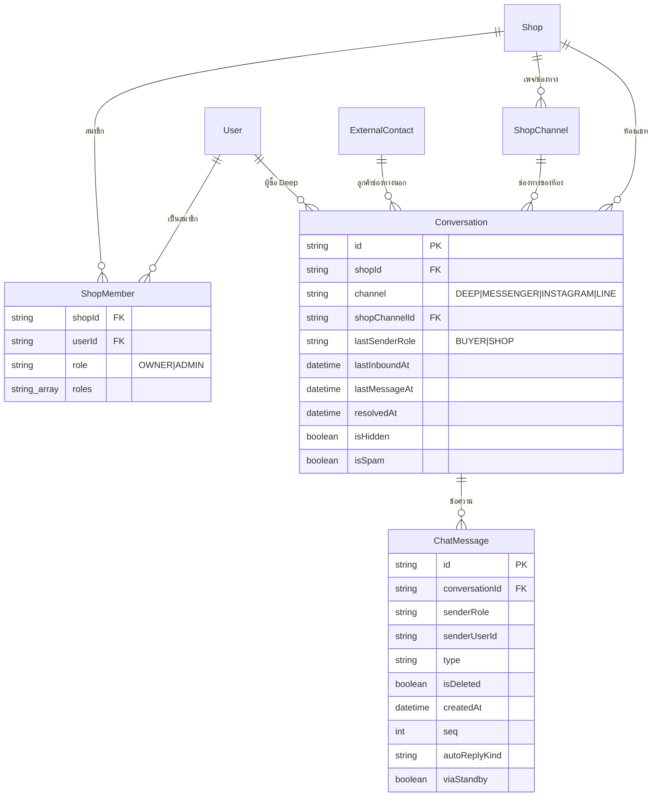

> **โมดูล:** 00077 - Chat Desk · **ประเภท:** DATABASE Design · **เวอร์ชัน:** 1.0 · **วันที่:** 2026-10-16 · **สถานะ:** Draft
> **เจ้าของเอกสาร:** SA (ดู [[Feature-Docs-Ownership]])

# DATABASE: โต๊ะแชท 3D

## 1. Overview
**ยืนยัน: ไม่มี schema change** ไม่มีตารางใหม่ คอลัมน์ใหม่ enum ใหม่ index ใหม่ หรือ migration (OOS-6, AC-CD-55/56) ฟีเจอร์อ่านตารางเดิมของ Postgres 16 (Supabase) ผ่าน Prisma 6.19.1 และ `$queryRaw` แบบอ่านอย่างเดียว

- **เอกสารออกแบบต้นทาง:** [[SDS]] §7
- **Store ที่เกี่ยวข้อง:** Postgres เดียว · สถานะ presence อยู่ใน Supabase Realtime (ในหน่วยความจำ ไม่ลง DB) · แคชตัวเลขรายวันอยู่ในหน่วยความจำของอินสแตนซ์
- **ผลต่อ HR15:** ไม่มี migration จึงไม่ต้องแจ้งสามข้อก่อน push

## 2. ERD (ตารางที่อ่าน)


## 3. Tables (คอลัมน์ที่อ่านเท่านั้น)
### 3.1 `Conversation` (Postgres)
อ่าน: `id, shopId, channel, shopChannelId, externalContactId, buyerUserId, alias, lastSenderRole, lastInboundAt, lastMessageAt, resolvedAt, isHidden, isSpam, shopLastReadAt (ไม่เขียน)` · schema `prisma/schema.prisma` L1940 · รองรับ SDS §7.2

### 3.2 `ChatMessage` (Postgres)
อ่าน: `id, conversationId, senderRole, senderUserId, type, body (เฉพาะ preview), isDeleted, createdAt, seq, autoReplyKind, viaStandby` · L2132 · **ไม่อ่าน** `rawMessage` (global omit ที่ `src/lib/prisma.ts` และ raw SQL ต้องระบุคอลัมน์) `cards` `sendPayload` `imageUrl`

### 3.3 `Shop` / `ShopMember` / `User` / `ShopChannel` / `ExternalContact`
อ่าน: `Shop(shopName, kind, vertical, userId, deletedAt)` · `ShopMember(userId, role, roles)` L1384 · `User(displayName)` · `ShopChannel(id, name, provider)` L1784 (**ห้าม select** `accessTokenEnc`, `channelSecretEnc`, token อื่น) · `ExternalContact(name)` L1899

## 4. Indexes (ที่มีอยู่แล้ว ใช้อย่างเดียว)
| Table | Columns | Type | Query pattern ที่รองรับ |
|---|---|---|---|
| `Conversation` | `(shopId, lastInboundAt)` | BTREE | ห้องรอคำตอบ ช่วง 7 วัน เรียงรอนานสุด `LIMIT 201` |
| `Conversation` | `(shopId, lastMessageAt)` | BTREE | ห้องที่ร้านเพิ่งตอบ ≤ 180 วินาที |
| `Conversation` | `(shopId, createdAt)` | BTREE | cohort ของ 00059 (ใช้โดย `getShopResponseSummary`) |
| `ChatMessage` | `(conversationId, createdAt)` | BTREE | LATERAL หาข้อความร้านล่าสุด / ข้อความลูกค้าใบแรกของช่วงรอ / preview 30 ใบ |
| `ShopMember` | `(shopId, userId)` UNIQUE · `(userId)` | BTREE | รายชื่อสมาชิก · `listAccessibleShopIds` |
**ไม่มี index บน** `Conversation(resolvedAt)` และ `Conversation(shopId, lastSenderRole)` — ห้ามเพิ่ม (OOS-6) ความเสี่ยงอยู่ที่ [[SDS]] §7.3

## 5. Migration Plan

> **แก้ 2026-10-17 (ส่วนขยาย):** มี migration 1 ตัว `20261016230000_chat_shop_reply_broadcast` — `CREATE OR REPLACE FUNCTION public.chat_message_realtime_broadcast()` เพิ่ม event `shop_reply` บน `chat:shop:{shopId}` เมื่อ INSERT ข้อความ SHOP ที่ไม่ใช่บรรทัดระบบ · **ไม่มีตาราง/คอลัมน์/index/enum ใหม่ ไม่แตะ schema.prisma** · trigger เดิมไม่สร้างใหม่ · rollback = re-apply ฟังก์ชันใน `20260823110000_chat_broadcast_on_status_update` (ไม่มี data loss) · AC-CD-55 (`prisma/` diff = 0) ใช้กับรอบ 1 (PR #168) เท่านั้น

### 5.1 ลำดับการ Migrate
| ลำดับ | การเปลี่ยนแปลง | Store | หมายเหตุ |
|---|---|---|---|
| — | ไม่มี | — | ไม่ต้อง dispatch `safepay-database` |
### 5.2 Rollback
ไม่มีอะไรต้องย้อน
### 5.3 Impact
ไม่มี downtime/lock · ภาระอ่านเพิ่มจาก polling ทุก 8 วินาที/ผู้ดู (เส้นทางปกติ 3 การเรียก) · แคชรายวันจำกัด ≤ 1 คำนวณ/60 วินาที/ร้าน/อินสแตนซ์

### 5.4 คำสั่งตรวจ (ใช้ตอน sign-off)
```
git diff --stat main -- prisma/        # ต้องว่าง (AC-CD-55)
```

## 6. Retention / ข้อควรระวัง
- **Data Retention:** ไม่เก็บข้อมูลใหม่ (ไม่มี snapshot ย้อนหลัง OOS-11)
- **PII:** payload snapshot ไม่มีเบอร์/อีเมล/token/avatar; ชื่อแสดงมาจาก `alias`/`ExternalContact.name`/`User.displayName` (`alias` เป็นข้อความอิสระที่ร้านพิมพ์เอง อาจมีเบอร์ปนได้ ยอมรับเพราะผู้ดูคือเจ้าของ) preview ส่งเนื้อข้อความตามที่เจ้าของอ่านได้ในกล่องแชทอยู่แล้ว ตัดที่ 2000 ตัวอักษร ไม่ส่ง URL ไฟล์
- **Performance:** ดู SDS §7.3 (สแกนช่วง 7 วัน, `resolvedToday` ไม่มี index) ยังไม่ได้วัด EXPLAIN
- **Consistency ข้าม store:** ออนไลน์มาจาก presence (ไม่ใช่ DB) · `lastSenderRole/lastMessageAt` เป็นภาพนิ่งที่ `sendMessage` เขียนใน transaction เดียวกับข้อความ (บรรทัดระบบไม่แตะ) ห้องที่ข้อความลูกค้าล่าสุดถูกลบยังอยู่เลานจ์ (KL-1)
- **ห้าม:** เทสที่แตะ DB ต้อง scope ด้วย id ที่เทสสร้างเอง ชี้ localhost:5434 เท่านั้น (HR13/14)

## 7. Traceability
| Table / Query | SDS | สถานะ |
|---|---|---|
| `Conversation` + `ChatMessage` rooms query | §7.2 / TD-06 | Draft |
| `Shop`/`ShopMember`/`ShopChannel` directory | §7.1 #1 / TD-14 | Draft |
| daily (00059 facts + count) | §5.1 / TD-04, TD-05 | Draft |

## 8. สรุป
ฟีเจอร์นี้ไม่เปลี่ยนโครงสร้างข้อมูล อ่านตารางเดิมด้วย index เดิม และมีคำสั่งตรวจ `git diff --stat main -- prisma/` เป็นหลักฐาน

**Open Questions:** OQ-6 (`resolvedToday` นับ spam/hidden หรือไม่)
