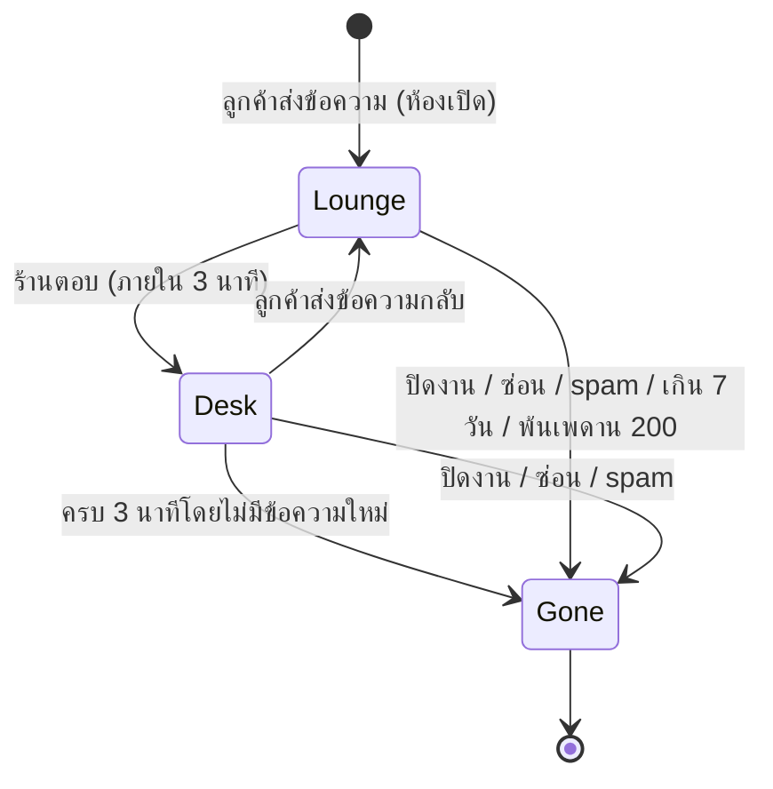
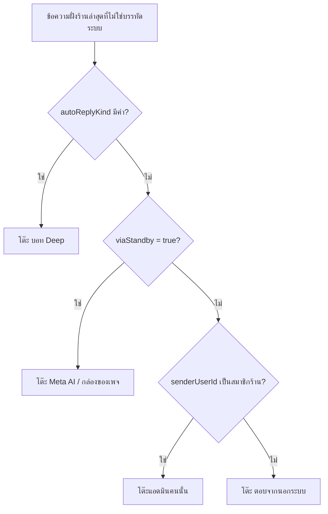

> **โมดูล:** 00077 - Chat Desk (โต๊ะแชท 3D)
> **ประเภทเอกสาร:** Product Requirements Document (PRD)
> **เวอร์ชัน:** 1.0
> **วันที่จัดทำ:** 2026-10-16
> **สถานะ:** Approved 2026-10-16 (user "ลุยต่อเลย" = รับค่าแนะนำ Q-1..Q-5 ทั้งหมด)
> **เจ้าของเอกสาร:** BA + PO + PM (ดู [[Feature-Docs-Ownership]])
> **ต้นแบบ:** gochat-v3 `3D-Chat-Desk` BR-ASSIGNMENT-069 (ขึ้น prod แล้ว) · ฉบับนี้ตัดส่วนที่พึ่งระบบมอบแชท/ทีมออก

# PRD: โต๊ะแชท 3D (Chat Desk)

---

## Executive Summary

เจ้าของร้านที่มีแอดมินหลายคนมองไม่เห็นว่า "ตอนนี้ลูกค้าใครรออยู่ ใครกำลังคุยกับใคร ใครตอบช้า" ต้องไล่เปิดกล่องแชทแล้วนับเอง หรือไปอ่านรายงานผลงาน 00059 ซึ่งเป็นภาพย้อนหลัง ไม่ใช่ภาพ ณ ตอนนี้

ฟีเจอร์นี้เพิ่มหน้า **โต๊ะแชท** ฉากห้องทำงานจำลองมุม isometric แบบ **อ่านอย่างเดียว** ลูกค้าที่รอคำตอบนั่งในเลานจ์ ลูกค้าที่ร้านเพิ่งตอบ (ภายใน 3 นาที) ยืนหน้าโต๊ะของคนที่ตอบล่าสุด ลูกค้าที่รอเกินเวลาตอบเป็นสีแดง ข้างฉากมีตัวเลขภาพรวมของวันนี้ เจ้าของเปิดดูได้คนเดียว (OWNER) ไม่มีการสั่งงานใด ๆ จากฉาก

**ข้อเท็จจริงจาก prod (SELECT 7 วันล่าสุด ณ 2026-10-16)** กำหนดรูปร่างของฉาก ข้อความฝั่งร้าน 10,096 ข้อความ แยกเป็น

| ผู้ตอบ | ข้อความ | สัดส่วน | ร้านที่เกี่ยว |
|---|---:|---:|---|
| ตอบจากนอกระบบ (Business Suite / แอปแพลตฟอร์ม ระบุตัวคนไม่ได้) | 6,714 | 66% | 4 ร้าน |
| `viaStandby` (กล่องของเพจ / Meta AI ถือห้อง) | 1,194 | 12% | 1 ร้าน |
| คนในระบบ ระบุตัวได้ | 2,188 | 22% | 3 ร้าน (4 คน) |
| บอท Deep (`autoReplyKind` AUTO) | 0 | 0% | - |

ผลต่อการออกแบบ ฉากต้องมีโต๊ะ 3 ชนิดที่ไม่ใช่แอดมินคู่กับโต๊ะแอดมิน คือ **โต๊ะ "ตอบจากนอกระบบ"** (คนจริงที่ระบบระบุตัวไม่ได้ ห้ามเรียกว่า AI) **โต๊ะ "Meta AI / กล่องของเพจ"** และ **โต๊ะ "บอท Deep"** โต๊ะตอบจากนอกระบบ จะแน่นที่สุดบนข้อมูลจริง และฉากต้องใช้งานได้กับร้านที่ไม่มีแอดมินในระบบเลย (เหลือเจ้าของคนเดียวกับโต๊ะตอบจากนอกระบบ)

---

## 1. Business Goals & KPIs

### 1.1 เป้าหมายทางธุรกิจ

| เป้าหมาย | รายละเอียด |
|----------|-----------|
| **เห็นภาพ ณ ตอนนี้ในหน้าเดียว** | ใครรอ ใครคุย ใครเกินเวลา โดยไม่ต้องเปิดกล่องแชททีละห้อง |
| **จับแชทที่ค้างได้เร็ว** | ลูกค้าที่รอเกินเวลาตอบเด่นพอที่เจ้าของเห็นในไม่กี่วินาที |
| **ตัวเลขตรงกับรายงานเดิม** | ใช้นิยามของ 00059 ไม่ตั้งสูตรใหม่ (HR16) และบอกตรง ๆ เมื่อข้อมูลมาไม่ครบ |
| **ไม่ทำให้ระบบเดิมเสี่ยง** | ไม่มี migration ไม่มีการเขียน ไม่แตะสถานะ "อ่านแล้ว" |

### 1.2 ตัวชี้วัดความสำเร็จ (KPIs)

| KPI | คำอธิบาย | เป้าหมาย |
|-----|----------|---------|
| **ตัวเลขตรงนิยามเดิม** | ค่า "ตอบแรกเฉลี่ย" "รอเฉลี่ย" บนโต๊ะแชทเท่ากับ `/reports/agents` ช่วงและร้านเดียวกัน | ต่าง 0 วินาที (เทส parity) |
| **ความปลอดภัย** | จำนวนครั้งที่ ADMIN/ไม่ล็อกอินเรียกข้อมูลโต๊ะแชทสำเร็จ | 0 |
| **การเขียนจากฉาก** | จำนวน endpoint เขียนที่หน้านี้เรียก | 0 |
| **ภาระ DB** | query ต่อ snapshot | เส้นทางปกติ 3 การเรียก Prisma / แคชรายวันพลาด 6 (SQL จริงวัดได้ 6 / 9 — SDS §7.4 · ตีความ "ไม่เกิน 4" เป็นเส้นทางปกติ ตาม SDS OQ-5) |
| **การนำไปใช้** | เจ้าของที่เปิดหน้า ใน 30 วันหลังขึ้นระบบ | รายงานค่า (ไม่ตั้งเป้า) |

---

## 2. User Personas (กลุ่มผู้ใช้งาน)

### 2.1 เจ้าของร้านที่มีแอดมินหลายคน (ผู้ใช้หลักและผู้ใช้เดียวของรอบนี้)

**ข้อมูลพื้นฐาน:** เจ้าของหลัก (`Shop.userId`) หรือเจ้าของร่วม (`ShopMember.role = OWNER`) ร้านรับแชทหลายช่องทาง (Deep / Messenger / Instagram / LINE) ทีมตอบแชท 1-10 คน บางส่วนตอบจากแอปของแพลตฟอร์มโดยตรง

**เป้าหมาย:** รู้ว่าลูกค้ารออยู่กี่คน ใครรอนานเกินไป ใครว่าง ใครกำลังคุย

**จุดปวด:**
- ต้องเปิดกล่องแชททีละห้องเพื่อนับคนรอ
- รายงาน 00059 บอกผลย้อนหลัง ไม่ใช่ตอนนี้
- ตอบจาก Business Suite แล้วระบบเห็นแต่ "ไม่ทราบผู้ตอบ" เจ้าของไม่รู้ว่าใครตอบ

### 2.2 ผู้ดูแล (ADMIN)

ไม่ใช่ผู้ใช้ของรอบนี้ ไม่เห็นเมนูและถูกปฏิเสธที่ server (มติ user 2026-10-16) 00071 (บทบาทสมาชิก) merge แล้ว และตัดสินด้วย capability `X7` = เจ้าของเท่านั้น ทุกบทบาทของ ADMIN ไม่มีสิทธิ์

---

## 3. User Stories

| ID | เรื่องราว | ตัวอย่างที่ทดสอบได้ |
|----|----------|------------------|
| US-CD-1 | ในฐานะเจ้าของ ฉันอยากเห็นลูกค้าที่รอคำตอบทั้งหมดในที่เดียว | มีห้อง 5 ห้องที่ข้อความล่าสุดเป็นของลูกค้า -> เห็นลูกค้า 5 คนในเลานจ์ |
| US-CD-2 | ในฐานะเจ้าของ ฉันอยากรู้ว่าตอนนี้ใครกำลังคุยกับลูกค้ากี่คน | แอดมิน A ตอบห้อง X เมื่อ 1 นาทีก่อน -> ลูกค้าห้อง X ยืนหน้าโต๊ะ A และป้ายโต๊ะ A แสดงจำนวน |
| US-CD-3 | ในฐานะเจ้าของ ฉันอยากเห็นทันทีว่าลูกค้าคนไหนรอเกินเวลาตอบ | รอเกิน SLA -> ตัวสีแดง วงกะพริบ ไอคอนเตือน |
| US-CD-4 | ในฐานะเจ้าของร้านที่ตอบจาก Business Suite ฉันอยากให้การตอบเหล่านั้นปรากฏบนฉาก ไม่หายไป | ห้องที่ตอบจากนอกระบบ ยืนหน้าโต๊ะ "ตอบจากนอกระบบ" |
| US-CD-5 | ในฐานะเจ้าของ ฉันอยากอ่านข้อความล่าสุดของลูกค้าโดยไม่ทำให้แชทกลายเป็น "อ่านแล้ว" | คลิกลูกค้า -> เห็น 30 ข้อความ ห้องยังเป็น "ยังไม่อ่าน" ในกล่องแชท |
| US-CD-6 | ในฐานะเจ้าของ ฉันอยากกรองฉากตามเพจ แพลตฟอร์ม แอดมิน และแชร์ลิงก์มุมมองนั้นได้ | URL มีตัวกรอง รีเฟรชแล้วยังอยู่ |
| US-CD-7 | ในฐานะเจ้าของ ฉันอยากเห็นตัวเลขภาพรวมของวันนี้ที่ตรงกับรายงานผลงาน | ค่าตรงกับ `/reports/agents` |
| US-CD-8 | ในฐานะเจ้าของที่ใช้มือถือหรือเครื่องที่ไม่รองรับ WebGL ฉันยังอยากเห็นข้อมูลชุดเดียวกัน | โหมดรายการ 2D ครบทุกตัวเลขและทุกรายชื่อ |

---

## 4. Business Requirements (FR ระดับฟีเจอร์ ฉบับเต็มอยู่ [[BRD]])

### 4.1 Functional Requirements

| ID | ความต้องการ | ระดับ |
|----|------------|-------|
| FR-CD-01 | หน้า "โต๊ะแชท" ใต้กลุ่มเมนูแชท เปิดได้เฉพาะ OWNER ของร้านนั้น | must |
| FR-CD-02 | ฉาก isometric อ่านอย่างเดียว ประกอบด้วย ผนัง+ป้ายชื่อร้าน · ประตูทางเข้า/ออก · เลานจ์ · โต๊ะ · ลูกค้า | must |
| FR-CD-03 | เลานจ์ = ลูกค้ารอคำตอบ (นิยาม BR-CD-02) เลานจ์ 24 ที่นั่ง เกินเป็นตัวเลข | must |
| FR-CD-04 | โต๊ะ 4 ชนิด 1) โต๊ะแอดมินรายคน (สมาชิกทุกคนของร้าน รวมเจ้าของ) 2) ตอบจากนอกระบบ 3) Meta AI / กล่องของเพจ 4) บอท Deep | must |
| FR-CD-05 | ลูกค้ายืนหน้าโต๊ะของ "คนตอบล่าสุด" เมื่อร้านตอบภายใน 3 นาที (นิยาม BR-CD-05, 06) ยืนแถวเดียว แสดง 3 คน เกินเป็น "+N" | must |
| FR-CD-06 | ป้ายโต๊ะแอดมิน = ชื่อ + จำนวนแชทในมือ + สถานะออนไลน์ (Presence) | must |
| FR-CD-07 | ลูกค้ารอเกินเวลาตอบ (SLA เดิมของ 00059) = ตัวแดง + วงกะพริบ + ไอคอนเตือนเป็น icon ไม่ใช่ emoji | must |
| FR-CD-08 | การเคลื่อนไหว เดินเข้า / เดินไปโต๊ะ / เดินออก จากการเทียบ snapshot ต่อห้อง กันซ้ำด้วย id ห้อง | must |
| FR-CD-09 | การ์ดซ้าย นาฬิกาสด · ภาพรวม · แชทแยกตามช่องทาง (แถบสัดส่วน) · ความเคลื่อนไหวล่าสุด | must |
| FR-CD-10 | ตัวเลขภาพรวม ออนไลน์ n/N · ว่างรับแชท · รอคำตอบ · กำลังคุย · ปิดงานวันนี้ · รอเฉลี่ย · ตอบแรกเฉลี่ย · เกินเวลาตอบ ใช้นิยามเดิมของระบบและบอกเมื่อนับไม่ครบ | must |
| FR-CD-11 | legend สีด้านล่าง | must |
| FR-CD-12 | แถบเครื่องมือ หมุนกลับ · ซูม -/+ · ตัวกรอง · ซ่อน/แสดงตัวเลข · เต็มจอ | must |
| FR-CD-13 | คลิกแอดมิน = แผงข้อมูล + รายการแชทในมือ | must |
| FR-CD-14 | คลิกลูกค้า = กล่องแชทอ่านอย่างเดียว 30 ข้อความ ไม่แตะสถานะอ่านแล้ว + ปุ่ม "เปิดในหน้าข้อความ" | must |
| FR-CD-15 | ตัวกรอง เพจ / แพลตฟอร์ม / แอดมิน ค่าอยู่ใน URL ฉาก ตัวเลข การ์ดช่องทาง ความเคลื่อนไหวกรองตามกันหมด | must |
| FR-CD-16 | ไม่มี WebGL / ฉากล้ม = โหมดรายการ 2D ที่มีข้อมูลเท่ากัน | must |
| FR-CD-17 | ดึง snapshot ทุก 5-10 วินาที + ใช้ broadcast ขาเข้า `chat:shop:{shopId}` เป็นตัวเร่งดึงใหม่และฟองลอยจากลูกค้า | must |
| FR-CD-18 | สถานะออนไลน์ของแอดมินมาจาก Supabase Presence ของหน้าแชท | must |
| FR-CD-19 | หลายร้าน ใช้ `listAccessibleShopIds(userId,'X7')` ได้ชุดร้านที่ผู้ดูเป็น OWNER มีตัวสลับร้าน แสดงฉากทีละร้าน | must |
| FR-CD-20 | asset 3D โหลดไม่ได้ = ตัวแทนแบบแคปซูล ฉากไม่ล้ม | must |
| FR-CD-21 | ตัวเลขที่นับไม่ครบ (เช่น เพดาน 200 ห้อง คำตอบที่ระบุตัวคนไม่ได้) ต้องมีป้ายบอก | must |
| FR-CD-22 | โหมดมือถือ (<768px) ค่าตั้งต้นเป็น 2D ฉาก 3D เปิดได้ด้วยตัวเลือก (ดูคำถาม Q-1) | should |
| FR-CD-23 | ปุ่ม "ดึงใหม่" และเวลา "อัปเดตล่าสุด" ให้เห็นว่าข้อมูลสดแค่ไหน | should |

### 4.2 ไม่ใช่ FR ของรอบนี้ (ดู §7)

ตกแต่งห้อง · ป้ายกำลังพิมพ์ · ระบบทีม/มอบแชท · การสั่งงานจากฉาก

---

## 5. Non-Functional Requirements

| ID | ความต้องการ | วิธีวัด |
|----|------------|--------|
| NFR-CD-01 | three.js / @react-three/fiber / @react-three/drei โหลดเฉพาะหน้านี้ (dynamic import, `ssr:false`) | bundle analyzer: ไม่มี chunk three ใน route อื่น |
| NFR-CD-02 | ไม่บังคับ 60fps แต่ **หยุดวาดเมื่อแท็บซ่อน** (`document.hidden`) และหยุด polling | เทส/มือ: ซ่อนแท็บแล้ว requestAnimationFrame และ fetch หยุด |
| NFR-CD-03 | payload snapshot ไม่เกิน 60 KB gzip ที่ 200 ห้อง (ตัวเลขเสนอ ต้องวัดจริง) | วัดใน QA |
| NFR-CD-04 | ผู้ดูหน้านี้ไม่เพิ่ม query หนักต่อเนื่อง ตัวเลขรายวันคำนวณไม่ถี่กว่า 60 วินาทีต่อร้าน | เทส cache |
| NFR-CD-05 | มือถือ ค่าตั้งต้น 2D (ดู Q-1) | E2E 3 จอ |
| NFR-CD-06 | ฉากรองรับ `prefers-reduced-motion` (ปิดอนิเมชันเดิน/กะพริบ เหลือสถานะนิ่ง) | E2E |
| NFR-CD-07 | ข้อความบนฉากเป็น Anuphan (HR5) ใช้ DOM overlay ไม่ใช่ฟอนต์ในกราฟิก | rg + ดูจริง |
| NFR-CD-08 | ไม่มี emoji ในหน้า (HR12) | rg |
| NFR-CD-09 | ข้อมูลลูกค้าที่ส่งออกจาก server = ชื่อแสดงและช่องทางเท่านั้น ไม่มีเบอร์/อีเมล (PII mask ที่ต้นทาง) | เทส payload |
| NFR-CD-10 | asset 3D ใบอนุญาต CC0 เท่านั้น (KayKit Adventurers/Furniture Bits, Kenney) ห้าม Mixamo และ Quaternius | ทะเบียน asset ใน SDS |
| NFR-CD-11 | เข้าถึงได้ เลานจ์/โต๊ะมีทางเข้าด้วยคีย์บอร์ด รายการ 2D เป็นทางเลือกเสมอ | E2E |

---

## 6. Business Rules & Constraints (สรุป ฉบับเต็ม [[BRD]] §8)

- ไม่มีระบบมอบแชท/ทีมในระบบ จึง **ไม่มีโซนทีม ไม่มีคิว** เลานจ์คือ "ลูกค้ารอคำตอบ"
- "รอคำตอบ" = ห้องเปิด ไม่ spam/hidden ข้อความล่าสุดเป็นของลูกค้า ภายใน 7 วัน เพดาน 200 ห้อง
- "คนตอบล่าสุด" ภายใน 3 นาที ตัดสินจากข้อความฝั่งร้านล่าสุดที่ไม่ใช่บรรทัดระบบ
- ตัวเลขรายวันนับตามเวลาไทย (Asia/Bangkok)
- ไม่มี schema change ไม่มี migration
- ฉาก 3D ได้ยกเว้น HR1 (ไม่ต้อง copy theme) เปลือกรอบฉากยังต้อง copy จาก Paces

### 6.1 ข้อจำกัดที่รู้ตัว (ไม่ใช่ "หนี้" แต่ต้องประกาศ)

| ข้อจำกัด | ผลต่อผู้ใช้ | ทางที่รองรับ |
|---|---|---|
| คำตอบที่ระบุตัวคนไม่ได้ (66% บน prod) ไม่เข้าสูตร "ตอบแรกเฉลี่ย/รอเฉลี่ย" ของ 00059 | ร้านที่ตอบจากนอกระบบ เป็นหลักเห็น "-" หรือตัวอย่างน้อย | ป้ายบอก + แสดงจำนวนข้อความตอบจากนอกระบบ (BR-CD-12) |
| ไม่มีคอลัมน์ "Meta AI" ตรง ๆ ใช้ `viaStandby` ใกล้สุด | โต๊ะ Meta AI อาจมีห้องที่ไม่ใช่ AI (เช่นคนตอบจากกล่องเพจ) | ตั้งชื่อ "Meta AI / กล่องของเพจ" |
| ข้อความจาก AI suggestion (Gemini) แยกจากคนไม่ได้ | นับเป็นคนตอบ | ตามนิยามเดิม |
| ไม่มีสัญญาณสดฝั่งแอดมิน (กำลังพิมพ์) | ภาพช้ากว่าความจริงได้ถึงรอบ polling | รอบ 2 |
| Presence ผูกกับ "เปิดหน้าแชท" แอดมินที่ตอบจากแอป Meta ล้วนเป็น "ออฟไลน์" | ตัวเลขออนไลน์ต่ำกว่าจริง | ป้ายอธิบาย + โต๊ะตอบจากนอกระบบ รองรับการตอบกลุ่มนี้ |
| ช่อง Supabase presence `presence:chat:{shopId}` เป็น public (anon) | คนนอกที่รู้ `shopId` เห็นจำนวนคีย์ออนไลน์ได้ แต่ไม่เห็นตัวตน (คีย์ทึบ HMAC ไม่มี userId) และปลอมตัวสมาชิกคนใดไม่ได้เพราะไม่มี secret — ระดับเดียวกับช่อง `chat:shop:{shopId}` เดิม | ยอมรับในรอบ 1 · ทางปิดจริง = Realtime private channel (รอบ 2) |
| ตัวเลขออนไลน์ n/N นับเฉพาะสมาชิกที่ `canChat` (ถือ H1) | ผู้ดูแลที่ไม่มีสิทธิ์แชท (เปิดบิล/ช่าง) ไม่อยู่ใน N | ตั้งใจ — คนกลุ่มนี้ลงชื่อ presence ไม่ได้ (SDS OQ-3) |

---

## 7. Out of Scope (นอกขอบเขต)

### MVP (รอบนี้) ไม่ทำ

| รายการ | เหตุผล |
|---|---|
| ระบบมอบแชท / ทีม / คิว / โซนทีม | ไม่มีในระบบ (มติ 1) |
| แผง "ตกแต่งห้อง" (แบบสำเร็จรูป / สีผนัง / ของแต่ง / ตัวละคร / ธีมตามประเภทร้าน) | มติ 3 ฉากใช้หน้าตาเดียว (คาเฟ่ไม้) |
| schema / migration / ตาราง `desk_settings` | มติ 3 |
| ป้ายกำลังพิมพ์ · เส้นแอดมินไปลูกค้า · ฟองขาออก | มติ 5 ต้องมีสัญญาณสดฝั่งแอดมินที่ยังไม่มี |
| การเขียนจากฉาก (ตอบ มอบ ปิดงาน ย้ายห้อง) | หน้าอ่านอย่างเดียว |
| เปิดให้ ADMIN | มติ 6 |
| SSE / WebSocket ใหม่ | ใช้ polling + broadcast เดิม |
| โลโก้ร้านบนผนัง | วาดลง canvas ติด CORS ใช้ชื่อร้าน |
| ย้อนดู (replay) ฉากย้อนหลัง | ไม่มีข้อมูล snapshot เก็บ |
| asset จาก Mixamo / Quaternius | ใบอนุญาต |
| สูตรตัวเลขใหม่ / แก้นิยามของ 00059 | HR16 |
| แอป DeepSellerApp | อยู่นอกรีโป |
| หลายภาษา | คงไทย |

---

## 8. Success Metrics (ตัวชี้วัดความสำเร็จ)

ใช้ตาราง §1.2 บวกวัดหลังขึ้นระบบ 30 วัน (รายงานค่า ไม่ตั้งเป้า) จำนวนเจ้าของที่เปิดหน้า · สัดส่วนที่เปิดมากกว่า 1 ครั้ง · สัดส่วนที่ใช้โหมด 2D (บอกว่ามือถือ/WebGL เป็นปัญหาแค่ไหน) · จำนวนครั้งกด "เปิดในหน้าข้อความ"

---

## 9. Dependencies & Assumptions

### 9.1 สิ่งที่ต้องพึ่งพา

| สิ่งที่พึ่ง | ใช้ทำอะไร |
|---|---|
| 00059 รายงานผลงานแอดมิน (`agent-performance.ts`, `agent-performance.service.ts`, `agent-sla.ts`) | นิยามตัวเลขและ SLA |
| 00037 `resolveChatScope` (`src/lib/chat-scope.ts:63`) | ขอบเขตหลายร้าน |
| `chat-shop-realtime.ts` (`chat:shop:{shopId}` `new_message`) | ตัวเร่งดึงใหม่ |
| Supabase Realtime Presence | สถานะออนไลน์ |
| `seller-menu.ts` / ChatNavRail | เมนู |
| dependency ใหม่ three, @react-three/fiber, @react-three/drei | ฉาก 3D ต้องมีแถวในทะเบียน dependency ของ SDS (ชื่อ เหตุผล ขนาด ผู้อนุมัติ) |
| 00071 (merge แล้ว) | capability `X7` = OWNER เท่านั้น (`shop-permissions.ts`) + `listAccessibleShopIds(userId,'X7')` ตัดสินสิทธิ์สดทุกคำขอ · เปิดให้บทบาทอื่นภายหลังต้องแก้แถว X7 ใน 00071 BRD §8.3 |

### 9.2 สมมติฐาน

1. ฉากแสดงทีละร้าน (ร้านเดียวต่อฉาก) ไม่รวมหลายร้านในฉากเดียว มีตัวสลับร้านเมื่อเป็น OWNER หลายร้าน
2. ร้านประเภท PERSONAL ที่ผู้ดูเป็นเจ้าของ เปิดได้เหมือนกัน (ฉากเหลือโต๊ะเจ้าของ + โต๊ะตอบจากนอกระบบ)
3. เลานจ์ 24 ที่นั่ง ตัวเลขยกจากต้นแบบ
4. โต๊ะ "Meta AI / กล่องของเพจ" เป็นโต๊ะเดียวต่อร้าน (ไม่แยกต่อเพจ) การกรองเพจยังใช้ได้
5. สีตัวลูกค้าแยกตามช่องทาง สีแดงเป็นของ "เกินเวลาตอบ" เท่านั้น
6. เลขฟีเจอร์ 00077 ยังไม่ชนกับอะไรในรีโป (Controller ยืนยันก่อน commit ตามกฎเลขชน)
7. ชื่อ route `/seller/chat-desk` เป็นข้อเสนอ SDS ต้องตรวจชื่อ slug ไม่ชนและไม่ใช่ชื่อไฟล์สงวนของ App Router
8. ขณะ drafting working tree มีไฟล์แชทที่แก้ค้างอยู่ (`InboxList.tsx`, `CustomerPanel.tsx`, `inbox/[conversationId]/page.tsx`, `ShipmentDraftPanel.tsx`) งาน tracker Presence ต้องประสานก่อนแตะ layout ของ `(chat)`

---

## 10. คำถามเปิด — ปิดแล้ว 2026-10-16 (รับค่าแนะนำทุกข้อ)

| # | คำถาม | ข้อเสนอ | ถ้าไม่ตอบ |
|---|---|---|---|
| Q-1 | **มือถือ** แสดงอะไร | ค่าตั้งต้น <768px = รายการ 2D มีปุ่มสลับเปิดฉาก 3D ขนาดเล็ก (หมุน/ซูมด้วยนิ้ว) เพราะเจ้าของร้านใช้มือถือเป็นหลักแต่ 3D หนักและอ่านตัวเลขยาก | ใช้ข้อเสนอ |
| Q-2 | **"ปิดงานวันนี้"** ไม่มีนิยามเดิมใน 00059 (ที่ใกล้สุดคือ `Conversation.resolvedAt` ใน `chat.service.ts:423`) ตั้งนิยามใหม่หรือตัดไทล์ | นิยามใหม่ = ห้องที่ `resolvedAt` ตั้งแต่ 00:00 เวลาไทย และยังปิดอยู่ ลงทะเบียนเป็นนิยามเดียวใน BRD §9 และห้ามใช้ที่อื่นต่างจากนี้ | ใช้ข้อเสนอ |
| Q-3 | **ตัวเลขเวลาที่นับไม่ครบ** (22% ของคำตอบบน prod) ยอมให้แสดง "นับเฉพาะคำตอบที่ระบุตัวคนได้ n จาก m" หรืออยากให้คำนวณจากคำตอบทุกแบบ (นิยามใหม่) | ยอมป้ายกำกับ ไม่ตั้งสูตรใหม่ (HR16) | ใช้ข้อเสนอ |
| Q-4 | **หลายร้าน** ฉากทีละร้านพร้อมตัวสลับ หรือรวมหลายร้านในฉากเดียว | ทีละร้าน (ตัวเลขเฉลี่ยข้ามร้านไม่มีความหมาย) | ใช้ข้อเสนอ |
| Q-5 | **นิยามออนไลน์** แท็บแชทเปิดอยู่เบื้องหลังนับเป็นออนไลน์ไหม และผู้ดูโต๊ะแชทเองไม่นับ | นับทุกแท็บของหน้าแชทที่เปิดอยู่ (ไม่ดูว่าซ่อน) นับต่อคน ไม่ต่อแท็บ ผู้ดูโต๊ะแชทไม่ลงชื่อ | ใช้ข้อเสนอ |

---

## 11. Roadmap

### รอบ 1 (เอกสารนี้)
ฉากอ่านอย่างเดียว · โต๊ะ 4 ชนิด · เลานจ์ · ตัวเลข · ตัวกรอง · กล่องแชทอ่านอย่างเดียว · Presence · 2D fallback

### รอบ 2 (ยังไม่ผูกมัด)
1. ตกแต่งห้อง (แบบสำเร็จรูป สีผนัง ของแต่ง ตัวละคร ธีมตามประเภทร้าน) ต้องเพิ่มที่เก็บค่าและ migration
2. สัญญาณสดฝั่งแอดมิน (ป้ายกำลังพิมพ์ เส้นแอดมินไปลูกค้า ฟองขาออก) ต้องมี channel สัญญาณใหม่
3. โซนทีม/คิว เมื่อ 00071 และระบบมอบแชทมา
4. เปิดให้บทบาทอื่นตามตารางสิทธิ์ของ 00071

---

## 12. Appendix

### 12.1 วงจรของห้องแชทบนฉาก

### 12.2 เลือกโต๊ะที่ลูกค้ายืน

### 12.3 ตัวอย่าง journey

เจ้าของเปิดโต๊ะแชทตอน 14:02 เห็นเลานจ์ 4 คน คนหนึ่งตัวแดง (รอ 7 นาที SLA 5 นาที) คลิกแล้วอ่านข้อความ 30 ใบ ห้องยังขึ้นยังไม่อ่านในกล่องแชท กด "เปิดในหน้าข้อความ" ไปตอบเอง หน้าโต๊ะรอบถัดไป (ไม่เกิน 10 วินาที) ลูกค้าคนนั้นเดินจากเลานจ์ไปยืนหน้าโต๊ะเจ้าของ
