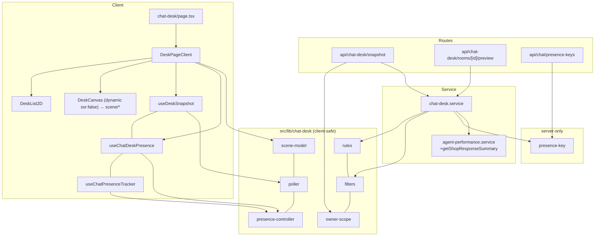
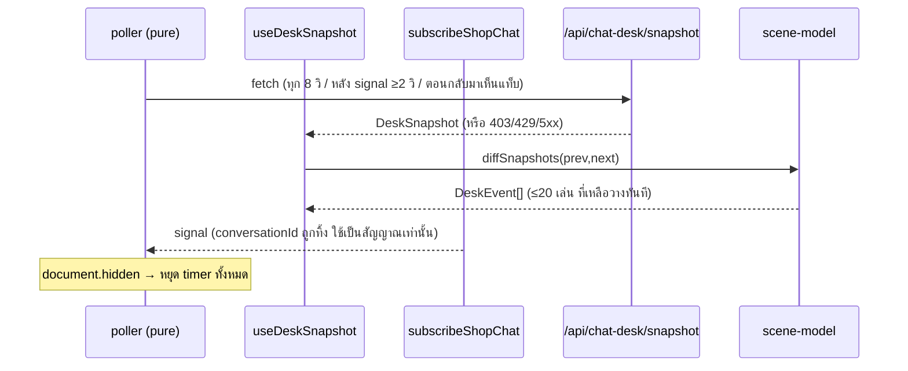
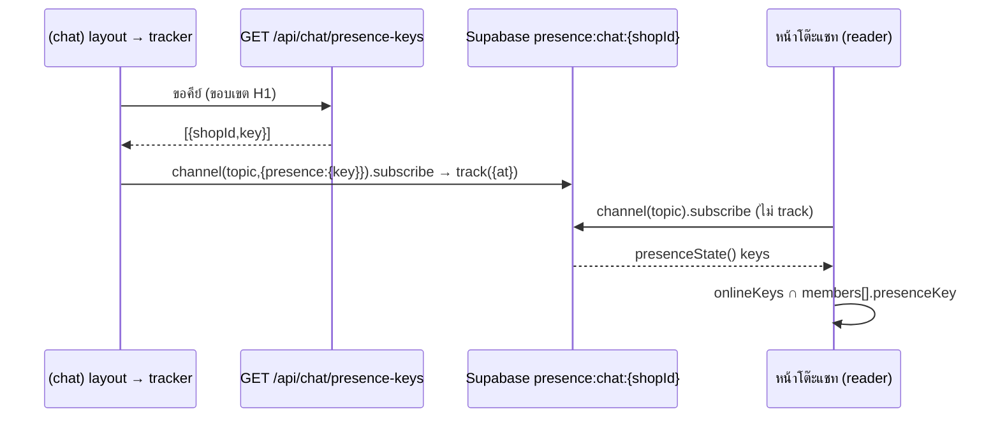

> **โมดูล:** 00077 - Chat Desk · **ประเภท:** SDS · **เวอร์ชัน:** 1.0 · **วันที่:** 2026-10-16 · **สถานะ:** Draft (รอ Controller/user)
> ผู้อ่าน: Controller / DEV / QA · stack: Next.js 16.1.1 · React 19.2.3 · Prisma 6.19.1 · Valibot 1.2.0 · NextAuth v4 (สิทธิ์ที่ service/route ไม่ใช่ RLS)
> ทุกชื่อไฟล์/ฟังก์ชันเดิมตรวจกับ worktree `/Users/craftman/Projects/safepay-00077` แล้ว (HR16) ชื่อไฟล์ใหม่ = ข้อเสนอสัญญา

# SDS: โต๊ะแชท 3D

## 1. บทนำ
### 1.1 วัตถุประสงค์
ออกแบบระดับไฟล์ + ลำดับงาน ให้ dev ลงมือได้โดยไม่ต้องเดา
### 1.2 ขอบเขตการออกแบบ
แตะ: `src/lib/shop-permissions.ts` · `src/lib/route-capabilities.ts` · `src/lib/seller-menu.ts` · `src/i18n/dictionaries/{th,en}.ts` · `src/services/agent-performance.service.ts` (เพิ่ม export) · `src/proxy.ts` (เพิ่ม `glb`) · `(chat)/layout.tsx` (mount tracker) · ไฟล์ใหม่ทั้งหมดตาม §3 · **ไม่แตะ** `prisma/` `chat.service.ts` `agent-sla.ts` `chat-shop-realtime.ts`
### 1.3 อ้างอิง
[[SRS]] (TFR-CD-xx) · [[API]] · [[DATABASE]] · `docs/conventions/{rule-must-be-enforced-not-described,root-served-assets-and-proxy,partial-data-must-be-labeled-or-filled,hook-return-identity-in-deps}.md`

---

## 2. Architecture Overview
### 2.1 มุมมองสถาปัตยกรรม
แบ่งชั้นตามของเดิม: **pure lib** (ตัดสิน/จัดวาง/diff/ตัวกรอง/poller/presence controller เทสได้ใน node) → **service** (query) → **route** (auth + validate + แปลง error) → **hook บาง ๆ** → **component** ไม่เพิ่ม framework ใหม่นอกจาก three/R3F/drei ที่ PRD อนุมัติ

### 2.2 มุมมองการ Deploy
Vercel เดิม ไม่มี cron/queue ใหม่ แคชรายวัน = `globalThis` ต่ออินสแตนซ์ (pattern ตาม `lib/sms-consume-rl`) `.glb` เสิร์ฟจาก `public/chat-desk/`

---

## 3. Component Design

### 3.1 ชื่อ route (ตรวจแล้ว)
| รายการตรวจ | ผล |
|---|---|
| URL ที่ผู้ใช้เห็น | `seller.<domain>/chat-desk` (`src/proxy.ts` rewrite เป็น `/seller/chat-desk` และ 301 ถ้าพิมพ์ `/seller/` นำหน้า) |
| ไฟล์หน้า | `src/app/(paces)/seller/(dashboard)/chat-desk/page.tsx` |
| ชนกับหน้าเดิม | Glob `(dashboard)/*/page.tsx` 28 หน้า ไม่มี `chat-desk` · Grep `chat-desk` ใน `src/` = 0 รายการ · ไม่มีโฟลเดอร์ `src/app/api/chat-desk` |
| เลือก group ไหน | **`(dashboard)`** เพราะได้เมนู/เปลือก Paces ฟรี `(chat)` layout ผูกกับ rail/แท็บ inbox/DraftOrderProvider/โหลดแคตตาล็อก (ไม่เหมาะ) `(fullscreen)` ไม่มีเมนู |
| ชื่อไฟล์สงวน | ไฟล์ใหม่ในโฟลเดอร์ route ใช้ชื่อ `page.tsx` + `components/*` เท่านั้น ไม่ใช้ `template/layout/error/loading/not-found/default/global-error/forbidden/unauthorized` (ด่าน `src/app/__tests__/app-router-reserved-filenames.test.ts`) |
| dynamic segment | `api/chat-desk/rooms/[id]/preview` เป็น `[id]` เดียวใต้ `rooms/` ไม่ชนชื่อ (ด่าน `src/lib/__tests__/route-slug-collision.test.ts`) · `/api/chat/conversations/[id]/preview` เดิมเป็นคนละ path (toast) ไม่ reuse |
| เอกสาร Next | `node_modules/next/dist/docs` ไม่มีใน next@16.1.1 (Glob ไม่พบ) จึงอ้างด่านเทส 2 ตัวข้างบนแทน และ `searchParams`/`params` เป็น `Promise` ตาม sibling เดิม |

### 3.2 โครงไฟล์ทั้งหมด
| ไฟล์ (relative จาก worktree) | สถานะ | หน้าที่ |
|---|---|---|
| `src/lib/shop-permissions.ts` | แก้ | เพิ่ม `X7: [O]` + คอมเมนต์ที่มา |
| `src/lib/shop-permissions.test.ts` | แก้ | เพิ่มแถว `X7: 'Y----'` และเปลี่ยนจำนวนรหัส 36 → 37 |
| `src/lib/route-capabilities.ts` | แก้ | +4 รายการ (หน้า X7 · snapshot GET X7 · preview GET X7 · presence-keys GET H1) |
| `src/lib/seller-menu.ts` | แก้ | เมนู `seller:chat-desk` ใน CHAT group + `BY_SLUG` ใน `applyMenuLocale` |
| `src/i18n/dictionaries/th.ts` / `en.ts` | แก้ | `menu.chatDesk` |
| `src/lib/seller-menu.test.ts` | แก้ | เพิ่ม slug ใน contract |
| `src/proxy.ts` | แก้ | เติม `glb` ใน regex บรรทัด 159 |
| `src/services/agent-performance.service.ts` | แก้ (เพิ่ม export) | `getShopResponseSummary` |
| `src/services/chat-desk.service.ts` | ใหม่ | `getDeskSnapshot` · `getRoomPreview` · `loadDeskMembers` · `countResolvedToday` · `getDailyMetrics` (แคช) |
| `src/lib/chat-desk/constants.ts` | ใหม่ | ค่าคงที่ทั้งหมด (§6.1) + `presenceTopic(shopId)` |
| `src/lib/chat-desk/types.ts` | ใหม่ | `DeskSnapshot` `DeskRoom` `DeskMember` `DeskFilters` `DeskView` `DeskEvent` `DeskCanvasProps` |
| `src/lib/chat-desk/rules.ts` | ใหม่ | `classifyRoom` `pickDesk` `isOverdue` `startOfBangkokDay` `previewBodyLabel` `resolveInitialView` |
| `src/lib/chat-desk/filters.ts` | ใหม่ | `parseDeskFilters` `sanitizeDeskFilters` `serializeDeskFilters` `roomMatchesFilters` |
| `src/lib/chat-desk/owner-scope.ts` | ใหม่ | `pickDeskShop` (pure ไม่เรียก resolver ใด) |
| `src/lib/chat-desk/scene-model.ts` | ใหม่ | `buildDeskView` `layoutDesk` `layoutLounge` `summarizeDesk` `diffSnapshots` `splitEvents` |
| `src/lib/chat-desk/poller.ts` | ใหม่ | `createSnapshotPoller` |
| `src/lib/chat-desk/presence-controller.ts` | ใหม่ | `createPresenceTracker` `createPresenceReader` |
| `src/lib/chat-desk/channel-colors.ts` | ใหม่ | สีช่องทางของฉาก/legend (ไม่ใช่ token UI) |
| `src/lib/chat-desk/presence-key.ts` | ใหม่ (server-only) | `presenceKeyFor(shopId, userId)` |
| `src/hooks/useDeskSnapshot.ts` `useChatDeskPresence.ts` `useChatPresenceTracker.ts` | ใหม่ | ห่อ controller เป็น hook |
| `src/app/api/chat-desk/snapshot/route.ts` | ใหม่ | GET |
| `src/app/api/chat-desk/rooms/[id]/preview/route.ts` | ใหม่ | GET |
| `src/app/api/chat/presence-keys/route.ts` | ใหม่ | GET (ไฟล์ใหม่ใต้ `api/chat/` ไม่แก้ไฟล์เดิม) |
| `src/app/(paces)/seller/(chat)/layout.tsx` | แก้ 2 บรรทัด | import + `<ChatPresenceTracker key={scopeKey} />` (HR17 ต้องอ่าน diff ฝั่งอื่น) |
| `src/app/(paces)/seller/(chat)/_components/ChatPresenceTracker.tsx` | ใหม่ | client คืน null เรียก `useChatPresenceTracker` |
| `src/app/(paces)/seller/(dashboard)/chat-desk/page.tsx` | ใหม่ | RSC: ด่านสิทธิ์ + parse searchParams + รายการร้าน |
| `.../chat-desk/components/DeskPageClient.tsx` | ใหม่ | state หลัก (ตัวกรอง/เลือก/มุมมอง) |
| `.../components/{ClockCard,OverviewCard,ChannelMixCard,ActivityCard,DeskToolbar,DeskLegend,DeskFilters,ShopSwitcher,DeskList2D,AdminPanel,ChatPreviewPanel,DeskCanvas,DeskSceneBoundary}.tsx` | ใหม่ | ดู plan ตาราง theme |
| `.../components/scene/{DeskScene,Walls,Lounge,DeskFurniture,Person,Overlay,camera,scene-colors}.tsx/.ts` | ใหม่ | ฉาก R3F (ไฟล์เดียวที่ import three) |
| `public/chat-desk/**` | ใหม่ | asset (§10) |
| `e2e/chat-desk.spec.ts` | ใหม่ | Playwright 3 จอ/WebGL off/block glb |

### 3.3 ฟังก์ชันเดิมที่ import (ตรวจบรรทัดจริง)
| แหล่ง | ฟังก์ชัน/ค่า | ใช้ทำอะไร | สถานะ |
|---|---|---|---|
| `src/lib/agent-performance.ts` | `summarizeShop` L517 · `PerformanceMetrics` L456 · `formatResponseDuration` L280 · `average` L167 | สูตร/แสดงผลเวลา | มีจริง |
| `src/lib/agent-performance.ts` | `HUMAN_AGENT_REPLY_WHERE` L85 · `isHumanAgentReply` L63 · `isUnattributedShopReply` L93 | **ไม่ import** เพราะ `pickDesk` ตัดสินจากฟิลด์ตรง ๆ (ลำดับ 4 ข้อตาม BR-CD-06) แต่เทส `pickDesk` ต้องเทียบผลกับ `isHumanAgentReply` ที่ `senderUserId` เป็นสมาชิกเพื่อกัน drift | มีจริง |
| `src/lib/agent-sla.ts` | `resolveSlaConfig` L43 (`firstResponseSec`, `source`) · `DEFAULT_FIRST_RESPONSE_SLA_SEC` L26 | SLA | มีจริง |
| `src/services/agent-performance.service.ts` | `getAgentPerformanceOverview` L429 | ทางอ้อมเดียวที่เดิมคืน `overview` ระดับร้าน (หนัก: 2×loadFacts + channels + count + directory) | มีจริง ไม่ใช้ |
| ที่เดียวกัน | `fetchConversations` L171 · `fetchResponsePairs` L208 · `assembleFacts` L275 · `loadFacts` L363 | private ใช้จากฟังก์ชัน export ใหม่ | **ไม่ export** |
| **ฟังก์ชันระดับร้านที่คืน `firstResponseAvgSec/responseAvgSec/unattributedReplyCount`** | — | **ไม่มีใน service** (`summarizeShop` เรียกเฉพาะใน `getAgentPerformanceOverview` ที่ L474 และ L482) | **ต้องเพิ่ม export `getShopResponseSummary` (§5.1)** |
| `src/lib/chat-scope.ts` | `resolveChatScope(session, cap)` L77 · `chatScopeOrDeny` L136 · `intersectScopedShopIds` L210 | presence-keys ใช้ `resolveChatScope(session,'H1')` | มีจริง |
| `src/lib/shop-capability.ts` | `listAccessibleShopIds(userId, cap)` L127 · `gatePage` L79 | ด่านหน้า/route ของโต๊ะแชท (cap `X7`) | มีจริง |
| `src/lib/chat-shop-realtime.ts` | `subscribeShopChat(shopId, listener)` L34 | signal (ห้ามแก้ไฟล์) | มีจริง |
| `src/lib/seller-menu.ts` | CHAT group (children L164-180) · `BY_SLUG` L1036 | เพิ่มเมนู | มีจริง |
| `src/lib/date-range.ts` | `thaiTodayBounds(now)` L162 · `todayThaiIsoDate` L147 | นิยามเดียวของ "วันนี้" | มีจริง |
| `src/lib/auto-order-message-type.ts` | `INTERNAL_MESSAGE_TYPES` L16 | บรรทัดระบบ | มีจริง |
| `src/lib/format-date.ts` | `formatTime` L117 · `formatDateTime` L55 · `formatChatBubbleTime` L479 | แสดงเวลา (conventions/date-format) | มีจริง |
| `src/lib/session-user.ts` | `sessionUserId` | ตัวตน | มีจริง |
| `src/lib/forbidden-role.ts` | `forbiddenRoleResponse` | 403 | มีจริง |
| `src/lib/supabase-browser.ts` | `getSupabaseBrowserClient` | client เดียว | มีจริง |

---

## 4. Data Flow

### 4.1 Flow หลัก: snapshot → ฉาก
ดู sequence ใน [[SRS]] §4.3 รายละเอียดเพิ่มของฝั่ง client

### 4.2 Flow Presence

### 4.3 Flow ล้มเหลว
- daily ล้ม → `daily.status='UNAVAILABLE'` ไทล์รายวันแสดง "โหลดไม่ได้" ฉากยังอยู่
- presence ล้ม/ไม่ sync ใน 10 วินาที → `unavailable` ไทล์ออนไลน์ "—" พร้อมป้ายตรวจสถานะไม่ได้
- 403 ระหว่างเปิดหน้า → หยุด poll ล้างข้อมูลเก่า แสดงไม่มีสิทธิ์ (AC-CD-24)
- WebGL ไม่มี/ฉาก throw → `DeskSceneBoundary` ตกไป `DeskList2D`

---

## 5. Integration Points

| จุดเชื่อม | ประเภท | Contract | ความเสี่ยงเมื่อล่ม |
|---|---|---|---|
| Postgres (Prisma) | internal | อ่านอย่างเดียว | 500 (snapshot) ฉากค้างข้อมูลเก่า |
| `getShopResponseSummary` | internal | §5.1 | ไทล์รายวัน "โหลดไม่ได้" |
| Supabase Realtime | external | broadcast `chat:shop:{id}` + presence `presence:chat:{id}` | ออนไลน์ "—" / ตกไป poll |
| three/R3F/drei | npm | §9 | boundary → 2D |

**Timeout/Retry:** fetch ฝั่ง client ใช้ `AbortController` ยกเลิกอันก่อนหน้าเมื่อเริ่มอันใหม่ ไม่ retry อัตโนมัติเกิน poll รอบถัดไป 429 → รอตาม `Retry-After`

### 5.1 export ที่ต้องเพิ่ม (เพิ่มอย่างเดียว ตาม S-14)
```ts
// src/services/agent-performance.service.ts — ใช้ helper private เดิม ไม่แก้ฟังก์ชันเดิม
export type ShopResponseSummary = Pick<PerformanceMetrics,
  'firstResponseAvgSec' | 'responseAvgSec' | 'responseSampleCount' |
  'unattributedReplyCount' | 'answeredOutsideSystemConversations'>
export async function getShopResponseSummary(shopId: string, f: ReportFilters): Promise<ShopResponseSummary> {
  const sla = resolveSlaConfig({ id: shopId })
  const [conversations, pairs] = await Promise.all([fetchConversations(shopId, f), fetchResponsePairs(shopId, f)])
  const m = summarizeShop(assembleFacts(conversations, pairs, []), sla.firstResponseSec)
  return { firstResponseAvgSec: m.firstResponseAvgSec, responseAvgSec: m.responseAvgSec,
    responseSampleCount: m.responseSampleCount, unattributedReplyCount: m.unattributedReplyCount,
    answeredOutsideSystemConversations: m.answeredOutsideSystemConversations }
}
```
เหตุผล: ตัวเลข 5 ตัวนี้ไม่ขึ้นกับออเดอร์ จึงข้าม `fetchOrders` ได้ (2 query แทน 3) ผลต้องเท่า `getAgentPerformanceOverview(...).overview` ทุกวินาที (เทส parity)

---

## 6. Technical Decisions

### 6.1 ค่าคงที่ (`constants.ts` ที่เดียว)
`POLL_INTERVAL_MS=8000` · `SIGNAL_DEBOUNCE_MS=2000` · `RECENT_REPLY_WINDOW_SEC=180` · `AWAITING_WINDOW_DAYS=7` · `AWAITING_CAP=200` · `LOUNGE_SEATS=24` · `PER_DESK=3` · `MAX_ANIMATED_EVENTS=20` · `PREVIEW_LIMIT=30` · `DAILY_CACHE_TTL_MS=60000` · `PRESENCE_READY_TIMEOUT_MS=10000` · `FEED_MAX=12` · `MAX_FILTER_IDS=50`

### TD-01: วางหน้าใน `(dashboard)`
- **เหตุผล:** ได้เปลือก Paces + เมนู + `loading` ของกลุ่ม · ดู §3.1
- **ทางเลือกที่ตัด:** `(chat)` (เหตุผลข้างต้น) · `(fullscreen)` (ไม่มีเมนู; เต็มจอทำด้วย Fullscreen API ในหน้า)

### TD-02: เพิ่ม capability `X7 = [OWNER]` แทน predicate OWNER ใหม่
- **ตัดสินใจ:** `X7` ใน `TABLE` ของ `shop-permissions.ts` ใช้ผ่าน `listAccessibleShopIds(userId,'X7')`
- **เหตุผล:** 00071 merge แล้ว ตารางสิทธิ์ + ทะเบียน route + เมนู ตัดสินจากแหล่งเดียว (`canSeePage` อ่านทะเบียน) ตัวสแกน `route-capability-inventory` บังคับ literal cap ให้ ถ้าเขียน predicate เอง = ชุดที่สองที่ drift ได้ (HR16)
- **ทางเลือกที่ตัด:** (ก) ใช้ `F3`/`T2` ที่ OWNER-only อยู่แล้ว → ความหมายผิด วันที่ F3 เปิดให้บทบาทอื่นโต๊ะแชทจะเปิดตามเงียบ ๆ (ข) query role เองตาม BR-CD-15 เดิม → ซ้ำกับ `effectiveRoles`/PERSONAL rule
- **ผลกระทบ:** ต้องแก้เทสตารางสิทธิ์ และต้องจด Change Log ใน scope baseline + เพิ่มแถว X7 ใน 00071 BRD §8.3 (SSOT ของตาราง) ดู OQ-1
- **หมายเหตุ:** ใช้ `listAccessibleShopIds` ไม่ใช่ `resolveChatScope(.., 'X7')` เพราะโหมด SINGLE ของแชทคืนแค่ร้าน active ทำให้ตัวสลับร้านของ OWNER หลายร้านไร้ความหมาย

### TD-03: ตรรกะเป็นฟังก์ชันบริสุทธิ์ + hook บาง
- vitest เป็น node ไม่มี jsdom การทดสอบ fake timers/presence จึงทำกับ controller ที่ inject timer/client ได้ hook แค่ผูก React lifecycle (`conventions/ui-boolean-needs-a-testable-home`)

### TD-04: เพิ่ม `getShopResponseSummary` (ดู §5.1) แทนเรียก `getAgentPerformanceOverview`
- overview ลาก query ที่ไม่ต้องใช้ ~9 ครั้ง (6 query facts ปัจจุบัน+ก่อนหน้า, channels, count, directory)

### TD-05: แคชรายวัน `globalThis` 60 วินาที
- คีย์ `${shopId}|${dayStartISO}` เก็บ promise (กัน stampede) ล้ม = ไม่จำ ขนาดจำกัด (clear เมื่อ > 2000 รายการ ตาม pattern gochat) ใช้ `Symbol.for('safepay.chatDesk.daily')` (conventions: state ข้าม route ต้อง globalThis)

### TD-06: rooms = raw SQL ก้อนเดียว (§7) ไม่ใช่ Prisma หลาย findMany
- ต้องการ LATERAL สำหรับ "ข้อความฝั่งร้านล่าสุดที่ไม่ใช่บรรทัดระบบ" และ "ข้อความลูกค้าใบแรกของช่วงที่ยังไม่ถูกตอบ" ต่อห้อง โดยไม่เกิด N+1 (ตาม 00059) · อ่านอย่างเดียว ไม่ชน `chat-message-no-raw-write`

### TD-07: คีย์ presence ทึบ
- `base64url(HMAC-SHA256(NEXTAUTH_SECRET, "chat-desk-presence:v1:" + shopId + ":" + userId))` ตัดเหลือ 22 ตัวอักษร (128 บิต) อ่านค่า secret ใน function (ไม่ throw ตอน import เหมือน `scam-identifier.ts`/`link-intent.ts` เพื่อให้เทสตั้ง env ได้) ไม่เพิ่ม env ใหม่ · ขาด secret → throw → route 500 (`console.error`)

### TD-08: endpoint เป็น `presence-keys` (พหูพจน์)
- tracker ลงชื่อทุกร้านในขอบเขต (AC-CD-27) จึงขอครั้งเดียวได้ทุกร้าน ขอบเขต = `resolveChatScope(session,'H1')` (ADMIN ที่แชทได้ลงชื่อได้ ตรง BRD §5)

### TD-09: poller เดียวคุมทุกสาเหตุการดึง
- poll/signal/visibility ผ่าน `createSnapshotPoller` ตัวเดียว: มี in-flight เดียว ช่วงห่างขั้นต่ำ 2 วินาทีระหว่าง fetch ลดโอกาสชน rate-limit 120/นาที

### TD-10: ชุด asset
- ตัวละคร = **Kenney Mini Characters** 12 แบบ (เล็กกว่าและหลากหลายกว่า KayKit Adventurers 3 แบบ) ของตกแต่ง = KayKit Furniture Bits เฉพาะ 9 ชิ้นของ "มุมคาเฟ่" · ไม่ส่ง themes.glb · ทางเลือก: KayKit Adventurers (~265 KB/ตัว ตามคอมเมนต์ต้นแบบ) ถ้า user อยากได้ลุคนักผจญภัย

### TD-11: `dynamic(ssr:false)` ใน client wrapper + boundary 2 ชั้น
- `DeskCanvas.tsx` (`'use client'`) เรียก `dynamic(() => import('./scene/DeskScene'), {ssr:false})` ห่อ `DeskSceneBoundary` (class component) → `DeskList2D` · ระดับโมเดล: `Quiet` boundary → แคปซูล (AC-CD-46)

### TD-12: แผงข้าง (เมื่อคลิกแอดมิน/ลูกค้า) ขับด้วย React state ไม่ใช่ Preline `hs-overlay`
- polling ทำให้หน้า re-render ทุก 8 วินาที Preline เก็บ state ใน DOM แล้วหาย (บทเรียน `paces-component-reference.md` §3) ใช้ markup/สไตล์ของ offcanvas + `useDialogFocus` + `useLockBodyScroll` เฉพาะมือถือ

### TD-13: ไทล์รายวัน 3 ตัวเป็นของ "ทั้งร้าน" ไม่ตามตัวกรอง
- `ReportFilters` ของ 00059 รับ `channel`/`shopChannelId` ตัวเดียว ไม่รองรับหลายค่าและไม่มีตัวกรองแอดมิน การใส่ตัวกรองบางส่วนคือสูตรใหม่ (HR16) → ไทล์ขึ้นป้าย "ทั้งร้าน" เมื่อมีตัวกรองทำงาน ตัวเลขสด (รอคำตอบ/กำลังคุย/เกินเวลา/ออนไลน์/ว่าง/แถบช่องทาง/ความเคลื่อนไหว) ตามตัวกรองครบ (ดู OQ-2)

### TD-14: ไม่ส่ง avatar
- `User.avatar` อาจเป็น fileId หรือ URL ภายนอก ต้องผ่านด่านไฟล์ ใช้อักษรย่อชื่อใน DOM overlay รอบแรก

### TD-15: sanitize ตัวกรองก่อน query rooms (2 จังหวะ)
- จังหวะ 1: directory+channels จังหวะ 2: rooms กับ daily ขนานกัน ค่า id ที่ไม่รู้จักถูกทิ้ง ถ้าทิ้งหมดทั้งชุด = ไม่กรอง (ตรงข้ามกับ `intersectScopedShopIds` ซึ่งใช้กับ **ขอบเขตสิทธิ์**; ที่นี่ shop ถูกล็อกด้วย WHERE แล้ว ตัวกรองเป็นแค่การแสดงผล)

---

## 7. Query ของ snapshot

### 7.1 จำนวนและลำดับ
| # | คำสั่ง | เมื่อไร | หมายเหตุ |
|---|---|---|---|
| G | `listAccessibleShopIds(userId,'X7')` (ใน route) | ทุกคำขอ | 1 `shop.findMany` |
| 1 | `prisma.shop.findUnique` select `shopName,kind,vertical,userId,user{displayName},members{userId,role,roles,user{displayName}},channels{id,name,provider}` | ทุกคำขอ | นับเป็น 1 การเรียก Prisma (จำนวน SQL จริงต้องวัดด้วย `log:['query']`) |
| 2 | rooms raw SQL (CTE `awaiting` + `recent` + LATERAL) | ทุกคำขอ | ขนานกับ #D |
| D | daily: `getShopResponseSummary` (2 raw) + `conversation.count` | แคชพลาด ≤ 1 ครั้ง/60 วินาที/ร้าน/อินสแตนซ์ | เส้นทางแคชโดน = 0 |
เส้นทางปกติ = 3 การเรียก (G,1,2) · แคชรายวันพลาด = 6 การเรียก (BRD §1.2 ตั้ง "ไม่เกิน 4" ให้ตีความเป็นเส้นทางปกติ ดู OQ-5)

### 7.2 rooms (สัญญา SQL; พารามิเตอร์ผ่าน `Prisma.sql` ห้ามต่อสตริง)
```sql
WITH awaiting AS (
  SELECT c."id", c."channel", c."shopChannelId", c."lastInboundAt", c."lastMessageAt",
         COALESCE(NULLIF(btrim(c."alias"),''), NULLIF(btrim(ec."name"),''), NULLIF(btrim(u."displayName"),'')) AS "name"
  FROM "Conversation" c
  LEFT JOIN "ExternalContact" ec ON ec."id" = c."externalContactId"
  LEFT JOIN "User" u ON u."id" = c."buyerUserId"
  WHERE c."shopId" = ${shopId} AND c."resolvedAt" IS NULL AND c."isHidden" = false AND c."isSpam" = false
    AND c."lastSenderRole" = 'BUYER' AND c."lastInboundAt" >= ${now - 7d}
    /* AND c."channel" IN (${Prisma.join(platforms)}) AND c."shopChannelId" IN (${Prisma.join(pages)}) เมื่อมีตัวกรอง */
  ORDER BY c."lastInboundAt" ASC LIMIT 201
), recent AS ( /* เหมือนกัน แต่ lastSenderRole='SHOP' AND lastMessageAt >= now-180s ORDER BY lastMessageAt DESC LIMIT 200 */ )
SELECT 'WAITING' AS "state", a.*, ls."at" AS "lastShopAt",
       COALESCE(fa."at", a."lastInboundAt") AS "askedAt",
       NULL::timestamp AS "repliedAt", NULL::text AS "senderUserId", NULL::text AS "autoReplyKind", NULL::boolean AS "viaStandby"
FROM awaiting a
LEFT JOIN LATERAL (SELECT m."createdAt" AS "at" FROM "ChatMessage" m
   WHERE m."conversationId" = a."id" AND m."senderRole" = 'SHOP' AND m."isDeleted" = false
     AND m."type" NOT IN (${Prisma.join(INTERNAL_MESSAGE_TYPES)})
   ORDER BY m."createdAt" DESC, m."seq" DESC LIMIT 1) ls ON true
LEFT JOIN LATERAL (SELECT m."createdAt" AS "at" FROM "ChatMessage" m
   WHERE m."conversationId" = a."id" AND m."senderRole" = 'BUYER' AND m."isDeleted" = false
     AND m."type" NOT IN (${Prisma.join(INTERNAL_MESSAGE_TYPES)}) AND (ls."at" IS NULL OR m."createdAt" > ls."at")
   ORDER BY m."createdAt" ASC, m."seq" ASC LIMIT 1) fa ON true
UNION ALL
SELECT 'AT_DESK', r.*, NULL, NULL, lr."createdAt", lr."senderUserId", lr."autoReplyKind", lr."viaStandby"
FROM recent r
JOIN LATERAL (SELECT m.* FROM "ChatMessage" m
   WHERE m."conversationId" = r."id" AND m."senderRole" = 'SHOP' AND m."isDeleted" = false
     AND m."type" NOT IN (${Prisma.join(INTERNAL_MESSAGE_TYPES)})
   ORDER BY m."createdAt" DESC, m."seq" DESC LIMIT 1) lr ON true
```
(คอลัมน์ของสองสาขา `UNION ALL` ต้องเรียง/ชนิดตรงกัน dev ระบุคอลัมน์ชัดเจน) `rawMessage` ไม่ถูก select (global omit ที่ `src/lib/prisma.ts` ใช้กับ findMany แต่ raw SQL ต้องไม่ `SELECT m.*` ใน production ให้ระบุคอลัมน์)

### 7.3 Index ที่ใช้ (มีอยู่แล้ว ห้ามเพิ่ม)
| ส่วน | Index (schema.prisma) | ความเห็น |
|---|---|---|
| awaiting | `Conversation @@index([shopId, lastInboundAt])` L2068 | range 7 วัน + `ORDER BY lastInboundAt ASC LIMIT 201` ที่เหลือ (resolvedAt/isHidden/isSpam/lastSenderRole) เป็น filter ที่ heap |
| recent | `@@index([shopId, lastMessageAt])` L2059 | range 180 วินาที เล็กมาก |
| ข้อความต่อห้อง | `ChatMessage @@index([conversationId, createdAt])` L2314 | LATERAL แบบ `ORDER BY createdAt DESC LIMIT 1` + filter senderRole |
| resolvedToday | ไม่มี index บน `resolvedAt` | ใช้ prefix `shopId` + filter ต่อแถว |
**ความเสี่ยง:** ร้านใหญ่ที่มีห้อง active ใน 7 วันเป็นหมื่น แต่ห้องรอจริงน้อย → สแกน index range ทั้งช่วงก่อนจะครบ 201 แถว; `resolvedToday` สแกนทั้งร้าน (แคช 60 วินาทีช่วย) ห้ามแก้ด้วย index (OOS-6) · **ยังไม่ได้วัด EXPLAIN** งาน T4 ต้องรัน `EXPLAIN (ANALYZE, BUFFERS)` บน dev (localhost:5434) ที่ 200 ห้อง และบันทึกผลในหัวข้อ §7.4
### 7.4 ผลวัดที่ต้องบันทึกก่อน sign-off
| รายการ | ค่า | สถานะ |
|---|---|---|
| จำนวน SQL จริงต่อ snapshot (เส้นทางปกติ/แคชพลาด) | — | ยังไม่วัด |
| EXPLAIN rooms ที่ 200 ห้อง | — | ยังไม่วัด |
| EXPLAIN `resolvedToday` | — | ยังไม่วัด |
| ขนาด payload gzip ที่ 400 แถว | — | ยังไม่วัด |

---

## 8. Presence (ออกแบบจริง)
| หัวข้อ | การออกแบบ |
|---|---|
| ช่อง | `presence:chat:{shopId}` (คู่กับ `presence:auction:{id}` ของ `useAuctionPresence`) · ค่าจาก `presenceTopic()` |
| client | `getSupabaseBrowserClient()` ใน `src/lib/supabase-browser.ts` (anon key) · ห้ามใช้ service role |
| คีย์ | §6 TD-07 · ต่อคนต่อร้าน · เปิดหลายแท็บ key เดียวกัน → `presenceState()` มี 1 key (ต่างจาก `useAuctionPresence` ที่สุ่มต่อแท็บ) |
| payload | `{ at: Date.now() }` เท่านั้น (ห้าม userId/ชื่อ) |
| tracker | `createPresenceTracker({ client, keys, now })` เรียก `channel.track` หลัง `SUBSCRIBED` และ re-track เมื่อกลับมาเห็นแท็บ · cleanup `removeChannel` |
| reader | `createPresenceReader({ client, shopId })` ไม่ import/เรียก `.track(` · state: `connecting → ready → unavailable` · `ready` เมื่อได้ `sync` แรก · ไม่ sync ใน 10 วินาที/`CHANNEL_ERROR`/`TIMED_OUT`/`CLOSED` → `unavailable` |
| ออนไลน์ | `members.filter(m => state keys มี m.presenceKey)` (วนจากคีย์ที่คาดหวัง ไม่ใช่ทุกคีย์ใน state → คีย์ปลอมไม่มีผล) |
| ความหน่วง | Supabase ตัดคีย์ตอน socket หลุด (heartbeat) ออฟไลน์อาจช้าถึงราว 1 นาที (ยังไม่วัด) ระบุในป้ายอธิบาย |
| ความเสี่ยง | คนนอกที่รู้ `shopId` เข้าช่องได้และเห็นจำนวนคีย์ ไม่เห็นตัวตน · ปลอมตัวสมาชิกคนใดไม่ได้เพราะไม่มี secret · ทางปิดจริงคือ Realtime private channel (นอกขอบเขต) |
| ชนกันของ topic | tracker อยู่ `(chat)` reader อยู่ `(dashboard)` ไม่ mount พร้อมกันในแท็บเดียว แต่ SPA nav สลับกันได้ reader เลื่อน subscribe ไป 1 tick หลัง cleanup ของ tracker และมี E2E nav `inbox → chat-desk` |
| จำนวนวัดผล `canChat` | `DeskMember.canChat = can(effectiveRoles(shop, role, roles), 'H1')` ผู้ดูแลที่ไม่มี H1 (BILLING/TECHNICIAN) ออนไลน์ไม่ได้เลย (ดู OQ-3) |

---

## 9. ทะเบียน dependency
| แพ็กเกจ | เวอร์ชันที่เสนอ | เหตุผล | ขนาด | ใบอนุญาต | ผู้อนุมัติ |
|---|---|---|---|---|---|
| `three` | `^0.186.1` (npm latest ตรวจ 2026-10-16) | engine 3D | unpacked 20.4 MB (ขนาดแพ็กเกจ ไม่ใช่ bundle; ต้องวัด chunk หลัง build) | MIT | **ติดตั้งแล้ว 0.186.1** |
| `@react-three/fiber` | `^9.8.2` ติดตั้งแล้ว 9.8.2 (peer `react >=19 <19.4` เข้ากับ 19.2.3 ✓; `three >=0.156`) | React renderer ของ three | unpacked 2.4 MB | MIT | รออนุมัติ user |
| `@react-three/drei` | `^10.7.9` ติดตั้งแล้ว 10.7.9 (peer `@react-three/fiber ^9`, `react ^19`, `three >=0.159`) | `Html` `OrbitControls` `useGLTF` `useAnimations` `Edges` `RoundedBox` | unpacked 1.75 MB (ลาก transitive หลายตัว เช่น `three-stdlib` `hls.js` `@mediapipe/tasks-vision` ลงใน node_modules แต่ไม่เข้า bundle หากไม่ import) | MIT | รออนุมัติ user |
| `@types/three` (dev) | `^0.186.0` ติดตั้งแล้ว 0.186.0 | type | — | MIT | รออนุมัติ user |
เวอร์ชันชุดเดียวกับที่ต้นแบบ gochat ใช้ (Next 16.2.12 / React 19.2.4) ความเข้ากับ **Next 16.1.1 + Turbopack ของรีโปนี้ยังไม่พิสูจน์** งาน T8 ต้อง `next build` (ตัดสินด้วย exit code) และวัดว่าไม่มี chunk three ใน route อื่น · ไม่ต้อง `transpilePackages` (ต้นแบบไม่ใช้)

## 10. ทะเบียน asset (CC0)
| ไฟล์ปลายทาง | ที่มา | ผู้สร้าง | ใบอนุญาต | ขนาด |
|---|---|---|---|---|
| `public/chat-desk/kenney/{female-a..f,male-a..f}.glb` (12 ไฟล์) | ต้นแบบ `gochat-v3/3D-Chat-Desk/public/ops3d/kenney/` ← Kenney Mini Characters 1.0 (https://kenney.nl/assets/mini-characters) บีบเหลือ 5 ท่า (Idle · Walking_A · Sit_Chair_Idle · Interact · Cheer) ด้วย gltf-transform | Kenney (www.kenney.nl) | CC0 http://creativecommons.org/publicdomain/zero/1.0/ | 39,476–43,568 B/ตัว (วัดจริง 2026-10-16) รวม 12 ไฟล์ ≈ 493 KB |
| `public/chat-desk/kenney/LICENSE.txt` | คัดลอกจากต้นแบบ | — | CC0 | — |
| `public/chat-desk/kaykit/furniture.glb` | ต้นแบบ `public/ops3d/kaykit/furniture.glb` ← KayKit Furniture Bits 1.0 (https://kaylousberg.itch.io/furniture-bits) รวม 11 ชิ้น + meshopt | Kay Lousberg (www.kaylousberg.com) | CC0 | 104,892 B (วัดจริง 2026-10-16; EXT_meshopt_compression + KHR_mesh_quantization) |
| `public/chat-desk/kaykit/LICENSE.txt` | เฉพาะส่วน Furniture Bits | — | CC0 | — |
node จริงใน furniture.glb (อ่าน JSON chunk 2026-10-16 มี 11 ตัว): `shelf_B_large_decorated` `cabinet_medium_decorated` `cactus_medium_A` `cactus_small_A` `lamp_standing` `couch_pillows` `armchair_pillows` `table_low` `pictureframe_large_A` `pictureframe_medium` `rug_oval_A` — ครบทุกชื่อที่แผนอ้าง · LICENSE.txt ของ kaykit ขึ้นหัวเป็น Adventurers แต่มีส่วน `---- furniture.glb ----` Furniture Bits 1.0 CC0 ท้ายไฟล์ · node ที่ใช้ในมุมคาเฟ่ตามแผน: `shelf_B_large_decorated` `pictureframe_large_A` `pictureframe_medium` `cabinet_medium_decorated` `cactus_medium_A` `couch_pillows` `rug_oval_A` `table_low` `lamp_standing` · **ไม่ใช้/ไม่ส่ง:** `themes.glb` · KayKit Adventurers · Mixamo · Quaternius (NFR-CD-10) · ตัวถอด meshopt มากับ three-stdlib ใน drei (`useGLTF(url, false)` ไม่ดึง Draco จาก CDN) · งาน T8 ต้องวัดขนาดจริงด้วย `ls -l` และเติมในตารางนี้ · เทสสแกนว่าทุกไฟล์ใต้ `public/chat-desk/**` มีนามสกุลที่อยู่ใน regex ของ `proxy.ts`

---

## 11. Error handling และ cross-file error mapping
service **ไม่ throw custom error ใหม่** (preview ไม่พบ = `null`, daily ล้ม = สถานะใน payload) ตารางนี้ระบุว่าข้อผิดพลาดแต่ละแบบถูกจับที่ไฟล์ไหนและตอบอะไร
| เหตุ | เกิดที่ | จับที่ (route) | HTTP / body |
|---|---|---|---|
| ไม่มี session/id | route | `snapshot`/`preview`/`presence-keys` | 401 `{error:'unauthorized'}` |
| ไม่ถือ `X7` ร้านใดเลย / `shopId` ไม่อยู่ในชุดเจ้าของ | `pickDeskShop` → route | `snapshot` | 403 `{error:'FORBIDDEN_ROLE'}` |
| เช่นเดียวกัน | route | `preview` | 404 `{error:'NOT_FOUND'}` (ไม่บอกว่าห้องมี) |
| `shopId` รูปแบบผิด (Valibot) | route | `snapshot` | 400 `{error:'INVALID_QUERY'}` (ตัวกรองรูปแบบผิดถูกทิ้งเงียบ ไม่ 400) |
| `[id]` ไม่ใช่ uuid | route | `preview` | 400 `{error:'INVALID_ID'}` |
| ห้องไม่พบ/ไม่อยู่ร้านเจ้าของ | `getRoomPreview` คืน `null` | `preview` | 404 |
| `resolveChatScope` คืน null | `chatScopeOrDeny` | `presence-keys` | 404 (ตามของเดิม) |
| scope ว่าง (ไม่มี H1) | `chatScopeOrDeny` | `presence-keys` | 403 `FORBIDDEN_ROLE` (tracker เงียบ) |
| `NEXTAUTH_SECRET` ขาด | `presenceKeyFor` throw `Error` | `snapshot`, `presence-keys` | 500 `{error:'INTERNAL'}` + `console.error` |
| Prisma/DB ล้ม | service | route catch ทุกเส้น | 500 `{error:'INTERNAL'}` |
| daily ล้ม | service `allSettled` | — (ไม่ถึง route) | 200 + `daily.status='UNAVAILABLE'` |
ทุกเส้น: `Cache-Control: private, no-store, max-age=0, must-revalidate` + `export const dynamic = 'force-dynamic'`

## 12. Risks (รวม)
| ID | ความเสี่ยง | ลด |
|---|---|---|
| R-01 | rate-limit GET 120/นาที/IP | TD-09 · เคารพ Retry-After · ติดตามใน QA · ทางสำรอง bucket แยกที่ `proxy.ts` ต้องขออนุมัติ |
| R-02 | สแกน index 7 วัน/`resolvedToday` ช้าในร้านใหญ่ | วัด EXPLAIN · แคช · ไม่เพิ่ม index |
| R-03 | three + Next 16.1.1 Turbopack build/bundle | T8 พิสูจน์ด้วย build exit code ก่อนเขียนฉาก |
| R-04 | `.glb` 404 บน `seller.*` | แก้ regex `proxy.ts` + เทสสแกนนามสกุล + `curl -sI http://seller.deepth.local:4000/chat-desk/kaykit/furniture.glb` |
| R-05 | ฟอนต์ใน canvas (ป้ายผนัง/ชื่อร้าน) เป็นฟอลแบ็ก | `await document.fonts.load('700 120px Anuphan')` ก่อนวาด |
| R-06 | N ออนไลน์ต่ำกว่าจริง (แอดมินตอบจากแอป Meta · ผู้ดูแลไม่มี H1) | ป้ายอธิบาย · `canChat` ใน payload · OQ-3 |
| R-07 | อินสแตนซ์ละแคช → ค่าต่างกัน ≤ 60 วินาที | แสดง `asOf` |
| R-08 | iOS Safari เสียบริบท WebGL/หน่วยความจำ | `webglcontextlost` → boundary → 2D · มือถือตั้งต้น 2D (Q-1) |
| R-09 | แท็ปชนกันของ topic presence ตอน SPA nav | §8 + E2E |
| R-10 | `(chat)/layout.tsx` ถูกแก้โดยอีก stream | HR17: อ่าน `git diff main..` ก่อน rebase · แก้เพียง 2 บรรทัด |

## 13. Traceability
| SRS | SDS |
|---|---|
| TFR-CD-01 | TD-02 · §3.1 · `owner-scope.ts` |
| TFR-CD-02 | `rules.ts` · §7.2 |
| TFR-CD-03 | §7 · TD-06, TD-14, TD-15 |
| TFR-CD-04 | §5.1 · TD-04, TD-05, TD-13 |
| TFR-CD-05 | §8 · TD-07, TD-08 |
| TFR-CD-06 | §4.1 · TD-09 · `scene-model.diffSnapshots` |
| TFR-CD-07 | §11 · `getRoomPreview` |
| TFR-CD-08 | `filters.ts` · TD-15 |
| TFR-CD-09 | TD-11, TD-12 |
| TFR-CD-10 | §9, §10 |
| TFR-CD-11 | [[DATABASE]] |

## 14. ข้อสังเกต BRD/PRD เทียบโค้ดจริง และคำถามเปิด
### 14.1 จุดที่ BRD/PRD ไม่ตรงโค้ด (Controller ต้อง patch เอกสารรอบเดียวกัน)
| ID | เอกสารว่า | โค้ดจริง | ที่ใช้ใน SDS |
|---|---|---|---|
| D-1 | BR-CD-15: `resolveChatScope` ไม่มี role ต่อร้าน | 00071 merge แล้ว มี cap (`ChatCap`) และ `listAccessibleShopIds(userId, cap)` | TD-02 `X7` |
| D-2 | PRD §9.1: 00071 ยังไม่ merge | `shop-permissions.ts`, `route-capabilities.ts` อยู่บน main | เช่นเดียวกัน |
| D-3 | AC-CD-12: `summarizeShop` ~L452-468 | อยู่ที่ L474/L482 ใน `getAgentPerformanceOverview` ไม่มีฟังก์ชันระดับร้าน | §5.1 |
| D-4 | BR-CD-03: บรรทัดระบบ = `AUTO_ORDER_RESULT` | `INTERNAL_MESSAGE_TYPES` มี `META_NOTICE` ด้วย | ใช้ทั้งสอง |
| D-5 | AC-CD-16: `startOfBangkokDay` ใหม่ | `thaiTodayBounds` เป็นนิยามเดียวของ "วันนี้" | wrapper |
| D-6 | KPI query ≤ 4 | เส้นทางปกติ 3 · แคชพลาด 6 | OQ-5 |
| D-7 | "endpoint ออกคีย์ของตน" (เอกพจน์) | tracker ต้องการหลายร้านในครั้งเดียว | `presence-keys` |
| D-8 | AC-CD-17 N = สมาชิกทั้งหมด | ผู้ดูแลไม่มี H1 ออนไลน์ไม่ได้ | OQ-3 |

### 14.2 คำถามเปิด
| ID | คำถาม | ข้อเสนอ |
|---|---|---|
| OQ-1 | อนุมัติเพิ่ม `X7` ใน `shop-permissions.ts` (นอกรายการไฟล์ใน S-2) และจด Change Log + แก้ 00071 BRD §8.3 | อนุมัติ |
| OQ-2 | ไทล์รายวันไม่ตามตัวกรอง (TD-13) | ยอมรับพร้อมป้าย "ทั้งร้าน" |
| OQ-3 | N ออนไลน์นับสมาชิกที่ไม่มี H1 หรือไม่ | ตัดออกจาก N (ใช้ `canChat`) แล้วแก้ AC-CD-17 |
| OQ-4 | ไอคอนเมนู | `armchair-2` (ยืนยันมีใน tabler) ถ้าไม่ชอบให้ user เลือก (HR12) |
| OQ-5 | ตีความ "≤ 4 query" เป็นเส้นทางปกติ | ใช่ |
| OQ-6 | `resolvedToday` นับห้อง spam/hidden ที่ปิดวันนี้หรือไม่ (Q-2 ไม่ระบุ) | นับตามตัวอักษร Q-2 ไม่ตัด |
| OQ-7 | อนุมัติ dependency 4 ตัว (§9) | อนุมัติ |
| OQ-8 | ชุดตัวละคร Kenney (ข้อเสนอ) หรือ KayKit | Kenney |
| OQ-9 | เพิ่มพารามิเตอร์ URL `shop` และ `view` นอกเหนือตัวกรองสามตัว | อนุมัติ (เล็กน้อย อยู่ใน FR-CD-15/19) |

## 15. สรุป
**ลำดับ build ที่แนะนำ:** (1) `X7` + เทส (2) pure lib + presence-key (3) service+export ตัวเลข (4) routes + registry (5) presence (6) poller (7) deps+assets+proxy (8) หน้า+2D+menu (9) panels (10) 3D (11) E2E/QA (12) docs/sign-off — รายละเอียดใน plan `docs/superpowers/plans/2026-10-16-00077-chat-desk-plan.md`
