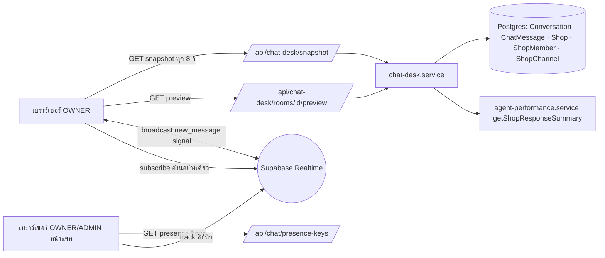
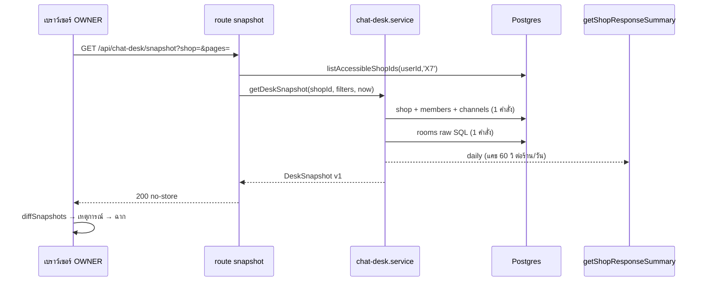

> **โมดูล:** 00077 - Chat Desk (โต๊ะแชท 3D)
> **ประเภทเอกสาร:** Software Requirements Specification (SRS) - TECHNICAL
> **เวอร์ชัน:** 1.0
> **วันที่จัดทำ:** 2026-10-16
> **สถานะ:** Draft (ร่างโดย planner แบบ read-only รอ Controller/user ตรวจ)
> **เจ้าของเอกสาร:** SA (ดู [[Feature-Docs-Ownership]])

# SRS: โต๊ะแชท 3D (Software Requirements Specification — Technical)

---

## 1. บทนำ (Introduction)

### 1.1 วัตถุประสงค์ของเอกสาร
กำหนดข้อกำหนดเชิงเทคนิคของหน้า "โต๊ะแชท" ให้ DEV/QA ลงมือได้โดยไม่ต้องเดา ทุกข้อ trace กลับ FR/BR/AC ใน [[PRD]] และ [[BRD]] ชื่อไฟล์และฟังก์ชันของโค้ดเดิมที่อ้างถึงตรวจกับ repo จริงแล้ว ชื่อไฟล์ใหม่คือข้อเสนอสัญญา

### 1.2 ขอบเขตเชิงระบบ
**อยู่ในขอบเขต:** หน้า RSC + client ใต้ `(paces)/seller/(dashboard)/chat-desk/` · API `GET` 3 เส้น · service `chat-desk.service.ts` · pure lib `src/lib/chat-desk/` · hook ฝั่ง client · capability `X7` · Presence tracker ใน layout `(chat)` · asset 3D + dependency 3 ตัว

**นอกขอบเขต:** schema/migration (AC-CD-55) · การเขียนข้อมูลจากฉาก · สัญญาณสดฝั่งแอดมิน · ระบบมอบแชท/ทีม · ตกแต่งห้อง (OOS-1..17 ใน scope baseline)

### 1.3 เอกสารอ้างอิง
| เอกสาร | ความสัมพันธ์ |
|---|---|
| [[PRD]] / [[BRD]] ของ 00077 | ที่มาของ FR-CD-01..23, BR-CD-01..37, AC-CD-01..56 |
| `docs/scope/2026-10-16-00077-chat-desk-scope-baseline.md` | S-1..S-16, OOS-1..17 |
| 00059 (`src/lib/agent-performance.ts`, `src/services/agent-performance.service.ts`, `src/lib/agent-sla.ts`) | นิยามตัวเลขเวลาตอบและ SLA (HR16) |
| 00071 (`src/lib/shop-permissions.ts`, `src/lib/route-capabilities.ts`, `src/lib/shop-capability.ts`) | ตารางสิทธิ์และทะเบียน route |
| ต้นแบบ gochat `3D-Chat-Desk` (`src/lib/ops3d/{model,activity}.ts`, `src/app/(app)/chat-control/3d/*`) | แนวทางฉากและโมเดล ไม่ copy ทั้งก้อน |

### 1.4 นิยามและตัวย่อ
| คำ | ความหมาย |
|---|---|
| **เลานจ์** | ห้องสถานะ `WAITING` (ลูกค้ารอคำตอบ) |
| **หน้าโต๊ะ** | ห้องสถานะ `AT_DESK` (ร้านตอบภายใน 180 วินาที) |
| **โต๊ะ** | `admin:{userId}` · `external` (ตอบนอก Deep) · `meta-ai` · `bot` |
| **X7** | capability ใหม่ที่ OWNER เท่านั้นถือ (SDS TD-02) |
| **บรรทัดระบบ** | `ChatMessage.type` ∈ `INTERNAL_MESSAGE_TYPES` (`src/lib/auto-order-message-type.ts:16`) |
| **คีย์ทึบ** | presence key = HMAC ของ `shopId:userId` ไม่มี userId จริง |

---

## 2. ภาพรวมสถาปัตยกรรม

### 2.1 บริบทระบบ

### 2.2 องค์ประกอบหลัก
| Component | หน้าที่ | Stack |
|---|---|---|
| `chat-desk.service.ts` | ประกอบ snapshot/preview ผ่าน query อ่านอย่างเดียว | Next 16 server + Prisma 6.19 |
| `src/lib/chat-desk/*` | กฎ/ตัวกรอง/โมเดลฉาก/poller/presence controller เป็นฟังก์ชันบริสุทธิ์ | TypeScript ล้วน เทสใน vitest env node |
| `chat-desk/page.tsx` + `components/*` | เปลือก Paces + 2D list + panels | RSC + client |
| `components/scene/*` | ฉาก 3D | three + @react-three/fiber + drei (dynamic ssr:false) |
| Presence | tracker ใน `(chat)` layout + reader ในหน้าโต๊ะแชท | `@supabase/supabase-js` ^2.110 |

### 2.3 มุมมองการ Deploy
Vercel serverless เดิม ไม่มี infra ใหม่ แคชตัวเลขรายวันเป็นหน่วยความจำต่ออินสแตนซ์ (`globalThis`) ไม่รับประกันค่าตรงกันทุกเครื่อง (BRD §10.2) asset `.glb` เสิร์ฟจาก `public/chat-desk/**`

---

## 3. ข้อกำหนดเชิงฟังก์ชันเชิงเทคนิค

### TFR-CD-01: ด่าน OWNER-only
- **Trace to:** FR-CD-01, FR-CD-19 · BR-CD-14..18 · AC-CD-21..26
- **ระบบทำอย่างไร:** เพิ่ม capability `X7 = [OWNER]` แล้วทุกทางเข้า (หน้า, snapshot, preview) เรียก `listAccessibleShopIds(userId, 'X7')` ด้วย literal cap ใน route/หน้าเอง จากนั้นใช้ `pickDeskShop()` (pure) เลือกร้าน ห้ามอ่านข้อมูลก่อนเลือกร้าน เมนูตัดสินจากทะเบียน `ROUTE_CAPABILITIES` ตัวเดียวกัน (`role-nav.canSeePage`)
- **Precondition:** `sessionUserId(session)` ไม่ null
- **Postcondition:** ร้านที่ใช้ ∈ ร้านที่ผู้ดูถือ X7 ทุกคำขอ (ไม่ cache สิทธิ์ใน JWT)
- **Error / Edge:** snapshot → 401 / 403 `FORBIDDEN_ROLE` (รวมกรณี `shopId` ไม่อยู่ในชุดเจ้าของ) · preview → 401 / 404 เสมอเมื่อไม่ผ่านสิทธิ์ · หน้า → การ์ดไม่มีสิทธิ์ ไม่มีข้อมูลร้านใน HTML

### TFR-CD-02: จัดห้องเข้าเลานจ์/หน้าโต๊ะ
- **Trace to:** FR-CD-03..05, FR-CD-07 · BR-CD-01..08, BR-CD-10 · AC-CD-01, 03..11, 15
- **ระบบทำอย่างไร:** `classifyRoom()` ตัดสิน `WAITING | AT_DESK | NONE` จากแถว Conversation + เวลาข้อความฝั่งร้านล่าสุด (ตรวจ awaiting ก่อน → AC-CD-09) `pickDesk()` ตัดสินโต๊ะตามลำดับ `autoReplyKind` → `viaStandby` → `senderUserId` เป็นสมาชิก → ที่เหลือ `external` `isOverdue(askedAt, now, slaSec)` ใช้ `>` เทียบ SLA จาก `resolveSlaConfig({id: shopId}).firstResponseSec`
- **Edge:** ข้อความที่ถูกลบไม่นับเป็นคำตอบ (BR-CD-04) · บรรทัดระบบไม่ใช่ข้อความร้านเลย · `askedAt` ว่างเพราะลูกค้าลบข้อความ (KL-1) ใช้ `lastInboundAt` แทน

### TFR-CD-03: ประกอบ snapshot
- **Trace to:** FR-CD-17, FR-CD-21 · BR-CD-02, BR-CD-30 · AC-CD-02, 43, 49
- **ระบบทำอย่างไร:** `getDeskSnapshot({shopId, filters, now})` ยิง (ก) directory+channels (ข) rooms ด้วย raw SQL เดียว (ค) daily metrics (แคช) คืน payload แบบ allow-list ไม่มีเบอร์/อีเมล/token/avatar ตัวกรองถูก sanitize กับ channel/member จริงก่อน query rooms
- **Error / Edge:** daily ล้ม → `daily.status='UNAVAILABLE'` ห้ามทำ snapshot ล้ม · awaiting เกิน 200 → `awaiting.capped=true`

### TFR-CD-04: ตัวเลขภาพรวมตรงนิยามเดิม
- **Trace to:** FR-CD-10 · BR-CD-09..13 · AC-CD-12..20
- **ระบบทำอย่างไร:** เพิ่ม export `getShopResponseSummary(shopId, filters)` ใน `agent-performance.service.ts` เรียก `fetchConversations`+`fetchResponsePairs` เดิม → `assembleFacts(..., [])` → `summarizeShop` ช่วง = `thaiTodayBounds(now)` (cohort = ห้องที่เปิดวันนี้ ตาม 00059) `resolvedToday` = นับ `resolvedAt >= startOfBangkokDay(now)` แคช 60 วินาทีต่อ (ร้าน, วัน) พร้อมแชร์ promise ที่กำลังรัน
- **Edge:** ไม่มีตัวอย่าง → `null` แสดง "—" (ใช้ `formatResponseDuration`) · `unattributedReplyCount > 0` ต้องมีป้าย · ไทล์รายวันเป็นของทั้งร้านไม่ตามตัวกรอง (SDS TD-13)

### TFR-CD-05: Presence
- **Trace to:** FR-CD-06, FR-CD-18 · BR-CD-19..22 · AC-CD-27..31
- **ระบบทำอย่างไร:** `GET /api/chat/presence-keys` คืนคีย์ทึบของผู้เรียกต่อร้านในขอบเขตแชท (cap `H1`) tracker ใน `(chat)/layout.tsx` ลงชื่อบนช่อง `presence:chat:{shopId}` ด้วย `presence.key` = คีย์ทึบ (ต่อคน ไม่ใช่ต่อแท็บ) payload `{at}` เท่านั้น หน้าโต๊ะแชทเป็น reader ไม่เรียก `.track(` ออนไลน์ = คีย์ของสมาชิกที่ปรากฏใน `presenceState()`
- **Error / Edge:** ต่อไม่ได้/หมดเวลา 10 วินาที → `unavailable` แสดง "—" ห้ามแสดง 0/N · ผู้ดูโต๊ะแชทไม่ลงชื่อ

### TFR-CD-06: รีเฟรชและเหตุการณ์
- **Trace to:** FR-CD-08, FR-CD-17, FR-CD-23 · BR-CD-23..27 · AC-CD-32..38
- **ระบบทำอย่างไร:** `createSnapshotPoller()` (pure + inject timer) poll ทุก 8 วินาที หยุดเมื่อ `document.hidden` และดึงทันทีเมื่อกลับมา signal จาก `subscribeShopChat()` ถูก coalesce ภายใน 2 วินาทีเป็น fetch เดียว `diffSnapshots(prev, next)` ใช้ id ห้องเป็นคีย์ snapshot แรก = วางตำแหน่งทันที เกิน 20 เหตุการณ์/รอบ → เล่น 20 ที่เหลือวางทันที
- **Edge:** 403 → หยุด poll แสดงไม่มีสิทธิ์ · 429 → เคารพ `Retry-After` · ล้มชั่วคราว → คง snapshot เดิมพร้อมป้ายข้อมูลเก่า

### TFR-CD-07: อ่านอย่างเดียว + กล่องแชท
- **Trace to:** FR-CD-13, FR-CD-14 · BR-CD-28..31 · AC-CD-39..44
- **ระบบทำอย่างไร:** ทุก route ใต้ `/api/chat-desk/` export เฉพาะ `GET` preview ใช้ `findMany` ล้วน `take: 31` ตัดเหลือ 30 กรอง `INTERNAL_MESSAGE_TYPES` ข้อความที่ถูกลบส่ง `body:null` ไม่เรียก `markRead`/`sendSenderAction`/เขียน `shopLastReadAt`
- **Edge:** ไม่ reuse `getThreadMessagesPage` (enrich ลากการ์ดออเดอร์ ที่อยู่ เบอร์ผู้ซื้อ)

### TFR-CD-08: ตัวกรองใน URL
- **Trace to:** FR-CD-15 · AC-CD-48, 49
- **ระบบทำอย่างไร:** `parseDeskFilters()` (Valibot) อ่าน `platforms|pages|admins` (CSV) ค่าไม่รู้จักถูกทิ้ง server คืนตัวกรองที่ sanitize แล้วใน `filters` และ client เขียนทับ URL (`router.replace`) นอกจากนี้ URL มี `shop` และ `view=2d|3d`
- **Edge:** เลานจ์กรองตามเพจ/แพลตฟอร์มเท่านั้น (S-10) · ตัวกรองแอดมินกระทบเฉพาะหน้าโต๊ะแอดมิน

### TFR-CD-09: การแสดงผล/fallback/การเข้าถึง
- **Trace to:** FR-CD-02, 07, 09, 11, 12, 16, 20, 22 · BR-CD-32..37 · NFR-CD-05..08, 11 · AC-CD-45..47, 50..54
- **ระบบทำอย่างไร:** 3D โหลดผ่าน `next/dynamic({ssr:false})` ภายใน client wrapper ห่อ error boundary ที่ตกไป `DeskList2D` (ข้อมูลเท่ากัน) asset โหลดไม่ได้ → แคปซูล (boundary ระดับโมเดล) ป้ายทั้งหมดเป็น DOM overlay (Anuphan) ปุ่มเลานจ์/โต๊ะเป็น `<button>` โหมดมือถือ <768px ตั้งต้น 2D `prefers-reduced-motion` → วางทันทีและแดงนิ่ง
- **Edge:** `document.hidden` → `frameloop='never'`

### TFR-CD-10: Dependency และ asset
- **Trace to:** NFR-CD-01, NFR-CD-10 · AC-CD-53
- **ระบบทำอย่างไร:** เพิ่ม `three`, `@react-three/fiber`, `@react-three/drei` (+ `@types/three` dev) import เฉพาะใต้ `chat-desk/components/scene/**` เติม `glb` ใน regex ของ `src/proxy.ts` ในคอมมิตเดียวกับ asset (conventions/root-served-assets-and-proxy)

### TFR-CD-11: ไม่มี schema change
- **Trace to:** AC-CD-55, 56
- **ระบบทำอย่างไร:** อ่านตารางเดิมเท่านั้น `git diff --stat main -- prisma/` ต้อง 0 ไฟล์

---

## 4. ข้อกำหนดส่วนต่อประสาน

### 4.1 API Endpoints
| Method | Path | คำอธิบาย | Auth |
|---|---|---|---|
| GET | `/api/chat-desk/snapshot` | snapshot ของร้านหนึ่งร้านตามตัวกรอง | session + cap `X7` |
| GET | `/api/chat-desk/rooms/{id}/preview` | 30 ข้อความล่าสุดอ่านอย่างเดียว | session + cap `X7` |
| GET | `/api/chat/presence-keys` | คีย์ presence ทึบของผู้เรียก | session + cap `H1` |

สัญญาเต็มดู [[API]]

### 4.2 Events / Messaging
| Event | Producer | Consumer | Payload |
|---|---|---|---|
| broadcast `new_message` บน `chat:shop:{shopId}` | DB trigger เดิม (เฉพาะ BUYER) | `useDeskSnapshot` ผ่าน `subscribeShopChat` | `{conversationId}` ใช้เป็นสัญญาณเท่านั้น |
| presence บน `presence:chat:{shopId}` | `useChatPresenceTracker` | `useChatDeskPresence` | key = คีย์ทึบ · meta `{at}` |

### 4.3 Sequence ของ flow หลัก

---

## 5. ข้อกำหนดด้านข้อมูล

### 5.1 Data Model / Entities (อ่านอย่างเดียว)
| Entity | คอลัมน์ที่อ่าน | Owner store |
|---|---|---|
| `Conversation` | id, shopId, channel, shopChannelId, externalContactId, buyerUserId, alias, lastSenderRole, lastInboundAt, lastMessageAt, resolvedAt, isHidden, isSpam | Postgres (Supabase) |
| `ChatMessage` | conversationId, senderRole, senderUserId, type, body, isDeleted, createdAt, seq, autoReplyKind, viaStandby | Postgres |
| `Shop` / `ShopMember` / `User` | shopName, kind, vertical, userId · role, roles · displayName | Postgres |
| `ShopChannel` | id, name, provider (ห้าม select token) | Postgres |
| `ExternalContact` | name | Postgres |

### 5.2 ERD
ดู [[DATABASE]] §2

### 5.3 Migration / Data Lifecycle
ไม่มี migration · presence และแคชรายวันอยู่ในหน่วยความจำ ไม่ลงฐานข้อมูล

---

## 6. ข้อกำหนดที่ไม่ใช่ฟังก์ชัน

| ด้าน | ข้อกำหนด | เป้าหมายที่วัดได้ |
|---|---|---|
| **Performance** | query ต่อ snapshot (เส้นทางปกติ) | 3 คำสั่ง Prisma (guard + directory + rooms) ตอนแคชรายวันพลาดเพิ่มอีก 3 ครั้งละไม่เกิน 1 ครั้ง/60 วินาที/ร้าน (SDS §7) ต้องวัดด้วย `Server-Timing` และ log query ก่อน sign-off |
| **Performance** | payload snapshot | ≤ 60 KB gzip ที่ 400 แถว (NFR-CD-03) วัดใน QA |
| **Scalability** | แคชรายวัน | ≤ 1 คำนวณ/60 วินาที/ร้าน/อินสแตนซ์ (NFR-CD-04) |
| **Availability** | WebGL/asset/presence ล้ม | degrade ไม่ล้มหน้า |
| **Security** | สิทธิ์ | OWNER เท่านั้น ตรวจทุกคำขอ ไม่พึ่ง layout · presence key ทึบ · payload allow-list |
| **Observability** | วัดช้า | `Server-Timing: guard;directory;rooms;daily` · `console.error` เฉพาะ 500 |
| **Maintainability** | เทส | ตรรกะอยู่ใน pure lib เทสใน node env ไม่พึ่ง jsdom · เทส source-scan บังคับ AC-CD-12/15/29/38/39/40/53 |
| **Accessibility** | คีย์บอร์ด/ลดการเคลื่อนไหว | เลานจ์/โต๊ะเป็นปุ่ม · 2D เป็นทางเลือกเสมอ · reduced-motion |

---

## 7. ข้อจำกัดทางเทคนิคและการพึ่งพา

### 7.1 ข้อจำกัด
- Next 16.1.1 / React 19.2.3 · `next/dynamic({ssr:false})` ต้องอยู่ใน Client Component
- `(paces)/**`: ห้าม arbitrary Tailwind (HR7) · toast = `pacesToast` (HR9) · ห้าม emoji (HR12) · Anuphan (HR5)
- vitest env = node (ไม่มี jsdom/testing-library) component เทสด้วย `renderToStaticMarkup`
- rate-limit GET ใน `src/proxy.ts`: 120/นาที/IP (auth) รวมทุก GET

### 7.2 การพึ่งพา
| Dependency | ประเภท | ความเสี่ยง |
|---|---|---|
| 00059 service/lib | internal | แก้นิยาม → ตัวเลขเปลี่ยนตาม (ตั้งใจ) parity test กัน drift |
| 00071 `shop-permissions`/`route-capabilities` | internal | เพิ่ม cap X7 ต้องแก้เทสตารางสิทธิ์ |
| Supabase Realtime | external | ล่ม → ออนไลน์ "—" signal หาย → ใช้ poll |
| three / R3F / drei | external (npm) | bundle · ความเข้ากับ Next 16.1.1 Turbopack ต้องพิสูจน์ด้วย build |
| asset CC0 | external | ใบอนุญาต/ขนาด (SDS §10) |

### 7.3 สมมติฐาน
- ผู้ดูใช้ร้านทีละร้าน · PERSONAL เปิดได้ · เลานจ์ 24 ที่นั่ง · โต๊ะ Meta AI เป็นโต๊ะเดียวต่อร้าน

---

## 8. ความเสี่ยงเชิงสถาปัตยกรรม
| ความเสี่ยง | ผลกระทบ | แนวทางลด |
|---|---|---|
| rate-limit GET 120/นาที/IP ถูกกินโดย polling หลายแท็บในออฟฟิศเดียว | 429 → snapshot ค้าง | ช่วงห่างขั้นต่ำ 2 วินาที ระหว่าง fetch · เคารพ `Retry-After` · ป้าย "ข้อมูลช้าลง" · ทางสำรอง: bucket แยกใน proxy (ต้องขออนุมัติ) |
| query "รอคำตอบ" สแกนช่วง 7 วันของร้านใหญ่ | latency | ใช้ index เดิม `(shopId, lastInboundAt)` · วัด EXPLAIN ที่ dev ก่อน sign-off · ห้ามเพิ่ม index (OOS-6) |
| ช่อง presence เป็น public ของ anon key | คนนอกเห็นจำนวนคีย์ | ไม่มี userId/ชื่อในคีย์และ payload · เทียบเท่า `chat:shop:{shopId}` ที่เป็น public อยู่แล้ว |
| three.js ทำ build/bundle บวม | โหลดช้า | dynamic ssr:false เฉพาะหน้านี้ · ตรวจ bundle (AC-CD-53) |
| แคชต่ออินสแตนซ์ | ตัวเลขสองเครื่องต่างกันได้ ≤ 60 วินาที | ยอมรับ ป้าย `asOf` |

---

## 9. Traceability Matrix
| BRD FR-ID | SRS TFR-ID | Component | สถานะ |
|---|---|---|---|
| FR-CD-01 | TFR-CD-01 | route/page guard · `X7` | Draft |
| FR-CD-02, 11, 12, 20 | TFR-CD-09 | `components/scene/*` · toolbar · legend | Draft |
| FR-CD-03, 04, 05 | TFR-CD-02 | `rules.ts` · `scene-model.ts` | Draft |
| FR-CD-06, 18 | TFR-CD-05 | presence tracker/reader | Draft |
| FR-CD-07 | TFR-CD-02, 09 | `isOverdue` · `Person` | Draft |
| FR-CD-08 | TFR-CD-06 | `diffSnapshots` | Draft |
| FR-CD-09 | TFR-CD-09 | cards ซ้าย | Draft |
| FR-CD-10, 21 | TFR-CD-03, 04 | service · `getShopResponseSummary` | Draft |
| FR-CD-13, 14 | TFR-CD-07 | `AdminPanel` · `ChatPreviewPanel` · preview route | Draft |
| FR-CD-15 | TFR-CD-08 | `filters.ts` | Draft |
| FR-CD-16, 22 | TFR-CD-09 | `DeskSceneBoundary` · `DeskList2D` | Draft |
| FR-CD-17, 23 | TFR-CD-06 | `poller.ts` · `useDeskSnapshot` | Draft |
| FR-CD-19 | TFR-CD-01 | `pickDeskShop` · `ShopSwitcher` | Draft |

---

## 10. สรุป
SRS นี้กำหนดข้อกำหนดเชิงเทคนิคของ **โต๊ะแชท 3D** ให้ตรงเจตนาธุรกิจใน [[PRD]]/[[BRD]]

**ขอบเขตที่ครอบคลุม:** สิทธิ์ OWNER-only · snapshot · ตัวเลขตรงนิยาม 00059 · Presence · poll+signal · อ่านอย่างเดียว · 3D+2D

**ประเด็นที่ต้องตัดสินเพิ่ม (Open Questions):** ดู [[SDS]] §14 (OQ-1..OQ-9) เช่น การเพิ่ม capability X7, ไทล์รายวันไม่ตามตัวกรอง, ฐานของ N ออนไลน์
