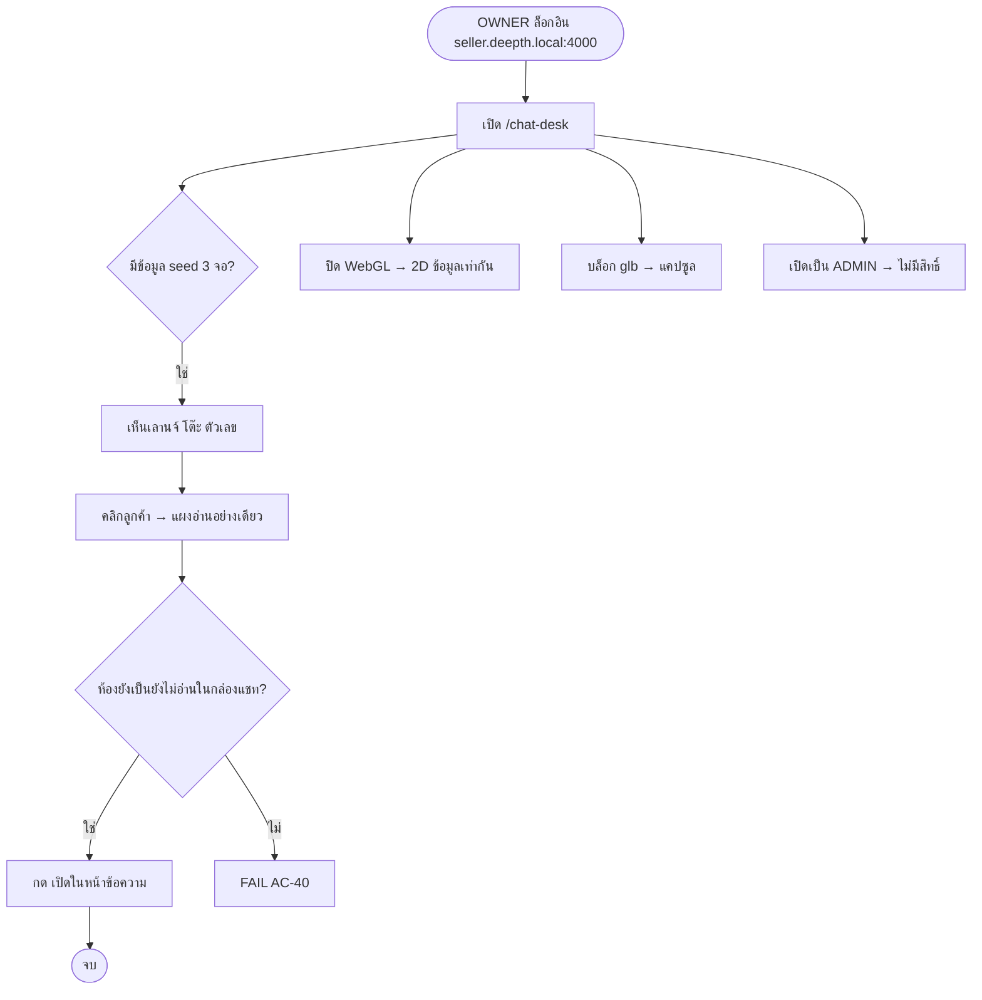

> **โมดูล:** 00077 - Chat Desk · **ประเภท:** Test Case · **เวอร์ชัน:** 1.0 · **วันที่:** 2026-10-16 · **สถานะ:** Draft (ยังไม่มีโค้ด/ยังไม่รัน)
> **เจ้าของเอกสาร:** QA (ดู [[Feature-Docs-Ownership]]) ร่างโดย planner ให้ QA/Controller ตรวจ

# Test Case: โต๊ะแชท 3D

## 1. Overview
- **เอกสารต้นทาง:** [[BRD]] AC-CD-01..56
- **ประเภท:** unit (pure) · integration (DB) · route · source-scan · component (`renderToStaticMarkup`) · Playwright E2E · คำสั่งตรวจตอน sign-off
- **สภาพแวดล้อม:** vitest env node · เทส DB ใช้ `DATABASE_URL`/`DIRECT_URL` ชี้ `localhost:5434` ปักในคำสั่งตรง ๆ (HR13/14) และ guard `CAN_RUN` แบบ `agent-performance-sql-parity.test.ts` · สร้างข้อมูลเองและลบด้วย id ที่สร้าง · เวลาทุกจุด inject `now`
- **ไฟล์เทส (ข้อเสนอ):** `src/lib/chat-desk/__tests__/{rules,filters,owner-scope,scene-model,poller,presence-controller,presence-key}.test.ts` · `src/lib/__tests__/chat-desk-sources.test.ts` · `src/services/__tests__/{chat-desk.service,chat-desk-metrics-parity}.db.test.ts` · `src/app/api/chat-desk/snapshot/route.test.ts` · `src/app/api/chat-desk/rooms/[id]/preview/route.test.ts` · `src/app/api/chat/presence-keys/route.test.ts` · `src/app/(paces)/seller/(dashboard)/chat-desk/components/__tests__/*.test.tsx` · `.../chat-desk/__tests__/page.test.tsx` · `e2e/chat-desk.spec.ts`
- **Out of scope:** รอบ 2 (ตกแต่งห้อง สัญญาณสด ทีม)

---

## 2. Test Scenarios

### TC-CD-001: ตัดสินห้องเลานจ์
- **Linked to:** AC-CD-01, 09
- **Precondition:** ห้องหลายแบบ (ปิดงาน/hidden/spam/lastInboundAt 8 วัน/`lastSenderRole='SHOP'`/ลูกค้าส่งหลังร้านตอบ 30 วินาที)
- **Steps:** เรียก `classifyRoom()` ทีละเงื่อนไขโดยเปลี่ยนเงื่อนไขเดียว
- **Expected:** เฉพาะเคสที่ครบเงื่อนไข = `WAITING`; เคสลูกค้าส่งหลังร้านตอบ = `WAITING` ไม่ใช่ `AT_DESK`

### TC-CD-002: เพดาน 200 ห้อง
- **Linked to:** AC-CD-02
- **Precondition:** seed 201 ห้องรอ
- **Steps:** `getDeskSnapshot`
- **Expected:** `rooms` WAITING = 200 แถวที่รอนานสุด · `awaiting.capped=true`; 200 ห้องพอดี → `false`

### TC-CD-003: ขอบเวลา 180 วินาที
- **Linked to:** AC-CD-03
- **Steps:** ข้อความร้านอายุ 179/180/181 วินาที
- **Expected:** 179, 180 → `AT_DESK`; 181 → `NONE`

### TC-CD-004: บรรทัดระบบไม่ใช่คนตอบ
- **Linked to:** AC-CD-04
- **Precondition:** ห้องมีข้อความ SHOP จริง 1 ใบ แล้วตามด้วยบรรทัด `AUTO_ORDER_RESULT` และอีกห้องตามด้วย `META_NOTICE`
- **Expected:** โต๊ะตามใบจริง · ไม่มีใบจริงเลย → ไม่ขึ้นหน้าโต๊ะ · ลบเงื่อนไข `type NOT IN` แล้วเทสแดง

### TC-CD-005: ตัดสินโต๊ะ 4 ชนิด
- **Linked to:** AC-CD-05, 06, 07, 08
- **Steps:** `pickDesk` ตาราง: autoReplyKind / viaStandby / senderUserId สมาชิก / senderUserId null / สมาชิกที่ถอดแล้ว / เคสชน (autoReplyKind+viaStandby)
- **Expected:** BOT > META_AI > ADMIN > EXTERNAL ตามลำดับ · เทียบผลกับ `isHumanAgentReply` ในเคสสมาชิก

### TC-CD-006: จัดวางหน้าโต๊ะ/เลานจ์/ร้านเจ้าของคนเดียว
- **Linked to:** AC-CD-10, 11, 50
- **Steps:** `layoutDesk` 0/3/4/10 คน · `layoutLounge` 24/25/60 คน · ร้านสมาชิก 1 คน + ห้องทุกชนิด
- **Expected:** ≤3 คน + `overflow=N-3` · ที่นั่ง 24 + ตัวเลขที่เหลือ · โต๊ะเจ้าของ + โต๊ะ "ตอบจากนอกระบบ" ครบไม่ error

### TC-CD-007: ตัวเลขตรงรายงานเดิม
- **Linked to:** AC-CD-12
- **Precondition:** seed ร้าน + ห้อง + ข้อความหลากแบบ (ระบุตัวคนได้/ไม่ได้/บอท)
- **Steps:** เทียบ `getShopResponseSummary(shop, window)` กับ `getAgentPerformanceOverview(shop, window).overview` (5 ฟิลด์)
- **Expected:** เท่ากันทุกวินาที · สแกนซอร์ส `chat-desk.service.ts` ไม่มี `computeResponsePairs(` `summarizeShop(` `AVG(`

### TC-CD-008: "-" และป้ายนับไม่ครบ
- **Linked to:** AC-CD-13, 14, 31
- **Steps:** render `OverviewCard` สถานะ: ไม่มีตัวอย่าง · `unattributedReplyCount` 0 และ >0 · presence `unavailable` · daily `UNAVAILABLE`
- **Expected:** "—" ไม่ใช่ 0 · ป้าย "ตอบจากนอกระบบ n ข้อความไม่รวม" เฉพาะ n>0 · ออนไลน์ "—" + ป้ายตรวจไม่ได้

### TC-CD-009: เกินเวลาตอบและเวลาไทย
- **Linked to:** AC-CD-15, 16
- **Steps:** `isOverdue` SLA-1/SLA/SLA+1 · `startOfBangkokDay` ที่ 16:59:59Z และ 17:00:00Z · สแกนซอร์สหา `resolveSlaConfig(` และไม่มีเลข `300`
- **Expected:** เกินเมื่อ `>` SLA เท่านั้น · ข้ามวันที่ 17:00:00Z · wrapper ของ `thaiTodayBounds`

### TC-CD-010: สมาชิกและตัวเลขภาพรวมสด
- **Linked to:** AC-CD-17, 18, 19
- **Steps:** เจ้าของ BUSINESS ที่มีแถว `ShopMember` ของตัวเองด้วย · ผสม online/offline/แชทในมือ · ห้องหน้าโต๊ะ AI/บอท
- **Expected:** นับเจ้าของ 1 ไม่ใช่ 2 · ว่างรับแชท = ออนไลน์ ∧ มือ 0 · กำลังคุยไม่นับ META_AI/BOT

### TC-CD-011: ปิดงานวันนี้
- **Linked to:** AC-CD-20
- **Steps:** ห้องปิดวันนี้ · ห้องปิดแล้วลูกค้าทักกลับ (resolvedAt ถูกล้าง) · ห้องปิดเมื่อวาน
- **Expected:** นับเฉพาะ `resolvedAt >= เที่ยงคืนไทย` และยังไม่ null

### TC-CD-012: สิทธิ์ 3 บัญชี
- **Linked to:** AC-CD-21, 24
- **Steps:** mock `getServerSession` + `listAccessibleShopIds`: OWNER / ADMIN / ไม่ล็อกอิน · สลับ OWNER→ADMIN ระหว่างสองคำขอ
- **Expected:** 200 / 403 `FORBIDDEN_ROLE` (body ไม่มีข้อมูล) / 401 · คำขอที่สอง 403

### TC-CD-013: หน้าไม่พึ่ง layout
- **Linked to:** AC-CD-22
- **Steps:** เรียก default export ของ `page.tsx` ด้วย ADMIN · เปิด URL ตรงใน E2E
- **Expected:** การ์ดไม่มีสิทธิ์ (`X7`) ไม่มีชื่อร้าน/ตัวเลขใน HTML

### TC-CD-014: ขอบเขตร้านของเจ้าของ
- **Linked to:** AC-CD-23
- **Steps:** ผู้ดู OWNER ร้าน A ADMIN ร้าน B ส่ง `shopId=B` · `pickDeskShop` กับชุดต่าง ๆ
- **Expected:** 403 ไม่มีข้อมูล B · mutation: ถอด `X7` เป็น cap กว้างกว่า (เช่น H1) แล้วเทสแดง

### TC-CD-015: เมนูเห็นเฉพาะเจ้าของ
- **Linked to:** AC-CD-25
- **Steps:** `applyCapabilityMenu` ด้วย roles ของ OWNER/MANAGER/CHAT/BILLING/TECHNICIAN · `isRegisteredPage('/chat-desk')` · ตาราง `X7` ใน `shop-permissions.test.ts`
- **Expected:** เห็น `seller:chat-desk` เฉพาะ OWNER · slug อยู่ในกลุ่ม CHAT

### TC-CD-016: preview ห้องร้านอื่น
- **Linked to:** AC-CD-26
- **Steps:** OWNER ขอห้องของร้านอื่น · ADMIN ขอห้องร้านตน · ห้องไม่มีจริง
- **Expected:** 404 ทั้งหมด (ไม่ใช่ 403) · ไม่มีเนื้อหา

### TC-CD-017: Presence tracker/คีย์
- **Linked to:** AC-CD-27, 28, 30
- **Steps:** mock Supabase client: tracker 2 instance คีย์เดียว · `presenceKeyFor` ต่างร้าน/ต่างคน · `GET /api/chat/presence-keys` ตามสิทธิ์
- **Expected:** `track` ต่อร้าน payload ไม่มี userId · `presenceState()` มี 1 key · คีย์ต่างกันต่อร้านและไม่มี userId ในสตริง · BILLING-only → 403

### TC-CD-018: Presence reader อ่านอย่างเดียว/ล่ม
- **Linked to:** AC-CD-29, 31
- **Steps:** สแกน `useChatDeskPresence.ts` + `presence-controller.ts` ส่วน reader หา `.track(` · จำลอง `CHANNEL_ERROR` และไม่มี sync 10 วินาที
- **Expected:** ไม่มี `.track(` · สถานะ `unavailable` หน้าไม่ล้ม

### TC-CD-019: Poll / ซ่อนแท็บ / signal
- **Linked to:** AC-CD-32, 33, 34
- **Steps:** fake timers + fake `document.hidden` + signal 5 ครั้งใน 1 วินาที + 429 พร้อม `Retry-After`
- **Expected:** fetch ทุก 8000ms · ซ่อน = ไม่มี timer/fetch · กลับมา = fetch ทันที · signal ×5 = fetch 1 ครั้ง · ไม่มี fetch ซ้อน

### TC-CD-020: เหตุการณ์ในฉาก
- **Linked to:** AC-CD-35, 36, 37
- **Steps:** `diffSnapshots(a,a)` · ห้องใหม่/ย้ายเลานจ์→โต๊ะ/หาย · `prev=null` · 25 เหตุการณ์ใน 1 รอบ
- **Expected:** `[]` · ENTER/TO_DESK/LEAVE ตรงตาราง · snapshot แรกไม่มีเหตุการณ์ · `splitEvents` เล่น 20 ที่เหลือวางทันที

### TC-CD-021: ไม่มีสัญญาณสดฝั่งแอดมิน
- **Linked to:** AC-CD-38
- **Steps:** สแกน `src/lib/chat-desk/**` และ `chat-desk/**` หา `typing`/`viewing`
- **Expected:** ไม่พบ

### TC-CD-022: อ่านอย่างเดียว
- **Linked to:** AC-CD-39, 40
- **Steps:** สแกนทุก `route.ts` ใต้ `src/app/api/chat-desk/**` (จากระบบไฟล์) · เรียก `getRoomPreview` แล้วเทียบ `shopLastReadAt` ก่อน-หลัง · สแกนหา `markRead` `sendSenderAction` `shopLastReadAt:`
- **Expected:** export เฉพาะ `GET` · ค่าเท่าเดิม · ไม่พบสัญลักษณ์ต้องห้าม

### TC-CD-023: กล่องแชทอ่านอย่างเดียว
- **Linked to:** AC-CD-41, 42, 44
- **Steps:** route: 31 ข้อความ · ข้อความ `isDeleted` · render `ChatPreviewPanel`
- **Expected:** 30 ใบเรียงเก่า→ใหม่ + `truncated:true` · `body:null` และข้อความเดิมไม่อยู่ใน JSON · ไม่มี `<textarea>`/ปุ่มส่ง/ย้าย/มอบ/ปิดงาน · ลิงก์ "เปิดในหน้าข้อความ" ผ่าน `LinkButton` ไป `/inbox/{id}`

### TC-CD-024: ไม่มี PII
- **Linked to:** AC-CD-43
- **Steps:** snapshot + preview ที่ seed ลูกค้ามีเบอร์/อีเมลใน record · เทียบคีย์ทุกระดับกับ allow-list
- **Expected:** มีเฉพาะคีย์ที่ระบุใน [[API]] · ไม่มี token/avatar

### TC-CD-025: Fallback 3D → 2D
- **Linked to:** AC-CD-45, 46
- **Steps:** component: child ของ boundary throw · E2E: ปิด WebGL · E2E: บล็อก `**/*.glb`
- **Expected:** เห็น `DeskList2D` ตัวเลข/รายชื่อครบเท่าฉาก · แคปซูลแทนโมเดล ฉากไม่ล้ม

### TC-CD-026: เกินเวลาตอบบนฉาก + ลดการเคลื่อนไหว
- **Linked to:** AC-CD-47, 54
- **Steps:** render ป้าย overdue ด้วย/ไม่ `reducedMotion` · สแกน emoji ใน `chat-desk/**` · E2E อ่าน `getComputedStyle` ของป้าย
- **Expected:** ไอคอน tabler (`alert-triangle`) ไม่ใช่ emoji · reduced-motion = แดงนิ่งไม่มีคลาส animate · ฟอนต์ Anuphan

### TC-CD-027: ตัวกรองใน URL
- **Linked to:** AC-CD-48, 49
- **Steps:** `parseDeskFilters`/`serializeDeskFilters`/`roomMatchesFilters` ตารางเพจ/แพลตฟอร์ม/แอดมิน · ส่ง id แปลกปลอม ·  E2E รีเฟรช
- **Expected:** ค่าถูกต้องคงอยู่หลังรีเฟรช · id แปลกถูกทิ้ง ไม่ 500 ไม่เพิ่มข้อมูล · เลานจ์ไม่ถูกกรองด้วยแอดมิน

### TC-CD-028: ซ่อนตัวเลข / มือถือ / three เฉพาะหน้านี้
- **Linked to:** AC-CD-51, 52, 53
- **Steps:** E2E 3 จอ (390, 768, 1440) · กดซ่อนตัวเลข · `resolveInitialView(width, hasWebGL, urlView)` · สแกน import `three`/`@react-three/*` ทั้ง `src/` · `next build` + ตรวจ chunk
- **Expected:** <768 = 2D ตั้งต้น พื้นที่แตะ ≥44px · ซ่อนเฉพาะป้ายบนฉาก การ์ดซ้ายอยู่ · import อยู่เฉพาะ `chat-desk/components/scene/**` · ไม่มี chunk three ใน route อื่น

### TC-CD-029: ไม่มี schema change
- **Linked to:** AC-CD-55, 56
- **Steps:** `git diff --stat main -- prisma/` · ดู log deploy/PR
- **Expected:** 0 ไฟล์ · ไม่มี migration ของฟีเจอร์นี้

### TC-CD-030: ไม่ทำลายระบบเดิม (regression S-14)
- **Linked to:** NFR/S-14 (ไม่ใช่ AC)
- **Steps:** `git diff --stat main -- src/services/chat.service.ts src/lib/agent-sla.ts src/lib/chat-shop-realtime.ts` · `src/lib/agent-performance*.ts` · `npx vitest run src/lib src/services` และ `npx tsc --noEmit` · `route-capability-inventory` + `route-slug-collision` + `app-router-reserved-filenames` + `chat-nav-rail-guard`
- **Expected:** ไฟล์ข้างบนไม่ถูกแก้ (ยกเว้น `agent-performance.service.ts` เพิ่ม export) · เทสชุดเดิมผ่านเท่าก่อนเริ่ม

---

## 3. Traceability Matrix
| AC | Test Case | ไฟล์เทส :: ชื่อเทส (ข้อเสนอ) | ครอบคลุม |
|---|---|---|---|
| AC-CD-01 | TC-001 | `chat-desk/__tests__/rules.test.ts` :: classifyRoom WAITING ทีละเงื่อนไข | Yes |
| AC-CD-02 | TC-002 | `services/__tests__/chat-desk.service.db.test.ts` :: awaiting 201 → 200 + capped | Yes |
| AC-CD-03 | TC-003 | `rules.test.ts` :: classifyRoom AT_DESK 179/180/181 | Yes |
| AC-CD-04 | TC-004 | `chat-desk.service.db.test.ts` :: บรรทัดระบบไม่ใช่คนตอบ (+ mutation) | Yes |
| AC-CD-05 | TC-005 | `rules.test.ts` :: pickDesk ตาราง + เคสชน | Yes |
| AC-CD-06 | TC-005 | `rules.test.ts` :: pickDesk viaStandby | Yes |
| AC-CD-07 | TC-005 | `rules.test.ts` :: pickDesk สมาชิก (เทียบ isHumanAgentReply) | Yes |
| AC-CD-08 | TC-005 | `rules.test.ts` :: pickDesk external | Yes |
| AC-CD-09 | TC-001 | `rules.test.ts` :: ลูกค้าส่งหลังร้านตอบ 30 วิ → WAITING | Yes |
| AC-CD-10 | TC-006 | `scene-model.test.ts` :: layoutDesk 0/3/4/10 | Yes |
| AC-CD-11 | TC-006 | `scene-model.test.ts` :: ร้านเจ้าของคนเดียว + `chat-desk.service.db.test.ts` :: members | Yes |
| AC-CD-12 | TC-007 | `chat-desk-metrics-parity.db.test.ts` :: summary = overview + `chat-desk-sources.test.ts` :: ไม่คำนวณสูตรเอง | Yes |
| AC-CD-13 | TC-008 | `chat-desk.service.db.test.ts` :: daily null + `OverviewCard.test.tsx` :: "—" | Yes |
| AC-CD-14 | TC-008 | `OverviewCard.test.tsx` :: ป้ายนับไม่ครบ n>0/n=0 | Yes |
| AC-CD-15 | TC-009 | `rules.test.ts` :: isOverdue + `chat-desk-sources.test.ts` :: resolveSlaConfig ไม่มี 300 | Yes |
| AC-CD-16 | TC-009 | `rules.test.ts` :: startOfBangkokDay 16:59:59Z/17:00:00Z | Yes |
| AC-CD-17 | TC-010 | `chat-desk.service.db.test.ts` :: loadDeskMembers dedupe + `scene-model.test.ts` :: online n/N | Yes |
| AC-CD-18 | TC-010 | `scene-model.test.ts` :: summarizeDesk ว่างรับแชท | Yes |
| AC-CD-19 | TC-010 | `scene-model.test.ts` :: summarizeDesk กำลังคุย | Yes |
| AC-CD-20 | TC-011 | `chat-desk.service.db.test.ts` :: countResolvedToday | Yes |
| AC-CD-21 | TC-012 | `api/chat-desk/snapshot/route.test.ts` :: 401/403/200 | Yes |
| AC-CD-22 | TC-013 | `chat-desk/__tests__/page.test.tsx` :: ADMIN → NoPermissionCard + `e2e/chat-desk.spec.ts` | Yes |
| AC-CD-23 | TC-014 | `owner-scope.test.ts` + `snapshot/route.test.ts` :: shopId ร้าน ADMIN → 403 | Yes |
| AC-CD-24 | TC-012 | `snapshot/route.test.ts` :: สลับ role ระหว่างสองคำขอ | Yes |
| AC-CD-25 | TC-015 | `lib/__tests__/role-nav.test.ts` + `chat-nav-rail-guard.test.ts` + `shop-permissions.test.ts` | Yes |
| AC-CD-26 | TC-016 | `rooms/[id]/preview/route.test.ts` :: ห้องร้านอื่น/ADMIN → 404 | Yes |
| AC-CD-27 | TC-017 | `presence-controller.test.ts` :: tracker track ต่อร้าน | Yes |
| AC-CD-28 | TC-017 | `presence-controller.test.ts` :: สอง instance คีย์เดียว | Yes |
| AC-CD-29 | TC-018 | `chat-desk-sources.test.ts` :: reader ไม่มี `.track(` + `presence-controller.test.ts` | Yes |
| AC-CD-30 | TC-017 | `presence-key.test.ts` + `api/chat/presence-keys/route.test.ts` | Yes |
| AC-CD-31 | TC-018 | `presence-controller.test.ts` :: unavailable + `OverviewCard.test.tsx` | Yes |
| AC-CD-32 | TC-019 | `poller.test.ts` :: poll 8000ms | Yes |
| AC-CD-33 | TC-019 | `poller.test.ts` :: hidden หยุด/กลับมาดึงทันที + `e2e` :: paused | Yes |
| AC-CD-34 | TC-019 | `poller.test.ts` :: signal ×5 → fetch 1 | Yes |
| AC-CD-35 | TC-020 | `scene-model.test.ts` :: diff(a,a)=[] | Yes |
| AC-CD-36 | TC-020 | `scene-model.test.ts` :: diffSnapshots ตารางเหตุการณ์ | Yes |
| AC-CD-37 | TC-020 | `scene-model.test.ts` :: prev=null + splitEvents 20 | Yes |
| AC-CD-38 | TC-021 | `chat-desk-sources.test.ts` :: ไม่มี typing/viewing | Yes |
| AC-CD-39 | TC-022 | `chat-desk-sources.test.ts` :: route chat-desk export เฉพาะ GET | Yes |
| AC-CD-40 | TC-022 | `chat-desk.service.db.test.ts` :: shopLastReadAt ไม่เปลี่ยน + `chat-desk-sources.test.ts` | Yes |
| AC-CD-41 | TC-023 | `preview/route.test.ts` :: 31→30 + `ChatPreviewPanel.test.tsx` | Yes |
| AC-CD-42 | TC-023 | `preview/route.test.ts` :: isDeleted → body null | Yes |
| AC-CD-43 | TC-024 | `chat-desk.service.db.test.ts` + 2 route test :: allow-list | Yes |
| AC-CD-44 | TC-023 | `ChatPreviewPanel.test.tsx` :: LinkButton + `e2e` | Yes |
| AC-CD-45 | TC-025 | `DeskSceneBoundary.test.tsx` + `e2e` ปิด WebGL | Yes |
| AC-CD-46 | TC-025 | `e2e` บล็อก `.glb` | Yes |
| AC-CD-47 | TC-026 | `DeskLegend/Person.test.tsx` :: overdue ไอคอน + reduced-motion + สแกน emoji | Yes |
| AC-CD-48 | TC-027 | `filters.test.ts` + `e2e` รีเฟรช | Yes |
| AC-CD-49 | TC-027 | `filters.test.ts` + `chat-desk.service.db.test.ts` :: id แปลกปลอม | Yes |
| AC-CD-50 | TC-006 | `scene-model.test.ts` :: layoutLounge + `e2e` คีย์บอร์ด | Yes |
| AC-CD-51 | TC-028 | `DeskToolbar.test.tsx` + `e2e` ซ่อนตัวเลข | Yes |
| AC-CD-52 | TC-028 | `rules.test.ts` :: resolveInitialView + `e2e` 3 จอ | Yes |
| AC-CD-53 | TC-028 | `chat-desk-sources.test.ts` :: import three จำกัดโฟลเดอร์ + ตรวจ bundle | Yes |
| AC-CD-54 | TC-026 | `chat-desk-sources.test.ts` :: ฟอนต์ + `e2e` computed style | Yes |
| AC-CD-55 | TC-029 | คำสั่ง `git diff --stat main -- prisma/` | Yes |
| AC-CD-56 | TC-029 | บันทึกใน PR/ผล deploy | Yes |

> เทส mutation ที่ต้องพิสูจน์ว่าแดงจริง (ทำตอน implement): M-1 ถอด `type NOT IN` (AC-04) · M-2 เปลี่ยน cap เป็น `H1` (AC-21/23) · M-3 แทน `getShopResponseSummary` ด้วยสูตรเอง (AC-12) · M-4 ใส่ `markRead` ใน preview (AC-40) · M-5 ใส่ `.track(` ใน reader (AC-29) · M-6 เติมฟิลด์ `phone` ใน payload (AC-43) · M-7 เปลี่ยน `>` เป็น `>=` ใน `isOverdue` (AC-15) · M-8 ใช้ UTC แทน `thaiTodayBounds` (AC-16)

---

## 4. Flow ทดสอบ E2E หลัก

## 5. ผลล่าสุด
| Run | วันที่ | ผล (Pass/Fail/Blocked) | ผู้ทดสอบ |
|---|---|---|---|
| 0 | 2026-10-16 | Blocked: ยังไม่มีโค้ด | — |
| 1 | 2026-10-16 | PASS — QA รอบ 1 (E2E 10 เคส) พบ minor 4 ข้อ แก้แล้วใน `50b33225f` | QA agent |

## 6. สรุป
เอกสารนี้ map AC-CD-01..56 ครบทุกข้อเข้ากับ TC และไฟล์เทส ชื่อไฟล์/เทสเป็นข้อเสนอที่ dev ต้องยืนยันหรือเปลี่ยนชื่อให้ตรงกับของจริงตอนเขียน

**Open Questions:** ไม่มี — ผลรัน EXPLAIN จำนวน SQL จริง และขนาด payload วัดแล้วใน [[SDS]] §7.4 (ยังไม่ครอบ E2E 3 จอ/critique/clarify ของ S-13)
