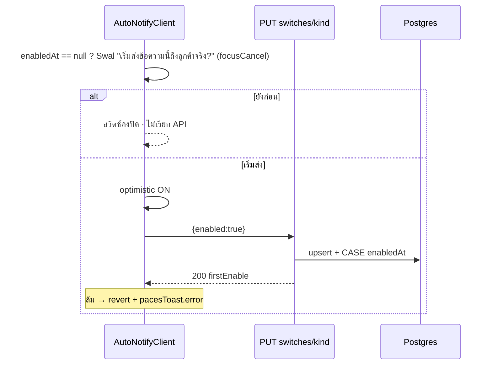

> **ประเภท:** API Contract · provider = Next.js 16 route handlers (`src/app/api/**`) · consumer = Paces seller UI

# API Contract: 00078

## 1. Overview
- **Base:** same-origin `https://seller.deepthailand.app/api` (dev `seller.deepth.local:4000`) · `Content-Type: application/json`
- **Convention:** `jsonNoStore()` (`@/lib/shop-api-guard`) ทุกคำตอบของ GET ที่ผูกสิทธิ์ · error shape เดิมของโปรเจกต์: `{ error: CODE, message?: ไทย, … }` (ไม่ใช่ `{error:{code}}` ของ template — ตาม `close/route.ts`)
- **ตรวจชื่อ route แล้ว:** ไม่ชนกับ sibling dynamic segment (`[token]` ใต้ `/api/orders` ชื่อเดียวกับพี่น้อง · `[kind]` ใต้ `switches`/`templates` เป็นชั้นใหม่ไม่มี sibling) · ไม่ใช้ชื่อไฟล์สงวน (`template`/`layout`/`default`…) — โฟลเดอร์ใช้พหูพจน์ `templates`
- `?shopId=` รองรับเฉพาะเส้นที่ถูกเรียกจากกล่องแชทข้ามร้าน (BR-UNI-07): `start`, `strip-context`

## 2. Authentication
| รายการ | ค่า |
|---|---|
| วิธี | NextAuth session cookie ของ subdomain seller |
| ตรวจสิทธิ์ | `requireShopCapability(session, CAP, {shopId})` (ไม่ใช่ RLS) |
| ไม่ผ่าน | 401 (ไม่มี session) · 403 `FORBIDDEN_ROLE` (`forbiddenRoleResponse()`) |

## 3. Endpoint List
| Method | Path | Cap | หมายเหตุ |
|---|---|---|---|
| GET | `/api/shops/current/auto-notify` | H1 | snapshot หน้าตั้งค่า (CHAT อ่านได้) |
| PATCH | `/api/shops/current/auto-notify/settings` | X8 | เพดานต่อวัน |
| PUT | `/api/shops/current/auto-notify/switches/[kind]` | X8 | เปิด/ปิดจังหวะ |
| PUT | `/api/shops/current/auto-notify/templates/[kind]` | X8 | บันทึกเทมเพลต (409 ถ้าชน) |
| DELETE | `/api/shops/current/auto-notify/templates/[kind]` | X8 | คืนค่าตั้งต้น |
| GET | `/api/shops/current/auto-notify/strip-context` | O1 (+H1 เมื่อมี `conversationId`) | ข้อมูลให้แถบแจ้ง |
| POST | `/api/orders/[token]/start` | O4 | เริ่มงาน |
| PATCH | `/api/orders/[token]/shipping-cost` | S1 | แก้เฉพาะต้นทุน (D06) |
| POST / PATCH | `/api/orders/[token]/ship` | S1 | **เปลี่ยน:** body รับ `outboundShippingCost` |
| POST | `/api/chat/conversations/[id]/messages` | H2 | **เปลี่ยน:** `type:"TRACKING"` ใหม่ · `ORDER`/`APPOINTMENT` ประกอบผ่าน renderer |
| GET | `/api/chat/conversations` | H1 | **เปลี่ยน:** item +`metaAiHoldUntilMs` · `customerBehavior.counted` (เลิก `completed`) |
| GET | `/api/chat/conversations/[id]/orders` | H1 | **เปลี่ยน:** order +`autoNotify[]` |
| GET | `/api/seller/iship/order-context` | S1 | **เปลี่ยน:** `manualShipment.outboundShippingCost` |
| GET | `/api/cron/chat-outbox` | CRON_SECRET | **เปลี่ยน:** คืน `autoNotify:{…}` เพิ่ม |

## 4. Endpoint Detail

### 4.1 `GET /api/shops/current/auto-notify`
**Response 200**
| ฟิลด์ | ชนิด | คำอธิบาย |
|---|---|---|
| `vertical` | string | |
| `kinds[]` | array | เฉพาะ kind ที่ร้านนี้ใช้ได้ (`kindsForVertical`) ตามลำดับแสดง |
| `kinds[].kind` | enum | |
| `kinds[].enabled` | boolean | |
| `kinds[].enabledAt` | ISO\|null | `null` = ไม่เคยเปิด → UI ถาม Swal ครั้งแรก |
| `kinds[].updatedBy` | `{name}\|null` | |
| `kinds[].template` | `{ body: string\|null, defaultBody: string, isCustom: boolean, updatedAt: ISO\|null, updatedBy: {name}\|null }` | `body=null` = ใช้ค่าตั้งต้น |
| `dailyCapPerRoom` | int | ไม่มีแถว = 5 |
| `canEdit` | boolean | `can(roles,'X8')` |
| `variables` | `Record<kind, {name,sample}[]>` | จาก SSOT (เมนูตัวแปร) |
```json
{ "vertical":"ONLINE_SALES","dailyCapPerRoom":5,"canEdit":true,
  "kinds":[{"kind":"ORDER_SUMMARY","enabled":false,"enabledAt":null,"updatedBy":null,
    "template":{"body":null,"defaultBody":"{คำเรียกรายการ}: {รายการสินค้า}\nยอดสุทธิ {ยอดสุทธิ}\n{ลิงก์คำสั่งซื้อ}","isCustom":false,"updatedAt":null,"updatedBy":null}}] }
```
**Error:** 401 · 403 (BILLING/TECHNICIAN ไม่มี H1)

### 4.2 `PATCH /api/shops/current/auto-notify/settings`
Body `{ dailyCapPerRoom: int 1..20 }` → 200 `{ dailyCapPerRoom }` · 400 `VALIDATION_ERROR` (0/21/ทศนิยม/ไม่ใช่ตัวเลข) · 403
```ts
export const SetAutoNotifyCapSchema = v.object({
  dailyCapPerRoom: v.pipe(v.number(), v.integer(), v.minValue(1), v.maxValue(20)),
})
```

### 4.3 `PUT /api/shops/current/auto-notify/switches/[kind]`
Path `kind` = picklist 5 ค่า · Body `{ enabled: boolean }`
สำเร็จ 200 `{ kind, enabled, enabledAt, firstEnable }` — `firstEnable` = เปลี่ยนจากไม่เคยมี `enabledAt` (ให้ UI รู้ว่า Swal ผ่านแล้ว; **Swal เป็น UX ไม่ใช่กฎ server — A-12**)
เขียนด้วย SQL เดียว: `INSERT … ON CONFLICT ("shopId","kind") DO UPDATE SET "enabledAt" = CASE WHEN "AutoNotifySwitch"."enabled" THEN "AutoNotifySwitch"."enabledAt" ELSE now() END, "enabled"=$3, …` (ปิดไม่แตะ `enabledAt`)
Error: 400 `VALIDATION_ERROR` · 403 · **409 `KIND_NOT_AVAILABLE`** (kind ไม่อยู่ใน vertical)

### 4.4 `PUT /api/shops/current/auto-notify/templates/[kind]`
Body
```ts
export const SaveAutoNotifyTemplateSchema = v.object({
  body: v.pipe(v.string(),
    v.check((s) => !s.includes('\u0000'), 'NUL'),
    v.check((s) => !hasLoneSurrogate(s), 'SURROGATE'),
    v.check((s) => countCodePoints(s) >= 1 && countCodePoints(s) <= 500, 'LENGTH'),
    v.check((s) => s.trim() !== '', 'BLANK')),
  expectedUpdatedAt: v.nullable(v.pipe(v.string(), v.isoTimestamp())), // null = ยังไม่เคยมีแถว
})
// + validateTemplate(kind, body) → issues[] (ตัวแปรไม่รู้จัก/ผิดชนิด) ที่ route และซ้ำที่ service
```
200 `{ kind, body, updatedAt, updatedBy }` · 400 `VALIDATION_ERROR` + `issues:[{code:'UNKNOWN_VARIABLE'|'WRONG_KIND_VARIABLE'|'BLANK'|'TOO_LONG', name?}]` · 403 · 409 `KIND_NOT_AVAILABLE` · **409 `TEMPLATE_CONFLICT`** `{currentUpdatedAt}`
กลไก: ใหม่ = `INSERT … ON CONFLICT DO NOTHING RETURNING` (ไม่ได้แถว → 409) · เดิม = `updateMany where updatedAt = expected` (count 0 → 409)

### 4.5 `DELETE /api/shops/current/auto-notify/templates/[kind]?expectedUpdatedAt=ISO`
`deleteMany where (shopId,kind,updatedAt)` · 204 · ไม่มีแถว = 204 (idempotent) · แถวมีแต่ `updatedAt` ไม่ตรง → 409 `TEMPLATE_CONFLICT` · 403

### 4.6 `GET /api/shops/current/auto-notify/strip-context`
Query: `orderToken` **หรือ** `conversationId` (อย่างน้อยหนึ่ง) · `shopId?` · `kind?`
| ฟิลด์ | ชนิด | |
|---|---|---|
| `switches` | `Record<kind,{enabled,enabledAt}>` | เฉพาะ kind ของ vertical |
| `templates` | `Record<kind,string\|null>` | เนื้อ (ไม่ใช่ PII) |
| `canOpenSettings` | boolean | `can(roles,'H1')` (ซ่อนลิงก์ "ตั้งค่า" ของช่าง/ฝ่ายบัญชี) |
| `conversation` | `{id,channel,lastInboundAt: ISO\|null,customerName}\|null` | หาใน `WHERE id AND shopId` |
| `order` | `{conversationId\|null,isDryRun,status,serviceStart,appointmentStatus,serviceClosedAt}\|null` | เมื่อส่ง `orderToken` |
Error: 400 (ไม่ส่งทั้งสอง) · 403 · 404 (ห้อง/ออเดอร์ไม่ใช่ของร้าน → ตอบเหมือนไม่มี) 
> ข้อมูลนี้ไม่มีเงิน/ที่อยู่/เบอร์ จึงเปิดให้ทุกบทบาทที่เห็นจุดใช้งาน (ช่างเห็นแถบเริ่มงาน/ปิดงาน)

### 4.7 `POST /api/orders/[token]/start?shopId=`
Body ว่าง (ยอมรับ `{}`) · cap `O4` · service `startServiceJob`
200 `{ serviceStartedAt: ISO, alreadyStarted: boolean }` — กดซ้ำคืน 200 ค่าเดิม `alreadyStarted:true` (ไม่ส่งซ้ำ) · **ไม่คืนเงิน** (ช่างเรียกได้ — 00071)
| Error | HTTP |
|---|---|
| `SERVICE_JOB_NOT_FOUND` | 404 |
| `SERVICE_JOB_ALREADY_CLOSED` | 409 |
| **`SERVICE_JOB_NOT_STARTABLE`** (ยกเลิก/ร่าง) | 409 |
| `APPOINTMENT_NOT_STARTED` | 409 |
| `FEATURE_NOT_AVAILABLE` | 403 |
ผลเขียน: `Order.serviceStartedAt` + `OrderEvent SERVICE_STARTED` + (ถ้าเข้าเงื่อนไข) ledger INTENT ใน tx เดียว · **ไม่แตะ** `status`/`appointmentStatus`

### 4.8 `PATCH /api/orders/[token]/shipping-cost` (D06)
Body `{ outboundShippingCost: number|null }` (null = ล้างเป็นยังไม่ระบุ) · cap `S1` (`canAccessShopWith(order.shopId,userId,'S1')` แบบเดียวกับ `/ship`)
200 `{ outboundShippingCost: number|null }` · 400 `VALIDATION_ERROR` · 404 ออเดอร์ · **409 `NO_TRACKING_ROW`** (ยังไม่มีแถว ShipmentTracking) · 409 `SHIPPING_COST_NOT_ALLOWED` (CANCELLED/DRAFTED) · 403
บันทึกผู้แก้ใน `OrderEvent` ชนิดเดิม (`ORDER_EDITED`, meta `{field:'outboundShippingCost'}` **ไม่ใส่ตัวเลขดิบ**)

### 4.9 `POST|PATCH /api/orders/[token]/ship` (ขยาย)
```ts
export const ShipOrderSchema = v.object({
  provider: v.pipe(v.string(), v.minLength(1)),
  trackingNo: v.pipe(v.string(), v.minLength(1)),
  outboundShippingCost: v.optional(v.nullable(v.pipe(v.number(), v.minValue(0), v.maxValue(99999.99),
    v.check((n) => Math.round(n * 100) === n * 100 || Math.abs(n * 100 - Math.round(n * 100)) < 1e-6)))),
})
```
POST: ไม่ส่งคีย์/null → เก็บ NULL · PATCH: **ไม่ส่งคีย์ = ไม่แตะ** · `null` = ล้าง · ตัวเลข = ตั้ง · response/ error เดิม (400 `Invalid input`; PATCH 409 `IShipManagedShipmentError`/`OrderNotShippedError`, 404 `ShipmentTrackingNotFoundError`)
side effect: INTENT `TRACKING` (ไม่เปลี่ยน response)

### 4.10 `POST /api/chat/conversations/[id]/messages` (ขยาย)
- `type:"TRACKING"` + `orderRefToken` → ประกอบจากฐาน (ใบ iShip active ก่อน ไม่ก็ ShipmentTracking) ผ่าน `composeNotice('TRACKING')` · ไม่ติด `AUTO_NOTICE` · 202 เหมือน type อื่น
- Error ใหม่ (inline ใน route เหมือน `ORDER` `:839-841`): 400 `ไม่พบคำสั่งซื้อนี้ในร้าน` · **409 `NO_TRACKING`** (ยังไม่มีเลข) · **409 `EMPTY_MESSAGE`** (renderer ว่างทั้งข้อความ — ใช้กับ ORDER/APPOINTMENT/TRACKING)
- `ORDER`/`APPOINTMENT`: ผลลัพธ์ค่าตั้งต้นต้องเท่าเดิม (D-1/D-2 ระบุข้อยกเว้น)

### 4.11 รายการห้อง / แผงออเดอร์ (เปลี่ยน)
`GET /api/chat/conversations` item: `metaAiHoldUntilMs: number|null` (เฉพาะ MESSENGER/INSTAGRAM) · `customerBehavior: {orders,counted,cancelledTotal,cancelledByBuyer,returnedParcels,problemOrders}|null` (**เลิก `completed`**)
`GET …/[id]/orders` order: `autoNotify: [{kind,status,reason,createdAt,message:{deliveryStatus,failureReason}|null}]` (ไม่มี ledger = `[]`)

## 5. Error Code Table
| Code | HTTP | เงื่อนไข |
|---|---|---|
| `VALIDATION_ERROR` | 400 | Valibot ไม่ผ่าน |
| `FORBIDDEN_ROLE` | 403 | บทบาทไม่ถือ cap |
| `KIND_NOT_AVAILABLE` | 409 | kind ไม่อยู่ใน vertical ของร้าน |
| `TEMPLATE_CONFLICT` | 409 | `updatedAt` ชน/แถวหาย |
| `SERVICE_JOB_NOT_STARTABLE` | 409 | ใบยกเลิก/ร่าง |
| `SERVICE_JOB_ALREADY_CLOSED` | 409 | ปิดแล้ว |
| `APPOINTMENT_NOT_STARTED` | 409 | ยังไม่ถึงเวลาเริ่มนัด |
| `NO_TRACKING_ROW` | 409 | ยังไม่มีแถว ShipmentTracking |
| `SHIPPING_COST_NOT_ALLOWED` | 409 | ออเดอร์ยกเลิก/ร่าง |
| `NO_TRACKING` | 409 | ปุ่มแจ้งเลขแต่ออเดอร์ไม่มีเลข |
| `EMPTY_MESSAGE` | 409 | renderer ว่างทั้งข้อความ |

## 6. ทะเบียน capability (`route-capabilities.ts`) ที่ต้องเติม
| key | รายการ |
|---|---|
| `src/app/api/shops/current/auto-notify/route.ts` | `{ GET:'H1' }` |
| `…/auto-notify/settings/route.ts` | `{ PATCH:'X8' }` |
| `…/auto-notify/switches/[kind]/route.ts` | `{ PUT:'X8' }` |
| `…/auto-notify/templates/[kind]/route.ts` | `{ PUT:'X8', DELETE:'X8' }` |
| `…/auto-notify/strip-context/route.ts` | `{ GET:'O1' }` (+H1 ใน body เมื่อมี conversationId) |
| `src/app/api/orders/[token]/start/route.ts` | `{ POST:'O4' }` |
| `src/app/api/orders/[token]/shipping-cost/route.ts` | `{ PATCH:'S1' }` |
| `src/app/(paces)/seller/(dashboard)/settings/auto-notify/page.tsx` | `{ page:'H1' }` |
ต้องคู่กับ `tests/integration/role-contract.test.ts` (GET ใหม่: `auto-notify`, `strip-context`) และเทสสิทธิ์ทุกคู่ (บทบาท×cap) ไฟล์ใหม่

## 7. Sequence — เปิดสวิตช์ครั้งแรก


## 8. Traceability
| Endpoint | SDS | FR |
|---|---|---|
| GET/PATCH/PUT/DELETE auto-notify/** | §3.1 config service · TD-013 | FR-CS-11/19/23/33 |
| strip-context | §4.3 | FR-CS-31 |
| POST start | §7.3 · §7.4 | FR-CS-26 |
| PATCH shipping-cost · ship | TD-009/010 | FR-CS-28 |
| POST messages TRACKING | TD-006 | FR-CS-21 |

## 9. สรุป / Open Questions
Contract ครบพอให้ DEV เขียนได้ · ค้าง: D-1/D-2 (ข้อความเริ่มต้น) กระทบ response ของ `ORDER` เล็กน้อย
