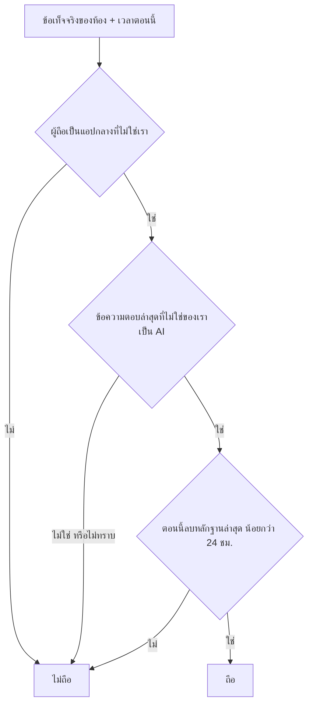
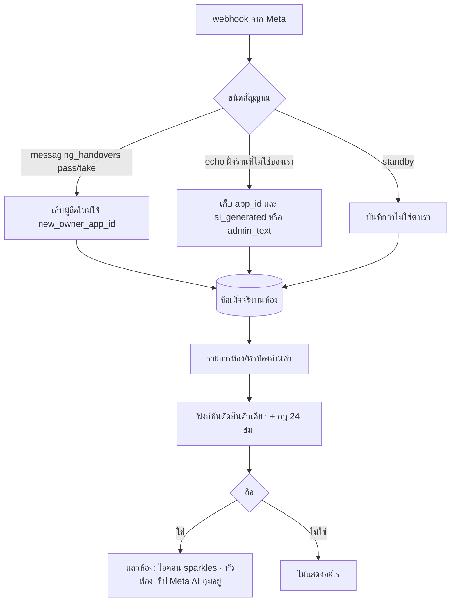
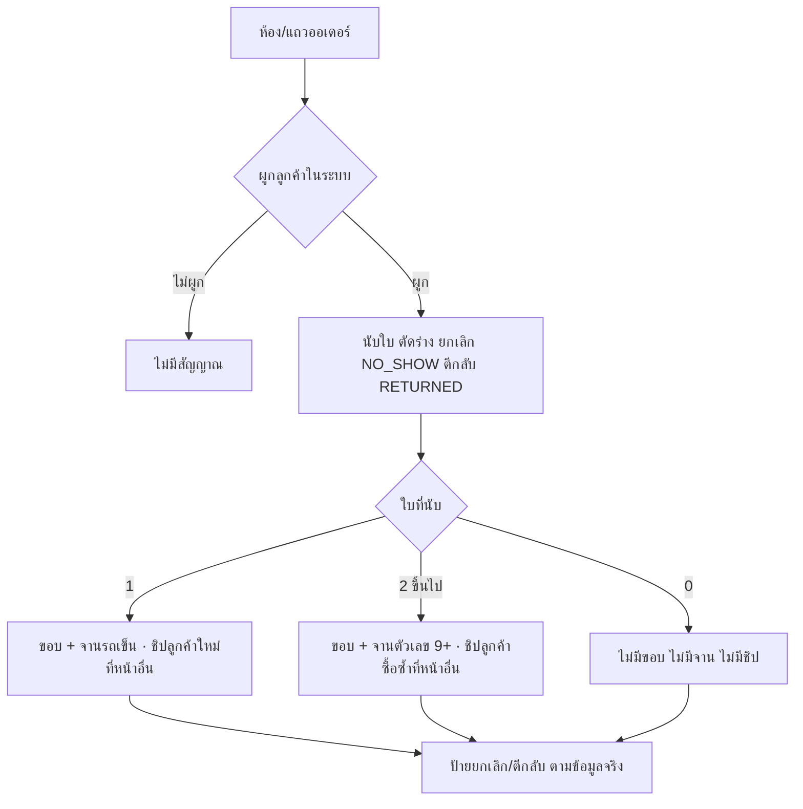
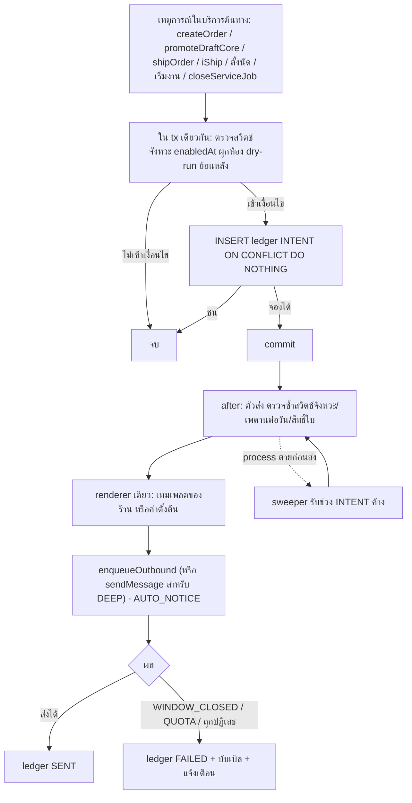
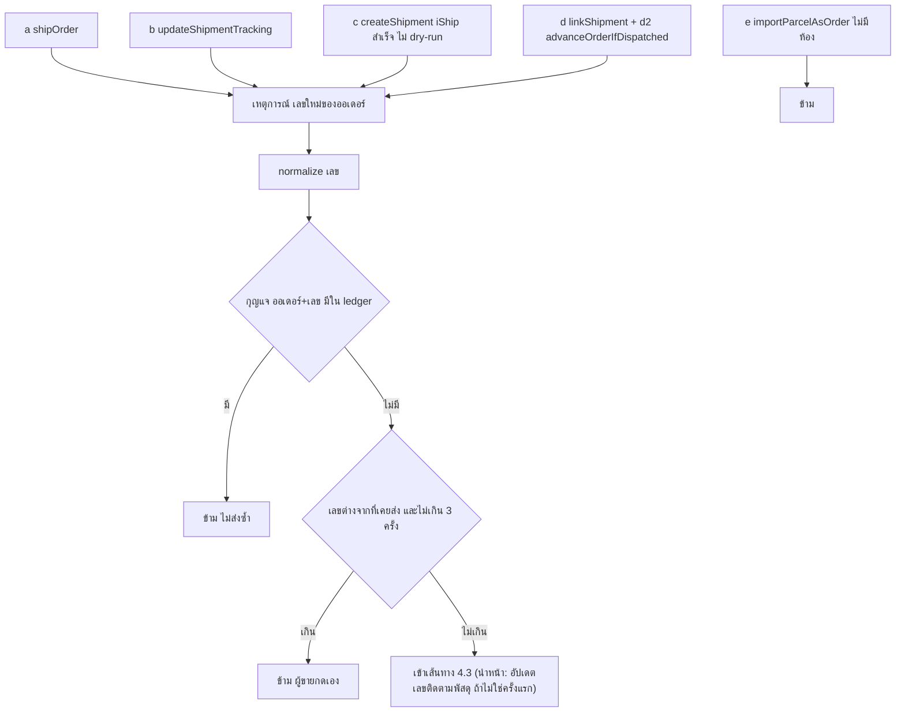
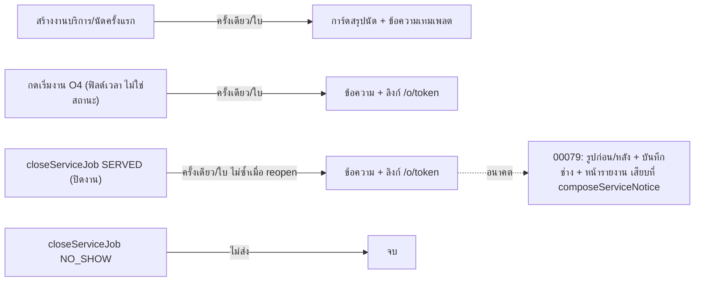
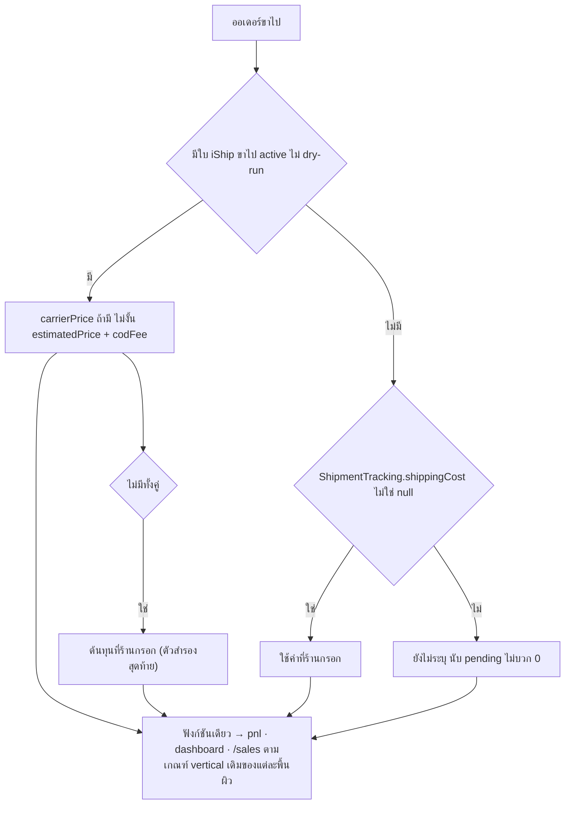
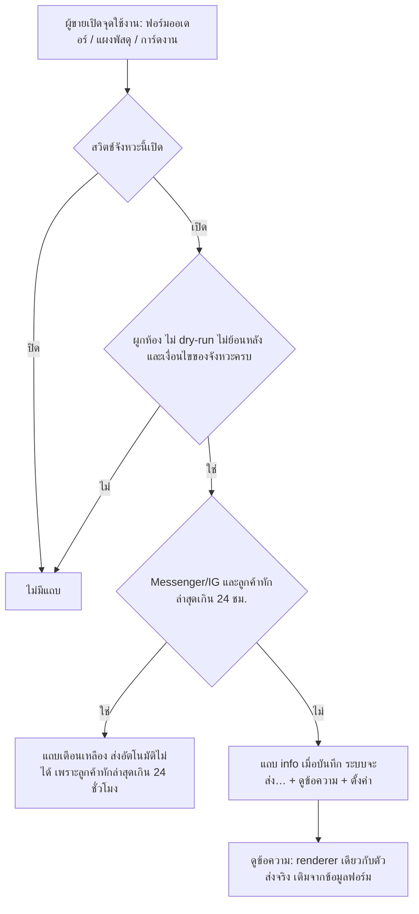
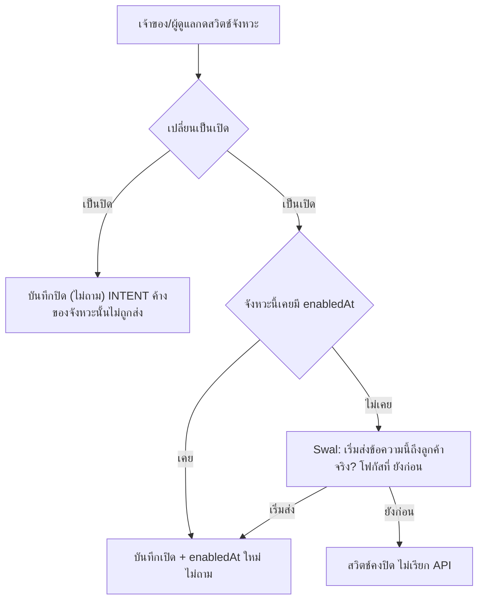

> **โมดูล:** 00078 - Chat Customer Signals & Auto Notify
> **ประเภทเอกสาร:** Business Requirements Document (BRD) - NON-TECHNICAL (ระบุ path เฉพาะจุดบังคับของ acceptance)
> **เวอร์ชัน:** 0.3
> **วันที่จัดทำ:** 2026-10-17 (รอบ 3)
> **สถานะ:** Draft — เหลือคำถามสั้น ๆ ใน [[PRD]] §13
> **เจ้าของเอกสาร:** BA (ดู [[Feature-Docs-Ownership]])

# BRD: สัญญาณลูกค้าในแชทและการส่งอัตโนมัติ (Business Requirements Document)

---

## 1. บทนำ

### 1.1 วัตถุประสงค์ของเอกสาร

1. กำหนดความต้องการหลัก 8 ส่วน: ป้าย Meta AI · สัญญาณลูกค้า (ขอบ+จานมุม+ป้าย) · ส่งอัตโนมัติฝั่งสินค้า · เทมเพลต+ลิงก์ขนส่ง · ส่งอัตโนมัติฝั่งร้านบริการ 3 จังหวะ · ต้นทุนค่าส่งส่งเอง+แท็บ "ส่งเอง" · **แถบแจ้งที่จุดใช้งาน** · **จัดกลุ่มเมนูผู้ขาย 7 กลุ่ม**
2. กำหนดขอบเขตและข้อจำกัด (Meta 24 ชม., โควตา LINE, Flex ส่งเฉพาะการ์ด, ไม่ล็อกช่องพิมพ์, ไม่หยุดบอท, "เริ่มงาน" ไม่ใช่สถานะ, **ไม่มีโหมดทดสอบ**)
3. อธิบายกฎที่ระบบต้อง "บังคับ" ไม่ใช่แค่ "บรรยาย" พร้อมจุดบังคับและเทสที่ต้องแดงเมื่อละเมิด (`docs/conventions/rule-must-be-enforced-not-described.md`)
4. สร้างความเข้าใจร่วมระหว่างทีมธุรกิจและทีมพัฒนา

### 1.2 ขอบเขตของระบบ

**เข้าสู่ระบบ (Input):**
- webhook Messenger/Instagram: `messaging_handovers`, `standby`, echo ที่มี `ai_generated`/`app_id`/`admin_text`
- ออเดอร์และสถานะ/พัสดุ (ยกเลิก ตีกลับ ร่าง NO_SHOW RETURNED)
- เหตุการณ์: ออเดอร์ถึง `PENDING` ครั้งแรก · เลขพัสดุถูกเขียน (6 จุด) · การจอง/นัดครั้งแรก · กด "เริ่มงาน" · `closeServiceJob` ผล `SERVED`
- ตั้งค่าของร้าน: **สวิตช์เปิด/ปิดต่อจังหวะ (5 จังหวะ)** · เทมเพลต · เพดานต่อวัน (**ไม่มีห้องทดสอบ ไม่มีสถานะระดับชุด**)
- ค่าส่งที่ร้านกรอกเมื่อส่งเอง
- ข้อมูลในฟอร์มที่ผู้ขายกำลังกรอก (สำหรับ "ดูข้อความ" ของแถบแจ้ง)

**ออกจากระบบ (Output):**
- สัญญาณบนแถวห้อง หัวห้อง แผงลูกค้า (ขอบ จานมุม ไอคอน ชิป)
- ข้อความอัตโนมัติเข้าแชทลูกค้า 5 ชนิด
- แถบแจ้งที่จุดใช้งาน 4 จุด
- บันทึกผลการส่ง/ข้าม พร้อมเหตุผล + แถวสถานะบนการ์ดออเดอร์ในแชท
- ต้นทุนค่าส่งที่เข้าสูตรกำไรทุกพื้นผิว
- เมนูผู้ขายโครงใหม่ 7 กลุ่ม

**ระบบที่เกี่ยวข้อง:** 00018 · 00023 · 00025 · 00022 · 00059 · 00061 · 00071 · 00073 · 00024/00036 · 00077 · 00047 · 00027 (เมนูลัด) · 00079 (อนาคต)

### 1.3 กลุ่มผู้ใช้งาน

| กลุ่มผู้ใช้ | บทบาท | สิทธิ์ในฟีเจอร์นี้ |
|-----------|--------|----------------|
| **เจ้าของ (OWNER)** | ใช้ทุกอย่าง | เห็นสัญญาณ · เปลี่ยนสวิตช์/เทมเพลต/เพดาน · กดเริ่มงาน · กรอกค่าส่ง · เห็นเมนูครบ 7 กลุ่ม |
| **ผู้ดูแล (MANAGER)** | เหมือนเจ้าของในส่วนนี้ | เหมือนเจ้าของ (`X8` ข้อเสนอ) · ไม่เห็นกลุ่ม "รายงานและการเงิน" และ "ทีมและแพ็กเกจ" |
| **แอดมินแชท (CHAT)** | ตอบแชท | เห็นสัญญาณ · เห็นหน้าตั้งค่าแบบอ่านอย่างเดียว · กดเริ่มงาน (O4) · แจ้งเลข/กรอกค่าส่ง (S1) · เห็นแถบแจ้ง · เปลี่ยนตั้งค่าไม่ได้ |
| **ช่าง (TECHNICIAN)** | ทำงานบริการ | กดเริ่มงาน/ปิดงาน (O4) · ไม่เห็นเงิน · เห็นแถบแจ้ง แต่ไม่เห็นลิงก์ "ตั้งค่า" · ไม่เห็นหน้าตั้งค่า (เห็น `NoPermissionCard`) |
| **ฝ่ายบัญชี (BILLING)** | ตามเดิม | ไม่เกี่ยวกับแชท |
| **ลูกค้าปลายทาง** | ผู้รับข้อความ | ไม่มีสิทธิ์ตั้งค่า |

---

## 2. ความต้องการหลัก (Functional Requirements)

FR ระดับ must = ต้องมีในรอบนี้ · should = ควรมี

### 2.1 ส่วน A — ป้าย Meta AI กำลังควบคุมห้อง

#### FR-CS-01: เก็บข้อเท็จจริงผู้ถือห้องจากสัญญาณที่ Meta ส่งมา (must)

**User Story:**
> ในฐานะผู้ขาย ฉันต้องการให้ระบบจดไว้ว่าห้องไหนถูกแอปอื่น/Meta AI ถือและหลักฐานคืออะไร เพื่อให้ป้ายขึ้นได้โดยไม่ต้องถาม Meta ทุกครั้ง

**Acceptance Criteria:**
- [ ] ข้อเท็จจริงต่อห้อง (ข้อเสนอ DATABASE ยืนยันรูปทรง): ผู้ถือล่าสุด {เรา, แอปอื่น, ว่าง, ไม่ทราบ} · app id · เวลาที่ได้หลักฐาน · เวลาข้อความตอบฝั่งร้านล่าสุดที่ไม่ใช่ของเรา · ชนิดข้อความนั้น {AI, คนใน Business Suite, แอปอื่น, ไม่ทราบ} — ไม่เก็บ boolean (BR-CS-A08)
- [ ] ตอนรับ echo ฝั่งร้านที่ไม่ใช่ของเรา อ่าน `message.ai_generated`, `message.admin_text`, `message.app_id` แล้วเก็บเป็นข้อเท็จจริง (ปัจจุบันใช้เลือก placeholder เท่านั้น: `src/lib/chat-placeholder-text.ts`; `admin_text` ไม่ถูกอ่านเลย)
- [ ] `messaging_handovers` แบบ `pass`/`take` อัปเดตผู้ถือด้วย `new_owner_app_id` เท่านั้น · event ที่มาก่อนห้องถูกสร้าง → ข้าม + log
- [ ] echo ไม่มี `app_id` = ของเรา · ไม่ตั้ง `META_APP_ID` → ไม่เขียนว่า "เรา"
- [ ] idempotent: event ซ้ำ/ลำดับสลับ ไม่ทำให้สถานะเก่าทับใหม่ (เทียบ `occurredAt` ของ Meta)
- [ ] จุดบังคับ: `src/app/api/channels/facebook/webhook/route.ts` + `src/services/channel-chat.service.ts` (`ingestHandoverEvent` `:2433`, ingest echo) · เทสใช้ payload จริงจาก `rawMessage` (`docs/conventions/external-payload-schema.md`)
- [ ] เทส `[blocker]` mutation: `new_owner_app_id` → `previous_owner_app_id` ต้องแดง
- [ ] **ขั้นแรก:** spike วัดข้อมูล prod แบบอ่านอย่างเดียว (Q-23): แถว `ChatHandoverEvent` · จำนวนข้อความ `ai_generated = true` 30 วัน · `admin_text` ปรากฏไหม — ถ้า `ai_generated` = 0 ในสนามจริง ถอยเป็น "แสดงเมื่อพบ `ai_generated` ใน 24 ชม." ไม่พึ่ง handover

**หมายเหตุ:** migration M1 (HR15)

#### FR-CS-02: ฟังก์ชันตัดสิน "Meta AI ถือห้อง" ตัวเดียว (must)

**Acceptance Criteria:**
- [ ] ฟังก์ชันบริสุทธิ์ตัวเดียวใน `src/lib/` (ไม่ import prisma ใช้ได้ทั้ง server/client เหมือน `thread-control-ui.ts`) รับข้อเท็จจริง FR-CS-01 + เวลาปัจจุบัน
- [ ] ถือ = ผู้ถือเป็นแอปอื่น **และ** เป็นแอปกลาง (Page/IG Inbox) **และ** ชนิดข้อความล่าสุดที่ไม่ใช่ของเราเป็น AI **และ** หลักฐานล่าสุดอายุ < 24 ชม. (หลักฐานล่าสุด = ค่ามากสุดของ {เวลาได้ผู้ถือ, `lastInboundAt`, เวลาข้อความตอบที่ไม่ใช่ของเรา} — ยืนยันด้วยข้อมูลจริง Q-23)
- [ ] ไม่มีข้อเท็จจริง = ไม่ถือ · ผู้ถือเป็นเรา/ว่าง = ไม่ถือ · คนพิมพ์ใน Business Suite = ไม่ถือ
- [ ] ห้ามอ่าน `ChatMessage.viaStandby` และ marker ข้อความเป็นอินพุต
- [ ] จุดบังคับ/เทส: ตาราง input 2×2×2 + ขอบเขตเวลา 23:59 / 24:00 / 24:01 · mutation ถอดเงื่อนไข 24 ชม. ต้องแดง · mutation เติม `viaStandby` เป็นอินพุตต้องแดง



**Example:**
```
ห้อง ก: ผู้ถือ = Page Inbox, echo ล่าสุด ai_generated=true เมื่อ 3 ชม.ก่อน   -> ถือ
ห้อง ข: ผู้ถือ = Page Inbox, echo ล่าสุด มี admin_text เมื่อ 1 ชม.ก่อน        -> ไม่ถือ
ห้อง ค: ai_generated=true เมื่อ 25 ชม.ก่อน ไม่มีอะไรใหม่                       -> ไม่ถือ
ห้อง ง: ไม่มีข้อมูลผู้ถือ (ห้องเก่าก่อนฟีเจอร์)                                 -> ไม่ถือ (ไม่ทราบ ไม่ใช่ปลอดภัย)
```

#### FR-CS-03: สัญญาณ Meta AI บนแถวรายการห้อง (must)

**User Story:**
> ในฐานะผู้ขาย ฉันต้องการรู้ในรายการห้องว่าห้องไหน Meta AI คุมอยู่ โดยที่ชื่อลูกค้ายังเป็นพระเอกของแถว

**Acceptance Criteria:**
- [ ] แถว Messenger/IG ที่ FR-CS-02 = ถือ แสดง **ไอคอน `sparkles` เล็กหน้าเวลา** (คอลัมน์ขวา บรรทัดเวลา) **ไม่ใช่ชิป** · LINE และ DEEP ไม่เคยแสดง
- [ ] `role="img"` + `aria-label="Meta AI กำลังควบคุมห้องนี้"` + `title` (ไอคอนไม่มีข้อความข้างเคียง — `docs/conventions/aria-name-requires-supporting-role.md`)
- [ ] ไม่ซ้ำไอคอนกับสัญญาณอื่นในแถว: "ลูกค้าใหม่" ย้ายจาก `sparkles` (`customer-behavior.ts:235`) เป็น `user-plus` (FR-CS-07)
- [ ] ไม่มีการเรียก Graph/ปลายทางภายนอกตอนเรนเดอร์รายการ — ข้อมูลมากับ query รายการเดิม ไม่มี query เพิ่มต่อแถว
- [ ] ไม่ disable/ซ่อนส่วนใดของแถว
- [ ] แถวเป็น `React.memo`: หมดอายุ 24 ชม. ระหว่างเปิดรายการค้างต้องคำนวณจาก prop primitive ที่ปัดเวลา (`nowBucket` ~5 นาที) ไม่ใช่นาฬิกาใน component (U9)
- [ ] จุดบังคับ: ประกอบ field ที่ `inbox/page.tsx` (ที่เดียวกับ `customerBehavior`) · แสดงที่ `InboxRow.tsx` · เทส: Messenger ถือ / LINE / DEEP · เทสว่าไม่มี `fetch` ตอนเรนเดอร์

#### FR-CS-04: ชิป Meta AI บนหัวห้อง (must)

**Acceptance Criteria:**
- [ ] แถบชิปใต้หัวห้อง (`ThreadChipStrip`) แสดงชิป "Meta AI คุมอยู่" เมื่อ FR-CS-02 = ถือ · ไอคอน `sparkles` · โทน `neutral` (เพิ่มโทนใหม่ `bg-default-200 text-default-800` — ไม่ใช้ฟ้า/เหลือง) · ลำดับ: หน้าต่าง 24 ชม. → Meta AI → บอทหยุด
- [ ] ชิปเป็นปุ่มกางคำอธิบาย (`aria-expanded`) เหมือนชิปเพื่อนบ้าน — ไม่มี action ใด (ไม่ใช่ปุ่มแย่งห้อง) · คำอธิบาย: "Meta AI กำลังตอบลูกค้าห้องนี้แทนร้าน" + ประโยคท้ายจาก `chat-send-failure.ts:211` ใช้ค่าคงที่ร่วม
- [ ] ค่าต้องเท่ากับแถวรายการของห้องเดียวกัน (ฟังก์ชันตัวเดียว)
- [ ] ช่องพิมพ์ใช้ได้ตามเดิม ไม่เรียก `POST …/thread-control`
- [ ] **ไม่แก้** `aiAgentActive` (`ChatThread.tsx:1676`) · เทส regression ว่ากล่อง "ตอบเอง" ทำงานเหมือนเดิม
- [ ] จุดบังคับ: `inbox/[conversationId]/page.tsx` ส่ง field เข้า `ChatThread` · เทส component

#### FR-CS-05: ยืนยันสดตอนเปิดห้อง (should — เลื่อน, Q-12)

- [ ] ไม่ทำรอบนี้ · จดในรายงานปิดรอบว่ารายการอาจคลาดจนเปิดห้อง · ถ้าทำภายหลัง: ผลว่าง (`data: []`) ต้องไม่ล้างป้ายเมื่อเพิ่งมี `(#10)` ใน 10 นาที

### 2.2 ส่วน B — สัญญาณลูกค้า

#### FR-CS-06: นิยาม "ใบที่นับ" ที่เดียว (must)

**User Story:**
> ในฐานะผู้ขาย ฉันต้องการให้ลูกค้าคนเดียวกันได้สัญญาณเดียวกันทุกหน้า

**Acceptance Criteria:**
- [ ] ฟังก์ชันบริสุทธิ์ตัวเดียวตัดสินว่า "ใบนี้นับไหม" ผลรวมเป็น `counted` ใน `CustomerBehavior` (ต่อยอด `summarizeCustomerBehavior`, `src/lib/customer-behavior.ts:104`) · ไม่นับ: `DRAFTED`, `CANCELLED`, `appointmentStatus = NO_SHOW`, พัสดุตีกลับ (`isReturnedCarrierStatus`), **`Order.status = RETURNED` (มติ Q-1)**
- [ ] `counted` ไม่ใช่ `orders` (รวมยกเลิก) · คอมเมนต์ที่ `customer-behavior.ts:~69` ต้องแก้ให้ตรงนิยามใหม่
- [ ] ทุกที่ที่นับเรียกฟังก์ชันเดียว: `customer-behavior.service.ts` · `orders/page.tsx` + `OrdersTable.tsx:507-508` · `customer.service.ts:80-91` (`getCustomerSummary`) · `customers/page.tsx` · `customers/[id]/page.tsx` · `customer-directory.ts:215-231` · ห้ามเหลือเงื่อนไข `status`/`CANCELLED` เขียนเองใน consumer
- [ ] เทส parity: ข้อมูลชุดเดียวกัน (DRAFTED / CANCELLED / NO_SHOW / ตีกลับ / RETURNED / PENDING / SHIPPED / CONFIRMED ผสม) ผ่านทุก consumer ได้ `counted` เท่ากัน
- [ ] เทส `[blocker]` + mutation: ถอดการตัด DRAFTED / ตีกลับ / NO_SHOW / RETURNED ตัวใดตัวหนึ่งต้องแดง (ถ้ายังเขียว = ชุดข้อมูลอ่อน `docs/conventions/mutation-silence-means-weak-corpus.md`)
- [ ] scope (`shopId`, `customerId`) ไม่ข้ามร้าน · ร้านแก้สถานะ → ค่าลดตามในการอ่านครั้งถัดไป

**Example:**
```
ลูกค้า ก.: CONFIRMED, PENDING, DRAFTED, CANCELLED, พัสดุตีกลับ, RETURNED  -> ที่นับ = 2 -> ซื้อซ้ำ
ลูกค้า ข.: CANCELLED, DRAFTED                                            -> ที่นับ = 0 -> ไม่มีสัญญาณ (ยังมีป้ายยกเลิก 1)
ห้องไม่ผูกลูกค้า                                                         -> null -> ไม่มีสัญญาณ
```

#### FR-CS-07: ป้ายข้อความ "ลูกค้าใหม่" / "ลูกค้าซื้อซ้ำ" (must — ใช้เฉพาะหน้าอื่นนอกแถวห้อง)

**Acceptance Criteria:**
- [ ] `customerBadges()` ออกป้ายตาม BR-CS-B02: 0 → ไม่มี · 1 → "ลูกค้าใหม่" · ≥2 → "ลูกค้าซื้อซ้ำ" ไม่ออกสองป้ายพร้อมกัน
- [ ] **แถวรายการห้องไม่เรนเดอร์ชิปนี้** (ใช้ FR-CS-08) · หน้าที่ยังใช้ชิป: `/orders` (`OrdersTable.tsx:504`), `/customers` (`customers/page.tsx:157`), `/customers/[id]` (`:110`), `CustomerProfileHeader.tsx`
- [ ] ไอคอน: ใหม่ = `user-plus` · ซื้อซ้ำ = `repeat` · tone `info` (ไม่เขียว ไม่แดง) · `detail` (tooltip/SR) ซื้อซ้ำบอกจำนวนใบ ผัน `orderNoun` ("ซื้อแล้ว 3 คำสั่งซื้อ") · label หลักไม่มีตัวเลข
- [ ] เลิก `orders ≤ newMaxOrders`/`regularCompleted = 3` ใน `CUSTOMER_BADGE_THRESHOLDS` (`:193`) ใช้ {1, 2}
- [ ] ป้ายตีกลับ/ยกเลิกคงเดิม (Q-2)
- [ ] ผูกแล้วแต่ยังไม่มีใบที่นับ **ไม่ขึ้น "ลูกค้าใหม่"** (แก้พฤติกรรมเดิมที่ส่ง `hasHistory: true` ให้ `orders = 0`)
- [ ] ป้ายใหม่ต้องไม่ทำให้เกิดเตือนเหลือง (`hasBehaviorWarning` ใน `CustomerProfileHeader.tsx`)
- [ ] พจนานุกรม: `badgeNew` / `badgeRegular` ทั้ง `th.ts:949-950` และ `en.ts:755-756`
- [ ] เทสตารางครบ (counted 0/1/2/5 × cancelled/returned มี-ไม่มี) · mutation สลับเกณฑ์ 1↔2 ต้องแดง

#### FR-CS-08: ขอบรูปม่วง + จานมุม (must)

**User Story:**
> ในฐานะผู้ขาย ฉันต้องการเห็นที่รูปโปรไฟล์ว่าคนนี้เป็นลูกค้าแล้ว และซื้อซ้ำกี่ใบ โดยไม่ต้องอ่านชิป

**Acceptance Criteria:**
- [ ] ขอบ = `outline-2 outline-offset-2 outline-purple` ที่ตัวรูปเอง (ทั้ง `` และตัวอักษรย่อ fallback) · โทเคน `--color-purple` (`#7b70ef`) ไม่มี hex/arbitrary value (HR7) · ขึ้นเมื่อ `counted ≥ 1`
- [ ] จานมุม **บนขวา** (มุมล่างขวาเป็นของ `ChannelBadgeOverlay`) ขนาด/ring เท่า `ChannelBadgeOverlay`: `ring-card absolute -end-0.5 -top-0.5 flex size-4 items-center justify-center rounded-full bg-purple ring-2` · counted = 1 → ไอคอนรถเข็น (ชื่อไอคอนที่ยืนยันกับ iconify โดย UX — HR12) · counted ≥ 2 → ตัวเลข · ≥ 10 → "9+"
- [ ] **แถวรายการห้อง:** จานมุม `role="img"` + `aria-label` ("ลูกค้าใหม่ ซื้อแล้ว 1 {noun}" / "ลูกค้าซื้อซ้ำ ซื้อแล้ว {n} {noun}") + `title` · ไม่มีชิปข้อความลูกค้าใหม่/ซื้อซ้ำในแถว
- [ ] **หัวห้อง / แผงลูกค้า (`PanelAvatar`):** ขอบ+จานมุมเดียวกัน · `role="img" aria-label="เป็นลูกค้าของร้านแล้ว"` · ไม่มีป้ายข้อความ (ถอดแล้ว 2026-08-27, `CustomerPanel.tsx:~916-931`)
- [ ] คอนทราสต์ขอบเทียบพื้นที่ติดกัน ≥ 3:1 ทั้ง light/dark ทุกพื้น (ปกติ/hover/ปักหมุด/เลือกอยู่/หัวห้อง/แผงขวา) — คำนวณมือต่ำสุด 3.39:1 (แถวเลือกอยู่ light) **QA ต้องวัด computed color บนจอจริง**
- [ ] ที่ที่แสดง: `InboxRow.tsx` (ครอบ `BuyerAvatar`), `ChatThread.tsx` (ครอบ `ChatAvatar`), `CustomerPanel.tsx:~924` (`PanelAvatar`) · should: `_shared/ChatWidgetList.tsx` (สำเนา `BuyerAvatar`)
- [ ] ห้องไม่ผูกลูกค้า (`null`) ไม่มีขอบ ไม่มีจาน · ผูกแล้ว counted = 0 ไม่มีขอบ (ป้ายยกเลิก/ตีกลับยังขึ้นถ้ามีข้อมูล)
- [ ] ข้อมูลหัวห้อง/แผงขวามาจากการอ่าน `counted` ของห้องเดียว ผ่าน `enrichWithCustomerBehavior` สำหรับ 1 รายการ **ห้ามกลับไปทำคิวรี `behaviorRows` ทุกใบที่ถูกถอดเมื่อ 2026-08-27** (`inbox/[conversationId]/page.tsx:~641-644`) · วัดเวลาโหลดห้องก่อน/หลัง
- [ ] คอมโพเนนต์ขอบ+จานเป็นตัวเดียวใช้ 3 จุด (ไม่ก๊อปสามที่) · ผ่าน `safepay-ux` + `/impeccable critique` (HR8) · commit ที่แตะ UI มี `Base: theme/...` (HR3 — ไม่มี theme match ให้ระบุ `Base:` เป็น `ChannelBadgeOverlay` ใน `ChannelBadge.tsx`)
- [ ] ตัดสิน "แสดงขอบ/ตัวเลขอะไร" อยู่ใน `src/lib` ไม่ใช่ใน JSX (`docs/conventions/ui-boolean-needs-a-testable-home.md`) + mutation ถอดเงื่อนไข `≥ 1` และขอบเขต "9+" ต้องแดง
- [ ] ตรวจก่อนลงมือ: Tailwind 4 ออกคลาส `outline-purple`/`bg-purple` จาก `--color-purple` จริง (ยังไม่เคยใช้ใน `(paces)`) · ความเสี่ยง iOS Safari < 16.4 (outline เป็นสี่เหลี่ยม) ให้ Controller เคาะก่อนเขียน

#### FR-CS-08b: บรรทัดชิปในแถวรายการห้อง สูงสุด 2 + "+N" (must)

**Acceptance Criteria:**
- [ ] ลำดับ: ติดตาม (00066, ชิปแรกตามมติ 2026-10-05) → ตีกลับ/ยกเลิก → DeepBot/DeepAI → สถานะขาย → ad_id → แท็ก · แสดง 2 ใบแรก ที่เหลือรวมเป็น `+N`
- [ ] `+N` นับรวมแท็กส่วนเกิน (เลิก `+N` ของแท็กเดิม) · `role="img"` + `aria-label="ป้ายอื่นอีก N รายการ: …ชื่อ…"` + `title` · N ≥ 100 แสดง "99+"
- [ ] ไม่ใช้ JS วัดความกว้าง (`docs/conventions/measurement-must-not-decide-what-it-measures.md`) — ตัดตามจำนวนทุกขนาดจอ
- [ ] ป้าย DeepBot ไม่ขึ้นกับข้อความระบบ `AUTO_NOTICE` (FR-CS-16)
- [ ] ไม่แตะคำนำ "คุณ: " ในพรีวิวข้อความล่าสุด (มติ 2026-08-01)
- [ ] เทสหน่วย: ลำดับ/การตัด/`+N` ด้วยชุดป้ายครบ (ฟิกซ์เจอร์เลวร้ายสุด R5 ในสเปกดีไซน์ §9)

#### FR-CS-09: ปรับจุดที่นิยามขัดกัน (must)

**Acceptance Criteria:**
- [ ] (1) `OrdersTable` + `orders/page.tsx` ใช้ตัวตัดสินกลาง (จบ drift `orders − cancelled`)
- [ ] (2) ฟอร์มสร้างออเดอร์ `CustomerQuickBlock.tsx:269-280`: 1 ใบ = "ลูกค้าใหม่" · ≥2 = "ลูกค้าซื้อซ้ำ" · ไม่มีในระบบหรือ 0 = "ยังไม่เคยสั่ง" · ไม่ใช้เขียว (Q-4) · `getCustomerSummary` คืนค่านับตามเกณฑ์เดียวกัน
- [ ] (3) ตัวกรอง "ซื้อซ้ำ" `/customers` = counted ≥ 2 (Q-5) · สถิติสาธารณะ `shop.service.ts:427` คงเดิม (Q-6) พร้อมหมายเหตุ glossary ใน `docs/10 - Business Rules/`
- [ ] รายงาน "ที่ไหนเปลี่ยน ที่ไหนคงเหตุผลอะไร" ลง PR description ตาม PRD §3.2.1

#### FR-CS-10: ไม่คืนป้ายข้อความบน CustomerPanel (must)

- [ ] หัวแผงขวาได้เฉพาะขอบ+จานมุม ไม่มีชิปข้อความ (user สั่งถอด 2026-08-27) · ถ้า user เปลี่ยนใจต้องเป็นคำสั่งใหม่

### 2.3 ส่วน C — ส่งอัตโนมัติฝั่งสินค้า และหน้าตั้งค่า

#### FR-CS-11: หน้าตั้งค่า "ส่งอัตโนมัติถึงลูกค้า" — สวิตช์ต่อจังหวะ (must — เขียนใหม่ v0.3)

**User Story:**
> ในฐานะเจ้าของร้าน ฉันต้องการเลือกเองว่าจะให้ระบบแจ้งลูกค้าเรื่องอะไรบ้าง ปรับข้อความให้เป็นเสียงของร้าน และเปิด/ปิดแต่ละเรื่องได้ง่าย

**Acceptance Criteria:**

*โครงหน้า*
- [ ] **หน้าใหม่ `/settings/auto-notify`** ชื่อเมนูและหัวหน้าเดียวกัน "ส่งอัตโนมัติถึงลูกค้า" (HR16) ไอคอนเมนู `send` กลุ่ม "ตั้งค่าแชท" ลำดับ 4 (FR-CS-32) · ลงทะเบียนที่ `seller-menu.ts` + `route-capabilities.ts` (ทะเบียนรายไฟล์ page) · breadcrumb "ตั้งค่า > ส่งอัตโนมัติถึงลูกค้า" (เดสก์ท็อป)
- [ ] **คอลัมน์เดียว** (`max-w-3xl`) ทุกจอ · ใต้หัวหน้ามีประโยคแนะนำ "ให้ระบบส่งข้อความในแชทแทนคุณ เมื่อเกิดเหตุการณ์ที่เลือกไว้ ส่งเฉพาะลูกค้าที่คุยกับร้านผ่านแชท"
- [ ] **ไม่มี**: การ์ดสถานะระดับชุด · radiogroup ปิด/ทดสอบ/เปิด · ห้องทดสอบ · กรอบแชทตัวอย่าง/พรีวิว · ตารางลิงก์ขนส่ง · ชิป "ทดสอบ" (ตัดตามมติ)
- [ ] การ์ดเดียวมี **หนึ่งแถวต่อจังหวะ** (`divide-y`) ไม่ใช่การ์ดซ้อนการ์ด · แถวที่กางตัวแก้อยู่ได้ทีละแถว มีแถบซ้าย `border-s-3 border-primary` (ข้อยกเว้นที่ขึ้นทะเบียนไว้สำหรับ `(paces)`) · กางแถวอื่นขณะข้อความค้างอยู่ → ถามเก็บ/ทิ้ง (ท่า `closeSettings` ใน `ShippingSettingsRow.tsx`)

*แถวจังหวะ (2 บรรทัด)*
- [ ] บรรทัดแรก: ไอคอน + ชื่อจังหวะ **ขึ้นต้น "เมื่อ…"** + สวิตช์เปิด/ปิดขวา · บรรทัดสอง: ต้นข้อความ 1 บรรทัด (`truncate`) หรือ "ใช้ข้อความตั้งต้น" + ปุ่ม "แก้ข้อความ"
- [ ] ชื่อและไอคอนต่อจังหวะ (ผันตาม `resolveOrderVocab`): `ORDER_SUMMARY` "เมื่อสร้าง{noun}" `file-invoice` · `TRACKING` "เมื่อมีเลขพัสดุ" `truck-delivery` · `SERVICE_BOOKED` "เมื่อสร้างงานบริการ" `file-invoice` · `SERVICE_STARTED` "เมื่อเริ่มงาน" `player-play` · `SERVICE_CLOSED` **"เมื่อปิดงาน"** `clipboard-check` (ห้ามใช้คำ "จบงาน") พร้อมบรรทัดย่อย "ไม่ส่งถ้าลูกค้าไม่มาตามนัด"
- [ ] ชื่อจังหวะในหน้าตั้งค่า ในแถบแจ้ง ในบับเบิลระบบ และการ์ดออเดอร์ต้องเป็นคำเดียวกัน (HR16)
- [ ] "แก้ล่าสุด {วันเวลา} โดย {ชื่อ}" อยู่ในตัวแก้ (ไม่อยู่ในแถว)

*การมองเห็นตามประเภทกิจการ*
- [ ] ONLINE_SALES: แถว "เมื่อสร้างคำสั่งซื้อ" + "เมื่อมีเลขพัสดุ" (แถวพัสดุซ่อนทั้งแถวเมื่อร้านไม่ส่งสินค้า — `shopShipsGoods`, `shipping-address-status`)
- [ ] SERVICE_QUEUE: เห็นเฉพาะ 3 แถวบริการ — ไม่เห็นแถวสินค้า (OQ-5) ซ่อนทั้งแถว ไม่ใช่ disabled
- [ ] LODGING: เห็นแถว "เมื่อสร้างคำสั่งซื้อ" (OQ-5; ดู PRD OQ-D ที่สเปกดีไซน์ต่าง) ไม่มีแถวพัสดุ/บริการ

*สวิตช์*
- [ ] ปิดเป็นค่าตั้งต้นทุกร้านรวมร้านเดิม ไม่ backfill · แท้จริงเป็น **สวิตช์เปิด/ปิดต่อจังหวะเท่านั้น**
- [ ] `enabledAt` ต่อจังหวะ ตั้งใหม่ **ทุกครั้งที่สวิตช์เปลี่ยนจากปิดเป็นเปิด** (BR-CS-C02) · บันทึกผู้เปลี่ยน/เวลา/จาก→เป็น
- [ ] ท่า optimistic + revert + `pacesToast` (HR9) บันทึกทันทีที่กด ไม่มีปุ่มบันทึกระดับหน้า · สวิตช์เป็น `<input type="checkbox" class="form-switch">` ผูก `<label for>` หรือ `aria-label` = ชื่อจังหวะ · สถานะเปิด/ปิดไม่สื่อด้วยสีอย่างเดียว (semantic checkbox + ตัวอักษรอ่านได้โดย SR)
- [ ] **Swal ยืนยันเมื่อเปิดสวิตช์จังหวะหนึ่งเป็นครั้งแรก** (จังหวะนั้นยังไม่เคยมี `enabledAt` — A-12): ผ่าน `pacesConfirm.warning` หัว "เริ่มส่งข้อความนี้ถึงลูกค้าจริง?" เนื้อ "ลูกค้าที่คุยในแชทจะได้รับข้อความนี้เมื่อ{เหตุการณ์} ไม่ส่งย้อนหลัง" ปุ่ม "เริ่มส่ง" / "ยังก่อน" · `focusCancel: true` (โฟกัสเริ่มที่ "ยังก่อน") · กด "ยังก่อน"/ปิด → สวิตช์คงปิด ไม่เรียก API · ปิด→เปิดซ้ำภายหลังไม่ถามอีก · ปิดสวิตช์ไม่ถาม
- [ ] เทสรอบสวิตช์: เปิดครั้งแรกมี Swal · ยกเลิกไม่เปลี่ยน · เปิดซ้ำไม่มี Swal · `enabledAt` เปลี่ยนทุกครั้งปิด→เปิด · mutation ถอด `focusCancel` หรือถอดการ reset `enabledAt` ต้องแดง

*เพดานต่อวัน (บรรทัดเล็กท้ายการ์ด)*
- [ ] บรรทัดเดียวท้ายการ์ด: ไอคอน + "ส่งไม่เกิน [ 5 ] ข้อความ / ลูกค้า / วัน · นับรวมทุกเหตุการณ์ ตั้งได้ 1-20" · ช่องตัวเลข `inputMode="numeric"` ผูก `<label for>` "ส่งไม่เกิน" · ค่าตั้งต้น **5** · ช่วง 1-20 จำนวนเต็ม · บันทึกเมื่อ blur หรือ Enter พร้อม toast · นอกช่วง/ไม่ใช่เลขจำนวนเต็ม → "เพดานต้องอยู่ระหว่าง 1 ถึง 20" (ตรวจทั้ง client และ server)
- [ ] ไม่ทำเป็นส่วนพับ/ตั้งค่าขั้นสูง (เหลือรายการเดียว)

*ข้อควรรู้ (2 ข้อ ใต้การ์ด)*
- [ ] "Messenger และ Instagram ส่งได้ภายใน 24 ชั่วโมงหลังลูกค้าทักล่าสุด" · "LINE นับรวมในโควตาข้อความรายเดือนของบัญชี" · ไอคอน `info-circle` · ไม่มี emoji ไม่ใช้ "ไม่สามารถ"
- [ ] เรื่อง "ส่งเฉพาะห้องที่ผูกกับ{noun}" / "ไม่ส่งซ้ำ" / "แจ้งพัสดุอาจซ้ำกับ SMS ขนส่ง" ไม่อยู่ในหน้าตั้งค่า v0.3 (แถวสินค้ามีบรรทัดอธิบายในตัวแก้ตามที่จำเป็น เช่น "ถ้าแก้เลขพัสดุ ระบบส่งอีกครั้งพร้อมคำว่า ‘อัปเดตเลขติดตามพัสดุ’") — ผู้ขายยังเห็นข้อเท็จจริงเหล่านี้ที่แถบแจ้ง (FR-CS-31)

*สิทธิ์*
- [ ] สิทธิ์ **เปลี่ยน** (สวิตช์/เทมเพลต/เพดาน): OWNER + MANAGER (Q-20) ตัดสินที่ server ผ่าน `can()` (`shop-permissions.ts`) capability ใหม่ `X8` (ข้อเสนอ) — บทบาทอื่นเรียก API ได้ 403 · เทสทุกคู่ (บทบาท × capability) · เพิ่มแถวใน BRD 00071 §8.3 + SRS
- [ ] สิทธิ์ **ดูหน้า**: capability อ่านแยกจาก X8 (เสนอ H1 — SDS ยืนยัน) · CHAT เห็นหน้าได้ แบนเนอร์ "ดูได้อย่างเดียว เจ้าของร้านหรือผู้ดูแลเป็นคนเปิดและปิดได้ ถ้าต้องการเปลี่ยน บอกเจ้าของร้านหรือผู้ดูแลได้เลย" (ท่า `OrderAgentClient.tsx:305`) · สวิตช์/เพดาน/ปุ่ม "แก้ข้อความ" `disabled` แต่ยังอ่านต้นข้อความและค่าเพดานได้ · TECHNICIAN/BILLING ไม่เห็นหน้า (เห็น `NoPermissionCard`) (ต่างจาก `/settings` ที่กั้น CHAT — U5 ต้อง sync BRD 00071 §8.3)

*เทส/จุดบังคับ*
- [ ] บทบาท CHAT/BILLING/TECHNICIAN ถูกปฏิเสธที่ API เปลี่ยน · ร้านบริการไม่เห็นแถวสินค้า · ร้านไม่ส่งสินค้าไม่เห็นแถวพัสดุ · ไม่มี `TEST_ROOM_ONLY`/`TEST_ONLY` อยู่ในโค้ด (grep gate)

#### FR-CS-12: ส่งสรุปคำสั่งซื้ออัตโนมัติเมื่อถึง PENDING ครั้งแรก (must)

**Acceptance Criteria:**
- [ ] ทริกเกอร์เมื่อถึง `PENDING` ครั้งแรกใน 2 ทาง: `createOrder` (`order.service.ts:309`) และ `promoteDraftCore` (`:838`; จาก `promoteAutoOrderDraft` `:1028`) · ไม่ทริกเกอร์จากการแก้ออเดอร์ที่มีอยู่
- [ ] เงื่อนไขทั้งหมดจริง: **สวิตช์ ORDER_SUMMARY เปิด** · เหตุการณ์หลัง `enabledAt` ของจังหวะ · `Order.conversationId != null` · `isDryRun = false` · **ไม่ลงวันที่ย้อนหลัง** (`order.service.ts:729-730`, OQ-10) · ใบยังเป็น `PENDING` ตอนส่ง (ไม่ใช่ → `NOT_ELIGIBLE_ANYMORE`) · ไม่ใช่ใบ SERVICE ของร้านบริการ (ใช้ FR-CS-25)
- [ ] เนื้อหา: เรนเดอร์จากเทมเพลต `ORDER_SUMMARY` (FR-CS-19) · **ค่าตั้งต้น = ข้อความเดิมของปุ่มมือ** (`messages/route.ts:847`) · LINE (https): **ร้านที่ยังไม่แก้เทมเพลต = การ์ด Flex เดิมทุกประการ · ร้านที่แก้เทมเพลต = ส่งเป็นข้อความตามเทมเพลต** (OQ-1 ล็อก) · Messenger/IG ข้อความ · DEEP การ์ด ORDER
- [ ] **ตัวสร้างข้อความต้องแยกออกจาก inline ใน `messages/route.ts:824-873`** เป็น renderer ร่วมที่ปุ่มมือ ตัวอัตโนมัติ และ "ดูข้อความ" เรียกร่วม (HR16) ห้ามก๊อป
- [ ] เทส parity: ออเดอร์เดียวกัน 4 ช่องทาง ข้อความจากปุ่มมือ = จากตัวอัตโนมัติ (ต่างเฉพาะป้ายผู้ส่ง) · เทสร้านไม่แก้เทมเพลต + LINE ได้การ์ดเดิม / แก้แล้วได้ข้อความล้วน
- [ ] ผู้ขายส่งสรุปด้วยมือก่อนแล้ว (มีข้อความ `ORDER` ของใบนั้นในห้อง) → ไม่ส่งซ้ำ (BR-CS-C15)
- [ ] ออเดอร์ถูกสร้างสำเร็จเสมอแม้ตัวส่งล้ม (BR-CS-C13) — เทส: บังคับให้ตัวส่ง throw แล้วออเดอร์ยัง commit
- [ ] ส่งผ่านคิวส่ง `enqueueOutbound` (`chat-outbox.service.ts:197`) เพื่อได้ retry/บับเบิล FAILED/แจ้งเตือนเดิม · DEEP ใช้ `chat.service.sendMessage` (`enqueueOutbound` ปฏิเสธ DEEP — `channel-chat.service.ts:2997`)
- [ ] เจตนาส่งถูกบันทึกใน ledger (INTENT) ใน tx เดียวกับเหตุการณ์ (FR-CS-14)

#### FR-CS-13: ส่งเลขพัสดุอัตโนมัติเมื่อมีเลขใหม่ (must)

**Acceptance Criteria:**
- [ ] ครอบทุกจุดเขียนเลข (PRD §3.3.1): a `shipOrder` · b `updateShipmentTracking` · c `createShipment` · d `linkShipment` · d2 `advanceOrderIfDispatched` · e ข้าม (ไม่มีห้อง) · grep `trackingNo` ที่ write ยืนยันไม่มีทางอื่น · ตรวจ webhook iShip ไม่เขียนเลข — **ต้องยืนยันซ้ำก่อนล็อก**
- [ ] ไม่ส่งเมื่อ: สวิตช์ TRACKING ปิด/ก่อน `enabledAt` · ไม่ผูกห้อง · `Order.isDryRun`/`OrderShipment.isDryRun` · `FAILED`/ไม่มีเลข · `CANCELLED` · ร้านบริการ (ไม่มีจังหวะนี้)
- [ ] เรนเดอร์จากเทมเพลต `TRACKING` (ค่าตั้งต้น = `trackingMessage()` เดิม; หลังรวม manual-tab อยู่ที่ `src/lib/chat-shipment-panel.ts`) · ลิงก์ตามตารางขนส่ง (FR-CS-22) · ไม่มีชื่อขนส่ง/ขนส่ง "อื่นๆ" = ตัดบรรทัด
- [ ] เลขเดียวสองตาราง (d + d2) ส่งครั้งเดียว (FR-CS-14)
- [ ] เลขใหม่ที่ต่างจากที่เคยส่ง ส่งอีก ขึ้นต้นบรรทัดคงที่ "อัปเดตเลขติดตามพัสดุ" (ไม่อยู่ในเทมเพลต ร้านลบไม่ได้) สูงสุด 3 ครั้ง/ออเดอร์ · แก้กลับเป็นเลขที่เคยส่ง → ไม่ส่ง · เกิน 3 → ข้าม พร้อมเหตุผล ผู้ขายกดเอง
- [ ] การบันทึกเลขสำเร็จเสมอแม้ตัวส่งล้ม · เทสเดียวกับ FR-CS-12

#### FR-CS-14: กันส่งซ้ำด้วย ledger (must)

**Acceptance Criteria:**
- [ ] กุญแจ = (ร้าน, ออเดอร์, kind, valueKey) · valueKey = ค่าคงที่ (สรุป/จอง/เริ่มงาน/ปิดงาน) หรือเลขพัสดุ normalize (trim, ตัวพิมพ์ใหญ่) · **unique ระดับฐานข้อมูล** (ตารางจริงเป็นของ DATABASE)
- [ ] จองกุญแจด้วย `INSERT … ON CONFLICT DO NOTHING` ใน tx เดียวกับเหตุการณ์ (ไม่ก่อ error ใน log Postgres — `docs/conventions/insert-then-catch-logs-every-error.md`)
- [ ] ตัวกวาด (sweeper) รับช่วงแถว INTENT ค้างเกินเวลาที่กำหนด แล้วส่ง/ข้ามตามสถานะปัจจุบัน — **ตรวจสวิตช์จังหวะซ้ำตอนส่ง** (ถ้าปิดระหว่างรอ → `NOT_ELIGIBLE_ANYMORE` ไม่ส่ง)
- [ ] ทริกเกอร์ซ้ำพร้อมกัน (2 request, d กับ d2, 2 ผู้เรียก `closeServiceJob`) ส่ง 1 ครั้ง · เทส N=10 พร้อมกันได้ 1 แถวส่ง
- [ ] ผล {ส่งแล้ว, ล้มเหลว, ข้าม+เหตุผล} บันทึกในแถวเดียวกัน
- [ ] ส่งล้ม (ปลายทางปฏิเสธ) ไม่ปลดกุญแจให้ส่งใหม่เอง — ผู้ขายส่งใหม่ด้วยมือผ่านบับเบิลที่ลองใหม่ได้ของคิวเดิม
- [ ] mutation: ถอด unique → เทสพร้อมกันต้องแดง · key เป็น `trackingNo` ดิบ → "abc123" vs "ABC123 " ต้องแดง · key ปิดงานผูก `serviceClosedAt` → reopen แล้วปิดใหม่ต้องแดง

#### FR-CS-15: ข้อจำกัดช่องทางและสถานะห้อง (must)

- [ ] Messenger/IG นอกหน้าต่าง 24 ชม.: ไม่เรียก Graph · ผู้ขายเห็นเหตุผลมาตรฐาน (`chat-send-failure.ts:337`) · ไม่ใช้ `HUMAN_AGENT`/message tag
- [ ] LINE: ใช้ REPLY ถ้ามี token ที่ยังไม่หมดอายุ ไม่งั้น PUSH · โควตาเต็ม → `QUOTA_EXCEEDED` ไม่ส่ง บันทึก (`chat-send-failure.ts:280`) · ไม่บังคับ `replyOnly`
- [ ] ห้องที่ Meta AI/แอปอื่นถือ: ไม่ตรวจล่วงหน้า (BR-CS-C16) `(#10)` → ส่งไม่ได้ + ถ้อยคำเดิมของ `chat-send-failure.ts:211`
- [ ] จุดบังคับ: ด่านหน้าต่าง `channel-chat.service.ts:3959-3963` **ห้ามผ่อน** · เทส: ข้อความระบบนอกหน้าต่างไม่เรียก Graph (mock ต้องไม่ถูกเรียก)

#### FR-CS-16: ข้อความอัตโนมัติติดป้ายผู้ส่งระบบ ไม่รบกวนบอท/รายงาน (must)

**Acceptance Criteria:**
- [ ] ข้อความอัตโนมัติมี `autoReplyKind = 'AUTO_NOTICE'` (ไม่ใช่ null และไม่ใช่ `AUTO`/`AUTO_TEST`) → ไม่หยุดบอท (`channel-chat.service.ts:4330-4333`) · ไม่นับเป็นการตอบของแอดมิน (`agent-performance-sql.ts`)
- [ ] ขยายชนิด `autoReplyKind?: 'AUTO' | 'AUTO_TEST'` (`channel-chat.service.ts:2907`, `:3288`) · `auto-reply-constants.ts`
- [ ] **ไล่ผู้บริโภคทุกไฟล์** (grep `autoReplyKind|AUTO_TEST|'AUTO'` เจอ 116 จุดใน 32 ไฟล์ — ไม่ใช่เฉพาะที่นึกออก): `chat.service.ts`, `chat-outbox.service.ts`, `chat-desk.service.ts`, `channel-chat.service.ts`, `auto-reply.service.ts`, `auto-reply-send.service.ts`, `auto-reply-takeover.service.ts`, `agent-performance.service.ts`, `comment-auto-reply.service.ts`, `comment-private-reply.service.ts`, `page-comment.service.ts`, `line-rich-menu-reply.service.ts`, `auto-order-detect.service.ts`, `inspection-round.service.ts`, `inspection-admin.service.ts`, `lib/meta-system-notice.ts`, `lib/chat-desk/rules.ts`, `lib/agent-performance-sql.ts`, `lib/agent-performance.ts`, `lib/auto-reply-constants.ts`, `lib/inspection/checks.ts`, `lib/inspection/owner-view.ts`, `lib/line/rich-menu.ts`, `app/api/cron/auto-order-sweeper/route.ts`, `app/api/chat/conversations/route.ts`, `useSellerChatThread.ts`, `inbox/components/InboxList.tsx`, `ThreadMessageList.tsx`, `ShippingSettingsRow.tsx`, `RichMenuEditor.tsx`, `views/pages/user-profile/v2/inspection-view-vm.ts` — แต่ละไฟล์ตัดสิน "บอทตอบแชท" กับ "ข้อความระบบแจ้ง" ปฏิบัติต่างกันตรงไหน (ใช้แนวเดียวกับ `docs/conventions/enum-value-removal.md` กลับทิศ: เพิ่มค่า ขยาย type ให้ tsc บังคับ)
- [ ] ป้าย DeepBot/DeepAI ไม่ขึ้นกับข้อความ `AUTO_NOTICE` · โต๊ะ "บอท Deep" ของ 00077 ไม่นับ
- [ ] ตัวส่งไม่มี `replyToMid` · ไม่แตะ `lastAutoReplyAt`/`autoReplyCount` ของบอท
- [ ] เทส: หลังส่ง (1) บอทไม่ถูกหยุด (2) เวลาตอบแรกของแอดมิน (00059) ไม่เปลี่ยน (3) ป้ายบอทไม่ขึ้น (4) 00077 ไม่นับ · mutation ตั้ง `autoReplyKind = null` ต้องแดงทั้ง 4
- [ ] เส้นทางส่ง: `actorUserId = null` + `systemShopId = ร้านของห้อง` (กันยิงข้ามร้าน — `channel-chat.service.ts:2999-3005`)
- [ ] **ป้ายบนบับเบิล:** ป้ายเกยขอบบน "ส่งโดยระบบ" ไอคอน `send` สีกลาง ไม่ใช่ปุ่ม (`<span>` + `title` + `sr-only` "ส่งโดยระบบ: …") ช่องเดียวกับ AutoReplyTag/ป้าย AI ของ Meta (`ThreadMessageList.tsx:~675-688`) ลำดับชนะ: DeepBot/AUTO_TEST → ระบบ → AI ของ Meta

#### FR-CS-17: ผู้ขายเห็นผลของข้อความอัตโนมัติ (must)

**Acceptance Criteria:**
- [ ] สำเร็จ: ข้อความในห้องพร้อมป้าย "ส่งโดยระบบ"
- [ ] ล้ม/ข้าม ตาม PRD §4.3: บับเบิลล้มเหลวของคิวเดิม (`deliveryStatus = FAILED` + `failureReason`) + แจ้งเตือน `pushChatSendFailed` · เฉพาะบับเบิลของ `AUTO_NOTICE`: ข้อความนิ่ง "ระบบส่งไม่สำเร็จ" · หัว Swal (i) "ระบบส่งข้อความให้ลูกค้าไม่สำเร็จ" · ปุ่ม "ลองใหม่"/"ยกเลิก" เดิม · ไม่สร้างกล่องแดงใหม่ (ถอดไปแล้ว 2026-08-02)
- [ ] **แถวสถานะบนการ์ดออเดอร์ในแชท (`OrderCardView`)** (ยกจาก gochat-v3): "ส่งสรุปให้ลูกค้าแล้ว" / "ส่งเลขพัสดุให้ลูกค้าแล้ว" / "ส่งสรุปอัตโนมัติไม่สำเร็จ: {เหตุผล}" / "ข้าม: {เหตุผล}" (DAILY_CAP, EMPTY_MESSAGE) — ใช้ถ้อยคำเหตุผลมาตรฐานเดิมจาก `chat-send-failure.ts` ห้ามเขียนประโยค "ส่งเองได้" เมื่อสาเหตุคือ Meta นอกหน้าต่าง
- [ ] ประวัติออเดอร์ (`OrderEvent`) บันทึก "ระบบแจ้งลูกค้าแล้ว/แจ้งไม่ได้" (ชนิดเหตุการณ์ใหม่ต้องขยาย CHECK แบบ additive M4 และไล่ผู้บริโภคตามแนว enum)
- [ ] ผู้ขายคัดลอกข้อความ/เลขจากบับเบิลล้มเหลวได้ด้วยปุ่มคัดลอกที่มีอยู่ (`CopyMessageButton`)

#### FR-CS-18: ช่องติ๊ก "แจ้งลูกค้า" ในแผงพัสดุไม่ซ้ำกับระบบ (must — ปรับ v0.3)

**Acceptance Criteria:**
- [ ] ช่องติ๊ก "แจ้งลูกค้า" ใน `ShipmentDraftPanel` (ฝั่ง main `:72`, ฝั่ง manual-tab `notifyBlock`) ถูกแทนด้วย **แถบแจ้งของ FR-CS-31** เมื่อระบบจะส่งจริง (สวิตช์ TRACKING เปิด + ออเดอร์ผูกห้อง + ไม่ dry-run) — ตัดสินที่ฟังก์ชันใน `src/lib` ที่เทสได้ (เดียวกับ FR-CS-31)
- [ ] เงื่อนไขไม่ครบ = ช่องติ๊กเดิมทุกประการ (ค่าตั้งต้นปิด มติ 2026-07-29)
- [ ] toast `สร้างพัสดุแล้ว (เลข)` ไม่อ้างว่าระบบแจ้งลูกค้าแล้ว (ส่งทีหลังอาจล้ม)
- [ ] ปุ่ม "ส่งเข้าแชท" และ "แจ้งเลขในแชท" คงอยู่ทุกกรณี · ถ้า ledger บอกระบบส่งแล้ว ป้ายเป็น "แจ้งเลขในแชทอีกครั้ง" (ควรมี — U8)
- [ ] เทส: สวิตช์ทำงาน + ผู้ขายติ๊กไม่ได้ (ไม่มีช่องให้ติ๊ก) → ไม่มีทางส่ง 2 ข้อความจากการเปิดพัสดุครั้งเดียว

### 2.4 ส่วน C+ — เทมเพลตและลิงก์ติดตามตามขนส่ง

#### FR-CS-19: เทมเพลตข้อความที่ร้านตั้งเอง — กติกา (must — ปรับ v0.3)

**User Story:**
> ในฐานะเจ้าของร้าน ฉันต้องการแก้ถ้อยคำข้อความที่ระบบส่งให้ลูกค้าให้เป็นน้ำเสียงของร้าน

**Acceptance Criteria:**
- [ ] ในหน้า `/settings/auto-notify` ทุกแถวจังหวะที่ร้านเห็นมีตัวแก้ของตัวเอง (FR-CS-33) รวม 5 ชนิดตามประเภทกิจการ
- [ ] ไวยากรณ์ `{ชื่อไทย}` ชั้นเดียว · ตัวแปรที่ไม่อยู่ในชุดของชนิดนั้น (FR-CS-20) → **บันทึกไม่ได้** พร้อมบอกชื่อที่ไม่รู้จัก (ทั้ง client และ server) · ว่างเปล่าบันทึกไม่ได้ · > 500 อักษร (นับ code point) บันทึกไม่ได้ (CHECK ในฐานด้วย)
- [ ] กติกาเรนเดอร์ (renderer เดียวใน `src/lib` ใช้ทั้ง server และ "ดูข้อความ"): ตัวแปรว่าง → หาย · บรรทัดที่มีตัวแปร ≥ 1 ตัวและตัวแปร *ทุกตัว* ว่าง → ตัดทั้งบรรทัด · บรรทัดที่ไม่มีตัวแปร (ข้อความล้วน) คงอยู่ · บรรทัดว่างติดกันยุบเป็นหนึ่ง · trim หัวท้าย · ผลว่างทั้งข้อความ → ไม่ส่ง (`EMPTY_MESSAGE`)
- [ ] ความยาวผลลัพธ์ปลอดภัยกับเพดานของ Meta/LINE (ตัดอย่างปลอดภัยถ้าเกิน — SDS ยืนยันตัวเลขจากเอกสารแพลตฟอร์มก่อนเขียน ห้ามเดา) · เทมเพลต 500 ตัวอักษรที่มีตัวแปรรายการยาวได้เกินที่เห็น
- [ ] เก็บเฉพาะที่ร้านแก้ (ไม่มีแถว = ใช้ค่าตั้งต้นของระบบ) · "คืนค่าตั้งต้น" ลบแถว/ตั้ง null · ค่าตั้งต้นทุกชนิด = ข้อความเดิมของปุ่มมือ ทุกตัวอักษร (เทส: ร้านที่ไม่แก้ได้ข้อความตรงกับของเดิมทุกชนิด ทุกช่องทาง)
- [ ] **ไม่มีกล่องพรีวิว/กรอบแชทตัวอย่าง/ตัวเลือกช่องทาง/ "ลองกรณีข้อมูลไม่ครบ" ในหน้าตั้งค่า** (ตัดตามมติ) — การดูข้อความจริงอยู่ที่แถบแจ้ง "ดูข้อความ" (FR-CS-31)
- [ ] **parity ยังบังคับ:** ปุ่มมือ ↔ ตัวอัตโนมัติ ↔ "ดูข้อความ" เรียก renderer ตัวเดียวกัน ห้ามพิมพ์ข้อความตัวอย่างซ้ำใน JSX (HR16)
- [ ] กันสองคนแก้พร้อมกัน: บันทึกพร้อม `updatedAt` ที่โหลดมา ไม่ตรง = 409 แจ้งให้โหลดใหม่ (ควรมี) · เก็บผู้แก้ล่าสุด+เวลา
- [ ] สิทธิ์แก้ = ผู้เปลี่ยนสถานะ (FR-CS-11) ตัดสินที่ server
- [ ] **LINE:** ร้านที่ไม่แก้เทมเพลตสรุปคำสั่งซื้อ ได้การ์ด Flex เดิม · ร้านที่แก้ส่งเป็นข้อความ (OQ-1 ล็อก) — ตัวแก้ของแถว "เมื่อสร้างคำสั่งซื้อ" แสดงหมายเหตุ info "ลูกค้า LINE จะได้ข้อความนี้แทนการ์ดสรุป กดคืนค่าตั้งต้นเพื่อกลับไปใช้การ์ด"
- [ ] ห้ามมีตัวแปรที่ดึง `internalNote`/ที่อยู่เต็ม/เบอร์เต็ม (BR-CS-C18b)
- [ ] เทส: ตัวแปรไม่รู้จัก · 500/501 (รวมกรณีอีโมจิที่ UTF-16 length ≠ code point) · บรรทัดตัวแปรว่างตัด · บรรทัดข้อความล้วนอยู่ · ว่างทั้งข้อความ · คืนค่าตั้งต้น · แก้ชนกัน · mutation เอาการตัดบรรทัดออกต้องแดง

#### FR-CS-20: ชุดตัวแปรต่อชนิดข้อความ (must)

**Acceptance Criteria:**
- [ ] ชุดตัวแปรเท่ากับตาราง PRD §3.4 เป๊ะ (ที่มาข้อมูลจากฟิลด์จริง) · SSOT ตัวเดียวใน `src/lib` ใช้ทั้ง validator, renderer, เมนูตัวแปร, ชิป "+ ตัวแปร" และเอกสาร
- [ ] `{ชื่อลูกค้า}` ตัด "คุณ" นำหน้า, ว่าง = "ลูกค้า" · `{วันที่สั่งซื้อ}` ใช้ `formatDate` เท่านั้น (`docs/conventions/date-format.md`) · เงินใช้ `formatBaht` · `{ลิงก์…}` ใช้ `publicOrderUrl` · `{คำเรียกรายการ}` จาก `resolveOrderVocab`
- [ ] `{รายการสินค้า}` = ชื่อรายการแรก + "และอีก N รายการ" (นับจากฐาน ไม่ใช่ `items.length` ที่ take:1 — เหตุผลเดียวกับ `messages/route.ts:827`)
- [ ] `{ลิงก์งาน}` = `/o/{token}` ของใบนั้น ชื่อเดียวทั้ง 3 จังหวะบริการ (ไม่มี `{ลิงก์นัดหมาย}`) · `{เวลาเริ่มงาน}` ว่างได้ (ปิดงานโดยไม่ได้กดเริ่ม) → บรรทัดที่มีแค่ตัวแปรนี้ถูกตัด
- [ ] ไม่มี `{ยอดที่ชำระแล้ว}`/`{ยอดค้างชำระ}` รอบนี้ (OQ-11)
- [ ] เมนูตัวแปรแสดงชื่อ + ค่าตัวอย่าง และชื่อตามประเภทกิจการ (ผันคำ HR16)
- [ ] เทส: ทุกตัวแปรของแต่ละชนิดมีค่าจากฟิลด์ที่ระบุ · ตัวแปรของชนิดอื่นใช้ข้ามชนิดไม่ได้

#### FR-CS-21: ปุ่มส่งมือใช้เทมเพลตเดียวกัน (must)

**Acceptance Criteria:**
- [ ] `sendOrderToChat` (`_components/sendOrderToChat.ts:17`) และ "แจ้งเลขในแชท" เรียก renderer ตัวเดียวกับตัวอัตโนมัติ ผ่านเส้นทางฝั่ง server ที่เดียว (ยุบการประกอบ 2 ที่: `messages/route.ts:847` และ `trackingMessage` ฝั่ง client)
- [ ] ข้อความที่ปุ่มมือส่ง **ไม่** ติด `AUTO_NOTICE` (เป็นคนกด)
- [ ] "ดูข้อความ" ที่แถบแจ้ง = ข้อความจริง = ตัวอัตโนมัติ (ทุกช่องทาง)
- [ ] เทส parity: ปุ่มมือ ↔ ตัวอัตโนมัติ ↔ "ดูข้อความ" ข้อความเท่ากัน (ต่างเฉพาะป้ายผู้ส่ง) ทั้งก่อนและหลังร้านแก้เทมเพลต

#### FR-CS-22: ตารางลิงก์ติดตามพัสดุแยกตามขนส่ง (must)

**User Story:**
> ในฐานะลูกค้า ฉันต้องการกดลิงก์แล้วเห็นสถานะพัสดุของขนส่งที่ส่งจริง ไม่ใช่หน้าของแพลตฟอร์มกลาง

**Acceptance Criteria:**
- [ ] ตาราง `รหัสแบรนด์ → {รูป: DEEP|PAGE, URL}` ใน `src/lib/iship/` ข้าง `courier.ts` ผูกกับ `courierBrandCode()` (รหัส `FLASH` `KERRY` `THAIPOST` `DHL` `BEST` `SPX` `FUZE` `JANDT` `ISHIP`) — **ไม่สร้างรายชื่อขนส่งชุดที่สอง** (HR16) · ฟังก์ชันเดียว `trackingLinkFor({courierCode, courierName, trackingNo, source})` ใช้ทั้งเทมเพลต (`{ลิงก์ติดตามพัสดุ}`) ปุ่มมือ และ "ดูข้อความ"
- [ ] `DEEP` → URL ฝังเลข (encodeURIComponent) · `PAGE` → ลิงก์หน้าติดตาม (เลขอยู่บรรทัดแยกในข้อความอยู่แล้ว) · ไม่มีแถวที่ยืนยัน → ตัวแปรว่าง บรรทัดถูกตัด
- [ ] พัสดุที่เปิดผ่าน iShip + แบรนด์ไม่มีแถวที่ยืนยัน → `https://app.iship.cloud/tracking?track={เลข}` (ทางถอย; hardcode production โดยเจตนา ไม่ผูก `ISHIP_BASE_URL`) · พัสดุส่งเอง/แบรนด์ไม่รู้จัก ("อื่นๆ") → ไม่มีลิงก์
- [ ] **ร้านแก้ลิงก์เองไม่ได้ และไม่แสดงตารางในหน้าตั้งค่า** (BR-CS-C21)
- [ ] **สถานะตอนนี้ (OQ-2): ตารางว่าง รอ user ส่ง URL ของแต่ละขนส่ง** · ทุกแถวที่จะอยู่ในตารางต้องผ่านการเปิดจริงด้วยเลขพัสดุจริง 1 เลขและบันทึกวันที่ยืนยัน (BR-CS-C24) · Flash `https://www.flashexpress.co.th/fle/tracking` เปิดด้วยเครื่องมือไม่ได้ (`self signed certificate`) จึงยังไม่ใส่
- [ ] เทส: ทุกแบรนด์ใน `COURIER_BRANDS` ที่ไม่ใช่ `ISHIP` ต้องมีแถวหรือถูกประกาศ "ไม่มีลิงก์" ชัดเจน (ไม่ตกหล่นเงียบ — ช่วงตารางว่างทุกแบรนด์ประกาศ "ไม่มีลิงก์") · แถว DEEP ต้องมี `{เลข}` · mutation ลบ `encodeURIComponent` ต้องแดง
- [ ] ผูกกับ ShipForm: รวมรายการขนส่งใน `ShipForm.tsx` (`CARRIERS`) เป็น `COURIER_OPTIONS` (OQ-9) — ข้อมูลที่เก็บเป็นชื่อข้อความต้องยังจับแบรนด์ได้ (เทส regression กับค่าที่เก็บเดิม "Kerry Express", "Thailand Post", "J&T Express")
- [ ] เทสตัวตรวจลิงก์หลอกลวงของแชท Deep (`scam-link-detector.ts`) ไม่เตือนผิดกับ URL ขนส่งในตาราง (เพิ่ม fixture เมื่อมีแถว)

#### FR-CS-23: เพดานข้อความต่อลูกค้าต่อวัน (must — เหลือเฉพาะเพดาน v0.3)

> v0.2 มี "โหมดทดสอบและเพดานต่อวัน" — **โหมดทดสอบถูกตัดทั้งหมด** FR นี้เหลือเฉพาะเพดาน

**Acceptance Criteria:**
- [ ] เพดานต่อห้อง (ต่อลูกค้า) ต่อวัน (เวลาไทย Asia/Bangkok) นับจาก ledger ที่ SENT/INTENT ของ 00078 เท่านั้น ไม่นับข้อความที่คนกด · นับรวมทุกจังหวะ
- [ ] เกินเพดาน = ข้ามพร้อม `DAILY_CAP` (ไม่ส่งเงียบ ไม่ปลดกุญแจ) แสดงบนการ์ดออเดอร์ (FR-CS-17)
- [ ] ค่าตั้งต้น **5** ตั้งได้ **1-20** จำนวนเต็ม ระดับร้าน · UI ตาม FR-CS-11 (บรรทัดเล็กท้ายการ์ด) · validate ทั้ง client และ server
- [ ] เทส: ต่ำกว่า/เท่ากับ/เกินเพดาน · ข้ามวันนับใหม่ (ขอบ 23:59/00:00 เวลาไทย) · ค่า 0/21/ทศนิยม ถูกปฏิเสธ · mutation เปลี่ยนเวลาไทยเป็น UTC ต้องแดง
- [ ] **ห้ามมี**: ห้องทดสอบ · `TEST_ROOM_ONLY` · สถานะ "ทดสอบ" · ตารางห้องทดสอบ (grep gate ใน CI/รีวิว)

#### FR-CS-24: สถานะผลบนการ์ดออเดอร์ในแชท (should — ยกจาก gochat-v3)

- [ ] การ์ดออเดอร์ในแชท (`(chat)/_components/OrderCardView.tsx`) แสดงแถวสถานะผลของข้อความอัตโนมัติชนิดที่เกี่ยวกับใบนั้น อ่านจาก ledger (ไม่เดา) · ไม่มีข้อมูล ledger = ไม่แสดงแถว
- [ ] ข้อความตรงกับสิ่งที่ระบบทำได้จริง (ไม่ชวนกดสิ่งที่ปฏิเสธซ้ำ) · ครอบด้วย FR-CS-17

### 2.5 ส่วน S — ร้านบริการ 3 จังหวะ

#### FR-CS-25: ส่งอัตโนมัติเมื่อสร้างการจอง/นัดหมายสำเร็จ (must)

**User Story:**
> ในฐานะเจ้าของร้านบริการ ฉันต้องการให้ลูกค้าที่จองผ่านแชทได้รับสรุปนัดพร้อมลิงก์ทันที

**Acceptance Criteria:**
- [ ] ทริกเกอร์เมื่อใบ `type = SERVICE` ได้นัดครั้งแรก: (ก) `createOrder` + `attachAppointmentInTx` (`order.service.ts:777`) (ข) `setOrRescheduleAppointment` เมื่อ `hadAppointment = false` (`appointment.service.ts:259`) · **เลื่อนนัดไม่ทริกเกอร์** (A-11: SDS ตรวจผู้เรียกทุกทาง)
- [ ] เงื่อนไข: ร้าน `SERVICE_QUEUE` (`canUseAppointments`) · **สวิตช์ `SERVICE_BOOKED` เปิด** · `Order.conversationId != null` (ไม่มี fallback — BR-CS-S01) · ไม่ dry-run · ไม่ย้อนหลัง · นัดยังไม่จบ (`isTerminalAppointmentStatus` เหมือน `messages/route.ts:597`)
- [ ] เนื้อหา: ค่าตั้งต้น = การ์ดสรุปนัดเดิม (`buildAppointmentSummary` `src/lib/appointment-summary.ts:156` + `buildLineFlexAppointmentCard`/`buildMetaAppointmentCard`) ซึ่งได้การ์ดจริงทั้ง LINE และ Meta (`messages/route.ts:796-821`) · ส่วนข้อความ (`text` ที่ส่งคู่การ์ด/ทางถอย) ใช้เทมเพลต `SERVICE_BOOKED` · คำปิดท้ายค่าตั้งต้น `DEFAULT_APPOINTMENT_CLOSING` · ตัวเลือกซ่อนบรรทัด (`hiddenSummaryKeys`) และคำปิดท้ายที่ชีตส่งสรุปนัดจำใน `localStorage` ของเครื่อง (`AppointmentSummarySheet.tsx:59-60`) **ไม่ใช่นโยบายร้าน** ตัวอัตโนมัติจึงอ่านไม่ได้ — ใช้ค่าตั้งต้นเต็ม (ไม่ซ่อนบรรทัด) + เทมเพลต
- [ ] ลิงก์ = `/o/{token}` ของใบนั้น (`publicOrderUrl`) · เปิดเป็น guest view ได้ (ตรวจแล้ว `o/[token]/page.tsx:181-186`) · ปุ่มบนการ์ด "ยืนยันนัด" ตามเดิม
- [ ] ครั้งเดียวต่อออเดอร์ (valueKey คงที่) · ใช้ ledger/คิว/ป้ายระบบ/เหตุผลเดียวกับ FR-CS-12..17
- [ ] ผู้ขายส่งการ์ดสรุปนัดด้วยมือก่อนแล้ว → ไม่ส่งซ้ำ (ตรวจข้อความ `ORDER` ชนิด appointment ของใบนั้นในห้อง)
- [ ] การสร้างออเดอร์/นัดสำเร็จเสมอแม้ตัวส่งล้ม
- [ ] เทส: createOrder+นัด · walk-in เติมนัด · เลื่อนนัด (ไม่ส่ง) · ใบไม่ผูกห้อง (ไม่ส่ง) · ใบเก่าก่อน 2026-08-12 `conversationId` NULL (ไม่ส่ง)

#### FR-CS-26: ปุ่ม "เริ่มงาน" + ฟิลด์เวลาเริ่มงาน + ส่งอัตโนมัติ (must)

**User Story:**
> ในฐานะช่าง/เจ้าของร้านบริการ ฉันต้องการกดเริ่มงานเพื่อให้ลูกค้ารู้ว่างานเริ่มแล้ว โดยไม่ต้องเพิ่มขั้นตอนที่ทำให้สถานะงานสับสนอีก

**Acceptance Criteria:**
- [ ] ฟิลด์ใหม่ `Order.serviceStartedAt` (timestamptz nullable, M5) ตั้งได้ครั้งเดียวต่อใบ (กดซ้ำ = idempotent ไม่เปลี่ยนค่า ไม่ส่งซ้ำ) · เขียนผ่าน service ที่เดียว (ข้างหรือเหมือน `service-job.service.ts`) + `OrderEvent` `SERVICE_STARTED` ใน tx เดียวกัน (M4)
- [ ] **ไม่แตะ `Order.status` · ไม่เพิ่มค่าใน `appointmentStatus` · ไม่เพิ่มป้ายในชุด 10 ป้าย (`resolveServiceStatusBadge` ผลเดิมทุกกรณี) · ไม่กระทบวันที่ยอด/เงิน/Trust Score/รีวิว/หน้าร้านสาธารณะ** — เทสตรึง: ใบเดียวกันก่อน-หลังกดเริ่มงาน `resolveServiceStatusBadge`, `serviceRevenueOrderWhere`, `countsAsServiceRevenue` ให้ผลเท่าเดิม (ปกป้องเหตุผลของ 00073 PRD §3.1)
- [ ] ปิดงานได้โดยไม่ต้องกดเริ่มงาน (ไม่บังคับ ไม่เป็นเงื่อนไขของ `canCloseServiceJob`) · `reopenServiceJob` ไม่ล้าง `serviceStartedAt`
- [ ] สิทธิ์ O4 (OWNER MANAGER CHAT TECHNICIAN) ตัดสินที่ server ผ่าน `requireShopCapability(…, 'O4')` เหมือน `api/orders/[token]/close` · ช่างกดได้ ไม่เห็นเงิน · route ใหม่ (ชื่อให้ SDS) รองรับ `?shopId=` เหมือน close route (กดจากกล่องแชทของอีกร้าน)
- [ ] ปุ่ม "เริ่มงาน" อยู่ที่ `ServiceJobCard.tsx` (และมุมมองช่าง `TechnicianOrderDetail.tsx`) เป็นปุ่ม tonal เหนือ "ปิดงาน" (ปุ่มหลัก) ไอคอน `player-play` · แสดงเมื่อ: ใบยังไม่ปิดงาน · ยังไม่เคยกด · ยังไม่ยกเลิก · ถึงเวลาเริ่มนัดแล้ว (หรือ walk-in) · **สวิตช์ `SERVICE_STARTED` เปิด และใบผูกห้อง** (OQ-6 ที่ user อนุมัติ — A-13)
- [ ] ก่อนกดมีขั้นยืนยัน `pacesConfirm.warning` "เริ่มงานและแจ้งลูกค้า?" / "ระบบจะส่งข้อความเริ่มงานให้ลูกค้าในแชททันที" / "เริ่มงานและแจ้งลูกค้า" / "ยังไม่เริ่ม" เพราะถอนข้อความไม่ได้ (แถบแจ้ง FR-CS-31 อยู่เหนือปุ่มเสมอ)
- [ ] แสดง "เริ่มงานเมื่อ {เวลา}" เป็นข้อความธรรมดาในการ์ดงาน (ไม่ใช่ป้ายสถานะ) · ปิดแล้ว/ยกเลิกแล้ว/ไม่มาตามนัด → ไม่แสดงปุ่มเริ่ม · ไม่มี "ยกเลิกการเริ่มงาน" รอบนี้
- [ ] ส่งอัตโนมัติเมื่อกด: เงื่อนไขเดียวกับ FR-CS-25 + ใบยังไม่ปิดงาน/ไม่ยกเลิก/นัดไม่จบ · เทมเพลต `SERVICE_STARTED` · ข้อความ + ลิงก์ `/o/{token}` (ไม่มีรูป — 00079) · ครั้งเดียวต่อใบ
- [ ] ร่างถ้อยคำค่าตั้งต้น (รอ user เคาะจากภาพ — PRD OQ-B; ห้าม emoji): `ร้านเริ่มงาน {บริการ} แล้วเมื่อ {เวลาเริ่มงาน}` / `ดูรายละเอียด {ลิงก์งาน}`
- [ ] การกดเริ่มงานสำเร็จเสมอแม้ตัวส่งล้ม
- [ ] กดได้ตั้งแต่เวลาเริ่มนัด (คู่กับ BR-RSV-34 ของปุ่มปิดงาน) ตาม PRD §3.6
- [ ] เทส: สิทธิ์ทุกบทบาท · กดซ้ำ · ก่อนเวลานัด (`AppointmentNotStartedError`) · หลังปิดงาน · เทสตรึงสถานะ/เงินข้างบน

#### FR-CS-27: ส่งอัตโนมัติเมื่อปิดงาน (must)

**Acceptance Criteria:**
- [ ] ทริกเกอร์ที่ `closeServiceJob` (`service-job.service.ts:50`) หลัง commit เมื่อผล `SERVED` เท่านั้น · **`NO_SHOW` ไม่ส่ง** · ทริกเกอร์อยู่ที่ service (ผู้เรียก 2 ทาง: `api/orders/[token]/close` และ `…/appointment/outcome`)
- [ ] ครั้งเดียวต่อใบ: valueKey คงที่ **ไม่ผูก `serviceClosedAt`** — เปิดงานอีกครั้ง (`reopenServiceJob`) แล้วปิดใหม่ห้ามส่งซ้ำ · ถ้าเคยปิดเป็น `NO_SHOW` แล้วเปิดใหม่และปิดเป็น `SERVED` → ส่ง (ยังไม่เคยส่งปิดงาน)
- [ ] เงื่อนไขอื่น = FR-CS-25 (**สวิตช์ `SERVICE_CLOSED` เปิด** · ผูกห้องเท่านั้น ไม่ dry-run ฯลฯ) · เทมเพลต `SERVICE_CLOSED` · ข้อความ + ลิงก์ `/o/{token}` (ไม่มีรูป/บันทึกช่าง — 00079) · ข้อความ **ไม่มีตัวเลขเงิน** (BR-CS-S05)
- [ ] ร่างถ้อยคำค่าตั้งต้น (รอ user เคาะ — PRD OQ-B): `งาน {บริการ} เสร็จเรียบร้อยเมื่อ {เวลาปิดงาน}` / `ดูรายละเอียดและยืนยันรับบริการ {ลิงก์งาน}` (ลูกค้ายืนยันรับบริการ = ขั้น 4 ของ 00073 ต้อง login ที่หน้าลิงก์)
- [ ] ปิดงานสำเร็จเสมอแม้ตัวส่งล้ม (ใน tx เดียวกัน INTENT เท่านั้น — ไม่ยิงข้างนอกใน tx)
- [ ] ผู้เห็นการตกหน้าต่าง Meta: การจองล่วงหน้าหลายวันทำให้ `WINDOW_CLOSED` บ่อย — เป็นพฤติกรรมที่คาดไว้ ไม่ใช่บั๊ก (วัดตาม KPI) · แถบเตือน 24 ชม. (FR-CS-31) ช่วยบอกผู้ขายล่วงหน้า
- [ ] เทส: SERVED ส่ง · NO_SHOW ไม่ส่ง · ปิด→reopen→ปิดไม่ส่งซ้ำ · NO_SHOW→reopen→SERVED ส่ง · 2 ผู้เรียกพร้อมกัน 1 ครั้ง · ไม่ผูกห้องไม่ส่ง · mutation ผูก key กับ `serviceClosedAt` ต้องแดง

### 2.6 ส่วน D — ต้นทุนค่าส่งและแท็บ "ส่งเอง"

#### FR-CS-28: ช่องกรอกค่าส่งที่ร้านจ่ายขนส่ง + เข้าสูตรกำไรด้วยฟังก์ชันเดียว (must)

**User Story:**
> ในฐานะเจ้าของร้านที่ส่งของกับขนส่งเอง ฉันต้องการกรอกค่าส่งที่ฉันจ่ายจริง เพื่อให้กำไรไม่สูงเกินจริง

**Acceptance Criteria:**
- [ ] ช่อง "ค่าส่งที่ร้านจ่ายขนส่ง" ไม่บังคับ ใน `ShipForm.tsx` (ใช้ร่วมโดยหน้าต่างพัสดุแชทและ `ShipmentEntryModal` หน้ารายละเอียดออเดอร์) · ตำแหน่ง: ช่องที่ 3 ใต้ "เลขพัสดุ" · `input-group` ฿ + `form-input` `type="number" step="0.01" min="0" inputMode="decimal"` `placeholder="0.00"` (ท่า `ProductCostCardV2.tsx`) · ผูก `<label for>` · ≥ 0 เพดาน 99,999.99 · ใต้ช่อง: "ต้นทุนของร้าน ไม่แสดงให้ลูกค้า — หักในกำไรของ{noun}นี้" (เมื่อกรอก: "…หักในกำไรของ{noun}นี้ ฿{ค่า}" ด้วย `formatBaht`) · ผิด: "ค่าส่งต้องเป็นตัวเลขตั้งแต่ 0 ขึ้นไป" ผูก `aria-describedby`/`aria-invalid`
- [ ] เก็บที่ `ShipmentTracking.shippingCost` (M6; ที่เก็บจริง DATABASE ตัดสิน — OQ-7 ค) · **null = ยังไม่ระบุ ≠ 0** (BR-CS-D01) · `ShipOrderSchema` (`lib/validations.ts:429`) ขยายรับค่า (Valibot) ทั้ง POST และ PATCH ของ `/api/orders/[token]/ship` (สิทธิ์ S1 เดิม)
- [ ] แก้ภายหลังได้ (โหมดแก้ของ ShipForm / `PATCH`) · ทุกพื้นผิวเปลี่ยนตามในการอ่านครั้งถัดไป · บันทึกผู้แก้ (`OrderEvent` meta)
- [ ] **ฟังก์ชันคำนวณต้นทุนค่าส่งขาไปตัวเดียวใน `src/lib`** รวม 3 จุดที่เขียนสูตรซ้ำ: `pnl.service.ts:121-125` · `dashboard.service.ts:546-550` (+ ช่วงก่อนหน้า `:327-332` และ select `:331-346`) · `sales/page.tsx:331` และ `:413-418` · ลำดับ: ใบ iShip ขาไป active → `carrierPrice ?? estimatedPrice` + `codFee` (ชนะเสมอ — BR-CS-D03) · ไม่มี → `ShipmentTracking.shippingCost` · ไม่มีทั้งคู่ → "ยังไม่ระบุ" (นับ pending เหมือน `carrierPrice == null`)
- [ ] **เกณฑ์ vertical/พื้นผิวเดิมไม่เปลี่ยน** (BR-CS-D02): `getPnlReport` ยังนับค่าส่งขาไปเฉพาะร้านบริการ (`pnl.service.ts:229-230`) · `/sales` และ dashboard ยังนับทุกร้านตามเดิม · เทส parity: ออเดอร์ส่งเอง + ต้นทุน X → ทุกพื้นผิวที่ปัจจุบันนับ `carrierPrice` ต้องนับ X เท่ากัน และพื้นผิวที่ไม่นับต้องยังไม่นับ
- [ ] **ร้านขายของที่กรอกเอง: เห็นผลที่ /sales + dashboard ไม่เห็นที่ /expenses (user รับทราบ OQ-7 ก)** — มีข้อความกำกับในหน้ากรอก และ release note
- [ ] `line-report-summary.service.ts:64` และ `lib/line-report/preview-sample.ts:109` ฉลาก "ค่าส่งขาไป (จากระบบ)" ขัดกับ `lib/expense.ts:16` `SYSTEM_SHIPPING_LABEL_TH` ("ค่าส่ง (จ่ายขนส่ง)") และจะผิดความจริงเมื่อมียอดที่ร้านกรอก → รวมเป็นฉลากเดียว
- [ ] `lib/order-view-by-level.ts:28-45`: ฟิลด์ต้นทุนใหม่อยู่ในรายการที่ซ่อนจากระดับเงินที่ไม่เห็นราคา · เทสตามระดับเงิน
- [ ] ต้องไล่ grep ยืนยัน consumer อื่นของ "ค่าส่ง" ก่อนล็อกรายการ (เช่น การ์ดกำไรรายใบ `OrderProfitCard`, `order-profit-presentation`, `finance-chart`, `FinancePanels`) — รายการด้านบนตรวจจาก `carrierPrice|estimatedPrice|codFee` เท่านั้น
- [ ] **ปิดหนี้เดิม (ล็อก OQ-7 ข, BR-CS-D06):** พัสดุ iShip ที่ไม่มีทั้ง `carrierPrice` และ `estimatedPrice` ใช้ต้นทุนที่ร้านกรอกเป็นตัวสำรองสุดท้าย (รองจาก `carrierPrice` → `estimatedPrice`)
- [ ] กรณีมีทั้ง iShip และส่งเอง: ใบ iShip active ชนะ ค่าส่งเองถูกละเว้น ไม่บวกซ้ำ (เทส) · `updateShipmentTracking` ยังปฏิเสธเมื่อมี iShip active (`IShipManagedShipmentError`) ตามเดิม
- [ ] เทส `[blocker]` + mutation: ถอดเงื่อนไข iShip ชนะ → บวกซ้ำ ต้องแดง · ตีค่า null เป็น 0 ต้องแดง

#### FR-CS-29: แท็บ "ส่งเอง" ในหน้าต่างพัสดุแชท (must — รวมก้อน)

**Acceptance Criteria:**
- [ ] รวม commit `58457e7d0` (branch `fix/chat-shipment-manual-tab`, worktree `/Users/craftman/Projects/safepay-wt-manual-ship`) เข้า branch 00078 **ก่อน** แก้ไฟล์ร่วม · HR17: `comm -12` ของ diff สองทาง อ่าน diff อีกฝั่งทุกไฟล์ที่ซ้อน (`ShipmentDraftPanel.tsx`, `ShipForm.tsx`, `order-context/route.ts`, `iship.service.ts`, `lib/iship/context.ts`, `lib/validations.ts`) · build/test หลัง rebase ไม่ใช่ก่อน
- [ ] พฤติกรรมตามสเปก `docs/superpowers/specs/2026-10-17-chat-shipment-manual-tab-design.md` ไม่เปลี่ยน: ร้านไม่เชื่อม iShip ได้ฟอร์มส่งเองทันที · ร้านเชื่อมได้แถบ 3 วิธี (เริ่มที่ "สร้างพัสดุ iShip") · มุมมองส่งเองแล้ว · กล่องสถานะไม่ใช่ PENDING · ปุ่ม "ส่งเองแทน" ทางออกของใบ FAILED/ผู้ส่งไม่ครบ · `Invalid transition` เป็นไทย
- [ ] หลังรวม: `trackingMessage` โหมด MANUAL ("ไม่แนบลิงก์") ถูกแทนที่ด้วย renderer เทมเพลต + ตารางลิงก์ขนส่ง (FR-CS-19/22) — เทสเดิมของ `chat-shipment-panel.test.ts` ต้องปรับให้ตรงนิยามใหม่ ไม่ลบเงียบ
- [ ] ช่องค่าส่ง (FR-CS-28) เพิ่มในแท็บนี้ และ `silentSuccess`/`onSuccess` ส่งค่ากลับให้ panel ใช้ในข้อความแจ้ง · แถบแจ้ง (FR-CS-31) วางเหนือปุ่มยืนยันของแท็บ
- [ ] เทสที่มากับ branch เดิมทั้งหมดต้องยังเขียว

### 2.7 จุดเสียบสำหรับ 00079

#### FR-CS-30: จุดเสียบ (extension point) สำหรับรายงานงานบริการ (must — เป็นสัญญา ไม่ใช่ฟีเจอร์)

**Acceptance Criteria:**
- [ ] ตัวประกอบข้อความของ `SERVICE_STARTED` / `SERVICE_CLOSED` เป็นฟังก์ชันเดียว (ข้อเสนอชื่อ `composeServiceNotice(kind, order, ctx)`) คืนรายการ "ส่วนของข้อความ" ที่มีข้อความ + ลิงก์ และเว้นช่องให้ส่วนอื่น (รูป/ไฟล์) เพิ่มได้ในอนาคตโดยไม่เปลี่ยนผู้เรียก — รอบนี้คืนเฉพาะข้อความ+ลิงก์
- [ ] `kind` และ `valueKey` ของ ledger เสถียร (ค่าคงที่เท่ากันทุกใบ) เพื่อให้ 00079 เสียบรูป/ลิงก์รายงานโดยไม่ส่งซ้ำและไม่ต้อง backfill
- [ ] ลิงก์ในข้อความมาจากตัวประกอบเดียว (วันนี้ `/o/{token}`) — 00079 เปลี่ยนปลายทางที่เดียว
- [ ] ตัวแปรเทมเพลตมีที่ว่างเพิ่มได้โดยไม่แตกชนิดเดิม (เพิ่มชื่อใหม่ในชุดของชนิด = ไม่กระทบเทมเพลตที่ร้านบันทึกไว้)
- [ ] **ห้ามทำรอบนี้:** โมเดลรูปก่อน/หลัง · บันทึกช่าง · upload purpose ใหม่ · หน้ารายงานลูกค้า · ใช้ `Order.internalNote` เป็นเนื้อหา (ห้ามส่งลูกค้า)
- [ ] เอกสารระบุข้อมูลที่ 00079 ต้องรู้: ระบบส่งรูปทีละ 1 ไฟล์/แถวคิว (`enqueueOutbound` IMAGE_GRID วนหลายแถว `messages/route.ts:893-930`) · ไฟล์ผ่าน `/api/files/{key}` เปิดสาธารณะได้ถ้ารู้ key · ส่งเข้า Messenger/LINE ใช้ presigned 1 ชม. · หน้าต่าง 24 ชม. กระทบข้อความเหล่านี้เช่นเดียวกัน

### 2.8 ส่วน E — แถบแจ้งที่จุดใช้งาน (ใหม่ v0.3)

#### FR-CS-31: แถบ "เมื่อบันทึก ระบบจะส่ง… ให้ลูกค้าในแชทนี้" ที่จุดใช้งาน 4 จุด (must)

**User Story:**
> ในฐานะผู้ขาย ฉันต้องการรู้ก่อนกดบันทึกว่าระบบจะส่งอะไรให้ลูกค้าในแชทนี้ และดูข้อความจริงได้ทันที เพื่อไม่ต้องเดาและไม่ส่งซ้ำด้วยมือ

**Acceptance Criteria:**

*จุดใช้งาน (ตรวจไฟล์แล้วว่ามีอยู่จริง — ดู PRD §3.9)*
- [ ] (1) ฟอร์มสร้างออเดอร์ในแชท: `DraftOrderProvider.tsx` → `OrderCreateForm` (โมดัล/แถบล่างมือถือ)
- [ ] (2) `/orders/new` **เมื่อผูกห้อง**: `OrderCreateForm` ตัวเดียวกับข้อ 1 — ใช้คอมโพเนนต์แถบเดียวที่ฟอร์ม ไม่ก๊อปสองที่ · SDS ตรวจว่า `/orders/new` รับ `conversationId` ทางไหน (ไม่ผูกห้อง = ไม่มีแถบ)
- [ ] (3) แผงพัสดุ: `ShipmentDraftPanel.tsx` ทั้งแท็บ iShip และแท็บส่งเอง แทนช่องติ๊ก (FR-CS-18) · should: `ShipmentEntryModal` หน้ารายละเอียดออเดอร์เมื่อออเดอร์ผูกห้อง (คอมโพเนนต์เดียวกัน)
- [ ] (4) การ์ดงานบริการ: `ServiceJobCard.tsx` + `TechnicianOrderDetail.tsx` — แถบ "เริ่มงาน" เหนือปุ่มเริ่มงาน · แถบ "ปิดงาน" ที่ขั้นปิดงาน: ใส่ที่ตัวเดียวที่ครอบทุกทางเข้า (`ServiceCloseSheet` ถูกเรียกจากการ์ดงาน บอร์ดคิว และแชท — SDS ตรวจ ห้ามให้บางทางเข้าไม่มีแถบ) แถบปิดงานแสดงเฉพาะเมื่อผลที่เลือกเป็น `SERVED` (ไม่มาตามนัด = ไม่มีแถบ)

*เนื้อหาแถบ*
- [ ] ประโยค: จังหวะสินค้า "เมื่อบันทึก ระบบจะส่งสรุปคำสั่งซื้อให้ลูกค้าในแชทนี้ ({ช่องทาง} · {ชื่อลูกค้า})" · พัสดุ "เมื่อยืนยัน ระบบจะส่งเลขพัสดุให้ลูกค้าในแชทนี้ (…)" · เริ่มงาน "เมื่อกดเริ่มงาน ระบบจะส่งข้อความให้ลูกค้าในแชท (…)" · ปิดงาน/จอง ผันตามจังหวะ · {noun} ผันจาก `resolveOrderVocab` · ชื่อช่องทางเดียวกับที่ใช้ในแชท (HR16)
- [ ] ปุ่ม "ดูข้อความ" (`aria-expanded`, `aria-controls`) กาง/ซ่อนข้อความจริง · ปุ่มสลับ "ซ่อน" เมื่อกางอยู่ · ลิงก์ "ตั้งค่า" ไป `/settings/auto-notify` (เปิดแท็บเดียวกัน ไม่ทำให้ฟอร์มที่กรอกค้างหาย — SDS/UX ตัดสินวิธี เช่น แท็บใหม่) · ไอคอน `send` (`aria-hidden`)
- [ ] "ดูข้อความ" เรนเดอร์จาก **renderer ตัวเดียว (FR-CS-19)** ด้วยข้อมูลในฟอร์มตอนนั้น เป็นฟังก์ชันบริสุทธิ์ฝั่ง client ไม่เรียกเครือข่ายทุกครั้งที่พิมพ์ · ช่องที่ยังไม่มีค่า (เช่น ลิงก์คำสั่งซื้อก่อนบันทึก) แสดงเป็นชิปตัวแปร · เทมเพลต/สวิตช์ของร้านโหลดมาพร้อมหน้า (ครั้งเดียวต่อหน้า)
- [ ] LINE + เทมเพลตสรุปยังไม่ถูกแก้ → "ดูข้อความ" บอกว่าลูกค้าจะเห็นเป็นการ์ดสรุป (ไม่แสดงข้อความล้วนที่ไม่ใช่สิ่งที่ถูกส่ง)

*เงื่อนไขแสดง (BR-CS-E01..E03)*
- [ ] แสดงเฉพาะเมื่อ: สวิตช์จังหวะเปิด + ผูกห้อง + ไม่ dry-run + ไม่ลงวันที่ย้อนหลัง (เปลี่ยนวันที่ในฟอร์มเป็นย้อนหลัง → แถบหายทันที) + (จอง: ฟอร์มมีนัด) + (ปิดงาน: ผลเป็น SERVED) · สวิตช์ปิด = **ไม่มีแถบ**
- [ ] Messenger/IG + ลูกค้าทักล่าสุดเกิน 24 ชม. → **แถบเตือนโทนเหลือง** ไอคอน `alert-triangle` ข้อความ "ส่งอัตโนมัติไม่ได้ เพราะลูกค้าทักล่าสุดเกิน 24 ชั่วโมง" แทนแถบส่ง · ตัดสินด้วยฟังก์ชันหน้าต่าง 24 ชม. ตัวเดียวกับด่านส่ง (`channel-chat.service.ts:3959-3963`)
- [ ] LINE / DEEP ไม่มีแถบเตือน 24 ชม. (A-15 โควตา LINE ตรวจล่วงหน้าไม่ได้)
- [ ] ตัวตัดสินแสดงเป็นฟังก์ชันใน `src/lib` (ข้อเสนอชื่อ `autoNotifyStripState(...)` คืน HIDDEN | WILL_SEND | WINDOW_CLOSED) ไม่ตัดสินใน JSX — เทสทุกเงื่อนไข: สวิตช์ปิด/ไม่ผูกห้อง/dry-run/ย้อนหลัง/ไม่มีนัด/ผลไม่มาตามนัด/Messenger 23:59 ,24:00, 24:01 ชม./LINE/DEEP · **mutation ถอดเงื่อนไขใดเงื่อนไขหนึ่ง ต้องแดง** · เทส parity: predicate ชุดเดียวกับที่ตัวส่งใช้ (ไม่มีเกณฑ์ที่สอง)
- [ ] แถบไม่บล็อกการบันทึก ไม่เปลี่ยนผลการบันทึก · ไม่อ้างว่า "ส่งแล้ว" (BR-CS-E05)

*การแสดงผล*
- [ ] เดสก์ท็อป/แท็บเล็ต: กล่อง info (`bg-info/15`, ตัวหนังสือ `text-info-ink`) ประโยคเต็ม แล้ว "ดูข้อความ · ตั้งค่า" ขึ้นบรรทัดใหม่ (ไม่ตัดคำกลางชื่อ)
- [ ] มือถือ: บรรทัดเดียวตัดด้วย … อยู่ในแถบล่างค้างจอเหนือปุ่มบันทึก (`QuickSummaryPanel`) · กางแล้วข้อความเลื่อนในกรอบสูงไม่เกิน 9rem ปุ่มบันทึกยังอยู่ในจอ · "ดูข้อความ"/"ตั้งค่า" เป้าแตะ ≥ 44px (BR-CS-U03)
- [ ] ลิงก์ "ตั้งค่า" ไม่แสดงให้บทบาทที่ไม่เห็นหน้า `/settings/auto-notify` (TECHNICIAN/BILLING) แต่ยังเห็นแถบ (BR-CS-E06)
- [ ] ผ่าน `safepay-ux` + `/impeccable critique` + `clarify` (HR8) · ใช้ `pacesToast`/ไอคอนจริง ไม่มี emoji (HR12) · commit ที่แตะ UI มี `Base: theme/...` (HR3)
- [ ] a11y: ข้อความเตือนอ่านได้ด้วยตัวอักษร ไม่พึ่งสีเหลืองอย่างเดียว (BR-CS-U06) · ข้อความที่กางมี `role="region"` + `aria-label="ข้อความที่จะส่งให้ลูกค้า"` ไม่ใช้ `aria-live`
- [ ] เทส component: 4 จุด × (จะส่ง / เตือน 24 ชม. / ซ่อน) · มือถือบรรทัดเดียว · กางแล้วปุ่มบันทึกยังอยู่ในพื้นที่มองเห็น (Playwright 390)

### 2.9 ส่วน C+ (ต่อ) — ตัวแก้ข้อความ

#### FR-CS-33: ตัวแก้ข้อความแบบ gochat-v3 (must — ใหม่ v0.3)

**User Story:**
> ในฐานะเจ้าของร้าน ฉันต้องการแก้ข้อความที่ส่งให้ลูกค้าโดยเห็นตัวแปรเป็นชิปในเนื้อความ แทรกตัวแปรได้ง่าย และเห็นว่ายาวเกินหรือยัง

**Acceptance Criteria:**

*โครงตัวแก้ (กางใต้แถวจังหวะ ไม่ใช้โมดัล)*
- [ ] ส่วนบน: หัว "เริ่มจากตัวอย่าง" + ปุ่มตัวอย่าง **3 แบบ** ของทุกจังหวะ (มาตรฐาน = ค่าตั้งต้น / สั้น กระชับ / เป็นกันเอง) เป็นปุ่มธรรมดา (ไม่ใช่ segmented) · กดแล้วเติมลงตัวแก้ ยังไม่บันทึก · ถ้าข้อความแก้ค้างอยู่ถามก่อน `pacesConfirm.warning` "ใช้ตัวอย่างนี้แทนข้อความที่แก้อยู่?" / "ใช้ตัวอย่างนี้" / "เก็บข้อความเดิม" · มือถือ: ปุ่มเลื่อนแนวนอนได้ (ถ้อยคำตัวอย่างจริงรอ user เคาะ — PRD OQ-B; แทนจำนวนตัวอย่าง v0.2 ที่เป็น 3/2/2/1/1)
- [ ] กล่องเดียว (มุมมนขอบเดียว): หัวกล่อง ไอคอน `message` ในกล่องเทา + "เนื้อความ" + บรรทัดรอง "พิมพ์ { เพื่อแทรกตัวแปร" + **ตัวนับ `n/500` มุมขวาบน** · เนื้อความ `min-h-32` · **แถบล่างในกล่องเดียวกัน** คั่นเส้นบาง: ปุ่มอีโมจิ (ไอคอน `mood-smile`, `aria-label="แทรกอีโมจิ"`) + เส้นคั่นแนวตั้ง + **ชิปเส้นประ "+ {ตัวแปร}" ของทุกตัวแปรในชุดของจังหวะนั้น**
- [ ] บรรทัดกำกับเฉพาะแถว: TRACKING "ถ้าแก้เลขพัสดุ ระบบส่งอีกครั้งพร้อมคำว่า ‘อัปเดตเลขติดตามพัสดุ’" (หัวตัวแก้) + คำอธิบาย `{ลิงก์ติดตามพัสดุ}` ใต้แถบชิป "‘ลิงก์ติดตามพัสดุ’ คือลิงก์ของขนส่งที่เลือกตอนกรอกเลข ถ้าขนส่งนั้นไม่มีลิงก์ บรรทัดนี้จะไม่ถูกส่ง" · ORDER_SUMMARY หมายเหตุ LINE (FR-CS-19)
- [ ] แถวปุ่ม: **บันทึก** (ปุ่มหลักเดียว `bg-primary text-white min-h-11`) · **คืนค่าตั้งต้น** (ปิดเมื่อข้อความตรงค่าตั้งต้นอยู่แล้ว; กดแล้วถาม "คืนข้อความเป็นค่าตั้งต้น?" / "ข้อความที่แก้ไว้จะหายไป" / "คืนค่าตั้งต้น" / "เก็บไว้ก่อน") · **ยกเลิก** · ท้ายแถว "แก้ล่าสุด {วันเวลา} โดย {ชื่อ}" · บันทึกสำเร็จ toast "บันทึกข้อความแล้ว" ล้ม "บันทึกไม่สำเร็จ ลองอีกครั้ง" ข้อความที่พิมพ์ค้างไม่หาย · โฟกัสคืนปุ่ม "แก้ข้อความ" ของแถวเดิม

*พฤติกรรมตัวแปรและชิป*
- [ ] ตัวแปรแสดงเป็นชิปในเนื้อความ (`contenteditable="false"` `aria-label="ตัวแปร ชื่อลูกค้า"` `bg-primary/10 text-primary-ink rounded-full` ตัวหนา) · ลบทั้งชิปด้วย Backspace · พิมพ์ต่อท้ายชิปได้
- [ ] พิมพ์ `{` → เมนูรายการตัวแปรที่เคอร์เซอร์ (ตัวกรองตามที่พิมพ์ต่อ ↑↓ Enter เลือก Esc ปิด) แต่ละรายการแสดงชื่อ + ค่าตัวอย่าง `role="listbox"`/`role="option"`/`aria-activedescendant` · ปิดด้วย Esc คืนโฟกัสตัวแก้ · ชิปเส้นประแตะแล้วแทรกที่เคอร์เซอร์
- [ ] **มือถือ: ชิปตัวแปรรวมเป็นปุ่มเดียว "+ ตัวแปร" (สูง ≥ 44px) เปิดรายการ** แต่ละรายการ ≥ 44px (BR-CS-U04) · เดสก์ท็อป/แท็บเล็ตแสดงชิปเส้นประต่อตัวแปร
- [ ] ตัวแปรไม่รู้จัก (พิมพ์/วางมา) แสดงเป็นชิปแดงมีไอคอน `alert-circle` (`bg-danger/15 text-danger-ink`) + ข้อความใต้กล่อง "ตัวแปร {x} ไม่มีในระบบ เลือกจากชิป ‘+ ตัวแปร’ ใต้เนื้อความ" · ตัวแปรของชนิดอื่น "ตัวแปร {เลขพัสดุ} ใช้ได้เฉพาะข้อความแจ้งเลขพัสดุ" · กล่องขอบแดง · ปุ่มบันทึกกดไม่ได้จนกว่าจะแก้
- [ ] ผิด: ว่าง "ข้อความว่างไม่ได้ พิมพ์ข้อความ หรือกด ‘คืนค่าตั้งต้น’" · ยาวเกิน "ข้อความยาวเกิน 500 ตัวอักษร ตัดให้สั้นลงก่อนบันทึก" · เตือนไม่บล็อก: ORDER_SUMMARY ไม่มี `{ลิงก์คำสั่งซื้อ}` "ข้อความนี้ไม่มีลิงก์ ลูกค้า Messenger และ Instagram จะเปิดดู{noun}ไม่ได้" · TRACKING ไม่มี `{ลิงก์ติดตามพัสดุ}` "ข้อความนี้ไม่มีลิงก์ติดตาม ลูกค้าต้องไปหาเว็บขนส่งเอง"

*ตัวนับ 500 อักษร*
- [ ] **นับตาม code point** (อีโมจิหนึ่งตัว = 1 หรือตามนิยามเดียวกันทุกที่ — ห้ามใช้ `.length` ของ JS ที่นับ UTF-16) เท่ากันทั้ง client, server validator และ CHECK ใน Postgres (`char_length`) · ชิปตัวแปรนับตามความยาว `{ชื่อ}` ที่เก็บจริง · เทสขอบ 499/500/501 ด้วยอีโมจิ + ภาษาไทยวรรณยุกต์ซ้อน
- [ ] สี: ≥ 450 `text-warning-ink` · 500 `text-danger-ink` และหยุดรับตัวอักษรเพิ่ม **เว้นระหว่าง IME composition** · ตัวนับประกาศ (`aria-live="polite"`) เฉพาะตอนข้ามเกณฑ์ 450 และ 500

*การเก็บข้อความ*
- [ ] เก็บเป็นข้อความธรรมดา `{ชื่อไทย}` (ไม่เก็บ HTML) · ตัวแปลง DOM ↔ ข้อความ: ชิป ↔ `{ชื่อ}` · ขึ้นบรรทัดใหม่ ↔ `\n` · วางข้อความเป็น plain text (ตัด format/ HTML) · ตัดอักขระความกว้างศูนย์/ควบคุมที่ตัวแก้ใส่เอง
- [ ] เทสไป-กลับ (round trip): ข้อความ → ชิป → ข้อความ ต้องเท่าเดิมทุกตัวอักษร (ไทย วรรณยุกต์ อีโมจิ ขึ้นบรรทัดใหม่ ตัวแปรติดกัน) · mutation ทำให้ลำดับตัวอักษรเพี้ยน/หาย ต้องแดง

*IME ไทย — ความเสี่ยงที่ยอมรับโดยมีเงื่อนไข (บังคับ)*
- [ ] **ห้ามนับ/ตัด/แทนที่เนื้อหาระหว่าง `compositionstart`–`compositionend`**
- [ ] **เทสด้วยมือบนอุปกรณ์จริง iOS Safari และ Android Chrome (คีย์บอร์ดไทย)** อย่างน้อย: พิมพ์ประโยคไทยยาวที่มีวรรณยุกต์/สระซ้อน · ลบทีละตัวอักษรและทีละชิป · พิมพ์ต่อท้าย/คั่นกลางชิป · พิมพ์ `{` กลางประโยคแล้วเลือกตัวแปร · วางข้อความ · เมนูตัวแปรไม่ถูกคีย์บอร์ดบัง · เก็บวิดีโอ/ภาพเป็นหลักฐานแนบ QA
- [ ] **กฎถอย:** ถ้าเทสเครื่องจริงพบอักขระหาย/เพี้ยน/เคอร์เซอร์กระโดดที่แก้ไม่ได้ในรอบเดียว → Controller ตัดสินถอยเป็น `textarea` ธรรมดา + แถบชิปกดแทรกตัวแปรใต้กล่อง **ก่อน merge** — ห้ามปล่อยตัวแก้ที่พิมพ์ไทยเพี้ยนขึ้น prod

*สิ่งที่ต้องห้าม/ระวัง*
- [ ] เนื้อความของร้านใส่อีโมจิได้ (เป็น content — BR-CS-U05) แต่ UI ของตัวแก้ไม่ใช้อีโมจิ · แหล่งชุดอีโมจิ (picker) SDS ตัดสิน — ห้ามเพิ่ม dependency ถ้าไม่จำเป็น
- [ ] ตัวแก้ต้องไม่ประกาศ component ใน render (`docs/conventions/component-declared-in-render.md`) และไม่ใส่ค่าที่ hook คืนทั้งก้อนใน deps (`docs/conventions/hook-return-identity-in-deps.md`) — ตัวแก้ re-render ทุกตัวอักษร จึงห้ามใช้ `hs-dropdown` ของ Preline สำหรับเมนูตัวแปร (ใช้ `FilterDropdownShell` ตามสเปก)
- [ ] a11y: `role="textbox" aria-multiline="true" aria-label="ข้อความที่ส่ง{เมื่อ…}"` `aria-describedby` ไปตัวนับ+ข้อผิดพลาด · `prefers-reduced-motion` ไม่ใส่ transition ตอนกาง/หุบ
- [ ] ผ่าน `safepay-ux` + `/impeccable critique` + `clarify` (HR8) — เพ่งความหนาแน่นของแถวที่กาง และการใช้ชิป `bg-primary/10` จำนวนมาก (One Voice)

### 2.10 ส่วน F — เมนูผู้ขาย

#### FR-CS-32: จัดกลุ่มเมนูผู้ขายใหม่ 7 กลุ่ม (must — ใหม่ v0.3)

**User Story:**
> ในฐานะผู้ขาย ฉันต้องการเมนูที่เรียงตามความถี่ใช้งาน ป้ายเป็นภาษาไทย และหน้าตั้งค่าอยู่รวมกัน เพื่อหาของเจอเร็ว

**Acceptance Criteria:**

*โครงใหม่ (PRD §3.10)*
- [ ] 7 กลุ่มตามลำดับ: งานประจำวัน · แชทและลูกค้า · รายงานและการเงิน · ความน่าเชื่อถือ · ตั้งค่าแชท · ตั้งค่าร้าน · ทีมและแพ็กเกจ · รายการและลำดับในแต่ละกลุ่มตามตาราง PRD §3.10 · ผลรวมต่อ vertical (เจ้าของเต็มสิทธิ์): ONLINE_SALES 29 · SERVICE_QUEUE 27 · LODGING 28 = ของเดิม +1 ทั้ง 3 · ไม่มีรายการหายหรือซ้ำ (เทสนับต่อ vertical) · ทุกกลุ่มไม่เกิน 6 รายการในทุก vertical
- [ ] **ไม่เปลี่ยน URL และไม่เปลี่ยน slug** ของรายการเดิมทุกรายการ (BR-CS-F01) — เทส slug contract: เพิ่มได้ ห้ามลบ
- [ ] slug กลุ่ม "แชทและลูกค้า" ใช้ `seller-chat` ต่อ (เทส `role-nav.test.ts:~211` ที่ยืนยันว่าช่างไม่เห็นกลุ่มนี้ ผ่านเหมือนเดิม — ช่างไม่มีสิทธิ์ H1/C1/X2/X4) · slug กลุ่มอื่น SDS กำหนด

*รายการใหม่*
- [ ] เพิ่ม `seller:settings-auto-notify` (url `/settings/auto-notify`, ไอคอน `send` — ตรวจชื่อในชุด tabler/iconify ก่อนใช้) ในกลุ่ม "ตั้งค่าแชท" ลำดับ 4 · ไม่อยู่ใน `*_ONLY_SLUGS` (เห็นทุก vertical) · ลงทะเบียน `route-capabilities.ts` · ชื่อหน้าใน `getSellerPageTitle.ts`/`SellerMobileHeader.tsx` · เพิ่มไอคอนเมนูลัดใน `shortcut-icons.ts` ถ้ามีเทส/กฎให้ครบทุก slug (SDS ตรวจ)
- [ ] เพิ่มคีย์พจนานุกรม `menu.group*` (7 กลุ่ม) และ `menu.settingsAutoNotify` ทั้ง `th.ts` และ `en.ts` (tsc บังคับให้ตรงกัน) · `applyMenuLocale` (`seller-menu.ts:1035`) ต้องแปลป้ายกลุ่มตาม slug ด้วย (เดิมแปลเฉพาะรายการ)
- [ ] ย้ายรายการระหว่างกลุ่มตามสเปก: ลูกค้า/ติดตามลูกค้า (MANAGE → แชทและลูกค้า) · การตอบแชทของแอดมิน (ANALYTICS → แชทและลูกค้า) · ช่องทางการขาย (SETTING → ตั้งค่าแชท) · ตั้งค่ารายงาน (ตั้งค่าร้าน) / รายงานเข้ากลุ่ม LINE (รายงานและการเงิน)

*ป้ายกลุ่มและ CSS*
- [ ] ป้ายกลุ่มเป็นไทย sentence-case: ตัด `uppercase` + `letter-spacing` + ปรับขนาดเฉพาะ sidebar ฝั่ง seller ที่ `src/assets/css/safepay-overrides.css` · **ห้ามแก้ `_sidenav.css`** ของ Paces (global) · เปิดดู ChatNavRail ที่ใช้ป้ายกลุ่มเป็นเส้นคั่น และ rail ตอนหุบว่าป้ายยาวไม่ล้น · ไม่ใช้สีเพิ่ม ไม่ใช้ accent ใหม่ ไม่มีเขียว (Impeccable: Operate)

*การกรอง/การถอดกลุ่มว่าง*
- [ ] กรองด้วย slug ไม่ใช่กลุ่ม · ลำดับ `applyInventoryGate → applyPaymentRestriction → applyCapabilityMenu → …` ไม่เปลี่ยน (มีเทส blocker) · ไม่มี slug ที่ถูกซ่อนเพราะข้อจำกัดแอปถูกย้ายไปกลุ่มที่เห็นต่างกัน
- [ ] **เติมการถอดกลุ่มว่างท้าย `resolveVisibleSellerMenu` (`seller-menu.ts:803`)** + เทสอย่างน้อย 1 ข้อ: Android + ร้านส่วนตัว → กลุ่ม "ทีมและแพ็กเกจ" หายทั้งกลุ่ม · mutation ถอดขั้นถอดกลุ่มว่างต้องแดง (ปัจจุบัน `applyPaymentRestriction`, `applyVerticalMenu`, `applyFinanceMenu` ไม่ถอดเอง)
- [ ] ผลต่อบทบาท (00071): OWNER 7 กลุ่ม · MANAGER 1,2,4,5,6 · CHAT 1,2,4 (ความสำเร็จ),6 (ร้านค้า) + กลุ่ม 5 เห็นเฉพาะหน้าส่งอัตโนมัติ (อ่านอย่างเดียว) · BILLING 1,2 (ลูกค้า),4 (ความสำเร็จ),6 (ร้านค้า) · TECHNICIAN 1,4 (ความสำเร็จ),6 (ร้านค้า) · ไม่มีบทบาทใดเห็นกลุ่มว่าง (เทสต่อบทบาท)

*เมนูลัด (ผลข้างเคียงที่ user รับทราบ)*
- [ ] เมนูลัดค่าเริ่มต้น (คนที่ยังไม่ปัก; 8 รายการแรกของ catalog ตาม `computeDefaultSlugs` — `shortcut.service.ts:181`) เปลี่ยนตามลำดับเมนูใหม่ (ONLINE: ภาพรวม, คำสั่งซื้อ, สินค้า, สต็อก, ประมูล, ข้อความ, โต๊ะแชท, ลูกค้า) · คนที่ปักเองแล้วไม่กระทบเพราะ slug ไม่เปลี่ยน · เขียนใน release note · `shortcut-role.test.ts` ปรับตามถ้าผูกลำดับ

*มือถือ `/shop`*
- [ ] เพิ่มหัวข้อ "ตั้งค่าแชท" ใน `ShopQuickLinks.tsx` และเพิ่ม URL ตั้งค่าแชทที่ผู้ใช้เห็น (ช่องทางการขาย · ตอบกลับอัตโนมัติ · ตอบกลับคอมเมนต์ · ส่งอัตโนมัติถึงลูกค้า · สร้างออเดอร์จากแชท · ผู้ช่วยอัตโนมัติ) ใน `QUICK_LINK_URLS` (`src/lib/role-nav.ts:271`) · ชื่อแถวตรงกับเมนูเดสก์ท็อป (ข้อกำหนดในไฟล์นั้น) · แสดงเฉพาะที่อยู่ในเมนูที่ผู้ใช้เห็นจริง (`shopQuickLinks(visibleUrls)` ไม่ตัดสินสิทธิ์ซ้ำ) · รูปแบบการนำเสนอ (หัวข้อ+แถว) UX ตัดสิน · เทส: iOS/ผู้ดูแล/บทบาทอื่น หายตามอัตโนมัติ
- [ ] แถบล่างมือถือ (`resolveMobileNav`) ไม่เปลี่ยน

*เทสที่ผูกกับโครงเมนู (ปรับ ไม่ลบ)*
- [ ] `src/lib/seller-menu.test.ts`: slug contract เพิ่ม `seller:settings-auto-notify` · จุดที่หากลุ่ม `seller-shops` เพื่อหา line-reports (~บรรทัด 415) เปลี่ยนไปหารายการด้วย slug
- [ ] `src/lib/__tests__/role-nav.test.ts` (~บรรทัด 211) ผ่านด้วย slug `seller-chat`
- [ ] `src/lib/__tests__/chat-desk-menu-access.test.ts`: `chat-desk` ต้องอยู่ถัดจาก `inbox` ทันที (โครงใหม่ทำตาม)
- [ ] รันทั้งชุดหลังแก้: `shortcut-role.test.ts`, `dictionaries.test.ts`, `chat-nav-rail-guard.test.ts`, `iap-entry-point-in-app.test.ts`, `no-payment-in-android-app.test.ts` (ยังไม่ได้เปิดไล่ทุกไฟล์ — SDS/Dev ตรวจ)

*ความเสี่ยง App Store*
- [ ] เทส blocker ที่ยึดลำดับ `hidePayments`/`hidePaidFeatures` ยังเขียวหลังย้ายกลุ่ม · กลุ่ม "รายงานและการเงิน" ไม่มีรายการไหนผูก `hidePayments` (line-reports ยกเว้นโดยตั้งใจ) · wallet/subscriptions ยังซ่อนบน Android ตามเดิม

---

## 3. Acceptance Criteria สรุป

### 3.1 สัญญาณ Meta AI
- ห้อง Messenger/IG ที่ Meta AI ตอบล่าสุดภายใน 24 ชม. ขึ้นไอคอนในแถวและชิปที่หัวห้อง ค่าตรงกัน
- ห้องที่คนตอบจาก Business Suite, LINE, DEEP, ไม่มีข้อมูล, หลักฐานเกิน 24 ชม. → ไม่ขึ้น
- ช่องพิมพ์ใช้ได้เหมือนเดิม · ไม่มีปุ่มแย่งห้อง · ไม่มี Graph ตอนเรนเดอร์รายการ
- `viaStandby` และ marker ไม่ใช่อินพุต

### 3.2 สัญญาณลูกค้า
- counted = 1: ขอบม่วง + จานรถเข็น (แถวห้อง) · ชิป "ลูกค้าใหม่" ที่หน้าอื่น
- counted ≥ 2: ขอบ + จานตัวเลข (9+) · ชิป "ลูกค้าซื้อซ้ำ" ที่หน้าอื่น (ไม่ซ้อน "ลูกค้าใหม่")
- counted = 0/ไม่ผูก: ไม่มีขอบ/จาน/ชิป · ป้ายยกเลิก/ตีกลับยังขึ้นตามข้อมูล
- แก้สถานะ/RETURNED/ตีกลับ → เปลี่ยนตามในการอ่านครั้งถัดไป · ทุกหน้า `counted` เท่ากัน
- แถวห้อง: ชิปสูงสุด 2 + "+N"

### 3.3 ส่งอัตโนมัติ
- สวิตช์จังหวะปิด/ไม่เข้าเงื่อนไข: ไม่มีข้อความ ไม่มีแถว ledger
- เปิดสวิตช์จังหวะครั้งแรก: มี Swal ยืนยัน · ยกเลิกแล้วสวิตช์คงปิด
- เปิดและเงื่อนไขครบ: ได้ข้อความ 1 ครั้งตามเทมเพลตของร้าน · บอทไม่หยุด · เวลาตอบแอดมินไม่เปลี่ยน · ไม่ขึ้นป้ายบอท · ขึ้นป้าย "ส่งโดยระบบ"
- ส่งไม่ได้: ไม่ฝืนกฎแพลตฟอร์ม · ผู้ขายเห็นเหตุผลในห้องและบนการ์ดออเดอร์ · งานหลักไม่ล้ม
- ไม่ผูกห้อง/dry-run/ร่าง/ย้อนหลัง: ไม่ส่ง ไม่แจ้งผิดห้อง
- ร้านบริการ: จอง→ส่ง 1 ครั้ง · เริ่มงาน→ส่ง 1 ครั้ง · ปิดงาน SERVED→ส่ง 1 ครั้ง (ไม่ซ้ำเมื่อ reopen) · NO_SHOW→ไม่ส่งปิดงาน · สถานะ/ป้าย/เงินไม่เปลี่ยนเพราะเริ่มงาน
- เกินเพดานต่อวัน: ข้ามพร้อม `DAILY_CAP`
- **ไม่มีโหมดทดสอบ/ห้องทดสอบในโค้ดและ UI**

### 3.4 เทมเพลตและลิงก์
- ร้านที่ไม่แก้ → ข้อความเท่าของเดิมทุกตัวอักษร ทุกช่องทาง (LINE ได้การ์ดเดิม)
- ตัวแปรไม่รู้จัก/ว่าง/>500 (นับ code point) บันทึกไม่ได้ · บรรทัดตัวแปรว่างหาย
- "ดูข้อความ" = ข้อความจริง = ปุ่มมือ
- ลิงก์ขนส่งที่อยู่ในตารางเปิดได้จริงทุกแถว · ไม่รู้ = ไม่มีลิงก์ (ช่วงนี้ตารางว่าง)
- ตัวแก้พิมพ์ไทยได้ถูกต้องบน iOS/Android จริง

### 3.5 ต้นทุนค่าส่ง
- ส่งเองกรอกค่าส่ง → ทุกพื้นผิวที่คิดค่าส่งอยู่แล้วนับเท่ากัน ตามเกณฑ์ vertical เดิม
- ไม่กรอก → "ยังไม่ระบุ" ไม่ใช่ 0 · มี iShip active → ไม่บวกซ้ำ

### 3.6 แถบแจ้งที่จุดใช้งาน
- 4 จุดแสดงแถบเมื่อจะส่งจริงเท่านั้น · สวิตช์ปิดไม่มีแถบ · Messenger/IG เกิน 24 ชม. เป็นแถบเตือน
- "ดูข้อความ" เห็นข้อความจริงจาก renderer เดียว · มือถือบรรทัดเดียว ปุ่มบันทึกยังอยู่ในจอ

### 3.7 เมนู
- 7 กลุ่มภาษาไทย ไม่ uppercase · ไม่มี slug/URL หาย · ไม่มีกลุ่มว่าง · หน้า `/settings/auto-notify` อยู่ "ตั้งค่าแชท" ลำดับ 4 · `/shop` มือถือมีหัวข้อ "ตั้งค่าแชท"

---

## 4. Business Flows

### 4.1 ข้อเท็จจริงผู้ถือห้องไหลเข้ามาจนเป็นสัญญาณ



### 4.2 ตัดสินสัญญาณลูกค้า



### 4.3 ส่งอัตโนมัติ — เส้นทางเดียวทุกชนิด



### 4.4 ส่งเลขพัสดุ (ครอบทุกจุดเขียน)



### 4.5 ร้านบริการ 3 จังหวะ (ไม่มีสถานะใหม่)



### 4.6 ต้นทุนค่าส่งเข้าสูตรกำไร



### 4.7 แถบแจ้งที่จุดใช้งาน (ใหม่ v0.3)



### 4.8 เปิดสวิตช์จังหวะครั้งแรก (ไม่มีโหมดทดสอบ)



---

## 5. Use Case Scenarios

### Scenario 1: Best Case — ร้าน Messenger เปิดสวิตช์ ลูกค้าเพิ่งทัก
1. ร้านเปิด "เมื่อสร้างคำสั่งซื้อ" และ "เมื่อมีเลขพัสดุ" (ผ่าน Swal ครั้งแรก) และแก้เทมเพลตพัสดุให้เป็นน้ำเสียงร้าน · ลูกค้าทัก 10 นาทีก่อน
2. ผู้ขายสร้างออเดอร์จากห้อง เห็นแถบ "เมื่อบันทึก ระบบจะส่งสรุปคำสั่งซื้อให้ลูกค้าในแชทนี้ (Messenger · คุณสมชาย)" → บันทึก → ลูกค้าได้ข้อความสรุป (ติดป้าย "ส่งโดยระบบ") บอทไม่หยุด
3. ผู้ขายแจ้งเลข (ส่งเอง กรอกค่าส่ง 45) → ลูกค้าได้ข้อความตามเทมเพลต · กำไรที่ /sales ลดลง 45

### Scenario 2: ลูกค้านอกหน้าต่าง Meta
1. ลูกค้าทักเมื่อ 3 วันก่อน · ผู้ขายเปิดแผงพัสดุ เห็น **แถบเตือนเหลือง** "ส่งอัตโนมัติไม่ได้ เพราะลูกค้าทักล่าสุดเกิน 24 ชั่วโมง" · ผู้ขายแจ้งเลข
2. ระบบไม่เรียก Graph · ห้องมีบับเบิล "ระบบส่งไม่สำเร็จ" พร้อมเหตุผล · การ์ดออเดอร์ขึ้นแถวสถานะเดียวกัน
3. เลขถูกบันทึกสำเร็จ · ผู้ขายคัดลอกเลขไปแจ้งช่องทางอื่นเอง

### Scenario 3: iShip ผูกพัสดุที่มีอยู่ (เลขเดียว สองตาราง)
ระบบเขียน `OrderShipment` (d) และ `ShipmentTracking` (d2) ด้วยเลขเดียวกัน → ตัวส่งเห็นเหตุการณ์ 2 ครั้ง กุญแจชน → ลูกค้าได้ 1 ข้อความ · ต้นทุนค่าส่งใช้ราคาของ iShip (ถ้ามี) ไม่บวกซ้ำกับค่าที่เคยกรอก

### Scenario 4: แก้เลขพัสดุพิมพ์ผิด
ส่ง `TH123` ไปแล้ว → แก้เป็น `TH124` → ส่งใหม่ขึ้นต้น "อัปเดตเลขติดตามพัสดุ" → แก้กลับเป็น `TH123` → ไม่ส่ง · ครั้งที่ 4 เป็นต้นไปไม่ส่ง (เพดาน 3)

### Scenario 5: ห้องที่ Meta AI คุมอยู่ได้รับข้อความอัตโนมัติ
ไอคอน Meta AI ขึ้นที่แถว · สวิตช์ "เมื่อสร้างคำสั่งซื้อ" เปิด · สร้างออเดอร์ → ส่ง · Meta ปฏิเสธ `(#10)` → บับเบิลล้มเหลวพร้อมคำอธิบายเดิม · ไม่มีการแย่งห้อง

### Scenario 6: ร้านแก้สถานะแล้วสัญญาณตาม
ลูกค้ามี 2 ใบ (จานเลข 2) · ใบหนึ่งถูกขนส่งตีกลับ → ที่นับ 1 → จานรถเข็น + ป้ายตีกลับ 1 · ร้านกด "รับคืนทั้งใบ" (`RETURNED`) อีกใบ → ที่นับ 0 → ขอบและจานหาย

### Scenario 7: ร้านบริการครบ 3 จังหวะ
1. ลูกค้า LINE จองล้างแอร์วันศุกร์ → ผู้ขายสร้างออเดอร์พร้อมนัดจากห้อง (เห็นแถบจอง) → ลูกค้าได้การ์ดสรุปนัด
2. ถึงเวลานัด ช่าง (TECHNICIAN) เห็นแถบเหนือปุ่ม กด "เริ่มงาน" ผ่าน Swal → ลูกค้าได้ข้อความเริ่มงาน + ลิงก์ · ป้ายสถานะงานเหมือนเดิม
3. เสร็จ ร้านเลือกผล "ให้บริการแล้ว" เห็นแถบปิดงาน กด "ปิดงาน" → ลูกค้าได้ข้อความปิดงาน + ลิงก์
4. ร้านกดเปิดงานอีกครั้งแล้วปิดใหม่ → ไม่ส่งซ้ำ

### Scenario 8: ร้านบริการ — ลูกค้าไม่มา และใบที่ไม่ผูกห้อง
เลือกผล "ไม่มาตามนัด" → **ไม่มีแถบ** และไม่ส่งข้อความปิดงาน · ใบที่สร้างนอกแชท (`conversationId` NULL) → ไม่มีแถบ ไม่ส่งทั้ง 3 จังหวะ ไม่เดาห้องจากลูกค้า

### Scenario 9: เปิดสวิตช์ครั้งแรก (แทนโหมดทดสอบ)
เจ้าของเปิดสวิตช์ "เมื่อมีเลขพัสดุ" → Swal "เริ่มส่งข้อความนี้ถึงลูกค้าจริง?" → กด "ยังก่อน" สวิตช์คงปิด → เปิดใหม่ กด "เริ่มส่ง" → `enabledAt` ถูกตั้ง ใบที่เกิดก่อนหน้าไม่ถูกส่งย้อนหลัง · ปิดแล้วเปิดอีก → ไม่มี Swal แต่ `enabledAt` ใหม่

### Scenario 10: แถบแจ้งหายเมื่อสวิตช์ปิดหรือเลือกวันย้อนหลัง
สวิตช์สรุปปิด → ฟอร์มสร้างออเดอร์ไม่มีแถบ · สวิตช์เปิดแต่ผู้ขายเลือกวันที่สั่งซื้อย้อนหลัง → แถบหายทันที (ระบบไม่ส่ง) · เปลี่ยนกลับเป็นวันนี้ → แถบกลับมา

### Scenario 11: เมนู
CHAT เปิด sidebar เห็นกลุ่ม "แชทและลูกค้า", "ความน่าเชื่อถือ" (ความสำเร็จ), "ตั้งค่าแชท" (เฉพาะ "ส่งอัตโนมัติถึงลูกค้า" อ่านอย่างเดียว) · ช่างไม่เห็นกลุ่ม "ตั้งค่าแชท" · Android ร้านส่วนตัวไม่เห็นกลุ่ม "ทีมและแพ็กเกจ"

---

## 6. ความต้องการด้านคุณภาพ

### 6.1 ความถูกต้องของข้อมูล
- นิยาม "ใบที่นับ", "Meta AI ถือห้อง", "ข้อความอัตโนมัติ", "ลิงก์ติดตามพัสดุ", "ต้นทุนค่าส่ง", "แถบแจ้งแสดงหรือไม่" อยู่ที่เดียวต่อเรื่อง ทุกจุดมาจากตัวเดียว (HR16) ห้ามคำนวณบนจอ
- ไม่รู้ = ไม่แสดง (null ≠ 0, ไม่มีหลักฐาน ≠ ปลอดภัย, ไม่มีลิงก์ที่ยืนยัน ≠ เดาลิงก์)
- ข้อความอัตโนมัติไม่แต่งข้อมูล ไม่ครบ = สั้นลง
- ตัวเลขที่ลบต้องมาจากชุดแถวเดียวกับตัวตั้ง (`docs/conventions/partial-data-must-be-labeled-or-filled.md`) — ค่าส่งที่ยังไม่ระบุต้องติดป้ายบอก ไม่เงียบ
- นับความยาวข้อความตาม code point เท่ากันทุกชั้น (client / server / CHECK)

### 6.2 ความรวดเร็ว
- รายการห้อง: ไม่มี query เพิ่มต่อแถว · เปิดห้อง: อ่าน `counted` ห้องเดียว ≤ 1 query เพิ่ม วัดก่อน/หลัง
- ตัวส่งอัตโนมัติรันนอกเส้นทางตอบ request · INTENT ใน tx ไม่เพิ่มเวลาเชิงนัยสำคัญ (วัด)
- แถบแจ้ง/"ดูข้อความ" คำนวณฝั่ง client จากข้อมูลที่โหลดมาแล้ว ไม่รอเครือข่ายทุกครั้งที่พิมพ์
- ตัวแก้ข้อความไม่กระตุกเมื่อพิมพ์ต่อเนื่อง (re-render เบา ไม่มีลูปจากการวัด DOM)

### 6.3 ความน่าเชื่อถือ
- ตัวส่งล้มห้ามทำให้ออเดอร์/เลข/ปิดงาน/เริ่มงานล้ม
- กุญแจกันซ้ำ unique ระดับฐาน · พร้อมกันหลายคำขอส่งครั้งเดียว
- ไม่ลูป: ไม่ retry ไม่รู้จบ ไม่ส่งใหม่เองเมื่อปลายทางปฏิเสธ
- เจตนาส่งไม่หายเมื่อ process ตาย (INTENT + sweeper)
- หลักฐาน handover ซ้ำ/ลำดับสลับต้องไม่ทำให้สถานะถอยหลัง
- แถบแจ้งกับตัวส่งใช้ predicate ชุดเดียว

### 6.4 ความปลอดภัย
- สิทธิ์เปลี่ยนตั้งค่า/เทมเพลต/เพดานตัดสินที่ server ด้วย `can()` (ไม่ใช่ซ่อนปุ่ม) · เริ่มงาน O4 · กรอกค่าส่ง S1
- ตัวส่งระบบยืนยัน `systemShopId` ตรงกับ `conversation.shopId` (กันยิงข้ามร้าน)
- เทมเพลต: ไม่มีตัวแปร PII ดิบ (ที่อยู่/เบอร์/`internalNote`) · ตัวแปรเป็น allow-list · ข้อความที่ร้านพิมพ์ escape ตามชนิดปลายทาง (ไม่ใช่ HTML) · วางข้อความเป็น plain text
- ไม่ log PII (เบอร์ ที่อยู่ เนื้อข้อความ) ใน ledger/log
- สถานะ Meta AI แสดงเฉพาะผู้ที่มีสิทธิ์เห็นห้อง (H1 เดิม)
- ไม่ฝืนข้อบังคับ Meta (หน้าต่าง 24 ชม.) และ LINE (โควตา)

### 6.5 ความสะดวกในการใช้งาน (Usability) และกฎ UI ร่วม (audit)

| รหัส | กฎ | วิธีตรวจ (ต้องทดสอบได้) |
|---|---|---|
| **BR-CS-U01** | ตัวหนังสือใช้สีคู่ `-ink` เสมอ ห้าม `text-primary`/`text-danger`/`text-warning`/`text-info` กับตัวหนังสือ | reviewer grep ในไฟล์ UI ใหม่ของ 00078 + วัดคอนทราสต์ computed ≥ 4.5:1 ทั้ง light/dark (ชิปตัวแปร, ตัวนับ, ข้อผิดพลาด, แถบแจ้ง) |
| **BR-CS-U02** | ทุกช่องกรอกผูก label (`for`/`id` หรือ `aria-label` ตรงป้ายที่เห็น) | เทส component/axe: ช่องเพดาน · ช่องค่าส่ง · ตัวแก้ข้อความ · สวิตช์ทุกตัว |
| **BR-CS-U03** | เป้าแตะ ≥ 44px บนมือถือ | Playwright 390 วัด bounding box: สวิตช์ · "แก้ข้อความ" · ปุ่มตัวอย่าง · "+ ตัวแปร" · รายการเมนูตัวแปร · "ดูข้อความ" · "ตั้งค่า" · ปุ่มบันทึก/คืนค่า/ยกเลิก · ปุ่มอีโมจิ · ช่องเพดาน |
| **BR-CS-U04** | มือถือ: ชิปตัวแปรรวมเป็นปุ่มเดียวเปิดรายการ | เทส viewport 390 ต้องมีปุ่ม "+ ตัวแปร" 1 ปุ่ม ไม่มีชิปเส้นประต่อตัวแปร |
| **BR-CS-U05** | ไม่มีอีโมจิใน UI ของระบบ (ยกเว้นเนื้อความที่ร้านพิมพ์) | reviewer grep |
| **BR-CS-U06** | สถานะไม่สื่อด้วยสีอย่างเดียว | ตรวจ aria/ข้อความของสวิตช์ ชิป แถบเตือน |

- ทุกสัญญาณอ่านได้ด้วยข้อความ/aria · ขอบรูปคอนทราสต์ ≥ 3:1
- ไอคอนจริง (HR12) · ฟอนต์ Anuphan (HR5) · ผ่าน `safepay-ux` + `/impeccable critique` + `clarify` (HR8) · คัดจากธีม Paces (HR1, HR7, HR9) · สองภาษาครบ (00047)
- ข้อความบอกเหตุผลที่ส่งไม่ได้เป็นภาษาธรรมดา บอกขั้นต่อไปที่ทำได้จริง ไม่ใช้ "ไม่สามารถ"/"คุณไม่มีสิทธิ์"
- หน้าตั้งค่าและจุดใช้งานทดสอบ 3 จอ (390/834/1440) light/dark · สถานะ CHAT ดูอย่างเดียวชัดเจน
- `prefers-reduced-motion`: การกาง/หุบแถวไม่มีแอนิเมชัน

---

## 7. ข้อจำกัด (Constraints)

### 7.1 ข้อจำกัดทางธุรกิจ
- ไม่ส่งโดยร้านไม่ได้เลือกเอง (มติ 2026-07-29) · ปิดเป็นค่าตั้งต้น · **ไม่มีโหมดทดสอบ**
- รอบนี้ไม่มีปุ่มแย่งห้องจาก Meta AI
- ออเดอร์จอง(ที่พัก)/ประมูล/หน้าร้านสาธารณะ/iShip import ไม่ผูกห้อง จึงไม่ส่ง
- "เริ่มงาน" ห้ามเป็นสถานะ (ไม่ย้อนมติ 00073)
- รูปก่อน/หลัง/บันทึกช่าง/หน้ารายงาน = 00079
- สัญญาณลูกค้าเป็นข้อมูลภายในร้าน ไม่ป้อน Trust Score
- ลิงก์ติดตามขนส่งรอ user ส่ง URL (ตารางว่าง)

### 7.2 ข้อจำกัดทางเทคนิค
- Meta ไม่ส่ง webhook ตอนหมดอายุ · `ai_generated` ไม่อยู่ในเอกสาร Meta · IG ยังไม่มีเคสยืนยัน
- ข้อความระบบนอกหน้าต่าง Meta ถูกกั้นโดยตั้งใจ (`channel-chat.service.ts:3956-3963`)
- LINE PUSH กินโควตา · LINE ที่มี Flex ส่งเฉพาะ Flex (`:3723`)
- `ChatMessage.rawMessage` ถูก global omit (`src/lib/prisma.ts`) — เก็บเป็นคอลัมน์
- `enqueueOutbound` ใช้กับช่องทางนอกเท่านั้น (DEEP ต้องใช้ `chat.service.sendMessage`)
- Vercel: งานหลัง​response ไม่รับประกัน → INTENT + sweeper
- push `main` = `prisma migrate deploy` (HR15) · ห้าม `migrate dev` กับฐานแชร์ · ปักหมุด URL localhost เมื่อล้าง/สร้าง schema (HR14) · `npm test` ในเครื่องต้อง override `DATABASE_URL` เป็น 5434 · เทสห้ามลบข้อมูลไม่ scope (HR13)
- สูตรค่าส่งซ้ำ 3 ที่ — ต้องรวมก่อนเพิ่มแหล่งที่สี่
- `_sidenav.css` เป็น global ของ Paces ห้ามแก้ — ใช้ `safepay-overrides.css`
- contenteditable + IME ไทยพังง่ายบนมือถือ — ต้องเทสเครื่องจริง มีกฎถอยเป็น textarea

---

## 8. กฎทางธุรกิจ (Business Rules)

### 8.1 กฎ Meta AI (BR-CS-A01 ถึง A11)
- A01 ข้อมูลอย่างเดียว ไม่ล็อกช่องพิมพ์ ไม่มีปุ่มแย่งห้อง · A02 เฉพาะ Messenger/IG · A03 ถือห้อง = ผู้ถือไม่ใช่เรา + แอปกลาง + หลักฐาน AI · A04 ห้ามตัดสินจาก `viaStandby`/marker อย่างเดียว · A05 หมดอายุ 24 ชม. · A06 ห้ามยิง Graph ต่อแถว · A07 ไม่มีหลักฐาน = ไม่ขึ้น · A08 เก็บข้อเท็จจริง ไม่เก็บธง · A09 ไม่มี `META_APP_ID` = ไม่เดา · A10 ใช้ `new_owner_app_id` · A11 ไอคอนในแถวต้องมี role/aria/title และไม่ซ้ำไอคอนกับสัญญาณอื่น

### 8.2 กฎสัญญาณลูกค้า (BR-CS-B01 ถึง B12)
- B01 ใบที่นับ = ไม่ร่าง ไม่ยกเลิก(รวม NO_SHOW) ไม่ตีกลับ ไม่ RETURNED · B02 0 ไม่มี · 1 ใหม่ · ≥2 ซื้อซ้ำ (ไม่ซ้อน) · B03 null ≠ 0 · B04 ขอบเมื่อนับ ≥ 1 · B05 นับสด · B06 scope (ร้าน, ลูกค้า) · B07 ฟังก์ชันเดียว · B08 outline + โทเคน + คอนทราสต์ 3:1 · B09 ห้ามขอบ/สีเป็นช่องทางเดียว (aria/title) · B10 จานมุม: 1 = รถเข็น ≥2 = ตัวเลข ≥10 = "9+" · B11 ชิปในแถวห้อง ≤ 2 + "+N" ตามลำดับที่กำหนด · B12 ไอคอนชิปหน้าอื่น user-plus / repeat tone info

### 8.3 กฎส่งอัตโนมัติ (BR-CS-C01 ถึง C24)
- C01 เลือกเอง ปิดเป็นค่าตั้งต้น · **C02 ไม่ย้อนหลัง `enabledAt` ต่อจังหวะ ตั้งใหม่ทุกครั้งปิด→เปิด** · C03 ผูกห้อง ห้ามเดา · C04 ข้าม dry-run · C05 PENDING ครั้งแรก · C06 ครั้งเดียวต่อ (ออเดอร์, ชนิด, ค่า) · C07 เลขใหม่ส่งอีก (≤ 3, บรรทัด "อัปเดต…") · C08 เนื้อหา = เทมเพลตของร้าน ค่าตั้งต้น = ข้อความเดิม ตัวสร้างเดียว · C09 ไม่แต่งข้อมูล บรรทัดตัวแปรว่างตัด ว่างทั้งข้อความไม่ส่ง · C10 Meta นอก 24 ชม. ไม่ส่ง · C11 LINE กินโควตา · C12 `AUTO_NOTICE` ไม่หยุดบอท/ไม่นับตอบ/ไม่ขึ้นป้ายบอท · C13 ล้มไม่กระทบงานหลัก · C14 ทุกเหตุการณ์มีบันทึกผล · C15 ส่งมือแล้วไม่ส่งซ้ำ · C16 ไม่ตรวจ Meta AI ล่วงหน้า · **C17 สิทธิ์เปลี่ยน OWNER+MANAGER (`X8`) · สิทธิ์ดูหน้าแยก (CHAT อ่านอย่างเดียว)** · C18 ไม่ส่งออเดอร์ลงวันที่ย้อนหลัง · C18b เทมเพลตห้ามตัวแปร PII/`internalNote` · **C19 เพดานต่อห้องต่อวัน ค่าตั้งต้น 5 ช่วง 1-20 นับเฉพาะ 00078** · **C20 ถอน (โหมดทดสอบถูกตัด)** · C21 ตารางลิงก์ขนส่งระบบกำหนด ร้านแก้ไม่ได้ ไม่แสดงในหน้า · C22 แถวมี 2 รูป DEEP/PAGE ไม่มี URL ที่ยืนยัน = ไม่มีลิงก์ ห้ามเดา · C23 พัสดุ iShip ที่แบรนด์ไม่มีแถว → ลิงก์ iShip · พัสดุส่งเอง → ไม่มีลิงก์ · C24 ทุกแถวต้องยืนยันด้วยเปิดจริงก่อนอยู่ในตาราง

### 8.4 กฎร้านบริการ (BR-CS-S01 ถึง S06)
- S01 ผูกห้องด้วย `conversationId` เท่านั้น ห้าม fallback · S02 สวิตช์บริการแยก 3 จังหวะ ร้านบริการไม่เห็นแถวสินค้า · S03 ข้อความ + ลิงก์ `/o/{token}` (guest view เปิดได้) · S04 เริ่มงาน = ฟิลด์ ไม่ใช่สถานะ ห้ามแตะสถานะ/ป้าย/เงิน · S05 ปิดงาน SERVED เท่านั้น ครั้งเดียว ไม่มีตัวเลขเงิน · S06 ไม่ส่งสรุปนัดให้ใบที่นัดจบแล้ว

### 8.5 กฎต้นทุนค่าส่ง (BR-CS-D01 ถึง D06)
- D01 null ≠ 0 · D02 เข้าที่เดียวกับ `carrierPrice` ด้วยเกณฑ์ vertical เดิม ฟังก์ชันเดียว · D03 iShip active ชนะ ไม่บวกซ้ำ · D04 แก้ภายหลังได้ สิทธิ์ S1 บันทึกผู้แก้ · D05 ไม่รวม COD fee ส่งเอง ไม่ใช่ยอดที่เก็บลูกค้า · D06 ตัวสำรองสุดท้ายสำหรับ iShip ที่ไม่มีราคา (ล็อก)

### 8.6 กฎแถบแจ้ง (BR-CS-E01 ถึง E07) — ใหม่
- E01 แสดงเฉพาะเมื่อจะส่งจริง (predicate เดียวกับตัวส่ง) · E02 สวิตช์ปิด = ไม่มีแถบ · E03 Messenger/IG เกิน 24 ชม. = แถบเตือน ใช้ฟังก์ชันหน้าต่างเดียวกับด่านส่ง · E04 "ดูข้อความ" ใช้ renderer เดียว เติมจากฟอร์ม ช่องว่าง = ชิปตัวแปร · E05 ไม่บล็อกการบันทึก ไม่อ้างว่าส่งแล้ว · E06 ลิงก์ "ตั้งค่า" เฉพาะบทบาทที่เห็นหน้า · E07 มือถือบรรทัดเดียวในแถบล่าง กางสูง ≤ 9rem

### 8.7 กฎเมนู (BR-CS-F01 ถึง F07) — ใหม่
- F01 ไม่เปลี่ยน URL/slug · F02 ป้ายกลุ่มไทย sentence-case แก้ CSS เฉพาะ seller · F03 กรองด้วย slug ลำดับ gate เดิม ถอดกลุ่มว่าง · F04 `/settings/auto-notify` กลุ่ม "ตั้งค่าแชท" ลำดับ 4 slug `seller:settings-auto-notify` ไอคอน `send` · F05 บทบาทไม่เห็นกลุ่มว่าง · F06 เมนูลัดค่าเริ่มต้นเปลี่ยน (user รับทราบ) · F07 `/shop` มือถือเพิ่มหัวข้อ "ตั้งค่าแชท"

### 8.8 ความสัมพันธ์กับกฎเดิม

| กฎเดิม | ความสัมพันธ์ |
|---|---|
| มติ 2026-07-29 "ไม่ส่งเองโดยไม่ได้เลือก" | ไม่ขัด: เปิดสวิตช์เอง (ผ่าน Swal ครั้งแรก) = เลือกแล้ว · ช่องติ๊กเดิมยังปิดเป็นค่าตั้งต้นเมื่อสวิตช์ปิด |
| มติ 2026-07-29 ถอดโหมดทดสอบ "ระดับร้าน" ของ auto-reply (`schema.prisma:3102`) | **สอดคล้อง:** 00078 ไม่มีโหมดทดสอบเลย (v0.3) · 00061 ยังมี TEST ของตัวเอง ไม่เกี่ยวกัน |
| 00061 BR-ACO-27 "v1 ไม่ส่งอะไรหาลูกค้าอัตโนมัติ" | 00078 เป็นข้อยกเว้นเฉพาะร้านที่เปิดสวิตช์ (Q-14) · ตัวส่งต้องติดป้ายผู้ส่งระบบ |
| 00045 BR-LINE-18 `replyOnly` | 00078 จงใจไม่ใช้ เพราะเหตุการณ์ไม่มี reply token (Q-16) |
| 00023 หยุดบอทเมื่อคนตอบ (BR-AR-22) | ข้อความ `AUTO_NOTICE` ไม่ถือเป็นคนตอบ |
| 00059 / 00077 นิยามคนตอบ = `autoReplyKind IS NULL` | `AUTO_NOTICE` ไม่ถูกนับ แต่ก็ไม่ถูกนับเป็น "บอท Deep" ด้วย |
| 00077 `chat-desk/rules.ts:45` ใช้ `viaStandby` | ไม่แก้ในรอบนี้ แจ้งเป็นความเสี่ยง |
| **00073 PRD §3.1 "ไม่มีขั้นเริ่มให้บริการแล้ว (ตัดออก)"** | **ไม่ขัด:** `serviceStartedAt` เป็นฟิลด์เวลา ไม่ใช่ขั้น/สถานะ (BR-CS-S04) ต้องเพิ่มหมายเหตุในเอกสาร 00073 · ใช้คำ "ปิดงาน" ตาม 00073 |
| 00071 ตารางสิทธิ์ BRD §8.3 | เพิ่ม `X8` + capability อ่านหน้า · O4 ใช้กับเริ่มงาน |
| 00022 ลิงก์ติดตาม iShip (user 2026-08-07) | คงเป็นทางถอยของพัสดุ iShip เท่านั้น |
| 2026-10-02 ร้านที่ไม่ใช่บริการ: กติกาการเงินเดิม | ต้นทุนค่าส่งส่งเองเข้าพื้นผิวเดิมตามเกณฑ์เดิม ไม่ขยาย |
| 00027 เมนูลัด | slug ไม่เปลี่ยน คนปักเองไม่กระทบ ค่าเริ่มต้นเปลี่ยนตามลำดับเมนูใหม่ |
| มติเมนู 2026-08-04 (ชื่อ 3 หน้า "…อัตโนมัติ") | ไม่เปลี่ยนชื่อ |

---

## 9. อภิธานศัพท์ (Glossary)

| คำศัพท์ | ความหมาย |
|---------|----------|
| **ใบที่นับ** | ออเดอร์ของ (ร้าน, ลูกค้า) ที่ไม่ใช่ร่าง/ยกเลิก(รวม NO_SHOW)/ตีกลับ/RETURNED |
| **ลูกค้าใหม่ / ลูกค้าซื้อซ้ำ** | ใบที่นับ = 1 / ≥ 2 (ต่างจาก "ซื้อซ้ำ" บนหน้าร้านสาธารณะ = ใบ CONFIRMED ≥ 2) |
| **จานมุม** | วงกลมม่วงมุมบนขวาของรูปลูกค้า (รถเข็น / ตัวเลข) |
| **ตีกลับ** | พัสดุตีกลับจากขนส่ง (ต่างจากคืนสินค้า 00044/00056) |
| **Meta AI** | เอเจนต์ AI ของ Meta ที่ตอบแทนเพจ |
| **ผู้ถือห้อง** | แอปที่ได้สิทธิ์ส่งข้อความในเธรดตาม Conversation Routing |
| **หน้าต่าง 24 ชม.** | ช่วงที่เพจส่งหาผู้ใช้ได้หลังผู้ใช้ทักล่าสุด |
| **ข้อความระบบ** | ข้อความฝั่งร้านที่ไม่ได้มาจากคนกดส่ง ติดป้าย "ส่งโดยระบบ" |
| **จังหวะ** | เหตุการณ์ที่ส่งอัตโนมัติได้ 1 อย่าง มีสวิตช์เปิด/ปิดของตัวเอง ชื่อขึ้นต้น "เมื่อ…" |
| **เทมเพลต** | ข้อความ ≤ 500 อักษร (นับ code point) ของร้านต่อชนิด มี `{ตัวแปร}` · ไม่มีแถว = ใช้ค่าตั้งต้น |
| **ตัวแปร** | `{ชื่อไทย}` จาก allow-list ต่อชนิดข้อความ |
| **ชิปตัวแปร** | ตัวแปรที่แสดงเป็นก้อนในเนื้อความของตัวแก้ (เก็บจริงเป็น `{ชื่อ}`) |
| **renderer** | ฟังก์ชันตัวเดียวที่แปลงเทมเพลต+ข้อมูลเป็นข้อความ ใช้ทั้งตัวส่ง ปุ่มมือ "ดูข้อความ" |
| **แถบแจ้ง** | แถบ info ที่จุดใช้งานบอกว่าเมื่อบันทึกระบบจะส่งอะไรให้ลูกค้าในแชทนี้ |
| **ledger การแจ้งอัตโนมัติ** | บันทึก (ร้าน, ออเดอร์, ชนิด, ค่า) + สถานะ + เหตุผล ใช้กันซ้ำและแสดงผล |
| **INTENT** | แถว ledger ที่บันทึกเจตนาส่งใน tx เดียวกับเหตุการณ์ ก่อนส่งจริง |
| **sweeper** | ตัวกวาดที่รับช่วง INTENT ที่ค้าง |
| **ผู้ส่งระบบ (`autoReplyKind`)** | `AUTO`/`AUTO_TEST` (บอท) และ `AUTO_NOTICE` (ข้อความระบบแจ้ง — ใหม่) |
| **รหัสแบรนด์ขนส่ง** | `FLASH` `KERRY` `THAIPOST` `DHL` `BEST` `SPX` `FUZE` `JANDT` `ISHIP` จาก `courierBrandCode()` |
| **DEEP / PAGE (ลิงก์ขนส่ง)** | URL ฝังเลขได้ / ได้แต่หน้าติดตาม |
| **เริ่มงาน** | เวลาที่ร้านกดเริ่ม (`Order.serviceStartedAt`) ไม่ใช่สถานะ |
| **ปิดงาน** | `closeServiceJob` (ส่งข้อความเมื่อผล `SERVED`) — ใช้คำนี้ทุกที่ ไม่ใช้ "จบงาน" |
| **ต้นทุนค่าส่ง** | ค่าส่งขาไปที่ร้านจ่ายขนส่งจริง (ต่างจากยอดที่เก็บลูกค้า) |
| **dry-run** | ออเดอร์/พัสดุจำลองจากห้องทดสอบของ 00061 (`isDryRun`) |
| **จุดบังคับ** | บรรทัดโค้ดหรือเทสที่ทำให้กฎถูกบังคับจริง |

---

## 10. สรุป

BRD ฉบับนี้ครอบ 8 ส่วนที่ออกพร้อมกัน: ป้าย Meta AI (ไอคอนในแถว/ชิปที่หัวห้อง) · สัญญาณลูกค้า (ขอบ+จานมุม นิยามเดียว) · ส่งอัตโนมัติฝั่งสินค้า (สวิตช์ต่อจังหวะ ไม่มีโหมดทดสอบ) · เทมเพลตของร้าน (ตัวแก้ gochat) + ลิงก์ขนส่ง · ร้านบริการ 3 จังหวะ (เริ่มงานเป็นฟิลด์ ไม่ใช่สถานะ) · ต้นทุนค่าส่งส่งเอง+แท็บ "ส่งเอง" · แถบแจ้งที่จุดใช้งาน · จัดกลุ่มเมนู 7 กลุ่ม

**ผลลัพธ์ที่คาดหวัง:** สัญญาณลูกค้าตรงกันทุกหน้า (0 ราย) · ส่งซ้ำ 0 · ข้อความอัตโนมัติทำให้บอทหยุด/เวลาตอบเพี้ยน 0 · เทมเพลต parity 0 ราย · แถบแจ้งตรงกับตัวส่ง · ต้นทุนค่าส่งตรงทุกพื้นผิว · เมนูไม่มี slug หาย/กลุ่มว่าง · ผู้ขายพิมพ์ทิ้งในห้องที่ Meta AI คุมลดลง (วัด `(#10)` 14 วัน เทียบ 33 ครั้ง)

### 10.1 ตารางตามรอย: คำขอ user → FR

| คำขอ / มติ | FR |
|---|---|
| รอบบ่าย 1 เทมเพลต + แก้ BR-CS-C08 | FR-CS-19, 20, 21, 33 · BR-CS-C08 |
| รอบบ่าย 2 สวิตช์ส่งอัตโนมัติ (สินค้า) | FR-CS-11, 12, 13 |
| รอบบ่าย 3 ลิงก์ติดตามตามขนส่ง (แทน Q-18) + OQ-2 | FR-CS-22 · BR-CS-C21..C24 |
| gochat-v3: เพดานต่อวัน · สถานะบนการ์ดออเดอร์ · ข้อควรรู้ · ปุ่มคืนค่าตั้งต้น | FR-CS-23, 24, 17, 11, 19, 33 |
| **ตัดโหมดทดสอบ (OQ-3 ทับ) + Swal เปิดครั้งแรก + enabledAt ต่อจังหวะ** | FR-CS-11, 23 · BR-CS-C02, C17, C20(ถอน) |
| **เพดาน 5 ช่วง 1-20 (OQ-4)** | FR-CS-11, 23 · BR-CS-C19 |
| **ตัดกล่องพรีวิว** | FR-CS-19 · KPI เทมเพลต parity |
| **ตัวแก้แบบ gochat + เทส IME จริง** | FR-CS-33 |
| **แถบแจ้งที่จุดใช้งาน 4 จุด + เตือน 24 ชม.** | FR-CS-31, 18 · BR-CS-E01..E07 |
| **ชื่อ "เมื่อ…" · "ปิดงาน" · คอลัมน์เดียว · ข้อควรรู้ 2 ข้อ** | FR-CS-11, 27 · Glossary |
| **จัดกลุ่มเมนู 7 กลุ่ม + /shop มือถือ + ถอดกลุ่มว่าง** | FR-CS-32 · BR-CS-F01..F07 |
| **กฎ UI audit (-ink, label, 44px, ชิปมือถือ)** | §6.5 · BR-CS-U01..U06 |
| รอบบ่าย SERVICE 3 จังหวะ · เริ่มงาน · 00079 แยก | FR-CS-25, 26, 27, 30 · BR-CS-S01..S06 |
| ต้นทุนค่าส่ง + แท็บส่งเอง + OQ-7 | FR-CS-28, 29 · BR-CS-D01..D06 |
| ดีไซน์รอบ 2 แถวรายการห้อง (ตรวจแล้วคงอยู่) | FR-CS-03, 07, 08, 08b |
| ส่วน A / ส่วน B เดิม | FR-CS-01..06, 09, 10 |

---

**หมายเหตุ:**
สำหรับความต้องการระดับภาพรวม/personas/KPI/แผนส่งมอบ/migration/คำถามเปิดที่เหลือ ดู [[PRD]] (§11-§13) สำหรับ technical specification ดู [[SRS]] — ต้อง sync ก่อนแตะโค้ด (HR11): data model (M1-M6), enum (`autoReplyKind` `AUTO_NOTICE`, kind/status/reason ของ ledger, `OrderEvent` ชนิดใหม่), capability `X8` + capability อ่านหน้า (BRD 00071 §8.3), API (ตั้งค่าสวิตช์/เพดาน/เทมเพลต/เริ่มงาน/`ship` รับ `shippingCost`/`order-context`), validation (เทมเพลต ≤ 500 code point, allow-list ตัวแปร, เพดาน 1-20), routing `/settings/auto-notify`, slug เมนู `seller:settings-auto-notify` และกลุ่มเมนูใหม่
