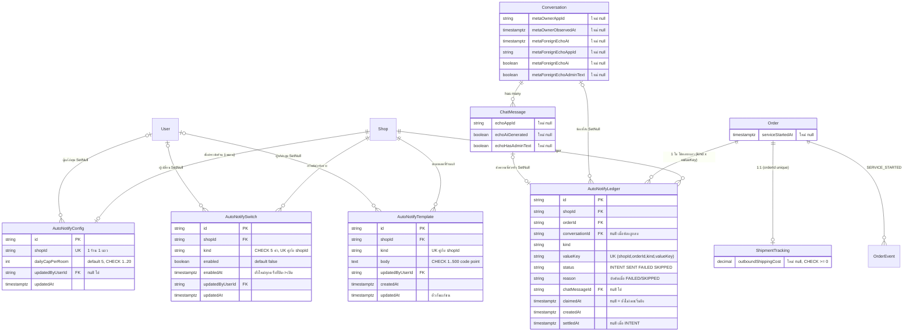

> **โมดูล:** 00078 - Chat Customer Signals & Auto Notify
> **ประเภทเอกสาร:** DATABASE Design
> **เวอร์ชัน:** 0.1 (ออกแบบบนกระดาษ — รอ Controller อนุมัติก่อนแตะ `prisma/schema.prisma` หรือเขียน migration)
> **วันที่จัดทำ:** 2026-10-17
> **สถานะ:** Draft
> **เจ้าของเอกสาร:** safepay-database (ดู [[Feature-Docs-Ownership]])
> **ที่มา:** [[PRD]] v0.3 §3.1.1 §3.3.1 §3.4 §3.7 §11 · [[BRD]] v0.3 FR-CS-01/11/14/19/23/26/28/32 · อ่าน `prisma/schema.prisma` ณ `main` + branch `feat/00078-chat-signals-auto-notify`

# DATABASE: สัญญาณลูกค้าในแชท + ส่งอัตโนมัติถึงลูกค้า (00078)

---

## 1. Overview

ส่วนที่ต้องเปลี่ยนฐานข้อมูล (ส่วน B ป้ายลูกค้า, E แถบแจ้ง, F เมนู **ไม่มี migration**):

| ส่วน | ต้องการ | รูปทรงที่เลือก |
|---|---|---|
| A Meta AI | เก็บ *ข้อเท็จจริง* ผู้ถือห้อง + echo ล่าสุด | คอลัมน์ nullable เพิ่มบน `Conversation` (6) และ `ChatMessage` (3) |
| C/C+ ตั้งค่า | สวิตช์ต่อจังหวะ · เพดาน · เทมเพลต | 3 ตารางเล็กใหม่ `AutoNotifyConfig` / `AutoNotifySwitch` / `AutoNotifyTemplate` |
| C ledger | กันส่งซ้ำ + สถานะ + เพดานต่อวัน | ตารางใหม่ `AutoNotifyLedger` |
| S เริ่มงาน | เวลาเริ่มงาน (ไม่ใช่สถานะ) + event | `Order.serviceStartedAt` + `OrderEvent` ชนิด `SERVICE_STARTED` |
| D ค่าส่ง | ต้นทุนส่งเอง | `ShipmentTracking.outboundShippingCost` |

- **Store:** PostgreSQL 16 (Supabase) ตัวเดียว · ORM Prisma · migration = Prisma Migrate (`migrate deploy` รันตอน push `main` — HR15)
- **ไม่มี RLS** — สิทธิ์ (X8 ฯลฯ) ตัดสินที่ `src/services/` ไม่ใช่ใน DB
- **Convention ที่ยึด (อ่านจากไฟล์จริง):** PK = `String @id @default(uuid())` · enum = `String` + DB CHECK (ไม่ใช้ Prisma enum) · คอลัมน์เวลาที่เพิ่มใหม่ใช้ `@db.Timestamptz(3)` ตาม `Order.serviceClosedAt` (00073) · เงิน = `Decimal @db.Decimal(12, 2)` · FK ไป `User` ที่เป็น "ผู้กระทำ" ใช้ `onDelete: SetNull` เหมือน `OrderEvent.actorUserId`
- **ข้อห้ามที่ใช้กับเอกสารนี้:** `OrderEvent_type_check` และ CHECK ทุกตัวด้านล่างเป็น SQL ที่ Prisma DSL ประกาศไม่ได้ ⇒ ห้าม `prisma db pull` / `migrate dev` กับฐานแชร์ (HR13/14) · apply บน local ต้องปักหมุด URL localhost ในคำสั่งตรง ๆ

### 1.1 ผลตัดสินหลัก (สรุป)

| # | เรื่อง | ตัดสิน | เหตุผลสั้น |
|---|---|---|---|
| 1 | ผู้ถือห้อง | เก็บ **ข้อเท็จจริงล่าสุด** (app id, เวลา, `ai_generated`, `admin_text` มี/ไม่มี) ไม่เก็บธง `aiHolds` และ **ไม่เก็บ "kind" (AI/คน/แอปอื่น)** ที่ PRD §11 เสนอ — derive ในฟังก์ชันบริสุทธิ์ | kind คือ verdict ที่เกิดจากข้อเท็จจริง 3 ตัว เก็บแล้วจะค้างทันทีที่ rule เปลี่ยน (`stored-flag-vs-owner-truth.md`) |
| 2 | ตั้งค่า | **ตารางใหม่ แยกจาก `AutoReplyConfig` และไม่ใส่ `Shop`** · สวิตช์ = 1 แถวต่อ (ร้าน, kind) | `Shop` กว้าง/อ่านทุกคำขอ · 5 kind × (เปิด, enabledAt, ผู้เปลี่ยน) = 15+ คอลัมน์ · เพิ่ม kind ที่ 6 ไม่ต้อง ALTER |
| 3 | เทมเพลต | ตารางแยกจากสวิตช์ · **แถวมี = ร้านแก้แล้ว, ไม่มีแถว = ค่าตั้งต้น** · "คืนค่าตั้งต้น" = ลบแถว | ถ้ารวมกับสวิตช์ การกดสวิตช์จะขยับ `updatedAt` ของเทมเพลต → ตัวกันแก้ชนฟ้องผิด |
| 4 | ledger | ตารางใหม่ + UNIQUE `(shopId, orderId, kind, valueKey)` + `claimedAt` (กัน sweeper ยิงซ้ำ แบบเดียวกับ `ChatMessage.sendLockedAt`) | ดู §3.4 |
| 5 | เริ่มงาน | `Order.serviceStartedAt timestamptz(3)?` **ไม่เพิ่มคอลัมน์ผู้กด** — ผู้กดอยู่ใน `OrderEvent.actorUserId` ของ event `SERVICE_STARTED` · **ไม่เพิ่ม** `AUTO_NOTICE_SENT/FAILED` ใน OrderEvent | ไม่ขยาย `Order` (ตารางกว้าง) · ledger คือบันทึกผลการแจ้งอยู่แล้ว |
| 6 | ต้นทุนส่งเอง | **`ShipmentTracking.outboundShippingCost`** ไม่ใช่ `OrderShipment` ไม่ใช่ `Order` · ตั้งชื่อ `outbound…` เพราะ `OrderReturn.shippingCost` (ขากลับ) มีอยู่แล้ว | ดู §3.7 |
| 7 | `autoReplyKind` | **ยืนยัน: `String?` ไม่มี CHECK** (migration `20260729000000_auto_reply` บรรทัด 156 เป็น `ADD COLUMN "autoReplyKind" TEXT` เท่านั้น · grep ทั้ง `prisma/migrations` เจอไฟล์เดียว) ⇒ `AUTO_NOTICE` ไม่ต้อง migration | |
| 8 | migration | **6 ไฟล์แยก** ตามส่วน (ดู §5) ทั้งหมด additive · **ไม่มี backfill** (เหตุผล §5.4) | ล้มไฟล์ไหนรู้ทันทีว่าส่วนไหน |

---

## 2. ERD



---

## 3. Tables

### 3.1 `Conversation` — เพิ่ม 6 คอลัมน์ (PostgreSQL · M1)

เก็บ **ข้อเท็จจริงล่าสุดที่ Meta บอกเรา** 2 ชุด แล้วให้ฟังก์ชันบริสุทธิ์ใน `src/lib/` (FR-CS-02) ตัดสิน "Meta AI ถือห้อง" จากข้อเท็จจริง + เวลาปัจจุบัน + `META_APP_ID`

| Column | Type | Null | Default | หมายเหตุ |
|---|---|---|---|---|
| `metaOwnerAppId` | `text` | YES | NULL | `new_owner_app_id` ของ `pass`/`take` ล่าสุด (normalize เป็น string ตอนเขียน) · **NULL + `metaOwnerObservedAt` มีค่า = ห้องว่าง (ไม่มีผู้ถือ)** · NULL + observedAt NULL = ไม่เคยเห็นหลักฐาน |
| `metaOwnerObservedAt` | `timestamptz(3)` | YES | NULL | เวลา `timestamp` **ของ Meta** ใน event (ไม่ใช่ `now()`) — ใช้เทียบกันเขียนทับ event เก่า |
| `metaForeignEchoAt` | `timestamptz(3)` | YES | NULL | เวลาของ echo ฝั่งร้านล่าสุดที่ **ไม่ใช่ของเรา** (เวลาของ Meta) |
| `metaForeignEchoAppId` | `text` | YES | NULL | `app_id` ของ echo นั้น |
| `metaForeignEchoAi` | `boolean` | YES | NULL | `message.ai_generated` ตามที่ Meta ส่ง · NULL = ไม่มี field |
| `metaForeignEchoAdminText` | `boolean` | YES | NULL | echo นั้น **มี** `admin_text` หรือไม่ (เก็บแค่ "มี/ไม่มี") |

กติกาการเขียน (ฝั่ง `channel-chat.service.ts` — DB ไม่บังคับให้ แต่ออกแบบให้ทำได้ด้วย SQL เดียว):

```sql
-- อัปเดตเฉพาะเมื่อหลักฐานใหม่กว่า (event ซ้ำ/ลำดับสลับไม่ทับของใหม่ — FR-CS-01)
UPDATE "Conversation"
SET "metaForeignEchoAt" = $1, "metaForeignEchoAppId" = $2,
    "metaForeignEchoAi" = $3, "metaForeignEchoAdminText" = $4
WHERE "id" = $5
  AND ("metaForeignEchoAt" IS NULL OR "metaForeignEchoAt" < $1);
```

**ทำไมไม่เก็บ kind / `aiHolds`:** "AI vs คน vs แอปอื่น" คำนวณได้จาก `(metaForeignEchoAi, metaForeignEchoAdminText, metaForeignEchoAppId)` และ "เป็นของเรา" ขึ้นกับ `META_APP_ID` ซึ่งเป็น env (BR-CS-A09) — ถ้าเก็บ verdict ไว้ในแถว เปลี่ยน env/สูตรแล้วแถวเก่าค้างผิด · "หมดอายุ 24 ชม." (BR-CS-A05) ก็เป็นฟังก์ชันของ `now()` ไม่ใช่ค่าที่เก็บ

**ทำไมซ้ำบนห้องและบนข้อความ:** รายการห้องต้องตัดสินจากแถว `Conversation` แถวเดียว (BR-CS-A06 ห้าม join/ยิง Graph ต่อแถว) ส่วนข้อความเก็บไว้เป็นหลักฐานระดับ echo (§3.2) — ห้องคือ "ข้อเท็จจริงของ echo ล่าสุด" ที่ถูกเขียนใน tx เดียวกับการ insert ข้อความ

### 3.2 `ChatMessage` — เพิ่ม 3 คอลัมน์ (PostgreSQL · M1)

| Column | Type | Null | Default | หมายเหตุ |
|---|---|---|---|---|
| `echoAppId` | `text` | YES | NULL | `message.app_id` ของ echo ฝั่งร้าน · NULL = ไม่ใช่ echo / ไม่มี field / แถวก่อน migration |
| `echoAiGenerated` | `boolean` | YES | NULL | `message.ai_generated` ตามที่ส่งมา (ข้อเท็จจริง ไม่ใช่ verdict) · NULL = ไม่มี field |
| `echoHasAdminText` | `boolean` | YES | NULL | มี `message.admin_text` หรือไม่ · **ไม่เก็บตัวข้อความ** (ไม่รู้ชนิด/เนื้อหาจริงของ field — `external-payload-schema.md`; payload ดิบยังอยู่ใน `rawMessage`) |

- **ไม่มี default** ⇒ `ADD COLUMN` เป็นการแก้ catalog อย่างเดียว ไม่ rewrite ตาราง (ChatMessage คือตารางใหญ่สุดของระบบ) · NULL ใช้พื้นที่เป็น 0 ใน null bitmap
- **ไม่เพิ่ม index** บน 3 คอลัมน์นี้ (ไม่มี query ที่กรองด้วยมัน — ใช้ตอน ingest เขียน และตอน audit/สืบสวนเท่านั้น) · ตารางนี้มี index แล้ว 10 ตัว ทุกตัวที่เพิ่มคูณต้นทุนเขียนของทุกข้อความ
- `viaStandby` เดิม **ไม่แตะ** (00077 ใช้อยู่ — PRD §5)
- `rawMessage` ยัง omit ทั่วระบบ ห้ามเอามาเป็นแหล่งอ่านป้าย (BR-CS-A04)

### 3.3 `AutoNotifyConfig` / `AutoNotifySwitch` / `AutoNotifyTemplate` (PostgreSQL · M2)

ใหม่ทั้ง 3 ตาราง · ไม่ปนกับ `AutoReplyConfig` (Q-21) · ไม่มีโหมดทดสอบ ไม่มีตารางห้องทดสอบ ไม่มีคอลัมน์สถานะ 3 ค่า (grep gate ตาม FR-CS-23)

#### 3.3.1 `AutoNotifyConfig` — ระดับร้าน (1:1)

| Column | Type | Null | Default | Key |
|---|---|---|---|---|
| `id` | `text` | NO | `uuid()` | PK |
| `shopId` | `text` | NO | - | UNIQUE · FK → `Shop` ON DELETE CASCADE |
| `dailyCapPerRoom` | `integer` | NO | `5` | CHECK `AutoNotifyConfig_dailyCap_range`: `BETWEEN 1 AND 20` |
| `updatedByUserId` | `text` | YES | NULL | FK → `User` ON DELETE SET NULL · IDX |
| `createdAt` | `timestamptz(3)` | NO | `now()` | |
| `updatedAt` | `timestamptz(3)` | NO | `@updatedAt` | |

- **ไม่มีแถว = ค่าตั้งต้น 5** (อ่านด้วย `?? 5` ที่จุดเดียวใน `src/lib` — แถวถูกสร้างเมื่อร้านแก้เพดานครั้งแรก) ⇒ ไม่ต้อง backfill ร้านเดิมทุกร้าน
- ที่มาของการแยกตารางแทนคอลัมน์บน `Shop`: เพดานเป็นการตั้งค่าของฟีเจอร์นี้ ไม่ใช่ของร้านโดยรวม และไม่อยากเพิ่มคอลัมน์ให้ `Shop` ที่ถูก `findUnique` ทุกคำขอ

#### 3.3.2 `AutoNotifySwitch` — สวิตช์ต่อ (ร้าน, จังหวะ)

| Column | Type | Null | Default | Key |
|---|---|---|---|---|
| `id` | `text` | NO | `uuid()` | PK |
| `shopId` | `text` | NO | - | FK → `Shop` ON DELETE CASCADE · UNIQUE คู่กับ `kind` |
| `kind` | `text` | NO | - | CHECK `AutoNotifySwitch_kind_check` |
| `enabled` | `boolean` | NO | `false` | |
| `enabledAt` | `timestamptz(3)` | YES | NULL | เวลาที่สวิตช์เปลี่ยน **ปิด→เปิด** ล่าสุด · คงค่าไว้ตอนปิด (ไว้ตอบ "เคยเปิดไหม" สำหรับ Swal ครั้งแรก — A-12) |
| `updatedByUserId` | `text` | YES | NULL | FK → `User` ON DELETE SET NULL · IDX |
| `createdAt` | `timestamptz(3)` | NO | `now()` | |
| `updatedAt` | `timestamptz(3)` | NO | `@updatedAt` | |

CHECK:
- `AutoNotifySwitch_kind_check`: `kind IN ('ORDER_SUMMARY','TRACKING','SERVICE_BOOKED','SERVICE_STARTED','SERVICE_CLOSED')`
- `AutoNotifySwitch_enabled_has_enabledAt`: `NOT enabled OR "enabledAt" IS NOT NULL` — สวิตช์ที่เปิดอยู่ต้องมี `enabledAt` เสมอ (ด่าน BR-CS-C02 "ไม่ย้อนหลัง" ถ้า `enabledAt` เป็น NULL ตัวส่งจะเทียบเวลาไม่ได้)

> **ชื่อ kind:** brief ของงานนี้เขียน `SERVICE_FINISHED` แต่ PRD v0.3 §3.4 เปลี่ยนเป็น **`SERVICE_CLOSED`** ตาม HR16 ("ปิดงาน" ไม่ใช่ "จบงาน") — เอกสารนี้ใช้ `SERVICE_CLOSED` ทุกที่ (ดู §8 Open Question 1)

- **ไม่มีแถว = ปิด** (BR-CS-C01 ปิดเป็นค่าตั้งต้น ทุกร้านรวมร้านเดิม) ⇒ migration ไม่ INSERT ใด ๆ
- ธง `enabled` ไม่ใช่ "ภาพนิ่งของสิ่งที่คำนวณได้" — มันคือ **ค่าที่ร้านตั้ง (source of truth เอง)** จึงไม่ขัด `stored-flag-vs-owner-truth.md` · แต่ **ตัวส่งต้องอ่านซ้ำตอนส่งจริง** (sweeper ตรวจสวิตช์ซ้ำ → `NOT_ELIGIBLE_ANYMORE`, FR-CS-14) ห้ามเชื่อค่าที่อ่านไว้ตอนสร้าง INTENT
- ตั้ง `enabledAt` ใหม่เฉพาะตอนเปลี่ยนจริง — upsert ต้องทำใน SQL เดียว กันสองคนกดพร้อมกันรีเซ็ตเวลากันเอง:

```sql
INSERT INTO "AutoNotifySwitch" ("id","shopId","kind","enabled","enabledAt","updatedByUserId","updatedAt")
VALUES (gen_random_uuid()::text, $1, $2, true, now(), $3, now())
ON CONFLICT ("shopId","kind") DO UPDATE
SET "enabledAt" = CASE WHEN "AutoNotifySwitch"."enabled" THEN "AutoNotifySwitch"."enabledAt" ELSE now() END,
    "enabled" = true, "updatedByUserId" = $3, "updatedAt" = now();
```

(Prisma `upsert` แสดง CASE นี้ไม่ได้ ⇒ ใช้ `$executeRaw` หรือ `updateMany({where:{enabled:false}})` แบบมีเงื่อนไขแล้วตรวจ count)

#### 3.3.3 `AutoNotifyTemplate` — เฉพาะที่ร้านแก้

| Column | Type | Null | Default | Key |
|---|---|---|---|---|
| `id` | `text` | NO | `uuid()` | PK |
| `shopId` | `text` | NO | - | FK → `Shop` ON DELETE CASCADE · UNIQUE คู่กับ `kind` |
| `kind` | `text` | NO | - | CHECK ชุดเดียวกับ 3.3.2 |
| `body` | `text` | NO | - | CHECK `AutoNotifyTemplate_body_len`: `char_length("body") BETWEEN 1 AND 500` และไม่ว่างเปล่า |
| `updatedByUserId` | `text` | YES | NULL | FK → `User` ON DELETE SET NULL · IDX |
| `createdAt` | `timestamptz(3)` | NO | `now()` | |
| `updatedAt` | `timestamptz(3)` | NO | `@updatedAt` | ตัวกันแก้ชน (optimistic lock) |

CHECK ความยาว — **ใช้ `char_length` ไม่ใช่ `octet_length`/`length` ของ bytes:**

```sql
CHECK (char_length("body") BETWEEN 1 AND 500
       AND btrim("body", E' \t\r\n') <> '')
```

- `char_length(text)` ของ Postgres (DB เป็น UTF8) นับ **Unicode code point** — ภาษาไทย 1 ตัวอักษร (รวมสระ/วรรณยุกต์ที่เป็นตัวต่างหาก) = 1, อีโมจินอก BMP (😀) = 1 · ไม่ใช่ bytes (ไทย 3 bytes/ตัว จะนับเกินเพดานผิด)
- **JS ต้องนับให้ตรงกัน:** `[...s].length` / `Array.from(s).length` ❌ ห้ามใช้ `s.length` (UTF-16 code unit: 😀 = 2) · นับ **ก่อน** normalize ใด ๆ และห้าม normalize (NFC/NFD) ที่ฝั่งเดียว · ใช้ฟังก์ชันนับตัวเดียวทั้ง client/Valibot/server (FR-CS-33) · เทส mutation: เปลี่ยนเป็น `.length` ต้องแดงเมื่อเนื้อความมีอีโมจิ 251 ตัว
- Valibot ต้องปฏิเสธ `\u0000` (Postgres `text` รับ NUL ไม่ได้ → error 22021 ที่ไม่ตรงกับข้อความ validate) และสตริงที่มี lone surrogate
- **กันแก้ชน:** `UPDATE … WHERE "id"=$1 AND "updatedAt"=$expected` (ความแม่น ms ตรงกันเพราะคอลัมน์เป็น `(3)`) · count = 0 ⇒ ตอบชน "โหลดใหม่" · สร้างครั้งแรก (ไม่มีแถว) ใช้ INSERT แล้วให้ UNIQUE `(shopId,kind)` ตัดสินคนที่มาที่สอง
- **คืนค่าตั้งต้น = DELETE แถวของ (ร้าน, kind) นั้น** (การกระทำของร้านเอง ไม่ใช่การล้างข้อมูลระบบ) — ถ้าสองหน้าต่าง หน้าต่างที่ถือ `updatedAt` เก่าจะแก้ไม่ผ่าน (แถวหาย ⇒ count 0 ⇒ ชน) ซึ่งถูกต้อง
- ไม่เก็บประวัติแก้ไข (PRD §3.4) — แค่ผู้แก้ล่าสุด + `updatedAt`
- `body` เป็นเนื้อหาที่ร้านเขียน (อาจมีอีโมจิ — HR12 ห้ามเฉพาะ UI) · **ไม่ใช่ PII ลูกค้า** (เก็บแม่แบบที่มี `{ตัวแปร}` ไม่ใช่ค่าที่เติม) · การห้ามตัวแปรนอกชุด (`internalNote`/ที่อยู่/เบอร์) บังคับที่ Valibot — **DB ไม่รู้จักชุดตัวแปร** ตั้งใจ ไม่ใส่ regex ใน CHECK เพราะชุดตัวแปรขยายได้โดยไม่ต้อง migration

### 3.4 `AutoNotifyLedger` (PostgreSQL · M3)

กันส่งซ้ำ + แสดงผลบนการ์ดออเดอร์ + นับเพดานต่อวัน + ให้ sweeper รับช่วง INTENT ที่ค้าง (serverless ไม่รับประกันงานหลัง response — PRD §3.3.1)

| Column | Type | Null | Default | Key |
|---|---|---|---|---|
| `id` | `text` | NO | `uuid()` | PK |
| `shopId` | `text` | NO | - | FK → `Shop` ON DELETE CASCADE · ส่วนหนึ่งของ UNIQUE |
| `orderId` | `text` | NO | - | FK → `Order` ON DELETE CASCADE · IDX |
| `conversationId` | `text` | YES | NULL | FK → `Conversation` ON DELETE **SET NULL** (เหมือน `Order.conversationId`) · ใช้นับเพดานต่อห้อง |
| `kind` | `text` | NO | - | CHECK ชุดเดียวกับ 3.3.2 |
| `valueKey` | `text` | NO | - | `'-'` สำหรับ kind ที่ครั้งเดียวต่อใบ (ORDER_SUMMARY, SERVICE_*) · เลขพัสดุ **normalize แล้ว** (trim + ตัวพิมพ์ใหญ่) สำหรับ TRACKING · CHECK `char_length BETWEEN 1 AND 120` (กัน index entry บวม) |
| `status` | `text` | NO | `'INTENT'` | CHECK `INTENT/SENT/FAILED/SKIPPED` |
| `reason` | `text` | YES | NULL | CHECK ชุดเหตุผล (ด้านล่าง) |
| `chatMessageId` | `text` | YES | NULL | FK → `ChatMessage` ON DELETE SET NULL · IDX |
| `claimedAt` | `timestamptz(3)` | YES | NULL | ดูด้านล่าง |
| `createdAt` | `timestamptz(3)` | NO | `now()` | เวลา INTENT = เวลาเหตุการณ์ (ใน tx เดียวกัน) |
| `settledAt` | `timestamptz(3)` | YES | NULL | เวลาที่ออกจาก INTENT |

**UNIQUE** `AutoNotifyLedger_key` = `(shopId, orderId, kind, valueKey)` — คือด่านกันซ้ำของ BR-CS-C06/C07 · `valueKey` เป็น NOT NULL โดยตั้งใจ (UNIQUE ของ Postgres มองว่า NULL ≠ NULL → ถ้าเป็น nullable ช่องกันซ้ำของ kind ครั้งเดียวต่อใบจะรั่ว) · `shopId` ซ้ำกับ `Order.shopId` แต่คงไว้ตามสเปกเพื่อคีย์/นับระดับร้านโดยไม่ join · **ต้องเขียนจาก `Order.shopId` เสมอ** (ไม่รับจาก client)

CHECK (ทุกตัว additive บนตารางใหม่):
- `AutoNotifyLedger_status_check`: `status IN ('INTENT','SENT','FAILED','SKIPPED')`
- `AutoNotifyLedger_reason_check`: `reason IS NULL OR reason IN ('DAILY_CAP','EMPTY_MESSAGE','WINDOW_CLOSED','QUOTA_EXCEEDED','REJECTED_BY_PLATFORM','NOT_ELIGIBLE_ANYMORE','UNCERTAIN_SEND')` — เฉพาะเหตุผลที่ **PRD §4.3 ระบุให้บันทึก** (SWITCH_OFF/NO_ROOM/DRY_RUN/BACKDATED/ALREADY_SENT/SERVICE_NO_SHOW "ไม่บันทึก" จึงไม่อยู่ในชุด) + `UNCERTAIN_SEND` (**เพิ่มใหม่ ขอ Controller อนุมัติ** — ใช้เมื่อ `claimedAt` ค้างแล้วไม่แน่ใจว่าส่งไปหรือยัง ตาม pattern `sendLockedAt` ของ `ChatMessage`; ไม่มีรหัสนี้ sweeper ไม่มีที่ลงผล)
- `AutoNotifyLedger_status_reason_shape`: `(status IN ('INTENT','SENT') AND reason IS NULL) OR (status IN ('FAILED','SKIPPED') AND reason IS NOT NULL)` — กัน "ล้มไม่มีเหตุผล" ซึ่งฝ่าด่าน BR-CS-C14
- `AutoNotifyLedger_settled_shape`: `(status = 'INTENT') = ("settledAt" IS NULL)`
- `AutoNotifyLedger_valueKey_len`

**ความหมาย `claimedAt` (เป็นเกณฑ์ความปลอดภัยเดียวของ sweeper — เลียนแบบ `ChatMessage.sendLockedAt`):**
- `NULL` = ยังไม่เคยมีใครเริ่มยิง ⇒ หยิบไปยิงได้โดยไม่มีทางซ้ำ
- มีค่า + ยัง `INTENT` + ไม่มี `chatMessageId` + เกินเวลาที่กำหนด ⇒ **ห้ามยิงซ้ำอัตโนมัติ** (Meta ไม่มี idempotency key) ⇒ ปิดเป็น `FAILED/UNCERTAIN_SEND`
- claim แบบเงื่อนไขเดียว: `UPDATE … SET "claimedAt"=now() WHERE "id"=$1 AND "status"='INTENT' AND "claimedAt" IS NULL` (count=1 เท่านั้นที่ได้ส่ง)

**สถานะ ledger ≠ สถานะการส่งถึงลูกค้า:** `SENT` หมายถึง "ส่งมอบเข้าคิวขาออกสำเร็จ/ปลายทางรับ" ณ ตอนปิดผล ส่วนสถานะจริงต่อมา (อ่านแล้ว/ล้ม) อยู่ที่ `ChatMessage.deliveryStatus` ผ่าน `chatMessageId` — **จอที่แสดงผลต้อง join อ่านสถานะข้อความสด ห้ามสะท้อนค่าใน ledger ย้อนไปเป็นสถานะส่ง** (`stored-flag-vs-owner-truth.md`, ledger ไม่ถูก sync ตามหลัง)

**การจองกุญแจ — ไม่ก่อ ERROR ใน log Postgres** (`insert-then-catch-logs-every-error.md`): ห้ามใช้ `create` แล้ว catch P2002 — ใช้

```sql
INSERT INTO "AutoNotifyLedger" ("id","shopId","orderId","conversationId","kind","valueKey")
VALUES (gen_random_uuid()::text, $1, $2, $3, $4, $5)
ON CONFLICT ("shopId","orderId","kind","valueKey") DO NOTHING
RETURNING "id";   -- ไม่ได้แถวกลับ = มีคนจองแล้ว = ข้าม (ALREADY_SENT, ไม่บันทึก)
```

(หรือ `createMany({ skipDuplicates: true })` ซึ่งสร้าง `ON CONFLICT DO NOTHING` ให้ แต่ไม่คืน id — ไม่พอสำหรับ flow ที่ต้องรู้ว่าจองได้ไหม ให้ใช้ `$queryRaw`)

**เพดานต่อห้องต่อวัน (Asia/Bangkok, ไม่มี DST):** ขอบวันคำนวณเป็น timestamptz แล้วให้ index ทำ range scan — **ห้ามห่อคอลัมน์ด้วยฟังก์ชันใน WHERE**

```sql
SELECT count(*) FROM "AutoNotifyLedger"
WHERE "conversationId" = $1
  AND "status" IN ('INTENT','SENT')
  AND "createdAt" >= (date_trunc('day', now() AT TIME ZONE 'Asia/Bangkok') AT TIME ZONE 'Asia/Bangkok');
```

DB ไม่บังคับเพดานได้ (count-แล้ว-insert มีช่อง race) ⇒ ยอมรับ **เกินเพดานได้เท่าจำนวนคำขอที่ชนกันพอดี** (ปริมาณต่ำ A-7) ถ้า Controller ไม่ยอม ต้องใช้ `pg_advisory_xact_lock(hashtext(conversationId))` ใน tx เดียวกับการจอง (ดู §8 Open Question 3)

### 3.5 `Order` — เพิ่ม `serviceStartedAt` (M5)

| Column | Type | Null | Default |
|---|---|---|---|
| `serviceStartedAt` | `timestamptz(3)` | YES | NULL |

- เลียนแบบ `serviceClosedAt` (00073) ทุกประการ · **ไม่มี index** (ไม่มี query กรอง/เรียงด้วยค่านี้ — แสดงบนการ์ดงานรายใบ) · **ไม่มี CHECK ข้ามคอลัมน์** กับ `serviceClosedAt` (BR-CS-S04: ปิดงานได้โดยไม่ต้องเริ่ม · `reopenServiceJob` ไม่ล้างค่า)
- เขียนครั้งเดียว: `UPDATE "Order" SET "serviceStartedAt"=now() WHERE id=$1 AND "serviceStartedAt" IS NULL` (กดซ้ำไม่ขยับเวลา)
- **ไม่เพิ่มคอลัมน์ "ผู้กด"** ที่ PRD §11 M5 วงเล็บไว้: `OrderEvent` ชนิด `SERVICE_STARTED` มี `actorUserId` (SetNull + `meta.actorNameSnapshot`) อยู่แล้ว — เก็บสองที่ = ความจริงสองชุด (HR16) และไม่ต้องเพิ่ม FK บนตาราง `Order`
- **ห้ามแตะ** `Order.status`, `appointmentStatus`, ชุดป้าย 10 ป้าย, ยอด/วันที่ของยอด (BR-CS-S04) — ไม่มีอะไรใน migration นี้แตะ

### 3.6 `OrderEvent` — เพิ่มชนิด `SERVICE_STARTED` (M4)

`OrderEvent.type` เป็น `String` + CHECK `OrderEvent_type_check` (unmanaged) · เพิ่ม **1 ค่า: `SERVICE_STARTED`** แบบ additive (อ่านนิยามเดิมจาก `pg_get_constraintdef` แล้วต่อท้าย — ห้าม hardcode รายชื่อ)

- **ตัดสินไม่เพิ่ม `AUTO_NOTICE_SENT` / `AUTO_NOTICE_FAILED`:** ledger (§3.4) คือบันทึกผลการแจ้งต่อใบอยู่แล้ว (สถานะ + เหตุผล + ข้อความที่ส่ง) และการ์ดออเดอร์อ่านจาก ledger (FR-CS-24) · เพิ่ม event ต้องแก้ CHECK + `ORDER_EVENT_TYPES` + `ORDER_EVENT_META` (tsc บังคับ) + กรอง "ไทม์ไลน์รก" — ได้ของซ้ำกับ ledger · PRD §4.3 ที่ว่า `NOT_ELIGIBLE_ANYMORE` "บันทึกในประวัติออเดอร์" ถือว่าเป็นไปตามนั้นเมื่อการ์ด/ไทม์ไลน์ render แถว ledger · **ถ้า Controller ต้องการให้ขึ้นในไทม์ไลน์ `OrderEvent` จริง ๆ ต้องตัดสินก่อนเขียน M4** (เพิ่ม 2 ค่าในไฟล์เดียวกันแทบไม่มีต้นทุน แต่แก้ภายหลังต้องมี migration ใหม่)
- `OrderEvent.meta` ห้ามมี PII ดิบ (schema comment เดิม) — `SERVICE_STARTED` ไม่ต้องการ meta พิเศษ (`{}`)
- การแก้ `ORDER_EVENT_TYPES` ใน `src/lib/order-event.ts` + `ORDER_EVENT_META` เป็นงาน dev ใน PR เดียวกัน (tsc จะฟ้องถ้าลืมแถว meta) · ปรับคอมเมนต์ "15 ค่า" ที่ค้างใน schema ให้ตรงจริง (ตอนนี้ 27 ค่า → 28)

### 3.7 `ShipmentTracking` — เพิ่ม `outboundShippingCost` (M6) · ตัดสิน OQ-7(ค)

| Column | Type | Null | Default | Key |
|---|---|---|---|---|
| `outboundShippingCost` | `numeric(12,2)` | YES | NULL | CHECK `ShipmentTracking_outboundShippingCost_nonneg`: `"outboundShippingCost" IS NULL OR "outboundShippingCost" >= 0` |

- NULL = "ยังไม่ระบุ" (นับ pending) ≠ 0 = "ร้านส่งเองไม่มีค่าใช้จ่ายจริง" (BR-CS-D01) · **migration ห้าม backfill เป็น 0 เด็ดขาด**
- เพดาน 99,999.99 บังคับที่ Valibot (`ShipOrderSchema`) · DB บังคับแค่ ≥ 0 ตามสเปก (ไม่ใส่เลขเพดานซ้ำสองที่)
- ผู้แก้/เวลา: `ShipmentTracking.updatedAt` มีอยู่แล้ว · ผู้แก้อยู่ใน `OrderEvent.meta` (FR-CS-28; ใช้ชนิดเดิม `TRACKING_ADDED`/`ORDER_EDITED` ไม่เพิ่มชนิด)

**ทำไม `ShipmentTracking` (เทียบ 3 ทาง):**

| ทางเลือก | ข้อดี | ข้อเสีย/ผล | ผล |
|---|---|---|---|
| `OrderShipment.carrierPrice` ฯลฯ | อยู่กับราคา iShip | พัสดุส่งเอง **ไม่มีแถว OrderShipment** · ต้องสร้างแถวปลอมให้ใบส่งเอง ⇒ แถวนั้นหลุดเข้าทุก query ที่กรอง `{status:'CREATED', isDryRun:false}` (10 Prisma + 4 raw SQL ตามคอมเมนต์ใน schema), ปุ่มพิมพ์ฉลาก, สถิติ iShip, สูตร reconcile — และมี `idempotencyKey @unique`, `provider/source` ที่ไม่มีความหมายกับใบส่งเอง | **ปฏิเสธ** |
| `Order.<ค่าใหม่>` | ไม่ต้อง join | ขยายตารางที่กว้างที่สุด · ชื่อชนกับ "ค่าส่งที่เก็บจากลูกค้า" (HR16 น่ากลัวกว่าที่ดู) · แยกจากที่ที่ ShipForm เขียน (tx ของ `shipOrder`/`updateShipmentTracking` เขียน `ShipmentTracking` อยู่แล้ว) | ปฏิเสธ |
| **`ShipmentTracking`** | 1:1 กับ `orderId @unique` ⇒ join ด้วย unique index ที่มีอยู่ · ถูกเขียนใน tx เดียวกับเลขพัสดุ · มี `updatedAt` · cascade ตาม `Order` · **iShip ก็มีแถวนี้** เมื่อ dispatch (`advanceOrderIfDispatched` upsert เลขเดียวกัน — PRD §3.3.1 d2) ⇒ ตัวสำรอง D06 อ่านจากที่เดียวกันได้ | ต้อง LEFT JOIN เพิ่มใน 3 พื้นผิวที่คิดค่าส่ง (ไปอยู่หลังฟังก์ชันเดียวใน `src/lib` ตาม D02 อยู่แล้ว) | **เลือก** |

**ชื่อ `outboundShippingCost` ไม่ใช่ `shippingCost` (ต่างจาก BRD FR-CS-28/PRD M6):** `OrderReturn.shippingCost` (ค่าส่ง **ขากลับ** 00056, `schema.prisma:2922`) มีอยู่แล้ว ⇒ `rg shippingCost` จะเจอสองความหมายและ ผู้เขียนสูตรกำไรหยิบผิดตัวได้เงียบ ๆ (ตรงบทเรียน HR16 "grep ชื่อคอลัมน์") · BRD/PRD/SRS ต้อง sync ชื่อนี้

**ผลข้างเคียงที่ต้องให้ SDS ไปตัดสิน (ไม่ใช่การตัดสินของ DB แต่กระทบความถูกต้องของ D06):**
1. ตัวสำรอง D06 ใช้กับพัสดุ iShip ที่ไม่มีราคา แต่ `updateShipmentTracking` ปฏิเสธเมื่อมีใบ iShip active (`IShipManagedShipmentError`) ⇒ ต้องมีเส้นทาง "แก้เฉพาะต้นทุน" ที่ไม่ผ่านด่านนั้น
2. iShip ใบ LINKED ที่ยังไม่ dispatch อาจ **ไม่มีแถว `ShipmentTracking`** (คอลัมน์ `provider`/`trackingNo` เป็น NOT NULL) ⇒ เส้นทางข้อ 1 ต้อง upsert โดยเอา `provider='ISHIP'` + `trackingNo` จาก `OrderShipment` — ถ้าใบนั้นไม่มี `trackingNo` ก็ยังกรอกต้นทุนไม่ได้ (ยอมรับได้ ไม่มีเลขก็ยังไม่ใช่พัสดุที่ส่งแล้ว)
3. ลำดับสูตร (BR-CS-D03/D06): ใบ iShip active → `carrierPrice ?? estimatedPrice` + `codFee` · ไม่มีราคาทั้งคู่ → `outboundShippingCost` · ไม่มีทั้งหมด → ยังไม่ระบุ

### 3.8 `ChatMessage.autoReplyKind` — ค่าใหม่ `AUTO_NOTICE` (ไม่มี migration)

ตรวจแล้ว: `ADD COLUMN "autoReplyKind" TEXT` (migration `20260729000000_auto_reply`) · ไม่มี CHECK/enum บนคอลัมน์นี้ใน migration ใดเลย · แก้เฉพาะคอมเมนต์ใน `schema.prisma` (`null | AUTO | AUTO_TEST` → เติม `AUTO_NOTICE`) — เป็นการแก้ comment ไม่ก่อ diff ของ migration
index เดิม `(conversationId, autoReplyKind, createdAt)` ใช้ต่อได้ · **ความเสี่ยงที่ DB บังคับให้ไม่ได้:** query ที่เขียนแบบ `autoReplyKind <> 'AUTO'` / `NOT IN ('AUTO','AUTO_TEST')` จะหยิบ `AUTO_NOTICE` เป็น "ไม่ใช่บอท" โดยบังเอิญ (บางที่ถูก บางที่ผิด) ⇒ ต้องไล่ผู้บริโภคทุกจุดตาม BR-CS-C12 (116 จุด/32 ไฟล์) · ข้อความ `AUTO_NOTICE` ยังเป็น `autoReplyKind IS NOT NULL` ⇒ "คนตอบ" (`IS NULL`) ไม่นับมัน (ตรงกับที่ต้องการ)

---

## 4. Indexes

| Table | Columns | Type | Rationale (query pattern ที่รองรับ) |
|---|---|---|---|
| `Conversation` | — (**ไม่เพิ่ม**) | - | อ่านคอลัมน์ใหม่ไปกับแถวที่รายการห้องดึงอยู่แล้ว (`@@index([shopId, lastMessageAt])`) ไม่มี query ที่กรองด้วย holder · ตาราง `Conversation` ถูก UPDATE ทุกข้อความ (lastMessage*) — index เพิ่ม = ต้นทุนเขียนทุกครั้ง |
| `ChatMessage` | — (**ไม่เพิ่ม**) | - | `echo*` ใช้ตอน ingest/audit เท่านั้น |
| `AutoNotifyConfig` | `(shopId)` | UNIQUE | 1 ร้าน 1 แถว + lookup |
| `AutoNotifyConfig` | `(updatedByUserId)` | BTREE | รองรับ `ON DELETE SET NULL` ตอนลบ User (ไม่ให้ scan) — ตารางเล็ก ต้นทุนต่ำ |
| `AutoNotifySwitch` | `(shopId, kind)` | UNIQUE | อ่านสวิตช์ตอนสร้างออเดอร์ (`WHERE shopId=? AND kind=?`) และหน้าตั้งค่า (`WHERE shopId=?` ใช้ prefix) |
| `AutoNotifySwitch` | `(updatedByUserId)` | BTREE | SetNull ตอนลบ User |
| `AutoNotifyTemplate` | `(shopId, kind)` | UNIQUE | renderer โหลดเทมเพลตต่อ (ร้าน, kind) · กัน 2 แถว |
| `AutoNotifyTemplate` | `(updatedByUserId)` | BTREE | SetNull ตอนลบ User |
| `AutoNotifyLedger` | `(shopId, orderId, kind, valueKey)` | UNIQUE | **ด่านกันซ้ำ** (BR-CS-C06) + นับ "เลขพัสดุที่เคยส่งของใบนี้ ≤ 3" ผ่าน prefix `(shopId, orderId, kind)` |
| `AutoNotifyLedger` | `(orderId)` | BTREE | การ์ดออเดอร์: "แจ้งอะไรไปบ้างของใบนี้" (UNIQUE นำหน้าด้วย `shopId` เลยใช้ไม่ได้เมื่อรู้แต่ `orderId`) + cascade ตอนลบ Order |
| `AutoNotifyLedger` | `(conversationId, createdAt)` | BTREE | นับเพดานต่อห้องต่อวัน (range ตามขอบวันไทย) |
| `AutoNotifyLedger` | `(status, createdAt)` | BTREE | sweeper: `WHERE status='INTENT' AND createdAt < now() - interval` · ใช้ btree ธรรมดาที่ Prisma ประกาศได้ แทน partial index (`WHERE status='INTENT'`) เพราะ partial index เป็น unmanaged SQL เพิ่มอีกตัวที่ `migrate dev` จะมองเป็น drift · INTENT เป็นสัดส่วนเล็กมากของตาราง ต้นทุน index เต็มรับได้ |
| `AutoNotifyLedger` | `(chatMessageId)` | BTREE | join ข้อความ→ledger + SetNull ตอนลบข้อความ (ข้อความถูกลบตาม Conversation cascade ปริมาณมาก ไม่มี index = scan ledger ทุกครั้ง) |
| `Order` | — (**ไม่เพิ่ม** สำหรับ `serviceStartedAt`) | - | ไม่มี query กรองด้วยค่านี้ |
| `ShipmentTracking` | — (**ไม่เพิ่ม**) | - | อ่านผ่าน `orderId` UNIQUE ที่มีอยู่ |

Constraints (เฉพาะที่ Prisma DSL ประกาศไม่ได้ = unmanaged SQL ใน migration): ดูรายการเต็มใน §3.3–3.7 · สรุปชื่อ: `AutoNotifyConfig_dailyCap_range` · `AutoNotifySwitch_kind_check` · `AutoNotifySwitch_enabled_has_enabledAt` · `AutoNotifyTemplate_kind_check` · `AutoNotifyTemplate_body_len` · `AutoNotifyLedger_kind_check` · `_status_check` · `_reason_check` · `_status_reason_shape` · `_settled_shape` · `_valueKey_len` · `ShipmentTracking_outboundShippingCost_nonneg` · แก้ `OrderEvent_type_check`

---

## 5. Migration Plan

### 5.1 ลำดับการ Migrate (6 ไฟล์ แยกตามส่วน — ทั้งหมด additive)

timestamp ตั้งหลัง `20261016230000_chat_shop_reply_broadcast` · **ก่อนตั้งชื่อต้องรัน `git log --all --name-only -- 'prisma/migrations/*'` เช็ค timestamp ชนข้าม branch** (memory `feedback_migration_check_constraint_collision`; branch 00061 ยังไม่ push และ apply บน dev ไปแล้ว — ต้องดูว่าแตะ `OrderEvent_type_check` ไหม) — เอกสารนี้ไม่ได้รัน git ตามข้อกำหนดรอบนี้

| ลำดับ | ไฟล์ (ชื่อเสนอ) | เนื้อหา | ล็อก/ขนาด | dependency |
|---|---|---|---|---|
| M1 | `…_chat_meta_owner_facts` | `ALTER TABLE "Conversation" ADD COLUMN` ×6 · `"ChatMessage" ADD COLUMN` ×3 (`IF NOT EXISTS`, nullable, ไม่มี default) | catalog-only · ACCESS EXCLUSIVE ช่วงสั้น (ดู §5.3) | ไม่มี |
| M2 | `…_auto_notify_settings` | CREATE TABLE `AutoNotifyConfig`/`Switch`/`Template` + UNIQUE + index + CHECK + FK | ตารางใหม่ว่าง | ต้องมี `Shop`, `User` (มีอยู่) |
| M3 | `…_auto_notify_ledger` | CREATE TABLE `AutoNotifyLedger` + UNIQUE + index + CHECK + FK | ตารางใหม่ว่าง | FK → `Shop`,`Order`,`Conversation`,`ChatMessage` (มีอยู่) · **ไม่ต้องรอ M2** |
| M4 | `…_order_event_service_started` | `DO $$` ขยาย `OrderEvent_type_check` เพิ่ม `SERVICE_STARTED` (แพตเทิร์นเดียวกับ `20261011120000` ส่วน 2: อ่านนิยามเดิม → ต่อท้าย → `NOT VALID` → `VALIDATE` · `RAISE EXCEPTION` ถ้า regex จับค่าไม่ครบ · ถ้า `position('SERVICE_STARTED' IN def) > 0` ข้าม = รันซ้ำได้) | DROP+ADD constraint ช่วงสั้น · VALIDATE สแกน `OrderEvent` แต่ใช้ SHARE UPDATE EXCLUSIVE (ไม่บล็อกเขียน) | ก่อน M5 ใช้งานจริงในโค้ด |
| M5 | `…_order_service_started_at` | `ALTER TABLE "Order" ADD COLUMN IF NOT EXISTS "serviceStartedAt" TIMESTAMPTZ(3)` | catalog-only | ไม่มี |
| M6 | `…_shipment_tracking_outbound_cost` | `ADD COLUMN "outboundShippingCost" DECIMAL(12,2)` + `ADD CONSTRAINT … CHECK (… IS NULL OR … >= 0) NOT VALID` แล้ว `VALIDATE` | `ShipmentTracking` ขนาดเล็ก (1 แถวต่อออเดอร์ที่ส่งแล้ว) | ไม่มี |

- กิ่ง `IF def IS NULL` ของ M4 (ฐานที่ไม่มี constraint) ต้องใส่ **รายชื่อครบ = ค่าใน `src/lib/order-event.ts` ณ วันเขียน + `SERVICE_STARTED`** (ตอนนี้ไฟล์ 20261011 ระบุ 27 ค่า — ตรวจกับ `ORDER_EVENT_TYPES` ตอนเขียนจริง ไม่ใช่ copy จากเอกสารนี้)
- ทุกไฟล์รันซ้ำได้ (`IF NOT EXISTS` / guard `DO $$`) ตามสไตล์ของไฟล์ล่าสุด
- แต่ละไฟล์ PostgreSQL รันเป็นสคริปต์หลายคำสั่งใน implicit transaction เดียว ⇒ ล้มกลางไฟล์ = ไม่เหลือครึ่งทาง
- **HR15 — ก่อน migrate ต้องบอก user 3 ข้อ:** (1) prod ไม่ต้องสั่ง push `main` รัน `migrate deploy` ให้ (2) local ต้อง apply เอง (ห้าม `migrate dev`/`db pull`/`db push --force-reset` — ปักหมุด URL localhost ในคำสั่งตรง ๆ เช่น `DATABASE_URL=postgresql://…@localhost:5434/… npx prisma migrate deploy`) (3) migrate ล้ม = deploy ไม่ขึ้น
- รอบนี้ (ออกแบบ) **ยังไม่ได้รัน** `prisma validate` / `migrate dev` ตามข้อห้ามของงาน — ต้องรันก่อน report ในรอบที่ได้รับอนุมัติแล้ว

### 5.2 Rollback

หลักคิด: ทุกอย่าง **additive และ inert ตอน deploy** (สวิตช์ทุกตัวปิดโดยไม่มีแถว · คอลัมน์ใหม่ NULL ทั้งหมด) ⇒ ทางย้อนที่ปลอดภัยคือ **ย้อนโค้ด (revert PR) ก่อน แล้วปล่อย schema ไว้** — โค้ดเก่าบน schema ใหม่ใช้ได้ (ไม่มีอะไร NOT NULL ที่โค้ดเก่าไม่รู้จัก) ส่วน "โค้ดใหม่บน schema เก่า" พัง จึงห้ามย้อน schema ก่อนโค้ด

| ไฟล์ | ย้อนด้วย | ข้อมูลที่เสีย / ข้อควรระวัง | ใครต้องสั่ง |
|---|---|---|---|
| M1 | `ALTER TABLE … DROP COLUMN` ×9 | เสียข้อเท็จจริงผู้ถือห้องทั้งหมด (สร้างใหม่ได้ภายใน 24 ชม. เพราะ TTL อยู่แล้ว) | **destructive — ต้อง Controller สั่งชัด** |
| M2 | `DROP TABLE` ×3 | เสียการตั้งค่า/เทมเพลตที่ร้านกรอก (ไม่กู้คืน) | destructive |
| M3 | `DROP TABLE "AutoNotifyLedger"` | **เสียด่านกันส่งซ้ำ + ประวัติการแจ้ง** — ถ้ามีสวิตช์เปิดอยู่ให้ปิดทุกร้านก่อน (UPDATE enabled=false) ไม่งั้นโค้ดที่ยังรันอยู่ส่งซ้ำได้ | destructive |
| M4 | **ไม่แนะนำให้ย้อน** (forward-only) | CHECK ที่มีค่าเกินมาไม่เป็นโทษ · ถ้าจำเป็นต้องถอดค่า ต้องจัดการแถว `SERVICE_STARTED` ที่มีอยู่ก่อน ไม่งั้น `VALIDATE` ล้ม | — |
| M5 | `DROP COLUMN "serviceStartedAt"` | เสียเวลาเริ่มงานที่บันทึกแล้ว | destructive |
| M6 | `DROP COLUMN "outboundShippingCost"` | **กำไรที่ /sales + dashboard เปลี่ยนทันที** (ต้นทุนส่งเองหาย) — ต้องแจ้ง user ก่อน | destructive |

> ไม่มีสคริปต์ rollback ในรอบนี้ — เขียนเป็นไฟล์ `down.sql` แยก (ไม่ให้ Prisma หยิบ) เมื่อ Controller อนุมัติแล้วเท่านั้น (ห้าม drop โดยไม่ได้รับคำสั่ง)

### 5.3 ผลกระทบ (Impact) — ประเมินจากชนิดคอลัมน์ ไม่ได้ query prod

- **M1 (`Conversation`, `ChatMessage`):** `ADD COLUMN` nullable ไม่มี default บน PG 16 = เปลี่ยน catalog อย่างเดียว ไม่ rewrite ไม่สแกน · อันตรายจริงคือ **รอคิวล็อก**: `ACCESS EXCLUSIVE` ต้องรอทรานแซกชันที่ถือตารางอยู่ และระหว่างรอ มันบล็อกคำขอใหม่ทุกตัวที่ตามหลัง — `ChatMessage` ถูกเขียนจาก webhook ตลอดเวลา (+ trigger `chat_message_realtime_broadcast`, ไม่กระทบเพราะอ้างคอลัมน์ตามชื่อ) · **ข้อเสนอ:** ใส่ `SET LOCAL lock_timeout = '5s';` บนหัวไฟล์ M1 — ล้ม = deploy ไม่ขึ้น (HR15 ข้อ 3) แต่ดีกว่าทำให้ webhook ค้าง แล้วรัน deploy ซ้ำ (รันซ้ำได้) · ขอ Controller ยืนยันว่ายอมรับพฤติกรรม "migrate ล้มได้" แลกกับไม่บล็อกแชท
- **M2/M3:** ตารางใหม่ ไม่กระทบอะไรที่มีอยู่ · FK ไป `ChatMessage`/`Conversation`/`Order` เป็นการเพิ่ม constraint **บนตารางใหม่** (ตารางแม่แค่ถูกอ้างอิง) แต่มีผลข้างเคียง: ลบแถวแม่ต้องตรวจตารางลูก ⇒ index `chatMessageId`/`orderId`/`conversationId` ที่ประกาศไว้จึงจำเป็น
- **M4:** ขั้นตอน DROP+ADD อยู่ใน tx เดียว (ช่องว่างไม่มี constraint = ไม่มีเพราะ atomic) · VALIDATE สแกนเต็มตาราง `OrderEvent` (insert-only โตเร็ว) แต่ไม่บล็อกการเขียน — ไฟล์ 20261011 ทำแบบเดียวกันมาแล้ว
- **M5/M6:** ตารางละคอลัมน์ nullable · ไม่มี default · M6 มี CHECK เล็กน้อย
- **Backward compatibility ระหว่าง deploy:** Vercel build รัน `migrate deploy` ก่อน instance ใหม่ขึ้น — instance เก่าที่ยังรับคำขออยู่เจอ schema ใหม่ ซึ่งปลอดภัยเพราะ additive ทั้งหมด (Prisma client เก่าไม่ select คอลัมน์ที่ไม่รู้จัก; `INSERT` ของโค้ดเก่าไม่ต้องใส่ค่าใหม่)
- **Prisma global omit / ด่านเทสที่ต้องระวัง:** `ChatMessage` มีด่าน `chat-message-no-raw-write.test.ts` (ห้าม raw SQL เขียนตารางนี้) — การเขียน `echo*` ต้องผ่าน Prisma `create`/`update` ไม่ใช่ raw · การเขียน `Conversation.metaForeignEcho*` แบบมีเงื่อนไขเวลา (§3.1) ใช้ `updateMany({ where: { id, OR:[{metaForeignEchoAt:null},{metaForeignEchoAt:{lt: t}}] } })` แทน raw ได้

### 5.4 Backfill — ไม่มี (ทุกส่วน) และห้ามมี

| ส่วน | เหตุผลที่ไม่ backfill |
|---|---|
| ผู้ถือห้อง / `echo*` | หลักฐานมี TTL 24 ชม. (BR-CS-A05) — ของเก่ากว่านั้นไม่เคยขึ้นป้ายอยู่แล้ว · การไล่ `rawMessage` (omit ทั่วระบบ, jsonb ใหญ่) บนตารางใหญ่สุดเพื่อได้ผลแค่ช่วง ≤ 24 ชม. ก่อน deploy = ต้นทุนไม่คุ้มและเสี่ยง · NULL = "ไม่รู้" = ไม่ขึ้นป้าย (BR-CS-A07) ซึ่งเป็นพฤติกรรมที่ถูก |
| สวิตช์/เทมเพลต/เพดาน | ปิดเป็นค่าตั้งต้นทุกร้านรวมร้านเดิม (BR-CS-C01 มติ 2026-07-29) — **ไม่มีแถว = ปิด/ค่าตั้งต้น** จึงไม่ต้อง INSERT |
| ledger | ไม่ย้อนหลัง (BR-CS-C02) · ไม่เคยมีการส่งอัตโนมัติมาก่อน |
| `Order.serviceStartedAt` | ไม่มีข้อมูลต้นทางว่าเริ่มงานเมื่อไร (เดิมไม่เคยบันทึก) — ห้ามเดาจาก `serviceStart`/`updatedAt` (ต่างจาก 00073 ที่มีคอลัมน์ต้นทางจริง) |
| `outboundShippingCost` | NULL = "ยังไม่ระบุ" ≠ 0 · เดาค่าให้ไม่ได้ (BR-CS-D01) |

---

## 6. Retention / ข้อควรระวัง

- **Data Retention:** ไม่มี job ลบ/archive ในรอบนี้ · `AutoNotifyLedger` โต = เหตุการณ์ที่ร้านเปิดสวิตช์ ≤ 5 แถว/ออเดอร์ที่ผูกห้อง (ปริมาณต่ำ A-7) · คงไว้ตลอดอายุ `Order` (cascade) เพราะเป็นด่านกันซ้ำ — **ห้ามตัดแถวเก่าทิ้ง** ไม่งั้น reopen→ปิดงานใหม่/แก้เลขกลับค่าเดิม จะส่งซ้ำได้ · ตารางที่โตเร็วในกลุ่มนี้ไม่มี (ต่างจาก `OrderEvent`)
- **PII / ข้อมูลอ่อนไหว:** ledger **ไม่เก็บเนื้อข้อความและไม่เก็บเบอร์/ชื่อลูกค้า** (ข้อความจริงอยู่ที่ `ChatMessage.body` ตามเดิม) · `valueKey` ของ TRACKING คือเลขพัสดุ (ไม่ใช่ PII ตามนิยาม schema ที่ `ShipmentTracking.trackingNo` เก็บอยู่แล้ว) · `AutoNotifyTemplate.body` เป็นแม่แบบ ไม่ใช่ข้อมูลลูกค้า · `outboundShippingCost` = **ต้นทุนของร้าน** ⇒ ต้องอยู่ในรายการที่ `order-view-by-level.ts` ซ่อนจากระดับเงินที่ไม่เห็นราคา (FR-CS-28) และ **ไม่ส่งไปหน้า guest `/o/{token}` เด็ดขาด** · ห้ามใส่ลง `OrderEvent.meta` เป็นตัวเลขดิบโดยไม่จำเป็น (ร้านมีพนักงานหลายคนเปิดดูประวัติได้ — schema comment เดิม)
- **ตัวอย่าง query — ห้าม `select *` กับตารางอ่อนไหว:** ทุก query ตัวอย่างในเอกสารนี้ระบุคอลัมน์ · ตอน implement `Order`/`ShipmentTracking` ใช้ `select` ชัดเจน (ต้นทุนส่งเอง ≠ ข้อมูลที่ทุก role เห็น)
- **Performance:**
  - `Conversation` เป็น hot row (UPDATE ทุกข้อความ) — คอลัมน์ใหม่ถูกเขียนเฉพาะเมื่อมี echo ที่ไม่ใช่ของเรา/handover (ไม่บ่อย) แต่เป็น UPDATE บนแถวเดียวกัน ⇒ ให้เขียนรวมกับ UPDATE เดิมใน tx เดียวถ้าเป็นไปได้ ลดจำนวน tuple version
  - รายการห้อง: อ่านเพิ่ม 6 คอลัมน์เล็ก ๆ ไม่มี join เพิ่ม · ส่วน B (ขอบรูป) ไม่แตะ DB ใหม่ แต่ `enrichWithCustomerBehavior` ต้องไม่กลายเป็น N+1 (นอกขอบเขตเอกสารนี้ — SDS)
  - ledger: write ต่อออเดอร์ ≤ ไม่กี่แถว · ทุก query มี index รองรับตามตาราง §4 · เพดานต่อวันใช้ range บน `(conversationId, createdAt)` — ห้ามห่อ `createdAt` ด้วยฟังก์ชัน
  - 3 พื้นผิวกำไรได้ LEFT JOIN `ShipmentTracking` เพิ่ม — join ด้วย unique index `orderId` ผ่านฟังก์ชันเดียว (D02) ต้องวัดก่อน/หลังบน `/sales` และ dashboard (กฎ "วัดก่อนแก้")
- **ชนิดเวลาปนกัน:** `Conversation.lastInboundAt` (และคอลัมน์เก่าอื่น) เป็น `timestamp(3)` ไม่มี tz ส่วนคอลัมน์ใหม่เป็น `timestamptz(3)` — การเทียบข้ามสองชนิดใน **raw SQL** อาศัย session `TimeZone` (Supabase ค่าตั้งต้น UTC ⇒ ตรง) · ฝั่ง Prisma ปกติไม่มีปัญหา (ทุกค่าเป็น UTC instant) · ถ้าจะให้ปลอดภัยสุดและเรียบง่าย ใช้ `timestamp(3)` ตาม neighbor บน `Conversation` ได้ แต่เลือก `timestamptz` เพราะเป็นแนวใหม่ของ repo (00073) และเทียบเวลา Meta ที่เป็น instant
- **Consistency ข้าม store:** ไม่มี store อื่น · แหล่งความจริงของ "Meta AI ถือห้อง" คือ **Meta** (เรารู้แค่หลักฐานที่ webhook ส่งมา) — DB เก็บหลักฐานล่าสุด ไม่ใช่คำตอบ · ระวัง "ข้อความเข้าฐานครบ ≠ ผู้ใช้เห็น" (echo ที่ไม่ถึงเรา = ไม่มีหลักฐาน = ไม่ขึ้นป้าย ซึ่งเป็นทิศปลอดภัย)

---

## 7. Traceability

| Table / Column | PRD / BRD | สถานะ |
|---|---|---|
| `Conversation.metaOwner*`, `metaForeignEcho*` | PRD §3.1 · BR-CS-A03/A05/A08 · FR-CS-01/02 · M1 | Draft |
| `ChatMessage.echoAppId/echoAiGenerated/echoHasAdminText` | BR-CS-A03/A04 · FR-CS-01 · M1 | Draft |
| `AutoNotifyConfig` | BR-CS-C19 · FR-CS-23 · M2 | Draft |
| `AutoNotifySwitch` | BR-CS-C01/C02/C17 · FR-CS-11/12/13 · A-12 · M2 | Draft |
| `AutoNotifyTemplate` | PRD §3.4 · BR-CS-C08/C18b · FR-CS-19/33 · M2 | Draft |
| `AutoNotifyLedger` | BR-CS-C06/C07/C14/C19 · §4.3 · FR-CS-14/17/23/24 · M3 | Draft |
| `OrderEvent` + `SERVICE_STARTED` | BR-CS-S04 · FR-CS-26 · M4 | Draft |
| `Order.serviceStartedAt` | BR-CS-S04 · FR-CS-26 · M5 | Draft |
| `ShipmentTracking.outboundShippingCost` | BR-CS-D01–D06 · FR-CS-28 · M6 · OQ-7(ค) | Draft |
| `ChatMessage.autoReplyKind='AUTO_NOTICE'` | BR-CS-C12 · FR-CS-16 | Draft (ไม่มี migration) |

> SDS ของ 00078 ยังไม่มีในโฟลเดอร์ ณ วันที่เขียน — แถว traceability อ้างกลับ PRD/BRD แทน · ต้องเติมคอลัมน์ "SDS component" เมื่อ SDS เสร็จ

**เอกสารที่ต้อง sync เมื่อผ่านอนุมัติ (HR11):** `docs/SRS.md` data model (ตาราง/คอลัมน์/CHECK ข้างบน) + enum `OrderEvent.type` + ชื่อ `outboundShippingCost` (BRD FR-CS-28 / PRD M6 เขียน `shippingCost`) + ชื่อ kind `SERVICE_CLOSED` + เหตุผล ledger `UNCERTAIN_SEND` · คอมเมนต์ `schema.prisma` ของ `autoReplyKind`, `OrderEvent.type` (จำนวนค่า)

---

## 8. สรุป (Summary)

เอกสาร DATABASE นี้กำหนดโครงสร้างข้อมูลของ 00078 ให้ DEV เขียน migration 6 ไฟล์แบบ additive (เก็บข้อเท็จจริงผู้ถือห้อง · ตั้งค่า/เทมเพลต 3 ตาราง · ledger กันส่งซ้ำ · `serviceStartedAt` + event · ต้นทุนส่งเอง) โดยไม่มี backfill ไม่มี drop และไม่แตะ `AutoReplyConfig`

**Open Questions (ต้องให้ Controller/user เคาะก่อนเขียน migration):**

1. **ชื่อ kind ฝั่งปิดงาน:** brief ระบุ `SERVICE_FINISHED` แต่ PRD v0.3 ใช้ `SERVICE_CLOSED` (HR16 "ปิดงาน") — เอกสารนี้ใช้ `SERVICE_CLOSED` ยืนยันหรือไม่
2. **ชื่อคอลัมน์ต้นทุนส่ง:** เปลี่ยน `shippingCost` → `outboundShippingCost` (ชนกับ `OrderReturn.shippingCost` ขากลับ) ต้องแก้ BRD FR-CS-28/PRD M6 ตาม — เห็นด้วยไหม
3. **เพดานต่อวัน:** ยอมรับ "เกินได้เท่าจำนวนคำขอที่ชนกันพอดี" (ไม่ใช้ advisory lock) หรือให้ใช้ `pg_advisory_xact_lock` ตอนจองกุญแจ
4. **เหตุผล ledger ใหม่ `UNCERTAIN_SEND`** (sweeper ปิด INTENT ที่ `claimedAt` ค้างโดยไม่รู้ผล) และคอลัมน์ `claimedAt` — ไม่อยู่ใน PRD §4.3 เดิม อนุมัติเพิ่มได้ไหม
5. **ไทม์ไลน์ `OrderEvent`:** ตัดสินไม่เพิ่ม `AUTO_NOTICE_SENT/FAILED` (ledger เป็นบันทึกผลแล้ว) — ถ้าต้องการให้ขึ้นไทม์ไลน์ ต้องตอบก่อนเขียน M4
6. **`lock_timeout` บน M1:** ยอมให้ migrate ล้ม (deploy ไม่ขึ้น) แทนการบล็อก webhook แชทเมื่อรอล็อกนานหรือไม่
7. **ไม่เก็บ kind (AI/คน/แอปอื่น) บน `Conversation`** ต่างจาก PRD §11 M1 — เก็บเฉพาะข้อเท็จจริง 4 ตัว ยืนยันหรือไม่
8. **`admin_text` เก็บเป็น "มี/ไม่มี" boolean** (ไม่ทราบชนิดจริงของ field) — ถ้า spike Q-23 พบว่าต้องใช้เนื้อหา ต้องเพิ่มคอลัมน์ทีหลัง

---

## มติ Controller ต่อข้อเปิด §8 (2026-10-17)

| ข้อ | มติ |
|---|---|
| 1 ชื่อ kind | `SERVICE_CLOSED` (ตาม PRD v0.3 · คำ "ปิดงาน") |
| 2 ชื่อคอลัมน์ต้นทุน | `ShipmentTracking.outboundShippingCost` — SRS/BRD FR-CS-28/PRD M6 ต้อง sync ชื่อนี้ |
| 3 `UNCERTAIN_SEND` + `claimedAt` | รับ (เพิ่มในรายการเหตุผล PRD §4.3 ตอน sync SRS) |
| 4 เพดานต่อวันเมื่อชนกัน | ใช้ `pg_advisory_xact_lock` ต่อห้อง (key จาก conversationId) ตอนจองกุญแจ — ถูกต้องที่ขอบ ไม่ปล่อยเกิน |
| 5 `lock_timeout` ใน M1 | ใส่ `SET LOCAL lock_timeout = '5s'` — ยอมให้ migrate ล้ม (deploy ไม่ขึ้น แจ้งตาม HR15) ดีกว่าบล็อก webhook แชท |
| 6 ไทม์ไลน์ OrderEvent | ทำตาม BRD FR-CS-17: เพิ่มชนิด `AUTO_NOTICE_SENT` / `AUTO_NOTICE_FAILED` ใน M4 คู่กับ `SERVICE_STARTED` (additive) · ledger ยังเป็น SSOT ของผลส่ง OrderEvent เป็นภาพสำหรับไทม์ไลน์ |
| D06 | SDS ต้องออกเส้นทางแก้ "เฉพาะต้นทุน" ที่ไม่ผ่าน `updateShipmentTracking` (ไม่แตะเลข/ขนส่ง) และรองรับใบ LINKED ที่ยังไม่มีแถว `ShipmentTracking` — ถ้าทำไม่ได้โดยไม่สร้างแถวปลอม ให้ D06 เป็น Deferred พร้อมเหตุผล |
| timestamp migration | ก่อนตั้งชื่อไฟล์ เช็ค `git log --all -- prisma/migrations` และ branch 00061 ที่ยังไม่ push ว่าแตะ `OrderEvent_type_check` หรือไม่ |
