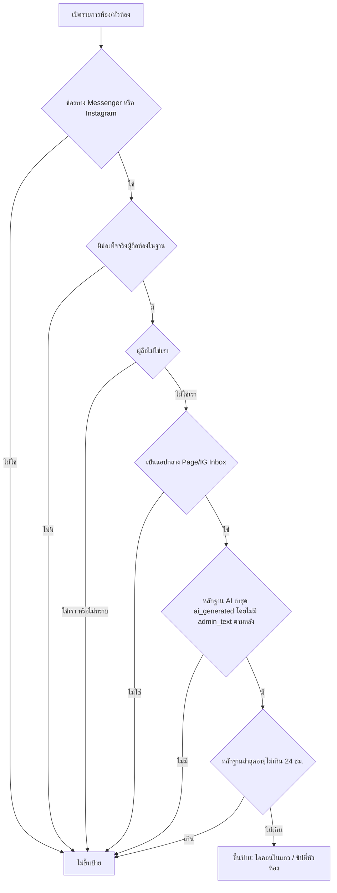
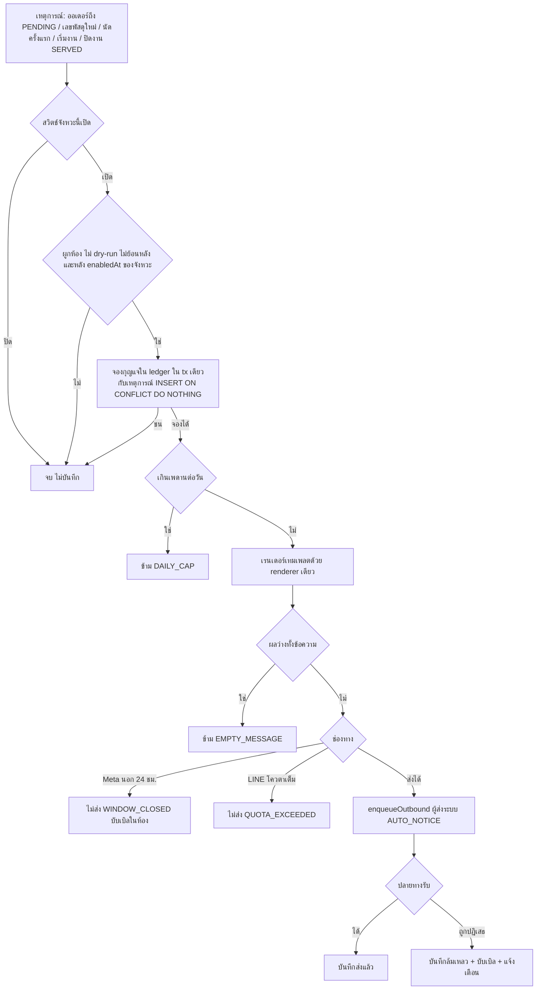
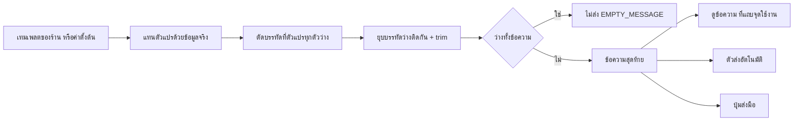
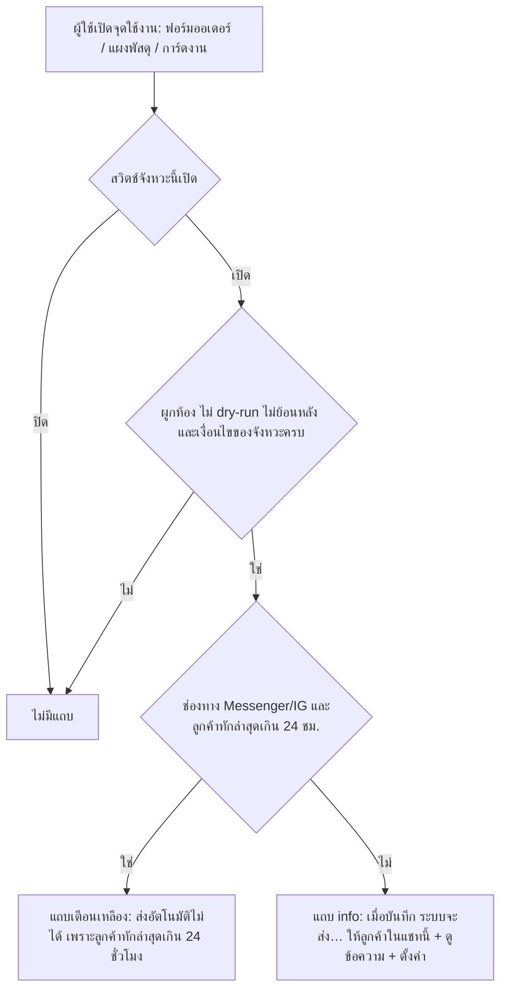
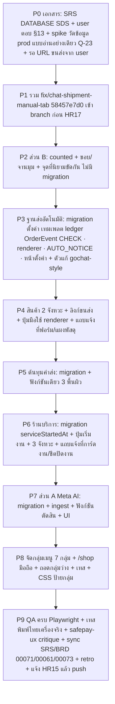

> **โมดูล:** 00078 - Chat Customer Signals & Auto Notify (สัญญาณลูกค้าในแชท + ส่งอัตโนมัติถึงลูกค้า)
> **ประเภทเอกสาร:** Product Requirements Document (PRD)
> **เวอร์ชัน:** 0.3
> **วันที่จัดทำ:** 2026-10-17 (รอบ 3 — นำมติ user ทั้งหมดของรอบ 2-3 เข้าเนื้อเอกสาร)
> **สถานะ:** Draft — เหลือคำถามเปิดสั้น ๆ ใน §13 ก่อนเริ่มโค้ด (HR11)
> **เจ้าของเอกสาร:** BA + PO + PM (ดู [[Feature-Docs-Ownership]])
> **ที่มา:** คำขอทีมร้านค้า + มติ user 2026-10-17 (เช้า/บ่าย/เย็น) + สำรวจโค้ดบน main `fc4efb21e` + โค้ด worktree `fix/chat-shipment-manual-tab` (`58457e7d0`) + ค้นคว้า gochat-v3 (ดู `Research-Notes.md`) + สเปกดีไซน์ `docs/superpowers/specs/2026-10-17-00078-chat-signals-design.md` (รวม "แก้ไขรอบ 2") + `2026-10-17-00078-auto-notify-settings-v2-design.md` (รวม "แก้ไขรอบ 3") + mockup `…-settings-v2-mockup.html` + `2026-10-17-00078-seller-menu-regroup-design.md`

# PRD: สัญญาณลูกค้าในแชทและการส่งอัตโนมัติ (Chat Customer Signals & Auto Notify)

---

## Executive Summary

ผู้ขายที่นั่งตอบแชทหลายห้องพร้อมกันขาดสัญญาณที่ต้องใช้ตัดสินใจทันที และเสียเวลากับงานซ้ำที่ลืมได้ง่าย ฟีเจอร์นี้ส่งมอบ **ก้อนเดียว ออกพร้อมกัน** (branch เดียว `feat/00078-chat-signals-auto-notify`) ประกอบด้วย 8 ความสามารถ

1. **ป้าย Meta AI ควบคุมห้อง (ส่วน A)** — แสดงสถานะอย่างเดียว ไม่มีปุ่มแย่งห้อง (prod 14 วันโดน `(#10)` 33 ครั้ง ตาม `EXTENSIONS-2026-08-26-thread-control-api.md` §5) แถวรายการห้องใช้ **ไอคอนเล็ก `sparkles` หน้าเวลา** หัวห้องใช้ชิปเต็ม
2. **ป้ายและขอบรูปลูกค้า (ส่วน B)** — นิยามเดียวทั้งระบบ "ลูกค้าใหม่" (ใบที่นับ = 1) / "ลูกค้าซื้อซ้ำ" (≥ 2) แถวรายการห้อง **ไม่มีชิปข้อความ** บอกด้วยขอบรูปม่วง + จานมุมบนขวา (1 ใบ = ไอคอนรถเข็น · ≥ 2 = ตัวเลข) ชิปข้อความยังอยู่ที่หน้าอื่น
3. **ส่งอัตโนมัติฝั่งสินค้า 2 จังหวะ (ส่วน C)** — เมื่อสร้างคำสั่งซื้อ / เมื่อมีเลขพัสดุ · **ต่อจังหวะมีแค่สวิตช์เปิด/ปิด ปิดเป็นค่าตั้งต้น** (ไม่มีโหมดทดสอบ)
4. **เทมเพลตข้อความที่ร้านตั้งเอง + ลิงก์ติดตามพัสดุแยกตามขนส่ง (ส่วน C+)** — ตัวแก้แบบ gochat-v3 (ตัวแปรเป็นชิปในเนื้อความ · ปุ่มอีโมจิ · ตัวนับ n/500 · เริ่มจากตัวอย่าง 3 แบบ · คืนค่าตั้งต้น) ปุ่มส่งมือใช้เทมเพลตเดียวกัน (HR16)
5. **ส่งอัตโนมัติฝั่งร้านบริการ 3 จังหวะ (ส่วน S)** — เมื่อสร้างงานบริการ / เมื่อเริ่มงาน (ปุ่มใหม่ + ฟิลด์เวลา ไม่ใช่สถานะ) / เมื่อปิดงาน (`closeServiceJob`) รอบนี้เป็นข้อความ + ลิงก์ `/o/{token}` รูปก่อน/หลัง + บันทึกช่าง + หน้ารายงานลูกค้า = **ฟีเจอร์ 00079 แยก**
6. **ต้นทุนค่าส่งสำหรับพัสดุที่ส่งเอง + แท็บ "ส่งเอง" (ส่วน D)** — รวมแท็บที่ทำเสร็จแล้ว (`58457e7d0`) เพิ่มช่องกรอกค่าส่งที่ร้านจ่ายขนส่ง เข้าทุกที่ที่คิดค่าส่งในกำไรด้วยฟังก์ชันเดียว
7. **แถบแจ้งที่จุดใช้งาน (ส่วน E — ใหม่ v0.3)** — ฟอร์มสร้างออเดอร์ในแชท · `/orders/new` เมื่อผูกห้อง · แผงพัสดุ · การ์ดงานบริการ บอกผู้ขายก่อนกดบันทึกว่า "ระบบจะส่งอะไรให้ลูกค้าในแชทนี้" พร้อม "ดูข้อความ" และลิงก์ "ตั้งค่า" — แสดงเฉพาะเมื่อจะส่งจริง
8. **จัดกลุ่มเมนูผู้ขายใหม่ 7 กลุ่ม (ส่วน F — ใหม่ v0.3)** — ป้ายกลุ่มภาษาไทย ไม่เปลี่ยน URL/slug · หน้าใหม่ `/settings/auto-notify` อยู่ในกลุ่ม "ตั้งค่าแชท"

ผลทางธุรกิจ: ผู้ขายตอบแชทได้ถูกตัวขึ้น เห็นลูกค้าที่เคยซื้อได้ทันทีที่รูป ลูกค้าได้ข้อมูลออเดอร์/พัสดุ/งานบริการโดยไม่ขึ้นกับความจำผู้ขาย ผู้ขายรู้ ณ จุดกดบันทึกว่าลูกค้าจะได้รับอะไร และกำไรสะท้อนค่าส่งที่ร้านจ่ายจริงแม้ส่งเอง

**ลำดับพัฒนาภายใน branch เดียว** (ออก prod พร้อมกัน) ดู §11

### สิ่งที่เปลี่ยนจาก v0.2

| หัวข้อ | v0.2 | v0.3 | แก้ที่ |
|---|---|---|---|
| โหมดทดสอบ | สถานะชุด ปิด/ทดสอบ/เปิด + ห้องทดสอบ ≤ 20 + `TEST_ROOM_ONLY` (OQ-3) | **ตัดทั้งหมด** — ต่อจังหวะมีแค่สวิตช์เปิด/ปิด · ไม่มีห้องทดสอบ · ไม่มีรหัส `TEST_ROOM_ONLY` · ตัวป้องกันแทน: Swal ยืนยันตอนเปิดสวิตช์จังหวะครั้งแรก + แถบ "ดูข้อความ" ที่จุดใช้งาน | §3.3 · C02 · C17 · C20(ถอน) · §4.3 · M2 |
| `enabledAt` | ต่อชุด | **ต่อจังหวะ** (ตั้งใหม่ทุกครั้งที่สวิตช์ปิด→เปิด) | C02 |
| เพดานต่อลูกค้าต่อวัน | เสนอ 5 (OQ-4) | **ล็อก ค่าตั้งต้น 5 ช่วง 1-20** บรรทัดเล็กท้ายการ์ดในหน้าตั้งค่า | C19 |
| พรีวิวในหน้าตั้งค่า | พรีวิวสด + กรอบแชทตัวอย่าง + สลับช่องทาง | **ตัดกล่องพรีวิวออก** — parity ปุ่มมือ ↔ อัตโนมัติยังบังคับ; ดูข้อความจริงได้ที่แถบจุดใช้งาน | §3.4 · FR-CS-19 · KPI |
| ตัวแก้ข้อความ | ชิป + เมนู `{` + พรีวิว (เสนอ textarea เป็นทางถอย) | **แบบ gochat-v3**: ชิปในเนื้อความ (contenteditable) · ชิปเส้นประ "+ ตัวแปร" · ตัวนับ n/500 · ปุ่มอีโมจิ · "เริ่มจากตัวอย่าง" 3 แบบ · บันทึก/คืนค่าตั้งต้น/ยกเลิก · บังคับเทสพิมพ์ไทยบน iOS/Android จริง | §3.4 · FR-CS-33 |
| หน้าตั้งค่า | สถานะชุด + จังหวะ + ตารางลิงก์ขนส่ง + ข้อควรรู้ 5 ข้อ | **คอลัมน์เดียว** · แถว "เมื่อ…" · ไม่มีตารางลิงก์ขนส่งในหน้า · ข้อควรรู้ 2 ข้อ · คำว่า "ปิดงาน" ทุกที่ | FR-CS-11 |
| ลิงก์ติดตามขนส่ง (OQ-2) | รอยืนยัน | **user จะส่ง URL เอง** — ระหว่างรอ ตารางว่าง ใช้ทางถอย iShip เฉพาะพัสดุ iShip | §3.5 |
| LINE (OQ-1) | ข้อเสนอ | **ล็อก**: ไม่แก้เทมเพลต = การ์ดเดิม · แก้แล้ว = ข้อความล้วน | §3.4 |
| ต้นทุนค่าส่ง (OQ-7) | รอตอบ | **ล็อก (ก)(ข)**: ร้านขายของเห็นที่ /sales + dashboard ไม่เห็นที่ /expenses · เป็นตัวสำรองสุดท้ายของพัสดุ iShip ที่ไม่มีราคา · (ค) ที่เก็บ = DATABASE | §3.7 · D06 |
| แถบแจ้งที่จุดใช้งาน | แทนแค่ช่องติ๊กในแผงพัสดุ (FR-CS-18) | **ส่วน E ใหม่** 4 จุด: ฟอร์มออเดอร์ในแชท · `/orders/new` · แผงพัสดุ · การ์ดงาน (เริ่มงาน/ปิดงาน) · เตือนเมื่อ Messenger/IG เกิน 24 ชม. | §3.9 · FR-CS-31 |
| เมนูผู้ขาย | `/settings/auto-notify` ในกลุ่ม CHAT | **จัดกลุ่มใหม่ 7 กลุ่ม** (รวมใน PR นี้) | §3.10 · FR-CS-32 |
| กฎ UI ร่วม | กระจาย | **รวมเป็นกฎเดียว (audit):** ตัวหนังสือใช้สี `-ink` · ทุกช่องกรอกผูก label · เป้าแตะ ≥ 44px · มือถือชิปตัวแปรรวมเป็นปุ่มเดียว | §3.11 · BRD §6.5 |
| ตัวแปรเทมเพลต | `{ลิงก์นัดหมาย}` · `{เวลาจบงาน}` | `{ลิงก์งาน}` ชื่อเดียวทั้ง 3 จังหวะบริการ · `{เวลาปิดงาน}` · เพิ่ม `{วันเวลานัด}` ใน เริ่มงาน/ปิดงาน · ชนิด `SERVICE_FINISHED` → `SERVICE_CLOSED` (HR16) | §3.4 |
| ตารางมติท้ายเอกสาร (§14) | ตารางดิบ | นำเข้าเนื้อเอกสารแล้ว เหลือบันทึกประวัติสั้น | §12 · §14 |

**ตรวจแล้วว่าคงอยู่จาก v0.2 (ข้อ 12):** ดีไซน์แถวรายการห้องรอบ 2 — ไอคอน Meta AI หน้าเวลา (A11) · ขอบรูปม่วง + จานมุม (B08-B10) · ชิป ≤ 2 + "+N" (B11) · ไอคอนชิปหน้าอื่น (B12) — ไม่มีส่วนใดถูกมติรอบ 3 ทับ

---

## 1. Business Goals & KPIs

### 1.1 เป้าหมายทางธุรกิจ

| เป้าหมาย | รายละเอียด |
|----------|-----------|
| **ผู้ขายรู้ก่อนพิมพ์ว่า Meta AI ควบคุมห้องอยู่** | ลดการพิมพ์ทิ้งแล้วถูกปฏิเสธ โดยไม่ล็อกช่องพิมพ์และไม่เดา (บทเรียน 18 เธรดบล็อกค้าง 2026-08-09) |
| **ป้ายลูกค้านิยามเดียวทั้งระบบ** | ลูกค้าคนเดียวกันต้องได้สัญญาณเดียวกันทุกหน้า (HR16) |
| **ลูกค้าได้ข้อมูลออเดอร์/พัสดุ/งานโดยผู้ขายไม่ต้องจำ** | ร้านที่ "ลืมส่ง" เป็นเหตุให้ลูกค้าทักถามซ้ำ |
| **ร้านคุมถ้อยคำของตัวเองได้** | ข้อความที่ออกไปหาลูกค้าเป็นน้ำเสียงของร้าน ไม่ใช่ข้อความตายตัวของระบบ |
| **ผู้ขายรู้ ณ จุดกดว่าลูกค้าจะได้อะไร** | ไม่มีการส่งที่ผู้ขายไม่รู้ตัว (เมื่อไม่มีโหมดทดสอบ จุดใช้งานคือที่เดียวที่เห็นข้อความก่อนส่งจริง) |
| **กำไรสะท้อนค่าส่งจริงแม้ส่งเอง** | พัสดุที่ส่งกับขนส่งข้างนอกต้องมีทางกรอกต้นทุน (ปิดหนี้เดิม) |
| **เมนูหาของเจอ** | งานประจำวันขึ้นก่อน หน้าตั้งค่าอยู่ท้ายติดกัน ป้ายเป็นภาษาไทย |
| **ไม่ทำลายกติกาเดิม** | ไม่ส่งโดยร้านไม่ได้เลือก (มติ 2026-07-29) · ไม่หยุดบอท · ไม่ทำเวลาตอบเพี้ยน · ไม่ฝืนหน้าต่าง 24 ชม. ของ Meta · ไม่กินโควตา LINE โดยร้านไม่รู้ · ไม่ถือว่า "เริ่มงาน" เป็นสถานะใหม่ (ไม่ย้อนมติ 00073) |

### 1.2 ตัวชี้วัดความสำเร็จ (KPIs)

| KPI | คำอธิบาย | เป้าหมาย |
|-----|----------|---------|
| **ป้ายตรงกันทุกหน้า** | เทส parity: ลูกค้า/ร้านเดียวกันได้ `counted` เท่ากันจาก InboxRow, หัวห้อง, CustomerPanel, `/orders`, `/customers`, `/customers/[id]`, ฟอร์มสร้างออเดอร์ | ต่าง 0 ราย |
| **ส่งซ้ำ** | ข้อความอัตโนมัติชนิด/ออเดอร์/ค่าเดียวกันส่งซ้ำ (รวม reopen→ปิดงานใหม่) | 0 |
| **ผลข้างเคียงต่อบอท/รายงาน** | ข้อความอัตโนมัติที่ทำให้ `pauseForHumanTakeover` ทำงาน หรือถูกนับเป็นเวลาตอบแอดมิน (00059) หรือขึ้นป้าย DeepBot/นับเป็นบอทใน 00077 | 0 |
| **งานหลักล้มเพราะตัวส่ง** | สร้างออเดอร์/บันทึกเลข/ปิดงาน/เริ่มงาน ที่ล้มเพราะตัวส่งอัตโนมัติ | 0 |
| **เทมเพลต parity** | ข้อความจาก "ดูข้อความ" ที่แถบจุดใช้งาน = ข้อความที่ส่งจริง = ข้อความปุ่มมือ (renderer ตัวเดียว ข้อมูลชุดเดียวกัน) | ต่าง 0 ราย |
| **แถบแจ้งไม่โกหก** | แถบบอก "จะส่ง" แต่ตัวส่งข้ามด้วยเงื่อนไขที่แถบรู้ล่วงหน้าได้ (สวิตช์/ผูกห้อง/dry-run/ย้อนหลัง/เกิน 24 ชม.) และกลับกัน | ต่าง 0 ราย (เทสใช้ predicate เดียว) |
| **ลิงก์ขนส่งตาย** | แถวในตารางขนส่ง→URL ที่เปิดแล้วไม่เจอเลขจริง | 0 แถวที่ผ่านการยืนยัน (แถวที่ยืนยันไม่ได้ต้องไม่อยู่ในตาราง) |
| **ต้นทุนค่าส่งตรงทุกหน้า** | ออเดอร์เดียวกันได้ต้นทุนค่าส่งเท่ากันที่ทุกพื้นผิวที่คิด (§3.7) | ต่าง 0 ราย |
| **เมนูเดิมไม่หาย** | ทุก slug เดิมยังอยู่ ทุก URL เดิมเข้าได้ ไม่มีกลุ่มว่างลอย | 0 รายการหาย · 0 กลุ่มว่าง |
| **ป้าย Meta AI ผิดทิศ** | ห้องที่ติดป้ายแต่ผู้ขายส่งผ่านได้ภายใน 24 ชม. | รายงานค่า ตั้งเพดานหลังวัดจริง |
| **สัดส่วนตกหน้าต่าง 24 ชม. แยกชนิดข้อความ** | `WINDOW_CLOSED` ต่อชนิด (สรุป/พัสดุ/จอง/เริ่มงาน/ปิดงาน) — คาดว่าเริ่มงาน/ปิดงานของการจองล่วงหน้าตกบ่อย | รายงาน (ใช้ตัดสินว่า 00079 ต้องมีช่องทางอื่นไหม) |
| **การเปิดใช้สวิตช์/การแก้เทมเพลต** | ร้านที่เปิดสวิตช์/ร้านที่แก้เทมเพลตภายใน 30 วัน · ร้านที่กด "ยังก่อน" ที่ Swal เปิดครั้งแรก | รายงานค่า (ไม่ตั้งเป้า) |

---

## 2. User Personas (กลุ่มผู้ใช้งาน)

### 2.1 ผู้ขาย / เจ้าของร้านที่ตอบแชทเอง

**ข้อมูลพื้นฐาน:** เจ้าของหลัก (`Shop.userId`) หรือเจ้าของร่วม ร้านรับแชทหลายช่องทาง (Deep / Messenger / Instagram / LINE) บางเพจเปิด "AI from Meta" ไว้ มีทั้งร้านขายของ ร้านบริการ (คิวงาน) และที่พัก

**เป้าหมาย:** ตอบลูกค้าเร็ว ไม่พิมพ์ทิ้ง ไม่ลืมแจ้งสรุป/เลขพัสดุ/ความคืบหน้างาน ข้อความออกไปด้วยน้ำเสียงของร้าน และรู้ก่อนกดบันทึกว่าระบบจะส่งอะไร

**จุดปวด:**
- พิมพ์ตอบแล้วถูก Meta ปฏิเสธโดยไม่รู้สาเหตุ
- ป้ายลูกค้าเดิมอ่านยาก ไม่ตรงกันทุกหน้า และแถวห้องรกจนอ่านชื่อลูกค้ายาก (user: "R5 วุ่นวายเกินไป")
- ข้อความแจ้งเลขพัสดุตายตัว ปรับถ้อยคำไม่ได้ · ส่งพัสดุกับขนส่งเองแล้วไม่มีที่กรอกค่าส่ง กำไรเพี้ยน
- ร้านบริการต้องพิมพ์แจ้งลูกค้าเองทุกจังหวะ (จองแล้ว/เริ่มงาน/เสร็จ)
- เคยบ่นเมื่อระบบส่งเองโดยไม่ถาม (2026-07-29) จึงต้องให้ร้านเลือกเปิดเอง และต้องบอกที่จุดใช้งานว่าจะส่งอะไร
- เมนูข้างสะเปะสะปะ (user 2026-10-17) ป้ายกลุ่มเป็นภาษาอังกฤษตัวพิมพ์ใหญ่

### 2.2 แอดมินแชท / ผู้ดูแล / ช่าง (บทบาท CHAT, MANAGER, TECHNICIAN ตาม 00071)

**ข้อมูลพื้นฐาน:** สิทธิ์ตาม `src/lib/shop-permissions.ts` (CHAT = H1/H2/S1/O4 · MANAGER = เพิ่ม O6/S2 · TECHNICIAN = O4 ไม่มี O5 ไม่เห็นเงิน)

**ความต้องการ:** CHAT เห็นป้ายเหมือนเจ้าของ เห็นหน้า "ส่งอัตโนมัติถึงลูกค้า" แบบอ่านอย่างเดียว และเห็นแถบแจ้งที่จุดใช้งาน (ไม่ส่งซ้ำด้วยมือ) · ช่างกด "เริ่มงาน" และ "ปิดงาน" ได้ตามสิทธิ์ O4 เดิม ไม่ต้องเห็นเงิน เห็นแถบแจ้งแต่ไม่เห็นลิงก์ "ตั้งค่า"

### 2.3 ลูกค้าปลายทาง

ผู้ซื้อ/ผู้จองบน Messenger / Instagram / LINE / Deep ต้องการสรุปคำสั่งซื้อ เลขพัสดุพร้อมลิงก์ที่เปิดได้จริง ความคืบหน้างานบริการ ไม่ได้รับซ้ำ ไม่ได้ข้อความที่หลอกว่าเป็นคนพิมพ์ ไม่ถูกท่วมข้อความ

---

## 3. Business Requirements

รหัส BR: `BR-CS-A` (Meta AI) · `B` (ป้ายลูกค้า) · `C` (ส่งอัตโนมัติ + เทมเพลต) · `S` (ร้านบริการ) · `D` (ต้นทุนค่าส่ง) · `E` (แถบแจ้งที่จุดใช้งาน) · `F` (เมนู) · `U` (กฎ UI ร่วม) FR ฉบับเต็มและ acceptance อยู่ [[BRD]]

### 3.1 ส่วน A — ป้าย "Meta AI กำลังควบคุมห้อง"

**ความต้องการ:**
- แถวรายการห้อง: **ไอคอน `sparkles` เล็กหน้าเวลา** (คอลัมน์ขวา บรรทัดเวลา) ไม่ใช่ชิป · หัวห้อง: **ชิปเต็ม** "Meta AI คุมอยู่" ในแถบชิปใต้หัว (โทน `neutral` ใหม่)
- แสดงสถานะอย่างเดียว ผู้ขายยังพิมพ์ได้เหมือนเดิม ไม่มีปุ่มแย่งห้อง ไม่ยิง Graph ฝั่งเขียน
- แยก "Meta AI" ออกจาก "คนพิมพ์ใน Business Suite" และ "แอปอื่น" (Pancake, Botcake) — สองอย่างหลังไม่ขึ้นป้าย

**Business Rules:**
- **BR-CS-A01** ป้ายเป็นข้อมูลอย่างเดียว ห้าม disable ช่องพิมพ์ ห้ามเพิ่มปุ่ม take/pass/request thread control
- **BR-CS-A02** เฉพาะ `MESSENGER` และ `INSTAGRAM` · LINE และ DEEP ไม่เคยขึ้น
- **BR-CS-A03** "ถือห้อง" ตัดสินจากหลักฐานหลายชั้น: (1) ผู้ถือปัจจุบันไม่ใช่เรา (2) เป็นแอปกลางของ Meta (Page Inbox `263902037430900` / IG Inbox `1217981644879628`) (3) echo ล่าสุดฝั่งร้านมี `ai_generated: true` โดยไม่มี `admin_text` ตามหลัง
- **BR-CS-A04** ห้ามตัดสินจาก `ChatMessage.viaStandby` อย่างเดียว (`schema.prisma:2246`) หรือ marker ข้อความอย่างเดียว (73% ของการส่งที่โดน `#10` ไม่มี marker)
- **BR-CS-A05** หมดอายุอัตโนมัติ: หลักฐานล่าสุดอายุ ≤ 24 ชม. (Meta ไม่ส่ง webhook ตอนหมดอายุ/ปล่อย)
- **BR-CS-A06** รายการห้องห้ามยิง Graph ต่อแถว · ฟังก์ชันบริสุทธิ์ตัวเดียวใช้ทั้งจอและ server
- **BR-CS-A07** ไม่มีหลักฐาน = ไม่ขึ้นป้าย
- **BR-CS-A08** เก็บข้อเท็จจริง ไม่เก็บ boolean `aiHolds` ถาวร (`docs/conventions/stored-flag-vs-owner-truth.md`)
- **BR-CS-A09** ไม่ตั้ง `META_APP_ID` = ไม่เดา (คืน "ไม่รู้")
- **BR-CS-A10** ใช้ `new_owner_app_id` ของ `pass`/`take` เท่านั้น · echo ไม่มี `app_id` = ของเรา
- **BR-CS-A11** ไอคอนบนแถวรายการต้องอ่านได้ด้วยข้อความ: `role="img"` + `aria-label="Meta AI กำลังควบคุมห้องนี้"` + `title` · ห้ามใช้ `sparkles` ซ้ำกับสัญญาณอื่นในแถวเดียวกัน (ไอคอน `sparkles` ของ "ลูกค้าใหม่" ที่ `customer-behavior.ts:235` ย้ายเป็น `user-plus` — ดู BR-CS-B12)

#### 3.1.1 สถานะปัจจุบันของโค้ด (ตรวจ 2026-10-17)

| หมวด | มีแล้ว (path) | ขาด |
|---|---|---|
| ตารางหลักฐาน handover | `ChatHandoverEvent` (`prisma/schema.prisma:4197`) · เขียนโดย `ingestHandoverEvent()` (`channel-chat.service.ts:2433`) จาก webhook (`src/app/api/channels/facebook/webhook/route.ts`) | ไม่มีตัวอ่านเป็น "ผู้ถือปัจจุบัน" · ไม่ผูก FK กับห้อง · **เนื้อหา prod ไม่ทราบ** (08-16 ว่าง, 08-26 แถวเดียวของเราเอง) |
| ผู้ถือบนห้อง | ไม่มี | `Conversation` ไม่มีคอลัมน์ผู้ถือ/เวลาที่เห็นล่าสุด |
| `ai_generated` / `app_id` / `admin_text` ของ echo | schema webhook อ่านได้ (`src/lib/facebook/webhook-types.ts`) | **ไม่ถูกเก็บ** ใช้เลือก placeholder เท่านั้น · payload ดิบอยู่ใน `rawMessage` ซึ่ง global omit (`src/lib/prisma.ts`) · `admin_text` ไม่ถูกอ่านเลย |
| ถามสด `GET /{page}/thread_owner` | ไม่มี | ไม่มีใน `src/` |
| marker ข้อความ | `readMetaAiControlMarker` (`src/lib/meta-system-notice.ts:217`), `attributeMetaAi` (`:236`) → `aiAgentActive` (`ChatThread.tsx:1676`) | เชื่อไม่ได้เป็นตัวตัดสิน · **ป้ายใหม่ไม่แตะ logic นี้** |
| ปุ่ม "ตอบเอง" | `POST …/thread-control` | ออกนอกขอบเขต คงเดิม |
| ธง webhook | subscribe `messaging_handovers` + `standby` | IG ยังไม่มีเคสยืนยัน |

**สรุป:** หลักฐานที่ทำให้รู้ว่าเป็น Meta AI เข้ามาถึงระบบแล้วแต่ถูกทิ้งก่อนถึงฐานข้อมูล → migration เพิ่มที่เก็บข้อเท็จจริง 2 ชั้น (ระดับห้อง + ระดับข้อความ) รูปทรงจริงเป็นของ DATABASE

### 3.2 ส่วน B — ป้ายลูกค้าและขอบรูป

**ความต้องการ:**
- นิยามเดียว: **"ลูกค้าใหม่"** (ใบที่นับ = 1) / **"ลูกค้าซื้อซ้ำ"** (≥ 2) แทน NEW/REGULAR เดิมของ `customerBadges()` (`src/lib/customer-behavior.ts:227`)
- **แถวรายการห้อง:** ไม่มีชิปข้อความลูกค้าใหม่/ซื้อซ้ำ · บอกด้วย **ขอบรูปม่วง** (`outline-2 outline-offset-2 outline-purple`) + **จานมุมบนขวา** (มุมล่างขวาเป็นของ `ChannelBadgeOverlay`): 1 ใบ = ไอคอนรถเข็น · ≥ 2 = ตัวเลขจำนวนใบ (เกิน 9 แสดง "9+")
- **หัวห้อง / แผงลูกค้า:** ขอบ + จานมุมเดียวกัน (คอมโพเนนต์เดียว 3 จุด) · ไม่มีป้ายข้อความบน CustomerPanel (มติ 2026-08-27 + Q-3)
- **หน้าอื่น** (`/orders`, `/customers`, `/customers/[id]`, ฟอร์มสร้างออเดอร์): ชิปข้อความ "ลูกค้าใหม่/ลูกค้าซื้อซ้ำ" ตามนิยามเดียว
- ป้ายยกเลิก/ตีกลับคงเดิม

**Business Rules:**
- **BR-CS-B01 ใบที่นับ:** ทุกใบของคู่ (ร้าน, ลูกค้า) ที่ **ไม่ใช่** (ก) ร่าง `DRAFTED` (ข) ยกเลิก `CANCELLED` รวม `NO_SHOW` (ค) พัสดุตีกลับ (`isReturnedCarrierStatus`) (ง) `Order.status = RETURNED` (มติ Q-1) `PENDING`/`SHIPPED`/`CONFIRMED` นับทั้งหมด
- **BR-CS-B02** 0 ไม่มีป้าย/ขอบ · 1 "ลูกค้าใหม่" · ≥ 2 "ลูกค้าซื้อซ้ำ" (แทน ไม่ซ้อน)
- **BR-CS-B03** null ≠ 0: ห้องไม่ผูกลูกค้า = ไม่รู้ = ไม่ติดป้าย ไม่มีขอบ
- **BR-CS-B04** ขอบขึ้นเมื่อนับ ≥ 1
- **BR-CS-B05** นับสดจากแถว `Order` ทุกครั้งที่อ่าน (`customer-behavior.service.ts:51-68`) ห้ามเป็นตัวนับสะสม
- **BR-CS-B06** scope (`shopId`, `customerId`) เสมอ
- **BR-CS-B07** ฟังก์ชันตัดสิน "ใบนี้นับไหม" ที่เดียว ทุก consumer เรียกร่วม (HR16)
- **BR-CS-B08** ขอบเป็น `outline` (ไม่ดันขนาดรูป) สีจากโทเคน `--color-purple` `#7b70ef` (Q-8) ไม่มี hex ดิบ · คอนทราสต์ ≥ 3:1 ทุกพื้น light/dark (คำนวณมือต่ำสุด 3.39:1 บนแถวเลือกอยู่ light — QA วัดจอจริงซ้ำ)
- **BR-CS-B09** ห้ามให้ขอบ/สีเป็นช่องทางเดียวของข้อมูล: ในแถวรายการจานมุมเป็น `role="img"` + `aria-label` ("ลูกค้าใหม่ ซื้อแล้ว 1 {noun}" / "ลูกค้าซื้อซ้ำ ซื้อแล้ว {n} {noun}") + `title` · หัวห้อง/แผงลูกค้า `aria-label="เป็นลูกค้าของร้านแล้ว"`
- **BR-CS-B10** จานมุม: 1 ใบ = ไอคอนรถเข็น (ชื่อไอคอนที่เลือกเป็นของ UX ตรวจกับ iconify ก่อนใช้) · ≥ 2 = ตัวเลข · ≥ 10 = "9+" · ใช้ได้ทุกช่องทาง (LINE/DEEP ก็มีถ้าผูกลูกค้า)
- **BR-CS-B11** บรรทัดชิปในแถวรายการห้อง: **สูงสุด 2 ใบ + "+N"** ทุกขนาดจอ ลำดับ: ติดตาม → ตีกลับ/ยกเลิก → DeepBot → สถานะขาย → ad_id → แท็ก · `+N` นับรวมแท็กส่วนเกิน · `+N` อ่านชื่อที่ซ่อนได้ (aria/title)
- **BR-CS-B12** ไอคอนชิปข้อความที่หน้าอื่น: "ลูกค้าใหม่" → `user-plus` (ใช้อยู่ที่ `CustomerQuickBlock.tsx`) · "ลูกค้าซื้อซ้ำ" → `repeat` (ใช้อยู่ที่ตัวกรอง `/customers`) · tone `info` ไม่เขียว (เขียว = ยืนยันแล้ว)

#### 3.2.1 ที่ที่นับ "ลูกค้าใหม่/ซื้อซ้ำ" ตอนนี้ — ผลกระทบ (HR16)

| # | จุด | นิยามปัจจุบัน | ที่ | ผลของ 00078 |
|---|---|---|---|---|
| 1 | ตัวตัดสินป้ายหลัก | NEW = `orders ≤ 1`, REGULAR = `completed ≥ 3` | `customer-behavior.ts:227-245` | **เปลี่ยน** counted ≥1 / ≥2 |
| 2 | ตัวนับ `completed` | ไม่ยกเลิก/ตีกลับ/NO_SHOW | `summarizeCustomerBehavior` `:104` | คงเป็นฐาน เพิ่มเงื่อนไข RETURNED · เปลี่ยนชื่อ/alias `counted` |
| 3 | รายการห้อง | `customerBadges` | `InboxRow.tsx` | **ถอดชิปข้อความ** ใช้ขอบ+จานมุม · แก้พฤติกรรมเดิม: ผูกแล้วแต่ยังไม่มีออเดอร์เคยได้ "ลูกค้าใหม่" (`hasHistory: true`) → จะไม่มีสัญญาณ |
| 4 | ตารางออเดอร์ | `completed = orders − cancelled` ไม่หักตีกลับ | `OrdersTable.tsx:507-508` | **ต้องแก้** ใช้ตัวกลาง (drift อยู่แล้ว) |
| 5 | หน้าลูกค้า | `customerBadges` | `customers/page.tsx`, `customers/[id]/page.tsx` | ตามข้อ 1 |
| 6 | ตัวกรอง "ซื้อซ้ำ" `/customers` | `totalOrders ≥ 2` รวมยกเลิก | `customer-directory.ts:215-231` | **เปลี่ยนเป็น counted ≥ 2** (Q-5) |
| 7 | ฟอร์มสร้างออเดอร์ | "ลูกค้าเก่า · N" เขียว / "ลูกค้าใหม่" = ไม่มีในระบบ | `CustomerQuickBlock.tsx:269-280`, `customer.service.ts:80-91` | **Q-4:** ป้ายชุดเดียวกัน · 1 = ลูกค้าใหม่ · ≥2 = ลูกค้าซื้อซ้ำ · ไม่มีในระบบ/0 = "ยังไม่เคยสั่ง" · เลิกเขียว |
| 8 | สถิติสาธารณะหน้าร้าน | ≥2 ใบ `CONFIRMED` | `shop.service.ts:427`, `shop-stat-vocab.ts` | **คงไว้** (ผู้ชมต่าง เกณฑ์ต่าง) จด glossary (Q-6) |
| 9 | พจนานุกรม | `badgeNew`/`badgeRegular` | `th.ts:949-950`, `en.ts:755-756` | แก้ทั้งสองภาษา (00047) |
| 10 | หัวห้อง | ไม่มีข้อมูลนับ | `ChatThread.tsx` | เพิ่มอ่านค่านับ 1 ครั้ง/ห้อง ใส่ขอบ+จานมุม |
| 11 | CustomerPanel | ถอดป้ายแล้ว 2026-08-27 | `PanelAvatar` | ขอบ+จานมุม ไม่คืนป้ายข้อความ |

### 3.3 ส่วน C — ส่งอัตโนมัติฝั่งสินค้า 2 จังหวะ

**ความต้องการ:**
- ตั้งค่าระดับร้าน **ต่อจังหวะ** **ปิดเป็นค่าตั้งต้น**: (ก) เมื่อสร้างคำสั่งซื้อ (ข) เมื่อมีเลขพัสดุ — **แต่ละจังหวะมีแค่สวิตช์เปิด/ปิด** ไม่มีสถานะระดับชุด ไม่มีโหมดทดสอบ ไม่มีห้องทดสอบ (มติ user 2026-10-17 "เอาโหมดทดสอบออกเลย ให้มีแค่เปิดปิด")
- **เปิดสวิตช์จังหวะใดเป็นครั้งแรก** → Swal ยืนยัน "เริ่มส่งข้อความนี้ถึงลูกค้าจริง?" (ปุ่ม "เริ่มส่ง" / "ยังก่อน" โฟกัสเริ่มที่ "ยังก่อน")
- ออเดอร์ถึง `PENDING` ครั้งแรกและผูกห้อง → ส่งสรุป · มีเลขพัสดุใหม่ → ส่งเลขพัสดุ
- ผู้ขายเห็นเสมอว่าข้อความอัตโนมัติถูกส่ง ล้มเหลว หรือถูกข้ามเพราะอะไร — **บนการ์ดออเดอร์ในแชทด้วย** (ยกจาก gochat-v3)
- ผู้ขายเห็น **ก่อนกดบันทึก** ว่าจะส่งอะไร — ดูส่วน E (§3.9)

**Business Rules:**
- **BR-CS-C01** เลือกเองเท่านั้น: ปิดเป็นค่าตั้งต้นทุกร้านรวมร้านเดิม ไม่ backfill (มติ 2026-07-29)
- **BR-CS-C02** ไม่ย้อนหลัง: ส่งเฉพาะเหตุการณ์หลัง `enabledAt` ของ **จังหวะนั้น** · `enabledAt` ตั้งใหม่ **ทุกครั้งที่สวิตช์จังหวะเปลี่ยนจากปิดเป็นเปิด** · สวิตช์เปลี่ยนเป็นปิด → INTENT ที่ค้างของจังหวะนั้นต้องไม่ถูกส่ง
- **BR-CS-C03** ต้องผูกห้อง: เฉพาะ `Order.conversationId` ไม่ null (`schema.prisma:981`) · ห้ามเดาห้องจากเบอร์/ลูกค้า (เหตุผลที่ไม่ backfill: `schema.prisma:959-972`)
- **BR-CS-C04** ข้าม `Order.isDryRun` และ `OrderShipment.isDryRun` (ออเดอร์จำลองจากห้องทดสอบของ 00061) — ไม่ขัดกับการตัดโหมดทดสอบ เพราะ 00078 ไม่มีห้องทดสอบของตัวเองแล้ว
- **BR-CS-C05** "สร้างเสร็จ" = ถึง `PENDING` ครั้งแรกผ่าน `createOrder` (`order.service.ts:309`) หรือ `promoteDraftCore` (`:838`) · `DRAFTED` ไม่ส่ง
- **BR-CS-C06** ส่งครั้งเดียวต่อข้อเท็จจริง: กุญแจ (ร้าน, ออเดอร์, ชนิด, ค่า) — สรุป 1 ครั้ง/ออเดอร์ · เลข 1 ครั้ง/(ออเดอร์, เลข normalize)
- **BR-CS-C07** แก้เลข: เลขใหม่ที่ต่างจากที่เคยส่ง ส่งอีก ขึ้นต้นบรรทัดคงที่ "อัปเดตเลขติดตามพัสดุ" (ร้านลบออกจากเทมเพลตไม่ได้) · สูงสุด 3 ครั้ง/ออเดอร์ (Q-17) · แก้กลับเป็นเลขเดิมไม่ส่งซ้ำ
- **BR-CS-C08** เนื้อหาข้อความมาจาก **เทมเพลตของร้าน** (§3.4) · ค่าตั้งต้นของทุกเทมเพลต = ข้อความเดิมของปุ่มมือ ทุกตัวอักษร (ร้านที่ไม่แก้ได้ผลเหมือนเดิม) · ตัวสร้างข้อความ (renderer) มีตัวเดียว ใช้ทั้งตัวส่งอัตโนมัติ ปุ่มส่งมือ และ "ดูข้อความ" ที่แถบจุดใช้งาน (HR16) · คำเรียกรายการมาจาก `resolveOrderVocab` ตัวเดียว
- **BR-CS-C09** ไม่แต่งข้อมูล: ข้อมูลไม่ครบ = ข้อความสั้นลง (บรรทัดที่ตัวแปรทุกตัวว่างถูกตัด) · ผลว่างทั้งข้อความ = ไม่ส่ง
- **BR-CS-C10** Meta นอกหน้าต่าง 24 ชม.: ไม่ส่ง + บันทึก `WINDOW_CLOSED` (`channel-chat.service.ts:3959-3963` ห้ามผ่อน) · ห้ามใช้ `HUMAN_AGENT` กับข้อความระบบ · ห้ามใช้ message tag `POST_PURCHASE_UPDATE`/`ACCOUNT_UPDATE` (ต้องยืนยันนโยบาย Meta ซ้ำก่อนทำ Phase 2)
- **BR-CS-C11** LINE กินโควตา: ไม่มี reply token → PUSH (`channel-chat.service.ts:3776-3783`) · เต็ม = `QUOTA_EXCEEDED` ไม่ส่ง บันทึก · หน้าตั้งค่าบอกใน "ข้อควรรู้" (Q-16) · เป็นข้อยกเว้นของ 00045 `replyOnly` (BR-LINE-18) เพราะร้านเลือกเปิดเอง
- **BR-CS-C12** ติดป้ายผู้ส่ง "ระบบ" ด้วย `autoReplyKind` ค่าใหม่ `AUTO_NOTICE` (Q-13) · คอลัมน์เป็น `String?` ไม่มี enum/CHECK (`schema.prisma:2260`) จึงไม่ต้อง migration แต่ต้องไล่ผู้บริโภคทุกไฟล์ (116 จุดใน 32 ไฟล์ที่ grep เจอ) · ไม่หยุดบอท ไม่นับเวลาตอบแอดมิน ไม่ขึ้นป้าย DeepBot ไม่นับเป็นบอทใน 00077
- **BR-CS-C13** ตัวส่งล้มไม่กระทบงานหลัก (ออเดอร์/เลข/ปิดงาน/เริ่มงานสำเร็จเสมอ)
- **BR-CS-C14** ทุกเหตุการณ์ที่ควรส่งมีบันทึกผลหนึ่งใน {ส่งแล้ว, ส่งไม่ได้+เหตุผล, ข้าม+เหตุผล} ผู้ขายเห็นได้ (บับเบิลในห้อง + แถวสถานะบนการ์ดออเดอร์)
- **BR-CS-C15** ส่งมือก่อนแล้ว = ไม่ส่งอัตโนมัติซ้ำ · ส่งมือซ้ำหลังระบบส่งแล้วทำได้ (ผู้ขายเลือกเอง)
- **BR-CS-C16** ไม่ตรวจสถานะ Meta AI ล่วงหน้า ปล่อย Meta ตัดสิน `(#10)`
- **BR-CS-C17** สิทธิ์ **เปลี่ยน** (สวิตช์ + เทมเพลต + เพดาน): OWNER + MANAGER ผ่าน capability ใหม่ในตารางกลาง (`X8` ข้อเสนอ — Q-20) · สิทธิ์ **ดูหน้า**: capability อ่านแยก (เสนอใช้ H1 = ผู้เห็นแชท — SDS ยืนยัน) ให้ CHAT เห็นแบบอ่านอย่างเดียว · TECHNICIAN/BILLING ไม่เห็นหน้า · ตัดสินที่ server (403)
- **BR-CS-C18** ออเดอร์ลงวันที่ย้อนหลังไม่ส่ง (`isBackdated` ที่ `order.service.ts:729-730`) — สอดคล้อง C02 (OQ-10 ใช้ค่าเสนอ)
- **BR-CS-C18b** เทมเพลตห้ามมีตัวแปรที่ดึง `internalNote`/ที่อยู่เต็ม/เบอร์เต็ม
- **BR-CS-C19 เพดานข้อความอัตโนมัติต่อลูกค้า (ต่อห้อง) ต่อวัน** นับเฉพาะข้อความ 00078 (ledger) ตามเวลาไทย ไม่นับข้อความที่คนกดเอง · เกิน = ข้ามพร้อมเหตุผล `DAILY_CAP` (ไม่ส่งเงียบ) · **ค่าตั้งต้น 5 ตั้งได้ 1-20 (ล็อก)** · นับรวมทุกจังหวะ · แสดงเป็นบรรทัดเล็กท้ายการ์ดในหน้าตั้งค่า
- **BR-CS-C20 — ถอน (v0.3)** เดิม "โหมดทดสอบ ≤ 20 ห้อง" ถูกตัดทั้งหมด เลขนี้ไม่ถูกนำกลับมาใช้
- **BR-CS-C21..C24** ดู §3.5

#### 3.3.1 จุดที่เลขพัสดุถูกเขียน (ตรวจโค้ด — ตัวทริกเกอร์ (ข) ต้องครอบทั้งหมด)

| ที่ | ฟังก์ชัน | ตาราง | หมายเหตุ |
|---|---|---|---|
| a | `shipOrder()` `order.service.ts:1533` (เรียกจาก `api/orders/[token]/ship` POST · สิทธิ์ S1) | `ShipmentTracking` create + `SHIPPED` | เลขใหม่ครั้งแรก (MANUAL) |
| b | `updateShipmentTracking()` `:1589` (PATCH) | `ShipmentTracking` update | แก้เลข · ปฏิเสธถ้ามี iShip ใบ active (`IShipManagedShipmentError`) |
| c | `createShipment` iShip `iship.service.ts:~1286-1299` | `OrderShipment` (`trackingNo`, `isDryRun`) | ต้องเช็ค `isDryRun` · `FAILED` ไม่มีเลข ไม่ส่ง |
| d | `linkShipment` `iship.service.ts:~2982` (`source: "LINKED"`) | `OrderShipment` | |
| d2 | `advanceOrderIfDispatched` `iship.service.ts:~3076-3089` | `ShipmentTracking` upsert **เลขเดียวกัน** + `SHIPPED` | เลขเดียวเขียน 2 ตาราง → ต้องกันซ้ำที่ (ออเดอร์, เลข) |
| e | `importParcelAsOrder` `iship.service.ts:~3158` | — | ไม่มี `conversationId` → ข้าม |
| f | พัสดุขากลับ (00056) | — | นอกขอบเขต |

webhook iShip ไม่เขียนเลข ตาม Research-Notes — **ยังไม่ได้ตรวจซ้ำทุกบรรทัด** SDS ต้องยืนยันก่อนล็อกรายการ

**ข้อสังเกตเรื่องความทนทาน (Vercel):** `after-order-create.ts:9-12` ระบุว่างานที่ค้างหลัง response ไม่รับประกันว่าได้รัน และ `messages/route.ts:780-782` พึ่ง "แถวถูกเขียนลง DB ก่อน response + ตัวเก็บงานค้าง" เป็นตัวการันตี → ตัวส่งอัตโนมัติต้องออกแบบแบบเดียวกัน: **บันทึกเจตนาส่ง (แถว ledger สถานะ INTENT) ใน transaction เดียวกับเหตุการณ์** (แพตเทิร์นเดียวกับ `recordOrderEvent(tx, …)` ที่ `order.service.ts:732`) แล้วส่งหลัง commit ด้วย `after()` และมีตัวกวาดรับช่วง INTENT ค้าง (รูปทรงจริงเป็นของ SDS)

### 3.4 เทมเพลตข้อความที่ร้านตั้งเอง (ส่วน C+)

**ความต้องการ (มติ user ข้อ 1 + รอบ 3):** ในหน้า "ส่งอัตโนมัติถึงลูกค้า" ร้านแก้ข้อความของแต่ละชนิดได้เอง ด้วยตัวแก้แบบ gochat-v3

**หลักที่ยกจาก gochat-v3 (`Research-Notes.md`):**
- ไวยากรณ์ `{ชื่อไทย}` ชั้นเดียว · ตัวแปรที่ไม่รู้จัก = บันทึกไม่ได้ · ≤ 500 อักษร ห้ามว่าง
- ตัวแปรว่าง → หาย · บรรทัดที่ตัวแปร *ทุกตัว* ว่าง → ตัดทั้งบรรทัด · บรรทัดว่างติดกันยุบ · ผลว่างทั้งข้อความ → ไม่ส่ง
- **ตัวแก้ (v0.3):** กล่องเดียว ตัวแปรเป็นชิปในเนื้อความ (contenteditable) · ตัวนับ `n/500` มุมขวาบน · แถบล่างในกล่อง: ปุ่มอีโมจิ + ชิปเส้นประ "+ ตัวแปร" · "เริ่มจากตัวอย่าง" 3 แบบ · ปุ่ม บันทึก / คืนค่าตั้งต้น / ยกเลิก · พิมพ์ `{` เปิดเมนูตัวแปร · **ไม่มีกล่องพรีวิวในหน้าตั้งค่า** (มติ user)
- **ที่เราเพิ่ม (เขาไม่มี):** ปุ่ม **"คืนค่าตั้งต้น"** ต่อเทมเพลต — เก็บเฉพาะที่ร้านแก้ (ไม่มีแถว = ใช้ค่าตั้งต้นของระบบ) เพื่อไม่ให้ร้านค้างข้อความเก่าเมื่อระบบปรับค่าตั้งต้น
- ไม่แยกข้อความตามช่องทาง: หนึ่งเทมเพลตต่อชนิดข้อความ ใช้ทุกช่องทาง
- กันสองคนแก้พร้อมกัน: เช็ค `updatedAt` ตอนบันทึก ชน = แจ้งให้โหลดใหม่
- ไม่ถือประวัติการแก้ (before/after) รอบนี้ — เก็บแค่ผู้แก้ล่าสุด+เวลา
- **เนื้อความของร้านใส่อีโมจิได้** — เป็น content ของร้าน ไม่ใช่ UI ของระบบ (HR12 ห้ามเฉพาะ UI) แต่ UI ของตัวแก้เอง (ปุ่ม ชิป ข้อความช่วย) ใช้ไอคอนจริง
- **ความเสี่ยง IME ไทยของ contenteditable ยอมรับ** โดยมีเงื่อนไข: ต้องเทสพิมพ์ไทยบน iOS/Android จริง (FR-CS-33) ไม่ผ่าน = ตัดสินถอยไป textarea ก่อน merge

**ชนิดข้อความและชุดตัวแปร** (อิงข้อมูลที่ระบบเรามีจริง ตรวจจาก `Order`/`Shop`/`OrderItem` — ห้ามเพิ่มตัวแปรนอกตารางนี้โดยไม่ผ่านเอกสาร):

| ชนิด (`kind`) | แถวในหน้าตั้งค่า | ตัวแปรที่ใช้ได้ | ที่มา | หมายเหตุ |
|---|---|---|---|---|
| `ORDER_SUMMARY` | เมื่อสร้างคำสั่งซื้อ (ผัน {noun}) | `{ชื่อร้าน}` `{ชื่อลูกค้า}` `{เลขคำสั่งซื้อ}` `{วันที่สั่งซื้อ}` `{รายการสินค้า}` `{ยอดสุทธิ}` `{ลิงก์คำสั่งซื้อ}` `{คำเรียกรายการ}` | `Shop.shopName` · `Order.buyerName` (ตัด "คุณ" นำหน้า ว่าง = "ลูกค้า") · `Order.orderNo` · `createdAt` ผ่าน `formatDate` (`docs/conventions/date-format.md`) · ชื่อรายการแรก + "และอีก N รายการ" · `totalAmount` ผ่าน `formatBaht` · `publicOrderUrl(publicToken)` · `resolveOrderVocab(...).noun` | ค่าตั้งต้น = ข้อความเดิมของปุ่มมือ `messages/route.ts:847` ทุกตัวอักษร (mockup แสดงเป็น "สรุปยอดคำสั่งซื้อ / ชื่อลูกค้า: … / วันที่สั่งซื้อ: … / รายการสินค้า: … / ยอดสุทธิ: … บาท / ตรวจสอบสถานะคำสั่งซื้อได้ที่ … / ขอบคุณสำหรับการสั่งซื้อ" — **ข้อความตั้งต้นจริงต้องเอาจากโค้ดเดิม ไม่ใช่จาก mockup**) |
| `TRACKING` | เมื่อมีเลขพัสดุ | `{ชื่อร้าน}` `{ชื่อลูกค้า}` `{เลขคำสั่งซื้อ}` `{ขนส่ง}` `{เลขพัสดุ}` `{ลิงก์ติดตามพัสดุ}` `{ลิงก์คำสั่งซื้อ}` | `ShipmentTracking.provider` / `OrderShipment.courierName` ("อื่นๆ" = ว่าง) · `trackingNo` · ตาราง §3.5 | ค่าตั้งต้น = `จัดส่งด้วย {ขนส่ง}` / `เลขติดตามพัสดุ: {เลขพัสดุ}` / `ติดตามพัสดุ: {ลิงก์ติดตามพัสดุ}` (เท่ากับ `trackingMessage()`) |
| `SERVICE_BOOKED` | เมื่อสร้างงานบริการ | `{ชื่อร้าน}` `{ชื่อลูกค้า}` `{เลขคำสั่งซื้อ}` `{วันเวลานัด}` `{บริการ}` `{ยอดรวม}` `{ยอดมัดจำที่ตกลงไว้}` `{ลิงก์งาน}` | `appointmentRangeText` · ชื่อบริการ · `buildAppointmentSummary` (`src/lib/appointment-summary.ts`) · มัดจำ = `Order.depositAmount` (0 = ว่าง) | ค่าตั้งต้น = ข้อความสรุปนัดเดิม · (v0.3: `{ลิงก์นัดหมาย}` เปลี่ยนเป็น `{ลิงก์งาน}` ชื่อเดียวทั้ง 3 จังหวะบริการ) |
| `SERVICE_STARTED` | เมื่อเริ่มงาน | `{ชื่อร้าน}` `{ชื่อลูกค้า}` `{บริการ}` `{วันเวลานัด}` `{เวลาเริ่มงาน}` `{ลิงก์งาน}` | `Order.serviceStartedAt` (ใหม่) | ถ้อยคำค่าตั้งต้นร่างใน BRD FR-CS-26 รอ user เคาะจากภาพ |
| `SERVICE_CLOSED` | เมื่อปิดงาน (ไม่ส่งถ้าลูกค้าไม่มาตามนัด) | `{ชื่อร้าน}` `{ชื่อลูกค้า}` `{บริการ}` `{วันเวลานัด}` `{เวลาเริ่มงาน}` `{เวลาปิดงาน}` `{ลิงก์งาน}` | `Order.serviceStartedAt` (อาจว่าง → บรรทัดถูกตัด) · `Order.serviceClosedAt` | เช่นเดียวกัน · (v0.3: เปลี่ยนจาก `SERVICE_FINISHED`/`{เวลาจบงาน}` ตาม HR16 คำว่า "ปิดงาน") |

**ตัวแปรที่ตั้งใจ *ไม่* มีรอบนี้ (และเหตุผล):**
- `{ยอดที่ชำระแล้ว}` / `{ยอดค้างชำระ}` — gochat-v3 เองระบุว่าเดาผิดได้ถ้าไม่มีข้อมูลจ่ายจริง ฝั่งเรา ร้านขายของ "ได้รับเงินแล้ว" เป็น self-report (`Order.paymentConfirmedAt`, `schema.prisma:925`) ไม่มียอด (OQ-11 ใช้ค่าเสนอ: ไม่รวมรอบนี้)
- `{ที่อยู่จัดส่ง}` / `{เบอร์ลูกค้า}` — PII (หน้า guest ยังต้อง mask) · `Order.internalNote` — โน้ตภายในร้าน ห้ามส่งลูกค้าเด็ดขาด

**LINE (มติ OQ-1 ล็อก):** LINE ที่มี Flex ส่ง **เฉพาะ flex** ข้อความ `text` ถูกทิ้ง (`channel-chat.service.ts:3723-3728`) → **ร้านที่ไม่แก้เทมเพลตสรุปคำสั่งซื้อ = ลูกค้า LINE ได้การ์ดเดิมทุกประการ · ร้านที่แก้ = ส่งเป็นข้อความตามเทมเพลตทุกช่องทางรวม LINE** · หน้าตั้งค่าบอกชัดใต้ตัวแก้ของแถว "เมื่อสร้างคำสั่งซื้อ": "ลูกค้า LINE จะได้ข้อความนี้แทนการ์ดสรุป กดคืนค่าตั้งต้นเพื่อกลับไปใช้การ์ด" · ฝั่งนัดหมาย LINE/Meta ได้การ์ด + ข้อความ — ส่วนข้อความใช้เทมเพลต ตัวการ์ดคงโครงเดิม

**ปุ่มส่งมือใช้เทมเพลตเดียวกัน (ล็อก):** `sendOrderToChat` (`_components/sendOrderToChat.ts:17`) และ "แจ้งเลขในแชท" ต้องเรียก renderer ตัวเดียวกับตัวส่งอัตโนมัติ เหตุผล HR16: ลูกค้าไม่ควรได้ข้อความคนละน้ำเสียงตามว่าใครกด · ผลข้างเคียง: ปุ่มส่งมือเดิมประกอบข้อความฝั่ง client (`trackingMessage`) และฝั่ง route (`linkText`) สองที่ → ต้องยุบเป็นที่เดียวฝั่ง server

### 3.5 ลิงก์ติดตามพัสดุแยกตามขนส่ง (แทน Q-18)

**ความต้องการ (มติ user ข้อ 3):** แต่ละขนส่งมี URL ติดตามของตัวเอง ใช้กับทั้งข้อความอัตโนมัติและปุ่มแจ้งเลขมือ

**สิ่งที่ระบบมีอยู่แล้ว:** `src/lib/iship/courier.ts` มี `COURIER_BRANDS` (รหัสแบรนด์ `FLASH` `KERRY` `THAIPOST` `DHL` `BEST` `SPX` `FUZE` `JANDT` + `ISHIP`) และ `courierBrandCode(code, name)` ที่จับแบรนด์จากทั้งรหัส iShip และชื่อที่ร้านเลือก → ตารางลิงก์ผูกกับ **รหัสแบรนด์นี้** ไม่สร้างรายชื่อขนส่งชุดที่สอง (HR16) · ตอนนี้ลิงก์เดียวคือ iShip `https://app.iship.cloud/tracking?track={เลข}` (`ShipmentDraftPanel.tsx:44`, user สั่ง 2026-08-07)

**Business Rules:**
- **BR-CS-C21** ตารางแบรนด์ → ลิงก์ **ระบบกำหนด ร้านแก้เองไม่ได้ และ v0.3 ไม่แสดงตารางนี้ในหน้าตั้งค่า**: ลิงก์ผิดส่งลูกค้าไปหน้าตายและร้านทุกร้านต้องยืนยันเองไม่ได้
- **BR-CS-C22** แต่ละแถวมี 2 รูป: `DEEP` (URL ฝังเลขได้) หรือ `PAGE` (ได้แต่หน้าติดตาม ลูกค้ากรอกเลขเอง → ข้อความมีเลขแยกบรรทัดอยู่แล้ว) · **ไม่มี URL ที่ยืนยันแล้ว = ไม่มีบรรทัดลิงก์** (ตัวแปร `{ลิงก์ติดตามพัสดุ}` ว่าง → บรรทัดถูกตัดตาม C09) ห้ามเดา URL
- **BR-CS-C23** พัสดุที่เปิดผ่าน iShip และแบรนด์นั้นไม่มีแถวที่ยืนยันแล้ว → ใช้ลิงก์ iShip เดิมเป็นทางถอย · พัสดุส่งเอง/ไม่รู้แบรนด์ → ไม่มีลิงก์ แค่เลข
- **BR-CS-C24** ทุกแถวต้องผ่านการยืนยันด้วยการเปิดจริง 1 เลขจริงก่อนอยู่ในตาราง

**สถานะ (มติ OQ-2):** **user จะส่ง URL ของแต่ละขนส่งเอง** (เปิดในเบราว์เซอร์ด้วยเลขจริงแล้ว) → **ระหว่างรอ ตารางว่าง** · ทางถอยเดียวที่ทำงานตอนนี้ = iShip สำหรับพัสดุที่เปิดผ่าน iShip · ผลต่อร้านส่งเอง: ได้เลขอย่างเดียว ไม่มีลิงก์จนกว่าตารางจะมีแถว (ข้อความไม่เสียหาย เพราะบรรทัดลิงก์ถูกตัดตาม C09) · หมายเหตุ: Flash `https://www.flashexpress.co.th/fle/tracking` ที่ user เคยให้เปิดไม่ได้ด้วยเครื่องมือ (`self signed certificate`) จึงยังไม่ใส่ในตาราง รอ user ยืนยันพร้อมรูป `PAGE`/`DEEP`

| รหัสแบรนด์ | URL | รูป | สถานะ |
|---|---|---|---|
| `FLASH` `KERRY` `THAIPOST` `JANDT` `SPX` `DHL` `BEST` `FUZE` | — | — | **ว่าง รอ user ส่ง** |
| `ISHIP` และพัสดุ iShip ที่แบรนด์ไม่มีแถว | `https://app.iship.cloud/tracking?track={เลข}` | `DEEP` | ใช้งานอยู่แล้ว (ทางถอย) |

**ข้อสังเกตที่เกี่ยวกัน:** รายชื่อขนส่งใน `ShipForm.tsx` (`CARRIERS` 6 ค่า ใน worktree manual-tab) เป็นรายการแยกจาก `COURIER_OPTIONS` ใน `courier.ts` (ซึ่งมี BEST/SPX/Fuze ด้วย) — ขัด HR16 · เสนอรวมเป็น `COURIER_OPTIONS` (OQ-9 ใช้ค่าเสนอ: ทำ)

### 3.6 ส่วน S — ส่งอัตโนมัติฝั่งร้านบริการ 3 จังหวะ

**ขอบเขต (มติ user ข้อ 4 + ข้อ 9):** ร้านบริการ (`SERVICE_QUEUE`) = `Order` type `SERVICE` (`APPOINTMENT_ORDER_TYPE`, `src/lib/appointments.ts:8`) · **ส่งเฉพาะออเดอร์ที่ `Order.conversationId` ไม่ null ห้าม fallback หาห้องจากลูกค้า** · ร้านที่พัก (BOOKING, `booking.service.ts`) นอกขอบเขต

**ข้อเท็จจริง:** `booking.service.ts:171-246` คือฝั่งที่พัก ไม่ใช่ SERVICE · การจองฝั่ง SERVICE สร้างผ่าน `createOrder` → `attachAppointmentInTx` (`order.service.ts:777`; `appointment.service.ts:319`) หรือ walk-in เติมนัดทีหลังผ่าน `setOrRescheduleAppointment` (`appointment.service.ts:226`) และใบที่สร้างจากแชทมี `conversationId` อยู่แล้ว (`order.service.ts:557-607`)

**3 จังหวะ (ชื่อแถวในหน้าตั้งค่า):**

| จังหวะ | ชื่อแถว | ทริกเกอร์ | เงื่อนไข/กันซ้ำ |
|---|---|---|---|
| **S1** | เมื่อสร้างงานบริการ | ใบ SERVICE ได้นัดครั้งแรก: (ก) `createOrder` + `attachAppointmentInTx` (ข) `setOrRescheduleAppointment` เมื่อ `hadAppointment = false` | ครั้งเดียวต่อออเดอร์ · **เลื่อนนัดไม่ส่งใหม่** · ค่าตั้งต้นใช้การ์ดสรุปนัดเดิม |
| **S2** | เมื่อเริ่มงาน | ร้านกดปุ่ม **"เริ่มงาน"** (ใหม่) → ตั้ง `Order.serviceStartedAt` | ครั้งเดียวต่อออเดอร์ · ไม่ส่งเมื่อปิดงานแล้ว/ยกเลิก |
| **S3** | เมื่อปิดงาน | `closeServiceJob` (`service-job.service.ts:50`) ผล `SERVED` | ครั้งเดียวต่อออเดอร์ (**เปิดงานอีกครั้ง `reopenServiceJob` แล้วปิดใหม่ ห้ามส่งซ้ำ**) · **`NO_SHOW` ไม่ส่ง** |

`closeServiceJob` มี 2 ผู้เรียก (`api/orders/[token]/close` และ `api/orders/[token]/appointment/outcome`) → ทริกเกอร์ต้องอยู่ที่ service ที่เดียว

**"เริ่มงาน" — ออกแบบให้ไม่ขัดเหตุผลของ 00073:**
- 00073 ตัดขั้น "เริ่มให้บริการแล้ว" ทิ้ง (PRD 00073 §3.1) เพราะเป็นขั้นที่ยืมมาจากร้านขายของ ทำให้สถานะ/ป้ายสับสนและเงินนับไม่ตรงกัน
- **BR-CS-S04: "เริ่มงาน" = ฟิลด์เวลา (`Order.serviceStartedAt`) ไม่ใช่สถานะ** — ห้ามแตะ `Order.status` ห้ามเพิ่มค่า `appointmentStatus` ห้ามเพิ่มป้ายในชุด 10 ป้าย (`resolveServiceStatusBadge`) ห้ามมีผลต่อวันที่ของยอด/เงิน/Trust Score/รีวิว · ปิดงานได้โดยไม่ต้องกดเริ่มงาน · `reopenServiceJob` ไม่ล้างค่า
- ใครกดได้: capability เดียวกับปิดงาน **O4** (OWNER MANAGER CHAT TECHNICIAN — `shop-permissions.ts:32`) ช่างกดได้ ไม่ต้องเห็นเงิน · ตัดสินที่ server
- กดได้ตั้งแต่เวลาเริ่มนัด (คู่กับ BR-RSV-34 ของปิดงาน `service-job.service.ts:69-70`)

**Business Rules:**
- **BR-CS-S01** ผูกห้องด้วย `Order.conversationId` เท่านั้น ห้าม fallback Customer→ExternalContact→Conversation (`schema.prisma:959-966`)
- **BR-CS-S02** สวิตช์ฝั่งบริการแยกจาก (ก)(ข) ของสินค้า: 3 จังหวะ แต่ละจังหวะมีสวิตช์เปิด/ปิดของตัวเอง · ร้านบริการ **ไม่เห็นแถวของสินค้า** (ใบ SERVICE ใช้ชุดบริการแทน ไม่ให้ลูกค้าได้ทั้งสรุปคำสั่งซื้อและสรุปนัดซ้อนกัน — OQ-5)
- **BR-CS-S03** ข้อความรอบนี้ = ข้อความ + ลิงก์ `/o/{token}` ของใบนั้น · guest view ของ `type = SERVICE` เปิดได้ (`o/[token]/page.tsx:181-186`; `guest-order-data.ts:338-353`) · action ที่ผูกตัวตน (ยืนยันรับบริการ รีวิว) ยังต้อง login
- **BR-CS-S04** เริ่มงาน = ฟิลด์ ไม่ใช่สถานะ (ข้างบน)
- **BR-CS-S05** ปิดงานส่งเฉพาะ `SERVED` · ครั้งเดียว/ออเดอร์ · ข้อความไม่มีตัวเลขเงิน (เงินที่รับตอนปิดงานเป็นเรื่องของ O5)
- **BR-CS-S06** ไม่ส่งการ์ดนัด/สรุปจองให้ใบที่นัดจบแล้ว (`isTerminalAppointmentStatus`) — ตรงกับด่านของปุ่มมือ `messages/route.ts:597`

**Out of scope ของส่วน S และจุดเสียบสำหรับ 00079:** ดู §5 และ [[BRD]] FR-CS-30

### 3.7 ส่วน D — ต้นทุนค่าส่งสำหรับพัสดุที่ส่งเอง

**ความต้องการ (มติ user ข้อ 5):** ช่อง "ค่าส่งที่ร้านจ่ายขนส่ง" ใน ShipForm (หน้าต่างพัสดุแชท + หน้ารายละเอียดออเดอร์ `ShipmentEntryModal`) · ต้องเข้าทุกที่ที่คิดค่าส่งในกำไร

**ข้อเท็จจริงจากโค้ด (HR16):**
- พัสดุส่งเอง = `ShipmentTracking` (`schema.prisma:1185`, `orderId @unique`) **ไม่มีคอลัมน์ราคา และไม่มีแถว `OrderShipment`** จึงไม่มีทางกรอกค่าส่งเลยตอนนี้ (หนี้เดิม) · ค่าส่ง iShip อยู่ที่ `OrderShipment.carrierPrice ?? estimatedPrice` + `codFee`
- **สูตร `carrierPrice ?? estimatedPrice + codFee` เขียนซ้ำอย่างน้อย 3 ที่:** `pnl.service.ts:121-125` · `dashboard.service.ts:546-550` (+ ช่วงก่อนหน้า `:327-332`) · `sales/page.tsx:331` และ `:413-418` · ที่เหลือ (`line-report-summary/detail`, `finance-chart`) รับต่อจาก `getPnlReport().shippingCost`
- **เกณฑ์ vertical ต่างกันตามพื้นผิว (ห้ามเปลี่ยน):** `getPnlReport` นับค่าส่งขาไปเป็นค่าใช้จ่ายเฉพาะร้านบริการ (`usesServiceFinanceRules`, `pnl.service.ts:229-230`, มติ 2026-10-02) ส่วน `/sales` และ dashboard หักค่าส่งในกำไรจากการขายให้ทุกร้าน (`SALES_PROFIT_FORMULA`, `format-money.ts:106`)
- **มติ OQ-7 (ก) ล็อก:** ยอมรับว่า **ร้านขายของที่กรอกต้นทุนส่งเองจะเห็นผลที่ /sales และ dashboard แต่ไม่เห็นที่ /expenses** (ตามเกณฑ์เดิม ไม่ใช่บั๊ก) — ต้องมีข้อความกำกับในหน้ากรอกและใน release note
- ฉลากค่าส่งไม่เป็นเอกภาพอยู่แล้ว: `lib/expense.ts:16` = "ค่าส่ง (จ่ายขนส่ง)" ส่วน `line-report-summary.service.ts:64` และ `lib/line-report/preview-sample.ts:109` = "ค่าส่งขาไป (จากระบบ)" — คำว่า "จากระบบ" จะผิดเมื่อมียอดที่ร้านกรอกเอง
- `order-view-by-level.ts:28-45` ซ่อนฟิลด์ราคา/ต้นทุนตามระดับเงิน → ฟิลด์ใหม่ต้องอยู่ในรายการเดียวกัน

**Business Rules:**
- **BR-CS-D01** `null` ≠ 0: ไม่กรอก = "ยังไม่ระบุ" (นับเป็น pending เหมือน iShip ที่ `carrierPrice == null`) · กรอก 0 = ร้านส่งเองไม่มีค่าใช้จ่ายจริง
- **BR-CS-D02** ต้นทุนส่งเองเข้า **ที่เดียวกับที่ `carrierPrice` เข้า ด้วยเกณฑ์ vertical เดิมของแต่ละพื้นผิวทุกประการ** ไม่เพิ่มพื้นผิวใหม่ ไม่ขยายร้านที่เคยถูกกั้น · ผ่านฟังก์ชันเดียวใน `src/lib` (รวม 3 ที่ข้างบน) พร้อมเทส parity
- **BR-CS-D03** มีใบ iShip ขาไป active ชนะ (เหมือน `orders/[token]/page.tsx:396`): ต้นทุนส่งเองถูกละเว้นเมื่อมีใบ iShip active · ไม่บวกซ้ำ
- **BR-CS-D04** แก้ภายหลังได้ (ShipForm โหมดแก้ / `PATCH …/ship`) → ทุกพื้นผิวเปลี่ยนตามในการอ่านครั้งถัดไป · สิทธิ์ S1 · บันทึกผู้แก้
- **BR-CS-D05** ไม่รวม COD fee ของพัสดุส่งเอง · ไม่ใช่ราคาที่เก็บจากลูกค้า
- **BR-CS-D06 (ล็อก OQ-7 ข)** พัสดุ iShip ที่ไม่มีทั้ง `carrierPrice` และ `estimatedPrice` (เช่น LINKED ที่ iShip ไม่ส่งราคา): ต้นทุนที่ร้านกรอกเป็น **ตัวสำรองสุดท้าย** รองจาก `carrierPrice` → `estimatedPrice` (iShip ชนะเสมอเมื่อมีราคา) · **ที่เก็บ (`ShipmentTracking` หรือ `OrderShipment`) ให้ DATABASE ตัดสิน (OQ-7 ค)** — ไม่ใช่คำถามถึง user

### 3.8 แท็บ "ส่งเอง" ในหน้าต่างพัสดุแชท (รวมก้อน — มติ 2026-10-17)

ทำเสร็จแล้ว commit `58457e7d0` บน branch `fix/chat-shipment-manual-tab` (worktree `/Users/craftman/Projects/safepay-wt-manual-ship` ผ่าน reviewer ยังไม่ push) สเปก `docs/superpowers/specs/2026-10-17-chat-shipment-manual-tab-design.md` · **รวมเข้า branch 00078 ก่อนแก้ไฟล์ร่วมใด ๆ** (ไฟล์ที่สองฝั่งแตะ: `ShipmentDraftPanel.tsx`, `ShipForm.tsx`, `order-context/route.ts`, `iship.service.ts`, `lib/iship/context.ts`, `lib/validations.ts` — HR17 ต้อง `comm -12` และอ่าน diff อีกฝั่ง)

สิ่งที่แท็บนั้นเปลี่ยน: ร้านไม่เชื่อม iShip ได้ฟอร์มส่งเองทันที (เดิมเจอทางตัน 404) · ร้านเชื่อมได้แถบเลือก 3 วิธี · มุมมอง "ส่งเองแล้ว" · `order-context` ตอบ 200 พร้อม `ishipState` `orderStatus` `manualShipment` · `trackingMessage` ย้ายไป `src/lib/chat-shipment-panel.ts` (โหมด `MANUAL` ไม่แนบลิงก์) · แปลง `Invalid transition` เป็นไทย

**ผลต่อ 00078:** `trackingMessage` โหมด MANUAL "ไม่แนบลิงก์" ถูกแทนด้วยตารางแบรนด์→ลิงก์ (§3.5) และถูกยุบเข้า renderer เทมเพลต (§3.4) · ช่องค่าส่ง (§3.7) เพิ่มใน ShipForm ที่แท็บนี้ใช้ร่วม · ช่องติ๊ก "แจ้งลูกค้า" ในแท็บ/แผงถูกแทนด้วยแถบแจ้ง (§3.9)

### 3.9 ส่วน E — แถบแจ้งที่จุดใช้งาน (ใหม่ v0.3)

**ที่มา:** user 2026-10-17 — เมื่อตัดโหมดทดสอบ จุดใช้งานต้องบอกผู้ขายว่าเปิดส่งอัตโนมัติไว้ และจะส่งอะไรเข้าแชทนั้น

**ความต้องการ:** แถบ info เล็กเหนือปุ่มบันทึก: ไอคอน `send` + ประโยค "เมื่อบันทึก ระบบจะส่ง…ให้ลูกค้าในแชทนี้ (ช่องทาง · ชื่อลูกค้า)" + ปุ่ม "ดูข้อความ" (กางข้อความจริงที่เติมจากข้อมูลในฟอร์ม) + ลิงก์ "ตั้งค่า"

| # | จุดใช้งาน | ไฟล์ (ตรวจแล้วว่ามี) | จังหวะที่แถบพูดถึง | ข้อความตัวอย่าง |
|---|---|---|---|---|
| 1 | ฟอร์มสร้างออเดอร์ในแชท | `(chat)/_components/DraftOrderProvider.tsx` → `OrderCreateForm` | ORDER_SUMMARY (ร้านขายของ/ที่พัก) · SERVICE_BOOKED (ร้านบริการ ที่ฟอร์มมีนัด) | เมื่อบันทึก ระบบจะส่งสรุปคำสั่งซื้อให้ลูกค้าในแชทนี้ (Messenger · คุณสมชาย) |
| 2 | `/orders/new` เมื่อผูกห้อง | `(dashboard)/orders/new/components/OrderCreateForm.tsx` (ตัวเดียวกับข้อ 1) | เหมือนข้อ 1 | เหมือนข้อ 1 |
| 3 | แผงพัสดุ (แทนช่องติ๊ก "แจ้งเลขในแชท") | `(chat)/_components/ShipmentDraftPanel.tsx` (+ แท็บส่งเอง) | TRACKING | เมื่อยืนยัน ระบบจะส่งเลขพัสดุให้ลูกค้าในแชทนี้ (Messenger · คุณสมชาย) |
| 4 | การ์ดงานบริการ | `(dashboard)/orders/[token]/components/ServiceJobCard.tsx` (+ `TechnicianOrderDetail.tsx`) | SERVICE_STARTED เหนือปุ่มเริ่มงาน · SERVICE_CLOSED ที่ขั้นปิดงาน | เมื่อกดเริ่มงาน ระบบจะส่งข้อความให้ลูกค้าในแชท (LINE · คุณวรรณา) |

**Business Rules:**
- **BR-CS-E01** แสดง **เฉพาะเมื่อระบบจะส่งจริง**: สวิตช์จังหวะนั้นเปิด + ออเดอร์ผูกห้อง + ไม่ dry-run + ไม่ลงวันที่ย้อนหลัง (ฟอร์มสร้างออเดอร์ เมื่อผู้ขายเลือกวันย้อนหลัง แถบต้องหายตาม) + (ร้านบริการ: ฟอร์มมีนัดจริง) + (ปิดงาน: ผลที่เลือกเป็น `SERVED` เท่านั้น — เลือกไม่มาตามนัด = ไม่มีแถบ) · ตัดสินที่ฟังก์ชันใน `src/lib` ที่เทสได้ (`docs/conventions/ui-boolean-needs-a-testable-home.md`) และใช้ predicate ชุดเดียวกับตัวส่งจริง
- **BR-CS-E02** สวิตช์จังหวะนั้นปิด = **ไม่มีแถบ** (ไม่แสดงเตือนว่าปิดอยู่ ไม่ชวนเปิด)
- **BR-CS-E03** Messenger/IG ที่ลูกค้าทักล่าสุดเกิน 24 ชม. = **แถบเตือน** (โทนเหลือง ไอคอน `alert-triangle` มีข้อความ ไม่ใช้สีอย่างเดียว) "ส่งอัตโนมัติไม่ได้ เพราะลูกค้าทักล่าสุดเกิน 24 ชั่วโมง" แทนแถบส่ง · ใช้ฟังก์ชันตัดสินหน้าต่าง 24 ชม. ตัวเดียวกับด่านส่ง (`channel-chat.service.ts:3959-3963`) ห้ามเขียนเกณฑ์ที่สอง
- **BR-CS-E04** "ดูข้อความ" เรนเดอร์ด้วย renderer ตัวเดียว (C08) จากข้อมูลในฟอร์มตอนนั้น · ช่องที่ยังไม่มีค่า (เช่น ลิงก์คำสั่งซื้อก่อนบันทึก) แสดงเป็นชิปตัวแปร · LINE + เทมเพลตสรุปยังไม่ถูกแก้ = บอกว่าลูกค้าจะเห็นเป็นการ์ดสรุป
- **BR-CS-E05** แถบไม่บล็อกและไม่เปลี่ยนผลการบันทึก · ห้องที่บันทึกแล้วไม่อ้างว่า "ส่งแล้ว" (ส่งทีหลังอาจล้ม)
- **BR-CS-E06** ลิงก์ "ตั้งค่า" ไป `/settings/auto-notify` แสดงเฉพาะบทบาทที่เห็นหน้านั้น (TECHNICIAN เห็นแถบ ไม่เห็นลิงก์)
- **BR-CS-E07** มือถือ: แถบเป็นบรรทัดเดียวตัดด้วย … อยู่ในแถบล่างค้างจอเหนือปุ่มบันทึก · กางแล้วข้อความเลื่อนในกรอบสูงไม่เกิน 9rem ปุ่มบันทึกยังอยู่ในจอ · เป้าแตะ ≥ 44px

### 3.10 ส่วน F — จัดกลุ่มเมนูผู้ขายใหม่ 7 กลุ่ม (ใหม่ v0.3)

**ที่มา:** user 2026-10-17 "เมนูสะเปะสะปะ" · ตามสเปก `docs/superpowers/specs/2026-10-17-00078-seller-menu-regroup-design.md` ทุกข้อที่เสนอ (user: ตามที่เสนอทุกข้อ)

| # | กลุ่ม | รายการตามลำดับ |
|---|---|---|
| 1 | **งานประจำวัน** | ภาพรวมร้านค้า → คำสั่งซื้อ/งานบริการ/บิลเข้าพัก → ตารางงาน → การจอง → ปฏิทินการจอง → สินค้า → จัดการสต็อก → การประมูล → ห้องพัก → แม่บ้าน |
| 2 | **แชทและลูกค้า** | ข้อความ → โต๊ะแชท → ลูกค้า → ติดตามลูกค้า → การตอบแชทของแอดมิน |
| 3 | **รายงานและการเงิน** | ภาพรวมกำไร/ขาดทุน (การเงินร้าน) → ค่าใช้จ่าย → ยอดขายรายสินค้า → รายงานเข้ากลุ่ม LINE |
| 4 | **ความน่าเชื่อถือ** | รีวิว → ระดับร้าน → ความสำเร็จ → แผนการตรวจสอบ |
| 5 | **ตั้งค่าแชท** | ช่องทางการขาย → ตอบกลับอัตโนมัติ → ตอบกลับคอมเมนต์ → **ส่งอัตโนมัติถึงลูกค้า** → สร้างออเดอร์จากแชท → ผู้ช่วยอัตโนมัติ |
| 6 | **ตั้งค่าร้าน** | ร้านค้า → ตั้งค่าหน้าร้าน → การจัดส่ง → ประเภทงาน → ตั้งค่ารายงาน |
| 7 | **ทีมและแพ็กเกจ** | พนักงาน → แพ็กเกจของฉัน → กระเป๋าเงิน |

**จำนวนรายการ (เจ้าของ เต็มสิทธิ์):** ONLINE_SALES 29 · SERVICE_QUEUE 27 · LODGING 28 (ของเดิม +1 ทั้ง 3 vertical) · ทุกกลุ่มไม่เกิน 6 รายการในทุก vertical

**Business Rules:**
- **BR-CS-F01** **ไม่เปลี่ยน URL และไม่เปลี่ยน slug** ของรายการเดิม (เมนูลัดที่ผู้ใช้ปักไว้ยังอยู่ครบ)
- **BR-CS-F02** ป้ายกลุ่มเป็นภาษาไทย sentence-case ไม่ uppercase ไม่ letter-spacing · ตัดเฉพาะ sidebar ฝั่งผู้ขาย (ห้ามแก้ `_sidenav.css` ของ Paces) · ป้ายกลุ่มแปลผ่าน `applyMenuLocale` ด้วย
- **BR-CS-F03** การกรองยึด slug ไม่ยึดกลุ่ม · ลำดับ gate `applyInventoryGate → applyPaymentRestriction → applyCapabilityMenu → …` ไม่เปลี่ยน (มีเทส blocker) · **เติมถอดกลุ่มว่างที่ท้าย `resolveVisibleSellerMenu` + เทส** (กลุ่ม "ทีมและแพ็กเกจ" บน Android ร้านส่วนตัวต้องหายทั้งกลุ่ม)
- **BR-CS-F04** `/settings/auto-notify` = slug `seller:settings-auto-notify` ไอคอน `send` (ตรวจชื่อในชุด tabler ก่อนใช้ — HR12) อยู่กลุ่ม "ตั้งค่าแชท" ลำดับ 4 · เห็นทุก vertical (ไม่อยู่ใน `*_ONLY_SLUGS`) แต่ร้านที่พักเห็นเฉพาะจังหวะที่ใช้ได้ (ดู FR-CS-11)
- **BR-CS-F05** กลุ่มที่บทบาทไม่มีสิทธิ์เห็นสักรายการ ต้องไม่ปรากฏ: OWNER ครบ 7 · MANAGER 1,2,4,5,6 · CHAT 1,2,4(ความสำเร็จ),6(ร้านค้า) และกลุ่ม 5 เห็นเฉพาะหน้าส่งอัตโนมัติ (อ่านอย่างเดียว) · BILLING 1,2(ลูกค้า),4(ความสำเร็จ),6(ร้านค้า) · TECHNICIAN 1,4(ความสำเร็จ),6(ร้านค้า)
- **BR-CS-F06** **เมนูลัดค่าเริ่มต้น (8 รายการแรกของ catalog ของคนที่ยังไม่ปักเอง) เปลี่ยน** — ONLINE เดิม: ภาพรวม, กำไร/ขาดทุน, แอดมิน, ยอดขายรายสินค้า, คำสั่งซื้อ, ประมูล, สินค้า, สต็อก → ใหม่: ภาพรวม, คำสั่งซื้อ, สินค้า, สต็อก, ประมูล, ข้อความ, โต๊ะแชท, ลูกค้า · **user รับทราบ** · คนที่ปักเองไม่กระทบ · ต้องมีใน release note
- **BR-CS-F07** **เพิ่มหัวข้อ "ตั้งค่าแชท" ในหน้า `/shop` บนมือถือ** (`ShopQuickLinks.tsx` + `QUICK_LINK_URLS` ที่ `src/lib/role-nav.ts:271`) เพราะหน้าตั้งค่าแชท 5 หน้าเข้าไม่ถึงบนมือถือ (sidebar ซ่อน < 1024px) · ชื่อต้องตรงกับเมนูเดสก์ท็อป · แสดงเฉพาะที่ผู้ใช้เห็นในเมนูจริง

### 3.11 กฎ UI ร่วม (audit) — ใหม่ v0.3

กฎเหล่านี้ใช้กับทุกพื้นผิว UI ใหม่ของ 00078 (หน้าตั้งค่า · ตัวแก้ · แถบแจ้ง · ปุ่มเริ่มงาน · ช่องค่าส่ง · เมนู) รายละเอียดทดสอบได้อยู่ [[BRD]] §6.5

| รหัส | กฎ |
|---|---|
| **BR-CS-U01** | ตัวหนังสือใช้สีคู่ `-ink` เสมอ (`text-primary-ink`, `text-danger-ink`, `text-warning-ink`, `text-info-ink`) — **ห้ามใช้ `text-primary`/`text-danger` กับตัวหนังสือ** (ใช้ได้กับไอคอน/เส้นขอบ) |
| **BR-CS-U02** | ทุกช่องกรอกผูก label (`<label for>` หรือ `aria-label` ที่ตรงกับป้ายที่เห็น) |
| **BR-CS-U03** | เป้าแตะ ≥ 44px บนมือถือ ทุกปุ่ม/สวิตช์/ชิปที่กดได้/รายการเมนู |
| **BR-CS-U04** | บนมือถือ ชิปตัวแปรรวมเป็น **ปุ่มเดียว "+ ตัวแปร"** เปิดรายการ (เดสก์ท็อป/แท็บเล็ตแสดงชิปเส้นประต่อตัวแปร) |
| **BR-CS-U05** | ไม่ใช้อีโมจิใน UI ของระบบ (HR12) — ยกเว้นเนื้อความของร้านที่ร้านพิมพ์เอง |
| **BR-CS-U06** | สถานะไม่สื่อด้วยสีอย่างเดียว (ข้อความ/ไอคอน/aria ประกอบเสมอ) · เขียวสงวนให้ "ยืนยันแล้ว" |

---

## 4. Business Rules & Constraints

### 4.1 กฎทางธุรกิจหลัก

| กฎ | คำอธิบาย |
|----|----------|
| **ป้าย Meta AI = ข้อมูลอย่างเดียว** | ไม่มีการกระทำผูก ไม่ล็อกช่องพิมพ์ |
| **ไม่มีหลักฐาน = ไม่ขึ้นป้าย** | ทั้ง Meta AI และสัญญาณลูกค้า (null ≠ 0) |
| **สัญญาณลูกค้านิยามเดียว** | counted ≥1 ใหม่ · ≥2 ซื้อซ้ำ · ขอบ ≥1 · RETURNED ไม่นับ |
| **ส่งอัตโนมัติเฉพาะร้านที่เปิดเอง** | ปิดเป็นค่าตั้งต้น ต่อจังหวะ ไม่ย้อนหลัง · เปิดครั้งแรกมี Swal ยืนยัน · **ไม่มีโหมดทดสอบ** |
| **ข้อความเดียว ผู้เขียนเดียว** | renderer เดียวทั้งอัตโนมัติ/ปุ่มมือ/ดูข้อความที่แถบ |
| **ส่งครั้งเดียวต่อข้อเท็จจริง** | กุญแจ = ออเดอร์ + ชนิด + ค่า |
| **แถบแจ้งเฉพาะเมื่อจะส่งจริง** | predicate เดียวกับตัวส่ง |
| **"เริ่มงาน" ไม่ใช่สถานะ** | ฟิลด์เวลา ไม่แตะสถานะ/ป้าย/เงินของ 00073 |
| **ต้นทุนค่าส่งนิยามเดียว** | ฟังก์ชันเดียว เกณฑ์ vertical เดิมของแต่ละพื้นผิว |
| **เมนู: ไม่เปลี่ยน URL/slug** | จัดกลุ่มใหม่เท่านั้น |
| **UI: ตัวหนังสือ `-ink`, label ผูก, แตะ ≥ 44px** | BR-CS-U01..U06 |

### 4.2 ข้อจำกัดทางธุรกิจ

| ข้อจำกัด | รายละเอียด |
|---------|-----------|
| **Meta หน้าต่าง 24 ชม.** | ระบบส่งนอกหน้าต่างไม่ได้ · สิทธิ์ Human Agent ถูก REJECTED (`EXTENSIONS-2026-08-26` §3) · **การจองล่วงหน้าหลายวันทำให้ข้อความเริ่มงาน/ปิดงานทาง Messenger/IG ตกหน้าต่างได้บ่อย** |
| **LINE โควตา** | PUSH กินโควตา · reply ฟรีเฉพาะมี token |
| **LINE ที่มี Flex ส่งเฉพาะ Flex** | `text` ถูกทิ้ง (`channel-chat.service.ts:3723`) → ร้านไม่แก้เทมเพลตได้การ์ด · แก้แล้วได้ข้อความล้วน |
| **Meta ไม่ส่ง webhook ตอนหมดอายุ/ปล่อยสิทธิ์** | ต้องมีกฎ 24 ชม. ฝั่งเรา |
| **Instagram** | ยังไม่มีเคสยืนยัน handover/`ai_generated` |
| **`Order.conversationId` ไม่ backfill** | ออเดอร์เก่าไม่ถูกส่ง |
| **ไม่มีงานเบื้องหลังที่รับประกันบน Vercel** | ต้องบันทึกเจตนาส่งในฐานก่อน (§3.3.1) |
| **ไม่มีโหมดทดสอบ** | การเปิดสวิตช์ครั้งแรกส่งถึงลูกค้าจริงทันที — ตัวป้องกัน = Swal + แถบ "ดูข้อความ" + ไม่ย้อนหลัง |
| **Migration = deploy** | push `main` รัน `prisma migrate deploy` บน prod (HR15) · ห้าม `migrate dev` กับฐานแชร์ · คำสั่งล้าง/สร้าง schema ต้องปักหมุด URL localhost (HR14) |

### 4.3 เหตุผลที่ระบบ "ไม่ส่ง" (ledger) และผู้ขายเห็นที่ไหน

| รหัสเหตุผล | ความหมาย | แสดงอย่างไร |
|---|---|---|
| `SWITCH_OFF` | สวิตช์จังหวะปิด | ไม่บันทึก |
| `NO_ROOM` | ออเดอร์ไม่ผูกห้อง | ไม่บันทึก |
| `DRY_RUN` | ใบ/พัสดุจำลอง (00061) | ไม่บันทึก |
| `BACKDATED` | ออเดอร์ลงวันที่ย้อนหลัง | ไม่บันทึก |
| `ALREADY_SENT` | เคยส่ง/ผู้ขายส่งมือแล้ว | ไม่บันทึกใหม่ |
| `DAILY_CAP` | เกินเพดานต่อลูกค้าต่อวัน | บันทึก แสดงบนการ์ดออเดอร์ |
| `EMPTY_MESSAGE` | เรนเดอร์แล้วว่าง | บันทึก แสดงบนการ์ดออเดอร์ |
| `SERVICE_NO_SHOW` | ปิดงานแบบไม่มาตามนัด | ไม่บันทึกเป็นความผิดพลาด (ไม่ใช่เหตุการณ์ที่ควรส่ง) |
| `WINDOW_CLOSED` | Meta นอก 24 ชม. | บันทึก + บับเบิลในห้อง (`chat-send-failure.ts:337`) · ผู้ขายรู้ล่วงหน้าจากแถบเตือน (E03) |
| `QUOTA_EXCEEDED` | LINE โควตาเต็ม | บันทึก + บับเบิล (`chat-send-failure.ts:280`) |
| `REJECTED_BY_PLATFORM` | Meta/LINE ปฏิเสธ (`#10` ฯลฯ) | บันทึก + บับเบิล |
| `NOT_ELIGIBLE_ANYMORE` | ถึงเวลาส่งแล้วออเดอร์ถูกยกเลิก/กลับเป็นร่าง/ปิดงานแล้ว (สำหรับเริ่มงาน)/สวิตช์ถูกปิดระหว่างรอ | บันทึกในประวัติออเดอร์ |

(v0.3: **ถอด `TEST_ROOM_ONLY`** ออกจากตาราง)

ถ้อยคำเหตุผลที่ผู้ขายเห็นใช้ของเดิมใน `chat-send-failure.ts` ทั้งหมด (HR16) ห้ามเขียนประโยค "ส่งเองได้" เมื่อสาเหตุคือ Meta นอกหน้าต่าง (การส่งมือก็ถูกปฏิเสธเช่นกัน)

---

## 5. Out of Scope (นอกขอบเขต)

| หัวข้อ | คำอธิบาย |
|--------|----------|
| **00079 — รายงานงานบริการสำหรับลูกค้า** | รูปก่อน/หลัง · บันทึกช่าง · หน้ารายงานงานฝั่งลูกค้า · โมเดลข้อมูล/upload purpose ใหม่ — **00078 เว้นจุดเสียบไว้ (BRD FR-CS-30) แต่ไม่ทำ** |
| **โหมดทดสอบทุกรูปแบบ (v0.3)** | สถานะ ปิด/ทดสอบ/เปิด ระดับชุด · ห้องทดสอบ · `TEST_ROOM_ONLY` — ตัดทั้งหมด จนกว่า user สั่งใหม่ |
| **กล่องพรีวิว/กรอบแชทตัวอย่างในหน้าตั้งค่า (v0.3)** | ตัดตามมติ · ดูข้อความได้ที่แถบแจ้งจุดใช้งาน |
| **ตารางลิงก์ขนส่งในหน้าตั้งค่า / ให้ร้านแก้ลิงก์ (v0.3)** | ตารางเป็นข้อมูลระบบอยู่ใน `src/lib` ไม่แสดงให้ร้าน |
| **แถบแจ้งที่ชีตตั้งนัดทีหลัง (walk-in เติมนัด)** | ไม่อยู่ใน 4 จุดที่ user ระบุ · ส่งอัตโนมัติ S1(ข) ยังทำงาน (ดู OQ-C) |
| **แถบแจ้งในเส้นทางที่ไม่มีฟอร์ม** | `promoteAutoOrderDraft` (00061) · iShip import · ประมูล · หน้าร้านสาธารณะ — ไม่มี UI ให้ใส่ และส่วนใหญ่ไม่ผูกห้อง |
| **ร้านที่พัก (BOOKING)** | `booking.service.ts` ไม่ผูกห้อง · ไม่มีสวิตช์ส่งอัตโนมัติสำหรับ flow จอง |
| **ข้อความ "เลื่อนนัด" / "ยกเลิกนัด" อัตโนมัติ** | S1 ส่งครั้งเดียวตอนมีนัดครั้งแรก |
| **ปุ่มแย่ง/ขอคืนสิทธิ์ห้องจาก Meta AI** | แสดงสถานะอย่างเดียว |
| **เปลี่ยน logic ล็อก/ปลดล็อกช่องพิมพ์** | `aiAgentActive` ไม่ถูกแตะ — อาจขัดป้ายใหม่ชั่วคราว (Q-10 → รายงานตอนปิดรอบ) |
| **ป้ายแอปอื่น (Pancake/Botcake) / "คนใน Business Suite"** | ไม่ขึ้นป้าย (Q-11) |
| **ยิง `GET /thread_owner` ทีละแถว/ตอนเปิดห้อง** | ไม่ทำใน MVP (Q-12) |
| **เปลี่ยนโต๊ะแชท 00077** ให้ใช้สัญญาณใหม่ | 00077 ใช้ `viaStandby` (`chat-desk/rules.ts:45`) — แจ้งเป็นความเสี่ยง |
| **ส่งนอกหน้าต่าง Meta ด้วย tag / utility template** | Phase 2 |
| **ส่งอัตโนมัติเมื่อสถานะอื่น** (ชำระแล้ว ส่งถึงแล้ว ยกเลิก ตีกลับ) | ไม่ขอ |
| **เทมเพลตแยกตามช่องทาง · ตั้งเวลาหน่วง · รวมข้อความ · ประวัติการแก้เทมเพลต · คลังเทมเพลตแยกจากชุด** | รอบนี้ 1 เทมเพลตต่อชนิด ใช้ทุกช่องทาง |
| **ตัวแปรเงินที่ชำระแล้ว/ค้างชำระ** | OQ-11 |
| **COD fee ของพัสดุส่งเอง** | ไม่มีข้อมูล |
| **พัสดุขากลับ (00056)** และ iShip webhook | ไม่ใช่ที่มาของเลขใหม่ |
| **เปลี่ยนชื่อรายการเมนู 3 หน้า "…อัตโนมัติ"** | ตอบกลับอัตโนมัติ / ผู้ช่วยอัตโนมัติ / ส่งอัตโนมัติถึงลูกค้า — หัวกลุ่ม "ตั้งค่าแชท" ให้บริบทพอ (ชื่อเดิมผ่านมติ 2026-08-04) |
| **แถบล่างมือถือ (`resolveMobileNav`)** | ไม่เปลี่ยนจากการจัดกลุ่มเมนู |
| **ป้ายลูกค้าบน Deep-App ฝั่งผู้ซื้อ · Trust Score** | ข้อมูลภายในร้าน |
| **แก้ `aria`/โทเคน/คอมโพเนนต์นอกจุดที่ระบุ** | ไม่ refactor ระบบป้ายรอบนี้ |

---

## 6. Risks & Mitigation

### 6.1 ความเสี่ยงทางธุรกิจ

| ความเสี่ยง | ผลกระทบ | ระดับ | แนวทางแก้ไข |
|-----------|---------|-------|-------------|
| **ป้ายเท็จ Meta AI ทำให้ผู้ขายไม่กล้าตอบ** | ลูกค้ารอนาน | สูง | ไม่ล็อกช่องพิมพ์ · ไม่มีหลักฐาน = ไม่ขึ้น · หมดอายุ 24 ชม. · ไอคอนในแถว (เบากว่าชิป) |
| **คำว่า "ลูกค้าใหม่" เปลี่ยนความหมาย** | สับสนกับฟอร์มสร้างออเดอร์ | กลาง | แก้ฟอร์มพร้อมกัน (Q-4) · aria/tooltip บอกจำนวนใบ |
| **ผู้ขายไม่รู้ความหมายของวงม่วง/ตัวเลขบนมือถือ** | เรียนรู้ยาก | กลาง | ยอมรับ + `title` + `aria-label` · ชิปข้อความยังอยู่ที่หน้าอื่น |
| **เปิดสวิตช์ครั้งแรกแล้วส่งถึงลูกค้าจริงทันที (ไม่มีโหมดทดสอบ)** | ข้อความผิด/ไม่พร้อมถึงลูกค้า | สูง | Swal ยืนยันเปิดครั้งแรก · ไม่ย้อนหลัง (`enabledAt`) · ค่าตั้งต้น = ข้อความเดิมของปุ่มมือ · แถบ "ดูข้อความ" ที่จุดใช้งานทุกครั้ง · ตัวแก้บอกตัวแปรไม่รู้จักก่อนบันทึก · เพดานต่อวัน |
| **ข้อความอัตโนมัติผิดข้อมูล/ซ้ำ/เทมเพลตของร้านผิดพลาด** | เสียความน่าเชื่อถือร้าน | สูง | renderer เดียว · ตัวแปรไม่รู้จักบันทึกไม่ได้ · ledger unique · ค่าตั้งต้น = ข้อความเดิม · เพดานต่อวัน |
| **แถบแจ้งบอก "จะส่ง" แต่ตัวส่งข้าม (หรือกลับกัน)** | ผู้ขายเชื่อผิด | กลาง | predicate เดียวกัน (E01/E03) + เทส parity + mutation |
| **ตัวแก้ contenteditable พิมพ์ไทยเพี้ยนบนมือถือ (IME)** | ข้อความร้านเสีย/ตัวอักษรหาย | สูง | AC บังคับเทสเครื่องจริง iOS/Android · ไม่นับ/ตัดระหว่าง composition · ตัวอ่าน-เขียนเป็นข้อความธรรมดา · กฎถอยเป็น textarea ถ้าไม่ผ่าน (FR-CS-33) |
| **นับ 500 อักษรไม่ตรงกันระหว่าง JS กับ Postgres (อีโมจิ)** | บันทึกผ่านหน้าแต่ฐานปฏิเสธ | กลาง | นับตาม code point ทั้ง client/server/CHECK (FR-CS-33) |
| **ลิงก์ติดตามขนส่งตาย** | ลูกค้าไปหน้าผิด | สูง | ตารางระบบกำหนด · ทุกแถวต้องยืนยันเปิดจริง · ไม่รู้ = ไม่มีลิงก์ · **ตอนนี้ตารางว่าง รอ user ส่ง URL** |
| **ร้านส่งเองไม่ได้ลิงก์ติดตามจนกว่าตารางมีแถว** | ลูกค้าต้องค้นเว็บขนส่งเอง | ต่ำ | ข้อความมีเลขพัสดุเสมอ · บรรทัดลิงก์ถูกตัดอย่างปลอดภัย |
| **แจ้งพัสดุซ้ำกับ SMS ของขนส่ง** | ลูกค้ารับ 2 ช่องทาง | ต่ำ-กลาง | "ข้อควรรู้" ในหน้าตั้งค่า · ร้านเลือกเปิดเอง |
| **ร้าน LINE โควตาหมดโดยไม่รู้** | หยุดส่งข้อความหลัก | กลาง | ข้อควรรู้ในหน้าตั้งค่า · เต็ม = ข้าม ไม่ซ่อน |
| **Meta นอกหน้าต่าง โดยเฉพาะเริ่มงาน/ปิดงานของการจองล่วงหน้า** | ร้านคาดหวังผิด | กลาง-สูง | แถบเตือนที่จุดใช้งาน (E03) · บันทึกเหตุผล · วัดสัดส่วนต่อชนิด |
| **"เริ่มงาน" กลายเป็นขั้นที่คนไม่กดแล้วทำให้ 00073 ย้อนเข้าความสับสนเดิม** | ผู้ใช้สับสน | กลาง | ไม่บังคับ ไม่มีสถานะ ไม่มีป้าย ไม่กระทบเงิน · แสดงปุ่มเฉพาะเมื่อมีประโยชน์ (OQ-6) |
| **ต้นทุนส่งเองเข้าบางหน้าไม่เข้าบางหน้า (ร้านขายของ)** | ผู้ใช้คิดว่าบั๊ก | กลาง | user รับทราบแล้ว (OQ-7 ก) · ข้อความกำกับในหน้ากรอก + release note · ฟังก์ชันเดียว + เทส parity |
| **ฉลาก "ค่าส่งขาไป (จากระบบ)" ไม่จริงเมื่อมียอดร้านกรอก** | ตัวเลขรายงาน LINE ผิดนิยาม | ต่ำ | รวมฉลากเป็น `SYSTEM_SHIPPING_LABEL_TH` ที่เดียว |
| **00061 BR-ACO-27 ขัดกัน** | เอกสารสองฉบับพูดไม่ตรง | กลาง | ข้อยกเว้นเฉพาะร้านที่เปิดสวิตช์ + หมายเหตุใน PRD 00061 (Q-14) |
| **เมนูลัดค่าเริ่มต้นเปลี่ยนทันทีหลัง deploy** | ผู้ใช้เห็นเมนูลัดต่างจากเดิม | กลาง | user รับทราบ (BR-CS-F06) · release note · คนปักเองไม่กระทบ |
| **หัวกลุ่มเมนูลอยเปล่า (กลุ่มว่าง)** | UI ผิดปกติ | ต่ำ | ถอดกลุ่มว่างท้าย `resolveVisibleSellerMenu` + เทส |
| **ย้ายเมนูแล้วเทสที่ผูกโครงเมนูแดง** | CI ล้ม | ต่ำ | ไล่ปรับเทสที่ระบุใน FR-CS-32 + รันทั้งชุด |

### 6.2 ความเสี่ยงทางเทคนิค

| ความเสี่ยง | ผลกระทบ | แนวทางแก้ไข |
|-----------|---------|-------------|
| **สองตาราง เลขเดียว (d + d2)** | ส่ง 2 ครั้ง | กุญแจ (ออเดอร์, เลข normalize) + `INSERT … ON CONFLICT DO NOTHING` (`docs/conventions/insert-then-catch-logs-every-error.md`) |
| **เจตนาส่งหายระหว่างทาง (serverless)** | ลูกค้าไม่ได้ข้อความแบบเงียบ | INTENT ใน tx เดียวกับเหตุการณ์ + ตัวกวาด |
| **`closeServiceJob` มี 2 ผู้เรียก** | ทริกเกอร์หลุดหนึ่งทาง | ทริกเกอร์อยู่ที่ service |
| **reopen→ปิดใหม่ ส่งปิดงานซ้ำ** | ลูกค้ารับซ้ำ | กุญแจปิดงาน = ค่าคงที่ต่อออเดอร์ ไม่ผูก `serviceClosedAt` |
| **รวม manual-tab กับงานนี้ทับกัน** | บั๊กเก่าย้อนกลับ | รวม branch นั้นก่อน · HR17 `comm -12` · build/test หลัง rebase |
| **ค่า `autoReplyKind` ใหม่ทำให้ผู้บริโภคเดิมตีเป็นบอท** | ป้าย/สถิติผิด | ไล่ทุกไฟล์ (116 จุด/32 ไฟล์) |
| **ปุ่มมือเดิมประกอบข้อความ 2 ที่ (client + route)** | drift | ยุบเป็น renderer ฝั่ง server ที่เดียว |
| **`OrderCreateForm` ถูกใช้ทั้งโมดัลแชทและ `/orders/new`** | แถบแจ้งแสดงไม่ครบ/ซ้ำ | แก้ที่ฟอร์มเดียวด้วยคอมโพเนนต์แถบเดียว · ตรวจว่า `/orders/new` รับ `conversationId` อย่างไร (SDS) |
| **`ServiceCloseSheet` ถูกเรียกจากหลายที่ (การ์ดงาน บอร์ดคิว แชท)** | แถบปิดงานโผล่ไม่ครบทางเข้า | ใส่แถบที่ชีต/ตัวเดียว ไม่ก๊อปรายที่ |
| **`ai_generated` ไม่อยู่ในเอกสาร Meta** | ฟิลด์เปลี่ยน/หาย | เก็บ payload เดิม · ตัดสินล้มแบบไม่ขึ้นป้าย |
| **migration บนตารางใหญ่ (`Conversation`/`ChatMessage`)** | ล็อกตาราง | additive nullable ไม่มี default · แจ้ง HR15 |
| **หัวห้องต้องอ่านค่านับ** (ถอดไปเมื่อ 2026-08-27) | หน้าห้องช้า | `enrichWithCustomerBehavior` 1 รายการ · วัดก่อน/หลัง |
| **`outline` เป็นสี่เหลี่ยมบน iOS Safari < 16.4** (U6) | ขอบดูผิดบนเครื่องเก่า | รับความเสี่ยง/วัดสัดส่วนเครื่องเก่าก่อน |
| **ขอบม่วง `#7b70ef` ใกล้ม่วง buyer `#7367F0` (HR7)** | critique ตีกลับ | user ล็อก Q-8 · ใช้ผ่านโทเคน |
| **คลาส `outline-purple`/`bg-purple`/`@md:` ยังไม่เคยใช้ใน repo** | build ไม่ออกคลาส | dev ตรวจก่อนลงมือ (U3) |
| **00077 ใช้ `viaStandby` ตัดสินโต๊ะ Meta AI** | ภาพสองแหล่งไม่ตรง | แจ้งเป็นความเสี่ยง ไม่แก้รอบนี้ |
| **carrier URL ผ่านตัวตรวจลิงก์หลอกลวงของแชท Deep** | เตือนผิด | `chat.service.ts:908` เตือนเฉพาะ TEXT ไม่ block · เพิ่ม fixture |
| **ป้ายกลุ่มเมนูใน ChatNavRail ใช้เป็นเส้นคั่น** | หน้าตาเพี้ยนเมื่อตัด uppercase | เปิดดูหลังแก้ CSS (สเปกเมนู §4) |

---

## 7. Glossary (อภิธานศัพท์)

| คำศัพท์ | ความหมาย |
|---------|----------|
| **ใบที่นับ** | ออเดอร์ของ (ร้าน, ลูกค้า) ที่ไม่ใช่ร่าง/ยกเลิก(รวม NO_SHOW)/พัสดุตีกลับ/`RETURNED` (BR-CS-B01) |
| **ลูกค้าใหม่ (ป้าย)** | ใบที่นับ = 1 — **ไม่ได้แปลว่ายังไม่เคยซื้อ** |
| **ลูกค้าซื้อซ้ำ (ป้าย)** | ใบที่นับ ≥ 2 · ไม่เท่ากับ "ซื้อซ้ำ" บนหน้าร้านสาธารณะ (ใบ CONFIRMED ≥ 2) |
| **จานมุม** | วงกลมม่วงเล็กมุมบนขวาของรูปลูกค้า (ไอคอนรถเข็น/ตัวเลข) |
| **ตีกลับ** | พัสดุตีกลับจากขนส่ง ≠ "คืนสินค้า" ของ 00044/00056 (`Order.status = RETURNED`) |
| **Meta AI** | เอเจนต์ AI ของ Meta ที่ตอบแทนเพจ (คำอื่นในระบบ "AI ของ Meta" — HR16 ต้องเคาะรวมคำในรอบเดียวกัน) |
| **ผู้ถือห้อง** | แอปที่มีสิทธิ์ส่งข้อความในเธรดตาม Conversation Routing |
| **หน้าต่าง 24 ชม.** | ระยะที่เพจส่งหาผู้ใช้ได้หลัง `lastInboundAt` |
| **ข้อความระบบ** | ข้อความฝั่งร้านที่ไม่ได้มาจากคนกดส่ง ติดป้าย `autoReplyKind = AUTO_NOTICE` |
| **จังหวะ** | เหตุการณ์ที่ส่งอัตโนมัติได้ 1 อย่าง (เมื่อสร้างคำสั่งซื้อ/มีเลขพัสดุ/สร้างงานบริการ/เริ่มงาน/ปิดงาน) มีสวิตช์เปิด/ปิดของตัวเอง · ชื่อแถวขึ้นต้น "เมื่อ…" |
| **เทมเพลต** | ข้อความ ≤ 500 อักษร (นับ code point) ของร้านที่มี `{ตัวแปร}` ต่อชนิด (`kind`) · ไม่มีแถว = ใช้ค่าตั้งต้นของระบบ |
| **แถบแจ้ง** | แถบ info เล็กที่จุดใช้งานบอกว่าเมื่อบันทึกระบบจะส่งอะไรให้ลูกค้าในแชทนี้ (ส่วน E) |
| **ledger การแจ้งอัตโนมัติ** | บันทึกกุญแจ (ร้าน, ออเดอร์, ชนิด, ค่า) + ผล ใช้กันซ้ำและแสดงเหตุผล (ชื่อตารางจริงเป็นของ DATABASE) |
| **INTENT** | สถานะแถว ledger ที่บันทึกใน tx ของเหตุการณ์ ก่อนส่งจริง |
| **เริ่มงาน** | เวลาที่ร้านกดว่าเริ่มทำงาน (`Order.serviceStartedAt`) **ไม่ใช่สถานะ** |
| **ปิดงาน** | `closeServiceJob` (ผล `SERVED` จึงส่งข้อความ) — **ใช้คำนี้ทุกที่ ไม่ใช้ "จบงาน"** (HR16 ตาม 00073) |
| **ต้นทุนค่าส่ง** | ค่าส่งขาไปที่ร้านจ่ายขนส่งจริง (ต่างจากยอดที่เก็บจากลูกค้า) |
| **dry-run** | ออเดอร์/พัสดุจำลองจากห้องทดสอบของ 00061 (`isDryRun`) |
| **จุดบังคับ** | บรรทัดโค้ดหรือเทสที่ทำให้กฎถูกบังคับจริง |

---

## 8. Success Metrics

| ตัวชี้วัด | ค่าที่คาดหวัง | วิธีวัด |
|----------|---------------|--------|
| **สัญญาณลูกค้าตรงกันทุกหน้า** | 0 ราย | เทส parity ทุก consumer ของ `counted` (§3.2.1) |
| **ส่งซ้ำ** | 0 | unique ledger + นับข้อความ |
| **ข้อความอัตโนมัติที่ทำให้บอทหยุด/นับเป็นเวลาตอบ/ขึ้นป้ายบอท** | 0 | เทส `pauseForHumanTakeover` · `humanAgentReplySql`/`unattributedShopReplySql` · InboxRow · chat-desk |
| **เทมเพลต parity** | 0 ราย | เทส: "ดูข้อความ" = ข้อความจริง = ปุ่มมือ ต่อ 4 ช่องทาง |
| **แถบแจ้งตรงกับตัวส่ง** | 0 ราย | เทส predicate เดียว + mutation |
| **ลิงก์ขนส่งที่ยืนยันแล้ว** | ทุกแถวที่อยู่ในตาราง | เทสอ่านตาราง + บันทึกวันที่ยืนยัน |
| **ต้นทุนค่าส่งตรงกัน** | ต่าง 0 | เทส parity ฟังก์ชันค่าส่งเดียว ข้าม /sales dashboard pnl รายงาน LINE |
| **เมนู** | 0 slug หาย · 0 กลุ่มว่าง | เทส slug contract + เทสถอดกลุ่มว่าง |
| **อัตราส่งสำเร็จ แยกชนิด × ช่องทาง** | รายงาน | ledger + `deliveryStatus` |
| **`WINDOW_CLOSED` แยกชนิด** | รายงาน | ledger |
| **ป้าย Meta AI เท็จ/พลาด** | รายงานจากชุดตรวจ QA | เทียบป้ายกับผลส่งจริง 14 วันแรก |
| **คำร้อง "ไม่รู้ว่า AI ตอบอยู่" / "ส่งซ้ำ" / "ข้อความไม่ใช่เสียงร้าน" / "ไม่รู้ว่าระบบส่งอะไรให้ลูกค้า"** | ลดลง | support |

---

## 9. Dependencies & Assumptions

### 9.1 Dependencies

| ระบบ | ความสัมพันธ์ |
|------|-------------|
| **00018 Facebook Chat / webhook** | ต้นทางของ handover/standby/`ai_generated` |
| **00023 + 00059 + 00077** | ผู้บริโภค `autoReplyKind` |
| **00061 สร้างออเดอร์อัตโนมัติ** | BR-ACO-27 ข้อยกเว้น · `promoteDraftCore` เป็นทริกเกอร์ · `isDryRun` ที่ 00078 ข้าม (00078 ไม่ใช้ `AutoOrderAgentConfig.status`/ห้องทดสอบของ 00061 เป็นต้นแบบอีกแล้ว) |
| **00071 บทบาทสมาชิก** | `shop-permissions.ts` · capability ใหม่ `X8` (ข้อเสนอ) + capability อ่านหน้า · O4 ใช้กับเริ่มงาน · sync BRD §8.3 |
| **00073 Service Four-Step Flow** | `closeServiceJob`/`reopenServiceJob` · ชุดป้าย 10 ป้าย · ต้องเพิ่มหมายเหตุว่า `serviceStartedAt` ไม่ใช่สถานะ |
| **00024/00036 การจอง/นัดหมาย** | `buildAppointmentSummary`, การ์ดนัด LINE/Meta, `setOrRescheduleAppointment` |
| **00022 iShip** | จุดเขียนเลข c, d, d2 · `carrierPrice/estimatedPrice/codFee` |
| **00025 LINE OA** | โควตา PUSH · reply token · Flex |
| **00047 สองภาษา** | `th.ts`/`en.ts` แก้คู่กัน (หน้าตั้งค่า/ป้าย/เหตุผล/ป้ายกลุ่มเมนู `menu.group*`/`menu.settingsAutoNotify`) |
| **Branch `fix/chat-shipment-manual-tab`** | รวมก่อน |
| **Paces theme** | HR1/HR7/HR9/HR12 · ผ่าน `safepay-ux` (HR8) · `pacesToast`/`pacesConfirm` · `seller-menu.ts` + `route-capabilities.ts` + `shortcut-icons.ts` + `role-nav.ts` |
| **SRS (HR11)** | sync data model, enum, capability, API, validation, routing |
| **00079 (ฟีเจอร์ถัดไป)** | เสียบเข้าจุดเสียบของส่วน S |

### 9.2 Assumptions

- **A-1** `Order.conversationId` เป็นข้อเท็จจริงที่บันทึกตอนสร้าง (เขียนครั้งเดียว หลังเช็คว่าห้องเป็นของร้าน `order.service.ts:557-607`)
- **A-2** ออเดอร์จากฟอร์มผู้ขายและฟอร์มในแชทมี `conversationId` เมื่อผู้ขายมีสิทธิ์ H1
- **A-3** สูตร `aiHoldsThread` ยังไม่ผ่านการวัดบน prod — spike ก่อนล็อก (Q-23)
- **A-4** Meta ส่ง `ai_generated: true` สม่ำเสมอพอ (มีหลักฐานจริง 1 ใบ)
- **A-5** ร้านที่เปิดสวิตช์เข้าใจว่าไม่ส่งทุกใบ (ข้อจำกัดแพลตฟอร์ม) — แถบเตือน 24 ชม. ช่วยบอก ณ จุดใช้งาน
- **A-6** ออเดอร์จากห้องทดสอบของ 00061 มี `Order.isDryRun = true` ครบ
- **A-7** ปริมาณต่ำ ไม่ต้องรองรับ bulk
- **A-8** เวลา "ต่อวัน" ของเพดานนับตามเวลาไทย (Asia/Bangkok)
- **A-9** สัญญาณลูกค้าที่หัวห้อง/แผงลูกค้า ใช้จานมุมเนื้อหาเดียวกับแถวรายการ
- **A-10** ชื่อไอคอนรถเข็นเป็นของ UX ตรวจกับ iconify ก่อนใช้ (HR12)
- **A-11** ผู้เรียก `setOrRescheduleAppointment` ทุกทางเป็นการตั้งนัดจริง — SDS ตรวจ
- **A-12 (ใหม่)** "เปิดสวิตช์ครั้งแรก" ที่ถาม Swal = ครั้งแรก **ต่อจังหวะต่อร้าน** (ยังไม่เคยมี `enabledAt`) · ปิดแล้วเปิดใหม่ไม่ถามซ้ำ · กด "ยังก่อน" สวิตช์คงเป็นปิด · Swal เป็น UX ไม่ใช่กฎฝั่ง server
- **A-13 (ใหม่)** ปุ่ม "เริ่มงาน" แสดงตาม OQ-6 ที่ user อนุมัติ (สวิตช์เริ่มงานเปิด + ใบผูกห้อง) — สเปกดีไซน์ §4 วาดปุ่มแสดงทุกใบของร้านบริการ ให้ถือ OQ-6 ชนะ
- **A-14 (ใหม่)** ร้านที่พัก (LODGING) เห็นแถว "เมื่อสร้างคำสั่งซื้อ" ตาม OQ-5 ที่ user อนุมัติ — สเปกดีไซน์รอบ 2 วาดเป็นหน้าว่าง ดู OQ-D
- **A-15 (ใหม่)** แถบแจ้ง LINE โควตาเต็ม: ตรวจล่วงหน้าไม่ได้ จึงไม่มีแถบเตือน ผลขึ้นหลังส่ง (QUOTA_EXCEEDED)

---

## 10. Appendix

### 10.1 ตัวอย่าง User Journey

**Scenario 1: ผู้ขายเห็น Meta AI ควบคุมห้อง**
1. ลูกค้าทักเพจที่เปิด "AI from Meta" · Meta AI ตอบ (echo `ai_generated: true`)
2. ในรายการห้องมีไอคอน `sparkles` หน้าเวลา · เปิดห้องเห็นชิป "Meta AI คุมอยู่" · ช่องพิมพ์ยังเปิด
3. 24 ชม. ผ่านไปโดยไม่มีหลักฐานใหม่ ป้ายหายเอง

**Scenario 2: ลูกค้าซื้อซ้ำ**
1. ลูกค้า ก. มี 1 ใบที่นับ → รูปมีขอบม่วง + จานมุมรถเข็น (ไม่มีชิปข้อความในแถว)
2. สั่งใบที่สอง → จานมุมเป็นเลข 2 ทุกที่พร้อมกัน · หน้า `/orders` `/customers` ขึ้นชิป "ลูกค้าซื้อซ้ำ"
3. ใบแรกถูกตีกลับ → ใบที่นับ 1 → กลับเป็นรถเข็น + ป้ายตีกลับ

**Scenario 3: ร้านขายของ แก้เทมเพลตแล้วเปิดส่งอัตโนมัติ**
1. เจ้าของเข้า "ส่งอัตโนมัติถึงลูกค้า" กดแก้ข้อความแถว "เมื่อมีเลขพัสดุ" เป็น `สวัสดีค่ะ {ชื่อลูกค้า} พัสดุส่งแล้วนะคะ\n{ขนส่ง} · {เลขพัสดุ}\n{ลิงก์ติดตามพัสดุ}` (ตัวแปรเป็นชิป) กดบันทึก
2. เปิดสวิตช์ "เมื่อมีเลขพัสดุ" ครั้งแรก → Swal "เริ่มส่งข้อความนี้ถึงลูกค้าจริง?" → กด "เริ่มส่ง"
3. ผู้ขายเปิดแผงพัสดุในห้องแชท เห็นแถบ "เมื่อยืนยัน ระบบจะส่งเลขพัสดุให้ลูกค้าในแชทนี้ (Messenger · คุณสมชาย)" กด "ดูข้อความ" เห็นข้อความจริงที่เติมแล้ว
4. ผู้ขายกรอกค่าส่ง 45 บาท กดยืนยัน → ลูกค้าได้ข้อความตามเทมเพลต (ถ้ามีแถวลิงก์ขนส่งที่ยืนยันแล้ว จะมีลิงก์ ไม่งั้นมีแค่เลข) · กำไรที่ /sales ลดลง 45

**Scenario 4: ร้านบริการ 3 จังหวะ**
1. ลูกค้า LINE จองคิวล้างแอร์ ผู้ขายสร้างออเดอร์พร้อมนัดจากห้อง (เห็นแถบ "เมื่อบันทึก ระบบจะส่งสรุปนัด…") → ลูกค้าได้การ์ดสรุปนัด (ติดป้ายระบบ)
2. ถึงเวลานัด ช่างกด "เริ่มงาน" (เห็นแถบเหนือปุ่ม + Swal ยืนยัน) → ลูกค้าได้ข้อความเริ่มงาน + ลิงก์ (สถานะ/ป้าย/เงินของงานไม่เปลี่ยน)
3. เสร็จ ร้านกด "ปิดงาน" ผลให้บริการแล้ว → ลูกค้าได้ข้อความปิดงาน + ลิงก์ · ร้านเปิดงานอีกครั้งแล้วปิดใหม่ → ไม่ส่งซ้ำ · ถ้าไม่มาตามนัด → ไม่ส่ง (และไม่มีแถบ)

**Scenario 5: เมนู**
ผู้ขายเปิด sidebar เห็นกลุ่ม "งานประจำวัน" บนสุด หน้าตั้งค่าแชททั้งหมดอยู่กลุ่ม "ตั้งค่าแชท" ติดกัน เมนู "ส่งอัตโนมัติถึงลูกค้า" อยู่ลำดับ 4 · บนมือถือเปิดหน้า `/shop` เห็นหัวข้อ "ตั้งค่าแชท"

### 10.2 แผนภาพตัดสินป้าย Meta AI

### 10.3 แผนภาพตัดสินส่งอัตโนมัติ (ทุกชนิด — ไม่มีโหมดทดสอบ)

### 10.4 การเรนเดอร์เทมเพลต

### 10.5 แถบแจ้งที่จุดใช้งาน — ตัดสินว่าแสดงอะไร

### 10.6 การตัดสินใจที่ user ตัดสินแล้ว → ดู §12

---

## 11. แผนส่งมอบและ Migration (HR15)

**หลักการ:** branch เดียว `feat/00078-chat-signals-auto-notify` ออก prod พร้อมกันทั้งก้อน (push `main` ครั้งเดียว) แบ่งเฟสภายในเพื่อลดความเสี่ยงการรวมและให้ตรวจทีละชั้น

### 11.1 รายการ Migration (ทั้งหมด additive — รูปทรงเป็นข้อเสนอ DATABASE ตัดสิน)

| # | Migration | เนื้อหา | หมายเหตุ |
|---|---|---|---|
| M1 | ผู้ถือห้อง (ส่วน A) | `Conversation`: ผู้ถือล่าสุด {เรา, แอปอื่น, ว่าง, ไม่ทราบ}, app id, เวลาได้หลักฐาน, เวลาข้อความตอบฝั่งร้านที่ไม่ใช่ของเราล่าสุด, ชนิด {AI, คน, แอปอื่น, ไม่ทราบ} · `ChatMessage`: `app_id`/`ai_generated`/มี `admin_text` ของ echo | nullable ไม่มี default · ไม่เก็บ boolean `aiHolds` |
| M2 | ตั้งค่าส่งอัตโนมัติ (**v0.3 ตัดห้องทดสอบ**) | **สวิตช์ต่อ (ร้าน, kind)** 5 kind (ORDER_SUMMARY, TRACKING, SERVICE_BOOKED, SERVICE_STARTED, SERVICE_CLOSED): เปิด/ปิด + `enabledAt` (ต่อจังหวะ ตั้งใหม่ทุกครั้งปิด→เปิด) + ผู้เปลี่ยน · เพดานต่อวันระดับร้าน (1-20 ค่าตั้งต้น 5) · เทมเพลต (ร้าน, kind, body ≤ 500 **นับ code point** CHECK, ผู้แก้, `updatedAt`) unique (ร้าน, kind) · **ไม่มีตารางห้องทดสอบ ไม่มีคอลัมน์สถานะ 3 ค่า** | ไม่ปนกับ `AutoReplyConfig` (Q-21) · ค่าตั้งต้นทุกร้านปิด · ที่เก็บสวิตช์/เทมเพลตรวมแถวเดียวหรือแยกให้ DATABASE ตัดสิน |
| M3 | ledger | (ร้าน, ออเดอร์, kind, valueKey) **UNIQUE** · สถานะ INTENT/SENT/FAILED/SKIPPED · เหตุผล · chatMessageId · เวลา | |
| M4 | OrderEvent CHECK | เพิ่มชนิด `SERVICE_STARTED` (+ ชนิดแจ้งลูกค้าถ้าตัดสินใช้) | CHECK อยู่ที่ migration `20261011120000_service_closed_at` — ต้องทำแบบ additive (`docs/conventions/migration-check-constraint-additive.md`) |
| M5 | เริ่มงาน | `Order.serviceStartedAt timestamptz?` (+ ผู้กด) | nullable ไม่มี default |
| M6 | ต้นทุนส่งเอง | `ShipmentTracking.shippingCost decimal(12,2)?` (หรือ `OrderShipment` — DATABASE ตัดสิน OQ-7 ค) | null ≠ 0 |

**ไม่มี migration:** ส่วน B ทั้งหมด · `autoReplyKind = 'AUTO_NOTICE'` (คอลัมน์ `String?` ไม่มี enum/CHECK) · ตารางลิงก์ขนส่ง (ค่าคงที่ในโค้ดข้าง `courier.ts`) · ส่วน E (แถบ) · ส่วน F (เมนู)

**ก่อน migrate ต้องบอก user 3 ข้อ (HR15):** (1) prod ไม่ต้องสั่ง — push `main` รัน `prisma migrate deploy` ให้ (2) local ต้อง apply เอง (ห้าม `migrate dev`/`db pull`/`db push --force-reset` กับฐานแชร์ — HR13/14, ปักหมุด URL localhost) (3) migrate ล้ม = deploy ไม่ขึ้น

### 11.2 เอกสารที่ต้อง sync ก่อนแตะโค้ด (HR11)

`docs/SRS.md` (data model M1-M6, enum `autoReplyKind`/kind/status/reason ของ ledger/OrderEvent, API: ตั้งค่า(สวิตช์ เพดาน)/เทมเพลต/`start`/`ship` รับ `shippingCost`/`order-context`, authorization `X8` + capability อ่านหน้า, validation, routing `/settings/auto-notify`, slug เมนู `seller:settings-auto-notify` + กลุ่มเมนูใหม่) · BRD 00071 §8.3 (เพิ่ม `X8`; ยืนยัน O4 กับเริ่มงาน) · PRD 00061 (หมายเหตุ BR-ACO-27) · เอกสาร 00073 (หมายเหตุว่า `serviceStartedAt` ไม่ใช่สถานะ ไม่ขัด PRD §3.1) · `docs/10 - Business Rules/` (glossary: ลูกค้าใหม่/ซื้อซ้ำ · ต้นทุนค่าส่ง · "เริ่มงาน") · `th.ts`/`en.ts` · `docs/system/ui-guideline/` (ถ้าแตะกติกา sidebar ฝั่ง seller)

---

## 12. บันทึกมติ (ตัดสินแล้ว — ห้ามตั้งนิยามทับ)

### 12.1 มติเดิม (Q-1..Q-26 และรอบบ่าย)

| ข้อ | มติ | ที่มา |
|---|---|---|
| Q-1 | **ไม่นับ** ใบ `RETURNED` | user 2026-10-17 |
| Q-2 | คงป้ายตีกลับ/ยกเลิก | ลุยเลย |
| Q-3 | ไม่คืนป้ายข้อความบน CustomerPanel ขอบ+จานมุมอย่างเดียว | ลุยเลย |
| Q-4 | ฟอร์มสร้างออเดอร์ใช้ป้ายชุดเดียวกัน · 0/ไม่มีในระบบ = "ยังไม่เคยสั่ง" · เลิกเขียว | user |
| Q-5 | ตัวกรอง "ซื้อซ้ำ" `/customers` = counted ≥ 2 | ลุยเลย |
| Q-6 | สถิติสาธารณะ "ซื้อซ้ำ" คงเดิม + glossary | ลุยเลย |
| Q-7 | ป้ายใช้คำ "ลูกค้าใหม่ / ลูกค้าซื้อซ้ำ" ทุกประเภทกิจการ tooltip ผัน `orderNoun` | ลุยเลย |
| Q-8 | ใช้ `--color-purple` `#7b70ef` ต้องวัดคอนทราสต์จริง | user |
| Q-9 | ไอคอนมุมรูป: 1 ใบ = รถเข็น · ≥2 = ตัวเลข (≥10 = "9+") | user รอบ 2 |
| Q-10 | ไม่แตะ logic `aiAgentActive` · รายงานความไม่ตรงตอนปิดรอบ | ลุยเลย |
| Q-11 | ไม่แสดงสถานะแอปอื่น/คนใน Business Suite | ลุยเลย |
| Q-12 | ไม่ยิง `thread_owner` สด (FR-CS-05 เลื่อน) | ลุยเลย |
| Q-13 | เพิ่มค่า `autoReplyKind` ใหม่ ไม่ reuse `AUTO` (`AUTO_NOTICE`) | Controller |
| Q-14 | 00078 เป็นข้อยกเว้นของ 00061 BR-ACO-27 | ลุยเลย |
| Q-15 | Meta นอกหน้าต่าง: ไม่ส่ง + บันทึก | ลุยเลย |
| Q-16 | LINE: เปิดได้ + ข้อควรรู้โควตา + ข้ามเมื่อเต็ม | ลุยเลย |
| Q-17 | แก้เลข: ส่งใหม่ "อัปเดตเลขติดตามพัสดุ" · เพดาน 3 ครั้ง/ออเดอร์ | user |
| Q-18 | **แทนที่** ด้วยตารางลิงก์ติดตามตามขนส่ง (§3.5) | user รอบบ่าย ข้อ 3 |
| Q-19 | **ทับ:** ร้านบริการอยู่ในขอบเขต 3 จังหวะ (§3.6) | user รอบบ่าย |
| Q-20 | สวิตช์/เทมเพลต: OWNER + MANAGER · capability ใหม่ · CHAT ดูได้ | ลุยเลย |
| Q-21 | ตั้งค่าอยู่ในตาราง/คอลัมน์ใหม่ ไม่ปนกับ `AutoReplyConfig` | ลุยเลย |
| Q-22 | ช่องทาง Deep (ในแอป) รวมอยู่ในขอบเขต · ใช้ `chat.service.sendMessage` | ลุยเลย |
| Q-23 | spike วัดข้อมูล prod (อ่านอย่างเดียว) เป็นขั้นแรกของส่วน A | Controller |
| Q-24 | IG ใช้โค้ดเส้นทางเดียวกัน ถือว่าไม่ได้พิสูจน์ใน QA | ลุยเลย |
| Q-25 | ช่องติ๊ก "แจ้งลูกค้า" ถูกแทนด้วยข้อความ/แถบ **เฉพาะเมื่อระบบจะส่งจริง** | ลุยเลย + ดีไซน์ → ขยายเป็นส่วน E |
| Q-26 | หน้าใหม่ `/settings/auto-notify` "ส่งอัตโนมัติถึงลูกค้า" **อยู่กลุ่ม "ตั้งค่าแชท" ลำดับ 4** (แก้จาก "กลุ่ม CHAT" ใน v0.2) | ดีไซน์ §5.1 + สเปกเมนู |
| รอบบ่าย 1-9 | เทมเพลตแก้ได้ · สวิตช์สินค้า 2 จุด · ลิงก์ตามขนส่ง · ร้านบริการ 3 จังหวะ · เริ่มงานเป็นฟิลด์ · 00079 แยก · แท็บส่งเอง+ค่าส่งออกพร้อม 00078 | user |
| ดีไซน์รอบ 2 | ขอบ+จานมุม · Meta AI ไอคอนหน้าเวลา · ชิปสูงสุด 2 + "+N" | user "R5 วุ่นวายเกินไป" |

### 12.2 มติรอบ 2-3 ที่นำเข้าเนื้อเอกสารใน v0.3 (2026-10-17)

| มติ | สรุป | นำเข้าที่ |
|---|---|---|
| OQ-1 | LINE: ไม่แก้เทมเพลต = การ์ดเดิม · แก้แล้ว = ข้อความล้วน (หน้าตั้งค่าบอกชัด) | §3.4 · FR-CS-12/19 |
| OQ-2 | user ส่ง URL ขนส่งเอง · ตารางว่างระหว่างรอ · ทางถอย iShip เฉพาะพัสดุ iShip | §3.5 · FR-CS-22 |
| OQ-3 (ทับ) | **ตัดโหมดทดสอบทั้งหมด** · ต่อจังหวะมีแค่สวิตช์ · Swal ยืนยันเปิดครั้งแรก · `enabledAt` ต่อจังหวะ · ไม่มี `TEST_ROOM_ONLY` | §3.3 · C02/C17/C20 · §4.3 · M2 · FR-CS-11/23 |
| OQ-4 | เพดานต่อลูกค้าต่อวัน ค่าตั้งต้น 5 ช่วง 1-20 บรรทัดเล็กในหน้าตั้งค่า | C19 · FR-CS-23 |
| OQ-5, 6, 8, 9, 10, 11 | ใช้ค่าที่เสนอ (OQ-8 ถ้อยคำบริการ user เคาะจากภาพ) | §3.4 §3.6 §3.5 C18 |
| OQ-7 | (ก)(ข) รับได้ คงเกณฑ์เดิม + ตัวสำรอง iShip ไม่มีราคา · (ค) DATABASE | §3.7 · D06 |
| รอบ 3 พรีวิว | **ตัดกล่องพรีวิวในหน้าตั้งค่า** (ทับพรีวิวสดใน FR-CS-19) — parity ปุ่มมือ↔อัตโนมัติยังบังคับ | §3.4 · FR-CS-19 · KPI |
| รอบ 3 ตัวแก้ | แบบ gochat-v3: ชิปในเนื้อความ · "+ ตัวแปร" เส้นประ · n/500 · อีโมจิ · เริ่มจากตัวอย่าง 3 แบบ · บันทึก/คืนค่า/ยกเลิก · ทดสอบ IME เครื่องจริง | §3.4 · FR-CS-33 |
| รอบ 3 จุดใช้งาน | แถบแจ้ง 4 จุด + แถบเตือน 24 ชม. | §3.9 · FR-CS-31 |
| รอบ 3 หน้าตั้งค่า | ชื่อจังหวะ "เมื่อ…" · "ปิดงาน" · คอลัมน์เดียว · ไม่มีตารางขนส่ง · ข้อควรรู้ 2 ข้อ | FR-CS-11 |
| รอบ 3 เมนู | จัดกลุ่ม 7 กลุ่มตามสเปกทุกข้อ · รวมใน PR นี้ · `/shop` มือถือเพิ่ม "ตั้งค่าแชท" · ถอดกลุ่มว่าง+เทส | §3.10 · FR-CS-32 |
| รอบ 3 audit UI | ตัวหนังสือ `-ink` · label ผูก · แตะ ≥ 44px · มือถือชิปตัวแปรปุ่มเดียว | §3.11 · BRD §6.5 |

---

## 13. คำถามเปิดที่เหลือ (ต้องให้ user ตัดสิน — ค่าที่เสนอ = ที่ทีมจะใช้ถ้าตอบ "ตามที่เสนอ")

ไม่มีข้อ [บล็อก] ต่อ SRS/SDS · ข้อ A-B เป็นของที่ต้องรอ user ส่ง/เคาะ ก่อน merge ไม่ใช่ก่อนเขียนโค้ด

- **OQ-A รอ user ส่ง URL ติดตามของแต่ละขนส่ง** (Flash/Kerry/ไปรษณีย์ไทย/J&T/SPX/DHL/BEST/Fuze + รูป `PAGE`/`DEEP`) — ไม่ส่ง = ตารางว่าง ร้านส่งเองได้เลขอย่างเดียว
- **OQ-B ถ้อยคำค่าตั้งต้นฝั่งบริการ + ตัวอย่าง 3 แบบของทุกจังหวะ** — user เคาะจากภาพ · **เสนอ:** ใช้ร่างใน BRD FR-CS-26/27 และ mockup · และให้ mockup/PRD ตัวแปร `SERVICE_BOOKED` ตรงกันตาม PRD §3.4 (mockup ตอนนี้ไม่มี `{เลขคำสั่งซื้อ}` `{ยอดรวม}` `{ยอดมัดจำที่ตกลงไว้}`)
- **OQ-C แถบแจ้งที่ชีตตั้งนัดทีหลัง (walk-in เติมนัด) ด้วยไหม** — **เสนอ:** ไม่ รอบนี้ (ส่งอัตโนมัติ S1(ข) ยังทำงาน แต่ผู้ขายไม่เห็นแถบ)
- **OQ-D ร้านที่พัก (LODGING) เห็นแถว "เมื่อสร้างคำสั่งซื้อ" หรือเห็นหน้าว่าง** — PRD/OQ-5 ที่ user อนุมัติให้เห็น · สเปกดีไซน์รอบ 2 §1 วาดเป็นหน้าว่าง · **เสนอ:** ตาม PRD (เห็น) แล้วให้ UX วาดเฟรมเพิ่ม

---

**หมายเหตุ:**
เอกสารนี้บันทึกความต้องการทางธุรกิจ สำหรับ Functional Requirements / User Story / Acceptance Criteria ดู [[BRD]] ของโมดูลนี้ สำหรับ technical specification ดู [[SRS]] (ต้อง sync ก่อนแตะโค้ด HR11)

---

## 14. บันทึกประวัติเวอร์ชัน

- **v0.1** — ร่างแรก 26 คำถามเปิด
- **v0.2** (2026-10-17 บ่าย) — เทมเพลตที่ร้านตั้งเอง · ลิงก์ขนส่ง · ร้านบริการ 3 จังหวะ · ต้นทุนค่าส่ง · รวมแท็บส่งเอง · ดีไซน์แถวห้องรอบ 2 · ตัดสินคำถามเปิด 26 ข้อ
- **v0.3** (2026-10-17 เย็น) — นำมติ user ต่อ OQ-1..11 และดีไซน์รอบ 3 เข้าเนื้อ (ตัดโหมดทดสอบ · ตัดพรีวิว · ตัวแก้ gochat · แถบแจ้งจุดใช้งาน · จัดกลุ่มเมนู 7 กลุ่ม · กฎ UI ร่วม) ยุบตารางมติท้ายเอกสารเป็นบันทึกนี้ + §12.2
