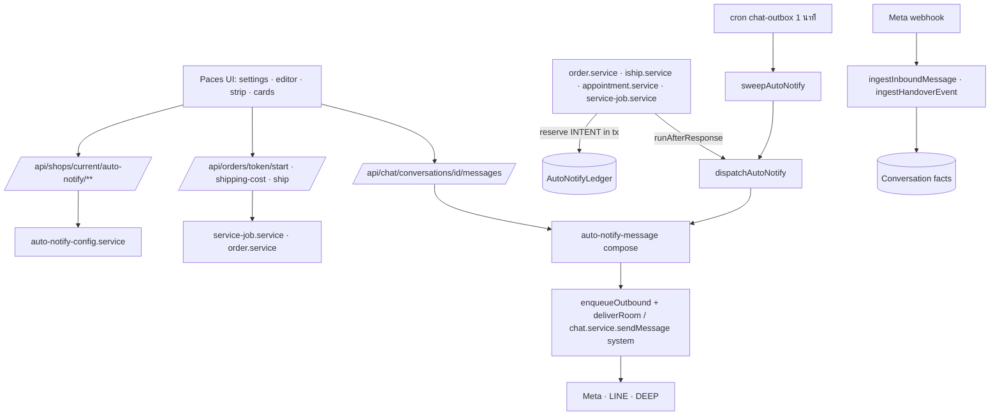
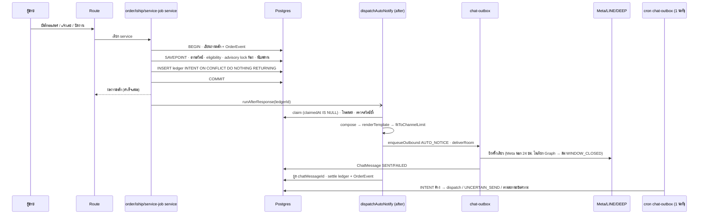
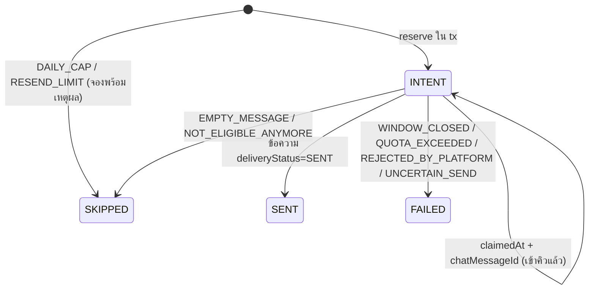

> **ประเภท:** System Design Spec (SDS) + Technical Design (หมวก System Architect)
> **ตรวจโค้ด ณ:** branch `feat/00078-chat-signals-auto-notify` HEAD `bf341b653` (file:line ในเอกสารนี้ตรวจจากไฟล์จริงแล้ว)
> **ข้อจำกัด:** ออกแบบอย่างเดียว · ไม่ได้รัน git/prisma/เทส (ไม่มี Bash ในรอบนี้)

# SDS: 00078

## 0. ผลสืบสวนที่เปลี่ยนแผน (อ่านก่อน)
| # | พบ | หลักฐาน | ผล |
|---|---|---|---|
| F-1 | นิยาม "ย้อนหลัง" ตรง ๆ (`createdAt ≠ keyedInAt` ms) จะปิดการส่งของออเดอร์จากแชทเกือบทั้งหมด: ฟอร์มส่ง `createdAt` เสมอในโหมดสร้าง (`OrderCreateForm.tsx:888-892`) โดย prefill เป็นเวลาข้อความลูกค้า (`DraftOrderProvider.tsx:815`) | `order.service.ts:729-730` | **D-13** ใช้ "ต่างวันปฏิทินไทย" (นิยามเดียวกับ `OrderCreateForm.tsx:950`) |
| F-2 | env ของแอปแชทคือ `FB_CHAT_APP_ID` ไม่ใช่ `META_APP_ID` (ไม่มีใน src) | `graph.ts:72,94,1042` · `connect/route.ts:41` | **D-5** |
| F-3 | `/orders/new` เต็มจอไม่ส่ง `conversationId` ให้ `OrderCreateForm` เลย — มีเฉพาะ `DraftOrderProvider` | `(fullscreen)/orders/new/page.tsx:172` vs `DraftOrderProvider.tsx:800` | **D-6** จุดแถบแจ้งที่ 2 ว่างโดยโครงสร้าง |
| F-4 | ผู้เรียก `setOrRescheduleAppointment` ทางเดียวคือ `PATCH /api/orders/[token]/appointment` (`route.ts:67`) ซึ่งถูกเรียกจาก `RescheduleAppointmentSheet.tsx:180` (เลื่อน) และ **`StartWalkInSheet.tsx`** (walk-in "เริ่มตอนนี้" → `hadAppointment=false`) | ตัวหลังจะส่ง "สรุปนัด" ให้คนที่เดินเข้าร้านอยู่ | **D-3** เพิ่มเงื่อนไข `serviceStart > now` |
| F-5 | ผู้บริโภค `autoReplyKind` ที่ตีความ "ไม่ null = บอท" และจะผิดทันทีเมื่อมี AUTO_NOTICE: `auto-reply.service.ts:671` (`not:null` ใน sweepStuckJobs → บอทคิดว่าตอบแล้ว), `:730-760` (ป้าย DeepBot/DeepAI), `chat-desk/rules.ts:44`, `chat.service.ts:736-807` (ติดเหตุผลบอท), `InboxList.tsx:190`, `ThreadMessageList.tsx:677-688` (`AutoReplyTag`), `conversations/route.ts:316` | grep `autoReplyKind` | S-10 ต้องแก้จริง ~9 ไฟล์ |
| F-6 | 116 จุด/32 ไฟล์ ใน grep มี **12 ไฟล์เป็นคนละความหมายของ 'AUTO'** (iShip `createMode`, rich-menu `mode`, inspection `method`, comment `trigger`): `iship/after-order-create.ts` `ShippingSettingsRow.tsx` `line/rich-menu.ts` `RichMenuEditor.tsx` `inspection-round/admin.service.ts` `inspection/checks.ts` `owner-view.ts` `inspection-view-vm.ts` `comment-auto-reply` `comment-private-reply` `page-comment` | grep `'AUTO'` | ตัดสิน "ไม่เกี่ยว" รายไฟล์ลงบันทึก S-10 |
| F-7 | default ของ ORDER_SUMMARY เดิมแสดงชื่อรายการแรกอย่างเดียว ไม่มี "และอีก N รายการ" (`messages/route.ts:844-847`) แต่ตัวแปร `{รายการสินค้า}` ตาม PRD มี suffix · และเงินเดิมใช้ `toLocaleString('th-TH')` (`:845`) ไม่ใช่ `formatBaht` | — | **D-1, D-2** |
| F-8 | `dispatchShipment` (`iship.service.ts:1311`) คือจุดเขียนเลขของทั้ง create และ retry — ไม่ใช่ `createShipment` | `:1359-1381` | hook ที่นี่จุดเดียว |
| F-9 | `getWindowState` อยู่ในไฟล์ service (import prisma) client ใช้ไม่ได้ | `channel-chat.service.ts:189` | แยกเป็น `src/lib/messaging-window.ts` (re-export เดิม) |
| F-10 | Instagram จำกัดข้อความ **1000 bytes UTF-8** (ไทย ≈333 ตัว) | Meta IG messaging doc (ยืนยันผ่านเครื่องมือ) | **D-12** |
| F-11 | 250+ ไฟล์เทสมี `[blocker]` — ด่าน 0 ของ CI (`verify.yml:68-76`) นับเฉพาะ `*.test.ts(x)` ที่ถูกแก้ | `.github/workflows/verify.yml` | PR นี้ต้องมีป้าย `แตะด่าน` แน่ (seller-menu.test.ts) — วางแผนให้ไฟล์เทสอื่นเป็นไฟล์ใหม่ |
| F-12 | `EmojiPicker.tsx` มีแล้ว (ไม่ต้องเพิ่ม dependency) | `inbox/[conversationId]/components/EmojiPicker.tsx` | ตัวแก้ใช้ซ้ำ |

## 1. บทนำ
SDS นี้ realize SRS TFR-001..030 บนสถาปัตยกรรมเดิม (service layer แยกจาก route · authz ที่ service/route · ไม่มี RLS) ห้ามเพิ่ม framework/dependency ใหม่

## 2. Architecture Overview

สไตล์: **pure lib (ตัดสิน) / service (เขียน DB) / route (authz+validate) / component (แสดง)** — ตรงกับ convention `ui-boolean-needs-a-testable-home` ทุกตัวตัดสินอยู่ใน `src/lib`

## 3. Component Design
### 3.1 ไฟล์ใหม่
| ไฟล์ | หน้าที่ |
|---|---|
| `src/lib/auto-notify/kinds.ts` | `AUTO_NOTIFY_KINDS` · `kindsForVertical(vertical)` · ไอคอน/ชื่อผันตาม `resolveOrderVocab` |
| `…/variables.ts` | SSOT ตัวแปรต่อ kind + ค่าตัวอย่าง · `parseTemplate` · `validateTemplate` · `countCodePoints` |
| `…/render.ts` | `renderTemplate(body, values)` + กติกาตัดบรรทัด |
| `…/defaults.ts` | ค่าตั้งต้นต่อ kind (ORDER_SUMMARY = ข้อความเดิมของ `messages/route.ts:847`; TRACKING = `trackingMessage()` เดิม) + ตัวอย่าง 3 แบบ |
| `…/values.ts` | `buildTemplateValues(kind, snapshot)` — ใช้ `formatBaht`/`formatDate`/`publicOrderUrl`/`resolveOrderVocab`/`trackingLinkFor` |
| `…/fit.ts` | `fitToChannelLimit` (TFR-030) |
| `…/eligibility.ts` | `evaluateAutoNotifyEligibility()` + `autoNotifyStripState()` + `isBackdatedForNotice()` |
| `…/ledger.ts` | `normalizeTrackingKey` · `LEDGER_FIXED_KEY='-'` · `TRACKING_NOTICE_MAX=3` · `mapFailureToLedgerReason` · `thaiDayStart` · `DAILY_CAP_*` |
| `…/editor-text.ts` | แปลง DOM-model ↔ ข้อความ (round-trip) |
| `…/schemas.ts` | Valibot ของ auto-notify (แยกไฟล์ ไม่แตะ `validations.ts`) |
| `src/lib/messaging-window.ts` | `MESSAGING_WINDOW_MS` · `HUMAN_AGENT_WINDOW_MS` · `getWindowState` (ย้ายมา; `channel-chat.service` re-export) |
| `src/lib/meta-ai-holder.ts` | TFR-002 |
| `src/lib/customer-signal.ts` | TFR-006 |
| `src/lib/inbox-row-chips.ts` | TFR-007 |
| `src/lib/shipping-cost.ts` | TFR-024 |
| `src/lib/iship/tracking-link.ts` | TFR-016 |
| `src/lib/facebook/app-id.ts` | `ourMetaAppId()` อ่าน `FB_CHAT_APP_ID` (D-5) |
| `src/services/auto-notify.service.ts` | reserve · dispatch · settle · sweep |
| `src/services/auto-notify-config.service.ts` | config CRUD · strip-context |
| `src/services/auto-notify-message.service.ts` | `composeNotice(kind, ctx)` (ใช้ทั้งตัวส่งและปุ่มมือ) + `composeServiceNotice` |
| `src/components/safepay/auto-notify/AutoNotifyStrip.tsx` · `useAutoNotifyContext.ts` | แถบแจ้ง (คอมโพเนนต์เดียว) |
| `src/components/safepay/CustomerRingAvatar.tsx` | ขอบ+จานมุม (3 จุด) |

### 3.2 ไฟล์แก้ (ดู §8.1 รายการเต็ม)

## 4. Data Flow
### 4.1 เส้นส่งอัตโนมัติ

### 4.2 วงจร ledger

`SENT` = ปลายทางรับแล้ว (ปิดผลโดยตัวส่งหลัง `deliverRoom` หรือโดย sweeper อ่านสถานะข้อความ) · UI อ่านสถานะข้อความสดผ่าน `chatMessageId` เสมอ (D-8)

### 4.3 แถบแจ้ง
`useAutoNotifyContext({orderToken | conversationId, shopId?})` → `GET …/strip-context` (ครั้งเดียวต่อหน้า/ห้อง cache ใน module-level Map ต่อ key) → `autoNotifyStripState(input, Date.now())` + `renderTemplate(template ?? default, buildTemplateValues(kind, formSnapshot))` (ไม่เรียกเครือข่ายต่อการพิมพ์)

### 4.4 ข้อเท็จจริง Meta AI
echo → `writeMessage` (`channel-chat.service.ts:1659`) เขียน `echo*` + `updateMany` conversation แบบมีเงื่อนไขเวลา · handover → `ingestHandoverEvent` (`:2433`) resolve ห้องจาก (provider,pageExternalId,contactExternalId) แล้ว `updateMany … OR [observedAt null, lt t]`

## 5. Integration Points
| จุดเชื่อม | ประเภท | สัญญา | เมื่อล่ม |
|---|---|---|---|
| Meta Graph (Send) | 3rd-party | `enqueueOutbound`→`transmitMetaMessage` (ด่าน 24 ชม. `:3959-3963` ห้ามผ่อน) | ledger FAILED + บับเบิล |
| LINE | 3rd-party | REPLY/PUSH ตามเดิม · `QUOTA_EXCEEDED` | ledger FAILED |
| chat-outbox | internal | `enqueueOutbound`/`deliverRoom`/`sweepOutbox` ไม่แก้ | — |
| cron | internal | `/api/cron/chat-outbox` เรียก `sweepAutoNotify` ท้ายรอบ (try/catch แยก) | outbox ยังทำงาน |

**เพดานข้อความจากเอกสารแพลตฟอร์ม (Dev ต้องเปิดต้นฉบับยืนยันซ้ำก่อนใส่ค่าคงที่):**
- Messenger: `message.text` ≤ 2000 chars UTF-8 — Meta "Send API Reference" (developers.facebook.com/docs/messenger-platform/reference/send-api) *[ยืนยันผ่านผลค้นหา · เปิดหน้าตรงด้วยเครื่องมือไม่ได้]*
- Instagram: "Message text must be UTF-8 and be a 1000 bytes or less" — Meta Instagram messaging API doc *[ยืนยันข้อความตรง]*
- LINE: text message ≤ 5000 chars — Messaging API reference "Text message" *[ยืนยันผ่านเอกสารบุคคลที่สามเท่านั้น · ต้องเปิด `developers.line.biz/en/reference/messaging-api/index.html.md` ยืนยัน]*
- DEEP: `SendChatMessageSchema.body` ≤ 2000 (`validations.ts:883`)

## 6. Technical Decisions
- **TD-001 INTENT ใน tx + SAVEPOINT:** เลียนแบบ `allocateSeat` (`appointment.service.ts:196-216`) · ทางเลือก "ยิงนอก tx แล้วค่อยบันทึก" ถูกตัด (process ตาย = เจตนาหาย) · "catch P2002" ถูกตัด (ก่อ ERROR log — insert-then-catch)
- **TD-002 เพดานด้วย advisory lock:** `pg_advisory_xact_lock(hashtextextended('auto-notify:'||conversationId,0))` ถือถึง COMMIT (ท้าย tx สั้น) · ตาม Controller มติข้อ 4
- **TD-003 sweeper = piggyback cron `chat-outbox`:** ไม่เพิ่ม route/`vercel.json` · cadence 1 นาทีตรงกับ stale 3 นาที · ทางเลือก cron ใหม่ถูกตัด (ไม่มีประโยชน์เพิ่ม ต้อง CRON_SECRET/ทะเบียนเพิ่ม) · **sweeper ห้ามยิงซ้ำ INTENT ที่ `claimedAt` มีค่า** (Meta ไม่มี idempotency key)
- **TD-004 ไม่แก้ `chat-outbox.service.ts`:** ปิดผล ledger ด้วย "ดึง" สถานะข้อความ (ตัวส่งหลัง `deliverRoom` + sweeper) ไม่ใช่ hook ใน `closeRow/failRow` (จุดละเอียดอ่อนที่สุดของระบบ)
- **TD-005 DEEP:** ขยาย `chat.service.sendMessage` ด้วย `system?: {shopId, autoReplyKind:'AUTO_NOTICE'}` + `senderUserId: string|null` — โหมด system: เช็ค `system.shopId === conversation.shopId` แทน authz ผู้ใช้ · `senderUserId=null` · ข้าม `pauseForHumanTakeover` และ `detectAutoOrderTrigger` (`chat.service.ts:978-990`)
- **TD-006 ชนิดข้อความตามช่องทาง:** ORDER_SUMMARY ค่าตั้งต้น → LINE Flex (https) / DEEP การ์ด ORDER / Meta ข้อความลิงก์ · แก้เทมเพลตแล้ว → ข้อความล้วนทุกช่องทาง · SERVICE_BOOKED → การ์ดนัดเดิม + `text` จากเทมเพลต · อื่น ๆ ข้อความล้วน
- **TD-007 กันซ้ำกับส่งมือ (BR-C15):** ก่อนจอง: มีข้อความ `type='ORDER'`+`orderRefToken`=ใบนี้ในห้อง ∧ `autoReplyKind IS NULL` ∧ (ORDER_SUMMARY: `body IS NULL` / SERVICE_BOOKED: `body IS NOT NULL`) → ไม่จอง · ตัวแยกการ์ดนัดกับการ์ดออเดอร์คือ `body` (ดู `channel-chat.service.ts:3610`) — เป็นการอนุมานความหมายจากค่า จึงมีเทสตรึง (D-15)
- **TD-008 TRACKING เลขใหม่:** `valueKey=normalizeTrackingKey(no)` (trim+UPPER) · ตัวส่งหา "ครั้งก่อน" = แถว TRACKING ของใบนี้ที่ `createdAt` เก่ากว่า → ขึ้นต้นบรรทัดคงที่ "อัปเดตเลขติดตามพัสดุ" (นอกเทมเพลต) · แถวที่ 4+ → `SKIPPED/RESEND_LIMIT` (D-4)
- **TD-009 ต้นทุนส่งเอง:** `ShipmentTracking.outboundShippingCost` (DATABASE §3.7) · ฟังก์ชันเดียวรับ `{forward: {carrierPrice,estimatedPrice,codFee}|null, manual: number|null}` · ผู้เรียกส่ง "ใบ iShip active" ที่กรองด้วย `ACTIVE_FORWARD_SHIPMENT`/`LATEST_FORWARD_SHIPMENT` เดิม — ฟังก์ชันไม่นิยาม "active" ใหม่
- **TD-010 D06 ไม่สร้างแถวปลอม:** `PATCH /shipping-cost` ต้องมีแถว `ShipmentTracking` อยู่แล้ว (ใบ LINKED ที่ dispatch แล้วมีแถวจาก `advanceOrderIfDispatched`) · ไม่มีแถว → 409 `NO_TRACKING_ROW` (อธิบายว่ายังไม่ส่งออก) · ไม่ใช้ `updateShipmentTracking` (ปฏิเสธใบ iShip `:1607`)
- **TD-011 Meta AI สัญญาณ:** server คืน `metaAiHoldUntilMs` (primitive) ไม่คืน boolean · client เทียบ `nowBucket` · ไม่เก็บ verdict ใน DB (stored-flag-vs-owner-truth)
- **TD-012 เมนู:** slug กลุ่ม `seller-daily` `seller-chat`(คงเดิม) `seller-finance` `seller-trust` `seller-chat-settings` `seller-setting`(คงเดิม) `seller-team` · เลิก `seller-analytics/manage/shops` (อ้างจาก `seller-menu.test.ts:415` เท่านั้น) · ถอดกลุ่มว่างท้าย `resolveVisibleSellerMenu`
- **TD-013 ไม่เพิ่ม capability อ่านหน้า:** ใช้ `H1` [O,M,C] ที่มีอยู่ (CHAT อ่านได้ TECHNICIAN/BILLING ไม่มี H1 → `NoPermissionCard`)

## 7. ข้อเท็จจริงที่ตรวจแล้ว (ตอบ Scope S-1)
### 7.1 จุดเขียนเลขพัสดุ (ครบ — webhook iShip ไม่เขียนเลข)
| จุด | ที่ | ตาราง | hook |
|---|---|---|---|
| a | `order.service.ts:1533` `shipOrder` (tx `:1547`, update `:1558`) | ShipmentTracking create | ✓ |
| b | `order.service.ts:1589` `updateShipmentTracking` (tx `:1611`) | ShipmentTracking update | ✓ เมื่อเลข normalize ต่างเดิม |
| c | `iship.service.ts:1311` `dispatchShipment` (tx `:1359-1381`; `trackingNo` `:1364`) ครอบทั้ง `createShipment` และ retry (`:1307`) | OrderShipment | ✓ (ต้องขยาย select ออเดอร์ `:1328` ให้มี `shopId,conversationId,isDryRun`) |
| d | `iship.service.ts:2994` `linkShipment` (tx `:3049-3088`) | OrderShipment | ✓ |
| d2 | `iship.service.ts:3135` `advanceOrderIfDispatched` (tx `:3143-3157`) | ShipmentTracking upsert | ✓ (เลขเดียวกับ d → ชน unique ข้าม) |
| e | `importParcelAsOrder` `:3226` → `createOrder` ไม่ส่ง `conversationId` | — | ข้ามโดยธรรมชาติ |
ยืนยันด้วย grep `shipmentTracking.(create|update|upsert)` / `orderShipment.(create|update…)`: มี `trackingNo` เป็นค่าเขียนเฉพาะ `:1364`, `:3060`, `:3149/3153`, `order.service.ts:1549,1614` · จุดอื่นของ iship.service.ts (`:1044,1253,1285,1941-2059,2180,2234,2390`) เขียนสถานะ ไม่ใช่เลข

### 7.2 ผู้เรียก
| สิ่ง | ผู้เรียก |
|---|---|
| `setOrRescheduleAppointment` | `api/orders/[token]/appointment/route.ts:67` เท่านั้น ← `RescheduleAppointmentSheet.tsx:180`, `StartWalkInSheet.tsx` |
| `attachAppointmentInTx` | `order.service.ts:777` เท่านั้น |
| `closeServiceJob` | `api/orders/[token]/close/route.ts:55`, `api/orders/[token]/appointment/outcome/route.ts:48` |
| `ServiceCloseSheet` | `AppointmentDayCard.tsx:416` · `CustomerPanel.tsx:660` · `OrderProgressBar.tsx:253` · `ServiceJobCard.tsx:171` → ใส่แถบ "ปิดงาน" **ในชีตเอง** (จุดเดียว) |
| `ServiceJobCard` | `orders/[token]/page.tsx:576`, `TechnicianOrderDetail.tsx:139` |
| `OrderCreateForm` | `DraftOrderProvider.tsx:786` (มี `conversationId`), `(fullscreen)/orders/new/page.tsx:172` และ `…/[token]/edit/page.tsx:212` (ไม่มี) |

### 7.3 จุดเสียบ (file:line)
| write site | ที่เสียบ | kind |
|---|---|---|
| `createOrder` | ท้าย tx ก่อน `return order` (`order.service.ts:785`) หลัง `attachAppointmentInTx` (`:776-783`); ประกาศ `let ledgerId` นอก retry-loop `:639` รีเซ็ตทุก attempt แล้ว `runAfterResponse` หลัง `$transaction` | `ORDER_SUMMARY` / `SERVICE_BOOKED` ตาม `kindForNewOrder(vertical,type,hasAppointment)` |
| `promoteDraftCore` | ก่อน `return order` (`:1013`); `existing` มี `conversationId,isDryRun` อยู่แล้ว (`:894`) | `ORDER_SUMMARY` |
| `shipOrder` | หลัง `tx.order.update` (`:1558`) | `TRACKING` |
| `updateShipmentTracking` | ก่อน `return updated` (`:1622`) | `TRACKING` |
| `dispatchShipment` / `linkShipment` / `advanceOrderIfDispatched` | ตาม §7.1 | `TRACKING` |
| `setOrRescheduleAppointment` | หลัง `tx.order.update` (`appointment.service.ts:286-302`) เมื่อ `!hadAppointment ∧ serviceStart>now` (ขยาย select `:243`) | `SERVICE_BOOKED` |
| `startServiceJob` (ใหม่) | ใน tx หลังตั้ง `serviceStartedAt` | `SERVICE_STARTED` |
| `closeServiceJob` | หลัง `recordOrderEvent SERVICE_CLOSED` (`service-job.service.ts:120-130`) เมื่อ `outcome==='SERVED'` (ขยาย select `:61`) | `SERVICE_CLOSED` |

### 7.4 Cross-file error-mapping (บังคับ enumerate)
| Error ใหม่ | โยนที่ | catch → HTTP |
|---|---|---|
| `ServiceJobNotStartableError` (ยกเลิก/ร่าง) | `startServiceJob` | `serviceJobErrorResponse` (`service-job-api.ts:17`) เติมแถว → **409** `SERVICE_JOB_NOT_STARTABLE` + ข้อความใน `SERVICE_JOB_ERROR_MESSAGE` · route `/start` ใช้ `mapError` ชุดเดียวกับ `/close` |
| `ServiceJobAlreadyClosedError` (ใช้ซ้ำ) | `startServiceJob` | 409 (มีแล้ว) |
| `AppointmentNotStartedError` (ใช้ซ้ำ) | `startServiceJob` | 409 `appointmentErrorResponse` (มีแล้ว) |
| `AutoNotifyKindNotAvailableError` | config service (kind ไม่อยู่ใน vertical) | route สวิตช์/เทมเพลต → **409** `KIND_NOT_AVAILABLE` |
| `AutoNotifyTemplateConflictError` | config service (`updatedAt` ชน) | route เทมเพลต → **409** `TEMPLATE_CONFLICT` (+`currentUpdatedAt`) |
| `AutoNotifyTemplateInvalidError` | config service (validator ซ้ำที่ server) | route เทมเพลต → **400** `VALIDATION_ERROR` + `issues[]` |
| `ShippingCostNotAllowedError` (ออเดอร์ CANCELLED/DRAFTED) | `setOutboundShippingCost` | route `/shipping-cost` → **409** |
| `ShipmentTrackingNotFoundError` (ใช้ซ้ำ) | `setOutboundShippingCost` | route `/shipping-cost` → **409** `NO_TRACKING_ROW` (ต่างจาก PATCH `/ship` ที่ตอบ 404 — ตั้งใจ: ไม่ใช่ "ไม่พบ resource" แต่ "ยังไม่ถึงขั้นให้กรอก") |
| `OrderNotFoundError` (ใช้ซ้ำ) | `setOutboundShippingCost` | **404** |
| ledger reason (ไม่ใช่ HTTP): `WINDOW_CLOSED`→`WINDOW_CLOSED` · `QUOTA_EXCEEDED`→`QUOTA_EXCEEDED` · `CONTACT_BLOCKED`/`CHANNEL_NOT_ACTIVE`/`TOKEN_INVALID`/`LINE_UNAVAILABLE`/`SEND_FAILED:*`/อื่น→`REJECTED_BY_PLATFORM` · `CONVERSATION_NOT_FOUND`/`FORBIDDEN`/`INVALID_ACTOR`→`NOT_ELIGIBLE_ANYMORE`+log เตือน | `dispatchAutoNotify` catch | ฟังก์ชัน `mapFailureToLedgerReason` ตัวเดียว + เทสตารางครบ |
| `TRACKING`/`ORDER` ที่ messages route: ไม่มีเลข / ว่างทั้งข้อความ | route สร้างข้อความ | **409** `NO_TRACKING` / `EMPTY_MESSAGE` (เติมใน route ตรง ๆ เหมือน `ORDER` ที่ `:839-841`) |

## 8. Technical Design (หมวก System Architect)
### 8.1 Affected files (absolute)
**สร้าง:** ตาม §3.1 · `prisma/migrations/20261017100000_chat_meta_owner_facts/` … `20261017100500_shipment_tracking_outbound_cost/` (6 โฟลเดอร์ ดู Plan) · `/Users/craftman/Projects/safepay/src/app/api/shops/current/auto-notify/{route.ts,settings/route.ts,switches/[kind]/route.ts,templates/[kind]/route.ts,strip-context/route.ts}` · `src/app/api/orders/[token]/{start,shipping-cost}/route.ts` · `src/app/(paces)/seller/(dashboard)/settings/auto-notify/{page.tsx,components/*}` · เทสใหม่ตาม TestCase.md
**แก้:** `prisma/schema.prisma` · `src/lib/order-event.ts` · `src/lib/shop-permissions.ts` · `src/lib/route-capabilities.ts` · `src/lib/validations.ts` (ShipOrderSchema `:429`, SendChatMessageSchema `:852`) · `src/lib/customer-behavior.ts` · `src/lib/chat-shipment-panel.ts` · `src/lib/auto-reply-constants.ts` · `src/lib/agent-performance.ts` · `src/lib/chat-desk/rules.ts` · `src/lib/facebook/webhook-types.ts` · `src/lib/order-view-by-level.ts` · `src/lib/expense.ts` · `src/lib/line-report/preview-sample.ts` · `src/lib/iship/courier.ts` · `src/lib/service-job.ts` · `src/lib/service-job-api.ts` · `src/lib/seller-menu.ts` · `src/lib/role-nav.ts` · `src/services/{order,iship,appointment,service-job,channel-chat,chat,auto-reply,customer-behavior,customer-directory,customer,pnl,dashboard,line-report-summary,chat-outbox(เฉพาะเรียก sweeper ที่ cron ไม่แก้ตัว service)}.service.ts` · `src/app/api/cron/chat-outbox/route.ts` · `src/app/api/chat/conversations/route.ts` · `…/[id]/messages/route.ts` · `…/[id]/orders/route.ts` · `src/app/api/orders/[token]/ship/route.ts` · `src/app/api/seller/iship/order-context/route.ts` · `src/i18n/dictionaries/{th,en}.ts` · `src/assets/css/safepay-overrides.css` · UI ตามแผน (Plan)

### 8.2 Data flow / API flow
ดู §4 · route ทุกเส้น: `requireShopCapability(session, CAP, {shopId})` → Valibot → service → `jsonNoStore` · ทุก `GET` ที่เพิ่มต้องลง `tests/integration/role-contract.test.ts` COVERED/MATRIX ในคอมมิตเดียวกับ route (บทเรียน retro 00077 ข้อ 3)

### 8.3 Auth / Permission
| การกระทำ | cap | ที่ตัดสิน |
|---|---|---|
| ดูหน้า/ค่าตั้งค่า | `H1` | page `gatePage` + GET route |
| สวิตช์/เพดาน/เทมเพลต | `X8` (ใหม่ `[OWNER,MANAGER]`) | route + service |
| strip-context | `O1`; ถ้าส่ง `conversationId` ต้อง `H1` ด้วย; ห้องต้องเป็นของร้านใน WHERE | route |
| เริ่มงาน | `O4` (+`?shopId=`) | route |
| กรอก/แก้ต้นทุนส่ง | `S1` | route (ตัวแปรต้นทุนอยู่ใน `order-view-by-level` — ซ่อนจากระดับเงิน NONE) |
| ตัวส่งอัตโนมัติ | ไม่มี user · `systemShopId` ต้อง = `conversation.shopId` (`channel-chat.service.ts:2999-3005`) | service |
ต้องเพิ่ม BRD 00071 §8.3 (X8) · SRS §8.14/§9

### 8.4 Database impact → **ให้ Controller dispatch `safepay-database` ก่อน**
M1–M6 ตาม DATABASE.md + แก้ 2 จุด: (1) M3 เพิ่มเหตุผล `RESEND_LIMIT` (D-4) (2) M4 เพิ่ม 3 ชนิด (`SERVICE_STARTED`,`AUTO_NOTICE_SENT`,`AUTO_NOTICE_FAILED`) กิ่ง fallback ต้องมีรายชื่อครบ = ค่าใน `ORDER_EVENT_TYPES` ณ วันเขียน (27) + 3 = 30 · guard idempotent ใช้ `position('SERVICE_STARTED' IN def)` · ต้องมีเทส `auto-notify-db-constraint.test.ts` อ่านค่าจาก TS แล้วเทียบกับ `prisma/migrations/**` (แบบ `cancel-reason-db-constraint.test.ts`) · เช็ค timestamp ชนด้วย `git log --all --name-only -- 'prisma/migrations/*'` ก่อนตั้งชื่อ

### 8.5 Error handling
ตัวส่งล้ม = ledger ปิดผลเอง ไม่ throw ออกไปงานหลัก · `reserve` ล้ม = ROLLBACK TO SAVEPOINT + `console.error('[auto-notify]', …)` (ไม่ log เนื้อข้อความ/เบอร์) · `fit` ยังเกินหลังย่อ = ตัดที่ขอบ code point + log · ตัวกวาดทั้งรอบอยู่ใน try/catch แยก ไม่ให้ `sweepOutbox` ล้ม

### 8.6 Risks เพิ่มเติม
| ความเสี่ยง | ลด |
|---|---|
| ปุ่ม "ลองใหม่" ของบับเบิล FAILED จะส่งซ้ำเป็นข้อความ "คนส่ง" (`sendPayload` ถูกล้างตอน FAILED) → หยุดบอท+นับเวลาตอบ | เป็นการกระทำของผู้ขายเอง ยอมรับ · บันทึกใน release note · ไม่นับเพดาน |
| `purple` ไม่เคยใช้ใน `(paces)` และ `--color-purple` ต่างกันตามสกิน (`_root.css:25` `#7b70ef`; `_theme-modern/luxe.css:28` `#6070cc`) | probe คลาสก่อนเขียน · วัดคอนทราสต์ตามสกินที่ active |
| 3 write site ใน `order.service.ts` ขนานกับ T08 | จัด sequential (Plan) |
| cap ผ่าน advisory lock ถือระหว่าง tx ออเดอร์ | จองท้าย tx เท่านั้น (สั้น) |

### 8.7 ลำดับ implement
DB → types/window/i18n skeleton/pure libs → (counted · tracking-link · Meta facts · config API) → (cost · S-10 sweep) → engine+cron → (manual path · goods hooks · service domain) → UI (settings → editor → strip → shipment UI → service UI) → Meta AI UI → ring → chips → menu → docs → QA

## 9. Traceability
| SRS | SDS |
|---|---|
| TFR-001..003 | §4.4, §7, TD-011 |
| TFR-004..007 | §3.1 (customer-signal, inbox-row-chips) |
| TFR-008..012 | §4.1-4.2, TD-001..004, §8.4 |
| TFR-013 | F-5, F-6, TD-005 |
| TFR-014..017 | §3.1, TD-006..008 |
| TFR-018..019 | §4.2, §8.3 |
| TFR-020..022 | §7.3, F-4 |
| TFR-023..025 | TD-009, TD-010 |
| TFR-026..028 | §3.1, §4.3 |
| TFR-029 | TD-012 |
| TFR-030 | §5 |

## 10. เรื่องที่ Controller ต้องตัดสิน/รับทราบ (ก่อน build)
| # | เรื่อง | ข้อเสนอ |
|---|---|---|
| D-1 | `{รายการสินค้า}` มี "และอีก N รายการ" แต่ default เดิมไม่มี → ค่าตั้งต้นของใบหลายรายการต่างจากของเดิม | **รับ** suffix (ตรงกับ Flex ที่แสดง N อยู่แล้ว) + เทสใบรายการเดียวเท่าเดิมทุกอักษร · ทางเลือก: เพิ่มตัวแปร `{ชื่อรายการแรก}` (ต้องแก้ PRD §3.4) |
| D-2 | เงินเดิม `toLocaleString` ต่าง `formatBaht` เมื่อมีสตางค์ (`฿1,234.5` vs `฿1,234.50`) | ใช้ `formatBaht` (HR16) + release note |
| D-3 | `StartWalkInSheet` ทำให้ SERVICE_BOOKED ยิงตอน walk-in | เพิ่ม `serviceStart > now` ทั้ง reserve และแถบ |
| D-4 | "เลขใหม่ครั้งที่ 4" ไม่มีรหัสเหตุผลใน CHECK | เพิ่ม `RESEND_LIMIT` ใน M3 (ยังไม่ apply จึงไม่มีต้นทุน) + PRD §4.3 |
| D-5 | env `META_APP_ID` ไม่มีจริง | ใช้ `FB_CHAT_APP_ID`; แก้ BRD/PRD/SRS |
| D-6 | `/orders/new` เต็มจอไม่ผูกห้อง | แถบจุดที่ 2 = ไม่ต้องทำงานเพิ่ม (คอมโพเนนต์เดียวกับจุดที่ 1) · แก้ AC S-24 |
| D-7 | D06 | ทำได้โดยไม่สร้างแถวปลอม (ต้องมีแถว ShipmentTracking เดิม) — ใบ LINKED ที่ยังไม่ dispatch กรอกไม่ได้ |
| D-8 | ledger `SENT` | = ปลายทางรับแล้ว ปิดโดยตัวส่ง/sweeper อ่านสถานะข้อความ · UI join สด |
| D-9 | sweeper | piggyback cron `chat-outbox` ไม่เพิ่ม cron |
| D-10 | slug กลุ่มเมนู | ตาม TD-012 |
| D-11 | `pending` ของต้นทุนที่ร้านกรอก | `pending=false` เมื่อค่ามาจาก manual (ร้านรู้ตัวเลขจริง) · iShip ไม่มี `carrierPrice` ยัง pending ตามเดิม |
| D-12 | ข้อความยาวเกิน (IG 1000 bytes) | ย่อบรรทัดยาวสุดที่ไม่ใช่ลิงก์ · ตัวแก้เตือนเมื่อเทมเพลตดิบเกิน (ไทย ~333 ตัว) บนช่อง IG |
| D-13 | นิยาม "ย้อนหลัง" | ต่างวันปฏิทินไทยระหว่าง `createdAt` กับ `keyedInAt` (ไม่ใช่ ms) · ข้อความลูกค้าเมื่อวานเย็น+สร้างวันนี้ = ย้อนหลัง ไม่ส่ง |
| D-14 | M4 | 3 ชนิด (ตามมติ) |
| D-15 | ตัวแยกการ์ดสรุปออเดอร์/การ์ดนัดที่ใช้ `body` | ใช้ได้ + เทสตรึง |
| D-16 | `chat.service.sendMessage` โหมด system | ตาม TD-005 |
| D-17 | `take_thread_control` ไม่มี new owner | owner=NULL (ไม่ขึ้นป้าย) · ยืนยันด้วย spike Q-23 |

## 11. สรุป
ใช้โครงเดิมทั้งหมด (outbox · cron · SAVEPOINT+advisory lock · pure-lib-ตัดสิน) เพิ่มเฉพาะ ledger/config ที่ DATABASE.md อนุมัติ · จุดเสี่ยงสูงสุดคือ F-1 (ย้อนหลัง) F-5 (ผู้บริโภค AUTO_NOTICE) F-7 (default ไม่เท่าเดิม)

## 12. บันทึกผู้บริโภค autoReplyKind (T12)

ไล่ด้วย `rg -n "autoReplyKind|AUTO_TEST|'AUTO'|AUTO_NOTICE" src` — ตัดสินแบบ 3 ชั้น: บอทตอบแชท (`AUTO`/`AUTO_TEST`, `isBotReplyKind`) · ข้อความระบบแจ้ง (`AUTO_NOTICE`, `isSystemNoticeKind`) · คน (`null`)

| ไฟล์ | จุด | ตัดสิน | ผล |
|---|---|---|---|
| `services/auto-reply.service.ts` | `sweepStuckJobs` (`not: null`) | แก้ | `in: AUTO_REPLY_KINDS` — AUTO_NOTICE ไม่ถือว่าบอทตอบแล้ว (TC-101) |
| `services/auto-reply.service.ts` | `enrichWithAutoReplyBadge` | แก้ | AUTO_NOTICE → `lastMessageAutoReplyKind=null`, `lastMessageIsAiEnhanced=false` (TC-102) |
| `lib/chat-desk/rules.ts` | `pickDesk` | แก้ | AUTO_NOTICE ไม่ใช่ BOT (ค่าอื่นที่ไม่ใช่ null ยังเป็น BOT เหมือนเดิม) |
| `services/chat-desk.service.ts` | SQL `ls`/`lr` + พรีวิวห้อง | แก้ | ข้ามแถว AUTO_NOTICE ตอนหา "ข้อความร้านล่าสุด" → โต๊ะ/askedAt ยึดการตอบจริง · พรีวิวไม่ระบุโต๊ะให้ข้อความระบบ |
| `services/chat.service.ts` | `sendMessage` | แก้ (TD-005) | โหมด `system` + `senderUserId: string \| null` · `attachAutoReplyTrace` ใช้ `isBotReplyKind` (AUTO_NOTICE ไม่มี AutoReplyLog) |
| `ThreadMessageList.tsx` | ป้ายบับเบิล + บับเบิลล้ม | แก้ | AutoReplyTag เฉพาะบอท → ป้าย "ส่งโดยระบบ" (span) → ป้าย AI ของ Meta · ข้อความล้ม "ระบบส่งไม่สำเร็จ" + หัว Swal |
| `InboxList.tsx`, `InboxRow.tsx` | ป้ายบอทในแถว | ไม่แก้โค้ด | อ่านจาก `lastMessageAutoReplyKind` ที่ enrich ตัด AUTO_NOTICE เป็น null แล้ว (แก้คอมเมนต์ชนิดค่า) |
| `app/api/chat/conversations/route.ts` | เรียก `enrichWithAutoReplyBadge` | ไม่แก้ | ผ่านฟังก์ชันเดียวกับ RSC |
| `useSellerChatThread.ts` | type `autoReplyKind?: string \| null` | ไม่แก้โค้ด | แก้คอมเมนต์ค่าที่เป็นได้ |
| `lib/agent-performance.ts` / `agent-performance-sql.ts` / `agent-performance.service.ts` | คน = `IS NULL` | ไม่แก้ | AUTO_NOTICE ไม่ null → ไม่ใช่คน และไม่ใช่ "ตอบนอกระบบ" (`isUnattributedShopReply` ก็ต้อง null) · `AutoReplyKind` re-export จาก SSOT แล้ว |
| `services/channel-chat.service.ts` | `if (!params.autoReplyKind)` (pause บอท · `sentByHuman`) | ไม่แก้ | truthy → AUTO_NOTICE ไม่หยุดบอท · `systemShopId` ≠ ห้อง → FORBIDDEN มีอยู่แล้ว (`:3046`) |
| `services/chat-outbox.service.ts` | `autoReplyKind ?? null`, `!autoReplyKind` | ไม่แก้ | ส่งต่อค่า/กฎ "คนส่ง" ตาม truthy ถูกแล้ว |
| `services/auto-order-detect.service.ts` | `if (message.autoReplyKind) → BOT_MESSAGE` | ไม่แก้ | ต้องกันข้อความระบบทุกชนิดไม่ให้สร้างออเดอร์ — truthy ถูกแล้ว |
| `lib/meta-system-notice.ts` | `attributeMetaAi` `if (m.autoReplyKind) continue` | ไม่แก้ | ข้อความที่ระบบเราส่งไม่ใช่ของ Meta AI — truthy ถูกแล้ว |
| `services/auto-reply-send.service.ts`, `line-rich-menu-reply.service.ts` | ผู้ผลิต `AUTO`/`AUTO_TEST` | ไม่แก้ | เป็นบอทตอบแชท |
| `services/auto-reply-takeover.service.ts` | คอมเมนต์ "ห้ามเรียกเมื่อมี autoReplyKind" | ไม่แก้ | ตรงกับพฤติกรรม |
| `app/api/cron/auto-order-sweeper/route.ts` | `autoReplyKind: null` | ไม่แก้ | เขียนการ์ดของตัวดักจับออเดอร์ (คนละเรื่อง) |
| `lib/order-event.ts` | ชื่อ `AUTO_NOTICE_SENT/FAILED` | ไม่เกี่ยว | ชนิดเหตุการณ์ออเดอร์ ไม่ใช่ `autoReplyKind` |
| F-6 (12 ไฟล์ `'AUTO'` คนละความหมาย): `iship/after-order-create.ts` `ShippingSettingsRow.tsx` `line/rich-menu.ts` `RichMenuEditor.tsx` `inspection-round/admin.service.ts` `inspection/checks.ts` `owner-view.ts` `inspection-view-vm.ts` `comment-auto-reply` `comment-private-reply` `page-comment` + `inspection-round.service.ts` | `createMode`/`mode`/`method`/`trigger` | ไม่เกี่ยว | ไม่ใช่ `ChatMessage.autoReplyKind` — ไม่แตะ |

เทส: `lib/__tests__/auto-notice-consumers.test.ts` (pure+static, TC-103/104) · `services/__tests__/auto-notice-side-effects.test.ts` (DB 5434, TC-100..102/105/106; `M12_NOTICE_NULL=1` → แดง 4 ข้อ [blocker])

### 12.1 AUTO_NOTICE ไม่ทำให้ห้องหลุดจาก "รอตอบ" (แก้แล้ว)

- ทุกจอ "รอตอบ / ยังไม่อ่าน / โต๊ะ 00077" ตัดสินจาก `Conversation.lastSenderRole` (unread 4 query ใน `chat.service`, `chat-desk.service` สาขา WAITING/AT_DESK, `InboxList` ลำดับ, `chat-beep-target`) — คอลัมน์อื่นที่เกี่ยวข้อง (`lastInboundAt`, `shopLastReadAt`) ไม่ถูกเขียนโดยขาออกอยู่แล้ว
- AUTO_NOTICE จึง **ไม่เขียน `lastSenderRole`** ผ่านตัวเดียว `shopSendSenderRolePatch(kind)` ใน `auto-reply-constants.ts` ใช้ครบทั้ง 4 จุดเขียนขาออก: `chat.service.sendMessage` (โหมด system ข้าม) · `chat-outbox` ตอนเขียนแถว · `channel-chat` Meta · `channel-chat` LINE (ตอนส่งสำเร็จ `chat-outbox` ไม่เขียน conversation ซ้ำ)
- `lastMessageAt` และ `lastMessagePreview` ยังเขียนตามข้อความร้านปกติ (ดันเธรดขึ้นบน พรีวิวแสดงข้อความระบบ)
- เทส: ฝั่ง `sendMessage` พิสูจน์บน DB จริง (ห้องคง BUYER · ขึ้น WAITING · ยังนับ unread) + mutation `M12_NOTICE_NULL=1` แดง · ฝั่ง channel-chat/chat-outbox พิสูจน์ด้วยเทส pure ของ helper + static gate (ไม่มี `lastSenderRole: 'SHOP'` ตรง ๆ ในจุดเขียนขาออก) — ยังไม่มีเทส DB ที่ยิง outbound จริงของสองเส้นนี้

### 12.2 มติ Controller ต่อผลข้างเคียง 2 ข้อ (ทำแล้ว · ไม่มี migration)

1. **Meta AI hold** — ข้อความฝั่งร้านที่ส่งสำเร็จบน MESSENGER/INSTAGRAM (AUTO_NOTICE หรือข้อความร้านปกติ) บันทึก `Conversation.metaOwnerAppId = ourMetaAppId()` + `metaOwnerObservedAt = เวลาส่งสำเร็จ` ด้วย `updateMany` เงื่อนไข `observedAt IS NULL OR < t` (`src/services/meta-owner-on-send.ts`: `recordOurSendAsMetaOwner`) · สูตร `meta-ai-holder.ts` กิ่ง `owner==ours && ownerAt > echoAt → ไม่ถือ` ทำให้ป้าย Meta AI หายทันที
   - จุดเรียก: `channel-chat.sendOutboundMessage` Meta (หลังผ่าน `failureReason`) และ `chat-outbox.deliverHead` (หลัง `closeRow` SENT) — ส่งล้ม (#10) ไม่เรียก → ป้ายคงอยู่
   - `FB_CHAT_APP_ID` ไม่ตั้ง → ข้าม (ไม่เดา · ป้ายหมดเองใน 24 ชม.) · ช่อง LINE/DEEP → ข้าม · ห้าม throw (เขียนล้มไม่ทำให้การส่งเป็น error)
   - เทส `meta-owner-on-send.test.ts`: AI echo → ส่ง AUTO_NOTICE สำเร็จ → สูตรคืน null · ส่งล้ม → ไม่เขียน · ไม่มี app id → ข้าม · mutation ถอดการเรียกออก → แดง (ทดสอบแล้ว) · ฝั่ง `chat-outbox` พิสูจน์ด้วยการอ่านโค้ด/tsc เท่านั้น ยังไม่มีเทสที่ยิงจริง
2. **จุดแจ้งเตือนฝั่งผู้ซื้อ DEEP** — แยกออกจาก `lastSenderRole` แล้ว: `listConversationsForBuyer` เติม `lastShopMessageAt` (MAX `createdAt` ของข้อความ SHOP ที่ผู้ซื้อเห็น: ไม่ลบ ไม่ใช่การ์ดภายใน — `groupBy` ตาม index `conversationId,createdAt` ที่มี) แล้ว helper เดียว `buyerHasUnreadFromShop` (`src/lib/buyer-unread.ts`) เทียบกับ `buyerLastReadAt` · ใช้ใน `BuyerChatWidget`, `(buyer-app)/messages/page.tsx`, `m/messages/MessagesInbox.tsx` · payload เก่าที่ไม่มีฟิลด์ → fallback นิยามเดิม · คอลัมน์ที่มีพอ ไม่ต้อง migration
   - เทส DB: ผู้ซื้อถามค้าง → AUTO_NOTICE → ผู้ซื้อเห็นจุด + ร้านยังรอตอบ (`lastSenderRole` คง BUYER, นับ unread) → อ่านแล้วจุดหาย · mutation `M12_NOTICE_NULL=1` แดง
   - ข้อสังเกต: ฟีเจอร์นี้แก้ความหมาย "unread ฝั่งผู้ซื้อ" ให้ถูกกว่าเดิมด้วย (เดิมข้อความร้านที่ตามด้วยข้อความผู้ซื้อ ทำจุดหายแม้ยังไม่อ่าน) — เป็นผลดีที่ตามมา ไม่ได้ตั้งใจเปลี่ยนพฤติกรรมอื่น

### 12.3 พรีวิวล่าสุดเมื่อเป็น AUTO_NOTICE (ระบุแหล่งที่มา) + ป้ายบับเบิลตามชนิด

- `lastMessagePreview` เป็นข้อความระบบ แต่ `lastSenderRole` ยังเป็น BUYER โดยตั้งใจ → ตัดสินคำนำหน้าด้วยฟังก์ชัน pure เดียว `previewPrefix(viewer, …)` ใน `src/lib/preview-attribution.ts` (เทส `preview-attribution.test.ts`) · ธง `lastMessageIsSystem` ส่งมาจาก `enrichWithAutoReplyBadge` (ฝั่งร้าน; ไม่ปน `lastMessageAutoReplyKind` ซึ่งยังเป็นของบอทเท่านั้น) และ `listConversationsForBuyer` (ฝั่งผู้ซื้อ)
- ผู้ซื้อ (`BuyerChatWidget`, `(buyer-app)/messages`, `m/messages`): ข้อความระบบ = เสียงของร้าน ไม่มีคำนำหน้า "คุณ:" · ร้าน (`InboxRow`): คำนำหน้า "ส่งโดยระบบ:" (คีย์ `autoNotify.sentBySystem` เดียวกับป้ายบับเบิล)
- ป้ายบับเบิล: title + sr-only เลือกคีย์ด้วย `systemNoticeLabelKey` — การ์ด ORDER → `sentBySystemOrder` ({noun} จาก `chatOrderLabel(vertical)`) · นอกนั้น `sentBySystem` ถ้อยคำกลาง · 🛑 `sentBySystemTracking/Start/Close` ยังใช้ไม่ได้: แถวไม่เก็บชนิด notice และห้ามเดาจากเนื้อความ → ต้องให้ตัวส่ง (T13) เก็บชนิดก่อน
- gate: เทส static ห้ามไฟล์ใต้ `src/app/api` ที่เรียก `sendMessage(` มี `system:` (ตัวตรวจพิสูจน์ด้วยตัวอย่างผิด)
