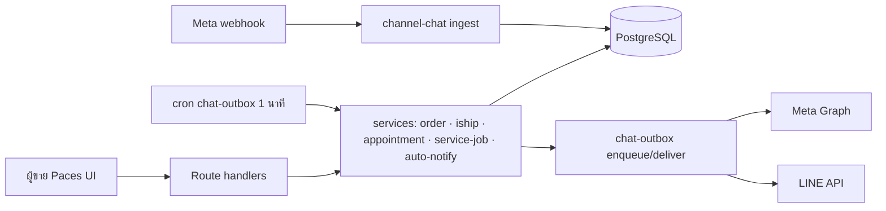
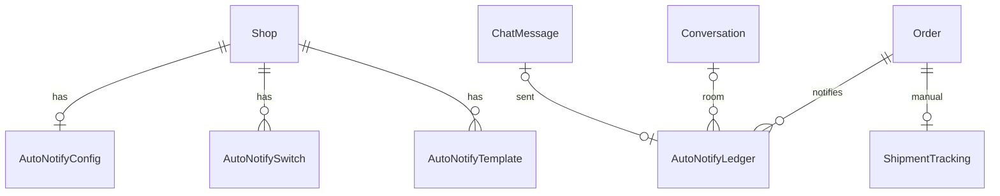

> **โมดูล:** 00078 - Chat Customer Signals & Auto Notify
> **ประเภทเอกสาร:** Software Requirements Specification (SRS) - TECHNICAL
> **เวอร์ชัน:** 0.1 · **วันที่:** 2026-10-17 · **สถานะ:** Draft (รอ Controller รับ D-1..D-17 ใน SDS §10)
> **เจ้าของ:** SA · stack จริง: Next.js 16 App Router · Prisma/PostgreSQL 16 (Supabase) · NextAuth v4 · Valibot (backend) / Yup (frontend)

# SRS: สัญญาณลูกค้าในแชท + ส่งอัตโนมัติถึงลูกค้า

## 1. บทนำ
### 1.1 วัตถุประสงค์
กำหนดข้อกำหนดเชิงเทคนิคของ 8 ส่วนใน BRD v0.3 (FR-CS-01..33) ให้ DEV/QA นำไป implement ได้โดยไม่ต้องเดา · ทุก TFR ผูกกลับ FR และ S-id ใน Scope Baseline (`docs/scope/2026-10-17-00078-chat-signals-auto-notify-scope-baseline.md`)

### 1.2 ขอบเขตเชิงระบบ
- **ใน:** webhook ingest (Meta) · service layer ส่งอัตโนมัติ · ตั้งค่า/เทมเพลต · ต้นทุนค่าส่ง · เมนู · UI ของ seller (Paces) ตาม S-4..S-28
- **นอก:** 00079 · โหมดทดสอบ · ปุ่มแย่งห้อง · ส่งนอกหน้าต่าง 24 ชม. · ร้านที่พัก BOOKING · Deep-App ฝั่งผู้ซื้อ (OOS-1..20)

### 1.3 เอกสารอ้างอิง
| เอกสาร | ความสัมพันธ์ |
|---|---|
| PRD/BRD v0.3 | เป้าหมาย/FR/AC (อนุมัติ 2026-10-17) |
| DATABASE.md + มติ Controller | ชื่อตาราง/คอลัมน์/CHECK ที่ยึด |
| SDS.md / API.md / TestCase.md | การออกแบบ / สัญญา API / ชุดเทส |
| `docs/conventions/*` | insert-then-catch · stored-flag-vs-owner-truth · external-payload-schema · rule-must-be-enforced · ui-boolean-needs-a-testable-home · migration-check-constraint-additive |

### 1.4 นิยาม
| คำ | ความหมาย |
|---|---|
| **kind** | จังหวะส่ง 5 ค่า: `ORDER_SUMMARY` `TRACKING` `SERVICE_BOOKED` `SERVICE_STARTED` `SERVICE_CLOSED` |
| **ledger** | ตาราง `AutoNotifyLedger` กันซ้ำ+บันทึกผล (UNIQUE ร้าน,ออเดอร์,kind,valueKey) |
| **INTENT** | แถว ledger ที่จองใน tx เดียวกับเหตุการณ์ ก่อนส่งจริง |
| **counted** | จำนวน "ใบที่นับ" ของ (ร้าน,ลูกค้า) — นิยามเดียวใน `customer-behavior.ts` |
| **AUTO_NOTICE** | ค่าใหม่ของ `ChatMessage.autoReplyKind` = ข้อความระบบแจ้ง (ไม่ใช่บอท ไม่ใช่คน) |
| **ข้อเท็จจริงผู้ถือห้อง** | คอลัมน์ `Conversation.metaOwner*` / `metaForeignEcho*` (ไม่ใช่ verdict) |

## 2. สถาปัตยกรรม
### 2.1 บริบท

### 2.2 องค์ประกอบ
| Component | หน้าที่ | ที่อยู่ |
|---|---|---|
| auto-notify libs (pure) | kinds · ตัวแปร · renderer · eligibility · strip-state · fit-to-limit · ledger keys · cap | `src/lib/auto-notify/*` |
| auto-notify.service | reserve INTENT · dispatch · settle · sweep | `src/services/auto-notify.service.ts` |
| auto-notify-config.service | สวิตช์ · เพดาน · เทมเพลต · strip-context | `src/services/auto-notify-config.service.ts` |
| meta-ai-holder (pure) | ตัดสิน "Meta AI ถือห้อง" ตัวเดียว | `src/lib/meta-ai-holder.ts` |
| shipping-cost (pure) | ต้นทุนค่าส่งขาไปตัวเดียว | `src/lib/shipping-cost.ts` |
| seller UI | หน้าตั้งค่า · ตัวแก้ · แถบแจ้ง · ขอบรูป · เมนู | `src/app/(paces)/seller/**`, `src/components/safepay/**` |
### 2.3 Deploy
Vercel serverless + cron เดิม `chat-outbox` (ทุก 1 นาที) รับช่วง sweeper · ไม่เพิ่ม cron ใหม่ · migration รันตอน push `main` (HR15)

## 3. ข้อกำหนดเชิงฟังก์ชันเชิงเทคนิค (TFR)

### TFR-001 เก็บข้อเท็จจริงผู้ถือห้อง (FR-CS-01 · S-2)
- **คำอธิบาย:** `ingestInboundMessage` (echo) เขียน `ChatMessage.echoAppId/echoAiGenerated/echoHasAdminText` ด้วย Prisma create (ห้าม raw) และเมื่อ echo ไม่ใช่ของเรา (`app_id` มีและ ≠ `FB_CHAT_APP_ID`) อัปเดต `Conversation.metaForeignEcho*` ด้วย `updateMany` เงื่อนไข `metaForeignEchoAt IS NULL OR < t` · `ingestHandoverEvent` อัปเดต `metaOwnerAppId/ObservedAt` ด้วย `new_owner_app_id` เท่านั้น
- **Pre:** ห้องมีอยู่แล้ว (event มาก่อนห้อง = ข้าม+log) · **Post:** event ซ้ำ/ลำดับสลับไม่ทับของใหม่
- **Edge:** `admin_text` ไม่มีใน `webhook-types.ts` → เพิ่ม `v.optional(v.unknown())` เก็บแค่ "มี/ไม่มี" · `take_thread_control` ไม่มี new owner → owner=NULL+observedAt (ไม่ขึ้นป้าย) · ไม่ตั้ง `FB_CHAT_APP_ID` → ไม่เขียนว่า "เรา"

### TFR-002 ตัดสิน Meta AI ถือห้อง (FR-CS-02 · S-3)
- ฟังก์ชันบริสุทธิ์ `metaAiHoldingUntilMs(facts, ourAppId): number | null` + `decideMetaAiHolding(facts, nowMs, ourAppId)` · ถือ = ผู้ถือไม่ใช่เรา ∧ เป็นแอปกลาง (`263902037430900` / `1217981644879628`) ∧ ชนิด echo ล่าสุดที่ไม่ใช่ของเรา = AI (`ai_generated=true` ∧ ไม่มี `admin_text`) ∧ now < max(หลักฐาน)+24h · ไม่อ่าน `viaStandby`/marker · ไม่ import prisma

### TFR-003 ส่งสัญญาณไปแถว/หัวห้อง (FR-CS-03/04 · S-4)
- query รายการเดิมอ่านคอลัมน์ใหม่ 6 ตัวพร้อมแถว · server คำนวณ `metaAiHoldUntilMs` ด้วยฟังก์ชัน TFR-002 แล้วส่ง primitive ให้ client · client เทียบกับ `nowBucket` (~5 นาที) · ห้ามมี fetch/query ต่อแถว

### TFR-004 ใบที่นับ (FR-CS-06/09 · S-5)
- `countsAsCustomerOrder(evidence)` ใน `customer-behavior.ts` · `CustomerBehavior.completed` เปลี่ยนชื่อเป็น `counted` (tsc บังคับทุก consumer) · ไม่นับ DRAFTED/CANCELLED/NO_SHOW/พัสดุตีกลับ/`Order.status=RETURNED` · `CustomerOrderEvidence` เพิ่ม `status` ใช้ตัดสินเอง ไม่พึ่ง where ของผู้เรียก

### TFR-005 ป้ายข้อความ (FR-CS-07)
- `customerBadges`: counted 0 → ไม่มี · 1 → NEW (`user-plus`, info) · ≥2 → REGULAR (`repeat`, info) · เลิก `newMaxOrders`/`regularCompleted` · `hasHistory` true แต่ counted=0 ไม่ออก NEW

### TFR-006 ขอบรูป+จานมุม (FR-CS-08/10 · S-7)
- `customerAvatarSignal(counted)` ใน `src/lib/customer-signal.ts` คืน `{ ring, plate: null|'cart'|number|'9+' , kind }` · คอมโพเนนต์เดียวใช้ 3 จุด · หัวห้อง/แผงขวาอ่าน counted ห้องเดียวผ่าน `enrichWithCustomerBehavior` 1 รายการ

### TFR-007 ชิปแถว ≤2 + "+N" (FR-CS-08b · S-8)
- `selectRowChips(chips)` pure: เรียงตามลำดับ BR-CS-B11 · ตัดเหลือ 2 · `+N` นับแท็กส่วนเกิน · N≥100 → "99+" · ไม่ใช้ JS วัดความกว้าง

### TFR-008 ที่เก็บตั้งค่า (FR-CS-11/19/23 · S-9/S-15)
- สวิตช์ = แถวต่อ (ร้าน,kind) · ไม่มีแถว = ปิด · เปิดครั้งแรกหรือปิด→เปิด ตั้ง `enabledAt=now()` ด้วย SQL เดียว (CASE) · เพดาน `AutoNotifyConfig.dailyCapPerRoom` 1..20 (ไม่มีแถว=5) · เทมเพลต = แถวที่ร้านแก้เท่านั้น (ไม่มีแถว=ค่าตั้งต้น) · คืนค่าตั้งต้น=DELETE

### TFR-009 สิทธิ์ (FR-CS-11 · S-28)
- `X8: [OWNER, MANAGER]` ใน `shop-permissions.ts` TABLE · อ่านหน้า = `H1` (ใช้ตัวเดิม ไม่เพิ่ม capability อ่านใหม่) · เปลี่ยนค่า = `requireShopCapability(session,'X8')` → 403 `forbiddenRoleResponse()`

### TFR-010 จอง INTENT ใน tx (FR-CS-12/13/14/25/27 · S-9/12/13/18/20)
- `reserveAutoNotifyIntent(tx, input)` เรียกท้าย tx ของทุก write site · ครอบ SAVEPOINT (ล้ม = ROLLBACK TO SAVEPOINT + log ห้ามพาธุรกรรมหลักล้ม) · ขั้น: ตรวจ eligibility → advisory lock ต่อห้อง → นับเพดาน → `INSERT … ON CONFLICT DO NOTHING RETURNING id` · เกินเพดาน = แถว `SKIPPED/DAILY_CAP` ทันที · คืน `ledgerId|null` ให้ผู้เรียกสั่ง `runAfterResponse(dispatch)` หลัง commit

### TFR-011 ตัวส่ง (FR-CS-12..16)
- `dispatchAutoNotify(ledgerId)`: claim CAS (`claimedAt IS NULL`) → โหลดสถานะสด → ตรวจสวิตช์ซ้ำ (`enabled ∧ enabledAt ≤ ledger.createdAt`) → render (renderer เดียว) → fit ตามช่องทาง → ส่ง (นอก: `enqueueOutbound`+`deliverRoom`; DEEP: `chat.service.sendMessage` โหมด system) ด้วย `autoReplyKind='AUTO_NOTICE'`, `actorUserId=null`, `systemShopId=ร้านของห้อง`, ไม่มี `replyToMid` · ผูก `chatMessageId`

### TFR-012 ตัวกวาด (FR-CS-14)
- `sweepAutoNotify` เรียกท้าย cron `chat-outbox`: (ก) INTENT claimedAt=NULL อายุ >60s → dispatch (ข) INTENT claimedAt มี ∧ chatMessageId=NULL อายุ >3 นาที → `FAILED/UNCERTAIN_SEND` ห้ามยิงซ้ำ (ค) INTENT ที่มี chatMessageId → ตามสถานะข้อความ (SENT/FAILED) แล้วปิดแถว+เขียน OrderEvent

### TFR-013 ผู้ส่งระบบ (FR-CS-16 · S-10)
- `AutoReplyKind = 'AUTO'|'AUTO_TEST'|'AUTO_NOTICE'` (SSOT เดียวใน `auto-reply-constants.ts`; ลบสำเนาใน `agent-performance.ts`) · ผู้บริโภคตัดสิน 3 ชั้น: `isBotReplyKind` (AUTO,AUTO_TEST) · `isSystemNoticeKind` · `IS NULL`=คน · AUTO_NOTICE ไม่หยุดบอท/ไม่นับเวลาตอบ/ไม่ขึ้นป้ายบอท/ไม่นับ 00077

### TFR-014 เทมเพลต/ตัวแปร/renderer (FR-CS-19/20/33 · S-11/S-16)
- ชุดตัวแปรต่อ kind = SSOT `variables.ts` (เท่าตาราง PRD §3.4) · validator: ไม่รู้จัก/ผิดชนิด/ว่าง/>500 code point/มี NUL หรือ lone surrogate → ปฏิเสธ · renderer: ตัวแปรว่างหาย → ตัดบรรทัดที่ตัวแปรทุกตัวว่าง → ยุบบรรทัดว่าง → trim → ว่าง=`EMPTY_MESSAGE` · นับ code point ด้วยฟังก์ชันเดียว (`Array.from`) ใช้ทั้ง client/Valibot/server

### TFR-015 ปุ่มมือผ่าน renderer (FR-CS-21)
- `POST …/messages` type `ORDER`/`APPOINTMENT` เรียก renderer แทน inline (`messages/route.ts:824-873`) · เพิ่ม type `TRACKING` ประกอบจากฐาน · `trackingMessage()` ฝั่ง client ถูกลบ · ปุ่มมือไม่ติด `AUTO_NOTICE`

### TFR-016 ลิงก์ขนส่ง (FR-CS-22 · S-17)
- `trackingLinkFor({courierCode,courierName,trackingNo,source})` ใน `src/lib/iship/tracking-link.ts` ผูก `courierBrandCode()` · ตารางเริ่มว่าง · ทุกแบรนด์ที่ไม่ใช่ `ISHIP` ต้องถูกประกาศ "ไม่มีลิงก์" ชัด (เทสกันตกหล่น) · พัสดุ iShip ที่ไม่มีแถว → ลิงก์ iShip hardcode · ส่งเอง/อื่นๆ → ไม่มีลิงก์ · `COURIER_OPTIONS` เป็นรายชื่อเดียวของ ShipForm

### TFR-017 เพดานต่อวัน (FR-CS-23)
- นับ `status IN ('INTENT','SENT')` ของห้องในวันไทย (UTC+7 ไม่มี DST) ด้วย range `createdAt >= thaiDayStart(now)` · ถือ `pg_advisory_xact_lock(hashtextextended('auto-notify:'||conversationId,0))` ขณะนับ+จอง

### TFR-018 การมองเห็นผล (FR-CS-17/24 · S-14)
- บับเบิล FAILED ของคิวเดิม + `pushChatSendFailed` · `OrderEvent` ชนิด `AUTO_NOTICE_SENT/FAILED` เขียนเมื่อ ledger ปิดผล (tx เดียวกับการปิด) · การ์ดออเดอร์อ่านจาก ledger + join `ChatMessage.deliveryStatus/failureReason` สด (ไม่ใช่ค่าที่ ledger จำ)

### TFR-019 แทนช่องติ๊ก (FR-CS-18)
- `shouldReplaceNotifyCheckbox = stripState === 'WILL_SEND'` · ไม่ครบเงื่อนไข = ช่องติ๊กเดิมค่าตั้งต้นปิด · ต้องไม่มีทางส่ง 2 ข้อความจากพัสดุครั้งเดียว

### TFR-020 สร้างงานบริการ (FR-CS-25 · S-18)
- เลือก kind ที่ `createOrder`: SERVICE_QUEUE ∧ type SERVICE ∧ มี appointment → `SERVICE_BOOKED` · ไม่มีนัด → ไม่ส่ง · `setOrRescheduleAppointment` จอง `SERVICE_BOOKED` เมื่อ `hadAppointment=false` ∧ `serviceStart > now` (D-3) · key `-` ครั้งเดียว/ใบ

### TFR-021 เริ่มงาน (FR-CS-26 · S-19)
- `startServiceJob`: `UPDATE Order SET serviceStartedAt=now() WHERE id AND serviceStartedAt IS NULL AND serviceClosedAt IS NULL` + `OrderEvent SERVICE_STARTED` ใน tx · idempotent · ไม่แตะ status/appointmentStatus · ถึงเวลาเริ่มนัดจึงกดได้ (`AppointmentNotStartedError`) · สิทธิ์ O4

### TFR-022 ปิดงาน (FR-CS-27 · S-20)
- จอง `SERVICE_CLOSED` ใน tx ของ `closeServiceJob` เมื่อ outcome=`SERVED` เท่านั้น · key `-` ไม่ผูก `serviceClosedAt` · ผู้เรียก 2 ทางเข้า service ตัวเดียว

### TFR-023 เก็บต้นทุนส่งเอง (FR-CS-28 · S-23)
- `ShipmentTracking.outboundShippingCost numeric(12,2)?` · null≠0 · `ShipOrderSchema` รับ optional+nullable ≥0 ≤99,999.99 2 ทศนิยม · PATCH: ไม่ส่งคีย์=ไม่แตะ, null=ล้าง · route ใหม่ `PATCH /api/orders/[token]/shipping-cost` (D06 · ต้องมีแถว ShipmentTracking เดิม)

### TFR-024 ฟังก์ชันต้นทุนค่าส่ง (FR-CS-28)
- `resolveOutboundShippingCost({forward, manual})` → `{amount, pending, source}` · ลำดับ: iShip active (`carrierPrice ?? estimatedPrice`)+`codFee` → ถ้าไม่มีราคาทั้งคู่ใช้ manual → ไม่มี=ยังไม่ระบุ · แทน 3 พื้นผิว (pnl · dashboard · sales) โดย **เกณฑ์ vertical ของแต่ละผู้เรียกไม่เปลี่ยน**

### TFR-025 แท็บส่งเอง (FR-CS-29 · S-22)
- คงพฤติกรรม `53fbb28f5` · เทสเดิมต้องเขียว · ปรับ `chat-shipment-panel.test.ts` ให้ตรง renderer ไม่ลบเงียบ

### TFR-026 จุดเสียบ 00079 (FR-CS-30 · S-21)
- `composeServiceNotice(kind, order, ctx): NoticePart[]` (วันนี้ `{type:'text'}`+ลิงก์) · ลิงก์มาจากตัวประกอบเดียว

### TFR-027 แถบแจ้ง (FR-CS-31 · S-24)
- `autoNotifyStripState(input, nowMs): 'HIDDEN'|'WILL_SEND'|'WINDOW_CLOSED'` เรียก `evaluateAutoNotifyEligibility` ตัวเดียวกับ reserve/dispatch + `getWindowState` ตัวเดียวกับด่านส่ง · "ดูข้อความ" = `renderTemplate` ฝั่ง client จากข้อมูลฟอร์ม (ไม่เรียกเครือข่ายต่อการพิมพ์)

### TFR-028 ตัวแก้ข้อความ (FR-CS-33 · S-16)
- contenteditable + แปลง DOM↔ข้อความ `{ชื่อ}` เป็นฟังก์ชันบริสุทธิ์ (round-trip เทสได้) · ไม่นับ/ตัดระหว่าง IME composition · เมนูตัวแปรใช้ `FilterDropdownShell` · ทางถอย textarea ถ้าเทสเครื่องจริงไม่ผ่าน

### TFR-029 เมนู (FR-CS-32 · S-25/26)
- `sellerMenuItems` จัด 7 กลุ่ม slug รายการเดิมคงทุกตัว · `resolveVisibleSellerMenu` ถอดกลุ่มว่างท้ายสุด · `applyMenuLocale` แปลป้ายกลุ่ม · `seller:settings-auto-notify` → `/settings/auto-notify`

### TFR-030 เพดานความยาวต่อช่องทาง (FR-CS-19)
- `fitToChannelLimit(text, channel)`: MESSENGER 2000 chars · INSTAGRAM 1000 UTF-8 bytes · LINE 5000 (นับ UTF-16 หน่วย = ปลอดภัยกว่า) · DEEP 2000 · เกิน → ย่อบรรทัดยาวสุดที่ไม่ใช่ URL ด้วย "…" ที่ขอบ code point ไม่ตัดบรรทัดลิงก์

## 4. Interface (สรุป — เต็มใน API.md)
| Method | Path | Auth |
|---|---|---|
| GET | `/api/shops/current/auto-notify` | H1 (อ่านอย่างเดียว) |
| PATCH | `/api/shops/current/auto-notify/settings` | X8 |
| PUT | `/api/shops/current/auto-notify/switches/[kind]` | X8 |
| PUT/DELETE | `/api/shops/current/auto-notify/templates/[kind]` | X8 |
| GET | `/api/shops/current/auto-notify/strip-context` | O1 (+H1 ถ้าส่ง conversationId) |
| POST | `/api/orders/[token]/start` | O4 |
| PATCH | `/api/orders/[token]/shipping-cost` | S1 |
| POST/PATCH | `/api/orders/[token]/ship` (ขยาย body) | S1 |
| POST | `/api/chat/conversations/[id]/messages` (เพิ่ม type `TRACKING`) | H2 |

## 5. ข้อมูล
### 5.1 Entities
| Entity | ที่ |
|---|---|
| `Conversation` +6 · `ChatMessage` +3 | M1 |
| `AutoNotifyConfig` · `AutoNotifySwitch` · `AutoNotifyTemplate` | M2 |
| `AutoNotifyLedger` | M3 (+เหตุผล `RESEND_LIMIT` — D-4) |
| `OrderEvent.type` +`SERVICE_STARTED` `AUTO_NOTICE_SENT` `AUTO_NOTICE_FAILED` | M4 |
| `Order.serviceStartedAt` | M5 |
| `ShipmentTracking.outboundShippingCost` | M6 |
### 5.2 ERD

### 5.3 Lifecycle
ไม่มี backfill ทุกส่วน · ledger ไม่ถูกตัดทิ้ง (เป็นด่านกันซ้ำ) · migration 6 ไฟล์ additive (HR15)

## 6. NFR
| ด้าน | ข้อกำหนด | วัดอย่างไร |
|---|---|---|
| Performance | รายการห้อง: query เพิ่ม 0 ต่อแถว · เปิดห้อง ≤1 query เพิ่ม · INTENT ใน tx ไม่เพิ่มเวลา createOrder เกิน 1 round-trip สวิตช์+1 insert | วัดก่อน/หลัง (Server-Timing) |
| Reliability | ตัวส่งล้มห้ามทำให้ออเดอร์/เลข/ปิดงาน/เริ่มงานล้ม · ส่ง N=10 พร้อมกัน = 1 แถว | เทส integration |
| Security | authz ที่ server (ไม่ใช่ซ่อนปุ่ม) · `systemShopId` ต้องตรง `conversation.shopId` · เทมเพลต allow-list ตัวแปร ไม่มี PII/`internalNote` · ไม่ log เนื้อข้อความ/เบอร์ | security review |
| Compliance | ไม่ฝืน 24 ชม. Meta · LINE กินโควตา → ข้ามเมื่อเต็ม | เทส mock Graph ไม่ถูกเรียก |
| i18n | th/en คู่กัน (tsc บังคับ) | dictionaries.test |

## 7. ข้อจำกัดและการพึ่งพา
- push `main` = `migrate deploy` (HR15) · ห้าม `migrate dev`/`db pull` · เทส DB ปักหมุด `localhost:5434`
- Meta ส่ง `ai_generated` นอกเอกสาร (ต้อง spike Q-23) · IG ยังไม่มีเคสยืนยัน
- `ChatMessage.rawMessage` ถูก global omit · `chat-message-no-raw-write.test.ts` ห้าม raw SQL เขียน ChatMessage
- Vercel `after()` ไม่รับประกัน → INTENT+sweeper

## 8. ความเสี่ยงเชิงสถาปัตยกรรม
| ความเสี่ยง | ผล | ลด |
|---|---|---|
| นิยาม "ย้อนหลัง" แบบ ms ทำให้แชทส่วนใหญ่ไม่ส่ง | ฟีเจอร์ไม่ทำงาน | D-13 ต่างวันไทย + เทสกรณี prefill |
| ผู้บริโภค `autoReplyKind != null` นับ AUTO_NOTICE เป็นบอท (`auto-reply.service.ts:671,730-760`, `chat-desk/rules.ts:44`) | บอท/ป้าย/โต๊ะเพี้ยน | TFR-013 + เทสผลข้างเคียง 4 ข้อ |
| default ของเทมเพลตไม่เท่าของเดิมเมื่อหลายรายการ (D-1) | ลูกค้าเห็นข้อความต่าง | เทสเทียบอักษร + ตัดสินก่อน build |
| INTENT ล้มพาออเดอร์ล้ม | ผิด BR-CS-C13 | SAVEPOINT |
| contenteditable + IME ไทย | อักษรหาย | เทสเครื่องจริง+ถอย textarea |

## 9. Traceability
| FR | TFR | Component | สถานะ |
|---|---|---|---|
| FR-CS-01 | 001 | channel-chat ingest | Draft |
| FR-CS-02 | 002 | meta-ai-holder | Draft |
| FR-CS-03/04 | 003 | inbox page/route · InboxRow · ThreadChipStrip | Draft |
| FR-CS-06/09 | 004 | customer-behavior | Draft |
| FR-CS-07 | 005 | customerBadges | Draft |
| FR-CS-08/10 | 006 | customer-signal | Draft |
| FR-CS-08b | 007 | inbox-row-chips | Draft |
| FR-CS-11 | 008, 009 | auto-notify-config · shop-permissions | Draft |
| FR-CS-12/13/14 | 010, 011, 012 | auto-notify.service | Draft |
| FR-CS-15/16 | 011, 013 | channel-chat · chat-outbox · consumers | Draft |
| FR-CS-17/24 | 018 | OrderCardView · order-event | Draft |
| FR-CS-18 | 019 | ShipmentDraftPanel | Draft |
| FR-CS-19/20/33 | 014, 028, 030 | auto-notify libs · editor | Draft |
| FR-CS-21 | 015 | messages route | Draft |
| FR-CS-22 | 016 | tracking-link | Draft |
| FR-CS-23 | 017 | daily-cap | Draft |
| FR-CS-25/26/27 | 020, 021, 022 | order · appointment · service-job | Draft |
| FR-CS-28/29 | 023, 024, 025 | shipping-cost · ShipForm | Draft |
| FR-CS-30 | 026 | composeServiceNotice | Draft |
| FR-CS-31 | 027 | AutoNotifyStrip | Draft |
| FR-CS-32 | 029 | seller-menu | Draft |

## 10. สรุป / Open Questions
SRS นี้ครอบ 8 ส่วนของ 00078 ทั้งก้อน ข้อที่ต้องให้ Controller ตัดสินก่อนเริ่มโค้ดอยู่ใน SDS §10 (D-1..D-17)
