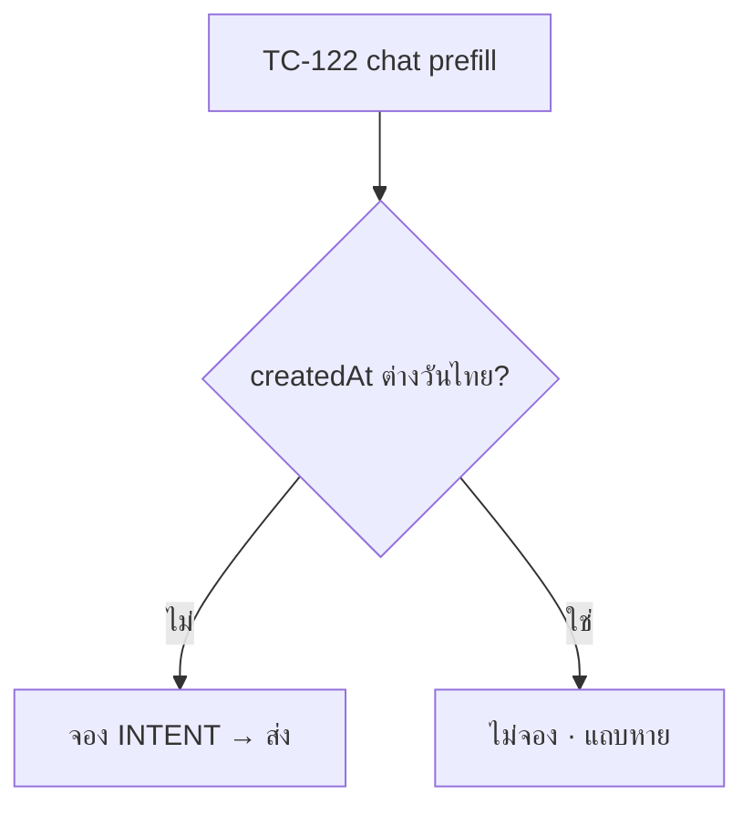

> **ประเภท:** Test Case · ผูก S-id (Scope Baseline) และ FR-CS/BR-CS

# Test Case: 00078

## 1. Overview
- **ระดับ:** U = vitest `src/` (ไม่ต้องมี DB) · I = vitest `tests/` + Postgres `localhost:5434` (ปักหมุด URL ในคำสั่ง HR13/14) · C = component (jsdom) · E = Playwright (3 จอ 390/834/1440 × light/dark; โดเมน `*.deepth.local:4000`) · D = เทสด้วยมือบนเครื่องจริง (แนบหลักฐาน)
- **`[blocker]`:** TC ที่ต้องมี marker ในชื่อ `describe` + ผ่านการพิสูจน์ด้วย mutation (แดงเมื่อกลับด้าน) · **ห้ามพิมพ์ marker ในคอมเมนต์** · TC ที่ต้อง *แก้ไฟล์เดิม* ที่มี marker (ต้องติดป้าย PR `แตะด่าน`): `src/lib/seller-menu.test.ts`, `src/lib/__tests__/role-nav.test.ts`, `src/lib/__tests__/customer-behavior.test.ts`, (ถ้าแตะ props) `chat-order-surfaces.test.ts` — ที่เหลือเขียนเป็นไฟล์ใหม่
- **คำสั่ง DB เทส:** `DATABASE_URL=postgresql://…@localhost:5434/… npm test` (ห้ามเรียก `deleteMany()` เปล่า — scope ด้วย id ที่เทสสร้าง)
- **mutation:** แก้ซอร์ส 1 จุด → รัน TC ที่ระบุ → ต้องแดง → คืนค่า · ถ้ายังเขียว = ชุด input อ่อน แก้เทส (ไม่แก้ข้อกำหนด)

## 2. Test Scenarios

### 2.1 เอกสาร/ฐานราก (S-1, S-2, S-9)
| TC | S-id | ระดับ | เคส | ผลที่คาด |
|---|---|---|---|---|
| TC-001 | S-9 | U `[blocker]` | อ่านค่า `AUTO_NOTIFY_KINDS`/เหตุผล ledger/ชนิด OrderEvent จาก TS แล้วเทียบกับ `prisma/migrations/**` (`auto-notify-db-constraint.test.ts`) | ทุกค่าอยู่ใน CHECK ของ migration · M-1: ลบ `AUTO_NOTICE_FAILED` จาก migration → แดง |
| TC-002 | S-9 | I | apply M1–M6 บนฐานว่าง localhost แล้ว `pg_get_constraintdef('OrderEvent_type_check')` | มี 30 ค่า (27 เดิม + 3) ไม่มีค่าหาย · รันซ้ำไม่ error (idempotent) |
| TC-003 | S-9 | I | ไม่มี migration ใดแตะ `AutoReplyConfig`; grep `TEST_ROOM_ONLY\|TEST_ONLY` ในซอร์ส | 0 ผลลัพธ์ (grep gate) |
| TC-004 | S-1 | Review | `diff <(ls "docs/99 - Rules/Feature-Templates/") <(ls ".../00078 …/")` | ไม่ขาด SRS/SDS/API/TestCase/DATABASE |

### 2.2 ส่วน A — Meta AI (S-2, S-3, S-4)
| TC | S-id | ระดับ | เคส | ผลที่คาด |
|---|---|---|---|---|
| TC-010 | S-2 | U `[blocker]` | ingest handover `pass` ที่มี `new_owner_app_id=A`, `previous_owner_app_id=B` (payload จริงจาก `rawMessage`) | `metaOwnerAppId=A` · M-2: เปลี่ยนไปอ่าน `previous_owner_app_id` → แดง |
| TC-011 | S-2 | U | echo ไม่มี `app_id` | ไม่ถูกนับเป็น foreign echo · ไม่ตั้ง `FB_CHAT_APP_ID` → ไม่เขียนว่า "เรา" |
| TC-012 | S-2 | I | event ซ้ำ + ลำดับสลับ (t2 มาก่อน t1) | `metaForeignEchoAt` ไม่ถอยหลัง (updateMany มีเงื่อนไขเวลา) |
| TC-013 | S-2 | I | handover มาก่อนห้องถูกสร้าง | ข้าม + log ไม่ throw |
| TC-014 | S-2 | U | `webhook-types`: payload มี `admin_text` เป็น string/object/ไม่มี | parse ผ่านทุกรูป (optional unknown) — เขียนในไฟล์ใหม่ ไม่แก้ `webhook-types.test.ts` |
| TC-020 | S-3 | U `[blocker]` | ตาราง 2×2×2 (ผู้ถือเรา/ไม่, แอปกลาง/ไม่, echo AI/ไม่) × เวลา 23:59/24:00/24:01 ชม. | ถือเฉพาะ (ไม่ใช่เรา ∧ กลาง ∧ AI ∧ <24h) · M-3: ถอดเงื่อนไข 24 ชม. → แดง · M-4: เพิ่ม `viaStandby` เป็นอินพุต → แดง |
| TC-021 | S-3 | U | ไม่มีข้อเท็จจริง / owner=เรา / owner=ว่าง / echo มี admin_text | ไม่ถือ |
| TC-022 | S-3 | U | ไฟล์ `meta-ai-holder.ts` ไม่ import prisma | static guard |
| TC-030 | S-4 | C | InboxRow: MESSENGER/INSTAGRAM ถือ → ไอคอน `role="img"` `aria-label="Meta AI กำลังควบคุมห้องนี้"` + `title`; LINE/DEEP ไม่ขึ้น | ผ่าน · ไม่ใช่ชิป · ไม่ซ้ำ `sparkles` กับสัญญาณอื่นในแถว |
| TC-031 | S-4 | C | ChatThread: ชิป "Meta AI คุมอยู่" โทน neutral กดแล้ว `aria-expanded` ไม่มี action · ช่องพิมพ์ไม่ disable · ไม่เรียก `thread-control` | ผ่าน |
| TC-032 | S-4 | C | regression กล่อง "ตอบเอง" (`aiAgentActive`) ทำงานเหมือนเดิม | ผ่าน |
| TC-033 | S-4 | C | render รายการไม่มี `fetch` · ค่าแถว = ค่าหัวห้อง (ฟังก์ชันเดียว) · `React.memo` + `nowBucket` ข้ามเส้น 24 ชม. ระหว่างเปิดค้าง | ผ่าน |
| TC-034 | S-4 | E | ห้องที่ seed ข้อเท็จจริงถือ → แถวมีไอคอน หัวห้องมีชิป · seed เกิน 24 ชม. → ไม่มี | ผ่าน 3 จอ |

### 2.3 ส่วน B — สัญญาณลูกค้า (S-5..S-8)
| TC | S-id | ระดับ | เคส | ผลที่คาด |
|---|---|---|---|---|
| TC-040 | S-5 | U `[blocker]` | ชุดข้อมูลผสม (DRAFTED, CANCELLED, NO_SHOW, ตีกลับ, RETURNED, PENDING, SHIPPED, CONFIRMED) | counted=2 ตามตัวอย่าง BRD · M-5..M-8: ถอดการตัด DRAFTED / ตีกลับ / NO_SHOW / RETURNED ทีละตัว → แต่ละตัวแดง |
| TC-041 | S-5 | I | parity: ชุดเดียวกันผ่าน `enrichWithCustomerBehavior`, `customer-directory.service`, `getCustomerSummary` | `counted` เท่ากันทุก consumer |
| TC-042 | S-5 | I | scope: ลูกค้าคนเดียวมีออเดอร์ 2 ร้าน | นับแยกร้าน ไม่ข้าม |
| TC-043 | S-5 | U | filter "ซื้อซ้ำ" `/customers` = counted ≥ 2 · `shop.service.ts:427` ไม่เปลี่ยน (เทสตรึง) | ผ่าน |
| TC-044 | S-5 | Review | grep เงื่อนไข `status`/`'CANCELLED'` ใน consumer ที่เขียนเอง | 0 |
| TC-050 | S-6 | U `[blocker]` | counted 0/1/2/5 × (มี/ไม่มี ยกเลิก-ตีกลับ) | 0 ไม่มี · 1 NEW (`user-plus`, info) · ≥2 REGULAR (`repeat`, info) ไม่ซ้อน · M-9: สลับเกณฑ์ 1↔2 → แดง |
| TC-051 | S-6 | U | ผูกแล้วแต่ counted=0 | ไม่มี NEW · `hasBehaviorWarning` ไม่เปลี่ยน |
| TC-052 | S-6 | U | `th.ts`/`en.ts` มี `badgeNew/badgeRegular` ใหม่คู่กัน | dictionaries.test ผ่าน |
| TC-060 | S-7 | U `[blocker]` | `customerAvatarSignal`: null/0 → ไม่มี · 1 → ring+cart · 2..9 → เลข · 10+ → "9+" | ผ่าน · M-10: ถอด `≥1` → แดง · M-11: เปลี่ยนขอบ "9+" → แดง |
| TC-061 | S-7 | C | 3 จุดใช้คอมโพเนนต์เดียว · แถว `aria-label` ตามจำนวน · หัวห้อง/แผง `aria-label="เป็นลูกค้าของร้านแล้ว"` ไม่มีชิปข้อความ | ผ่าน |
| TC-062 | S-7 | I/Perf | เปิดห้อง: query เพิ่ม ≤1 และไม่มี `behaviorRows` ทุกใบ | วัดก่อน/หลัง |
| TC-063 | S-7 | E | วัด computed `outline-color` เทียบพื้นทุกสถานะ (ปกติ/hover/ปักหมุด/เลือก/หัวห้อง/แผง) light+dark | ≥3:1 (ใช้สกินที่ active จริง) |
| TC-070 | S-8 | U | ฟิกซ์เจอร์ป้ายครบ (ติดตาม, ตีกลับ, DeepBot, สถานะขาย, ad_id, แท็ก×5) | แสดง 2 ใบตามลำดับ + `+N` · N=100 → "99+" |
| TC-071 | S-8 | C | DeepBot ไม่ขึ้นเมื่อข้อความล่าสุดเป็น AUTO_NOTICE · คำนำหน้า "คุณ: " ไม่ถูกแตะ | ผ่าน |

### 2.4 ส่วน C — ส่งอัตโนมัติ (S-9..S-14)
| TC | S-id | ระดับ | เคส | ผลที่คาด |
|---|---|---|---|---|
| TC-100 | S-10 | I `[blocker]` | ส่ง AUTO_NOTICE แล้วตรวจ 4 ข้อ: (1) `pauseForHumanTakeover` ไม่ถูกเรียก (2) เวลาตอบแรกแอดมิน (00059) ไม่เปลี่ยน (3) ป้าย DeepBot/DeepAI ไม่ขึ้น (4) 00077 `classify` ไม่นับ BOT/คน | ผ่านทั้ง 4 · M-12: ตั้ง `autoReplyKind=null` → แดงครบ 4 |
| TC-101 | S-10 | I | `sweepStuckJobs` มี AUTO_NOTICE หลัง claim | **ไม่** ถือว่าบอทตอบแล้ว (งานบอทยังถูกประมวลผล) |
| TC-102 | S-10 | I | `enrichWithAutoReplyBadge` ข้อความล่าสุด AUTO_NOTICE หลัง CHATBOT | `lastMessageAutoReplyKind` ไม่เป็นบอท · `lastMessageIsAiEnhanced=false` |
| TC-103 | S-10 | U | static: มีค่า `AUTO_REPLY_KINDS` ที่เดียว (ลบสำเนา `agent-performance.ts`) · ไม่มี `autoReplyKind: { not: null }` นอก allow-list | ผ่าน |
| TC-104 | S-10 | C | บับเบิล: ลำดับป้าย DeepBot/AUTO_TEST → ระบบ → AI ของ Meta · `` + `sr-only "ส่งโดยระบบ: …"` | ผ่าน |
| TC-105 | S-10 | I | ไม่มี `replyToMid` · ไม่แตะ `lastAutoReplyAt/autoReplyCount` | ผ่าน |
| TC-106 | S-10 | I | `systemShopId` ≠ `conversation.shopId` | `FORBIDDEN` ไม่ส่ง (ข้ามร้านไม่ได้) |
| TC-110 | S-11 | U `[blocker]` | renderer: ตัวแปรว่างหาย · บรรทัดที่ตัวแปรทุกตัวว่างถูกตัด · บรรทัดข้อความล้วนอยู่ · ยุบบรรทัดว่าง · ว่างทั้งข้อความ=`EMPTY_MESSAGE` | M-13: ตัดเงื่อนไขตัดบรรทัด → แดง |
| TC-111 | S-11 | U | ชุดตัวแปรต่อ kind เท่าตาราง PRD §3.4 เป๊ะ · ตัวแปรชนิดอื่นใช้ข้ามชนิดไม่ได้ | ผ่าน |
| TC-112 | S-11 | U | `{ชื่อลูกค้า}` ตัด "คุณ" ว่าง="ลูกค้า" · `{รายการสินค้า}` ใช้จำนวนจากฐาน (`_count`) ไม่ใช่ `take:1` | ผ่าน |
| TC-113 | S-11 | I | parity ค่าตั้งต้น: ออเดอร์รายการเดียว 4 ช่องทาง ข้อความ = `linkText` เดิมทุกอักษร (`messages/route.ts:847`) ก่อน/หลังเปิดฟีเจอร์ · TRACKING = `trackingMessage` เดิมทั้ง ISHIP/MANUAL | เท่ากัน (หลายรายการ: เท่ากับเดิม + " และอีก N รายการ" ตาม D-1) |
| TC-114 | S-11 | I | ปุ่มมือ ↔ อัตโนมัติ ↔ "ดูข้อความ" ต่างเฉพาะ `autoReplyKind` ทั้งก่อน/หลังร้านแก้เทมเพลต | เท่ากัน |
| TC-115 | S-11 | I | LINE: ไม่แก้เทมเพลต=Flex เดิม · แก้แล้ว=ข้อความล้วน · http (ไม่ใช่ https)=ข้อความ | ผ่าน |
| TC-116 | S-11 | U | `fitToChannelLimit`: IG 1000 bytes (ไทย 334 ตัว), Messenger 2000, LINE 5000 · ไม่ตัดบรรทัด URL · ไม่ตัดกลาง code point | ผ่าน |
| TC-117 | S-11 | U | ปุ่มมือไม่ติด `AUTO_NOTICE` | ผ่าน |
| TC-120 | S-12 | I | `createOrder` + สวิตช์เปิด + ผูกห้อง | ledger INTENT 1 แถวใน tx เดียวกับ `ORDER_CREATED` |
| TC-121 | S-12 | I | ไม่เข้าเงื่อนไข ทีละข้อ: สวิตช์ปิด · ก่อน `enabledAt` · `conversationId` null · `isDryRun` · ย้อนหลังต่างวันไทย (D-13) · ใบ SERVICE · DRAFTED | ไม่มีแถว ledger / ไม่ส่ง |
| TC-122 | S-12 | I | **chat-prefill:** ข้อความลูกค้า 10 นาทีก่อน → `createdAt`=เวลานั้น | **ไม่** ถือว่าย้อนหลัง → ส่ง · M-14: เปลี่ยนกลับเป็นเทียบ ms → แดง |
| TC-123 | S-12 | I | ขอบวัน: `createdAt` 23:59 เมื่อวาน/00:01 วันนี้ (เวลาไทย) | ต่างวัน=ย้อนหลัง |
| TC-124 | S-12 | I | ส่งมือแล้ว (มีข้อความ ORDER body null ในห้อง) | ไม่จอง |
| TC-125 | S-12 | I | `isDryRun` ใบจาก 00061 ห้องทดสอบ | ไม่ส่ง |
| TC-126 | S-12 | I `[blocker]` | บังคับ `dispatch`/`enqueueOutbound` throw | **ออเดอร์ commit** · ledger ถูกปิด FAILED · M-15: ย้ายการยิงเข้า tx → แดง |
| TC-127 | S-12 | I | Meta นอก 24 ชม. | mock Graph **ไม่ถูกเรียก** · ข้อความ FAILED `WINDOW_CLOSED` · ledger FAILED/WINDOW_CLOSED · ไม่ใช้ HUMAN_AGENT/tag |
| TC-128 | S-12 | I | LINE โควตาเต็ม | FAILED/`QUOTA_EXCEEDED` |
| TC-129 | S-12 | I | `promoteDraftCore` ONLINE_SALES ผูกห้อง | จอง ORDER_SUMMARY · `promoteAutoOrderDraft` ไม่มีห้อง=ไม่จอง |
| TC-130 | S-13 | I `[blocker]` | N=10 `reserve` พร้อมกัน key เดียว | ledger 1 แถว · ส่ง 1 ข้อความ · M-16: ถอด UNIQUE → แดง |
| TC-131 | S-13 | U/I `[blocker]` | key ติดตาม `"abc123"` กับ `"ABC123 "` | key เดียวกัน (ชน) · M-17: ใช้ `trackingNo` ดิบ → แดง |
| TC-132 | S-13 | I | ครบทุกจุดเขียนเลข: shipOrder · updateShipmentTracking · dispatchShipment(create+retry) · linkShipment · advanceOrderIfDispatched | แต่ละจุดจอง 1 ครั้ง · d+d2 เลขเดียว → 1 ข้อความ |
| TC-133 | S-13 | I | แก้เลข A→B→A→C→D | ส่ง A, B (ขึ้นต้น "อัปเดตเลขติดตามพัสดุ"), C; กลับ A ไม่ส่ง; D = `SKIPPED/RESEND_LIMIT` |
| TC-134 | S-13 | I | `FAILED`/`CANCELLED`/ร้านบริการ/ไม่มีเลข/dry-run | ไม่จอง |
| TC-135 | S-13 | I | ตัวส่งล้ม | บันทึกเลขสำเร็จ |
| TC-136 | S-13 | I | webhook iShip/refresh status ไม่จอง (ไม่เขียนเลข) | 0 แถว |
| TC-137 | S-9 | I `[blocker]` | เพดาน 5: ใบที่ 6 ของห้องเดียวในวันไทยเดียวกัน · ขอบ 23:59/00:00 · ค่า 0/21/ทศนิยมถูกปฏิเสธที่ API | `SKIPPED/DAILY_CAP` ไม่ส่งเงียบ · M-18: เปลี่ยนเป็น UTC → แดง |
| TC-138 | S-9 | I | เพดานพร้อมกัน 10 request เหลือโควตา 1 | ผ่านเพียง 1 (advisory lock) |
| TC-139 | S-9 | I | สวิตช์ปิดระหว่างรอ / ปิด→เปิดใหม่ (enabledAt ใหม่) ก่อน dispatch | `SKIPPED/NOT_ELIGIBLE_ANYMORE` |
| TC-140 | S-9 | I | sweeper: INTENT claimedAt=NULL >60s → ส่ง · claimedAt มี ∧ ไม่มี chatMessageId >3 นาที → FAILED/`UNCERTAIN_SEND` (ไม่ยิงซ้ำ) · INTENT มี chatMessageId → ตามสถานะข้อความ | ผ่าน |
| TC-141 | S-9 | I | ส่งล้มไม่ปลดกุญแจ (retry เองไม่เกิด) | ผ่าน |
| TC-142 | S-9 | I | `reserve` ล้ม (บังคับ error) | ROLLBACK TO SAVEPOINT · งานหลัก commit |
| TC-143 | S-9 | I | เอกสาร: ไม่มีข้อความ `ERROR` ใน Postgres log จากการชน key (ใช้ ON CONFLICT) | ผ่าน |
| TC-150 | S-14 | C | บับเบิล FAILED ของ AUTO_NOTICE: ข้อความนิ่ง "ระบบส่งไม่สำเร็จ" + Swal "ลองใหม่"/"ยกเลิก" เดิม · ไม่มีกล่องแดงใหม่ · ไม่เขียน "ส่งเองได้" เมื่อ WINDOW_CLOSED | ผ่าน |
| TC-151 | S-14 | C | `OrderCardView` แถวสถานะ: SENT/FAILED(เหตุผลจาก `describeSendFailure`)/SKIPPED(DAILY_CAP, EMPTY) · ไม่มี ledger=ไม่แสดง · อ่านสถานะข้อความสด | ผ่าน |
| TC-152 | S-14 | I | OrderEvent `AUTO_NOTICE_SENT/FAILED` เขียนเมื่อปิดผล · ไม่มี PII ใน meta | ผ่าน |
| TC-153 | S-14 | C | `ShipmentDraftPanel`: WILL_SEND → ไม่มีช่องติ๊ก · เงื่อนไขไม่ครบ → ช่องติ๊กเดิมปิดไว้ · เปิดพัสดุครั้งเดียวไม่ส่ง 2 ข้อความ · toast ไม่อ้าง "แจ้งแล้ว" · ปุ่ม "ส่งเข้าแชท/แจ้งเลขในแชท" คงอยู่ | ผ่าน |

### 2.5 ส่วน C+ (S-15..S-17, S-28)
| TC | S-id | ระดับ | เคส | ผลที่คาด |
|---|---|---|---|---|
| TC-160 | S-28 | I `[blocker]` | ทุกคู่ (OWNER MANAGER CHAT BILLING TECHNICIAN × {GET H1, PATCH/PUT/DELETE X8}) | CHAT/BILLING/TECHNICIAN เรียก X8 → 403 · BILLING/TECHNICIAN GET → 403 · M-19: ใส่ CHAT ใน X8 → แดง |
| TC-161 | S-28 | C | CHAT เห็นแบนเนอร์อ่านอย่างเดียว · สวิตช์/เพดาน/"แก้ข้อความ" disabled แต่อ่านต้นข้อความได้ · TECHNICIAN/BILLING เห็น `NoPermissionCard` | ผ่าน |
| TC-170 | S-15 | C | ONLINE_SALES 2 แถว (พัสดุซ่อนเมื่อไม่ส่งสินค้า) · SERVICE_QUEUE 3 แถว · LODGING 1 แถว (D-OQ-D) · คำ "ปิดงาน" ไม่มี "จบงาน" | ผ่าน |
| TC-171 | S-15 | C `[blocker]` | เปิดครั้งแรกมี Swal `focusCancel:true` · "ยังก่อน" ไม่เรียก API สวิตช์คงปิด · ปิด→เปิดซ้ำไม่มี Swal · ปิดไม่ถาม | M-20: ถอด `focusCancel` → แดง |
| TC-172 | S-15 | I `[blocker]` | `enabledAt` เปลี่ยนทุกครั้งปิด→เปิด; ปิดไม่แตะ; 2 คนกดพร้อมกันไม่รีเซ็ตกัน | M-21: reset `enabledAt` เมื่อ enabled อยู่แล้ว → แดง |
| TC-173 | S-15 | C | optimistic + revert + `pacesToast` เมื่อ API ล้ม · สวิตช์ `<input type=checkbox class=form-switch>` ผูก label | ผ่าน |
| TC-174 | S-15 | C | ช่องเพดาน `inputMode=numeric` ผูก `<label for>` บันทึกเมื่อ blur/Enter ตรวจทั้ง client+server | ผ่าน |
| TC-175 | S-15 | Review | ไม่มีการ์ดสถานะชุด/radiogroup/ห้องทดสอบ/พรีวิว/ตารางลิงก์ขนส่งในหน้า | grep ว่าง |
| TC-180 | S-16 | U `[blocker]` | round-trip DOM↔ข้อความ: ไทยวรรณยุกต์ซ้อน · อีโมจิ · `\n` · ตัวแปรติดกัน | เท่าเดิมทุกอักษร · M-22: ทำลำดับเพี้ยน → แดง |
| TC-181 | S-16 | U `[blocker]` | นับ 499/500/501 ด้วยอีโมจิ+ไทย (code point) เท่ากันใน client / Valibot / ฐาน (INSERT เล่น CHECK บน localhost) | 500 ผ่าน 501 ตก · M-23: เปลี่ยนเป็น `.length` → แดง (อีโมจิ 251 ตัว) |
| TC-182 | S-16 | U | ตัวแปรไม่รู้จัก/ผิดชนิด/ว่าง/NUL/lone surrogate → บันทึกไม่ได้ · ไม่มี `{ลิงก์…}` → เตือนไม่บล็อก | ผ่าน |
| TC-183 | S-16 | C | พิมพ์ `{` เปิดเมนู `role=listbox/option` `aria-activedescendant` · Esc ปิดคืนโฟกัส · ห้ามนับ/ตัดระหว่าง composition | ผ่าน |
| TC-184 | S-16 | I | 409 เมื่อ `updatedAt` ชน · คืนค่าตั้งต้น=ลบแถว · เก็บผู้แก้+เวลา | ผ่าน |
| TC-185 | S-16 | D `[blocker]` | iOS Safari + Android Chrome (คีย์บอร์ดไทย): ประโยคยาวมีวรรณยุกต์ซ้อน · ลบทีละตัว/ทีละชิป · พิมพ์ต่อท้าย/คั่นกลางชิป · `{` กลางประโยค · วาง · เมนูไม่ถูกคีย์บอร์ดบัง | **ไม่ผ่าน = ถอย textarea ก่อน merge** (Controller ตัดสิน) · แนบวิดีโอ/ภาพ |
| TC-186 | S-27 | E | Playwright 390: bounding box ≥44px (สวิตช์, "แก้ข้อความ", ปุ่มตัวอย่าง, "+ ตัวแปร", รายการเมนู, "ดูข้อความ", "ตั้งค่า", บันทึก/คืนค่า/ยกเลิก, อีโมจิ, ช่องเพดาน) · มี "+ ตัวแปร" ปุ่มเดียว | ผ่าน |
| TC-190 | S-17 | U `[blocker]` | ทุกแบรนด์ใน `COURIER_BRANDS` ที่ไม่ใช่ `ISHIP` มีแถวหรือถูกประกาศ "ไม่มีลิงก์" ชัด | M-24: ลบการประกาศแบรนด์หนึ่ง → แดง |
| TC-191 | S-17 | U | iShip + แบรนด์ไม่มีแถว → `app.iship.cloud/tracking?track=` · ส่งเอง/"อื่นๆ" → ไม่มีลิงก์ | ผ่าน |
| TC-192 | S-17 | U `[blocker]` | แถว DEEP ต้องมี `{เลข}` + `encodeURIComponent` | M-25: ถอด encode → แดง |
| TC-193 | S-17 | U | `COURIER_OPTIONS`: ค่าเดิม "Kerry Express","Thailand Post","J&T Express" ยังจับแบรนด์ได้ | ผ่าน |
| TC-194 | S-17 | U | `scam-link-detector` ไม่เตือนผิดกับ URL ในตาราง (เมื่อมีแถว) | ผ่าน |

### 2.6 ส่วน S — บริการ (S-18..S-21)
| TC | S-id | ระดับ | เคส | ผลที่คาด |
|---|---|---|---|---|
| TC-200 | S-18 | I | `createOrder` SERVICE + นัด + ผูกห้อง | จอง SERVICE_BOOKED (ไม่จอง ORDER_SUMMARY) · ส่งการ์ดนัด + ข้อความเทมเพลต |
| TC-201 | S-18 | I | ตั้งนัดครั้งแรกทาง `setOrRescheduleAppointment` (นัดอนาคต) | จอง |
| TC-202 | S-18 | I `[blocker]` | **walk-in ผ่าน StartWalkIn (serviceStart ≤ now)** | ไม่จอง (D-3) · M-26: ถอด `serviceStart > now` → แดง |
| TC-203 | S-18 | I | เลื่อนนัด (`hadAppointment=true`) | ไม่จอง |
| TC-204 | S-18 | I | ไม่ผูกห้อง / ใบเก่า `conversationId` NULL / นัดจบแล้ว / ส่งการ์ดมือก่อน | ไม่จอง |
| TC-205 | S-18 | I | ร้านบริการไม่ได้ทั้ง ORDER_SUMMARY และ SERVICE_BOOKED ซ้อนกัน | ผ่าน |
| TC-210 | S-19 | I `[blocker]` | เทสตรึง: ใบเดียวกันก่อน-หลังกด `start` → `resolveServiceStatusBadge`, `serviceRevenueOrderWhere`, `countsAsServiceRevenue`, `Order.status`, `appointmentStatus` ไม่เปลี่ยน | M-27: ให้ start แตะ `appointmentStatus` → แดง |
| TC-211 | S-19 | I | กดซ้ำ = 200 `alreadyStarted` ไม่ส่งซ้ำ · ปิดงานได้โดยไม่เริ่ม · `reopenServiceJob` ไม่ล้าง `serviceStartedAt` · ไม่มี "ยกเลิกเริ่มงาน" | ผ่าน |
| TC-212 | S-19 | I | ทุกบทบาท: O4 (OWNER MANAGER CHAT TECHNICIAN) ผ่าน · BILLING 403 · ช่างเรียกแล้วไม่มีคีย์เงินในคำตอบ · `?shopId=` ข้ามร้านทำงาน | ผ่าน |
| TC-213 | S-19 | I | ก่อนเวลานัด → 409 `APPOINTMENT_NOT_STARTED` · ปิด/ยกเลิกแล้ว → 409 | ผ่าน |
| TC-214 | S-19 | C | ปุ่ม `player-play` แสดงเมื่อ สวิตช์เปิด ∧ ผูกห้อง ∧ ยังไม่ปิด/ยกเลิก (A-13) · `pacesConfirm.warning` "เริ่มงานและแจ้งลูกค้า?" · แสดง "เริ่มงานเมื่อ {เวลา}" ข้อความธรรมดา | ผ่าน |
| TC-215 | S-19 | I | ตัวส่งล้ม → กดเริ่มงานสำเร็จเสมอ | ผ่าน |
| TC-220 | S-20 | I `[blocker]` | ปิดงาน SERVED→จอง · NO_SHOW→ไม่จอง · ปิด→reopen→ปิดไม่ซ้ำ · NO_SHOW→reopen→SERVED จอง | M-28: ผูก key กับ `serviceClosedAt` → แดง |
| TC-221 | S-20 | I `[blocker]` | 2 ผู้เรียก (`/close` + `/appointment/outcome`) พร้อมกัน | 1 ข้อความ |
| TC-222 | S-20 | I | ข้อความไม่มีตัวเลขเงิน · ปิดงานสำเร็จแม้ตัวส่งล้ม · reopen ก่อน dispatch → `NOT_ELIGIBLE_ANYMORE` | ผ่าน |
| TC-230 | S-21 | U | `composeServiceNotice` คืน `[text, link]` · ลิงก์มาจากตัวประกอบเดียว · เพิ่มตัวแปรใหม่ไม่กระทบเทมเพลตเก่า · ไม่มีโมเดลรูป/`internalNote` | ผ่าน |

### 2.7 ส่วน D–F (S-22..S-26)
| TC | S-id | ระดับ | เคส | ผลที่คาด |
|---|---|---|---|---|
| TC-300 | S-23 | U `[blocker]` | `resolveOutboundShippingCost`: iShip active ชนะเสมอ (ไม่บวกซ้ำ) · ไม่มีราคา iShip → manual · ไม่มีทั้งหมด → ยังไม่ระบุ(pending) · **null≠0** | M-29: ถอด "iShip ชนะ" → แดง · M-30: ตี null เป็น 0 → แดง |
| TC-301 | S-23 | I | parity ข้ามพื้นผิว: ออเดอร์ส่งเอง+ต้นทุน X → `/sales` + dashboard นับ X เท่ากัน · `getPnlReport` ร้านขายของไม่นับ (เกณฑ์เดิม) ร้านบริการนับ | ผ่าน |
| TC-302 | S-23 | I | `ShipOrderSchema` POST/PATCH: ไม่ส่งคีย์/null/0/ติดลบ/>99,999.99/3 ทศนิยม · PATCH ไม่ส่งคีย์=ไม่แตะ | ผ่าน |
| TC-303 | S-23 | I | `PATCH /shipping-cost`: มีแถวเดิม=ผ่าน · ไม่มีแถว=409 `NO_TRACKING_ROW` · ไม่สร้างแถวใหม่ | ผ่าน |
| TC-304 | S-23 | U | `order-view-by-level`: `outboundShippingCost` ถูกซ่อนจากระดับเงิน NONE | ผ่าน |
| TC-305 | S-23 | Review | grep consumer "ค่าส่ง" อื่น (`OrderProfitCard`, `order-profit-presentation`, `finance-chart`, `FinancePanels`, `line-report-*`) | ไม่มีสูตรที่ห้า · ฉลากเดียว `SYSTEM_SHIPPING_LABEL_TH` |
| TC-306 | S-23 | I | `updateShipmentTracking` ยังปฏิเสธเมื่อมี iShip active | 409 เดิม |
| TC-307 | S-23 | C | ShipForm: ช่อง ฿ ผูก label · `aria-describedby/invalid` · ข้อความกำกับ "ต้นทุนของร้าน ไม่แสดงให้ลูกค้า" · ฉลาก /sales+dashboard ไม่ถึง /expenses | ผ่าน |
| TC-310 | S-22 | I/U | เทสที่มากับ `53fbb28f5` ยังเขียว · `chat-shipment-panel.test.ts` ปรับตาม renderer (ไม่ลบเงียบ) | ผ่าน |
| TC-320 | S-24 | U `[blocker]` | `autoNotifyStripState` ทุกเงื่อนไข: สวิตช์ปิด · ไม่ผูกห้อง · dry-run · ย้อนหลัง · ไม่มีนัด(จอง) · นัดไม่เกิดหลัง now · ผล NO_SHOW(ปิดงาน) · Messenger 23:59/24:00/24:01 · LINE · DEEP · mode EDIT | แต่ละข้อ mutation ถอดเงื่อนไข → แดง (M-31..M-38) |
| TC-321 | S-24 | U | parity: strip กับ `evaluateAutoNotifyEligibility` ของตัวส่งใช้ predicate ตัวเดียว (เทียบผลชุดอินพุตเดียวกัน) | เท่ากัน |
| TC-322 | S-24 | C | 4 จุด × (จะส่ง/เตือน 24 ชม./ซ่อน) · `/orders/new` เต็มจอไม่แสดง (D-6) · ฟอร์มแก้ PENDING ไม่แสดง · แก้ DRAFTED แสดง | ผ่าน |
| TC-323 | S-24 | C | "ดูข้อความ" = `renderTemplate` ฟังก์ชันเดียว · ช่องไม่มีค่า=ชิปตัวแปร · LINE+ไม่แก้เทมเพลต=บอกว่าเป็นการ์ด · `aria-expanded/controls` · `role=region` ไม่ใช้ `aria-live` · ลิงก์ "ตั้งค่า" ซ่อนสำหรับ TECHNICIAN/BILLING | ผ่าน |
| TC-324 | S-24 | E | 390: แถบบรรทัดเดียว … กางแล้วสูง ≤9rem ปุ่มบันทึกยังอยู่ในจอ · เปลี่ยนวันที่เป็นต่างวัน → แถบหาย | ผ่าน |
| TC-330 | S-25 | U `[blocker]` | slug contract: เพิ่ม `seller:settings-auto-notify` · slug เดิมไม่หายไม่ซ้ำ · นับต่อ vertical (OWNER) ONLINE 29 · SERVICE 27 · LODGING 28 · ทุกกลุ่ม ≤6 หลังกรอง | M-39: ลบ slug เดิม → แดง (แก้ไฟล์เดิม → ป้าย `แตะด่าน`) |
| TC-331 | S-25 | U | ต่อบทบาท: OWNER 7 · MANAGER 1,2,4,5,6 · CHAT/BILLING/TECHNICIAN ตาม BR-CS-F05 · ไม่มีกลุ่มว่าง | ผ่าน |
| TC-332 | S-25 | U | `applyMenuLocale` แปลป้ายกลุ่ม th/en · `dictionaries.test` | ผ่าน |
| TC-333 | S-25 | E | sidebar: ป้ายไทย sentence-case ไม่ uppercase (computed `text-transform`) · `ChatNavRail` ใช้ป้ายกลุ่มเป็นเส้นคั่น rail หุบไม่ล้น · `_sidenav.css` ไม่ถูกแก้ (git diff) | ผ่าน |
| TC-340 | S-26 | U `[blocker]` | Android + ร้านส่วนตัว → กลุ่ม "ทีมและแพ็กเกจ" หายทั้งกลุ่ม | M-40: ถอดขั้นถอดกลุ่มว่าง → แดง |
| TC-341 | S-26 | U | `QUICK_LINK_URLS` + `shopQuickLinks(visibleUrls)` เฉพาะที่เห็นจริง · ชื่อแถวตรงเมนูเดสก์ท็อป · iOS/ผู้ดูแล/บทบาทอื่นหายอัตโนมัติ | ผ่าน |
| TC-342 | S-26 | U | เมนูลัดค่าเริ่มต้นเปลี่ยนตามลำดับใหม่ (ONLINE: ภาพรวม, คำสั่งซื้อ, สินค้า, สต็อก, ประมูล, ข้อความ, โต๊ะแชท, ลูกค้า) · คนปักเองไม่กระทบ | ผ่าน |
| TC-343 | S-26 | U | รันชุด: `shortcut-role`, `dictionaries`, `chat-nav-rail-guard`, `iap-entry-point-in-app`, `no-payment-in-android-app`, `chat-desk-menu-access` (`chat-desk` ถัดจาก `inbox`) · เทส blocker ลำดับ `hidePayments`/`hidePaidFeatures` เขียว | ผ่าน |

### 2.8 กฎ UI ร่วม + ส่งมอบ (S-27, S-29, S-30)
| TC | S-id | ระดับ | เคส | ผลที่คาด |
|---|---|---|---|---|
| TC-400 | S-27 | Review | `rg "text-(primary|danger|warning|info)\b"` กับตัวหนังสือในไฟล์ UI ใหม่ · emoji · arbitrary Tailwind ไม่มีคอมเมนต์ · `react-toastify` ใน `(paces)/` · `TEST_ROOM_ONLY` | 0 ทุกข้อ |
| TC-401 | S-27 | C | axe/เทส label: ช่องเพดาน, ช่องค่าส่ง, ตัวแก้, สวิตช์ทุกตัว | ผ่าน |
| TC-402 | S-27 | E | คอนทราสต์ตัวหนังสือ ≥4.5:1 (ชิปตัวแปร, ตัวนับ, ข้อผิดพลาด, แถบแจ้ง) light/dark · `prefers-reduced-motion` | ผ่าน |
| TC-410 | S-30 | E | ทางเต็ม: เปิดสวิตช์ (Swal) → แก้เทมเพลต → สร้างออเดอร์จากแชท (เห็นแถบ+ดูข้อความ) → ลูกค้าได้ข้อความ 1 ครั้ง ป้าย "ส่งโดยระบบ" บอทไม่หยุด → แจ้งเลข (ส่งเอง+ค่าส่ง) → กำไร /sales ลด → ร้านบริการ จอง/เริ่ม/ปิด/reopen | ผ่าน 3 จอ light/dark |
| TC-411 | S-30 | Perf | รายการห้อง: query เพิ่มต่อแถว = 0 · เปิดห้อง ≤1 · createOrder p50 ก่อน/หลัง | บันทึกตัวเลข |
| TC-412 | S-30 | Gate | ด่าน CI ในเครื่อง: `.claude/hooks/theme-guard.sh` ทุกไฟล์ที่แตะ · `vitest run src/` · `vitest run tests/` (5434) · `tsc --max-old-space-size=8192 --incremental false` · `next build` exit 0 | เขียวทั้งหมด |
| TC-413 | S-29 | Review | `docs/SRS.md` ครบ M1–M6/enum/API/authorization/validation/routing · BRD 00071 §8.3 มี X8 · PRD 00061 หมายเหตุ BR-ACO-27 · เอกสาร 00073 หมายเหตุ `serviceStartedAt` · glossary · state-snapshots | ครบ |

## 3. Traceability Matrix (S-id → TC)
| S-id | TC |
|---|---|
| S-1 | 004 |
| S-2 | 001, 002, 010-014 |
| S-3 | 020-022 |
| S-4 | 030-034 |
| S-5 | 040-044 |
| S-6 | 050-052 |
| S-7 | 060-063, 400-402 |
| S-8 | 070-071 |
| S-9 | 001-003, 137-143 |
| S-10 | 100-106 |
| S-11 | 110-117 |
| S-12 | 120-129 |
| S-13 | 130-136 |
| S-14 | 150-153 |
| S-15 | 170-175 |
| S-16 | 180-186 |
| S-17 | 190-194 |
| S-18 | 200-205 |
| S-19 | 210-215 |
| S-20 | 220-222 |
| S-21 | 230 |
| S-22 | 310 |
| S-23 | 300-307 |
| S-24 | 320-324 |
| S-25 | 330-333 |
| S-26 | 340-343 |
| S-27 | 186, 400-402 |
| S-28 | 160-161 |
| S-29 | 413 |
| S-30 | 410-412 |
| S-31 | retro + sign-off |

## 4. Flow

## 5. ผลล่าสุด
| Run | วันที่ | ผล | ผู้ทดสอบ |
|---|---|---|---|
| - | - | ยังไม่รัน (เอกสารร่าง) | - |

## 6. สรุป / Open Questions
- ชุดนี้ครอบทุก S-id · `[blocker]`+mutation รวม 40 รายการ (M-1..M-40)
- ค้าง: ผลเทส IME เครื่องจริง (TC-185) ตัดสินถอย textarea · ผล spike Q-23 อาจเปลี่ยน TC-020 (ถ้า `ai_generated`=0)
