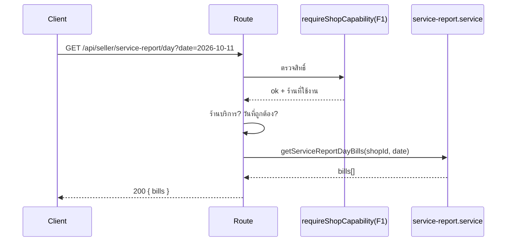

> **โมดูล:** 00078 — Service Report Redesign
> **ประเภทเอกสาร:** API Contract
> **เวอร์ชัน:** 1.0
> **วันที่จัดทำ:** 2026-10-17
> **สถานะ:** Draft

# API Contract: หน้ายอดขายและกำไรของร้านบริการ

## 1. Overview
API อ่านอย่างเดียว 2 ตัวสำหรับหน้ายอดขายและกำไร (ชีตมือถือ + `/sales`) — ร้าน `SERVICE_QUEUE` เท่านั้น · ไม่มี endpoint เขียนใหม่ (ตั้งค่าใช้ `PATCH /api/shops/current/report-settings` เดิม)

| รายการ | ค่า |
|---|---|
| Base | `seller.*` (session ของ seller subdomain) |
| Format | JSON |
| Cache | `Cache-Control: private, no-store` · `dynamic = 'force-dynamic'` |

## 2. Authentication
NextAuth session → `requireShopCapability(session, 'F1')` (เจ้าของร้านเท่านั้น · 00071) → ร้านที่ใช้งานอยู่ต้องผ่าน `usesServiceFinanceRules(vertical)` ไม่งั้น 404 · ประกาศใน `src/lib/route-capabilities.ts` เป็น `{ GET: 'F1' }`

## 3. Endpoint List
| Method | Path | หน้าที่ |
|---|---|---|
| GET | `/api/seller/service-report` | ข้อมูลรายงานหนึ่งช่วง |
| GET | `/api/seller/service-report/day` | บิลของหนึ่งวัน |

## 4. Endpoint Detail

### 4.1 `GET /api/seller/service-report`
**Query**
| ชื่อ | ชนิด | บังคับ | หมายเหตุ |
|---|---|---|---|
| `mode` | `daily` \| `monthly` | ✓ | |
| `year` | int 2000–2100 | ✓ | ค.ศ. |
| `month` | int 1–12 | เมื่อ `mode=daily` | |

**200** — `ServiceReportData`
```json
{
  "mode": "daily", "year": 2026, "month": 10,
  "labels": ["1", "2", "…", "31"],
  "closed": [0, 3500],        "closedCounts": [0, 4],
  "unclosed": [0, 3400],      "unclosedCounts": [0, 2],
  "cost": [0, 0],             "expense": [0, 0],
  "futureFromIndex": 17,
  "prevSalesToDate": 116300,
  "last14": { "labels": ["4 ต.ค.", "…"], "closed": [], "unclosed": [] }
}
```
- `closed` = ปิดงานแล้ว ตามวันปิดงาน (ไม่มาตามนัด = เงินที่รับไว้) · `unclosed` = ยังไม่ปิดงาน ตามวันเปิดบิล · `expense` = ค่าใช้จ่าย + ค่าส่งขากลับของใบคืนที่รับแล้ว
- `futureFromIndex` = index แรกที่เป็นอนาคต (ช่วงอดีต = `labels.length`) · `prevSalesToDate` = ยอดขายช่วงก่อนถึงวัน/เดือนเดียวกัน · `last14` มีเฉพาะเดือนปัจจุบันแบบรายวัน

### 4.2 `GET /api/seller/service-report/day`
**Query:** `date` = `YYYY-MM-DD` (วันตามปฏิทินไทย · ต้องเป็นวันที่มีจริง)

**200**
```json
{ "bills": [
  { "token": "abc…", "orderNo": "DP2569…", "buyerName": "คุณเอ", "amount": 1000, "closed": true },
  { "token": "def…", "orderNo": null, "buyerName": "คุณบี", "amount": 2500, "closed": false }
] }
```
- ปิดงานแล้วก่อน (เรียงวันปิดงานล่าสุด) แล้วตามด้วยยังไม่ปิดงาน (เรียงวันเปิดบิลล่าสุด) · `token` ใช้ลิงก์ `/orders/{token}` · ผลรวม `amount` = `closed[n] + unclosed[n]` ของวันเดียวกัน

## 5. Error Code Table
| HTTP | body `error` | เมื่อ |
|---|---|---|
| 401 | `กรุณาเข้าสู่ระบบก่อนใช้งาน` | ไม่มี session |
| 403 | (จาก `requireShopCapability`) | ไม่ถือ F1 (ไม่ใช่เจ้าของ) |
| 404 | `ไม่พบหน้านี้` | ร้านที่ใช้งานอยู่ไม่ใช่ร้านบริการ |
| 400 | `พารามิเตอร์ไม่ถูกต้อง` / `โหมดรายวันต้องระบุเดือน` | query ของ 4.1 ผิด |
| 400 | `วันที่ไม่ถูกต้อง` | `date` ผิดรูปแบบหรือไม่มีจริง (เช่น `2026-02-31`) |
| 500 | `เกิดข้อผิดพลาด กรุณาลองใหม่` | ข้อผิดพลาดภายใน (log ที่ server) |

## 6. Sequence (ถ้า flow ซับซ้อน)


## 7. Traceability
| Endpoint | BRD | เทส |
|---|---|---|
| `GET /api/seller/service-report` | FR-003, FR-011 | `tests/services/service-report.test.ts` (200/400/403/404) |
| `GET /api/seller/service-report/day` | FR-004 | `tests/services/service-report.test.ts` (ผลรวม = แถว · 400 วันไม่มีจริง) |

## 8. สรุป (Summary)
2 endpoint อ่านอย่างเดียว ด่าน F1 + ร้านบริการ · ไม่คืนข้อมูลติดต่อลูกค้า · ไม่มี endpoint เขียนใหม่
