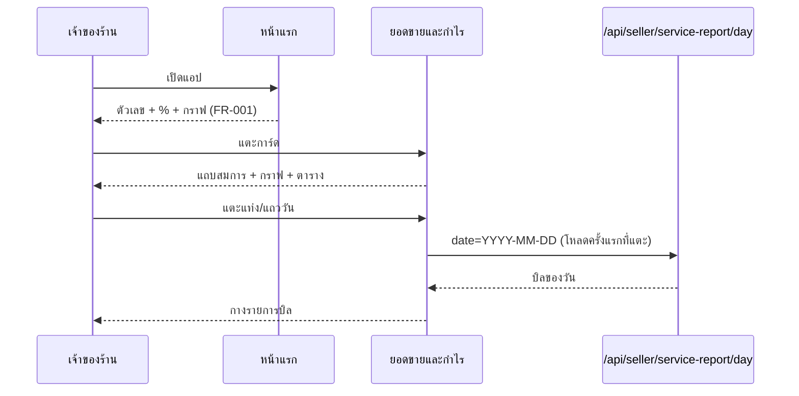

> **โมดูล:** 00078 — Service Report Redesign
> **ประเภทเอกสาร:** Business Requirements Document (BRD)
> **เวอร์ชัน:** 1.0
> **วันที่จัดทำ:** 2026-10-17
> **สถานะ:** Draft — รอ user อนุมัติ (HR11)

# BRD: ออกแบบหน้ายอดขายและกำไรของร้านบริการใหม่ (Business Requirements Document)

## 1. บทนำ

### 1.1 วัตถุประสงค์ของเอกสาร
กำหนดสิ่งที่ต้องสร้างเพื่อแทนจอรายงานการเงินของร้านบริการ (00073) ด้วยแบบที่ user เลือกจากต้นแบบ
https://claude.ai/artifact/RBwhMrruMgVzAfN3BYNe1f (v11) — เรียบ ใช้คำง่าย โครงเดียวกับหน้า "ยอดขายและกำไร" ของร้านขายของ

### 1.2 ขอบเขตของระบบ
**แก้ (ร้านบริการเท่านั้น):**
| # | จอ / ส่วน | ไฟล์หลักปัจจุบัน |
|---|---|---|
| 1 | การ์ดยอดขายหน้าแรก (มือถือ) | `dashboard/components/SalesChartCard.tsx` (ทางร้านบริการ) |
| 2 | ชีตเต็มจอจากการ์ด (มือถือ) | `dashboard/components/SalesChartSheet.tsx` (ทางร้านบริการ) + `FinancePanels` `ReceivablesPanel` |
| 3 | หน้าแรกบนคอม (ส่วนรายงาน) | `dashboard/page.tsx` การ์ดสถิติรายได้/จำนวนงาน + `SalesReport` (ทางร้านบริการ) |
| 4 | หน้า /sales (คอม + มือถือ) | `sales/page.tsx` ทางร้านบริการ (`FinanceTabs` `ServiceFinanceChart` `SalesChart` `SalesTable` `ReceivableList`) |
| 5 | ตั้งค่ารายงาน | `settings/reports/*` + `src/lib/report-settings.ts` + API `/api/shops/current/report-settings` |
| 6 | ทางเข้าตั้งค่า | ปุ่มบนการ์ด + ไอคอนบนหน้ายอดขายและกำไร (เพิ่ม) · `ShopQuickLinks` เมนูตั้งค่า (คงเดิม) |

**ไม่แตะ:** ร้านขายของ · ร้านที่พัก · portfolio · รายงานกลุ่ม LINE / `/lr` (00070) · `src/lib/line*` · `line-report-*` ·
เส้นทาง `getSalesSeries` ที่ไม่ส่ง vertical · `finance-colors.ts` · สิทธิ์ (`shop-permissions.ts`) · ฐานข้อมูล (ไม่มี migration)

### 1.3 กลุ่มผู้ใช้งาน
เจ้าของร้านบริการ (OWNER, สิทธิ์ F1) เท่านั้น — พนักงานไม่เห็นจอเหล่านี้อยู่แล้ว ไม่เปลี่ยน

## 2. ความต้องการหลัก (Functional Requirements)

### 2.1 ตัวกลาง (ทำก่อน ทุกจอใช้ร่วม)

#### FR-001: ตัวคำนวณรายงานกลาง (view-model)
ฟังก์ชันล้วน (ไม่ import prisma/React) รับข้อมูลรายวัน/รายเดือน + ตั้งค่า แล้วคืน: ตัวเลขใหญ่, % เทียบ, แถบสมการ, ชุดกราฟ, แถวตาราง
- การ์ดหน้าแรก ชีต และ /sales เรียกตัวเดียวกัน → ตัวเลขทุกจอตรงกันโดยโครงสร้าง
- AC: ป้อนข้อมูลร้านสุขสวัสดิ์ ต.ค. ได้ 636,900 / 248,300 / 388,600 / 119,949 / 128,351 · แถวตารางวันที่ 14 ต.ค. กำไร −6,394

#### FR-002: คำกลางของร้านบริการ
ค่าคงที่เดียวสำหรับทุกคำบนจอ: "ยอดขายและกำไร" "ยอดขาย" "กำไร" "ขาดทุน" "ปิดงานแล้ว" "ยังไม่ปิดงาน" "งาน" "ค่าใช้จ่าย" "ต้นทุนอะไหล่" "กำไร (งานที่ปิดแล้ว)" "รายวัน" "รายเดือน" "เพิ่มขึ้น/ลดลง … เทียบ …" ฯลฯ
- AC: grep คำเหล่านี้ในไฟล์จอได้ 0 ที่ (มาจากตัวกลางเท่านั้น) · เทสปักว่าไม่มีคำเก่า ("รับจริง" "ค้างรับ" "ยังไม่ปิด" ลอย ๆ "บิลยังไม่ปิด")

#### FR-003: ตัวโหลดข้อมูลรายงานร้านบริการ (server)
หนึ่งฟังก์ชันต่อหนึ่งช่วง: เรียก `getSalesSeries(..., includeFinance=true, vertical)` (ทางร้านบริการเดิม) + ค่าใช้จ่ายรายวันจาก `Expense` (query เดียว) → ป้อน FR-001
- ไม่ดึงออเดอร์ทั้งร้าน (`getOrdersByShop`) อีก · ไม่เรียก `getReturnAdjustments` ซ้ำ
- AC: จำนวน query ต่อการเปิดหน้า /sales ของร้านบริการลดลง และไม่โตตามจำนวนออเดอร์ทั้งหมดของร้าน (วัดก่อน/หลัง)

#### FR-004: รายการบิลของวัน (โหลดเมื่อแตะ)
API ใหม่ `GET /api/seller/service-report/day?date=YYYY-MM-DD` ด่าน F1 + ร้านบริการเท่านั้น (อื่น 404)
- คืน บิลที่ปิดงานวันนั้น (`serviceClosedAt`) + บิลยังไม่ปิดงานที่เปิดวันนั้น (`createdAt`) — เฉพาะ id/เลขบิล/ชื่อลูกค้า/ยอด/สถานะ
- ใช้ดัชนี `[shopId, serviceClosedAt]` และ `[shopId, createdAt]` ที่มีอยู่
- AC: ผลรวมของบิล = ยอดของวันนั้นในตาราง · ร้านอื่น/พนักงานได้ 404/403 · ไม่โหลดจนกว่าจะแตะ

### 2.2 จอ

#### FR-010: การ์ดหน้าแรก (มือถือ + คอม)
หัว: ไอคอน · ชื่อตามตั้งค่า · **ปุ่มตั้งค่า (ก่อน)** · วันนี้/เดือนนี้ → ตัวเลข → บรรทัด % → กราฟ (แท่ง/เส้นตามตั้งค่า แตะได้ถึงวันนี้)
- ไม่มีป้ายสี/จำนวนงาน/ยอดขาย-หักออก
- คอม: การ์ดเดียวกันแบบกว้าง แทน การ์ดสถิติรายได้ + จำนวนงาน + `SalesReport` (Q-3)
- AC: ร้านบริการเห็นตามนี้ · ร้านขายของเห็นการ์ดเดิมทุกตัวอักษร

#### FR-011: หน้า "ยอดขายและกำไร" (แทนชีต 3 แท็บ และ /sales ของร้านบริการ)
หัว + รายวัน/รายเดือน + ‹ ช่วง › → ตัวเลข + % → แถบสมการ → กราฟ → ตาราง (FR-001) → แตะแถว/แท่งกางบิล (FR-004)
- มือถือ: ชีตเต็มจอเดิม (โครงเดียวกับร้านขายของ) · คอม: /sales หน้าเดียวกว้างขึ้น
- ไม่มีแท็บ (`?tab=` เดิมของร้านบริการ → หน้าเดียว) · ไม่มี "ต้องตามเก็บ"/มัดจำ (Q-2) · ไม่มีข้อความอธิบาย
- AC: เลือก "กำไร" → ตัวเลขใหญ่เป็นกำไร (ติดลบ = "ขาดทุน" สีแดง) และแถบสมการเป็นแบบหัก

#### FR-012: ตั้งค่ารายงาน 2 ข้อ
"ตัวเลขที่อยากเห็นก่อน" (ยอดขาย/กำไร) + "รูปแบบกราฟ" (แท่ง/เส้น) + ตัวอย่างบนหน้าแรก · บันทึกทันที (PATCH เดิม)
- API รับเฉพาะค่าใหม่จากฟอร์ม แต่ยังอ่านค่าเก่าได้ (ตาราง 4.3 ใน PRD) — ไม่ลบค่าเดิมในฐาน
- `resolveReportSettings` คืนค่าเริ่มต้นสำหรับสวิตช์ที่เลิกใช้ → เมนู "ค่าใช้จ่าย" และการ์ดกำไรบนหน้าบิลกลับมาแสดงตามค่าเริ่มต้น (Q-1, Q-4)
- AC: ร้านที่ตั้ง headline=RECEIVED → เห็น "ยอดขาย" · chartStyle=AREA → "เส้น"

#### FR-013: ทางเข้าตั้งค่า
ปุ่มบนการ์ดหน้าแรก (ก่อน วันนี้/เดือนนี้) · ไอคอนบนหน้ายอดขายและกำไร · ร้านค้า › ตั้งค่ารายงาน และเมนูตั้งค่า (คงเดิม)

## 3. Acceptance Criteria สรุป

### 3.1 ความถูกต้อง
- ตัวเลขทุกจอ = FR-001 = SQL อ้างอิง (ร้านสุขสวัสดิ์ ก.ย./ต.ค.)
- คำทุกคำมาจาก FR-002 · ผ่าน `/impeccable clarify` + `critique`

### 3.2 ไม่กระทบ
- ร้านขายของ: snapshot ข้อความ + ภาพ การ์ด/ชีต/หน้า /sales ก่อน/หลัง เท่ากัน
- LINE: `line-report-summary.parity.test` และเทส 00070 เขียว · ไม่มีไฟล์ LINE ใน diff
- สิทธิ์: พนักงานยังไม่เห็น (F1) · ไม่มีไฟล์สิทธิ์ใน diff

## 4. Business Flows (กระบวนการทำงาน)

### 4.1 Flow หลัก: ดูยอดและเจาะดูบิล

### 4.2 Flow ตั้งค่า

## 5. Use Case Scenarios (สถานการณ์การใช้งานจริง)

### Scenario 1: ร้านไม่ค่อยกดปิดงาน (BT สุขสวัสดิ์)
ต.ค. ปิดงานแล้ว 248,300 · ยังไม่ปิดงาน 388,600 → ยอดขาย 636,900 · ตารางวันที่ 12–16 กำไร 0 หรือติดลบ (หัวคอลัมน์บอก "งานที่ปิดแล้ว")

### Scenario 2: ร้านเลือกดูกำไร
ตัวเลขใหญ่ 128,351 · แถบ ปิดงานแล้ว 248,300 − ค่าใช้จ่าย 119,949 · ต้นทุน 0 จึงไม่แสดงช่องต้นทุน

### Scenario 3: ร้านใหม่ยังไม่มีงาน
ตัวเลข 0 · ไม่แสดง % · ตาราง "ยังไม่มีงานในช่วงนี้"

## 6. ความต้องการด้านคุณภาพ (Quality Requirements)

### 6.1 ความถูกต้องของข้อมูล
ตัวคำนวณเดียว (FR-001) · กติกานับเดิม 00073 ไม่เปลี่ยน · วันตามเวลาไทย

### 6.2 ความรวดเร็ว
ไม่ดึงออเดอร์ทั้งร้าน · บิลรายวันโหลดเมื่อแตะ · ไม่เรียก query ซ้ำ · ทางร้านบริการใน `getSalesSeries` ไม่เลือก `shipments` (ถ้าทำ ต้องอยู่ใต้เงื่อนไขร้านบริการ ไม่กระทบ LINE)

### 6.3 ความน่าเชื่อถือ
โหลดไม่สำเร็จ → "โหลดข้อมูลไม่สำเร็จ" + ปุ่ม "ลองใหม่" (แบบเดียวกับร้านขายของ)

### 6.4 ความปลอดภัย
ด่าน F1 เดิมทุกจอ · API ใหม่ F1 + ร้านบริการ · คืนเฉพาะฟิลด์ที่จอใช้

### 6.5 ความสะดวกในการใช้งาน (Usability)
คำตาม clarify · ปุ่มไอคอนมีชื่อให้โปรแกรมอ่านหน้าจอ · ไม่สื่อด้วยสีอย่างเดียว · เป้ากด ≥44px · มือถือจอ 390 และคอม

## 7. ข้อจำกัด (Constraints)

### 7.1 ข้อจำกัดทางธุรกิจ
ร้านบริการเท่านั้น · ไม่แตะ LINE · ไม่แก้ข้อมูล

### 7.2 ข้อจำกัดทางเทคนิค
Paces primitive (HR7) · กราฟผ่าน `ApexChart` (HR10) · ฟอนต์ Anuphan · สีจาก `finance-colors.ts`/token ธีม · ไม่มี migration

## 8. กฎทางธุรกิจ (Business Rules)
1. ยอดขาย = ปิดงานแล้ว (วันปิดงาน) + ยังไม่ปิดงาน (วันเปิดบิล)
2. กำไร = ปิดงานแล้ว − ต้นทุนอะไหล่ − ค่าใช้จ่าย (นิยามเดิม HR16)
3. % เทียบช่วงเดียวกันเดือนก่อน (ถึงวันเดียวกัน) · ช่วงก่อนเป็น 0 ไม่แสดง
4. ตั้งค่าเก่าแปลงตามตาราง 4.3 ใน PRD · สวิตช์ที่เลิกใช้ = ค่าเริ่มต้น
5. คำถาม Q-1..Q-4 ใน PRD §10.2 ต้องได้คำตอบก่อนเขียนโค้ด
