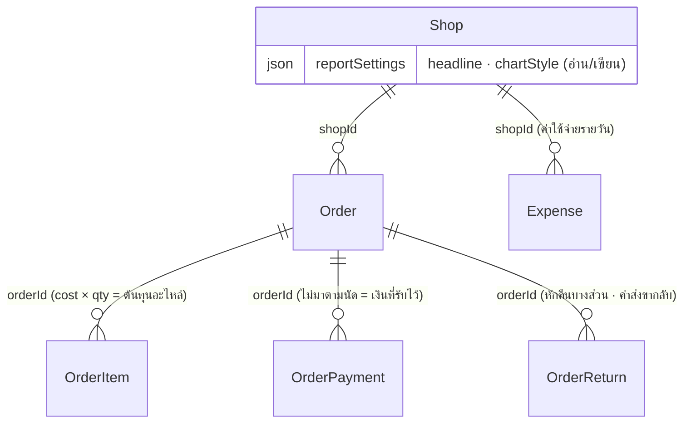

> **โมดูล:** 00078 — Service Report Redesign
> **ประเภทเอกสาร:** DATABASE
> **เวอร์ชัน:** 1.0
> **วันที่จัดทำ:** 2026-10-17
> **สถานะ:** Draft

# DATABASE: หน้ายอดขายและกำไรของร้านบริการ

## 1. Overview
**ไม่มีการเปลี่ยน schema และไม่มี migration** — ฟีเจอร์นี้อ่านตารางเดิม และเขียนเฉพาะคีย์เดิมใน `Shop.reportSettings` (JSON)

| รายการ | ค่า |
|---|---|
| ตารางใหม่ | ไม่มี |
| คอลัมน์ใหม่ | ไม่มี |
| Migration | ไม่มี (HR15 ไม่เกี่ยว — push main ไม่รัน migrate ใหม่) |

## 2. ERD

## 3. Tables

### 3.1 `Shop` (Postgres)
| คอลัมน์ | การใช้ | หมายเหตุ |
|---|---|---|
| `reportSettings` (jsonb, null ได้) | อ่าน/เขียนคีย์ `headline`, `chartStyle` | ค่าเก่าทุกคีย์คงอยู่ · null = ค่าตั้งต้น (ยอดขาย + แท่ง) |
| `vertical` | อ่าน | แตกทางร้านบริการ (`SERVICE_QUEUE`) |

**การแปลงค่าตอนอ่าน (ไม่เขียนกลับ)**
| ค่าในฐาน | จอแสดง |
|---|---|
| `headline = NET_PROFIT` | กำไร |
| `headline = SALES` / `RECEIVED` / อื่น ๆ / ไม่มี | ยอดขาย |
| `chartStyle = LINE` / `AREA` | เส้น |
| `chartStyle = STACKED` / `GROUPED` / อื่น ๆ / ไม่มี | แท่ง |

### 3.2 ตารางที่อ่านอย่างเดียว
| ตาราง | คอลัมน์ที่ใช้ |
|---|---|
| `Order` | `shopId` `status` `totalAmount` `createdAt` `serviceClosedAt` `appointmentStatus` `publicToken` `orderNo` `buyerName` |
| `OrderItem` | `cost` `qty` |
| `OrderPayment` | `amount` `voidedAt` |
| `Expense` | `shopId` `amount` `expenseDate` |
| `OrderReturn` | `status` `receivedAt` `countAsCost` `shippingCost` + ยอดหักคืน (`getReturnAdjustments`) |

## 4. Indexes
ไม่เพิ่ม — ใช้ดัชนีที่มีอยู่
| ดัชนี | ใช้กับ |
|---|---|
| `Order [shopId, serviceClosedAt]` | ปิดงานแล้วตามวันปิดงาน (ช่วง/วัน) |
| `Order [shopId, createdAt DESC, id DESC]` (`Order_shopId_createdAt_id_idx`) | ยังไม่ปิดงานตามวันเปิดบิล |
| `Expense [shopId, expenseDate]` | ค่าใช้จ่ายของช่วง |

## 5. Migration Plan

### 5.1 ลำดับการ Migrate
ไม่มี

### 5.2 Rollback
revert โค้ดอย่างเดียวพอ — ค่าใน `reportSettings` ยังเป็นรูปแบบเดิมทุกคีย์ หน้าตั้งค่าเดิม (00073) อ่านได้ทันที

### 5.3 ผลกระทบ (Impact)
ไม่มีการล็อกตาราง ไม่มี backfill · ร้านขายของ/ที่พักไม่ถูกอ่าน/เขียน `reportSettings` โดยฟีเจอร์นี้

## 6. Retention / ข้อควรระวัง
- `PATCH` merge ทับ JSON ดิบ — ห้ามเปลี่ยนเป็นการเขียนทับทั้งก้อน (ค่าเดิมของร้านจะหาย · มีเทส DB คุม)
- `Expense.expenseDate` = เที่ยงคืน UTC ของวันปฏิทิน · วันของงานคิดตามเวลาไทย (UTC+7)

## 7. Traceability
| BRD | ตาราง/คอลัมน์ |
|---|---|
| FR-003 | `Order` `OrderItem` `OrderPayment` `Expense` `OrderReturn` |
| FR-004 | `Order` (+ ดัชนี 2 ตัว) |
| FR-012 | `Shop.reportSettings` |

## 8. สรุป (Summary)
ไม่มีการเปลี่ยนฐานข้อมูล · อ่านตารางเดิม · เขียนแค่ 2 คีย์เดิมใน `Shop.reportSettings` โดยไม่ลบค่าอื่น
