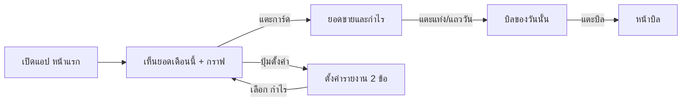

> **โมดูล:** 00078 — Service Report Redesign
> **ประเภทเอกสาร:** Product Requirements Document (PRD)
> **เวอร์ชัน:** 1.0
> **วันที่จัดทำ:** 2026-10-17
> **สถานะ:** Draft — รอ user อนุมัติ (HR11) ก่อนเขียนโค้ด
> **เจ้าของเอกสาร:** BA + PO + PM
> **ต้นแบบที่ user เลือก:** https://claude.ai/artifact/RBwhMrruMgVzAfN3BYNe1f (v11 · ข้อมูลจริง BT Premium - สุขสวัสดิ์)

# PRD: ออกแบบหน้ายอดขายและกำไรของร้านบริการใหม่

## Executive Summary

จอรายงานการเงินของ **ร้านบริการ (SERVICE_QUEUE) เท่านั้น** ที่ทำใน 00073 (#154 #156 #157) รกเกินไป
มี 3 แท็บ ตั้งค่า 10 ข้อ คำเรียกยอดคนละแบบในแต่ละจอ และข้อความอธิบายแปะหลายจุด
user สั่งรื้อใหม่ให้ **เรียบ ใช้คำง่าย และมีโครงเดียวกับหน้า "ยอดขายและกำไร" ของร้านขายของ**
โดยเนื้อหาเป็นของร้านบริการ และใช้คำตามหลัก impeccable/clarify

ร้านขายของ ร้านที่พัก รายงานกลุ่ม LINE (00070) และหน้าอื่นทั้งหมด **ไม่เปลี่ยน**

## 1. Business Goals & KPIs

### 1.1 เป้าหมายทางธุรกิจ
- เจ้าของร้านบริการเปิดแอปแล้วรู้ยอดเดือนนี้ภายใน 1 วินาทีที่มอง (ตัวเลขเดียวบนหน้าแรก)
- ดูรายละเอียดได้ในหน้าเดียว ไม่ต้องสลับแท็บ ไม่ต้องอ่านคำอธิบาย
- คำเรียกยอดตรงกันทุกจอ (ปิดงานแล้ว / ยังไม่ปิดงาน / กำไร (งานที่ปิดแล้ว))
- ตั้งค่าได้ใน 2 ข้อ และเห็นผลทันที

### 1.2 ตัวชี้วัดความสำเร็จ (KPIs)
| ตัวชี้วัด | เป้า |
|---|---|
| จำนวนข้อตั้งค่ารายงาน | 10 → 2 |
| จำนวนแท็บในหน้ารายงาน | 3 → 0 |
| ข้อความอธิบายที่แปะบนจอรายงาน | 6–7 จุด → 0 |
| คำเรียกยอดที่ไม่ตรงกันข้ามจอ | ≥3 ชุด → 1 ชุด |
| query ฐานข้อมูลตอนเปิดหน้า /sales ของร้านบริการ | ไม่ดึงออเดอร์ทั้งร้าน (ปัจจุบัน `getOrdersByShop` ทั้งร้าน) |

## 2. User Personas (กลุ่มผู้ใช้งาน)

### 2.1 เจ้าของร้านบริการ (OWNER · สิทธิ์ F1)
ร้านติดตั้งไฟรถ ร้านซ่อม ร้านคิว ใช้มือถือเป็นหลัก อยากรู้แค่ "เดือนนี้ได้เท่าไร งานค้างปิดเท่าไร กำไรเท่าไร"
ไม่ถนัดศัพท์บัญชี ไม่อ่านข้อความยาว

### 2.2 พนักงานร้านบริการ (MANAGER / CHAT / BILLING / TECHNICIAN)
**ไม่เห็นจอเหล่านี้อยู่แล้ว** (ด่านเดิม F1 + `dashboardMoney`) — 00078 ไม่เปลี่ยนสิทธิ์ใด ๆ

## 3. Business Requirements

### 3.1 หน้าแรก — การ์ดยอดขาย (มือถือ + คอม)
- หัวการ์ด: ไอคอน + ชื่อ ("ยอดขาย" หรือ "กำไร" ตามตั้งค่า) · **ปุ่มตั้งค่าอยู่หน้า** ปุ่ม วันนี้/เดือนนี้
- ตัวเลขใหญ่ตามตั้งค่า + บรรทัดเดียว "▲ เพิ่มขึ้น X% เทียบ 1–16 ก.ย." (วันนี้: "เทียบ ค่าเฉลี่ย 14 วันล่าสุด")
- กราฟตามตั้งค่า (แท่ง/เส้น) · แตะแท่งได้ถึงวันนี้ ขึ้นป้ายยอดวันนั้น
- **ไม่มี**ป้ายสี/จำนวนงาน/ยอดขาย-หักออก ใต้ตัวเลข (ดูในหน้ายอดขายและกำไร)
- แตะการ์ด → หน้า "ยอดขายและกำไร"
- คอม: การ์ดเดียวกันแบบกว้าง แทน การ์ดสถิติรายได้/จำนวนงาน + กราฟ "รายงานยอดขาย" เดิม

### 3.2 หน้า "ยอดขายและกำไร" (แทนชีต 3 แท็บบนมือถือ และ /sales บนคอม)
โครงเดียวกับหน้าร้านขายของ เรียงบนลงล่าง:
1. หัว "ยอดขายและกำไร" + รายวัน / รายเดือน + เลื่อนช่วง ‹ ต.ค. 2569 ›
2. ตัวเลขใหญ่ตามตั้งค่า (กำไรติดลบแสดง "ขาดทุน" สีแดง) + บรรทัด % เทียบ
3. แถบสมการ — ยอดขาย: ● ปิดงานแล้ว + ● ยังไม่ปิดงาน · กำไร: ● ปิดงานแล้ว − ต้นทุนอะไหล่ − ● ค่าใช้จ่าย (ต้นทุนแสดงเมื่อ > 0)
4. กราฟแท่งซ้อน เขียว/เหลือง (หรือเส้นตามตั้งค่า) แตะแท่ง → ตารางเลื่อนไปวันนั้นและกางบิล
5. ตาราง: วันที่ · งาน · ปิดงานแล้ว · ยังไม่ปิดงาน · (ต้นทุน) · ค่าใช้จ่าย · กำไร (งานที่ปิดแล้ว) — ใหม่สุดก่อน แสดงเฉพาะวันที่มีความเคลื่อนไหว
6. แตะแถววัน → กางรายการบิลของวันนั้น (ป้าย ปิดงานแล้ว/ยังไม่ปิดงาน · เลขบิล · ยอด) แตะบิล → หน้าบิล
- ไม่มีแท็บ · ไม่มี "ต้องตามเก็บ" · ไม่มีมัดจำ · ไม่มีข้อความอธิบาย

### 3.3 ตั้งค่ารายงาน (เหลือ 2 ข้อ)
- **ตัวเลขที่อยากเห็นก่อน** — ยอดขาย (รวมงานที่ยังไม่ปิดงานด้วย) / กำไร (เฉพาะงานที่ปิดงานแล้ว หักต้นทุนและค่าใช้จ่าย) · กล่องโชว์ตัวเลขจริงของร้าน
- **รูปแบบกราฟ** — แท่ง / เส้น (ใช้กับกราฟทุกหน้า)
- ตัวอย่างบนหน้าแรก เปลี่ยนตามทันที · บันทึกทันทีที่เลือก
- ทางเข้า: ปุ่มบนการ์ดหน้าแรก · ไอคอนบนหน้ายอดขายและกำไร · ร้านค้า › ตั้งค่ารายงาน (เดิม) · เมนูตั้งค่า (เดิม)

### 3.4 ตัวกลาง (central) และประสิทธิภาพ
- คำทุกคำของจอเหล่านี้มาจากที่เดียว (ตัวกลางคำของร้านบริการ) — ห้ามพิมพ์คำซ้ำในแต่ละไฟล์
- ตัวเลขทุกจอคิดจากตัวคำนวณเดียว (view-model กลาง) ตัวเลขหน้าแรก = หน้ายอดขายและกำไร เสมอ
- สีจาก `finance-colors.ts` (ไม่แก้ไฟล์นี้ — LINE ใช้ร่วม)
- หน้า /sales ร้านบริการเลิกดึงออเดอร์ทั้งร้าน · รายการบิลรายวันโหลดเมื่อแตะเท่านั้น

## 4. Business Rules & Constraints

### 4.1 กฎทางธุรกิจหลัก
- **ยอดขาย** = ปิดงานแล้ว (นับตามวันปิดงาน `serviceClosedAt`) + ยังไม่ปิดงาน (นับตามวันเปิดบิล) — ไม่นับ ยกเลิก/คืน/ร่าง (กติกาเดิม 00073)
- **กำไร (งานที่ปิดแล้ว)** = ปิดงานแล้ว − ต้นทุนอะไหล่ − ค่าใช้จ่ายร้าน (นิยามเดียวทั้งระบบ HR16)
- **% เทียบ** = ยอดขายช่วงนี้ เทียบช่วงเดียวกันของเดือนก่อน (ถึงวันเดียวกัน) · วันนี้เทียบค่าเฉลี่ย 14 วัน · ช่วงก่อนเป็น 0 → ไม่แสดง
- เห็นได้เฉพาะเจ้าของร้าน (ด่าน F1 เดิม)

### 4.2 ข้อจำกัดทางธุรกิจ
- **ร้านบริการเท่านั้น** — กั้นด้วย `usesServiceFinanceRules` ทุกจุด ร้านอื่นวิ่งโค้ดเดิมทุกบรรทัด
- **ห้ามแตะรายงานกลุ่ม LINE** (00070 · `line-report-*`, `src/lib/line*`, `/lr`) และเส้นทาง `getSalesSeries` ที่ไม่ส่ง vertical
- ไม่แก้ข้อมูลในฐาน · ไม่มี migration (ใช้ `Shop.reportSettings` เดิม)

### 4.3 การย้ายตั้งค่าเดิม
| ค่าเดิม | ค่าใหม่ |
|---|---|
| headline SALES / RECEIVED | ยอดขาย |
| headline NET_PROFIT | กำไร |
| chartStyle STACKED / GROUPED | แท่ง |
| chartStyle LINE / AREA | เส้น |
| สวิตช์ 6 ตัว · defaultRange · unclosedDisplay | เลิกใช้ — ระบบถือค่าเริ่มต้น (ค่าเดิมในฐานไม่ลบ ย้อนกลับได้) |

## 5. Out of Scope (นอกขอบเขต)
- ร้านขายของ ร้านที่พัก และหน้ารวมหลายธุรกิจ (portfolio)
- รายงานกลุ่ม LINE และหน้า `/lr`
- หน้าบิล หน้าออเดอร์ หน้าคิว (ยกเว้นลิงก์จากรายการบิลไปหน้าบิล)
- การจัดการค่าใช้จ่าย (เพิ่ม/แก้/ลบ) — ใช้หน้าที่มีอยู่ (ดูคำถาม Q-1)
- สิทธิ์พนักงาน

## 6. Risks & Mitigation (ความเสี่ยงและแนวทางแก้ไข)

### 6.1 ความเสี่ยงทางธุรกิจ
| ความเสี่ยง | แนวทาง |
|---|---|
| ร้านที่เคยปิดสวิตช์ไว้ จะเห็นค่าเริ่มต้น | user ยอมรับแล้ว (2026-10-16) · ค่าเดิมในฐานไม่ลบ |
| ตัด "ต้องตามเก็บ"/มัดจำ ร้านที่ใช้อยู่หาไม่เจอ | ถาม user (Q-2) ก่อนตัด |
| ยอดในแอปกับในกลุ่ม LINE นับต่างกัน (LINE นับทุกบิลตามวันเปิดบิล) | ตั้งใจ ตามมติหัวหน้า #165 |

### 6.2 ความเสี่ยงทางเทคนิค
| ความเสี่ยง | แนวทาง |
|---|---|
| แก้ `getSalesSeries` แล้ว LINE/ร้านขายของเพี้ยน | ไม่แก้กติกาเดิม · ถ้าปรับประสิทธิภาพต้องอยู่ใต้เงื่อนไขร้านบริการเท่านั้น + parity test LINE ต้องเขียว |
| เทสเดิมที่ปักรูปโค้ดของจอเก่าแดง | อัปเดตโดยคงเจตนา + เทสใหม่ปักโครงใหม่ |
| ร้านขายของได้รับผลโดยไม่ตั้งใจ | snapshot ข้อความ+ภาพจอร้านขายของก่อน/หลัง ต้องเท่ากัน |

## 7. Glossary (อภิธานศัพท์)
| คำบนจอ | ความหมาย |
|---|---|
| ปิดงานแล้ว | งานที่ร้านกดปิดงาน นับตามวันปิดงาน |
| ยังไม่ปิดงาน | บิลที่ยังไม่ปิดงานและไม่ถูกยกเลิก นับตามวันเปิดบิล |
| ยอดขาย | ปิดงานแล้ว + ยังไม่ปิดงาน |
| กำไร (งานที่ปิดแล้ว) | ปิดงานแล้ว − ต้นทุนอะไหล่ − ค่าใช้จ่าย |
| งาน | หน่วยนับบิลของร้านบริการ (ไม่ใช้ "บิล" เป็นหน่วยนับ) |

## 8. Success Metrics (ตัวชี้วัดความสำเร็จ)
- ตัวเลขการ์ดหน้าแรก = ตัวเลขหน้ายอดขายและกำไร = SQL อ้างอิง (ร้านสุขสวัสดิ์ ต.ค. 636,900 / 248,300 / 388,600 / 119,949 / 128,351)
- ร้านขายของ: ข้อความและภาพจอก่อน/หลัง เท่ากันทุกตัว
- LINE parity test เขียว

## 9. Dependencies & Assumptions

### 9.1 สิ่งที่ต้องพึ่งพา (Dependencies)
- 00073 (serviceClosedAt, unclosed) · ด่านสิทธิ์ 00071 (F1, `dashboardMoney`) · `finance-colors.ts`

### 9.2 สมมติฐาน (Assumptions)
- ร้านบริการไม่มีค่าส่ง (NO_SHIPPING) จึงไม่มีคอลัมน์ค่าส่ง
- ต้นทุนอะไหล่ร้านส่วนใหญ่ยังไม่ลง — คอลัมน์ต้นทุนแสดงเมื่อมีค่าเท่านั้น

## 10. Appendix

### 10.1 ตัวอย่าง User Journey

### 10.2 มติ user (2026-10-17)
- **Q-1 ค่าใช้จ่าย → ใช้ของเดิม:** หน้า `/expenses` (00016 · 2026-07-08) มีอยู่แล้ว · ตั้งแต่ 00067 ร้านบริการถูก redirect ไป `/sales?tab=expense` และเมนูชี้ `FINANCE_EXPENSE_TAB_URL`
  ⇒ 00078 ถอด redirect (ร้านบริการเท่านั้น) + เมนู "ค่าใช้จ่าย" ของร้านบริการชี้ `/expenses` · ลิงก์เก่า `/sales?tab=expense` ต้องพาไป `/expenses` (บุ๊กมาร์ก/ทางลัด)
  · ร้านบริการไม่เห็นการ์ด P&L 5 ใบในหน้านี้ (กำไรอยู่ในหน้ายอดขายและกำไรแล้ว) · คำในหน้านี้ใช้คำของร้านบริการ (แก้บั๊ก "สินค้า"/ค่าส่งระบบ ที่เคยหลุด)
- **Q-2 เอาออก:** "ต้องตามเก็บ" มีมาก่อนเราแก้ (00067) · "มัดจำล่วงหน้า" ไม่มีมาก่อน (เราเพิ่มใน 00073) — เอาออกจากรายงานทั้งคู่ (ข้อมูลในบิลไม่หาย)
- **Q-3 ใช่:** หน้าแรกบนคอม แทนเฉพาะส่วนรายงาน · ส่วนอื่นคงเดิมแบบก่อนแก้
- **Q-4 แสดงเสมอ:** การ์ดกำไรในหน้าบิลแสดงแบบค่าเริ่มต้นเสมอ
- ต้นแบบ v12 มีหน้า "ค่าใช้จ่าย" (หน้าเดิม) + ทางเข้า: เมนูข้าง (คอม) · ร้านค้า › ค่าใช้จ่าย (มือถือ)
