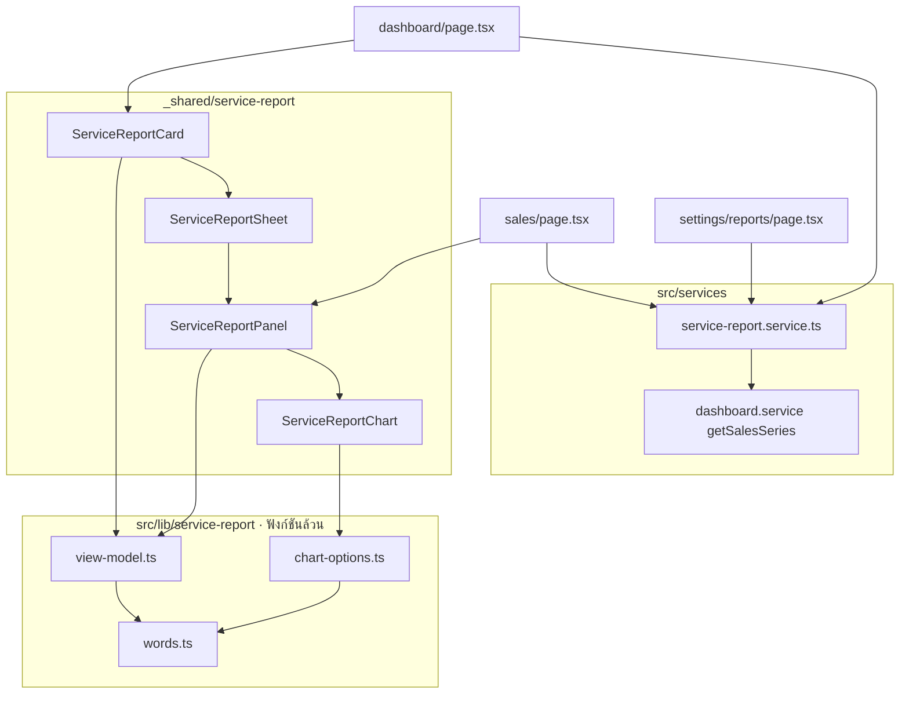
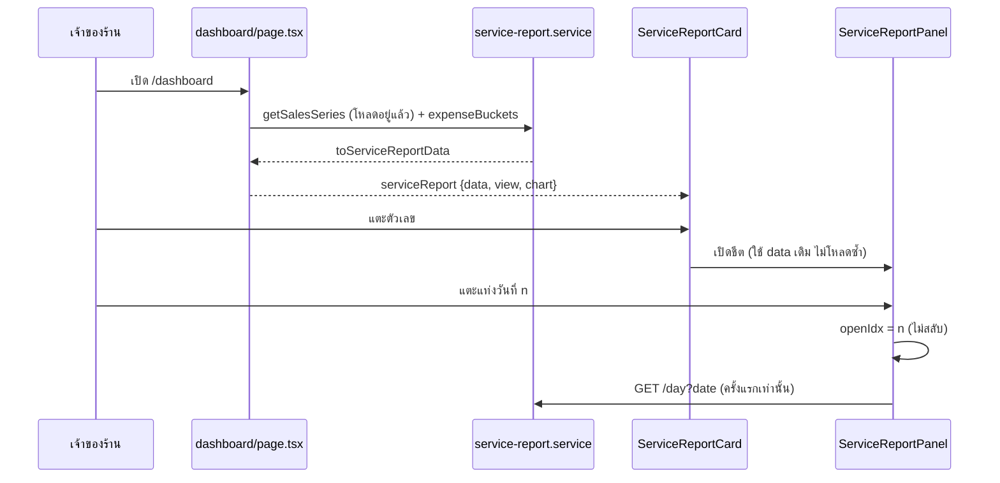

> **โมดูล:** 00078 — Service Report Redesign
> **ประเภทเอกสาร:** System Design Spec
> **เวอร์ชัน:** 1.0
> **วันที่จัดทำ:** 2026-10-17
> **สถานะ:** Draft

# SDS: หน้ายอดขายและกำไรของร้านบริการ (System Design Spec)

## 1. บทนำ & References

### 1.1 วัตถุประสงค์
อธิบายการออกแบบตัวกลางและการเชื่อมกับจอเดิม ให้ทุกจอรายงานของร้านบริการใช้ตัวเลข/คำ/กราฟชุดเดียว

### 1.2 ขอบเขตการออกแบบ
ตัวกลาง (`src/lib/service-report/*`) · ตัวโหลด (`src/services/service-report.service.ts`) · API 2 ตัว · คอมโพเนนต์ `_shared/service-report/*` · จุดแตกทางในหน้าแรก `/sales` `/settings/reports` `/expenses` เมนู และหัวจอมือถือ

### 1.3 เอกสารอ้างอิง
[[PRD]] · [[BRD]] · [[SRS]] · [[API]] · ต้นแบบที่ user อนุมัติ (artifact v12)

## 2. Architecture Overview

### 2.1 มุมมองสถาปัตยกรรม

### 2.2 มุมมองการ Deploy (ถ้าจำเป็น)
ไม่เปลี่ยน

## 3. Component Design
| คอมโพเนนต์ | ความรับผิดชอบ | หมายเหตุการออกแบบ |
|---|---|---|
| `words.ts` | คำทุกคำ + `deltaSentence` | ประโยคเต็ม ไม่ต่อเศษคำ (clarify) |
| `view-model.ts` | `buildServiceReport` · `buildServiceToday` · `compareLabelOf` · `deltaOf` | ข้อมูล serializable ข้าม RSC → client ได้ |
| `chart-options.ts` | `buildServiceChartOptions` · `anchorIndexes` | สีรับเป็นค่าที่ resolve แล้ว (เทสใน node ได้) · ห้ามคีย์ค่า `undefined` |
| `service-report.service.ts` | โหลดหนึ่งช่วง + บิลของวัน | ไม่ตัดสินสิทธิ์ (ผู้เรียกกั้น F1 + ร้านบริการ) |
| `ServiceReportCard` | การ์ดหน้าแรก วันนี้/เดือนนี้ · ปุ่มตั้งค่าก่อนตัวกรอง | มือถือ: เปิดชีต · คอม: ลิงก์ `/sales` |
| `ServiceReportSheet` | ชีตเต็มจอ + `useLockBodyScroll` | ปิดเองเมื่อจอ ≥ lg |
| `ServiceReportPanel` | รายวัน/รายเดือน · ‹ ช่วง › · ตัวเลข · แถบสมการ · กราฟ · ตาราง · บิลของวัน | `layout: 'sheet' \| 'page'` · โหลดบิลครั้งเดียวต่อวัน (นอก state updater) |
| `ServiceReportChart` | ApexChart wrapper + สี token | `FINANCE_COLORS` อ่านอย่างเดียว |
| `ReportSettingsForm` | 2 กลุ่มการ์ดเลือก + ตัวอย่างหน้าแรก | บันทึกทันที (optimistic) ผ่าน `serviceReportPatch` |

## 4. Data Flow

### 4.1 Flow หลัก: เปิดหน้าแรก → ชีต → แตะวัน

### 4.2 Flow กรณีล้มเหลว / ชดเชย (ถ้ามี)
- โหลดช่วงไม่สำเร็จ → แผงแสดง "โหลดข้อมูลไม่สำเร็จ" + ปุ่ม "ลองใหม่" (ตัวเลขเดิมไม่ถูกล้าง)
- โหลดบิลของวันไม่สำเร็จ → สถานะ `error` ของวันนั้น แตะอีกครั้งโหลดใหม่ได้
- บันทึกตั้งค่าไม่สำเร็จ → ย้อนค่าที่เลือก + `pacesToast` "บันทึกไม่สำเร็จ ลองอีกครั้ง"

## 5. Integration Points
| จุด | การเปลี่ยน | ร้านอื่น |
|---|---|---|
| `dashboard/page.tsx` | สร้าง `serviceReport` เมื่อ `usesServiceFinanceRules` · คอมแถว 3 ใช้การ์ดใหม่แทน `SalesReport` · ถอดบล็อก headline 00073 | ไม่เข้าทาง |
| `CommandCenter.tsx` | `serviceReport && !portfolio` → การ์ดใหม่ | `SalesChartCard` เดิม |
| `sales/page.tsx` | ร้านบริการ → หน้าเดียว · `?tab=expense` → `/expenses` | โค้ดเดิม |
| `expenses/page.tsx` + `ExpenseWorkspace` | ร้านบริการเปิดได้ (เดิม redirect) · `showReport=false` ซ่อนการ์ด P&L | ค่าเริ่ม `true` |
| `seller-menu.ts` + `th/en` dict | ป้าย `/sales` = "ยอดขายและกำไร" · เมนูค่าใช้จ่ายชี้ `/expenses` | "ภาพรวมกำไร/ขาดทุน" เดิม |
| `getSellerPageTitle` + `SellerMobileHeader` + layout | พารามิเตอร์ `salesLabel` (ส่งเฉพาะร้านบริการ) | ไม่ส่ง = ป้ายเดิม |
| `dashboard-money.ts` | redact ลบ `serviceReport` | — |
| `route-capabilities.ts` | ประกาศ 2 route เป็น F1 | — |

## 6. Technical Decisions

### TD-001: ตัวคำนวณเป็นฟังก์ชันล้วนใน `src/lib`
ทุกจอเรียกตัวเดียว ⇒ ตัวเลขตรงกันโดยโครงสร้าง และเทสได้โดยไม่ต้องมี DB/DOM (convention `ui-boolean-needs-a-testable-home`)

### TD-002: ต่อยอด `getSalesSeries` แทนเขียน query ใหม่
กติกานับเงินของ 00073 อยู่ที่นั่นแล้ว — เขียนซ้ำ = นิยามสองชุด (HR16) · เพิ่มแค่ `unclosedCounts` ในทางร้านบริการ · ทางที่ไม่ส่ง `vertical` (รายงาน LINE) ไม่เปลี่ยน

### TD-003: ตั้งค่า = แปลงตอนอ่าน ไม่ migrate
ร้านที่เคยเลือกค่าเดิมยังเห็นสิ่งที่ใกล้เคียงที่สุด · ย้อนกลับได้ทันทีโดยไม่ต้องแก้ข้อมูล · `updateReportSettings` merge ทับ JSON ดิบ

### TD-004: แตะกราฟ = เปิดวันนั้น (ไม่สลับ)
ApexCharts ยิง `dataPointSelection` 2 ครั้งต่อแตะ (listener บน path + delegate ของกลุ่ม) — สลับแล้วเปิด-ปิดทันที · ส่ง callback คงตัวผ่าน ref ให้กราฟเพื่อไม่ให้ options ถูกสร้างใหม่ทุกครั้งที่บิลโหลดเสร็จ

### TD-005: ป้ายแกน x ใช้ `axisAnchorDays` ของร้านขายของ
กติกาเดียวกันทั้งระบบ (ห่าง ≥ 3 ช่อง · มีวันนี้) — แก้ "30""31" ติดกันบนมือถือ

## 7. Traceability
| BRD | ออกแบบ (ข้อ) |
|---|---|
| FR-001, FR-002 | §3 `view-model` `words` · TD-001 |
| FR-003, FR-004 | §3 service · TD-002 · §4.1 |
| FR-010, FR-011 | §3 Card/Sheet/Panel · §5 · TD-004/005 |
| FR-012, FR-013 | §3 ReportSettingsForm · TD-003 |

## 8. สรุป (Summary)
ตัวกลางฟังก์ชันล้วน + ตัวโหลดที่ต่อยอดของเดิม + คอมโพเนนต์ชุดเดียวใช้ทั้งมือถือ/คอม · แตกทางเฉพาะร้านบริการทุกจุด
