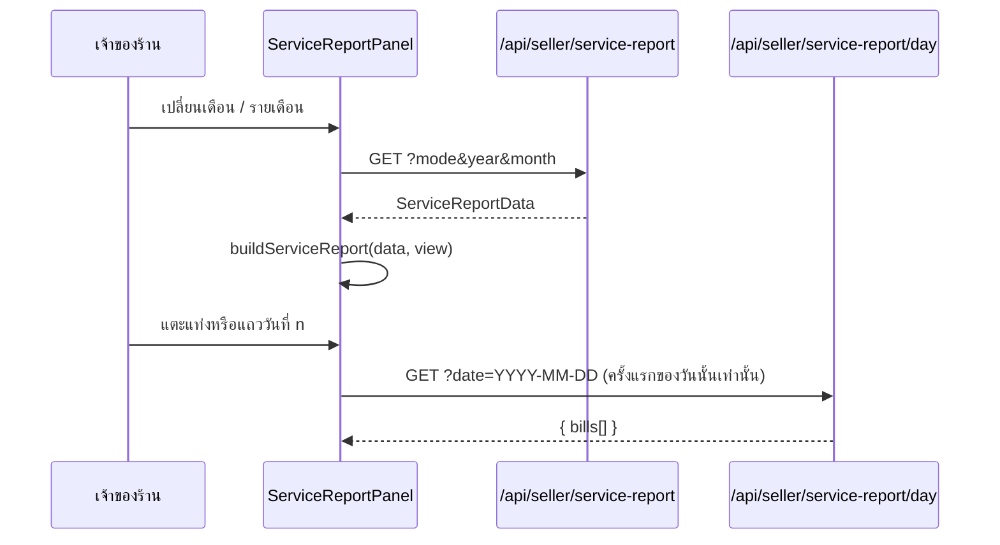
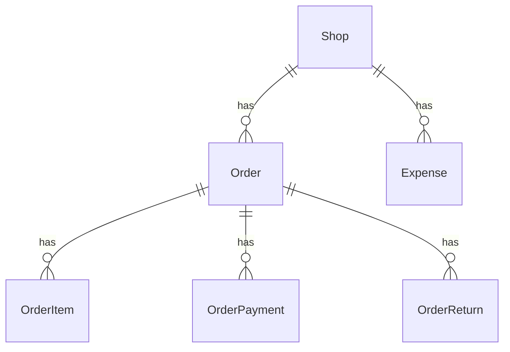

> **โมดูล:** 00078 — Service Report Redesign
> **ประเภทเอกสาร:** Software Requirements Specification (Technical)
> **เวอร์ชัน:** 1.0
> **วันที่จัดทำ:** 2026-10-17
> **สถานะ:** Draft

# SRS: หน้ายอดขายและกำไรของร้านบริการ (Software Requirements Specification — Technical)

## 1. บทนำ (Introduction)

### 1.1 วัตถุประสงค์ของเอกสาร
แปลง BRD 00078 เป็นข้อกำหนดเชิงเทคนิค: ตัวกลางคำนวณ · ตัวโหลดฝั่ง server · API 2 ตัว · การแปลงค่าตั้งค่าเดิม · จุดเชื่อมกับจอเดิม

### 1.2 ขอบเขตเชิงระบบ (System Scope)
- **อยู่ในขอบเขต:** ร้าน `SERVICE_QUEUE` เท่านั้น — การ์ดยอดขายหน้าแรก (มือถือ/คอม) · ชีตเต็มจอ · `/sales` · `/settings/reports` · เมนู/หัวจอมือถือของ `/sales` · `/expenses` (ซ่อนการ์ด P&L)
- **นอกขอบเขต:** ร้านขายของ/ที่พัก (ทุกจอคงเดิม) · รายงานกลุ่ม LINE (00070 — ไม่แตะไฟล์ใด) · สิทธิ์ (ใช้ F1 เดิม) · กติกานับเงิน 00073 (ไม่เปลี่ยน) · schema (ไม่มี migration)

### 1.3 เอกสารอ้างอิง (References)
- [[PRD]] · [[BRD]] ของ 00078 (มติ Q-1..Q-4 ใน PRD §10.2)
- `docs/20 - Features/00073 - Service Four-Step Flow/` (กติกาปิดงาน/ยังไม่ปิดงาน)
- `docs/SRS.md` §1 (00073) · §7 API Reference

### 1.4 นิยามและตัวย่อ (Definitions & Acronyms)
| คำ | ความหมาย |
|---|---|
| ปิดงานแล้ว | งานที่ `serviceClosedAt` ไม่ว่าง นับตาม **วันปิดงาน** (เวลาไทย) · ไม่มาตามนัด = เงินที่รับไว้ (ไม่ถูกยกเลิกรายการ) |
| ยังไม่ปิดงาน | `serviceClosedAt` ว่าง นับตาม **วันเปิดบิล** (`createdAt`) |
| ยอดขาย | ปิดงานแล้ว + ยังไม่ปิดงาน |
| กำไร (งานที่ปิดแล้ว) | ปิดงานแล้ว − ต้นทุนอะไหล่ − ค่าใช้จ่ายร้าน |
| ไม่นับ | สถานะ `CANCELLED` / `RETURNED` / `DRAFTED` |
| F1 | capability การเงินเต็ม (เจ้าของร้านเท่านั้น · 00071) |

## 2. ภาพรวมสถาปัตยกรรม (Architecture Overview)

### 2.1 บริบทระบบ (System Context)
```mermaid
flowchart LR
  U[เจ้าของร้านบริการ] --> D[หน้าแรก /dashboard]
  U --> S[/sales]
  U --> ST[/settings/reports]
  D -->|RSC| L[service-report.service]
  S -->|RSC| L
  ST -->|RSC| L
  P[ServiceReportPanel client] -->|GET /api/seller/service-report| L
  P -->|GET /api/seller/service-report/day| B[getServiceReportDayBills]
  L --> G[getSalesSeries เดิม · ทางร้านบริการ]
  L --> E[(Expense · OrderReturn)]
  G --> O[(Order · OrderItem · OrderPayment)]
  B --> O
  L --> VM[view-model ฟังก์ชันล้วน]
```

### 2.2 องค์ประกอบหลัก (Components)
| องค์ประกอบ | ไฟล์ | หน้าที่ |
|---|---|---|
| คำกลาง | `src/lib/service-report/words.ts` | ทุกคำบนจอ (FR-002) |
| ตัวคำนวณกลาง | `src/lib/service-report/view-model.ts` | ตัวเลขใหญ่ · % · แถบสมการ · ชุดกราฟ · แถวตาราง (FR-001) |
| ตัวสร้างกราฟ | `src/lib/service-report/chart-options.ts` | ApexOptions (แท่ง/เส้น · กำไรติดลบสีแดง · แตะได้ถึงวันนี้) |
| ตัวโหลด | `src/services/service-report.service.ts` | `getServiceReportData` · `expenseBuckets` · `toServiceReportData` · `getServiceReportDayBills` (FR-003/004) |
| ตั้งค่า | `src/lib/report-settings.ts` | แปลงค่าเดิม → 2 ข้อ · `serviceReportView/Chart/Patch` (FR-012) |
| จอ | `src/app/(paces)/seller/(dashboard)/_shared/service-report/*` | Card · Sheet · Panel · Chart |

### 2.3 มุมมองการ Deploy (Deployment View)
ไม่มีโครงสร้างใหม่ — Next.js เดิม (Vercel) + Postgres เดิม · ไม่มี migration · ไม่มี cron/env ใหม่

## 3. ข้อกำหนดเชิงฟังก์ชันเชิงเทคนิค (Technical Functional Requirements)

### TFR-001: ตัวคำนวณกลางเป็นฟังก์ชันล้วน
`buildServiceReport(data, view)` / `buildServiceToday(data, view)` ไม่ import prisma/React/window · การ์ด ชีต และ `/sales` เรียกตัวเดียวกัน · % เทียบ = ยอดขายช่วงนี้ เทียบช่วงก่อนถึงวันเดียวกัน · ช่วงก่อน ≤ 0 → ไม่แสดง (trace: FR-001)

### TFR-002: คำทั้งหมดมาจาก `SERVICE_REPORT_WORDS`
ไฟล์จอไม่พิมพ์คำซ้ำ · ป้ายเมนู `/sales` ร้านบริการ = `FINANCE_MENU_LABEL` = `SERVICE_REPORT_WORDS.pageTitle` และพจนานุกรม `menu.salesFinance` (th) ต้องเท่ากัน (เทสคุม) · หัวจอมือถือรับ `salesLabel` จาก layout (trace: FR-002, FR-011)

### TFR-003: ตัวโหลดหนึ่งช่วง = 2 query ขนาน
`getSalesSeries(shopId, mode, period, includeFinance=true, vertical)` (ทางร้านบริการเดิม — เพิ่มแค่ `unclosedCounts`) + `expenseBuckets` (ค่าใช้จ่าย + ค่าส่งขากลับของใบคืนที่รับแล้ว นิยามเดียวกับกราฟการเงินเดิม) · ไม่ดึงออเดอร์ทั้งร้าน · หน้าแรกใช้ `toServiceReportData` ต่อจาก series ที่โหลดอยู่แล้ว (ไม่ query ซ้ำ) (trace: FR-003)

### TFR-004: บิลของวัน โหลดเมื่อแตะ
`getServiceReportDayBills(shopId, YYYY-MM-DD)` คืนบิลที่ปิดงานวันนั้น + บิลยังไม่ปิดงานที่เปิดวันนั้น · ยอดต่อบิลใช้กติกาเดียวกับ `getSalesSeries` (หักคืนบางส่วน · ไม่มาตามนัด = เงินที่รับไว้) ⇒ ผลรวม = ยอดของแถว · client โหลดครั้งเดียวต่อวัน (trace: FR-004)

### TFR-005: ตั้งค่า 2 ข้อ ไม่ทำลายค่าเดิม
`resolveReportSettings` (ร้านบริการ) คืนค่าตั้งต้นทุกสวิตช์ที่เลิกใช้ + `headline` (`NET_PROFIT` → กำไร · อื่น ๆ → ยอดขาย) + `chartStyle` (`LINE`/`AREA` → เส้น · อื่น ๆ → แท่ง) · `updateReportSettings` merge patch ทับ JSON ดิบในฐาน (ไม่ลบคีย์เดิม) · ค่าตั้งต้น = ยอดขาย + แท่ง (trace: FR-012)

### TFR-006: กั้นร้านอื่นทุกชั้น
หน้าแรก/`/sales`/`/settings/reports` แตกทางด้วย `usesServiceFinanceRules(vertical)` · API คืน 404 สำหรับร้านที่ไม่ใช่บริการ · `redactCommandCenterData` ลบ `serviceReport` สำหรับผู้ไม่ใช่เจ้าของ (trace: BRD §3.2)

## 4. ข้อกำหนดส่วนต่อประสาน (Interface / API Specification)

### 4.1 API Endpoints
| Method | Path | Capability | หน้าที่ |
|---|---|---|---|
| GET | `/api/seller/service-report` | F1 · ร้านบริการ (อื่น 404) | ข้อมูลหนึ่งช่วง (`ServiceReportData`) |
| GET | `/api/seller/service-report/day` | F1 · ร้านบริการ (อื่น 404) | บิลของหนึ่งวัน |
| PATCH | `/api/shops/current/report-settings` | F1 (เดิม) | ไม่เปลี่ยนสัญญา — ฟอร์มใหม่ส่งเฉพาะ `headline`/`chartStyle` |

### 4.2 รายละเอียดต่อ Endpoint
ดู [[API]] (query · response · error ครบ)

### 4.3 Events / Messaging (ถ้ามี)
ไม่มี

### 4.4 Sequence ของ flow สำคัญ


## 5. ข้อกำหนดด้านข้อมูล (Data Requirements)

### 5.1 Data Model / Entities
ไม่มีตาราง/คอลัมน์ใหม่ · อ่าน `Order` `OrderItem` `OrderPayment` `Expense` `OrderReturn` · เขียนเฉพาะ `Shop.reportSettings` (คีย์ `headline`, `chartStyle` เดิม) — ดู [[DATABASE]]

### 5.2 ความสัมพันธ์ (ERD)


### 5.3 Migration / Data Lifecycle
ไม่มี migration · ค่าเดิมใน `reportSettings` ถูกอ่านแปลงตอนแสดงผล ไม่ถูกเขียนทับ

## 6. ข้อกำหนดที่ไม่ใช่ฟังก์ชัน (Non-Functional Requirements)
| ด้าน | ข้อกำหนด |
|---|---|
| Performance | หนึ่งช่วง = 2 query ขนาน ไม่โตตามจำนวนออเดอร์ทั้งร้าน · บิลของวันโหลดเมื่อแตะเท่านั้น · กราฟได้ callback คงตัว (ไม่วาดใหม่ทุกครั้งที่แตะ) |
| Security | F1 ทุก API · `Cache-Control: private, no-store` · ไม่คืนเบอร์โทร/ข้อมูลติดต่อลูกค้า |
| Correctness | วันตามเวลาไทย (UTC+7) · ผลรวมบิลของวัน = ยอดของแถว (เทส) |
| Accessibility | ปุ่มแตะ ≥ 44px · `aria-pressed` บนตัวเลือกรายวัน/รายเดือน · กราฟมี `aria-label` |

## 7. ข้อจำกัดทางเทคนิคและการพึ่งพา (Technical Constraints & Dependencies)

### 7.1 ข้อจำกัดทางเทคนิค
- ApexCharts: ห้ามส่งคีย์ที่ค่าเป็น `undefined` (merge ทับค่าตั้งต้นแล้วพัง) · ยิง `dataPointSelection` 2 ครั้งต่อการแตะ ⇒ แตะกราฟ = "เปิด" ไม่ใช่สลับ
- `FINANCE_COLORS` ใช้ร่วมกับรายงาน LINE — อ่านอย่างเดียว ห้ามแก้

### 7.2 การพึ่งพาภายนอก/ภายใน
`getSalesSeries` (dashboard.service) · `getReturnAdjustments` · `order-revenue` (where ของร้านบริการ) · `ApexChart` wrapper · `axisAnchorDays` (ป้ายแกน x ชุดเดียวกับร้านขายของ)

### 7.3 สมมติฐานทางเทคนิค (Assumptions)
`Expense.expenseDate` = เที่ยงคืน UTC ของวันปฏิทิน · `getSalesSeries` ที่ไม่ส่ง `vertical` (รายงาน LINE) ไม่ได้รับผลจากงานนี้

## 8. ความเสี่ยงเชิงสถาปัตยกรรม (Architectural Risks)
| ความเสี่ยง | ผลกระทบ | การรับมือ |
|---|---|---|
| ตัวเลขจอใหม่ไม่ตรงของเดิม | เจ้าของร้านไม่เชื่อตัวเลข | ตัวคำนวณเดียว + เทสข้อมูลจริง (ต.ค.) + เทียบ SQL ดิบ |
| กระทบร้านขายของ | จอร้านอื่นเปลี่ยน | ภาพก่อน/หลังเทียบพิกเซล 10 ภาพเท่ากัน + เทสแยก vertical |
| ค่าตั้งค่าเดิมหาย | ร้านเสียค่าที่เลือกไว้ | merge ทับ JSON ดิบ (เทส DB) |

## 9. Traceability Matrix
| BRD | TFR | ไฟล์หลัก | เทส |
|---|---|---|---|
| FR-001 | TFR-001 | `view-model.ts` | `view-model.test.ts` |
| FR-002 | TFR-002 | `words.ts` · `seller-menu.ts` · `getSellerPageTitle.ts` | `settings-and-words.test.ts` · `seller-menu.test.ts` · `getSellerPageTitle.test.ts` |
| FR-003 | TFR-003 | `service-report.service.ts` | `tests/services/service-report.test.ts` |
| FR-004 | TFR-004 | `.../service-report/day/route.ts` | `tests/services/service-report.test.ts` |
| FR-010/011 | TFR-001/006 | `_shared/service-report/*` · `dashboard/page.tsx` · `sales/page.tsx` | `chart-and-isolation.test.ts` + QA เบราว์เซอร์ |
| FR-012/013 | TFR-005 | `report-settings.ts` · `ReportSettingsForm.tsx` | `report-settings.test.ts` · DB test |

## 10. สรุป (Summary)
ตัวกลาง 3 ไฟล์ (คำ · ตัวคำนวณ · กราฟ) + ตัวโหลด 1 ไฟล์ + API อ่านอย่างเดียว 2 ตัว ให้ทุกจอรายงานของร้านบริการใช้ตัวเลขชุดเดียวกัน · ไม่มี migration · ร้านอื่นและรายงาน LINE ไม่เปลี่ยน
