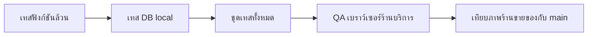

> **โมดูล:** 00078 — Service Report Redesign
> **ประเภทเอกสาร:** Test Case
> **เวอร์ชัน:** 1.0
> **วันที่จัดทำ:** 2026-10-17
> **สถานะ:** Draft

# Test Case: หน้ายอดขายและกำไรของร้านบริการ

## 1. Overview
| รายการ | ค่า |
|---|---|
| เทสอัตโนมัติใหม่ | `src/lib/service-report/__tests__/{view-model,settings-and-words,chart-and-isolation}.test.ts` · `tests/services/service-report.test.ts` (DB local) · `getSellerPageTitle.test.ts` (เพิ่ม) |
| เทสเดิมที่ปรับ (เจตนาเดิม) | `report-settings` · `unclosed-display-settings` · `date-dmy-and-finance-range` · `seller-menu` · `role-contract` |
| QA เบราว์เซอร์ | Playwright บน `seller.deepth.local` ฐาน local · มือถือ 390 + คอม 1300 |

## 2. Test Scenarios

### TC-001: ตัวเลขจากข้อมูลจริง (ต.ค.)
- **ขั้นตอน:** ป้อนข้อมูลร้านสุขสวัสดิ์ ต.ค. เข้า `buildServiceReport`
- **คาดหวัง:** ยอดขาย 636,900 = ปิดงานแล้ว 248,300 + ยังไม่ปิดงาน 388,600 · ต้นทุน + ค่าใช้จ่าย 119,949 · กำไร 128,351 · 69 งาน · วันที่ 14 กำไร −6,394 · % "เพิ่มขึ้น 1012% เทียบ 1–16 ก.ย."

### TC-002: กำไรติดลบ = "ขาดทุน"
- **คาดหวัง:** ตัวเลขใหญ่ป้าย "ขาดทุน" สีแดง · แท่งกำไรติดลบสีเดียวกับค่าใช้จ่าย

### TC-003: ช่วงก่อนไม่มียอด
- **คาดหวัง:** ไม่แสดง % (ไม่ใช่ "∞%" หรือ "0%")

### TC-004: ตัวโหลด (DB)
- **ฉาก:** ปิดงาน 6 ต.ค. 3,000 · ยังไม่ปิด 7 ต.ค. 8,000 · ไม่มาตามนัด 7 ต.ค. (มัดจำ 1,000) · ยกเลิก 500 · ค่าใช้จ่าย 6/7 ต.ค.
- **คาดหวัง:** ปิดงานแล้ววันที่ 6 = 3,000, วันที่ 7 = 1,000 · ยังไม่ปิดงานวันที่ 7 = 8,000 · ยกเลิกไม่นับ · กำไร 3,500

### TC-005: บิลของวัน = ยอดของแถว
- **คาดหวัง:** 7 ต.ค. ได้ 2 บิล (ไม่มาตามนัด 1,000 ปิดงานแล้ว · 8,000 ยังไม่ปิดงาน) ผลรวม = แถว

### TC-006: สิทธิ์และร้านอื่น (negative)
- **คาดหวัง:** ร้านขายของ 404 ทั้ง 2 route · ไม่ถือ F1 → 403 · query ผิด 400 · `date=2026-02-31` → 400 · `2028-02-29` → 200

### TC-007: ตั้งค่าไม่ลบค่าเดิม
- **ขั้นตอน:** ร้านที่มี `{pnl:false, headline:'RECEIVED', chartStyle:'AREA'}` บันทึก "กำไร"
- **คาดหวัง:** คืน กำไร + เส้น · แถวในฐานยังมี `pnl:false`, `chartStyle:'AREA'`

### TC-008: การแปลงค่าเดิม
- **คาดหวัง:** RECEIVED → ยอดขาย · NET_PROFIT → กำไร · AREA/LINE → เส้น · GROUPED/STACKED → แท่ง · ค่าตั้งต้น = ยอดขาย + แท่ง

### TC-009: กราฟ
- **คาดหวัง:** ช่องอนาคตเป็น null · แท่งซ้อนเขียว/เหลือง · เส้นไม่ซ้อน · แตะเฉพาะวันที่ถึงแล้ว · **ไม่มีคีย์ค่า `undefined` ใน options** · ป้ายแกน x ห่าง ≥ 3 ช่องทุกเดือน 28–31 วัน และมีวันนี้ · **รายเดือนป้ายครบ 12 เดือน + เส้น "เดือนนี้"** · คำอ่านของกราฟตรงกับชนิด/ช่วงจริง

### TC-014: การ์ด "วันนี้" ตอนยังไม่มีงาน
- **คาดหวัง:** ตัวเลข 0 และ **ไม่แสดงบรรทัด %** (ไม่ขึ้น "ลดลง 100%" เพราะวันยังไม่จบ เทียบไม่ได้)

### TC-016: กราฟบน iPhone (หลังขึ้น prod 2026-10-17)
- **อาการที่ user เจอ:** ความยาวแท่งถูก แต่ชุดสีเขียวถูกเลื่อนลงใต้แกน 60–70px (รายวันและรายเดือน) หลังสลับช่วง
- **แก้:** `chart.type 'line'` + ซีรีส์ `column` + `stackOnlyBar` (ชุดเดียวกับกราฟร้านขายของ) · สร้างกราฟใหม่ทุกครั้งที่ช่วงเปลี่ยน (`resetKey`) · ปิดแอนิเมชัน
- **คาดหวัง:** WebKit (iPhone 14 Pro) สลับ วันนี้/เดือนนี้ · รายวัน/รายเดือน · ย้อนเดือน แท่งเริ่มที่แกนทุกครั้ง · โหมดกำไรแท่งติดลบอยู่ใต้แกน
- **หมายเหตุ:** อาการเดิมจำลองใน WebKit บนเครื่องไม่ขึ้น (ทั้งโค้ดเดิมและใหม่ถูกในเครื่อง) — ยืนยันจริงต้องดูบน iPhone หลัง deploy

### TC-017: แถบสมการบนการ์ดหน้าแรก
- **คาดหวัง:** เดือนนี้ = ปิดงานแล้ว + ยังไม่ปิดงานของทั้งเดือน (ตรงหน้าเต็ม) · วันนี้ = ของวันนี้ · โหมดกำไร = ปิดงานแล้ว − (ต้นทุน) − ค่าใช้จ่าย · ไม่มีจำนวนงาน

### TC-015: ตารางบนจอ 390
- **คาดหวัง:** มีคอลัมน์ต้นทุน + ยอดหลักแสน ทุกคอลัมน์รวม "กำไร" อยู่ในการ์ด ไม่ล้น · ยอดใหญ่กว่านั้นเลื่อนข้างในกรอบตาราง · แถวรายเดือนไม่จาง (ไม่ใช่ปุ่ม disabled)

### TC-010: คำ
- **คาดหวัง:** ไฟล์จอไม่มีคำเก่า ("รับจริง" "ค้างรับ" "บิลยังไม่ปิด" ฯลฯ) · เมนู/หัวจอมือถือ `/sales` ร้านบริการ = "ยอดขายและกำไร" · ร้านขายของ/ที่พัก = "ภาพรวมกำไร/ขาดทุน"

### TC-011: ไม่กระทบรายงาน LINE
- **คาดหวัง:** ไม่มีไฟล์ `src/lib/line*` / `line-report-*` ใน diff · เทส 00070 เขียว

### TC-012: QA เบราว์เซอร์ร้านบริการ
- **คาดหวัง:** หน้าแรกมือถือ/คอมไม่ error · แตะการ์ดเปิดชีต (ล็อกการเลื่อนหน้าหลัง) · แตะแถว/แท่งเห็นบิล 6 ใบ ผลรวมตรงแถว · สลับรายเดือน/ย้อนเดือนได้ · ตั้งค่า กำไร + เส้น แล้วหน้าแรก/หน้า sales เปลี่ยนตาม

### TC-013: ร้านขายของไม่เปลี่ยน (ภาพ)
- **ขั้นตอน:** ถ่าย 5 หน้า × มือถือ/คอม บน branch และบน main (`git stash -u`) แล้วเทียบพิกเซล
- **คาดหวัง:** เท่ากันทั้ง 10 ภาพ

## 3. Traceability Matrix
| BRD | TC |
|---|---|
| FR-001 | TC-001, TC-002, TC-003 |
| FR-002 | TC-010 |
| FR-003 | TC-004 |
| FR-004 | TC-005, TC-006 |
| FR-010 / FR-011 | TC-009, TC-012, TC-014, TC-015, TC-016, TC-017 |
| FR-012 / FR-013 | TC-007, TC-008, TC-012 |
| §3.2 ไม่กระทบ | TC-011, TC-013 |

## 4. Flow (ถ้ามี)

## 5. ผลล่าสุด
| วันที่ | ผล |
|---|---|
| 2026-10-17 | ชุดเทสทั้งหมด 802 ไฟล์ / 10,246 เทส ผ่าน · mutation 8+2 ตัวถูกจับครบ · `tsc` ผ่าน · ภาพร้านขายของ 10/10 เท่ากับ main · QA เบราว์เซอร์ร้านบริการผ่าน (หลังแก้ 4 บั๊กที่เจอ: หน้าแรกล้มจาก `events: undefined` · แตะแท่งไม่ติด · ชื่อเมนู/หัวจอไม่ตรง · ป้ายแกน/ปุ่มตกบรรทัด) |
| 2026-10-17 (รอบ 2) | critique + clarify ตาม `DESIGN.md`/`.impeccable/design.json` (ปลั๊กอิน impeccable ไม่มีในเครื่อง — ตรวจตามกฎในไฟล์): แก้ รายเดือนเห็นป้ายแค่ 3 เดือน · เส้น "วันนี้" ในรายเดือน → "เดือนนี้" · คำอ่านกราฟตายตัว → ตามกราฟจริง · ตัวเลขใหญ่ในแผงเป็น Metric 800 เท่าการ์ด · "และ…และ" ในคำอธิบายตั้งค่า · คำพิมพ์ตรงในไฟล์จอ ("ปี" "ปิด"→"ย้อนกลับ") · ตารางล้นการ์ดบนจอ 390 · แถวรายเดือนจาง · การ์ด "วันนี้" ซ่อน % ตอนยังเป็น 0 (user) · เทสทั้งชุด 10,249 ผ่าน |
| 2026-10-17 (รอบ 3 หลัง prod) | แถบ ปิดงานแล้ว + ยังไม่ปิดงาน กลับมาบนการ์ดหน้าแรก (user) · กราฟ iOS: type line + stackOnlyBar + สร้างใหม่ทุกช่วง + ปิดแอนิเมชัน · WebKit iPhone 14 Pro ผ่านทุกจังหวะสลับ · เทสทั้งชุด 10,251 ผ่าน |
| ค้าง | ยืนยันกราฟบน iPhone จริงหลัง deploy (จำลองอาการเดิมในเครื่องไม่ได้) · ร้านที่พักไม่มีในฐาน local |

## 6. สรุป (Summary)
ครอบคลุมทุก FR ใน BRD ด้วยเทสอัตโนมัติ + QA เบราว์เซอร์ · ฝั่งไม่กระทบพิสูจน์ด้วยภาพเทียบพิกเซลและเทสแยก vertical
