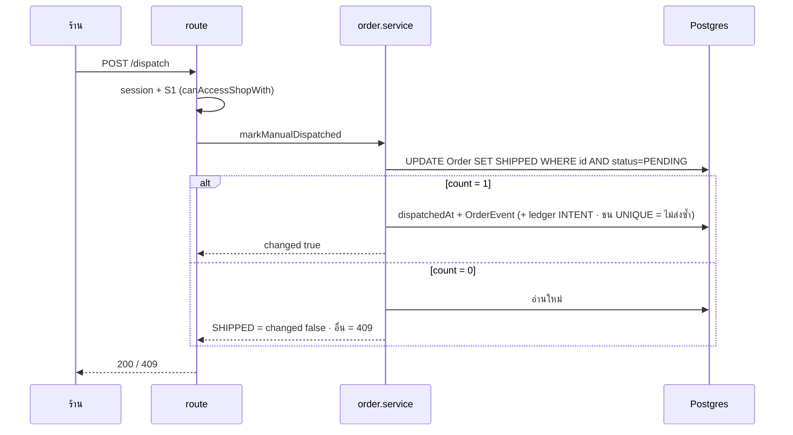

> **โมดูล:** 00080 - Manual Shipment Dispatch Steps
> **ประเภทเอกสาร:** API Contract
> **เวอร์ชัน:** 1.0 · **วันที่:** 2026-10-18 · **สถานะ:** Draft (route ใหม่ยังไม่ implement; ส่วน "เดิม" เขียนจากโค้ดวันที่ 2026-10-18)
> **เจ้าของเอกสาร:** SA

# API Contract: ขั้นตอนจัดส่งแบบส่งเอง

---

## 1. Overview

route ใต้ `src/app/api/` (Next.js App Router) · ผู้บริโภค = หน้าออเดอร์ฝั่งร้าน, แผงพัสดุแชท (`ShipmentDraftPanel`), หน้าตั้งค่าส่งอัตโนมัติ

- **เอกสารออกแบบต้นทาง:** [[SDS]] §3 (route ใหม่, shipOrder/updateShipmentTracking, ตั้งค่า) · TD-001..005
- **Base URL:** same-origin (`seller.*` / main) · **Content-Type:** `application/json`
- **Convention:** 3 route `orders/[token]/*` ใช้รูปแบบเดียวกับ `/ship` เดิม — error body `{ error: string }` (ไม่มี `code`) · route auto-notify ใช้ `jsonNoStore` + `VALIDATION_ERROR`
- **Cache:** route ใหม่ตอบ `Cache-Control: no-store`

---

## 2. Authentication

| รายการ | ค่า |
|--------|-----|
| **วิธี** | NextAuth session cookie (`getServerSession`) → `sessionUserId(session)` |
| **สิทธิ์ orders** | `canAccessShopWith(order.shopId, userId, 'S1')` — ดูร้านจากออเดอร์ ไม่เชื่อ shopId จาก client |
| **สิทธิ์ settings** | `requireShopCapability(session, 'X8')` (OWNER · MANAGER) |
| **ไม่ผ่าน** | 401 ไม่มี session · 403 ไม่ถือ cap/ไม่ใช่สมาชิกร้านเจ้าของออเดอร์ |

ทะเบียน `src/lib/route-capabilities.ts`: `ship` `{POST:'S1',PATCH:'S1'}` (เดิม) · `dispatch` `{POST:'S1'}` (ใหม่) · `delivered` `{POST:'S1'}` (ใหม่) · `auto-notify/settings` `{PATCH:'X8'}` (เดิม, ตรวจแล้ว)

---

## 3. Endpoint List

| Method | Path | คำอธิบาย | สถานะ |
|--------|------|----------|-------|
| `POST` | `/api/orders/{token}/ship` | บันทึกเลขส่งเอง → ขั้น "รอจัดส่ง" (status คง PENDING) | เปลี่ยน |
| `PATCH` | `/api/orders/{token}/ship` | แก้เลข/ขนส่ง/ต้นทุนค่าส่ง — PENDING หรือ SHIPPED | เปลี่ยน |
| `POST` | `/api/orders/{token}/dispatch` | "จัดส่งแล้ว" PENDING → SHIPPED | ใหม่ |
| `POST` | `/api/orders/{token}/delivered` | "ส่งสำเร็จ" SHIPPED → CONFIRMED | ใหม่ |
| `PATCH` | `/api/shops/current/auto-notify/settings` | เพิ่ม `trackingNoticeTiming` | เปลี่ยน |
| `GET` | `/api/shops/current/auto-notify` | snapshot เพิ่ม `trackingNoticeTiming` | เปลี่ยน (derived) |
| `GET` | `/api/seller/iship/order-context` | ตอบขั้น + ปุ่มที่กดได้ | เปลี่ยน (derived) |

---

## 4. Endpoint Detail

### 4.1 `POST /api/orders/{token}/ship` (เปลี่ยน)

**รูปร่างเดิม (โค้ดปัจจุบัน):** body `ShipOrderSchema` `{provider: string≥1, trackingNo: string≥1, outboundShippingCost?: number|null}` → 200 = แถว `Order` (หลัง `status: 'SHIPPED'`) · 401 `{error:"Unauthorized"}` · 404 `{error:"Order not found"}` · 403 `{error:"Forbidden"}` · 400 `{error:"Invalid input"}` · 400 `{error: translateInvalidTransition(msg) ?? "ไม่สามารถแจ้งจัดส่งได้"}`

**สิ่งที่เปลี่ยน**

| ประเด็น | เดิม | ใหม่ |
|---|---|---|
| `Order.status` หลังสำเร็จ | `SHIPPED` | **คง `PENDING`** (ขั้นที่ UI = "รอจัดส่ง") |
| response 200 | แถว Order (SHIPPED) | แถว Order (PENDING) — รูปร่างเดิม |
| notice TRACKING | จองทุกครั้ง | จองเฉพาะ timing `ON_SAVE` (`ON_DISPATCH` ไม่จอง) |
| ซ้ำเมื่อมีแถว tracking แล้ว | `assertTransition` SHIPPED→SHIPPED | unique `orderId` ชน → 400 `ไม่สามารถแจ้งจัดส่งได้` (ใช้ PATCH) |

error อื่นเหมือนเดิม: ออเดอร์ `fulfillmentMode ≠ SHIPPED` → 400 ข้อความ service · CANCELLED/CONFIRMED → 400 ข้อความไทยจาก `translateInvalidTransition`

```json
// Request
{ "provider": "Kerry", "trackingNo": "KEX123", "outboundShippingCost": 45 }
// Response 200 (ย่อ)
{ "publicToken": "…", "status": "PENDING" }
```

### 4.2 `PATCH /api/orders/{token}/ship` (เปลี่ยน)

body เหมือน 4.1 · **ไม่ส่ง `outboundShippingCost` = ไม่แตะ** / `null` = ล้าง / ตัวเลข = ตั้ง (เดิม)

| ประเด็น | เดิม | ใหม่ |
|---|---|---|
| สถานะที่รับ | `SHIPPED` เท่านั้น | **`PENDING` หรือ `SHIPPED`** |
| แตะ `status` | ไม่ | ไม่ (คงเดิม) |
| notice TRACKING | เลข (normalize) เปลี่ยน → จอง | PENDING+`ON_DISPATCH` = ไม่จอง · อื่นเหมือนเดิม |

**Response 200:** แถว `ShipmentTracking` ที่อัปเดต (เดิม)

| HTTP | `error` | เงื่อนไข |
|---|---|---|
| 400 | `Invalid input` / `ไม่สามารถแก้ข้อมูลการจัดส่งได้` | body ผิด / ข้อผิดพลาดอื่น |
| 401 / 403 / 404 | `Unauthorized` / `Forbidden` / `Order not found` | เดิม |
| 404 | `ไม่พบข้อมูลเลขพัสดุของออเดอร์นี้` | ไม่มีแถว tracking (`ShipmentTrackingNotFoundError`) |
| 409 | `ออเดอร์นี้ยังไม่ได้แจ้งจัดส่ง` | `status` ไม่ใช่ PENDING/SHIPPED (CONFIRMED/CANCELLED) — ดู Open Question |
| 409 | `พัสดุนี้สร้างผ่าน iShip แก้เลขด้วยมือไม่ได้` | มี live iShip |

### 4.3 `POST /api/orders/{token}/dispatch` (ใหม่)

"จัดส่งแล้ว" — ส่งเอง + `PENDING` → `SHIPPED` ด้วย conditional update · **idempotent** (กดซ้ำ/สองแท็บ = ผลครั้งเดียว) · บันทึก `ShipmentTracking.dispatchedAt` + `OrderEvent MANUAL_DISPATCHED` (ผู้กด) · จอง notice เลขปัจจุบันทุกครั้ง (ledger UNIQUE กันซ้ำกับที่ ON_SAVE ส่งไปแล้ว — SDS TD-006) ส่งหลัง commit

| ส่วน | ฟิลด์ | ชนิด | บังคับ | คำอธิบาย |
|---|---|---|---|---|
| Path | `token` | string | ใช่ | `Order.publicToken` |
| Body | - | - | ไม่ | ไม่มี (ยอมรับว่างหรือ `{}`) |

**Response 200**

| ฟิลด์ | ชนิด | คำอธิบาย |
|---|---|---|
| `changed` | boolean | `true` = ครั้งนี้เลื่อนขั้นจริง · `false` = ออเดอร์เป็น `SHIPPED` (ส่งเอง) อยู่แล้ว |
| `order` | object | แถว Order ล่าสุด (อย่างน้อย `publicToken`, `status`) |

```json
// Response 200 — เลื่อนขั้นจริง
{ "changed": true, "order": { "publicToken": "…", "status": "SHIPPED" } }
// Response 200 — กดซ้ำ
{ "changed": false, "order": { "publicToken": "…", "status": "SHIPPED" } }
```

| HTTP | `error` | เงื่อนไข |
|---|---|---|
| 401 | `Unauthorized` | ไม่มี session |
| 403 | `Forbidden` | ไม่ถือ S1 ของร้านเจ้าของออเดอร์ |
| 404 | `Order not found` | ไม่พบ token |
| 409 | ข้อความไทย เช่น `ออเดอร์นี้ไม่อยู่ขั้นรอจัดส่ง จึงกดจัดส่งแล้วไม่ได้` | ไม่ใช่ส่งเอง (iShip/ร้านบริการ/ไม่มีเลข) หรือ status ไม่ใช่ PENDING/SHIPPED (CONFIRMED/CANCELLED) — `ManualDispatchNotAllowedError` |

> ถ้อยคำ 409 ให้ DEV ใช้ข้อความไทยตัดสินร่วมกับ `translateInvalidTransition` (ไม่ echo `err.message` ดิบ, ไม่ 500)

### 4.4 `POST /api/orders/{token}/delivered` (ใหม่)

"ส่งสำเร็จ" — ส่งเอง + `SHIPPED` → `CONFIRMED` ด้วย conditional update · บันทึก `OrderEvent SELLER_DELIVERED` · หลัง commit รัน `runPostConfirmEffects` (ยอดขาย · Trust Score · เหรียญ) **ครั้งเดียว** · **ย้อนกลับไม่ได้** · COD ที่ยังไม่รับเงินไม่ถูกกั้น (เตือนที่ UI)

Request เหมือน 4.3 (ไม่มี body)

**Response 200**

| ฟิลด์ | ชนิด | คำอธิบาย |
|---|---|---|
| `changed` | boolean | `true` = ครั้งนี้ปิดงาน · `false` = ไม่ได้เปลี่ยนอะไร |
| `alreadyClosed` | boolean? | มีเฉพาะ `changed:false` เมื่อออเดอร์เป็น `CONFIRMED` อยู่แล้ว (ลูกค้ายืนยัน/ร้านปิดไปก่อน) → UI toast "ออเดอร์นี้ปิดไปแล้ว" |
| `order` | object | แถว Order ล่าสุด |

```json
// ปิดงานสำเร็จ
{ "changed": true, "order": { "publicToken": "…", "status": "CONFIRMED" } }
// ลูกค้ายืนยันไปก่อน
{ "changed": false, "alreadyClosed": true, "order": { "publicToken": "…", "status": "CONFIRMED" } }
```

| HTTP | `error` | เงื่อนไข |
|---|---|---|
| 401 / 403 / 404 | `Unauthorized` / `Forbidden` / `Order not found` | เหมือน 4.3 |
| 409 | ข้อความไทย เช่น `ออเดอร์นี้ยังไม่อยู่ขั้นกำลังจัดส่ง จึงกดส่งสำเร็จไม่ได้` | PENDING (ยังไม่กดจัดส่งแล้ว) · CANCELLED · iShip · ร้านบริการ — `ManualDeliveryNotAllowedError` |

### 4.5 `PATCH /api/shops/current/auto-notify/settings` (เปลี่ยน)

**รูปร่างเดิม:** body `{dailyCapPerRoom: int 1..20}` → 200 `{dailyCapPerRoom}` · 400 `{error:'VALIDATION_ERROR'}` · cap `X8` (`autoNotifyErrorResponse` สำหรับข้อผิดพลาดอื่น)

**ใหม่**

| ฟิลด์ | ชนิด | บังคับ | คำอธิบาย |
|---|---|---|---|
| `dailyCapPerRoom` | int 1..20 | ไม่* | เดิม (เปลี่ยนเป็น optional) |
| `trackingNoticeTiming` | `'ON_SAVE'` \| `'ON_DISPATCH'` | ไม่* | Valibot `picklist` — จังหวะแจ้งเลข **ส่งเองเท่านั้น** |

\* ต้องส่งอย่างน้อย 1 คีย์ (ว่าง/คีย์เกิน → 400) · คีย์ที่ไม่ส่ง = ไม่แตะค่าเดิม · ไม่มีแถว config เดิม → สร้างด้วยค่าตั้งต้น (cap 5 · `ON_SAVE`)

**Response 200:** `{ dailyCapPerRoom: number, trackingNoticeTiming: 'ON_SAVE'|'ON_DISPATCH' }`

```json
// Request
{ "trackingNoticeTiming": "ON_DISPATCH" }
// Response 200
{ "dailyCapPerRoom": 5, "trackingNoticeTiming": "ON_DISPATCH" }
```

| HTTP | `error` | เงื่อนไข |
|---|---|---|
| 400 | `VALIDATION_ERROR` | ค่านอก picklist · cap นอก 1..20 · ไม่มีคีย์ |
| 401 / 403 | (จาก `requireShopCapability`) | ไม่มี session / ไม่ถือ X8 |

### 4.6 การตอบเพิ่มของ route อ่าน (derived จาก SDS — ไม่เปลี่ยนสัญญาเดิม)

- `GET /api/shops/current/auto-notify` (H1): เพิ่ม `trackingNoticeTiming` ใน snapshot (UI แสดงค่าปัจจุบัน) — ไม่มีแถว config = `ON_SAVE`
- `GET /api/seller/iship/order-context` (S1): เพิ่ม **ขั้น** ของส่งเอง + `canMarkDispatched` / `canMarkDelivered` (คำนวณฝั่ง server ด้วย `manual-shipment.ts`) เพื่อให้แผงพัสดุแชทไม่ตัดสินเอง

---

## 5. Error Code Table

route `orders/[token]/*` ใช้ข้อความเป็นตัวบอก (ไม่มี `code`) ตามแบบ `/ship` เดิม

| HTTP | ความหมาย | ที่มา |
|---|---|---|
| 400 | body ผิด / บันทึกไม่ได้ | `Invalid input`, ข้อความไทย |
| 401 | ไม่มี session | `Unauthorized` |
| 403 | ไม่ถือ S1/X8 | `Forbidden` |
| 404 | ไม่พบออเดอร์/แถว tracking | `Order not found` / ข้อความไทย |
| 409 | ขั้นปัจจุบันไม่อนุญาต / iShip ถือพัสดุ | ข้อความไทย (ไม่ใช่ 500) |

## 6. Sequence



## 7. Traceability

| Endpoint | SDS | BRD FR |
|---|---|---|
| `POST /ship` | shipOrder · TD-001 | FR-001 |
| `PATCH /ship` | updateShipmentTracking | FR-001 |
| `POST /dispatch` | markManualDispatched · Flow 4.1 | FR-002 |
| `POST /delivered` | markManualDelivered · TD-004/005 | FR-003 |
| `PATCH …/settings` | ตั้งค่า · TD-003 | FR-004 |

## 8. สรุป

สัญญา 4 route (2 ใหม่ 2 เปลี่ยน) + settings 1 ตัว · conditional update ทุกตัว · error 409 เป็นข้อความไทย

**Open Questions:**
- ข้อความ 409 ของ `PATCH /ship` ตอน CONFIRMED/CANCELLED ("ยังไม่ได้แจ้งจัดส่ง") ไม่ตรงความหมายอีกต่อไป
- รูปร่าง body ของ settings PATCH (optional ทั้งสองคีย์ + อย่างน้อย 1) เป็นข้อเสนอของ SA — ยืนยันกับ Controller
- ถ้อยคำ 409 ของ `/dispatch` `/delivered` เป็นข้อเสนอ ให้ UX/DEV ปรับได้ ตราบใดที่เป็นไทยและไม่ 500
