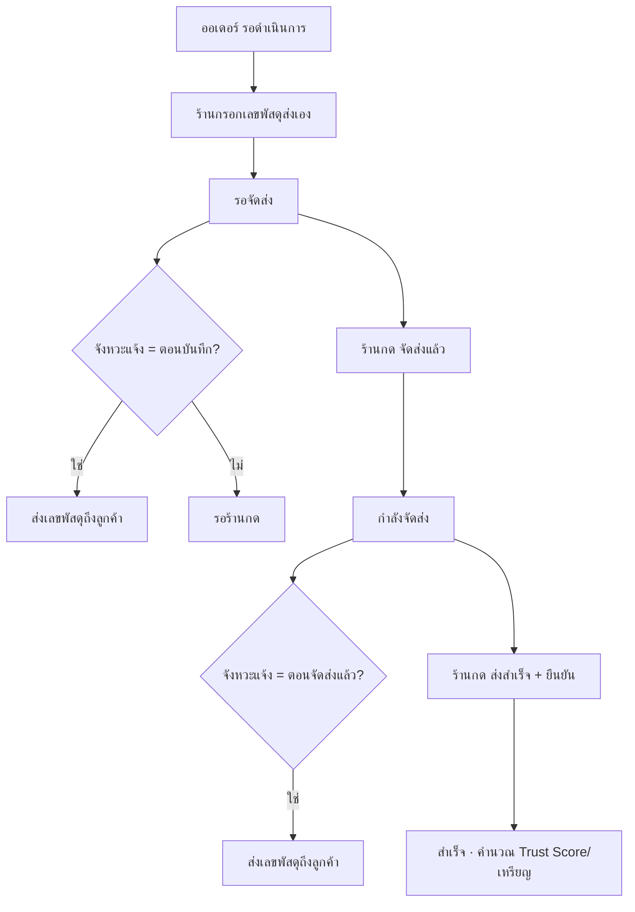
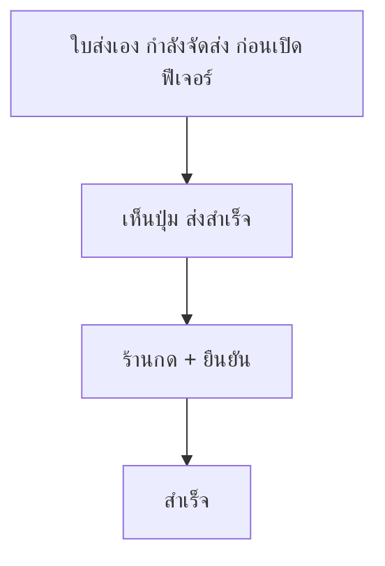

> **โมดูล:** 00080 - Manual Shipment Dispatch Steps
> **ประเภทเอกสาร:** Business Requirements Document (BRD) - NON-TECHNICAL
> **เวอร์ชัน:** 0.2
> **วันที่จัดทำ:** 2026-10-18
> **สถานะ:** Approved v0.2 — user อนุมัติ 2026-10-18 ("เอาแค่ปุ่มสำเร็จก่อน" · ไม่ทำ 00081 รอบนี้)
> **เจ้าของเอกสาร:** BA

# BRD: ขั้นตอนจัดส่งแบบส่งเอง (Business Requirements Document)

---

## 1. บทนำ

### 1.1 วัตถุประสงค์ของเอกสาร

เอกสารนี้มีวัตถุประสงค์เพื่อ:
1. กำหนดขั้นตอน รอจัดส่ง → กำลังจัดส่ง → สำเร็จ ของออเดอร์ที่ร้านส่งเอง
2. กำหนดปุ่ม "จัดส่งแล้ว" และ "ส่งสำเร็จ" พร้อมเงื่อนไขที่กดได้
3. กำหนดตัวเลือกจังหวะแจ้งเลขพัสดุถึงลูกค้าสำหรับการส่งเอง
4. ระบุสิ่งที่ไม่เปลี่ยน (iShip · ร้านบริการ · ใบเก่า)

### 1.2 ขอบเขตของระบบ

**ขั้นตอนจัดส่งแบบส่งเอง** คือ การแยกการแจ้งเลขพัสดุส่งเองออกจากการยืนยันว่าของออกจากร้าน และให้ร้านปิดงานเองได้

**เข้าสู่ระบบ (Input):**
- เลขพัสดุ + ขนส่ง + ต้นทุนค่าส่ง (ฟอร์มส่งเองเดิม)
- การกดปุ่ม "จัดส่งแล้ว" / "ส่งสำเร็จ"
- ตัวเลือกจังหวะแจ้งเลขพัสดุในหน้าตั้งค่า

**ออกจากระบบ (Output):**
- สถานะออเดอร์ที่ถูกต้องตามขั้น · ประวัติผู้กด/เวลา
- ข้อความแจ้งเลขพัสดุถึงลูกค้าตามจังหวะที่เลือก

**ระบบที่เกี่ยวข้อง:**
- หน้าออเดอร์ฝั่งร้าน · หน้าต่างพัสดุในแชท · รายการออเดอร์/ไทล์สถานะ · ป้ายขั้นในแถวแชท · ส่งอัตโนมัติถึงลูกค้า (00078) · Trust Score/เหรียญ · หน้าลูกค้า `/o/{token}`

### 1.3 กลุ่มผู้ใช้งาน

| กลุ่มผู้ใช้ | บทบาท | สิทธิ์การใช้งาน |
|-----------|--------|----------------|
| **เจ้าของร้าน / สมาชิกที่มีสิทธิ์จัดส่ง (S1)** | กรอกเลข กดเลื่อนขั้น | กดได้ทุกปุ่มในฟีเจอร์นี้ |
| **ผู้ดูแลการตั้งค่าส่งอัตโนมัติ** | เลือกจังหวะแจ้งเลข | สิทธิ์เดียวกับหน้าตั้งค่าส่งอัตโนมัติเดิม |
| **ลูกค้า** | รับของ ยืนยัน รีวิว | ไม่เปลี่ยน |

---

## 2. ความต้องการหลัก (Functional Requirements)

### 2.1 สถานะและปุ่ม

#### FR-001: บันทึกเลขพัสดุส่งเองแล้วเป็น "รอจัดส่ง"

**User Story:**
> ในฐานะร้านที่ส่งเอง ฉันต้องการบันทึกเลขพัสดุไว้ก่อนโดยสถานะยังไม่เป็นกำลังจัดส่ง เพื่อให้สถานะตรงกับว่าของยังอยู่ในร้าน

**Acceptance Criteria:**
- [ ] บันทึกเลขผ่านฟอร์มส่งเอง (หน้าออเดอร์หรือแชท) แล้วออเดอร์แสดง "รอจัดส่ง" ทุกหน้า (รายการ · หน้าออเดอร์ · แผงแชท · ป้ายในแถวแชท)
- [ ] ไทล์/ตัวกรองในหน้ารายการมีกอง "รอจัดส่ง" และนับตรงกับรายการที่กรองได้
- [ ] ระหว่าง "รอจัดส่ง" แก้เลข/ขนส่ง/ต้นทุนค่าส่งได้ และยกเลิกออเดอร์ได้
- [ ] ออเดอร์ที่มีพัสดุ iShip ใช้งานอยู่ ไม่เข้าขั้นนี้ (ทำงานเหมือนเดิม)

**Example:**
```
ออเดอร์ DP2569...A1 รอดำเนินการ → ร้านกรอก Kerry KEX123 กดบันทึก
→ ป้าย "รอจัดส่ง" · ปุ่ม "จัดส่งแล้ว" ขึ้นใต้เลขพัสดุ
```

#### FR-002: ปุ่ม "จัดส่งแล้ว"

**User Story:**
> ในฐานะร้านที่ส่งเอง ฉันต้องการกด "จัดส่งแล้ว" ตอนเอาของไปส่ง เพื่อให้ออเดอร์เป็นกำลังจัดส่ง

**Acceptance Criteria:**
- [ ] ปุ่มแสดงเฉพาะออเดอร์ส่งเองที่ "รอจัดส่ง" ทั้งในหน้าออเดอร์และหน้าต่างพัสดุในแชท
- [ ] กดแล้วออเดอร์เป็น "กำลังจัดส่ง" และบันทึกผู้กด + เวลา
- [ ] กดซ้ำ/กดจากสองแท็บพร้อมกัน ได้ผลครั้งเดียว ไม่ error ค้างจอ
- [ ] ถ้าตั้งจังหวะแจ้งเป็น "ตอนกดจัดส่งแล้ว" ลูกค้าได้ข้อความเลขพัสดุหลังกด (ครั้งเดียว)

#### FR-003: ปุ่ม "ส่งสำเร็จ"

**User Story:**
> ในฐานะร้านที่ส่งเอง ฉันต้องการกด "ส่งสำเร็จ" เมื่อลูกค้าได้ของ เพื่อปิดงานโดยไม่ต้องรอลูกค้ากดยืนยัน

**Acceptance Criteria:**
- [ ] ปุ่มแสดงเฉพาะออเดอร์ส่งเองที่ "กำลังจัดส่ง" — รวมใบเก่าที่ค้างก่อนเปิดฟีเจอร์
- [ ] กดแล้วมีกล่องยืนยัน (Swal) บอกว่าย้อนกลับไม่ได้ · ยืนยันแล้วออเดอร์เป็น "สำเร็จ"
- [ ] ใบเก็บเงินปลายทางที่ยังไม่บันทึกรับเงิน: กล่องยืนยันเตือนเพิ่ม แต่ยังปิดได้ (PRD D-2)
- [ ] นับเป็นออเดอร์สำเร็จเหมือนลูกค้ายืนยัน: ยอดขาย · Trust Score คำนวณใหม่ · ประเมินเหรียญ
- [ ] บันทึกผู้กด + เวลา แยกจาก "ลูกค้ายืนยัน" และ "ระบบปิดให้" ในประวัติออเดอร์
- [ ] ลูกค้ายังรีวิวได้ตามปกติ
- [ ] ออเดอร์ iShip ไม่เห็นปุ่มนี้

### 2.2 ตั้งค่าจังหวะแจ้งเลขพัสดุ

#### FR-004: เลือกจังหวะแจ้งเลขพัสดุสำหรับการส่งเอง

**User Story:**
> ในฐานะเจ้าของร้าน ฉันต้องการเลือกว่าลูกค้าจะได้เลขพัสดุส่งเองตอนบันทึกเลข หรือตอนกดจัดส่งแล้ว เพื่อไม่ให้ลูกค้าเห็นเลขก่อนของออก

**Acceptance Criteria:**
- [ ] แถว "เมื่อมีเลขพัสดุ" ในหน้า "ส่งอัตโนมัติถึงลูกค้า" มีตัวเลือก 2 ค่า: "ตอนบันทึกเลขพัสดุ" / "ตอนกดจัดส่งแล้ว" พร้อมคำอธิบายว่ามีผลกับการส่งเองเท่านั้น
- [ ] ค่าตั้งต้น = "ตอนบันทึกเลขพัสดุ" (PRD D-1)
- [ ] หน้าลูกค้า `/o/{token}` แสดงเลขพัสดุตามจังหวะที่เลือก — เลือก "ตอนกดจัดส่งแล้ว" = ซ่อนเลขระหว่างรอจัดส่ง (PRD D-3)
- [ ] สวิตช์ปิดอยู่ = ไม่ส่งไม่ว่าจะเลือกจังหวะไหน (กติกาเดิม)
- [ ] ข้อความเลขพัสดุของออเดอร์เดียวส่งครั้งเดียว ไม่ว่าจะเปลี่ยนจังหวะกลางทาง
- [ ] iShip แจ้งตามจังหวะเดิม ไม่อ่านตัวเลือกนี้

---

## 3. Acceptance Criteria สรุป

### 3.1 ขั้นตอนส่งเอง

**เมื่อระบบทำงานถูกต้อง:**
- ✅ บันทึกเลข = รอจัดส่ง · จัดส่งแล้ว = กำลังจัดส่ง · ส่งสำเร็จ = สำเร็จ
- ✅ ป้าย "รอจัดส่ง" คำเดียวกันทุกหน้า และตัวนับไทล์ = จำนวนในตัวกรอง
- ✅ ปุ่มอยู่ทั้งหน้าออเดอร์และแชท ทำงานเหมือนกัน

### 3.2 สิ่งที่ต้องไม่เปลี่ยน

**เมื่อเป็นออเดอร์ iShip / ร้านบริการ / ใบเก่า:**
- ✅ iShip เดินตามข้อมูลขนส่งเหมือนเดิม ไม่เห็นปุ่มใหม่
- ✅ ใบส่งเองที่ "กำลังจัดส่ง" อยู่แล้วไม่ถูกย้อน แต่ได้ปุ่ม "ส่งสำเร็จ"

---

## 4. Business Flows

### 4.1 Flow หลัก: ส่งเอง



### 4.2 Flow ย่อย: ใบเก่าที่ค้างกำลังจัดส่ง



---

## 5. Use Case Scenarios

### Scenario 1: ส่งเองครบทุกขั้น

**ผู้เกี่ยวข้อง:** แอดมินร้าน

**เงื่อนไขเริ่มต้น:**
- ร้าน ONLINE_SALES · สวิตช์ "เมื่อมีเลขพัสดุ" เปิด · จังหวะ = ตอนกดจัดส่งแล้ว

**ขั้นตอน:**
1. กรอกเลขในหน้าต่างพัสดุในแชท → รอจัดส่ง (ลูกค้ายังไม่ได้ข้อความ)
2. กด "จัดส่งแล้ว" → กำลังจัดส่ง · ลูกค้าได้เลขพัสดุในแชท
3. กด "ส่งสำเร็จ" → ยืนยัน → สำเร็จ

**ผลลัพธ์:**
- ประวัติออเดอร์มี 3 เหตุการณ์ พร้อมผู้กด · ลูกค้าได้ข้อความ 1 ครั้ง

### Scenario 2: พิมพ์เลขผิดระหว่างรอจัดส่ง

**ผู้เกี่ยวข้อง:** แอดมินร้าน

**เงื่อนไขเริ่มต้น:**
- ออเดอร์รอจัดส่ง · จังหวะ = ตอนกดจัดส่งแล้ว

**ขั้นตอน:**
1. แก้เลขพัสดุ → ยังรอจัดส่ง ลูกค้าไม่ได้ข้อความ
2. กด "จัดส่งแล้ว" → ลูกค้าได้เลขที่ถูกต้อง

**ผลลัพธ์:**
- ลูกค้าไม่เคยเห็นเลขผิด

### Scenario 3: ลูกค้ายืนยันก่อนร้านกด

**ผู้เกี่ยวข้อง:** ลูกค้า

**เงื่อนไขเริ่มต้น:**
- ออเดอร์กำลังจัดส่ง

**ขั้นตอน:**
1. ลูกค้ากดยืนยันรับของที่ `/o/{token}`

**ผลลัพธ์:**
- ออเดอร์สำเร็จ · ปุ่ม "ส่งสำเร็จ" หายไป · ร้านที่เปิดจอค้างไว้แล้วกด ได้ข้อความว่าออเดอร์ปิดไปแล้ว (ไม่ error)

---

## 6. ความต้องการด้านคุณภาพ

### 6.1 ความถูกต้องของข้อมูล
- ขั้นของออเดอร์ตัดสินจากที่เดียว ทุกหน้าใช้ตัวเดียวกัน (มีเทส)
- กดพร้อมกันหลายคน/หลายแท็บ ได้ผลครั้งเดียว

### 6.2 ความรวดเร็ว
- กดปุ่มแล้วจอเปลี่ยนสถานะทันทีหลังได้คำตอบ ไม่ต้องรีเฟรช

### 6.3 ความน่าเชื่อถือ
- ส่งข้อความล้ม ไม่พาการเลื่อนขั้นล้ม (กติกาเดิม 00078)

### 6.4 ความปลอดภัย
- เช็คสิทธิ์ S1 + ออเดอร์ต้องเป็นของร้านนั้นที่ฝั่ง server · ไม่เชื่อสถานะจาก client

### 6.5 ความสะดวกในการใช้งาน
- ปุ่มอยู่ติดกับเลขพัสดุ · "ส่งสำเร็จ" มีกล่องยืนยัน · ใช้ icon ไม่ใช้ emoji (HR12)

---

## 7. ข้อจำกัด

### 7.1 ข้อจำกัดทางธุรกิจ
- "ส่งสำเร็จ" อาศัยคำยืนยันของร้าน ไม่มีหลักฐานจากขนส่ง

### 7.2 ข้อจำกัดทางเทคนิค
- ฟอร์มส่งเองถูกใช้ 2 ที่ (หน้าออเดอร์ · แชท) — ต้องแก้ทั้งสองที่ให้ตรงกัน
- ป้ายขั้นของออเดอร์มีหลายตัวอ่าน (รายการ · ไทล์ · แชท · สูตร SQL) — SRS ต้องไล่ให้ครบ

---

## 8. กฎทางธุรกิจ

### 8.1 กฎการเลื่อนขั้น
- BR-MS-01 บันทึกเลขส่งเอง = รอจัดส่ง (ไม่ใช่กำลังจัดส่ง)
- BR-MS-02 "จัดส่งแล้ว" กดได้จาก รอจัดส่ง เท่านั้น → กำลังจัดส่ง
- BR-MS-03 "ส่งสำเร็จ" กดได้จาก กำลังจัดส่ง (ส่งเอง) เท่านั้น → สำเร็จ
- BR-MS-04 ไม่มีการย้อนขั้น · ยกเลิกได้ก่อนสำเร็จ
- BR-MS-05 ลูกค้ายืนยันได้ทุกขั้น (เหมือนเดิม)
- BR-MS-06 ออเดอร์ที่มีพัสดุ iShip ใช้งานอยู่ ไม่อยู่ใต้กฎชุดนี้

### 8.2 กฎการแจ้งลูกค้า
- BR-MS-10 จังหวะแจ้งเลือกได้ 2 ค่า มีผลกับส่งเองเท่านั้น
- BR-MS-11 ต่อออเดอร์ส่งข้อความเลขพัสดุครั้งเดียวต่อเลข (ด่านกันซ้ำเดิม)

### 8.3 กฎการปิดงาน
- BR-MS-20 ปิดด้วย "ส่งสำเร็จ" นับเป็นออเดอร์สำเร็จเต็มรูป (ยอดขาย · Trust Score · เหรียญ)
- BR-MS-21 บันทึกในประวัติแยกชนิดจากลูกค้ายืนยัน/ระบบปิดให้
- BR-MS-22 "ส่งสำเร็จ" เป็นทางสำรอง — การเลื่อนขั้นจากข้อมูลขนส่ง (00081) ต้องใช้ขั้นเดียวกันนี้ ไม่สร้างสถานะใหม่

---

## 9. อภิธานศัพท์

| คำศัพท์ | ความหมาย |
|---------|----------|
| **ส่งเอง** | กรอกเลขพัสดุเองผ่านฟอร์มส่งเอง ไม่ผ่าน iShip |
| **รอจัดส่ง** | มีเลขพัสดุส่งเองแล้ว ของยังไม่ออก |
| **กำลังจัดส่ง** | ร้านกด "จัดส่งแล้ว" แล้ว |
| **สำเร็จ** | ปิดงานแล้ว |

---

## 10. สรุป

เอกสาร BRD นี้อธิบายความต้องการของ **ขั้นตอนจัดส่งแบบส่งเอง** แบบไม่ใช่เทคนิค

**จุดเด่นของระบบ:**
- สถานะตรงความจริง · ร้านปิดงานส่งเองได้ · เลือกจังหวะแจ้งลูกค้าได้

**ผลลัพธ์ที่คาดหวัง:**
- ใบส่งเองค้าง "กำลังจัดส่ง" ลดลง · ลูกค้าไม่ได้เลขพัสดุก่อนของออก (ถ้าร้านเลือก)

---

**หมายเหตุ:**
ภาพรวม/personas/KPI ดู [[PRD]] · technical spec (SRS/SDS/API/DATABASE/TestCase) เขียนหลัง PRD+BRD ผ่าน
