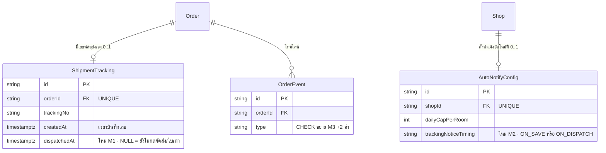

> **โมดูล:** 00080 - Manual Shipment Dispatch Steps
> **ประเภทเอกสาร:** DATABASE Design
> **เวอร์ชัน:** 1.0 · **วันที่จัดทำ:** 2026-10-18 · **สถานะ:** Draft (migration เขียนแล้ว ยังไม่ apply)

# DATABASE: ขั้นตอนจัดส่งแบบส่งเอง

---

## 1. Overview

เพิ่มข้อมูลเพียง 3 จุด ทั้งหมด additive ไม่มีตารางใหม่ ไม่ drop ไม่ backfill รองรับ SDS TD-002 / TD-003 / TD-005

- **เอกสารออกแบบต้นทาง:** [[SDS]] (TD-001 "รอจัดส่ง" เป็นขั้นที่คำนวณ จึง **ไม่มีการเพิ่มค่า `Order.status`**)
- **Store:** PostgreSQL 16 (Supabase) ผ่าน Prisma · migration ด้วย Prisma Migrate
- **ที่มาของ CHECK:** โปรเจกต์ใช้ String + DB CHECK (unmanaged SQL) ไม่ใช้ Prisma enum

---

## 2. ERD

---

## 3. Tables

### 3.1 `ShipmentTracking` (เพิ่มคอลัมน์ · M1)

| Column | Type | Null | Default | Key |
|--------|------|------|---------|-----|
| `dispatchedAt` | `TIMESTAMPTZ(3)` | YES | NULL (ไม่มี default) | - |

- เขียนเมื่อร้านกด "จัดส่งแล้ว" (`markManualDispatched`) · ผู้อ่าน (เหรียญ FAST_SHIPPING, "แจ้งเมื่อ") ใช้ `dispatchedAt ?? createdAt`
- ใบเก่า `dispatchedAt` เป็น NULL แต่ `createdAt` คือเวลาส่งจริงอยู่แล้ว จึงถูกต้องโดยไม่ backfill
- คอลัมน์ `status` เดิมไม่ถูกนำมาใช้ (TD-002)

### 3.2 `AutoNotifyConfig` (เพิ่มคอลัมน์ · M2)

| Column | Type | Null | Default | Key |
|--------|------|------|---------|-----|
| `trackingNoticeTiming` | `TEXT` | NO | `'ON_SAVE'` | CHECK `IN ('ON_SAVE','ON_DISPATCH')` |

- constraint `AutoNotifyConfig_trackingNoticeTiming_check`
- ไม่มีแถว config ของร้าน = `ON_SAVE` ในโค้ด · ใช้กับพัสดุส่งเองเท่านั้น (iShip ไม่อ่าน)

### 3.3 `OrderEvent` (ขยาย CHECK · M3)

`OrderEvent_type_check` เพิ่ม `MANUAL_DISPATCHED`, `SELLER_DELIVERED` ต่อท้ายค่าเดิมทั้งหมด (additive)

---

## 4. Indexes

ไม่เพิ่ม index ใหม่ — `dispatchedAt` และ `trackingNoticeTiming` ไม่ได้ใช้ filter/sort (อ่านตามแถวที่เข้าถึงด้วย `orderId` / `shopId` ซึ่ง UNIQUE อยู่แล้ว) · การคำนวณ "รอจัดส่ง" ใช้ LEFT JOIN `ShipmentTracking` ผ่าน `orderId` UNIQUE เดิม

---

## 5. Migration Plan

### 5.1 ลำดับการ Migrate

| ลำดับ | ไฟล์ | การเปลี่ยนแปลง | หมายเหตุ |
|-------|------|----------------|----------|
| M1 | `20261018100000_shipment_tracking_dispatched_at` | `ADD COLUMN IF NOT EXISTS "dispatchedAt" TIMESTAMPTZ(3)` | catalog-only · `lock_timeout 5s` |
| M2 | `20261018100100_auto_notify_tracking_timing` | `ADD COLUMN ... TEXT NOT NULL DEFAULT 'ON_SAVE'` + CHECK แบบ NOT VALID แล้ว VALIDATE | default คงที่ PG16 ไม่ rewrite · รันซ้ำได้ |
| M3 | `20261018100200_order_event_manual_dispatch_types` | อ่านนิยาม `OrderEvent_type_check` เดิมมาต่อท้าย 2 ค่า | ตาม `docs/conventions/migration-check-constraint-additive.md` · guard ด้วย position ของ `MANUAL_DISPATCHED` · raise ถ้านับ quote ไม่ตรง |

3 ไฟล์ไม่พึ่งกัน (ลำดับตาม timestamp เท่านั้น) · ต้องไม่ตกอยู่ก่อน `20261017100300` (M3 ต่อท้ายของ 00078)

### 5.2 Rollback

ไม่มี drop ใน migration · ถ้าต้องถอย (ต้องให้ Controller สั่งชัด):
- M1: `ALTER TABLE "ShipmentTracking" DROP COLUMN "dispatchedAt"` (เสียเวลา dispatch ที่บันทึกไว้ → ผู้อ่านกลับไปใช้ `createdAt`)
- M2: `ALTER TABLE "AutoNotifyConfig" DROP CONSTRAINT "AutoNotifyConfig_trackingNoticeTiming_check", DROP COLUMN "trackingNoticeTiming"` (ร้านที่ตั้ง ON_DISPATCH กลับเป็น ON_SAVE)
- M3: ก่อนถอด CHECK ต้องตรวจว่าไม่มีแถว `OrderEvent` ที่ `type IN ('MANUAL_DISPATCHED','SELLER_DELIVERED')` ไม่งั้น ADD CONSTRAINT จะล้ม · ไม่แนะนำให้ถอย ปล่อยค่าไว้ได้โดยไม่มีผลเสีย

### 5.3 ผลกระทบ (Impact)

- Lock: ACCESS EXCLUSIVE ชั่วครู่บน 3 ตาราง · `lock_timeout` ทำให้ migrate ล้มแทนการรอคิวบล็อกระบบ (ล้ม = deploy ไม่ขึ้น)
- Backward compatible: โค้ดเก่าไม่รู้จักคอลัมน์ใหม่ ไม่พัง · Prisma client ต้อง generate ใหม่
- Local ต้อง apply เอง · prod apply ผ่าน deploy (Hard Rule 15)

---

## 6. Retention / ข้อควรระวัง

- **Data Retention:** ไม่เพิ่มตารางโตเร็ว · `OrderEvent` เพิ่มได้ ≤2 แถวต่อออเดอร์ส่งเอง
- **PII:** ไม่มี PII ใหม่ · `dispatchedAt` ไม่ควรส่งออกหน้า guest ถ้าไม่จำเป็น
- **Performance:** CHECK ใหม่ validate เฉพาะตาราง `AutoNotifyConfig` (หนึ่งแถวต่อร้าน) และ `OrderEvent` (M3 VALIDATE สแกนทั้งตาราง ครั้งเดียว)
- **Consistency:** ไม่มีการอ้างข้าม store

---

## 7. Traceability

| Table / Constraint | SDS Component / Decision | สถานะ |
|--------------------|--------------------------|-------|
| `ShipmentTracking.dispatchedAt` | TD-002 · markManualDispatched · เหรียญ FAST_SHIPPING | Draft (migration เขียนแล้ว) |
| `AutoNotifyConfig.trackingNoticeTiming` | TD-003 · shipOrder/updateShipmentTracking/markManualDispatched · ตั้งค่า | Draft |
| `OrderEvent_type_check` | TD-005 · markManualDispatched/markManualDelivered | Draft |

เทสสัญญา TS ↔ migration: `src/lib/__tests__/auto-notify-db-constraint.test.ts` (ORDER_EVENT_TYPES + TRACKING_NOTICE_TIMINGS)

---

## 8. สรุป (Summary)

migration 3 ตัว additive ล้วน: คอลัมน์ `dispatchedAt` · คอลัมน์ + CHECK `trackingNoticeTiming` · ขยาย CHECK ของ `OrderEvent` อีก 2 ค่า ไม่แตะ `Order.status` ไม่แตะ iShip

**Open Questions:** ไม่มี
