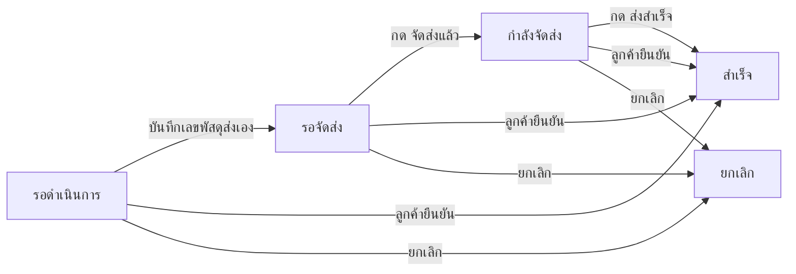

> **โมดูล:** 00080 - Manual Shipment Dispatch Steps
> **ประเภทเอกสาร:** Product Requirements Document (PRD)
> **เวอร์ชัน:** 0.2
> **วันที่จัดทำ:** 2026-10-18
> **สถานะ:** Approved v0.2 — user อนุมัติ 2026-10-18 ("เอาแค่ปุ่มสำเร็จก่อน" · ไม่ทำ 00081 รอบนี้)
> **เจ้าของเอกสาร:** BA + PO + PM

# PRD: ขั้นตอนจัดส่งแบบส่งเอง

---

## Executive Summary

วันนี้ร้านที่ส่งของกับขนส่งข้างนอกเอง (ไม่ผ่าน iShip) กรอกเลขพัสดุแล้วกดบันทึกครั้งเดียว ออเดอร์จะกระโดดเป็น "กำลังจัดส่ง" ทันที ทั้งที่ของอาจยังวางอยู่ในร้าน และหลังจากนั้นร้านไม่มีทางปิดออเดอร์เองได้ — ใบจะค้าง "กำลังจัดส่ง" จนกว่าลูกค้าจะกดยืนยันรับของ ซึ่งลูกค้าส่วนใหญ่ไม่เคยกด

ฟีเจอร์นี้แยกการส่งเองออกเป็น 3 ขั้นที่ร้านเป็นคนเลื่อนเอง:

1. **บันทึกเลขพัสดุ** → ออเดอร์อยู่ที่ **รอจัดส่ง**
2. ร้านกด **"จัดส่งแล้ว"** → ออเดอร์เป็น **กำลังจัดส่ง**
3. ร้านกด **"ส่งสำเร็จ"** → ออเดอร์เป็น **สำเร็จ**

พร้อมตัวเลือกในหน้าตั้งค่าส่งอัตโนมัติ ว่าจะส่งข้อความแจ้งเลขพัสดุถึงลูกค้า "ตอนบันทึกเลข" หรือ "ตอนกดจัดส่งแล้ว"

---

## 1. Business Goals & KPIs

### 1.1 เป้าหมายทางธุรกิจ

| เป้าหมาย | รายละเอียด |
|----------|-----------|
| **สถานะตรงความจริง** | "กำลังจัดส่ง" ต้องแปลว่าของออกจากร้านแล้วจริง ไม่ใช่แค่มีเลขพัสดุ |
| **ร้านปิดงานส่งเองได้** | ใบส่งเองไม่ค้าง "กำลังจัดส่ง" ตลอดไปเพราะรอลูกค้ากด |
| **คุมจังหวะแจ้งลูกค้า** | ร้านเลือกได้ว่าลูกค้าได้เลขพัสดุตอนไหน |

### 1.2 ตัวชี้วัดความสำเร็จ (KPIs)

| KPI | คำอธิบาย | เป้าหมาย |
|-----|----------|---------|
| **ใบส่งเองที่ค้าง "กำลังจัดส่ง" เกิน 14 วัน** | นับออเดอร์ส่งเอง status กำลังจัดส่ง อายุ > 14 วัน | ลดลงต่อเนื่องหลังเปิดใช้ |
| **สัดส่วนใบส่งเองที่ปิดงานได้** | ใบส่งเองที่ถึง "สำเร็จ" ÷ ใบส่งเองทั้งหมดในเดือน | เพิ่มขึ้นเทียบเดือนก่อนเปิดใช้ |

---

## 2. User Personas (กลุ่มผู้ใช้งาน)

### 2.1 ร้านขายของออนไลน์ที่ส่งเอง

**ข้อมูลพื้นฐาน:**
- ร้านประเภท ONLINE_SALES ที่ส่งพัสดุผ่านไปรษณีย์/ขนส่งเจ้าอื่นโดยไม่ผ่าน iShip หรือร้านที่เชื่อม iShip แต่บางใบส่งเอง

**เป้าหมาย:**
- เตรียมเลขพัสดุไว้ก่อน แล้วค่อยยืนยันตอนของออกจริง · ปิดงานเมื่อลูกค้าได้ของ

**ความต้องการ:**
- เห็นแยกได้ว่าใบไหน "มีเลขแล้วแต่ยังไม่ได้ส่ง" กับใบไหน "ส่งออกไปแล้ว"

**จุดปวด (Pain Points):**
- กรอกเลขปุ๊บสถานะเป็นกำลังจัดส่ง · ลูกค้าได้ข้อความเลขพัสดุทั้งที่ของยังไม่ออก
- ใบที่ส่งถึงแล้วปิดเองไม่ได้ ค้างกองกำลังจัดส่งจนรายการรก

### 2.2 แอดมิน/พนักงานร้านที่มีสิทธิ์จัดส่ง (S1)

**ข้อมูลพื้นฐาน:**
- สมาชิกร้านที่ได้รับสิทธิ์แจ้งเลขพัสดุอยู่แล้ว

**เป้าหมาย:**
- กดเลื่อนขั้นได้ทั้งจากหน้าออเดอร์และจากหน้าต่างพัสดุในแชท

**ความต้องการ:**
- ปุ่มอยู่ที่เดียวกับที่กรอกเลขพัสดุ ไม่ต้องหาไกล

**จุดปวด (Pain Points):**
- ไม่รู้ว่าใบไหนแพ็คแล้วแต่ยังไม่ได้ส่ง

---

## 3. Business Requirements

### 3.1 สถานะเริ่มต้นเมื่อบันทึกเลขพัสดุส่งเอง

**ความต้องการ:**
- บันทึกเลขพัสดุแบบส่งเองแล้ว ออเดอร์อยู่ที่ "รอจัดส่ง" (ไม่ใช่ "กำลังจัดส่ง")
- แก้เลขพัสดุ/ขนส่ง/ต้นทุนค่าส่งได้ระหว่าง "รอจัดส่ง" และ "กำลังจัดส่ง"
- ยกเลิกออเดอร์ได้ระหว่าง "รอจัดส่ง" เหมือนออเดอร์ที่ยังไม่มีเลข

**Business Rules:**
- ใช้กับการส่งเองเท่านั้น — ออเดอร์ที่ผ่าน iShip ทำงานเหมือนเดิมทุกอย่าง

**เหตุผล:**
- เลขพัสดุมักได้มาก่อนของออกจริง (ใบปะหน้า/จองคิวขนส่ง) สถานะต้องไม่อ้างว่าส่งแล้ว

**สถานะที่ต้องรองรับ:**

| สถานะ | ชื่อภาษาไทย | คำอธิบาย | การใช้งาน |
|-------|------------|----------|----------|
| **รอดำเนินการ** | รอดำเนินการ / รอเลขพัสดุ | ยังไม่มีเลขพัสดุ | เหมือนเดิม |
| **รอจัดส่ง** (ใหม่) | รอจัดส่ง | มีเลขพัสดุส่งเองแล้ว ของยังไม่ออกจากร้าน | หลังบันทึกเลข |
| **กำลังจัดส่ง** | กำลังจัดส่ง | ร้านยืนยันว่าของออกแล้ว | หลังกด "จัดส่งแล้ว" |
| **สำเร็จ** | สำเร็จ | ปิดงานแล้ว | หลังกด "ส่งสำเร็จ" หรือลูกค้ายืนยัน |

### 3.2 ปุ่ม "จัดส่งแล้ว"

**ความต้องการ:**
- ออเดอร์ "รอจัดส่ง" มีปุ่ม "จัดส่งแล้ว" กดแล้วเป็น "กำลังจัดส่ง"

**Business Rules:**
- กดได้เฉพาะออเดอร์ส่งเองที่อยู่ "รอจัดส่ง" · บันทึกว่าใครกด เมื่อไร
- ไม่มีขั้นย้อนกลับ (กำลังจัดส่ง → รอจัดส่ง)

**เหตุผล:**
- จุดนี้คือ "ของออกจากร้าน" ที่ระบบไม่มีทางรู้เองสำหรับการส่งเอง

### 3.3 ปุ่ม "ส่งสำเร็จ"

**ความต้องการ:**
- ออเดอร์ส่งเองที่ "กำลังจัดส่ง" มีปุ่ม "ส่งสำเร็จ" กดแล้วเป็น "สำเร็จ" (ปิดงาน)
- ออเดอร์ส่งเองที่ค้าง "กำลังจัดส่ง" อยู่ก่อนเปิดฟีเจอร์ เห็นปุ่มนี้ทันที (ไม่ย้ายข้อมูลเก่า)

**Business Rules:**
- ต้องมีกล่องยืนยันก่อนปิด เพราะย้อนกลับไม่ได้
- ปิดงานแล้วนับเป็นออเดอร์สำเร็จเหมือนลูกค้ายืนยัน (ยอดขาย · Trust Score · เหรียญ) — มติ user 2026-10-18
- ลูกค้ายังรีวิวได้ตามปกติ

**เหตุผล:**
- ใบส่งเองไม่มีข้อมูลขนส่งให้ระบบปิดเองแบบ iShip ร้านเป็นคนเดียวที่รู้

### 3.4 ตั้งค่าจังหวะแจ้งเลขพัสดุถึงลูกค้า

**ความต้องการ:**
- หน้า "ส่งอัตโนมัติถึงลูกค้า" แถว "เมื่อมีเลขพัสดุ" มีตัวเลือกจังหวะสำหรับการส่งเอง: **ตอนบันทึกเลขพัสดุ** หรือ **ตอนกด "จัดส่งแล้ว"**

**Business Rules:**
- ตัวเลือกนี้มีผลกับการส่งเองเท่านั้น — iShip แจ้งตามจังหวะเดิม
- เลือกจังหวะใด ระบบส่งข้อความเดียว ไม่ส่งซ้ำทั้งสองจังหวะ (ใช้ด่านกันซ้ำเดิมของ 00078)
- แก้เลขพัสดุหลังแจ้งไปแล้ว → แจ้งเลขใหม่ตามกติกาเดิมของ 00078 (เฉพาะเมื่อเลขเปลี่ยน)

**เหตุผล:**
- ร้านบางร้านอยากให้ลูกค้าได้เลขเร็ว บางร้านไม่อยากให้ลูกค้าเห็นเลขก่อนของออก (user สั่ง 2026-10-18)

---

## 4. Business Rules & Constraints

### 4.1 กฎทางธุรกิจหลัก

| กฎ | คำอธิบาย |
|----|----------|
| **ขอบเขตส่งเองเท่านั้น** | ออเดอร์ที่มีพัสดุ iShip ใช้งานอยู่ ไม่เห็นปุ่ม และไม่เข้าขั้นรอจัดส่ง |
| **เลื่อนขั้นทางเดียว** | รอจัดส่ง → กำลังจัดส่ง → สำเร็จ · ย้อนไม่ได้ (ยกเลิกยังทำได้ก่อนสำเร็จ) |
| **ลูกค้ายืนยันได้ทุกขั้น** | ลูกค้ากดยืนยันรับของได้เหมือนเดิม ไม่ว่าออเดอร์จะอยู่ขั้นไหน |
| **คำเดียวทั้งระบบ** | ป้าย "รอจัดส่ง" ต้องใช้คำเดียวกันทุกหน้า (รายการ · หน้าออเดอร์ · แชท · ไทล์) — HR16 |

### 4.2 ข้อจำกัดทางธุรกิจ

| ข้อจำกัด | รายละเอียด |
|---------|-----------|
| **ไม่มีหลักฐานจากขนส่ง** | "ส่งสำเร็จ" อาศัยคำยืนยันของร้านล้วน ระบบไม่ได้เช็คกับขนส่ง |

### 4.3 มติที่ตอบคำถามเปิด (user "ตามแนะนำ" 2026-10-18)

- **D-1 ค่าตั้งต้นของจังหวะแจ้งเลข** = "ตอนบันทึกเลขพัสดุ" ทั้งร้านที่เปิดสวิตช์ไว้แล้วและร้านใหม่ — ไม่เปลี่ยนพฤติกรรมเดิมเงียบ ๆ
- **D-2 ใบเก็บเงินปลายทาง (COD)** = กด "ส่งสำเร็จ" ได้แม้ยังไม่บันทึกรับเงิน แต่กล่องยืนยันต้องเตือนว่ายังไม่ได้บันทึกรับเงิน COD
- **D-3 หน้าลูกค้า `/o/{token}`** = แสดงเลขพัสดุตามจังหวะแจ้งที่ร้านเลือก (เลือก "ตอนกดจัดส่งแล้ว" = ซ่อนเลขระหว่างรอจัดส่ง)
- **D-4 "ส่งสำเร็จ" เป็นทางสำรอง** ที่ใช้ได้ทุกขนส่ง — การปิดงานจากข้อมูลขนส่งจริง (API) แยกไปฟีเจอร์ 00081

---

## 5. Out of Scope (นอกขอบเขต)

| หัวข้อ | คำอธิบาย |
|--------|----------|
| **ออเดอร์ iShip** | ไม่เปลี่ยนลำดับขั้น ไม่เพิ่มปุ่ม (iShip ปิดเองจากข้อมูลขนส่งอยู่แล้ว) |
| **ร้านบริการ/ที่พัก** | ไม่มีการจัดส่ง ไม่เกี่ยว |
| **ติดตามพัสดุอัตโนมัติจากขนส่งภายนอก** | ไม่ดึงสถานะจากไปรษณีย์/ขนส่งเจ้าอื่น |
| **ย้ายข้อมูลใบเก่า** | ใบที่ "กำลังจัดส่ง" อยู่แล้วไม่ถูกย้อนเป็น "รอจัดส่ง" — มติ user 2026-10-18 |
| **ข้อความแจ้ง "ส่งสำเร็จ" ถึงลูกค้า** | ไม่เพิ่มชนิดข้อความอัตโนมัติใหม่ในรอบนี้ |
| **เช็คสถานะจาก API ขนส่ง (Flash · ไปรษณีย์ไทย · ตัวรวม)** | แยกเป็น 00081 (ดู `00081 - Carrier Tracking Verification/Requirements-Seed.md`) — 00080 ต้องเผื่อจุดให้ 00081 เลื่อนขั้นเดียวกันได้โดยไม่แก้ตารางสถานะ |

---

## 6. Risks & Mitigation

### 6.1 ความเสี่ยงทางธุรกิจ

| ความเสี่ยง | ผลกระทบ | ระดับความรุนแรง | แนวทางแก้ไข |
|-----------|---------|-----------------|-------------|
| **ร้านปิดงานเองเพื่อปั่น Trust Score** | ออเดอร์ปลอม + เลขพัสดุปลอม + กดสำเร็จ = คะแนนขึ้น | กลาง | บันทึกผู้กด/เวลาทุกขั้นใน OrderEvent ให้ตรวจย้อนได้ · ความเสี่ยงคลาสเดียวกันมีอยู่แล้วกับการปิดนัดรับอัตโนมัติ · ยอมรับในรอบนี้ (มติ user) · 00081 ลดความเสี่ยงด้วยการแยกใบที่ปิดจากข้อมูลขนส่ง |
| **ลืมกด "จัดส่งแล้ว"** | ใบค้าง "รอจัดส่ง" ทั้งที่ส่งไปแล้ว · ลูกค้าไม่ได้เลข (ถ้าเลือกแจ้งตอนจัดส่ง) | กลาง | มีกอง/ตัวกรอง "รอจัดส่ง" ในหน้ารายการและไทล์ ให้เห็นงานค้าง |
| **กดสำเร็จทั้งที่ของไม่ถึง** | ปิดงานผิด ย้อนไม่ได้ | ต่ำ | กล่องยืนยันก่อนปิด |

### 6.2 ความเสี่ยงทางเทคนิค

| ความเสี่ยง | ผลกระทบ | แนวทางแก้ไข |
|-----------|---------|-------------|
| **มีหลายจุดที่อ่าน "มีเลขพัสดุ = ส่งแล้ว"** | ป้าย/ไทล์/แผงแชทพูดไม่ตรงกัน | สำรวจทุกจุดที่อ่านเลขพัสดุส่งเองก่อนออกแบบ (SRS) · ตัวตัดสินขั้นอยู่ที่เดียวใน `src/lib` + เทส |
| **iShip ผูกพัสดุทับใบที่รอจัดส่ง** | ใบส่งเองกลายเป็นใบ iShip กลางทาง | ใบ iShip ชนะตามกติกาเดิม (ผูกแล้วเดินตาม iShip) · เทสเคสนี้ |

---

## 7. Glossary

| คำศัพท์ | ความหมาย |
|---------|----------|
| **ส่งเอง (manual)** | ร้านกรอกเลขพัสดุเองผ่านฟอร์ม "ส่งเอง" ไม่ผ่าน iShip |
| **รอจัดส่ง** | มีเลขพัสดุส่งเองแล้ว ของยังไม่ออกจากร้าน |
| **จัดส่งแล้ว** | ปุ่มที่ร้านกดเมื่อของออกจากร้าน |
| **ส่งสำเร็จ** | ปุ่มที่ร้านกดเมื่อของถึงลูกค้า → ปิดงาน |

---

## 8. Success Metrics

| ตัวชี้วัด | ค่าที่คาดหวัง | วิธีวัด |
|----------|---------------|--------|
| **ใบส่งเองค้างกำลังจัดส่ง > 14 วัน** | ลดลง | query รายเดือนบน prod (อ่านอย่างเดียว) |
| **ใบที่ปิดด้วยปุ่ม "ส่งสำเร็จ"** | > 0 ภายในสัปดาห์แรก | นับ OrderEvent ชนิดใหม่ |

---

## 9. Dependencies & Assumptions

### 9.1 Dependencies

| ระบบ/ส่วนประกอบ | ความสัมพันธ์ |
|-----------------|-------------|
| **ฟอร์มส่งเอง (ShipForm)** | หน้าออเดอร์ + หน้าต่างพัสดุในแชท (00078 #174) — จุดที่ปุ่มใหม่ต้องอยู่ทั้งสองที่ |
| **ส่งอัตโนมัติถึงลูกค้า (00078 #176)** | จังหวะแจ้งเลขพัสดุ + ด่านกันส่งซ้ำ |
| **Trust Score / เหรียญ** | นับออเดอร์สำเร็จ |

### 9.2 Assumptions

- ร้านเป็นคนเดียวที่รู้ว่าของส่งเองออกจากร้าน/ถึงลูกค้าเมื่อไร
- สิทธิ์กดปุ่มใหม่ = สิทธิ์เดียวกับแจ้งเลขพัสดุ (S1)

---

## 10. Appendix

### 10.1 ตัวอย่าง User Journey

**Scenario: ร้านส่งไปรษณีย์เอง เลือกแจ้งลูกค้าตอนจัดส่งแล้ว**

1. ร้านแพ็คของ กรอกเลขไปรษณีย์ในหน้าต่างพัสดุในแชท กดบันทึก → ออเดอร์ "รอจัดส่ง" ลูกค้ายังไม่ได้ข้อความ
2. บ่ายเอาของไปส่ง กด "จัดส่งแล้ว" → "กำลังจัดส่ง" · ระบบส่งเลขพัสดุให้ลูกค้าในแชท
3. สามวันต่อมาลูกค้าทักว่าได้ของแล้ว ร้านกด "ส่งสำเร็จ" → ยืนยัน → "สำเร็จ"

---

**หมายเหตุ:**
เอกสารนี้เป็นความต้องการทางธุรกิจ ไม่ลงรายละเอียดเทคนิค · FR/AC ดู [[BRD]] · technical spec ดู SRS (เขียนหลัง PRD+BRD ผ่าน)
