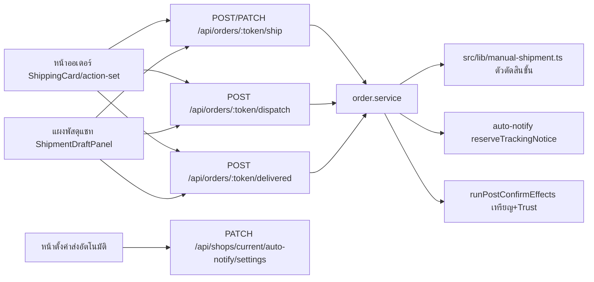
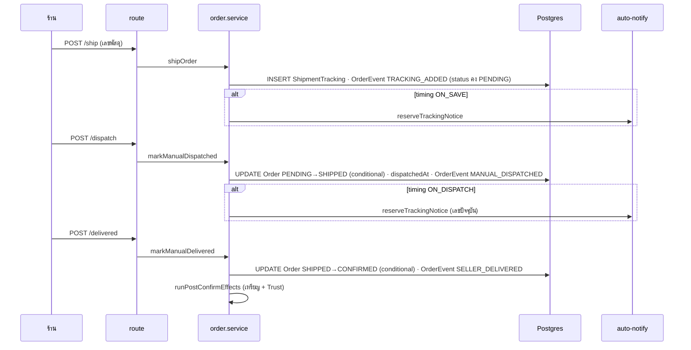

> **โมดูล:** 00080 - Manual Shipment Dispatch Steps
> **ประเภทเอกสาร:** System Design Spec (SDS)
> **เวอร์ชัน:** 1.0 · **วันที่:** 2026-10-18 · **สถานะ:** Controller ล็อกแนว (อิงผลสำรวจโค้ด 2026-10-18)

# SDS: ขั้นตอนจัดส่งแบบส่งเอง (System Design Spec)

## 1. บทนำ & References

### 1.1 วัตถุประสงค์
ล็อกการออกแบบของ S-1..S-15 (Scope Baseline `docs/scope/2026-10-18-00080-manual-shipment-dispatch-scope-baseline.md`) ก่อนแตก task

### 1.2 ขอบเขตการออกแบบ
ส่งเองเท่านั้น (ไม่มีพัสดุ iShip ที่ live) · ไม่แตะ flow iShip · ไม่ย้ายข้อมูลใบเก่า

### 1.3 เอกสารอ้างอิง
PRD/BRD 00080 v0.2 · 00078 (auto-notify ledger · ShipForm/แผงพัสดุแชท) · `docs/conventions/migration-check-constraint-additive.md` · `docs/conventions/enum-value-removal.md`

## 2. Architecture Overview

### 2.1 มุมมองสถาปัตยกรรม

## 3. Component Design

| Component | ไฟล์ | หน้าที่ (ใหม่/แก้) |
|---|---|---|
| ตัวตัดสินขั้นส่งเอง (ใหม่) | `src/lib/manual-shipment.ts` | `isManualShipment({hasManualTracking, hasLiveIshipShipment})` · `canMarkDispatched({status, ...})` · `canMarkDelivered({status, ...})` — pure ไม่ import prisma |
| ขั้นการส่ง | `src/lib/order-stage.ts` | `ShippingStageKey` + `'AWAITING_DISPATCH'` (ป้าย "รอจัดส่ง") · `deriveShippingStage` รับ `hasManualTracking` · ในสาขาไม่มีพัสดุ iShip: `PENDING && hasManualTracking` → `AWAITING_DISPATCH` · `OrderStageKey` + `'AWAITING_DISPATCH'` (stage chip แชท) · `STAGE_BADGE_OVERRIDE` + `AWAITING_DISPATCH` → ป้าย "รอจัดส่ง" |
| สูตร SQL คู่ | `src/lib/order-stage-sql.ts` · `services/order.service.ts` `getShippingStageCounts` · `services/order-list.service.ts` `STAGE_COLUMNS` · `services/order-stage.service.ts:159` | join `"ShipmentTracking"` (LEFT JOIN, orderId unique) → `hasManualTracking` · parity test `src/lib/__tests__/order-stage-sql.test.ts` ขยายกริด |
| คีย์ stage ที่ hard-code | `OrderStatusBand.tsx:144` · `OrdersList.tsx:63` · `OrdersTable.tsx:106,118` · `ShipmentHoverCard.tsx:49` · `chat-order-progress.ts:73` · `ProvinceSalesMap.tsx:209` · `order.service.ts:2724` | เติม `AWAITING_DISPATCH` (`Record` ให้ tsc บังคับ) |
| shipOrder (แก้) | `order.service.ts:1571` | สร้างแถว ShipmentTracking + `TRACKING_ADDED` · **ไม่เปลี่ยน status (คง PENDING)** · `assertTransition(status,'SHIPPED')` คงไว้เป็นด่าน "ส่งได้ไหม" · จอง TRACKING notice เฉพาะ timing `ON_SAVE` |
| updateShipmentTracking (แก้) | `order.service.ts:1639` | รับ `PENDING` หรือ `SHIPPED` (เดิม SHIPPED อย่างเดียว) · `PENDING && ON_DISPATCH` = ไม่จอง notice · ที่เหลือกติกาเดิม (เลขเปลี่ยนเท่านั้น) |
| markManualDispatched (ใหม่) | `order.service.ts` | tx: อ่านออเดอร์ (shopId scope) + tracking + live iShip → `canMarkDispatched` · `updateMany({id, status:'PENDING'} → SHIPPED)` · count 0 → อ่านใหม่: SHIPPED = `{changed:false}` (idempotent) · อื่น = `ManualDispatchNotAllowedError` · `tracking.dispatchedAt = now` · `OrderEvent MANUAL_DISPATCHED` · timing `ON_DISPATCH` → `reserveTrackingNotice(tx, orderId, trackingNo ปัจจุบัน)` · dispatch หลัง commit |
| markManualDelivered (ใหม่) | `order.service.ts` | `updateMany({id, status:'SHIPPED'} → CONFIRMED)` เมื่อ `canMarkDelivered` · `OrderEvent SELLER_DELIVERED` · count 0 → อ่านใหม่: CONFIRMED = `{changed:false, alreadyClosed:true}` · อื่น = `ManualDeliveryNotAllowedError` · หลัง commit → `runPostConfirmEffects` |
| runPostConfirmEffects (สกัด) | `order.service.ts` | ย้ายบล็อกเหรียญ/Trust จาก `confirmOrder` (`:1535-1566`) และ `settleCodFromCarrier` (`:2267-2288`) มาเป็น helper เดียว · พฤติกรรมเดิมทุกตัวอักษร |
| route ใหม่ | `src/app/api/orders/[token]/dispatch/route.ts` · `.../delivered/route.ts` | session → `sessionUserId` · `canAccessShopWith(order.shopId,userId,'S1')` · error → 409 ข้อความไทย · `Cache-Control: no-store` · ลงทะเบียน `src/lib/route-capabilities.ts` `{ POST: 'S1' }` |
| action set หน้าออเดอร์ | `orders/[token]/components/order-action-set.ts` | PENDING+MANUAL: primary "จัดส่งแล้ว" · secondary "แก้ไขเลขพัสดุ" (ไม่โชว์ "แจ้งเลขพัสดุ" ซ้ำ — เดิมกดแล้ว P2002) · SHIPPED+MANUAL: เพิ่ม "ส่งสำเร็จ" |
| ShippingCard | `ShippingCard.tsx:351` | "แจ้งเมื่อ" ใช้ `dispatchedAt ?? createdAt` ตอน SHIPPED · ตอน PENDING บอก "บันทึกเลขเมื่อ…" |
| แผงพัสดุแชท | `lib/chat-shipment-panel.ts` `decidePanelView` · `ShipmentDraftPanel.tsx:328` | `MANUAL_DONE` แยกปุ่มตาม orderStatus ผ่าน `canMarkDispatched/canMarkDelivered` · `order-context` ส่ง `trackingNoticeTiming` ไม่ต้อง (ตัดสินที่ server) |
| เหรียญ FAST_SHIPPING | `badge.service.ts:245,279` · `lib/shipping-speed.ts` | เวลาส่ง = `dispatchedAt ?? createdAt` |
| หน้าลูกค้า | `guest-order-data.ts:310-322` · `lib/order-shipment-view.ts` | `PENDING && timing ON_DISPATCH` → ตัดเลขพัสดุส่งเองออกจาก payload (`shipmentTracking: null`) · ตอนแสดง `hasShipment` ใช้ค่าหลังตัด |
| ตั้งค่า | `auto-notify-config.service.ts` · `lib/auto-notify/schemas.ts` · `settings/route.ts` · `AutoNotifyRow.tsx` (แถว TRACKING) · i18n th/en | `trackingNoticeTiming: 'ON_SAVE'\|'ON_DISPATCH'` · ไม่มีแถว config = `ON_SAVE` |

## 4. Data Flow

### 4.1 Flow หลัก

### 4.2 Flow กรณีล้มเหลว / ชดเชย
- กดซ้ำ/สองแท็บ: conditional update ได้แถวเดียว ตัวที่แพ้อ่านใหม่แล้วตอบ `changed:false` (200)
- ลูกค้ายืนยันก่อนร้านกด "ส่งสำเร็จ": `alreadyClosed:true` → UI toast "ออเดอร์นี้ปิดไปแล้ว" + refresh
- ส่งข้อความล้ม: ledger บันทึก FAILED · การเลื่อนขั้นไม่ย้อน (กติกา 00078)
- iShip ผูกทับใบรอจัดส่ง: `advanceOrderIfDispatched` upsert แถว tracking + SHIPPED ตามเดิม → ใบมี live iShip → ปุ่มส่งเองหาย (iShip ชนะ)

## 5. Integration Points

| ระบบ | จุดเชื่อม | หมายเหตุ |
|---|---|---|
| auto-notify (00078) | `reserveTrackingNotice` · `dispatchAutoNotifyAfterCommit` | ใช้ ledger UNIQUE เดิมกันซ้ำ · ไม่มี kind ใหม่ |
| Trust/เหรียญ | `runPostConfirmEffects` | ชุดเดียวกับ `confirmOrder` |
| iShip | `advanceOrderIfDispatched` · `unlinkShipment` | ไม่แก้ |

## 6. Technical Decisions

### TD-001: "รอจัดส่ง" = คำนวณ (PENDING + มีแถว ShipmentTracking + ไม่มี live iShip) ไม่เพิ่มค่า `Order.status`
- เหตุผล: `Order.status` ไม่มี CHECK และมีผู้อ่านหลายสิบจุดข้าม 3 vertical (คอมเมนต์ `order.service.ts:50`) การเพิ่มค่าใหม่ = ไล่ทั้ง repo · ผลสำรวจยืนยันว่าวันนี้ไม่มีทางไหนทิ้ง PENDING + แถว tracking ไว้ (iShip upsert + SHIPPED ใน tx เดียว · unlink ลบแถว + ถอยเป็น PENDING) ⇒ ไม่มีข้อมูลเก่าตกขั้นใหม่โดยไม่ตั้งใจ
- ผลที่ยอมรับ: PENDING ระหว่างรอจัดส่ง ⇒ ลูกค้ายังยกเลิกได้ และร้านยังแก้ออเดอร์ได้ (ของยังไม่ออกจากร้าน — สอดคล้อง PRD §3.1 "ยกเลิกได้ระหว่างรอจัดส่ง")
- 00081 ใช้ `markManualDispatched/markManualDelivered` ซ้ำได้ ไม่แก้ตารางสถานะ (BR-MS-22)

### TD-002: เวลา "จัดส่งแล้ว" เก็บที่ `ShipmentTracking.dispatchedAt` (ใหม่ nullable)
- เดิม `createdAt` ถูกอ่านเป็น "เวลาส่ง" (เหรียญ FAST_SHIPPING · "แจ้งเมื่อ") — หลังแยกขั้น `createdAt` = เวลาบันทึกเลข ⇒ ผู้อ่านใช้ `dispatchedAt ?? createdAt` (ใบเก่า dispatchedAt null แต่ createdAt = เวลาส่งจริง จึงถูกต้องโดยไม่ backfill)
- คอลัมน์ `ShipmentTracking.status` (ไม่มีใครอ่าน/เขียน) ไม่นำมาใช้ — ไม่อยากผูกความหมายใหม่กับค่า default "SHIPPED" ที่มีอยู่ทุกแถว

### TD-003: จังหวะแจ้งเลขเก็บที่ `AutoNotifyConfig.trackingNoticeTiming` (text NOT NULL default 'ON_SAVE' + CHECK)
- ไม่มีแถว config = `ON_SAVE` ในโค้ด · ใช้กับส่งเองเท่านั้น: จุดที่อ่านคือ `shipOrder`/`updateShipmentTracking`/`markManualDispatched` (iShip ไม่อ่าน)

### TD-004: สกัด `runPostConfirmEffects` แทนการ copy บล็อกเหรียญครั้งที่สาม
- refactor ไม่เปลี่ยนพฤติกรรม · เทสเดิมของ confirmOrder/settleCodFromCarrier ต้องเขียวโดยไม่แก้

### TD-005: OrderEvent ใหม่ `MANUAL_DISPATCHED` · `SELLER_DELIVERED`
- แยกจาก `BUYER_CONFIRMED`/`SYSTEM_CONFIRMED` (BR-MS-21) · ขยาย CHECK แบบ additive ตามแบบ `20261017100300_order_event_auto_notify_types`

## 7. Traceability

| Scope | Component |
|---|---|
| S-2 | DATABASE M1–M3 |
| S-3 | `src/lib/manual-shipment.ts` |
| S-4 | shipOrder · updateShipmentTracking · `/ship` |
| S-5 | markManualDispatched · `/dispatch` |
| S-6 | markManualDelivered · runPostConfirmEffects · `/delivered` |
| S-7 | order-action-set · ShippingCard · OrderDetailClient |
| S-8 | chat-shipment-panel · ShipmentDraftPanel |
| S-9 | order-stage(+sql) · hard-coded keys · counts |
| S-10 | auto-notify config/schemas/route/AutoNotifyRow |
| S-11 | timing ใน shipOrder/updateShipmentTracking/markManualDispatched |
| S-12 | guest-order-data · order-shipment-view |

## 8. สรุป
"รอจัดส่ง" เป็นขั้นคำนวณจาก PENDING + เลขพัสดุส่งเอง · 2 action ใหม่เป็น conditional update ที่ idempotent · migration 3 ตัว additive (dispatchedAt · trackingNoticeTiming · OrderEvent types) · ไม่แตะ iShip
