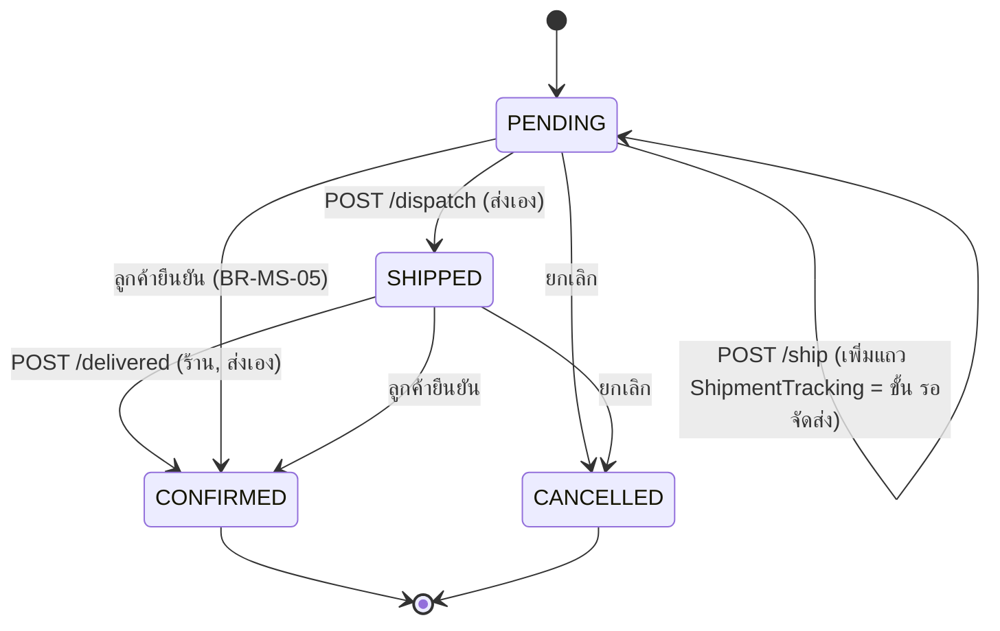

> **โมดูล:** 00080 - Manual Shipment Dispatch Steps
> **ประเภทเอกสาร:** Software Requirements Specification (SRS) - TECHNICAL
> **เวอร์ชัน:** 1.0
> **วันที่จัดทำ:** 2026-10-18
> **สถานะ:** Draft — เขียนจาก SDS ที่ Controller ล็อกแนว + โค้ดปัจจุบัน (ยังไม่ implement)
> **เจ้าของเอกสาร:** SA

# SRS: ขั้นตอนจัดส่งแบบส่งเอง (Software Requirements Specification — Technical)

---

## 1. บทนำ

### 1.1 วัตถุประสงค์
กำหนดข้อกำหนดเชิงเทคนิคของ 3 ขั้นส่งเอง (รอจัดส่ง → กำลังจัดส่ง → สำเร็จ) และตัวเลือกจังหวะแจ้งเลขพัสดุ สำหรับ DEV/QA

### 1.2 ขอบเขตเชิงระบบ
- **ในขอบเขต:** `order.service` (shipOrder · updateShipmentTracking · markManualDispatched · markManualDelivered) · `src/lib/manual-shipment.ts` · `order-stage` (+SQL) · route `/api/orders/[token]/{ship,dispatch,delivered}` · `auto-notify` settings · หน้าลูกค้า `/o/{token}`
- **นอกขอบเขต:** iShip · ร้านบริการ · backfill ใบเก่า · เช็คสถานะขนส่งภายนอก (00081) · ข้อความอัตโนมัติ "จัดส่งแล้ว/ส่งสำเร็จ"

### 1.3 เอกสารอ้างอิง
| เอกสาร | ความสัมพันธ์ |
|--------|-------------|
| [[PRD]] · [[BRD]] | FR-001..004 · BR-MS-01..22 |
| [[SDS]] | TD-001..005 (ล็อกแล้ว) |
| `docs/scope/2026-10-18-00080-manual-shipment-dispatch-scope-baseline.md` | S-1..S-15 |
| `docs/SRS.md` | §2 state machine · §6 data model · §7 API · §8 enum · §9 สิทธิ์ · §10 validation (sync แล้ว) |

### 1.4 นิยาม
| คำ | ความหมาย |
|----|----------|
| **ส่งเอง** | ออเดอร์ที่มีแถว `ShipmentTracking` และ **ไม่มี** พัสดุ iShip live (`OrderShipment` ที่ไม่ CANCELLED — `LATEST_FORWARD_SHIPMENT`) |
| **รอจัดส่ง** | ขั้นที่ **คำนวณ** ไม่ใช่ค่าที่เก็บ: `Order.status = PENDING` + ส่งเอง |
| **ใบเก่า** | ส่งเอง + `SHIPPED` ก่อนเปิดฟีเจอร์ (`dispatchedAt = NULL`) |

---

## 2. สถาปัตยกรรม

ดู [[SDS]] §2 (แผนภาพ flowchart) — สรุป: UI 2 ที่ (หน้าออเดอร์ · แผงพัสดุแชท) เรียก route เดียวกัน → `order.service` → ตัวตัดสิน `src/lib/manual-shipment.ts` (pure, ไม่ import prisma)

### 2.1 State model

| ขั้นที่ UI แสดง | `Order.status` | `ShipmentTracking` | live iShip |
|---|---|---|---|
| รอดำเนินการ (ยังไม่มีเลข) | PENDING | ไม่มีแถว | - |
| **รอจัดส่ง** (`AWAITING_DISPATCH`) | PENDING | มีแถว | ไม่มี |
| กำลังจัดส่ง (`SHIPPING`) | SHIPPED | มีแถว (`dispatchedAt` มีค่า หรือ NULL = ใบเก่า) | ไม่มี |
| สำเร็จ | CONFIRMED | - | - |
| ยกเลิก | CANCELLED | - | - |

- ไม่มี transition ย้อนขั้น (BR-MS-04) · `CANCELLED`/`CONFIRMED` terminal
- มี live iShip + แถว tracking ⇒ **iShip ชนะ** (stage เดินตามข้อมูลขนส่ง, ไม่มีปุ่มใหม่)
- ผลสำรวจ SDS TD-001: วันนี้ไม่มีทางทิ้ง PENDING + แถว tracking ไว้ จึงไม่มีใบเก่าตกขั้น "รอจัดส่ง" โดยไม่ตั้งใจ

---

## 3. ข้อกำหนดเชิงฟังก์ชันเชิงเทคนิค

### TFR-001: ตัวตัดสินขั้นส่งเอง (S-3)
- **Trace to:** BR-MS-01..06
- **ไฟล์:** `src/lib/manual-shipment.ts` (ใหม่) + `deriveShippingStage` ใน `src/lib/order-stage.ts`
- **สูตร:**
  - `isManualShipment = hasManualTracking && !hasLiveIshipShipment` และ `fulfillmentMode = 'SHIPPED'`
  - `canMarkDispatched = isManualShipment && status === 'PENDING'`
  - `canMarkDelivered = isManualShipment && status === 'SHIPPED'`
  - `deriveShippingStage`: ในสาขาที่ไม่มีพัสดุ iShip — `PENDING && hasManualTracking` → `AWAITING_DISPATCH` (ที่เหลือเดิม)
- **Precondition:** อินพุตเป็นค่าที่อ่านสด (ไม่ใช่ prop ค้างจาก client)
- **Edge:** iShip ผูกทับใบรอจัดส่ง → iShip ชนะ (`canMarkDispatched = false`) · ร้านบริการ (`NO_SHIPPING`) ไม่เคยเป็นส่งเอง · CANCELLED/CONFIRMED → ปุ่มทั้งสอง false
- **Acceptance:** ตารางเทสครบกริด (ส่งเอง/iShip active/iShip ทับ/ใบเก่า/บริการ/CANCELLED/สำเร็จ) · ผู้ใช้ตัวตัดสินนี้ทุกพื้นผิว ห้ามเขียนเงื่อนไขซ้ำในคอมโพเนนต์ (HR16)

### TFR-002: บันทึกเลขส่งเอง = รอจัดส่ง (S-4)
- **Trace to:** FR-001
- **คำอธิบาย:**
  - `shipOrder`: tx เดียว — สร้าง `ShipmentTracking` + `OrderEvent TRACKING_ADDED` · **ไม่เปลี่ยน `status`** (คง PENDING) · `assertTransition(status,'SHIPPED')` ยังเป็นด่าน "ส่งได้ไหม" (CANCELLED/CONFIRMED ถูกปฏิเสธเหมือนเดิม) · จอง notice TRACKING เฉพาะ timing `ON_SAVE`
  - `updateShipmentTracking`: รับ `PENDING` หรือ `SHIPPED` (เดิม SHIPPED อย่างเดียว) · ยังปฏิเสธเมื่อมี live iShip (`IShipManagedShipmentError`) · เลข (หลัง `normalizeTrackingKey`) เปลี่ยนเท่านั้นถึงจอง notice
  - `PATCH` ไม่สร้างแถวและไม่เปลี่ยน `status`
- **Postcondition:** หลัง `POST /ship` สำเร็จ `status = PENDING`, มีแถว tracking
- **Edge:** `POST /ship` ซ้ำเมื่อมีแถวแล้ว → unique `orderId` ชน → 400 ข้อความทั่วไป (ใช้ PATCH) · แก้เลขในขั้นรอจัดส่งไม่ใช่การเลื่อนขั้น

### TFR-003: "จัดส่งแล้ว" (S-5)
- **Trace to:** FR-002 · BR-MS-02,04
- **คำอธิบาย (`markManualDispatched(shopId, token, actorUserId)`):** tx เดียว
  1. อ่านออเดอร์ (scope ด้วย `shopId`) + tracking + live iShip → `canMarkDispatched`
  2. `updateMany({ id, status: 'PENDING' } → SHIPPED)` — เงื่อนไขขั้นอยู่ใน WHERE
  3. count = 1: `tracking.dispatchedAt = now()` · `OrderEvent MANUAL_DISPATCHED` (`actorUserId`) · `reserveTrackingNotice(tx, orderId, trackingNo ปัจจุบัน)` **ทุกครั้ง** (ON_SAVE ที่ส่งไปแล้ว = ledger ชน ไม่ส่งซ้ำ — SDS TD-006)
  4. count = 0: อ่านใหม่ — `SHIPPED` (และเป็นส่งเอง) = คืน `{changed:false}` · อื่น ๆ = `ManualDispatchNotAllowedError`
  5. หลัง commit: `dispatchAutoNotifyAfterCommit(ledgerId)`
- **Precondition:** ส่งเอง + PENDING + สิทธิ์ S1 + ออเดอร์เป็นของร้าน
- **Postcondition:** `status = SHIPPED`, `dispatchedAt` ตั้งครั้งเดียว, `OrderEvent` 1 แถว
- **Idempotency:** N กดพร้อมกัน → ผู้ชนะ 1 ราย · `OrderEvent MANUAL_DISPATCHED` 1 แถว · ที่เหลือ `changed:false`
- **Edge:** iShip/ร้านบริการ/ขั้นอื่น → 409 ข้อความไทย (ไม่ใช่ 500) · ส่งข้อความล้ม → ขั้นเลื่อนสำเร็จเสมอ (ledger ถือผล)

### TFR-004: "ส่งสำเร็จ" (S-6)
- **Trace to:** FR-003 · BR-MS-03,20,21
- **คำอธิบาย (`markManualDelivered`):**
  1. `updateMany({ id, status: 'SHIPPED' } → CONFIRMED)` เมื่อ `canMarkDelivered`
  2. count = 1: `OrderEvent SELLER_DELIVERED` (แยกจาก `BUYER_CONFIRMED`/`SYSTEM_CONFIRMED`) ใน tx เดียวกัน
  3. หลัง commit: `runPostConfirmEffects` (ยอดขาย/Trust Score/เหรียญ) — helper ที่สกัดจาก `confirmOrder` และ `settleCodFromCarrier` พฤติกรรมเดิมทุกตัวอักษร (TD-004)
  4. count = 0: อ่านใหม่ — `CONFIRMED` = `{changed:false, alreadyClosed:true}` · อื่น = `ManualDeliveryNotAllowedError`
- **Postcondition:** ผลข้างเคียงชุดเดียวกับลูกค้ายืนยัน; ลูกค้ารีวิวได้ตามปกติ
- **Edge:** ลูกค้ายืนยันชนะก่อน → ร้านได้ `alreadyClosed:true` (UI toast "ออเดอร์นี้ปิดไปแล้ว") และ **ตัวแพ้ไม่รัน** `runPostConfirmEffects` · COD ยังไม่รับเงิน → ปิดได้ (เตือนที่ UI เท่านั้น, D-2) · ใบเก่ากดได้ · iShip ปฏิเสธที่ server
- **Idempotency:** กดพร้อมกัน/พร้อมลูกค้า → ปิดครั้งเดียว

### TFR-005: ป้ายขั้น/ไทล์/ตัวกรอง (S-9)
- **Trace to:** FR-001 · BR-MS-01 · HR16
- **คำอธิบาย:** `ShippingStageKey` +`AWAITING_DISPATCH` (ป้าย "รอจัดส่ง") · `OrderStageKey` +`AWAITING_DISPATCH` (stage chip แชท) · `STAGE_BADGE_OVERRIDE` · สูตร SQL คู่ (`order-stage-sql.ts` · `getShippingStageCounts` · `STAGE_COLUMNS` · `order-stage.service.ts`) LEFT JOIN `"ShipmentTracking"` (orderId unique ⇒ ไม่คูณแถว) → `hasManualTracking`
- **Acceptance:** ไทล์ = จำนวนแถวตัวกรอง · parity test TS↔SQL ขยายกริด · ไม่มีป้าย "กำลังจัดส่ง" บนใบรอจัดส่ง · `Record<ShippingStageKey,…>` ให้ tsc บังคับทุกจุดที่ hard-code (รายชื่อไฟล์ใน [[SDS]] §3)

### TFR-006: ตั้งค่าจังหวะแจ้งเลข (S-10)
- **Trace to:** FR-004 · BR-MS-10
- **คำอธิบาย:** `AutoNotifyConfig.trackingNoticeTiming` ∈ {`ON_SAVE`,`ON_DISPATCH`} · ไม่มีแถว config = `ON_SAVE` (ในโค้ด `?? 'ON_SAVE'` จุดเดียวใน `src/lib`) · เขียนผ่าน `PATCH /api/shops/current/auto-notify/settings`
- **Edge:** มีผลกับส่งเองเท่านั้น (iShip ไม่อ่าน) · สวิตช์ TRACKING ปิด = ไม่ส่งทุกจังหวะ

### TFR-007: ตัวส่งเลขพัสดุตามจังหวะ (S-11)
- **Trace to:** FR-002,004 · BR-MS-10,11

| เหตุการณ์ | `ON_SAVE` | `ON_DISPATCH` |
|---|---|---|
| `POST /ship` (บันทึกเลข, PENDING) | จอง notice | ไม่จอง |
| `PATCH /ship` ตอน PENDING เลขเปลี่ยน | จอง | ไม่จอง |
| `POST /dispatch` | จองด้วยเลขปัจจุบัน (ส่งไปแล้ว = ชน UNIQUE ไม่ส่งซ้ำ · TD-006) | จองด้วยเลขปัจจุบัน |
| `PATCH /ship` ตอน SHIPPED เลขเปลี่ยน | จอง | จอง (กติกา 00078: แจ้งเลขใหม่) |

- ใช้ ledger เดิม (UNIQUE `(shopId, orderId, kind, valueKey)`) ไม่มี kind ใหม่ → เลขเดียวส่งครั้งเดียวแม้เปลี่ยนจังหวะกลางทาง · เลขใหม่ครั้งที่ 4+ = `SKIPPED/RESEND_LIMIT` (00078 D-4)
- สวิตช์ปิดหรือ reserve ล้ม = null → ไม่ส่ง ไม่กระทบการเลื่อนขั้น

### TFR-008: หน้าลูกค้า (S-12)
- **Trace to:** FR-004 · D-3 · BR-MS-05
- **คำอธิบาย:** `guest-order-data.ts` — `PENDING && timing = ON_DISPATCH` และเป็นส่งเอง → `shipmentTracking: null` ใน payload (ตัดสินที่ server, ไม่ส่งเลขลง client แล้วซ่อน) · `order-shipment-view.ts` คำนวณ `hasShipment` จากค่าหลังตัด · ฝั่งลูกค้าไม่แสดงถ้อยคำ "ส่งแล้ว" ตอนรอจัดส่ง · ลูกค้ายืนยันได้ทุกขั้น
- **Edge:** iShip/ใบเก่า (SHIPPED) แสดงเหมือนเดิม

### TFR-009: เวลาส่งจริง (ผู้อ่าน `createdAt` เดิม)
- **Trace to:** BR-MS-01 · TD-002
- **คำอธิบาย:** หลังแยกขั้น `ShipmentTracking.createdAt` = เวลาบันทึกเลข ⇒ ผู้อ่านที่ต้องการ "เวลาส่งจริง" (เหรียญ FAST_SHIPPING `badge.service.ts` · `lib/shipping-speed.ts` · "แจ้งเมื่อ" ใน `ShippingCard`) ใช้ `dispatchedAt ?? createdAt` · ใบเก่า `dispatchedAt = NULL` ได้ค่าถูกโดยไม่ backfill

---

## 4. ส่วนต่อประสาน (API)

| Method | Path | คำอธิบาย | Auth |
|--------|------|----------|------|
| POST | `/api/orders/[token]/ship` | บันทึกเลข (status คง PENDING) — **เปลี่ยน** | S1 |
| PATCH | `/api/orders/[token]/ship` | แก้เลข/ขนส่ง/ต้นทุน — รับ PENDING หรือ SHIPPED — **เปลี่ยน** | S1 |
| POST | `/api/orders/[token]/dispatch` | "จัดส่งแล้ว" — **ใหม่** | S1 |
| POST | `/api/orders/[token]/delivered` | "ส่งสำเร็จ" — **ใหม่** | S1 |
| PATCH | `/api/shops/current/auto-notify/settings` | เพิ่ม `trackingNoticeTiming` — **เปลี่ยน** | X8 |

สัญญาละเอียด: [[API]] · ตัวแปรที่ `GET /api/seller/iship/order-context` ต้องตอบเพิ่ม (ขั้น + ปุ่มที่กดได้) ดู [[API]] §4.6

### 4.1 Sequence
ดู [[SDS]] §4.1 (flow หลัก) และ §4.2 (ล้มเหลว/ชดเชย)

---

## 5. ข้อมูล

| Entity | การเปลี่ยน |
|---|---|
| `ShipmentTracking.dispatchedAt` | `timestamptz(3)?` ใหม่ — NULL = ยังไม่กดจัดส่งแล้ว/ใบเก่า |
| `AutoNotifyConfig.trackingNoticeTiming` | `text NOT NULL default 'ON_SAVE'` + CHECK ∈ {`ON_SAVE`,`ON_DISPATCH`} |
| `OrderEvent.type` | +`MANUAL_DISPATCHED` · +`SELLER_DELIVERED` (CHECK ขยาย additive ต่อท้ายจาก `pg_get_constraintdef` — จำนวนรวมดู DATABASE) |
| `Order.status` | **ไม่เพิ่มค่า** (TD-001) |

รูปทรง SQL/migration = [[DATABASE]] (เจ้าของแยก) · ไม่ backfill (OOS-4) · migration 3 ตัว additive ต้องแจ้ง HR15 3 ข้อก่อน migrate

---

## 6. ข้อกำหนดที่ไม่ใช่ฟังก์ชัน

| ด้าน | ข้อกำหนด | เป้าหมายที่วัดได้ |
|------|----------|-------------------|
| **Idempotency** | `dispatch`/`delivered` เป็น conditional `updateMany` (เงื่อนไขขั้นใน WHERE) ไม่ใช่ read-then-write | กด N=10 พร้อมกัน → `OrderEvent` 1 แถว, ผลข้างเคียงครั้งเดียว |
| **Security** | `sessionUserId()` + `canAccessShopWith(order.shopId, userId, 'S1')` ที่ server · ไม่เชื่อขั้นจาก client · ตั้งค่าจังหวะ X8 | 401/403 ครบทุก route |
| **Consistency** | ขั้นตัดสินที่เดียว (`manual-shipment.ts`) ทุกพื้นผิว | เทส parity หน้าออเดอร์ ↔ แชท ↔ รายการ ↔ SQL |
| **Reliability** | ส่งข้อความล้มไม่ทำให้เลื่อนขั้นล้ม | ledger FAILED + ขั้นเลื่อนแล้ว |
| **Cache** | route ใหม่ `Cache-Control: no-store` | header ตรวจในเทส |
| **Privacy** | เลขพัสดุไม่หลุด payload ลูกค้าตอน `ON_DISPATCH` + PENDING | ตรวจ JSON ไม่มีเลข |
| **Maintainability** | ศัพท์ UI ผ่าน th/en (00047) · tsc บังคับ `Record<ShippingStageKey,…>` | build exit 0 |

---

## 7. ข้อจำกัดและการพึ่งพา

- ใช้ ledger/ตัวส่งของ 00078 (#174/#176) และ `reserveTrackingNotice` / `dispatchAutoNotifyAfterCommit` เดิม
- "ส่งสำเร็จ" อาศัยคำยืนยันร้าน ไม่มีหลักฐานขนส่ง (00081 ใช้ action เดียวกันได้ — ไม่เขียน stub)
- PENDING ระหว่างรอจัดส่ง ⇒ ลูกค้ายังยกเลิกได้ และร้านยังแก้ออเดอร์ได้ (ยอมรับตาม TD-001)
- ห้าม `prisma db pull` / `migrate dev` กับฐานแชร์ (HR13/14) · CHECK ของ `OrderEvent` เป็น unmanaged SQL

---

## 8. ความเสี่ยง

| ความเสี่ยง | ผลกระทบ | แนวทางลด |
|-----------|---------|----------|
| ผู้อ่าน "PENDING = ยังไม่มีเลข" ที่ตกหล่น | ใบรอจัดส่งถูกนับ/แสดงผิดกอง | SDS ไล่ครบ + `Record` ให้ tsc บังคับ + parity test |
| ผู้อ่าน `ShipmentTracking.createdAt` เป็น "เวลาส่ง" ที่ตกหล่น | เหรียญ FAST_SHIPPING คิดเวลาผิด | TFR-009 + เทสเหรียญ |
| สกัด `runPostConfirmEffects` ทำพฤติกรรม confirm เปลี่ยน | Trust/เหรียญเพี้ยน | เทสเดิม confirmOrder/settleCodFromCarrier ต้องเขียวโดยไม่แก้ |
| ลูกค้ายกเลิกใบรอจัดส่งหลังร้านแพ็คของ | ของค้างที่ร้าน | ยอมรับ (TD-001) — ร้านเห็นสถานะ CANCELLED |

---

## 9. Traceability

| BRD FR | TFR | Component | Scope |
|---|---|---|---|
| FR-001 | TFR-001, 002, 005 | manual-shipment · shipOrder · order-stage | S-3, S-4, S-9 |
| FR-002 | TFR-003, 007 | markManualDispatched · `/dispatch` | S-5, S-7, S-8, S-11 |
| FR-003 | TFR-004 | markManualDelivered · runPostConfirmEffects · `/delivered` | S-6, S-7, S-8 |
| FR-004 | TFR-006, 007, 008 | auto-notify settings · guest-order-data | S-10, S-11, S-12 |
| BR-MS-21 | TFR-003, 004 | OrderEvent types | S-2 |
| (TD-002) | TFR-009 | badge.service · shipping-speed | S-2 |

---

## 10. สิทธิ์ (Authorization)

| การกระทำ | cap | หมายเหตุ |
|---|---|---|
| `POST /ship` · `PATCH /ship` · `POST /dispatch` · `POST /delivered` | **S1** | `canAccessShopWith(order.shopId, userId, 'S1')` · ลงทะเบียน `src/lib/route-capabilities.ts` (`dispatch`,`delivered` = `{ POST: 'S1' }` ใหม่) · ต้องมีเทสสิทธิ์ (บทบาท × cap) |
| `PATCH …/auto-notify/settings` (รวม `trackingNoticeTiming`) | **X8** | ตรวจแล้วกับ `route-capabilities.ts:447` และ `requireShopCapability(…,'X8')` ใน route · ผ่าน: OWNER · MANAGER · 403 ที่ server |
| `GET …/auto-notify` | H1 | เพิ่มคืน `trackingNoticeTiming` ให้ UI แสดง |
| ลูกค้ายืนยัน `POST /api/orders/[token]/confirm` | BUYER | ไม่เปลี่ยน |

## 11. Validation

| Schema | กติกา |
|---|---|
| `ShipOrderSchema` | ไม่เปลี่ยน: `provider`/`trackingNo` ≥1 ตัวอักษร · `outboundShippingCost` optional |
| `/dispatch`, `/delivered` body | ไม่มี (ยอมรับ `{}` หรือว่าง) — ขั้นตัดสินที่ server |
| `SetAutoNotifySettingsSchema` (แก้ `SetAutoNotifyCapSchema`) | `dailyCapPerRoom?` int 1..20 · `trackingNoticeTiming?` = `v.picklist(['ON_SAVE','ON_DISPATCH'])` · ต้องมีอย่างน้อย 1 คีย์ · ค่านอก picklist = 400 `VALIDATION_ERROR` · DB CHECK อีกชั้น |

---

## 12. สรุป

"รอจัดส่ง" เป็นขั้นคำนวณจาก PENDING + แถว tracking ส่งเอง · 2 action ใหม่เป็น conditional update ที่ idempotent · ไม่เพิ่มค่า `Order.status` · ไม่แตะ iShip

**Open Questions (ให้ Controller ตัดสิน):**
1. ถ้าร้านบันทึกเลขตอน `ON_DISPATCH` (ไม่จอง) แล้วสลับเป็น `ON_SAVE` ก่อนกด "จัดส่งแล้ว" — ตาม SDS ปัจจุบัน `markManualDispatched` จองเฉพาะ timing `ON_DISPATCH` ⇒ ลูกค้าไม่ได้เลขเลย · ทางเลือก: ให้ `dispatch` จองเสมอ (ledger UNIQUE กันซ้ำ, สวิตช์ปิดยังไม่ส่ง)
2. body ของ `PATCH …/settings`: ทำ `dailyCapPerRoom` เป็น optional + บังคับอย่างน้อย 1 คีย์ (สัญญาใน [[API]] §4.5) — SDS ไม่ได้ระบุรูปร่างตรง ๆ
3. ข้อความ `OrderNotShippedError` ("ออเดอร์นี้ยังไม่ได้แจ้งจัดส่ง") ไม่ตรงความหมายเมื่อ PATCH ใบ CONFIRMED/CANCELLED หลังรับ PENDING

**มติ Controller 2026-10-18:** OQ-1 = `dispatch` จองเสมอ (SDS TD-006) · OQ-2 = ตามข้อเสนอ (TD-007) · OQ-3 = ข้อความใหม่ "แก้เลขพัสดุไม่ได้ ออเดอร์นี้ปิดหรือยกเลิกแล้ว" (TD-007)
