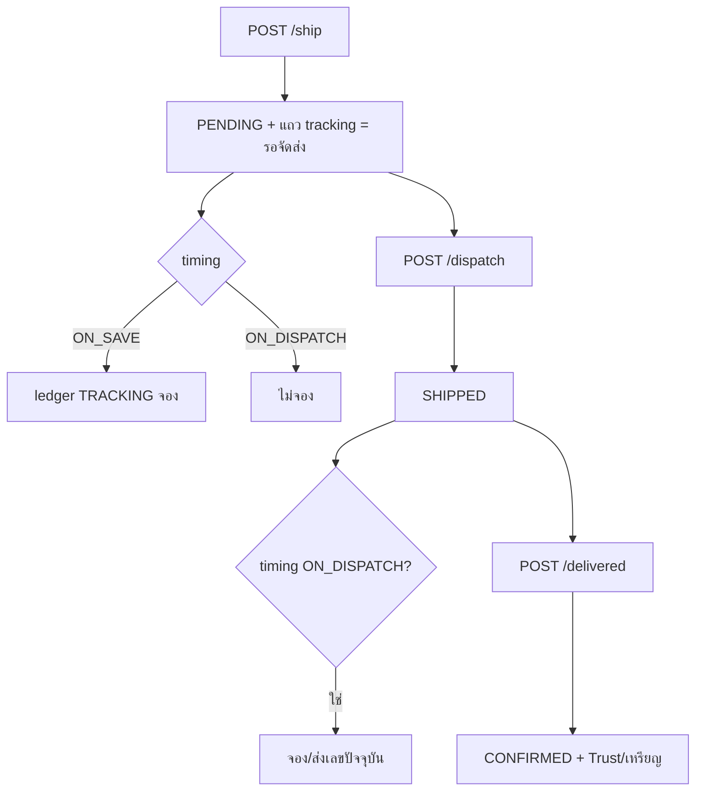

> **โมดูล:** 00080 - Manual Shipment Dispatch Steps
> **ประเภทเอกสาร:** Test Case
> **เวอร์ชัน:** 1.0 · **วันที่:** 2026-10-18 · **สถานะ:** Draft (ยังไม่เคยรัน)
> **เจ้าของเอกสาร:** QA

# Test Case: ขั้นตอนจัดส่งแบบส่งเอง

---

## 1. Overview

- **เอกสารต้นทาง:** [[BRD]] FR-001..004 · BR-MS-01..22 · Scope Baseline S-3..S-13 (S-14 UI audit และ S-15 E2E ดูหัวข้อ 4)
- **ชนิด:** unit (pure) · integration (DB) · parity · route · E2E (Playwright) · ตรวจสายตา (user)
- **สภาพแวดล้อม:** DB integration ที่ `localhost:5434` **ปักหมุด URL ในคำสั่ง** (HR14) · ข้อมูลสร้างเอง scope ด้วย id ที่เทสสร้าง ห้าม `deleteMany()` เปล่า (HR13) · E2E ที่ `*.deepth.local:4000`
- **ชื่อย่อ:** `[blocker]` = mutation test บังคับ (ถอด/สลับเงื่อนไขในโค้ดแล้วเทสต้องแดง; ต้องรันให้เห็นแดงจริง ไม่ใช่เขียนไว้เฉย ๆ)
- **นอกขอบเขต:** iShip flow ภายใน · 00081 · ข้อความอัตโนมัติ "จัดส่งแล้ว/ส่งสำเร็จ"

---

## 2. Test Scenarios

### 2.1 ตัวตัดสินขั้น (S-3) — unit, `src/lib/__tests__/manual-shipment.test.ts`

#### TC-001: ตารางขั้น × ปุ่ม
- **Linked to:** S-3 · BR-MS-01..06
- **Steps:** ป้อนกริด {status: PENDING/SHIPPED/CONFIRMED/CANCELLED} × {มีเลขส่งเอง: ใช่/ไม่} × {live iShip: ใช่/ไม่} × {fulfillmentMode SHIPPED/NO_SHIPPING}
- **Expected:**
  - PENDING+เลข+ไม่มี iShip → `AWAITING_DISPATCH`, `canDispatch=true`, `canMarkDelivered=false`
  - SHIPPED+เลข+ไม่มี iShip → `SHIPPING`, `canDispatch=false`, `canMarkDelivered=true`
  - มี live iShip ทุกกรณี → ทั้งสองปุ่ม false (iShip ชนะ แม้มีแถว tracking)
  - ร้านบริการ/NO_SHIPPING → ทั้งสองปุ่ม false
  - CONFIRMED/CANCELLED → ทั้งสองปุ่ม false

#### TC-002: `[blocker]` ถอดเงื่อนไข "iShip active"
- **Linked to:** S-3 · BR-MS-06
- **Steps:** mutate ตัดเงื่อนไข `!hasLiveIshipShipment` ออก
- **Expected:** TC-001 แถว iShip แดง

#### TC-003: `[blocker]` ปุ่ม "จัดส่งแล้ว" กดได้ที่ขั้นอื่น
- **Linked to:** S-3 · BR-MS-02
- **Steps:** mutate `canMarkDispatched` ให้ไม่เช็ค `status === 'PENDING'`
- **Expected:** แดง (ที่ SHIPPED/CONFIRMED)

#### TC-004: `[blocker]` ปุ่ม "ส่งสำเร็จ" ผูกกับ iShip
- **Linked to:** S-3 · BR-MS-03
- **Steps:** mutate ให้ `canMarkDelivered` ขึ้นกับสถานะ iShip (เช่น ต้องมี iShip active)
- **Expected:** แดง (ใบเก่าส่งเอง SHIPPED ต้องกดได้)

#### TC-005: iShip ผูกทับใบรอจัดส่ง
- **Linked to:** S-3, S-4 · BR-MS-06
- **Steps:** ใบ PENDING + แถว tracking → ผูก iShip (`advanceOrderIfDispatched`) → เรียกตัวตัดสิน
- **Expected:** ขั้นเดินตาม iShip (SHIPPED) · ปุ่มส่งเองหาย

### 2.2 บันทึกเลข/แก้เลข (S-4) — integration + route

#### TC-006: บันทึกเลข = รอจัดส่ง
- **Linked to:** FR-001 · S-4 · BR-MS-01
- **Precondition:** ออเดอร์ PENDING, `fulfillmentMode=SHIPPED`, ไม่มี iShip
- **Steps:** `POST /ship` `{provider:"Kerry", trackingNo:"KEX123"}`
- **Expected:** 200 · `Order.status` = PENDING · มีแถว `ShipmentTracking` (`dispatchedAt` NULL) · `OrderEvent TRACKING_ADDED` 1 แถว · stage = `AWAITING_DISPATCH`

#### TC-007: แก้เลข/ขนส่ง/ต้นทุนในขั้นรอจัดส่ง และกำลังจัดส่ง
- **Linked to:** FR-001 · S-4
- **Steps:** `PATCH /ship` ตอน PENDING (มีแถว) แล้วซ้ำตอน SHIPPED
- **Expected:** 200 ทั้งคู่ · `status` ไม่เปลี่ยน · `outboundShippingCost` ไม่ส่งคีย์ = ไม่แตะ, `null` = ล้าง

#### TC-008: PATCH ตอนไม่มีแถว / CONFIRMED / CANCELLED / มี iShip
- **Linked to:** S-4
- **Expected:** ไม่มีแถว → 404 · CONFIRMED/CANCELLED → 409 · live iShip → 409 `IShipManaged…` (`updateShipmentTracking` ยังปฏิเสธ) ไม่ใช่ 500

#### TC-009: ยกเลิกในขั้นรอจัดส่ง
- **Linked to:** FR-001 · BR-MS-04
- **Steps:** ใบรอจัดส่ง → ยกเลิก
- **Expected:** CANCELLED · ปุ่มทั้งสองหาย

#### TC-010: สิทธิ์ `/ship`
- **Linked to:** S-4 · A-2
- **Expected:** ไม่มี session 401 · ไม่ใช่สมาชิกร้านเจ้าของออเดอร์/ไม่ถือ S1 → 403 · ออเดอร์ร้านอื่น ไม่เปลี่ยนสถานะ

### 2.3 "จัดส่งแล้ว" (S-5)

#### TC-011: รอจัดส่ง → กำลังจัดส่ง
- **Linked to:** FR-002 · S-5 · BR-MS-02
- **Steps:** `POST /dispatch` บนใบ TC-006
- **Expected:** 200 `{changed:true}` · `status` = SHIPPED · `dispatchedAt` มีค่า · `OrderEvent MANUAL_DISPATCHED` 1 แถวมี `actorUserId`

#### TC-012: กดซ้ำ
- **Linked to:** FR-002 · S-5
- **Steps:** `POST /dispatch` ซ้ำ
- **Expected:** 200 `{changed:false}` · `OrderEvent` ยัง 1 แถว · `dispatchedAt` ไม่ถูกเขียนทับ

#### TC-013: กดพร้อมกัน N=10
- **Linked to:** FR-002 · S-5 · NFR Idempotency
- **Steps:** `Promise.all` 10 ครั้ง บนใบเดียวกัน (DB จริง 5434)
- **Expected:** `changed:true` ได้ 1 ครั้ง ที่เหลือ `changed:false` · `OrderEvent MANUAL_DISPATCHED` = 1 แถว · ledger TRACKING ≤ 1 แถว · ไม่มี 500

#### TC-014: ขั้นไม่ถูก → ข้อความไทย
- **Linked to:** S-5 · BR-MS-06
- **Steps:** `/dispatch` บนใบ (ก) ไม่มีเลข (ข) CONFIRMED (ค) CANCELLED (ง) มี live iShip (จ) ร้านบริการ
- **Expected:** 409 ข้อความไทยทุกกรณี · ไม่ใช่ 500 · `status` ไม่เปลี่ยน

#### TC-015: สิทธิ์ `/dispatch`
- **Linked to:** S-5
- **Expected:** 401 / 403 / 404 ตาม [[API]] §4.3 · สมาชิกที่ไม่ถือ S1 ถูกปฏิเสธที่ server

### 2.4 "ส่งสำเร็จ" (S-6)

#### TC-016: กำลังจัดส่ง → สำเร็จ + ผลข้างเคียงเท่าลูกค้ายืนยัน
- **Linked to:** FR-003 · S-6 · BR-MS-03,20
- **Steps:** `POST /delivered` บนใบ SHIPPED (ส่งเอง)
- **Expected:** 200 `{changed:true}` · CONFIRMED · `OrderEvent SELLER_DELIVERED` (ไม่ใช่ `BUYER_CONFIRMED`/`SYSTEM_CONFIRMED`) · ยอดขายนับ · Trust Score คำนวณใหม่ · ประเมินเหรียญ · ผลลัพธ์เท่ากับการลูกค้ายืนยันใบเทียบเคียง

#### TC-017: `[blocker]` ถอดการคำนวณ Trust Score
- **Linked to:** S-6 · BR-MS-20
- **Steps:** mutate `runPostConfirmEffects` / จุดเรียกจาก `markManualDelivered` ไม่คำนวณ Trust Score
- **Expected:** TC-016 แดง

#### TC-018: ใบเก่า (SHIPPED, `dispatchedAt` NULL) กดได้
- **Linked to:** FR-003 · S-6 · S-13
- **Expected:** สำเร็จ · ไม่มีขั้นย้อน

#### TC-019: COD ยังไม่รับเงินปิดได้
- **Linked to:** S-6 · D-2 · OOS-7
- **Expected:** `changed:true` (server ไม่กั้น)

#### TC-020: ลูกค้ายืนยันก่อน
- **Linked to:** S-6 · BRD Scenario 3
- **Steps:** ลูกค้า confirm → ร้านกด `/delivered`
- **Expected:** 200 `{changed:false, alreadyClosed:true}` · ไม่รัน `runPostConfirmEffects` ซ้ำ (Trust/เหรียญไม่นับสองรอบ)

#### TC-021: ร้านกับลูกค้ากดพร้อมกัน / ร้านกดซ้ำ N=10
- **Linked to:** S-6 · NFR Idempotency
- **Expected:** ปิดครั้งเดียว · ผลข้างเคียง (เหรียญ/Trust) หนึ่งชุด · `OrderEvent` ปิดงาน 1 แถว

#### TC-022: ปฏิเสธ iShip / PENDING / CANCELLED
- **Linked to:** S-6 · BR-MS-06
- **Expected:** 409 ข้อความไทย · ไม่เปลี่ยนสถานะ

#### TC-023: ลูกค้ารีวิวได้หลังร้านปิด
- **Linked to:** FR-003
- **Expected:** รีวิวได้ตามปกติบนใบ CONFIRMED จาก `SELLER_DELIVERED`

#### TC-024: refactor `runPostConfirmEffects` ไม่เปลี่ยนพฤติกรรมเดิม
- **Linked to:** S-6 · TD-004
- **Expected:** เทสเดิมของ `confirmOrder` และ `settleCodFromCarrier` เขียวโดยไม่แก้เทส

### 2.5 UI ปุ่ม 2 ที่ (S-7, S-8)

#### TC-025: ปุ่มบนหน้าออเดอร์
- **Linked to:** FR-002,003 · S-7
- **Expected:** "จัดส่งแล้ว" เห็นเฉพาะส่งเอง+รอจัดส่ง · "ส่งสำเร็จ" เห็นเฉพาะส่งเอง+กำลังจัดส่ง (รวมใบเก่า) · iShip ไม่เห็นทั้งสอง · "ส่งสำเร็จ" เปิด `pacesConfirm` บอกย้อนกลับไม่ได้ · COD ยังไม่รับเงิน เตือนเพิ่ม · กดแล้วจอเปลี่ยนไม่ต้องรีเฟรช · `pacesToast` ไม่มี emoji

#### TC-026: parity แผงพัสดุแชท ↔ หน้าออเดอร์
- **Linked to:** S-8
- **Steps:** รัน `decidePanelView`/ปุ่มกับกริดเดียวกับ TC-001
- **Expected:** ปุ่มที่ขึ้น = เหมือนหน้าออเดอร์ทุกแถว · `order-context` ตอบขั้นและ `canMarkDispatched/Delivered` ตรง server

#### TC-027: ข้อความ `Invalid transition` แปลไทยครอบ action ใหม่
- **Linked to:** S-8
- **Expected:** ไม่มีอังกฤษดิบหลุดใน toast

### 2.6 ป้าย/ไทล์/ตัวกรอง (S-9)

#### TC-028: ป้าย "รอจัดส่ง" คำเดียวทุกหน้า
- **Linked to:** FR-001 · S-9 · HR16
- **Expected:** รายการ · ไทล์/ตัวกรอง · หน้าออเดอร์ · แผงแชท · stage chip แชท แสดง "รอจัดส่ง" · ไม่มีป้าย "กำลังจัดส่ง" บนใบรอจัดส่ง · th/en ครบ

#### TC-029: ไทล์ = จำนวนแถวตัวกรอง (parity TS ↔ SQL)
- **Linked to:** S-9
- **Steps:** ขยายกริดใน `src/lib/__tests__/order-stage-sql.test.ts` ให้มีใบ PENDING+tracking, PENDING+tracking+iShip, SHIPPED+tracking(ใบเก่า), ไม่มี tracking
- **Expected:** `deriveShippingStage` (TS) = สูตร SQL ทุกแถว · ผลรวม `getShippingStageCounts` = จำนวน `STAGE_COLUMNS` ที่กรอง

#### TC-030: `[blocker]` ตัดใบรอจัดส่งจากตัวนับแต่ไม่ตัดจากตัวกรอง
- **Linked to:** S-9
- **Steps:** mutate สูตรตัวนับให้ไม่นับ `AWAITING_DISPATCH`
- **Expected:** TC-029 แดง

#### TC-031: LEFT JOIN ไม่คูณแถว
- **Linked to:** S-9 · SDS TD
- **Expected:** ออเดอร์ 1 ใบ = นับ 1 (orderId unique) แม้มีหลายผู้ใช้ join

### 2.7 ตั้งค่าและการแจ้งลูกค้า (S-10..S-12)

#### TC-032: ตั้งค่าจังหวะ — validation + สิทธิ์
- **Linked to:** FR-004 · S-10
- **Steps:** `PATCH …/settings` ด้วย `{trackingNoticeTiming}` ค่า `ON_SAVE`/`ON_DISPATCH`/`ON_X`/ว่าง
- **Expected:** 2 ค่าแรก 200 คืนค่าใหม่ · ที่เหลือ 400 `VALIDATION_ERROR` · บทบาทไม่ถือ X8 → 403 ที่ server · ไม่มีแถว config → ค่าอ่าน = `ON_SAVE`

#### TC-033: ค่าตั้งต้นไม่เปลี่ยนพฤติกรรมร้านเดิม
- **Linked to:** S-2 · A-6
- **Expected:** ร้านที่เปิดสวิตช์ TRACKING อยู่แล้ว = `ON_SAVE` = ส่งตอนบันทึกเหมือน 00078

#### TC-034: `ON_SAVE` ส่งตอนบันทึก
- **Linked to:** FR-004 · S-11 · Scenario 1
- **Expected:** `POST /ship` จอง notice 1 · `POST /dispatch` ไม่จองเพิ่ม

#### TC-035: `ON_DISPATCH` ไม่ส่งตอนบันทึก/แก้เลข แล้วส่งตอนกด
- **Linked to:** FR-002,004 · S-11 · Scenario 1,2
- **Steps:** timing=`ON_DISPATCH` → `POST /ship` → `PATCH /ship` (แก้เลข) → `POST /dispatch`
- **Expected:** สองขั้นแรกไม่มี ledger TRACKING · หลัง dispatch ledger 1 แถวด้วยเลขที่ถูกต้อง (เลขผิดไม่เคยถูกส่ง) · ลูกค้าได้ข้อความ 1 ครั้ง

#### TC-036: `[blocker]` ส่งทั้งสองจังหวะ
- **Linked to:** S-11 · BR-MS-11
- **Steps:** mutate ให้ทั้ง `shipOrder` และ `markManualDispatched` จองเสมอ
- **Expected:** TC-034/035 แดง (หรือเทสนับข้อความ = 1 แดง)

#### TC-037: `[blocker]` `ON_DISPATCH` ส่งตอนบันทึก
- **Linked to:** S-11
- **Steps:** mutate ให้ `shipOrder` ไม่อ่าน timing
- **Expected:** TC-035 แดง

#### TC-038: เปลี่ยนจังหวะกลางทาง เลขเดียวส่งครั้งเดียว
- **Linked to:** S-11 · BR-MS-11
- **Steps:** `ON_SAVE` บันทึก (ส่งแล้ว) → เปลี่ยนเป็น `ON_DISPATCH` → dispatch
- **Expected:** dispatch ชน ledger UNIQUE → ไม่ส่งซ้ำ

#### TC-039: แก้เลขหลังแจ้งแล้ว / สวิตช์ปิด / ส่งล้ม
- **Linked to:** S-11 · BRD §6.3
- **Expected:** แก้เลขหลังแจ้ง → แจ้งเลขใหม่ตามกติกา 00078 (ครั้งที่ 4+ = `SKIPPED/RESEND_LIMIT`) · สวิตช์ TRACKING ปิด = ไม่ส่งทุกจังหวะ · ส่งล้ม (ledger FAILED) → ออเดอร์ยังเลื่อนขั้นสำเร็จ

#### TC-040: iShip ไม่อ่านตัวเลือกจังหวะ
- **Linked to:** FR-004 · OOS-1
- **Expected:** ใบ iShip แจ้งตามจังหวะเดิมไม่ว่า timing เป็นอะไร

#### TC-041: หน้าลูกค้าตามจังหวะ
- **Linked to:** FR-004 · S-12 · D-3
- **Steps:** GET payload ของ `/o/{token}` (guest-order-data) ทุกชุด {timing} × {PENDING+เลข / SHIPPED / iShip / ใบเก่า}
- **Expected:** `ON_SAVE`: เห็นเลขตั้งแต่รอจัดส่ง · `ON_DISPATCH`+PENDING: payload **ไม่มีเลขพัสดุ** (`shipmentTracking: null`, ตรวจ JSON ไม่ใช่แค่ซ่อน UI) · SHIPPED/iShip/ใบเก่า เหมือนเดิม · ไม่มีถ้อยคำ "ส่งแล้ว" ตอนรอจัดส่ง

#### TC-042: ลูกค้ายืนยันได้ทุกขั้น
- **Linked to:** BR-MS-05 · S-12/S-13
- **Expected:** ยืนยันได้ที่ PENDING(รอจัดส่ง) และ SHIPPED

### 2.8 Regression (S-13)

#### TC-043: ของที่ต้องไม่เปลี่ยน
- **Linked to:** S-13 · BRD §3.2
- **Expected:** iShip ไม่เห็นปุ่ม ขั้นเดินตามขนส่ง · ร้านบริการไม่เกี่ยว · ใบเก่า SHIPPED ไม่ถูกย้อนแต่ได้ปุ่ม "ส่งสำเร็จ" · ยกเลิกได้ก่อนสำเร็จ · เทส 00078 ที่เกี่ยวเขียวทั้งหมด (auto-notify · ShipForm · chat-shipment-panel)

#### TC-044: เหรียญ FAST_SHIPPING ใช้ `dispatchedAt ?? createdAt`
- **Linked to:** TFR-009 · TD-002
- **Expected:** ใบใหม่คิดจากเวลากด "จัดส่งแล้ว" (ไม่ใช่เวลาบันทึกเลข) · ใบเก่า (`dispatchedAt` NULL) คิดจาก `createdAt` เหมือนเดิม

### 2.9 UI audit + E2E (S-14, S-15)

#### TC-045: UI audit
- **Linked to:** S-14
- **Expected:** `safepay-ux` Design Spec ก่อน build · `/impeccable critique` + `clarify` · ไม่มี arbitrary Tailwind (HR7) · `pacesToast` เท่านั้น (HR9: `rg "from ['\"]react-toastify" "src/app/(paces)/"` = 0) · emoji = 0 (HR12) · คอนทราสต์ ≥ 4.5:1 light/dark · แตะเป้า ≥ 44px บน 390 · label ผูก input ตัวเลือกจังหวะ · Anuphan · commit มี `Base: theme/...`

#### TC-046: E2E (Playwright, บังคับ)
- **Linked to:** S-15 · Scenario 1-3
- **Steps/Expected:** ส่งเองครบ 3 ขั้นจากหน้าออเดอร์ และจากแชท · `ON_DISPATCH` ลูกค้าได้ข้อความ 1 ครั้ง · ป้าย/ไทล์/ตัวกรอง parity · iShip ไม่เห็นปุ่ม · กดซ้ำสองแท็บไม่ error ค้างจอ · ลูกค้ายืนยันก่อน → ร้านกดได้ toast "ออเดอร์นี้ปิดไปแล้ว" · user ตรวจภาพเองก่อน merge

---

## 3. Traceability Matrix

| Requirement | Test Case | ครอบคลุม |
|---|---|---|
| FR-001 (BR-MS-01,04) | TC-001, 006, 007, 009, 028 | Yes |
| FR-002 (BR-MS-02) | TC-003, 011, 012, 013, 014, 015, 025, 035 | Yes |
| FR-003 (BR-MS-03,20,21) | TC-004, 016-024, 025 | Yes |
| FR-004 (BR-MS-10,11) | TC-032-041 | Yes |
| BR-MS-05 | TC-042 | Yes |
| BR-MS-06 | TC-002, 005, 014, 022, 040, 043 | Yes |
| S-3 | TC-001-005 | Yes |
| S-4 | TC-005-010 | Yes |
| S-5 | TC-011-015 | Yes |
| S-6 | TC-016-024 | Yes |
| S-7 | TC-025 | Yes |
| S-8 | TC-026, 027 | Yes |
| S-9 | TC-028-031 | Yes |
| S-10 | TC-032, 033 | Yes |
| S-11 | TC-034-040 | Yes |
| S-12 | TC-041, 042 | Yes |
| S-13 | TC-018, 043, 044 | Yes |
| S-14 | TC-045 | Yes |
| S-15 | TC-046 | Yes |
| Mutation `[blocker]` ตาม baseline | TC-002, 003, 004 (S-3) · TC-017 (S-6) · TC-030 (S-9) · TC-036, 037 (S-11) | Yes |

---

## 4. Flow

---

## 5. ผลล่าสุด

| Run | วันที่ | ผล | ผู้ทดสอบ |
|-----|--------|-----|----------|
| - | - | ยังไม่เคยรัน (implement ยังไม่เริ่ม) | - |

---

## 6. สรุป

46 เคสครอบคลุม S-3..S-15 และ FR-001..004 รวม mutation `[blocker]` ทั้ง 7 ข้อของ baseline

**Open Questions:**
- TC-035/038: ผลขึ้นกับคำตอบ Open Question #1 ใน [[SRS]] §12 (กรณีสลับ `ON_DISPATCH` → `ON_SAVE` ก่อน dispatch) — ถ้า Controller เลือก "dispatch จองเสมอ" ต้องเพิ่มเคสนั้น
