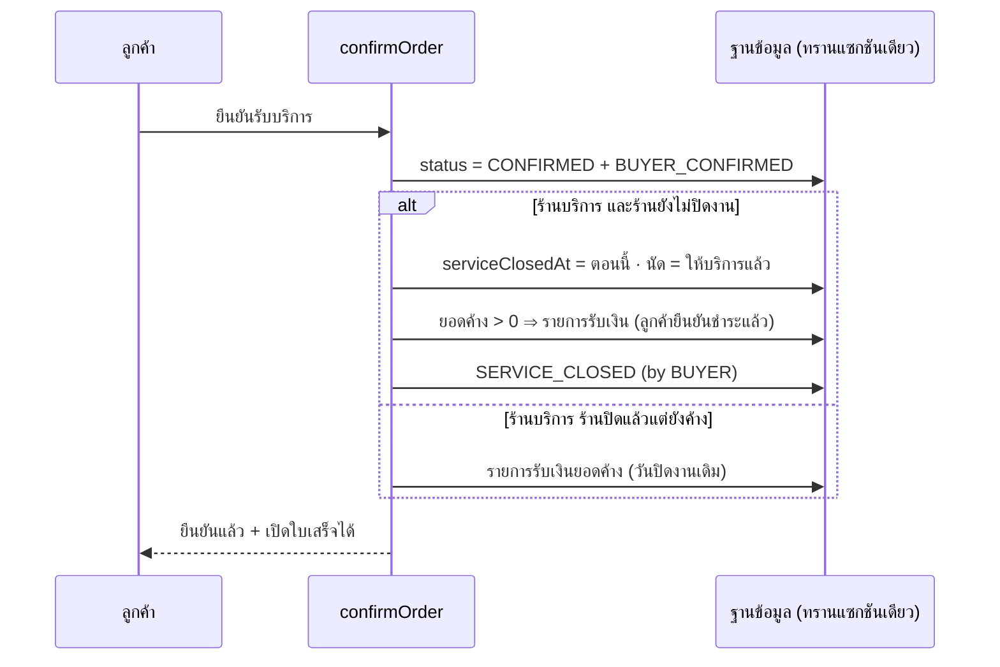

> **โมดูล:** 00082 — Service Buyer Confirm Closes Job
> **ประเภทเอกสาร:** Business Requirements Document (BRD)
> **เวอร์ชัน:** 1.0
> **วันที่จัดทำ:** 2026-10-21
> **สถานะ:** Draft — รอ user อนุมัติ (HR11)

# BRD: ลูกค้ายืนยันรับบริการ = ปิดงาน + ชำระครบ (ร้านบริการเท่านั้น)

## 1. บทนำ

ต่อยอด 00073 (flow 4 ขั้น) ให้ "ทางลัด" ในผังทำงานจริง: ลูกค้ายืนยันรับบริการ ⇒ ขั้น 3 (ปิดงาน) เกิดให้อัตโนมัติ พร้อมบันทึกชำระครบและใบเสร็จ — มติ user 2026-10-21 (PRD §9)

นิยามที่ใช้ (ไม่เปลี่ยนจาก 00073): ปิดงานแล้ว = `Order.serviceClosedAt` ไม่ว่าง · ยอดภายในร้านนับตามวันปิดงาน · โปรไฟล์สาธารณะนับตอนลูกค้ายืนยัน (`status = CONFIRMED`)

## 2. ความต้องการ (Functional Requirements)

#### FR-001: ลูกค้ายืนยัน ⇒ ปิดงานให้ (ร้านยังไม่ปิด)
ใน `confirmOrder` (ทางเข้าเดียวของเว็บ + แอป) เมื่อ **ร้านบริการ** และ `serviceClosedAt` ว่าง ⇒ ในทรานแซกชันเดียวกับการตั้ง `status = CONFIRMED`:
- `serviceClosedAt` = เวลาที่ลูกค้ากด
- มีนัด (`serviceStart` ไม่ว่าง) ⇒ `appointmentStatus = COMPLETED` (กติกาเดียวกับร้านกดปิด "ให้บริการแล้ว")
- **ไม่ตรวจเวลานัด** (ร้านปิดก่อนเวลานัดไม่ได้ แต่ลูกค้ายืนยันเองว่าได้รับบริการแล้ว)
- AC: หลังลูกค้ากด ใบมี `serviceClosedAt` = เวลากด · `status = CONFIRMED` · ป้ายร้าน "ปิดงานแล้ว · ชำระครบ" · ไม่เหลือสถานะ "ลูกค้ายืนยันแล้ว · รอร้านปิดงาน"

#### FR-002: บันทึกชำระครบ
ในทรานแซกชันเดียวกัน: ยอดค้าง (`computeOrderMoney(...).outstanding`) > 0 ⇒ สร้าง `OrderPayment` 1 แถว
- `kind = BALANCE` · `amount = ยอดค้าง` · `method = OTHER` (ไม่รู้ว่าโอนหรือเงินสด ⇒ ใบเสร็จไม่ติ๊กช่องวิธีชำระ ตาม BR-RCP-13) · `receivedAt = เวลากด`
- `receivedByUserId = ลูกค้าที่กด` · `note = "ลูกค้ายืนยันรับบริการและชำระแล้ว"`
- ยอดค้าง = 0 อยู่แล้ว ⇒ ไม่สร้างแถว
- AC: `outstanding = 0` หลังกด · ร้านยกเลิก (void) รายการนี้ได้ด้วยปุ่มเดิม ⇒ ใบกลับเป็น "ค้างชำระ" และลูกค้าเปิดใบเสร็จไม่ได้

#### FR-003: ประวัติ
บันทึก `SERVICE_CLOSED` (`actorUserId = ลูกค้า`, `meta = { outcome: "SERVED", by: "BUYER", amount? }`) ต่อจาก `BUYER_CONFIRMED` ในทรานแซกชันเดียวกัน — ฟีดกิจกรรมของร้านเห็นว่าปิดเพราะลูกค้ายืนยัน
- AC: ประวัติของใบมีทั้ง `BUYER_CONFIRMED` และ `SERVICE_CLOSED (by BUYER)` เวลาเดียวกัน

#### FR-004: ไม่ส่งข้อความ "ร้านให้บริการแล้ว"
การปิดจากลูกค้า **ไม่** จองข้อความแจ้งลูกค้าอัตโนมัติ `SERVICE_CLOSED` (ลูกค้ากดเอง ไม่ต้องบอกซ้ำ)
- AC: ไม่มีแถว auto-notify ของการปิดครั้งนี้

#### FR-005: ใบเสร็จขึ้นทันที
คำตอบของ API ยืนยัน (เว็บ) บอกว่าเปิดใบเสร็จได้แล้ว ⇒ หน้า `/o/[token]` แสดงปุ่มใบเสร็จทันทีโดยไม่ต้องรีเฟรช · ตัวตัดสินยังเป็น `canBuyerViewReceipt` ตัวเดียว (ปิดแล้ว · ไม่ใช่ไม่มาตามนัด · ไม่ค้าง)
- AC: กดยืนยันแล้วเห็นปุ่มใบเสร็จในจอเดิม · เปิดแล้วได้เลขที่ใบเสร็จ

#### FR-006: ร้านปิดไปแล้วแบบค้างชำระ แล้วลูกค้ายืนยัน (Q-1 = ใช่ · D-5)
ร้านบริการ · `serviceClosedAt` มีค่าแล้ว · ยอดค้าง > 0 · ไม่ใช่ไม่มาตามนัด ⇒ ใช้ FR-002 (สร้างรายการรับเงินยอดค้าง) **โดยไม่ปิดซ้ำ ไม่แตะวันปิดงานเดิม ไม่บันทึก `SERVICE_CLOSED` ซ้ำ** · ไม่เพิ่มชนิดประวัติใหม่ — ระบบรับเงินเดิมไม่บันทึก `OrderEvent` (รายการรับเงินเป็นหลักฐานในตัว · ตรวจ `order-payment.service.ts` 2026-10-23) ฟีดร้านเห็น `BUYER_CONFIRMED` ตามเดิม และหมายเหตุบนรายการบอกว่าลูกค้ายืนยัน
- ทางเข้าเดียวกัน: ลูกค้ากดยืนยัน **หรือ** ส่งคะแนน (`reviewConfirmsServiceJob` → `confirmOrder`)
- AC: ใบที่ร้านปิด "ค้าง 1,500" → ลูกค้ายืนยัน ⇒ outstanding 0 · วันปิดงานเดิม · ใบเสร็จเปิดได้

#### FR-007: ปิดย้อนหลังใบเก่า (migration ข้อมูล · HR15)
เลือกใบที่: ร้าน `SERVICE_QUEUE` · `status = CONFIRMED` · `serviceClosedAt IS NULL` · `appointmentStatus` ไม่ใช่ `NO_SHOW` ⇒ ต่อใบ:
- `serviceClosedAt` = `occurredAt` ของ `OrderEvent BUYER_CONFIRMED` ล่าสุดของใบ (ไม่มี event ⇒ `updatedAt` ของใบ)
- มีนัด ⇒ `appointmentStatus = COMPLETED`
- ยอดค้าง > 0 ⇒ `OrderPayment` แบบ FR-002 (`receivedAt` = วันเดียวกับวันปิด · `receivedByUserId = buyerUserId`)
- บันทึก `SERVICE_CLOSED` (`by: "BUYER"`, `meta.backfill = "00082"`)
- รันซ้ำได้ (เลือกเฉพาะ `serviceClosedAt IS NULL`) · ไม่ส่งข้อความหาใคร
- ใบที่ปิดแล้วแบบค้าง + ลูกค้ายืนยันแล้ว (`status = CONFIRMED` · `serviceClosedAt` มีค่า · ยอดค้าง > 0 · ไม่ใช่ `NO_SHOW`) ⇒ บันทึกชำระครบด้วย (`receivedAt` = วัน `BUYER_CONFIRMED` · ไม่แตะวันปิด) — D-5
- AC: หลัง migrate ใบร้านบริการที่ `status = CONFIRMED AND (serviceClosedAt IS NULL OR ยอดค้าง > 0)` (ยกเว้น `NO_SHOW`) = 0 · ใบร้านอื่นไม่ถูกแตะ (นับก่อน/หลังเท่ากัน)

## 3. กติกาที่คงเดิม (ห้ามเปลี่ยน)

- ร้านกด "ปิดงาน" ก่อน แล้วลูกค้ายืนยันทีหลัง ⇒ เหมือนเดิมทุกอย่าง ยกเว้นยอดค้างถูกบันทึกเป็นชำระครบ (FR-006)
- ไม่มาตามนัด ⇒ ลูกค้ายืนยันไม่ได้ (`ServiceJobNoShowConfirmError`)
- รีวิวต่อได้ทันที · ส่งคะแนน = ยืนยัน เมื่อร้านปิดแล้ว (`reviewConfirmsServiceJob`)
- ลูกค้ายืนยันแล้ว ⇒ "เปิดงานอีกครั้ง" ไม่ได้ (`canReopenServiceJob`)
- Trust Score / badges / โปรไฟล์สาธารณะ: นับตอนยืนยันเหมือนเดิม
- ร้านอื่น (`usesServiceFinanceRules = false`): `confirmOrder` ทำงานเดิมทุกบรรทัด

## 4. Business Flow

## 5. Acceptance Criteria สรุป

### 5.1 ความถูกต้อง
- ทุก FR มีเทสบนฐาน local (DB test) + เทส mutation ว่าตัวกั้นร้านบริการจับได้
- ทรานแซกชันเดียว: ส่วนไหนล้ม = ไม่มีอะไรถูกเขียน (ไม่มีใบที่ CONFIRMED แต่ไม่ปิด)
- กดซ้ำ/สองแท็บพร้อมกัน ⇒ ปิดครั้งเดียว รายการรับเงินแถวเดียว

### 5.2 ไม่กระทบ
- ร้านขายของ/ที่พัก: เทส `confirmOrder` เดิมผ่านทั้งหมด · ไม่มีแถว payment/serviceClosedAt เกิดกับร้านอื่น
- รายงานกลุ่ม LINE: ไม่มีไฟล์ LINE ใน diff
- สิทธิ์: ไม่มีไฟล์สิทธิ์ใน diff

## 6. ผลกระทบต่อข้อมูลเดิม

- ยอด "ปิดงานแล้ว" ของเดือนก่อน ๆ เพิ่มขึ้นตามใบที่ถูกปิดย้อนหลัง (ตั้งใจ — D-3)
- หน้าแรก "รอปิดงาน" ลดลง · "ปิดงานแล้ว" เพิ่มขึ้น
- จำนวนใบที่จะโดนบน prod: ยังไม่รู้ (การอ่าน prod ถูกบล็อกในเครื่องมือ) — ให้ user เช็กก่อน merge หรือให้ผมนับถ้าเปิดสิทธิ์อ่าน

## 7. แผนทดสอบ

| เคส | คาดหวัง |
|---|---|
| ร้านบริการ ยังไม่ปิด ค้าง 1,500 → ลูกค้ายืนยัน | ปิดงาน · payment 1,500 (OTHER) · outstanding 0 · ใบเสร็จเปิดได้ · ไม่มี auto-notify |
| ร้านบริการ ยังไม่ปิด จ่ายครบแล้ว → ยืนยัน | ปิดงาน · ไม่สร้าง payment |
| ร้านบริการ มีนัดในอนาคต → ยืนยัน | ปิดได้ · นัด = ให้บริการแล้ว |
| ร้านบริการ ปิดแล้ว (ชำระครบ) → ยืนยัน | เหมือนเดิม (ไม่ปิดซ้ำ ไม่มี payment) |
| ร้านบริการ ปิดแล้ว ค้าง → ยืนยัน | payment ยอดค้าง · วันปิดงานเดิม · ไม่มี SERVICE_CLOSED ซ้ำ · ใบเสร็จเปิดได้ |
| ร้านบริการ ปิดแล้ว ค้าง → ลูกค้าส่งคะแนน (ยังไม่ยืนยัน) | ยืนยัน + payment ยอดค้าง (ทางเดียวกัน) |
| ไม่มาตามนัด → ยืนยัน | 409 เหมือนเดิม |
| ร้านขายของ → ยืนยัน | เหมือนเดิมทุกอย่าง (ไม่มี serviceClosedAt/payment) |
| สองคำขอพร้อมกัน | ปิดครั้งเดียว payment แถวเดียว |
| ร้านยกเลิก payment อัตโนมัติ | ค้างชำระ · ใบเสร็จเปิดไม่ได้ |
| migration: ใบเก่า CONFIRMED ยังไม่ปิด | ปิดตามวัน BUYER_CONFIRMED · payment · event · รันซ้ำไม่เพิ่มอะไร · ร้านอื่นไม่ถูกแตะ |

## 8. คำถาม

- **Q-1** (PRD §8): ร้านปิดแล้วแบบค้าง + ลูกค้ายืนยัน ⇒ บันทึกชำระครบด้วย — **ตอบแล้ว: ใช่** (user 2026-10-23 · D-5)
