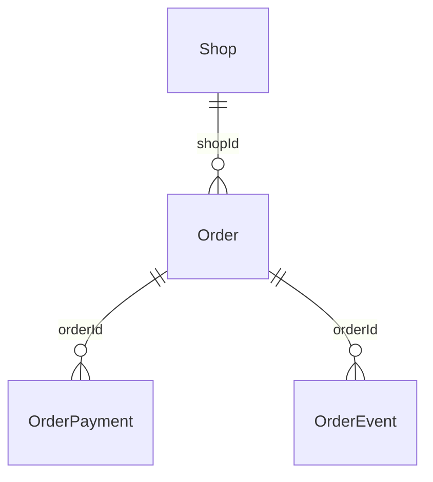

> **โมดูล:** 00082 — Service Buyer Confirm Closes Job
> **ประเภทเอกสาร:** DATABASE
> **เวอร์ชัน:** 1.0
> **วันที่จัดทำ:** 2026-10-23
> **สถานะ:** Draft

# DATABASE: ลูกค้ายืนยันรับบริการ = ปิดงาน + ชำระครบ

## 1. Overview
**ไม่เปลี่ยน schema** · มี migration **ข้อมูล** 1 ตัว (ปิด/บันทึกเงินย้อนหลัง) — HR15: รันบน prod อัตโนมัติตอน merge

| รายการ | ค่า |
|---|---|
| ตาราง/คอลัมน์ใหม่ | ไม่มี |
| Migration | `20261023100000_00082_service_buyer_confirm_settle` (ข้อมูลอย่างเดียว) |

## 2. ERD

## 3. Tables

### 3.1 `Order` (Postgres)
| คอลัมน์ | เขียนเมื่อ |
|---|---|
| `serviceClosedAt` (timestamptz) | ลูกค้ายืนยันขณะยังว่าง |
| `appointmentStatus` | มีนัด ⇒ `COMPLETED` |

### 3.2 `OrderPayment`
| คอลัมน์ | ค่าในแถวที่ระบบบันทึกให้ |
|---|---|
| `kind` | `BALANCE` |
| `amount` | ยอดค้าง (> 0 · CHECK เดิม) |
| `method` | `OTHER` |
| `receivedAt` | เวลายืนยัน |
| `receivedByUserId` | ลูกค้า (ใบเก่าไม่มีบัญชีลูกค้า ⇒ เจ้าของร้าน) |
| `note` | `ลูกค้ายืนยันรับบริการและชำระแล้ว` |

### 3.3 `OrderEvent`
`SERVICE_CLOSED` (type มีอยู่แล้วใน CHECK) · meta `{ outcome: "SERVED", closedBy: "BUYER", amount?, backfilled? }`

## 4. Indexes
ไม่เพิ่ม · ใช้ PK/`orderId` เดิม

## 5. Migration Plan

### 5.1 ลำดับการ Migrate
เลือกใบ: ร้าน `vertical = 'SERVICE_QUEUE'` · `status = 'CONFIRMED'` · `appointmentStatus` ไม่ใช่ `NO_SHOW`
1. ยังไม่ปิด ⇒ `INSERT OrderEvent SERVICE_CLOSED` (actor = ลูกค้า · `backfilled: true` · amount = ยอดค้างก่อนบันทึก) — กันซ้ำด้วย NOT EXISTS `closedBy = BUYER`
2. ยอดค้าง > 0 (ทั้งยังไม่ปิดและปิดแบบค้าง) ⇒ `INSERT OrderPayment` ตาม §3.2
3. ยังไม่ปิด ⇒ `UPDATE Order` `serviceClosedAt = วันที่ยืนยัน AT TIME ZONE 'UTC'` · นัดค้าง (`SCHEDULED/CONFIRMED_BY_BUYER/RESCHEDULE_REQUESTED`) ⇒ `COMPLETED`

วันที่ยืนยัน = `min(occurredAt)` ของ `BUYER_CONFIRMED/SYSTEM_CONFIRMED` (นิยามเดียวกับ 00073 ข้อ 3b) · ไม่มี ⇒ `updatedAt`

### 5.2 Rollback
ไม่มี down migration อัตโนมัติ · ถ้าต้องถอย: void รายการรับเงินที่ `note = 'ลูกค้ายืนยันรับบริการและชำระแล้ว'` และ `createdAt` = เวลา deploy (ระบบ void เดิม) · ล้าง `serviceClosedAt` ของใบที่มี `SERVICE_CLOSED meta.backfilled + closedBy BUYER`

### 5.3 ผลกระทบ (Impact)
- ยอด "ปิดงานแล้ว" ย้อนหลังเพิ่มตามวันที่ลูกค้ายืนยัน (มติ D-3)
- ฐาน local (2026-10-23): ร้านบริการ 17 ใบได้รายการรับเงิน · ปิดเพิ่ม 0 ใบ · ร้านขายของ 183 ใบที่ยืนยันแล้วไม่ถูกแตะ
- **prod: ยังไม่ได้นับ** (เครื่องมืออ่าน prod ถูกบล็อก) — ควรนับก่อน merge

## 6. Retention / ข้อควรระวัง
- หมายเหตุใน migration ต้องตรง `BUYER_CONFIRM_PAYMENT_NOTE` ทุกตัวอักษร (ใช้ระบุแถวอัตโนมัติ)
- รันซ้ำได้ (ทดสอบแล้วในเทส rollback)

## 7. Traceability
| BRD | ส่วน |
|---|---|
| FR-001/002/003 | §3.1–3.3 |
| FR-007 | §5 |

## 8. สรุป (Summary)
ไม่แตะ schema · migration ข้อมูล 3 คำสั่ง กั้นร้านบริการทุกคำสั่ง รันซ้ำได้
