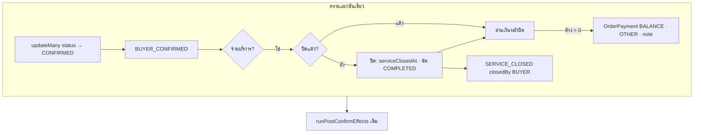
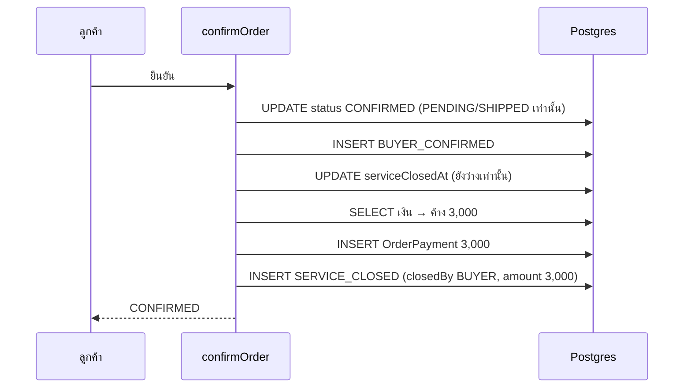

> **โมดูล:** 00082 — Service Buyer Confirm Closes Job
> **ประเภทเอกสาร:** System Design Spec
> **เวอร์ชัน:** 1.0
> **วันที่จัดทำ:** 2026-10-23
> **สถานะ:** Draft

# SDS: ลูกค้ายืนยันรับบริการ = ปิดงาน + ชำระครบ

## 1. บทนำ & References

### 1.1 วัตถุประสงค์
ออกแบบการต่อ "ปิดงาน + ชำระครบ" เข้ากับการยืนยันของลูกค้า โดยไม่สร้างทางเข้าใหม่และไม่แตะร้านอื่น

### 1.2 ขอบเขตการออกแบบ
`confirmOrder` · `settleServiceJobOnBuyerConfirm` · ป้าย/คำอธิบายประวัติ · หน้า `/o/[token]` · migration

### 1.3 เอกสารอ้างอิง
[[PRD]] · [[BRD]] · [[SRS]]

## 2. Architecture Overview

### 2.1 มุมมองสถาปัตยกรรม

### 2.2 มุมมองการ Deploy (ถ้าจำเป็น)
ไม่เปลี่ยน · migration รันตอน merge

## 3. Component Design
| คอมโพเนนต์ | การเปลี่ยน |
|---|---|
| `confirmOrder` | `settlesServiceJob = usesServiceFinanceRules(vertical)` · `now` ร่วมของ BUYER_CONFIRMED กับการปิด · เรียก settle เฉพาะผู้ชนะ |
| `settleServiceJobOnBuyerConfirm(tx, {orderId, buyerUserId, now})` | คืน `{ closed, paid }` · ไม่ตัดสินประเภทร้าน (ผู้เรียกกั้น) · NO_SHOW กันซ้ำ |
| `BUYER_CONFIRM_PAYMENT_NOTE` | ค่าคงที่เดียว ใช้ทั้งโค้ดและ migration |
| `ORDER_EVENT_META.SERVICE_CLOSED.label` | "ร้านปิดงาน" → "ปิดงาน" (ใช้เฉพาะร้านบริการ) |
| `describeOrderEvent` | `closedBy = BUYER` ⇒ ขึ้นต้น "ปิดให้อัตโนมัติเมื่อ{ลูกค้า}ยืนยันรับบริการ" |
| `OrderDetailMobile` | `refreshAfterServiceConfirm` ตอนแผ่นให้คะแนนปิด · ไม่มีแผ่น ⇒ refresh ทันที |

## 4. Data Flow

### 4.1 Flow หลัก: ลูกค้ายืนยัน (ร้านยังไม่ปิด · ค้าง 3,000)

### 4.2 Flow กรณีล้มเหลว / ชดเชย (ถ้ามี)
คำสั่งไหนล้ม ⇒ ทรานแซกชันย้อนทั้งหมด (สถานะยังเดิม) · ลูกค้ากดใหม่ได้ · ลูกค้ายืนยันโดยยังไม่จ่าย ⇒ ร้าน void รายการ (ระบบเดิม) ⇒ ใบกลับเป็นค้าง ใบเสร็จฝั่งลูกค้าปิด

## 5. Integration Points
| จุด | ผล |
|---|---|
| `createReview` (ส่งคะแนน = ยืนยัน) | ผ่าน `confirmOrder` ⇒ ได้ FR-006 อัตโนมัติ |
| รายงาน/หน้าแรกร้าน (00078) | ใบที่ลูกค้ายืนยันไป "ปิดงานแล้ว" ตามวันยืนยัน · ไม่ต้องแก้โค้ดรายงาน |
| ใบเสร็จ (`canBuyerViewReceipt`) | ไม่แก้ — เงื่อนไขเดิมผ่านเพราะปิด + ค้าง 0 |
| ฟีดกิจกรรม (`activity.service`) | อ่าน `serviceClosedAt` เดิม ⇒ ขึ้น "ปิดงาน …" ตามวันยืนยัน |

## 6. Technical Decisions

### TD-001: เรียกจาก `confirmOrder` ไม่ใช่ route
มี 3 ทางเข้า (เว็บ/แอป/ส่งคะแนน) — ใส่ที่ service จุดเดียวครอบทั้งหมด

### TD-002: ไม่ refresh ระหว่างแผ่นให้คะแนนเปิด
`page.tsx` ใส่ `key={status-hasReview}` ให้ `PublicOrderClient` ⇒ refresh ตอนสถานะเปลี่ยน = remount = แผ่นปิดเอง · เลือก refresh ตอนแผ่นปิด และใช้ตัวคำนวณเดิมของเพจ (ไม่เขียนป้าย/เงินซ้ำฝั่ง client)

### TD-003: เปลี่ยนป้าย SERVICE_CLOSED เป็น "ปิดงาน"
"ร้านปิดงาน" ไม่จริงเมื่อระบบปิดให้ · event นี้เกิดเฉพาะร้านบริการ ⇒ ไม่กระทบร้านอื่น · ใครปิดดูที่ผู้กระทำ + บรรทัดรายละเอียด

### TD-004: ไม่เพิ่มชนิด event ตอนบันทึกเงิน
ระบบรับเงินเดิมไม่บันทึก `OrderEvent` · ใบที่ร้านปิดไว้แล้ว (FR-006) จึงเห็นแค่ `BUYER_CONFIRMED` + รายการรับเงินที่มีหมายเหตุ

## 7. Traceability
| BRD | ออกแบบ |
|---|---|
| FR-001..004 | §3 · §4.1 · TD-001 |
| FR-005 | §3 OrderDetailMobile · TD-002 |
| FR-006 | §2.1 กิ่ง "ปิดแล้ว" · TD-004 |
| FR-007 | [[DATABASE]] §5 |

## 8. สรุป (Summary)
ต่อเข้าทางเดิมจุดเดียว ใช้ตัวคำนวณเงิน/ใบเสร็จเดิมทั้งหมด · เพิ่มแค่ฟังก์ชันกลาง 1 ตัว ค่าคงที่ 1 ตัว และ migration
