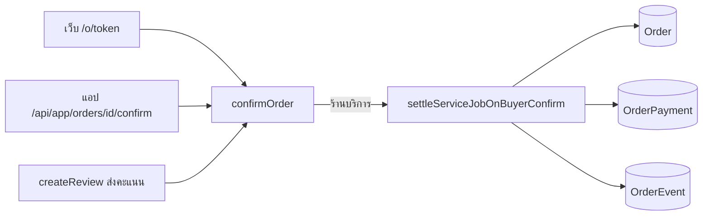
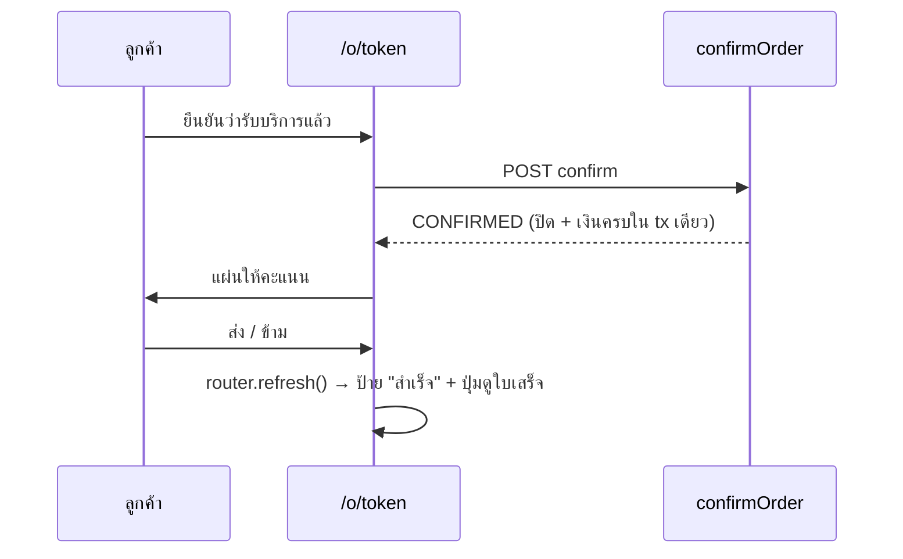
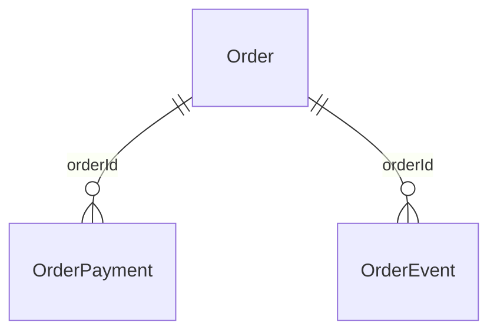

> **โมดูล:** 00082 — Service Buyer Confirm Closes Job
> **ประเภทเอกสาร:** Software Requirements Specification (Technical)
> **เวอร์ชัน:** 1.0
> **วันที่จัดทำ:** 2026-10-23
> **สถานะ:** Draft

# SRS: ลูกค้ายืนยันรับบริการ = ปิดงาน + ชำระครบ

## 1. บทนำ (Introduction)

### 1.1 วัตถุประสงค์ของเอกสาร
แปลง BRD 00082 (FR-001..FR-007) เป็นข้อกำหนดเชิงเทคนิค

### 1.2 ขอบเขตเชิงระบบ (System Scope)
- **ในขอบเขต:** `confirmOrder` (ทางเข้าเดียวของเว็บ `/api/orders/[token]/confirm` · แอป `/api/app/orders/[id]/confirm` · ส่งคะแนน `createReview`) สำหรับร้าน `SERVICE_QUEUE` · หน้า `/o/[token]` (ดึงหน้าใหม่หลังยืนยัน) · ป้าย/คำอธิบายประวัติ `SERVICE_CLOSED` · migration ข้อมูลใบเก่า
- **นอกขอบเขต:** ร้านขายของ/ที่พัก/การจอง · ปุ่มฝั่งร้าน · รายงานกลุ่ม LINE · สิทธิ์ · schema (ไม่มีคอลัมน์ใหม่)

### 1.3 เอกสารอ้างอิง (References)
[[PRD]] · [[BRD]] · `docs/20 - Features/00073 - Service Four-Step Flow/` · `src/services/order-payment.service.ts` (กฎ 00050)

### 1.4 นิยามและตัวย่อ (Definitions & Acronyms)
| คำ | ความหมาย |
|---|---|
| ปิดงานแล้ว | `Order.serviceClosedAt` ไม่ว่าง |
| ยอดค้าง | `computeOrderMoney(...).outstanding` = ยอดรวม − เงินที่รับจริงที่ยังไม่ void (≥ 0) |
| รายการรับเงินอัตโนมัติ | `OrderPayment` ที่ `note = BUYER_CONFIRM_PAYMENT_NOTE` |

## 2. ภาพรวมสถาปัตยกรรม (Architecture Overview)

### 2.1 บริบทระบบ (System Context)

### 2.2 องค์ประกอบหลัก (Components)
| องค์ประกอบ | ไฟล์ | หน้าที่ |
|---|---|---|
| ตัวตั้งค่าปิด/เงิน | `src/services/service-job.service.ts` `settleServiceJobOnBuyerConfirm` | FR-001/002/003/006 |
| ทางเข้า | `src/services/order.service.ts` `confirmOrder` | เรียกตัวบนในทรานแซกชันเดียวกัน เฉพาะ `usesServiceFinanceRules` |
| ค่าคงที่ | `src/lib/service-job.ts` `BUYER_CONFIRM_PAYMENT_NOTE` | หมายเหตุรายการรับเงิน (ใช้ร่วมกับ migration) |
| ประวัติ | `src/lib/order-event.ts` | `closedBy` · ป้าย "ปิดงาน" · บรรทัด "ปิดให้อัตโนมัติ…" |
| หน้าลูกค้า | `src/app/(marketing)/o/[token]/OrderDetailMobile.tsx` | ดึงหน้าใหม่หลังยืนยัน (FR-005) |
| ข้อมูลเก่า | `prisma/migrations/20261023100000_00082_service_buyer_confirm_settle/` | FR-007 |

### 2.3 มุมมองการ Deploy (Deployment View)
merge → `prisma migrate deploy` บน prod อัตโนมัติ (HR15) · ไม่มี env/cron ใหม่

## 3. ข้อกำหนดเชิงฟังก์ชันเชิงเทคนิค (Technical Functional Requirements)

### TFR-001: ทรานแซกชันเดียว เฉพาะผู้ชนะ
`confirmOrder`: `updateMany(status PENDING|SHIPPED → CONFIRMED)` → `BUYER_CONFIRMED (occurredAt = now)` → ถ้าร้านบริการ `settleServiceJobOnBuyerConfirm(tx, { orderId, buyerUserId, now })` · แพ้ updateMany = ไม่ทำอะไร ⇒ กดซ้ำ/สองแท็บ ปิดครั้งเดียว เงินแถวเดียว (BR FR-001)

### TFR-002: ปิดงาน
`serviceClosedAt IS NULL` ⇒ `updateMany({ id, serviceClosedAt: null } → serviceClosedAt = now, appointmentStatus = COMPLETED ถ้ามี serviceStart)` · ไม่ตรวจเวลานัด · ร้านปิดแทรกพร้อมกัน ⇒ count 0 ⇒ ไม่ปิดทับ (BR FR-001)

### TFR-003: บันทึกยอดค้าง
อ่าน `MONEY_SELECT` หลังขั้นปิด → `toMoney(row).outstanding > 0` ⇒ `OrderPayment { kind BALANCE, amount = ยอดค้าง, method OTHER, note = BUYER_CONFIRM_PAYMENT_NOTE, receivedByUserId = ลูกค้า, receivedAt = now }` · ใช้ทั้งใบที่เพิ่งปิดและใบที่ร้านปิดแบบค้าง (BR FR-002/006)

### TFR-004: ประวัติ + ไม่ส่งข้อความ
ปิดในขั้นนี้ ⇒ `SERVICE_CLOSED { actorUserId = ลูกค้า, meta { outcome SERVED, closedBy BUYER, amount? } }` · ไม่เรียก `reserveAutoNotifyIntent` (BR FR-003/004)

### TFR-005: หน้าลูกค้า
ร้านบริการ: ยืนยันแล้ว `router.refresh()` ทันที และ **ไม่เด้งแผ่นให้คะแนน** (ext 2026-10-23 — ลูกค้ากดผิดตอนจอสลับ) · รีวิวจากการ์ดบนหน้า (`canReview` → `ReviewForm`) · toast "ยืนยันรับบริการแล้ว" แทนหัวแผ่น · ร้านอื่นเด้งแผ่นแบบเดิม (BR FR-005)

### TFR-006: migration
3 คำสั่ง รันซ้ำได้ กั้น `vertical = 'SERVICE_QUEUE'` ทุกคำสั่ง — ดู [[DATABASE]] (BR FR-007)

## 4. ข้อกำหนดส่วนต่อประสาน (Interface / API Specification)

### 4.1 API Endpoints
ไม่มี endpoint ใหม่ · สัญญาเดิมไม่เปลี่ยน — ดู [[API]]

### 4.2 รายละเอียดต่อ Endpoint
[[API]]

### 4.3 Events / Messaging (ถ้ามี)
`OrderEvent SERVICE_CLOSED` meta เพิ่มคีย์ `closedBy` · ไม่มีข้อความแจ้งเตือนใหม่

### 4.4 Sequence ของ flow สำคัญ

## 5. ข้อกำหนดด้านข้อมูล (Data Requirements)

### 5.1 Data Model / Entities
ไม่เปลี่ยน schema · เขียน `Order.serviceClosedAt/appointmentStatus` · `OrderPayment` · `OrderEvent`

### 5.2 ความสัมพันธ์ (ERD)

### 5.3 Migration / Data Lifecycle
[[DATABASE]] §5

## 6. ข้อกำหนดที่ไม่ใช่ฟังก์ชัน (Non-Functional Requirements)
| ด้าน | ข้อกำหนด |
|---|---|
| Consistency | ยืนยัน + ปิด + เงิน ในทรานแซกชันเดียว |
| Concurrency | ผู้ชนะ updateMany คนเดียวเข้า settle · ปิดด้วย where `serviceClosedAt: null` |
| Performance | เพิ่ม 3–5 query ในทรานแซกชันยืนยัน (เฉพาะร้านบริการ) |
| Auditability | รายการรับเงินมีผู้รับ + หมายเหตุ · ประวัติบอก `closedBy` |

## 7. ข้อจำกัดทางเทคนิคและการพึ่งพา (Technical Constraints & Dependencies)

### 7.1 ข้อจำกัดทางเทคนิค
- `OrderPayment.amount > 0` (CHECK) ⇒ ยอดค้าง 0 ไม่สร้างแถว
- `id` ของ `OrderPayment`/`OrderEvent` ไม่มีค่าตั้งต้นในฐาน ⇒ migration ใช้ `gen_random_uuid()::text`
- เวลา `occurredAt/receivedAt/updatedAt` ไม่มีโซน (UTC) · `serviceClosedAt` มีโซน ⇒ `AT TIME ZONE 'UTC'`

### 7.2 การพึ่งพาภายนอก/ภายใน
`computeOrderMoney` · `recordOrderEvent` · `usesServiceFinanceRules` · `canBuyerViewReceipt` (ไม่แก้)

### 7.3 สมมติฐานทางเทคนิค (Assumptions)
ใบเก่าทุกใบที่ยืนยันแล้วมี `BUYER_CONFIRMED/SYSTEM_CONFIRMED` (backfill 2026-08-05) — ไม่มี ⇒ `updatedAt`

## 8. ความเสี่ยงเชิงสถาปัตยกรรม (Architectural Risks)
| ความเสี่ยง | การรับมือ |
|---|---|
| ข้อยกเว้นกฎ 00050 (ระบบบันทึกเงินเอง) | มติ user (PRD §5) · ร้าน void ได้ · หมายเหตุ + ผู้รับ = ลูกค้า |
| migration แตะข้อมูลร้านอื่น | กั้น vertical ทุกคำสั่ง + เทส rollback ยืนยันร้านขายของไม่ถูกแตะ + mutation |

## 9. Traceability Matrix
| BRD | TFR | เทส (`tests/services/service-buyer-confirm-00082.test.ts`) |
|---|---|---|
| FR-001 | TFR-001/002 | มีนัด/walk-in/นัดอนาคต/สองคำขอพร้อมกัน |
| FR-002 | TFR-003 | ค้าง 3,000 · จ่ายครบแล้ว · ร้าน void |
| FR-003/004 | TFR-004 | meta + ไม่มีแถว autoNotifyLedger |
| FR-005 | TFR-005 | ใบเสร็จออกได้ + QA เบราว์เซอร์ |
| FR-006 | TFR-003 | ร้านปิดแบบค้าง/ครบ · ทางส่งคะแนน |
| FR-007 | TFR-006 | migration rollback test |

## 10. สรุป (Summary)
แก้ที่ทางเข้าเดียว (`confirmOrder`) + ฟังก์ชันกลาง 1 ตัว + migration 3 คำสั่ง · ร้านบริการเท่านั้น · ไม่มีคอลัมน์/endpoint ใหม่
