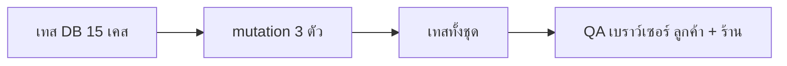

> **โมดูล:** 00082 — Service Buyer Confirm Closes Job
> **ประเภทเอกสาร:** Test Case
> **เวอร์ชัน:** 1.0
> **วันที่จัดทำ:** 2026-10-23
> **สถานะ:** Draft

# Test Case: ลูกค้ายืนยันรับบริการ = ปิดงาน + ชำระครบ

## 1. Overview
| รายการ | ค่า |
|---|---|
| เทสอัตโนมัติ | `tests/services/service-buyer-confirm-00082.test.ts` (ฐานจริง localhost · 15 เคส) |
| QA เบราว์เซอร์ | WebKit iPhone 14 Pro · ลูกค้า `/o/[token]` + ร้าน `/orders/[token]` |

## 2. Test Scenarios

### TC-001: ร้านยังไม่ปิด · มีนัด · มัดจำ 500 ค้าง 3,000 → ลูกค้ายืนยัน
- **คาดหวัง:** ปิด (เวลาเดียวกับ BUYER_CONFIRMED) · นัด COMPLETED · payment 3,000 BALANCE OTHER note ผู้รับ = ลูกค้า · ค้าง 0 · SERVICE_CLOSED actor ลูกค้า meta `{SERVED, BUYER, 3000}` · ไม่มีแถว autoNotifyLedger

### TC-002: ใบเสร็จ
- **คาดหวัง:** ลูกค้าออกเลขใบเสร็จได้ทันทีหลังยืนยัน (`CA` + 10 หลัก)

### TC-003: จ่ายครบอยู่แล้ว
- **คาดหวัง:** ปิด · ไม่มี payment ใหม่ · meta ไม่มี amount

### TC-004: นัดยังไม่ถึงเวลา
- **คาดหวัง:** ปิดได้ · นัด COMPLETED

### TC-005: walk-in
- **คาดหวัง:** ปิด · `appointmentStatus` ว่าง · ค้าง 0

### TC-006: ร้าน void รายการอัตโนมัติ (negative)
- **คาดหวัง:** ค้าง 3,500 · ลูกค้าออกใบเสร็จไม่ได้ (`ORDER_NOT_ISSUABLE`)

### TC-007: สองคำขอพร้อมกัน
- **คาดหวัง:** payment อัตโนมัติ 1 แถว · SERVICE_CLOSED 1 แถว

### TC-008: ร้านปิดแบบค้าง → ลูกค้ายืนยัน
- **คาดหวัง:** payment 3,500 · วันปิดเดิม · SERVICE_CLOSED แถวเดียว (ของร้าน) · ใบเสร็จออกได้

### TC-009: ร้านปิดแบบชำระครบ → ลูกค้ายืนยัน
- **คาดหวัง:** ไม่มี payment ใหม่

### TC-010: ทางส่งคะแนน (ร้านปิดแบบค้าง)
- **คาดหวัง:** CONFIRMED · payment 2,500 · ค้าง 0

### TC-011: ไม่มาตามนัด (negative)
- **คาดหวัง:** 409 เดิม · ไม่มีอะไรถูกเขียน

### TC-012: ร้านขายของ (negative · ไม่กระทบ)
- **คาดหวัง:** CONFIRMED · ไม่มี serviceClosedAt/payment/SERVICE_CLOSED

### TC-013: คนอื่นยืนยันแทน (negative)
- **คาดหวัง:** ถูกปฏิเสธ · ไม่ปิด · ไม่บันทึกเงิน

### TC-014: ไทม์ไลน์ร้าน
- **คาดหวัง:** "ปิดให้อัตโนมัติเมื่อลูกค้ายืนยันรับบริการ · ให้บริการแล้ว · รับเงิน ฿3,000" · ร้านปิดเอง = "ให้บริการแล้ว"

### TC-015: migration (รันไฟล์จริงในทรานแซกชันแล้วย้อนกลับ)
- **ฉาก:** A ยังไม่ปิด+นัดค้าง+มัดจำ 500 · B ร้านปิดแบบค้าง · C ไม่มาตามนัด · D ร้านขายของ · E ไม่มี event
- **คาดหวัง:** A ปิดตามวันยืนยัน + COMPLETED + payment 1,500 + event backfilled · B payment 2,000 วันปิดเดิม ไม่มี event · C/D ไม่ถูกแตะ · E ปิดตาม updatedAt · รันรอบสองไม่เพิ่มแถว

### TC-016: QA เบราว์เซอร์ (ลูกค้า)
- **ขั้นตอน:** เปิด `/o/[token]` → "ยืนยันว่ารับบริการแล้ว" → "รับบริการแล้ว"
- **คาดหวัง:** **ไม่เด้งแผ่นให้คะแนน** (ext 2026-10-23) · toast "ยืนยันรับบริการแล้ว" · หน้าดึงใหม่ทันที · ป้าย "สำเร็จ" · เส้นสถานะครบ · ปุ่ม "ดูใบเสร็จ" + การ์ดรีวิวบนหน้า · ไม่มี error

### TC-017: QA เบราว์เซอร์ (ร้าน)
- **คาดหวัง:** ป้าย "สำเร็จ" · "ปิดงานเมื่อ …" · ไม่มีปุ่มปิดงาน · ชำระ "ครบแล้ว" (มัดจำ 500 + ยอดที่เหลือ 3,000) · ประวัติ "ปิดงาน" + บรรทัดปิดให้อัตโนมัติ

## 3. Traceability Matrix
| BRD | TC |
|---|---|
| FR-001 | TC-001, TC-004, TC-005, TC-007 |
| FR-002 | TC-001, TC-003, TC-006 |
| FR-003 | TC-001, TC-014 |
| FR-004 | TC-001 |
| FR-005 | TC-002, TC-016 |
| FR-006 | TC-008, TC-009, TC-010 |
| FR-007 | TC-015 |
| §3 กติกาคงเดิม / ไม่กระทบ | TC-011, TC-012, TC-013, TC-017 |

## 4. Flow (ถ้ามี)

## 5. ผลล่าสุด
| วันที่ | ผล |
|---|---|
| 2026-10-23 | เทส 00082 15/15 ผ่าน · mutation 3/3 ถูกจับ (ตัดตัวกั้นร้านบริการ · ไม่บันทึกเงิน · ตัดตัวกั้นใน migration) · เทสทั้งชุด 858 ไฟล์ / 10,921 เทสผ่าน · tsc ผ่าน · QA WebKit ลูกค้า + ร้าน ผ่าน · migration apply ฐาน local: ร้านบริการ 17 ใบได้รายการรับเงิน ร้านขายของไม่เปลี่ยน |
| 2026-10-23 (ext) | ร้านบริการไม่เด้งแผ่นให้คะแนนหลังยืนยัน (ทีมแจ้งลูกค้ากดผิดตอนจอสลับ) — รีวิวจากการ์ดบนหน้า · ร้านอื่นเด้งเหมือนเดิม · เทส `service-confirm-no-review-sheet.test.ts` 3/3 (mutation ถูกจับ) · QA WebKit ผ่าน |

## 6. สรุป (Summary)
ครอบทุก FR · ฝั่งไม่กระทบพิสูจน์ด้วยเทสร้านขายของ/ไม่มาตามนัด + migration rollback test
