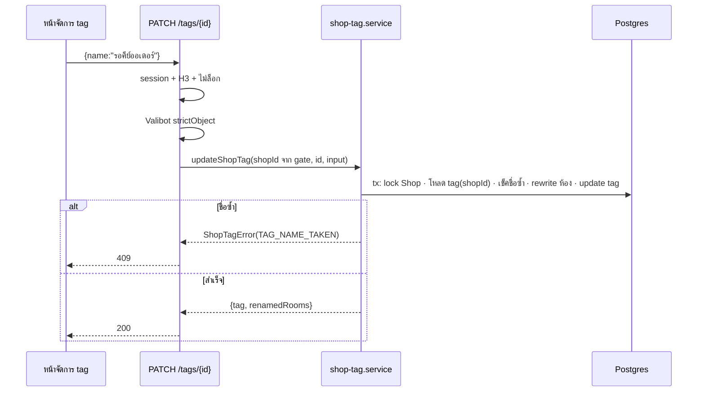

> **โมดูล:** 00083 - Auto Tag By Keyword · **ประเภท:** API Contract · **เวอร์ชัน:** 1.0 · **วันที่:** 2026-10-21 · **สถานะ:** Draft (ยังไม่ implement)

# API Contract: จัดการ tag ของร้าน

## 1. Overview
route ใต้ `src/app/api/shops/current/tags/` (Next.js 16 App Router) · ผู้บริโภค = หน้า `/settings/tags` ฝั่งผู้ขาย · ไม่มี endpoint สำหรับตัวติด/ถอดอัตโนมัติ (เป็น service ภายใน)

- **Base URL:** same-origin (`seller.*`) · **Content-Type:** `application/json`
- **ธรรมเนียม:** ตาม 00078 `auto-notify` — `requireShopCapability` → Valibot → service → `jsonNoStore()` · error body `{ error: CODE, message?: string (ไทย), issues?: [...] }`
- **Cache:** ทุกคำตอบ `Cache-Control: private, no-store` (`jsonNoStore`)
- **ชื่อ path:** `/api/tags` เป็น tag สินค้า (public) **ห้ามใช้** · `current` = ร้านที่ active ของ session — **ไม่รับ `shopId` จาก client** (ถ้าส่งมา body `strictObject` ปฏิเสธ; query ถูกเมิน)

## 2. Authentication & Authorization

| รายการ | ค่า |
|---|---|
| วิธี | NextAuth session cookie → `requireShopCapability(await getServerSession(authOptions), 'H3')` |
| cap | **H3** ทุก method (OWNER · MANAGER) — มติ P-6 |
| 401 | ไม่มี session (`{error:'unauthorized'}`) |
| 404 | ไม่มีร้าน (`{error:'NO_SHOP'}`) |
| 403 | ไม่ใช่สมาชิก (`FORBIDDEN`) หรือไม่ถือ H3 (`FORBIDDEN_ROLE`, CHAT/TECHNICIAN/BILLING) |
| เขียนเมื่อร้านถูกล็อกแพ็กเกจ | 403 `SHOP_LOCKED` (เช็ค `gate.active.locked` ก่อนอ่าน body — POST/PATCH/DELETE เท่านั้น) |

ทะเบียน `route-capabilities.ts`: `tags/route.ts {GET:'H3', POST:'H3'}` · `tags/[tagId]/route.ts {PATCH:'H3', DELETE:'H3'}` · `export const dynamic = 'force-dynamic'`

## 3. Endpoint List

| Method | Path | คำอธิบาย |
|---|---|---|
| GET | `/api/shops/current/tags` | รายการ tag (ลงทะเบียน + ยังไม่ลงทะเบียน) + จำนวนห้อง |
| POST | `/api/shops/current/tags` | เพิ่ม tag / ลงทะเบียน tag ที่มีอยู่ในห้อง |
| PATCH | `/api/shops/current/tags/{tagId}` | เปลี่ยนชื่อ · ตั้งคำ · สวิตช์ถอด |
| DELETE | `/api/shops/current/tags/{tagId}` | ลบ + ถอดจากทุกห้องของร้าน |
| GET | `/api/chat/tags` | (เดิม · X2) คืน tag ที่ใช้ในห้อง **รวม tag ที่ลงทะเบียน** — รูป response ไม่เปลี่ยน |

## 4. Endpoint Detail

### 4.1 `GET /api/shops/current/tags`

**Response 200**

| ฟิลด์ | ชนิด | คำอธิบาย |
|---|---|---|
| `tags[]` | array | ลงทะเบียน (เรียงชื่อไทย) ตามด้วยยังไม่ลงทะเบียน (rooms มาก→น้อย) |
| `tags[].id` | string \| null | `ShopTag.id` · `null` = ยังไม่ลงทะเบียน |
| `tags[].name` | string | สะกดมาตรฐาน (ยังไม่ลงทะเบียน = สตริงตามที่ติดในห้อง) |
| `tags[].registered` | boolean | |
| `tags[].rooms` | number | จำนวนห้องของร้านที่ติด tag นี้ (นับรวม variant · distinct ห้อง) |
| `tags[].keywords` | string[] | คำที่ทำให้ติด (ว่าง = tag ธรรมดา) |
| `tags[].removeOnOrderCreate` | boolean | |
| `tags[].createdAt` | string(ISO) \| null | |
| `counts` | `{registered, withKeywords}` | ใช้แสดงโควตา "12/50" "3/20" |
| `limits` | object | `{maxTags:50, maxKeywordTags:20, maxKeywords:10, nameMax:30, keywordMin:2, keywordMax:50}` |

```json
{
  "tags": [
    { "id": "6c1e…", "name": "รอคีย์ออเดอร์", "registered": true, "rooms": 14,
      "keywords": ["สรุปออเดอร์", "ยอดรวม"], "removeOnOrderCreate": true,
      "createdAt": "2026-10-21T03:00:00.000Z" },
    { "id": null, "name": "vip", "registered": false, "rooms": 3,
      "keywords": [], "removeOnOrderCreate": false, "createdAt": null }
  ],
  "counts": { "registered": 1, "withKeywords": 1 },
  "limits": { "maxTags": 50, "maxKeywordTags": 20, "maxKeywords": 10, "nameMax": 30, "keywordMin": 2, "keywordMax": 50 }
}
```

### 4.2 `POST /api/shops/current/tags`

| ฟิลด์ | ชนิด | บังคับ | กฎ |
|---|---|---|---|
| `name` | string | ใช่ | trim → 1..30 code point · nameKey ไม่ซ้ำในร้าน |
| `keywords` | string[] | ไม่ (default `[]`) | ≤10 รายการ · แต่ละคำ 2..50 · คำซ้ำรวมเป็นหนึ่ง |
| `removeOnOrderCreate` | boolean | ไม่ (default `false`) | |

body เป็น `strictObject` — คีย์อื่น (เช่น `shopId`) = 400

**Response 201:** `{ "tag": <TagRow> }` (รูปเดียวกับ `tags[]` ใน 4.1; `rooms` = จำนวนห้องที่มีสตริงนี้อยู่แล้ว — การ "ลงทะเบียน" ไม่แตะห้อง)

| HTTP | `error` | เงื่อนไข |
|---|---|---|
| 400 | `VALIDATION_ERROR` (+`issues[]`) | ชื่อ/คำผิดกฎ · body ไม่ใช่ JSON · คีย์เกิน |
| 403 | `SHOP_LOCKED` | ร้านถูกล็อกแพ็กเกจ |
| 409 | `TAG_NAME_TAKEN` | nameKey ซ้ำ (`VIP` = `vip`) |
| 409 | `TAG_LIMIT_REACHED` | มี 50 tag แล้ว |
| 409 | `KEYWORD_TAG_LIMIT_REACHED` | มีคำและร้านมี tag ที่มีคำครบ 20 แล้ว |

### 4.3 `PATCH /api/shops/current/tags/{tagId}`

body: อย่างน้อย 1 คีย์จาก `name` · `keywords` (แทนที่ทั้งชุด) · `removeOnOrderCreate` — กฎเดียวกับ 4.2 (`strictObject`)

พฤติกรรม `name` เปลี่ยน: ทุกห้องของ**ร้านนี้**ที่มี tag นี้ (รวม variant) เปลี่ยนเป็นชื่อใหม่ในทรานแซกชันเดียว · ห้องที่มีทั้งชื่อเก่า/ใหม่เหลือชื่อเดียว · ล้ม = ไม่มีห้องเปลี่ยน

**Response 200:** `{ "tag": <TagRow>, "renamedRooms": number }` (`renamedRooms` = 0 เมื่อไม่ได้เปลี่ยนชื่อ)

| HTTP | `error` | เงื่อนไข |
|---|---|---|
| 400 | `VALIDATION_ERROR` | body ว่าง/ผิดกฎ |
| 403 | `SHOP_LOCKED` | |
| 404 | `TAG_NOT_FOUND` | ไม่มี id นี้ **ในร้านนี้** (รวม id ของร้านอื่น/ไม่ใช่ uuid — ตอบเหมือนไม่มี) |
| 409 | `TAG_NAME_TAKEN` | ชื่อใหม่ซ้ำ tag ที่ลงทะเบียนอื่น (Q-6) · ตัวเองเปลี่ยนเฉพาะตัวพิมพ์ = อนุญาต |
| 409 | `KEYWORD_TAG_LIMIT_REACHED` | tag เปลี่ยนจากไม่มีคำเป็นมีคำ และครบ 20 แล้ว |

### 4.4 `DELETE /api/shops/current/tags/{tagId}`

ไม่มี body · ถอด tag (รวม variant) ออกจากทุกห้องของร้าน + ลบแถว `ShopTag` (กติกา/คำ/สวิตช์หายตาม) ในทรานแซกชันเดียว · ย้อนกลับไม่ได้ (UI ต้องมี Swal ยืนยัน)

**Response 200:** `{ "ok": true, "removedFromRooms": number }`

| HTTP | `error` | เงื่อนไข |
|---|---|---|
| 403 | `SHOP_LOCKED` | |
| 404 | `TAG_NOT_FOUND` | เหมือน 4.3 |

### 4.5 `GET /api/chat/tags` (เดิม — เปลี่ยนเฉพาะแหล่งข้อมูล)
`{ "tags": string[] }` เรียงไทย · ตอนนี้ = (tag ที่ติดอยู่ในห้องของร้านที่ขอบเขตเห็น) ∪ (`ShopTag.name` ของร้านเหล่านั้น) · cap `X2` เหมือนเดิม · tag ที่เพิ่งลงทะเบียนโผล่ทันทีแม้ยังไม่มีห้องติด

## 5. Error Code Table

| HTTP | `error` | ข้อความไทยที่เสนอ (ปรับได้ถ้าไม่เปลี่ยนความหมาย) |
|---|---|---|
| 400 | `VALIDATION_ERROR` | ตาม `issues[].message` เช่น "ชื่อต้องยาว 1-30 ตัวอักษร" · "คำต้องยาว 2-50 ตัวอักษร" · "ตั้งคำได้ไม่เกิน 10 คำ" |
| 403 | `SHOP_LOCKED` | "ร้านนี้ถูกระงับการแก้ไขชั่วคราวตามสถานะแพ็กเกจ" |
| 404 | `TAG_NOT_FOUND` | "ไม่พบแท็กนี้ในร้าน" |
| 409 | `TAG_NAME_TAKEN` | "มีแท็กชื่อนี้ในร้านแล้ว — ใช้ชื่ออื่น หรือแก้ตัวเดิมแทน" |
| 409 | `TAG_LIMIT_REACHED` | "ร้านมีแท็กครบ 50 แล้ว — ลบแท็กที่ไม่ใช้ก่อนเพิ่มใหม่" |
| 409 | `KEYWORD_TAG_LIMIT_REACHED` | "ตั้งคำให้แท็กติดอัตโนมัติได้สูงสุด 20 แท็ก — เอาคำออกจากแท็กอื่นก่อน" |
| 500 | `INTERNAL_ERROR` | (log `[shop-tags]` แล้วตอบรหัสเดียว ไม่ echo ข้อความภายใน) |

> ศัพท์ในข้อความ ("แท็ก" / "tag") รอมติ P-A ใน [[SRS]] §13 — เปลี่ยนที่ตาราง map เดียว (`shop-tag-route-errors.ts`)

## 6. Sequence (rename)


## 7. Traceability

| Endpoint | SRS | FR | S |
|---|---|---|---|
| GET tags | TFR-001 | FR-001 | S-2, S-3 |
| POST tags | TFR-002 | FR-002 | S-1, S-3 |
| PATCH tags/[id] | TFR-003, 005 | FR-003, 005, 007 | S-3, S-4 |
| DELETE tags/[id] | TFR-004 | FR-004 | S-3 |
| GET /api/chat/tags | TFR-011 | FR-002 | S-3 |

## 8. Open Questions
- ศัพท์ในข้อความ error (P-A)
- ไม่มีรายการประวัติ (`ShopTagEvent`) ผ่าน API — ตั้งใจ (OOS-7)
