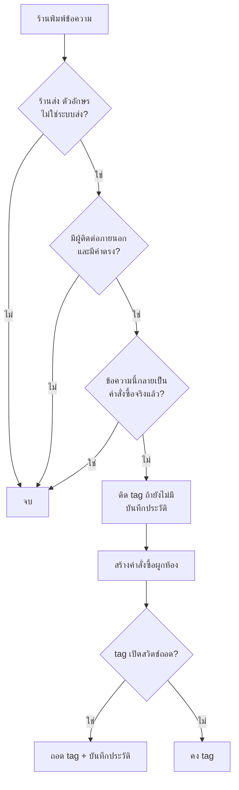
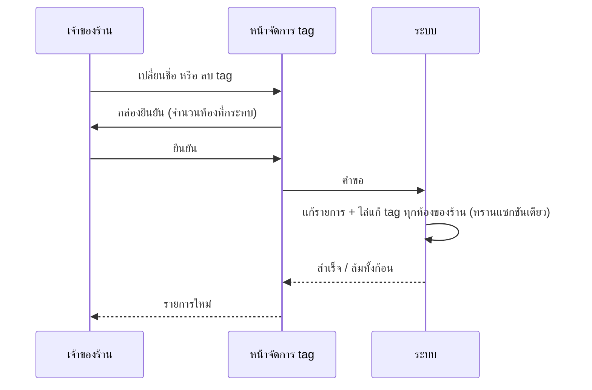

> **โมดูล:** 00083 - Auto Tag By Keyword
> **ประเภทเอกสาร:** Business Requirements Document (BRD) - NON-TECHNICAL
> **เวอร์ชัน:** 0.1
> **วันที่จัดทำ:** 2026-10-21
> **สถานะ:** Approved v0.1 — user อนุมัติ 2026-10-21 (ตามข้อเสนอทุกข้อใน PRD §4.4-4.5)
> **เจ้าของเอกสาร:** BA

# BRD: ติด tag อัตโนมัติจากคำที่ร้านพิมพ์ + เมนูจัดการ tag (Business Requirements Document)

---

## 1. บทนำ

### 1.1 วัตถุประสงค์ของเอกสาร

เอกสารนี้มีวัตถุประสงค์เพื่อ:
1. กำหนดหน้า "จัดการ tag" (เพิ่ม/เปลี่ยนชื่อ/ลบ) ของร้าน
2. กำหนดกติกาติด tag อัตโนมัติเมื่อร้านพิมพ์ข้อความที่มีคำที่ตั้งไว้
3. กำหนดกติกาถอด tag อัตโนมัติเมื่อสร้างคำสั่งซื้อที่ผูกห้อง
4. ระบุสิ่งที่ไม่ทำ (ห้อง DEEP · ข้อความลูกค้า · LINE ที่พิมพ์ในแอป LINE OA · ย้อนหลัง)

### 1.2 ขอบเขตของระบบ

**ติด tag อัตโนมัติ** คือ ตัวตรวจข้อความที่คนฝั่งร้านพิมพ์ แล้วติด tag ที่ร้านผูกคำไว้ให้ห้อง
**ถอด tag อัตโนมัติ** คือ ตัวถอด tag ที่ร้านเปิดสวิตช์ไว้เมื่อมีคำสั่งซื้อใหม่ผูกห้อง

**เข้าสู่ระบบ (Input):**
- ข้อความที่ร้านพิมพ์ในห้องแชท (จากกล่องแชท Deep หรือจากแอป Messenger/Instagram)
- การสร้างคำสั่งซื้อที่ผูกห้อง
- การตั้งค่าในหน้า "จัดการ tag"

**ออกจากระบบ (Output):**
- tag ที่ติด/ถอดบนห้องแชท · ประวัติการติด/ถอดอัตโนมัติ
- รายการ tag ของร้านที่ตรงกับห้องจริงเสมอ

**ระบบที่เกี่ยวข้อง:**
- กล่องแชท (ชิป tag ในแถว · ตัวกรอง tag) · แผงลูกค้า (CRM tag) · สร้างคำสั่งซื้อ (ฟอร์มในแชท · หน้าสร้างคำสั่งซื้อ) · สร้างออเดอร์อัตโนมัติ 00061 · แจ้งลูกค้าอัตโนมัติ 00078 · เมนูผู้ขาย · สิทธิ์ร้าน 00071

### 1.3 กลุ่มผู้ใช้งาน

| กลุ่มผู้ใช้ | บทบาท | สิทธิ์การใช้งาน |
|-----------|--------|----------------|
| **เจ้าของร้าน / ผู้จัดการ** | ตั้งรายการ tag กติกาอัตโนมัติ | เห็นและแก้หน้า "จัดการ tag" (กลุ่มสิทธิ์ตั้งค่าแชทเดียวกับหน้าตอบกลับอัตโนมัติ) |
| **แอดมินแชท (CHAT)** | พิมพ์แชท ติด/ถอด tag ต่อห้อง กรอง tag | ใช้งาน tag ต่อห้องได้เหมือนเดิม · ไม่เห็นหน้าจัดการ (มติ Q-4) |
| **ลูกค้า** | - | ไม่เกี่ยว ไม่เห็น tag |

---

## 2. ความต้องการหลัก (Functional Requirements)

### 2.1 หน้าจัดการ tag

#### FR-001: เมนูและหน้า "จัดการ tag"

**User Story:**
> ในฐานะเจ้าของร้าน ฉันต้องการหน้ารวมสำหรับดูและจัดการ tag ของร้าน เพื่อให้ทีมใช้ชื่อ tag ตรงกันและตั้งกติกาได้ที่เดียว

**Acceptance Criteria:**
- [ ] มีเมนู "จัดการ tag" ในกลุ่ม CHAT ของเมนูผู้ขาย (ทุก vertical เห็นได้ ไม่ซ่อนตามประเภทร้าน) ใช้ icon จริง ไม่ใช้ emoji
- [ ] ผู้ใช้ที่ไม่มีสิทธิ์ (เช่น CHAT) เข้าหน้าโดยตรงทาง URL ได้หน้า "ไม่มีสิทธิ์" ไม่ใช่หน้าว่าง และเรียก API ได้ 403
- [ ] หน้าแสดงรายการ tag ของร้าน: ชื่อ · จำนวนห้องที่ใช้อยู่ · คำอัตโนมัติ (ถ้ามี) · สถานะสวิตช์ถอดเมื่อสร้างคำสั่งซื้อ
- [ ] tag ที่แอดมินเคยพิมพ์ติดไว้ในห้องแต่ยังไม่เคยลงทะเบียน แสดงในรายการด้วย (ติดป้ายว่ายังไม่ได้ตั้งค่า) และกดแก้ไข/ตั้งกติกาได้
- [ ] รายการไม่รวม tag ของร้านอื่น แม้ผู้ใช้มีหลายร้านและกำลังดูกล่องรวม

#### FR-002: เพิ่ม tag

**Acceptance Criteria:**
- [ ] เพิ่ม tag ใหม่ได้ ชื่อ 1-30 ตัวอักษร (ตัดช่องว่างหัวท้าย) ชื่อซ้ำในร้านเดียวกันไม่ได้ (อังกฤษไม่สนตัวพิมพ์) แสดงข้อความภาษาไทยที่บอกสาเหตุ
- [ ] เกินเพดาน 50 tag ต่อร้าน เพิ่มไม่ได้ และบอกเหตุผล
- [ ] tag ที่เพิ่มแล้วโผล่ในตัวช่วยพิมพ์ tag ของแผงลูกค้าและตัวกรองกล่องแชททันที แม้ยังไม่มีห้องไหนติด

#### FR-003: เปลี่ยนชื่อ tag

**Acceptance Criteria:**
- [ ] เปลี่ยนชื่อแล้วทุกห้องของร้านที่ติด tag ชื่อเดิม เปลี่ยนเป็นชื่อใหม่ ไม่มีห้องค้างชื่อเก่า
- [ ] ห้องที่มีทั้งชื่อเก่าและชื่อใหม่อยู่แล้ว ผลลัพธ์ต้องมี tag นั้นครั้งเดียว (ไม่ซ้ำ)
- [ ] เปลี่ยนเป็นชื่อที่ซ้ำกับ tag ที่ลงทะเบียนอยู่แล้วในร้าน → ปฏิเสธ (มติ Q-6)
- [ ] ล้มกลางทาง = ไม่มีห้องไหนเปลี่ยนครึ่งเดียว
- [ ] ไม่แตะห้องของร้านอื่น แม้ชื่อ tag เหมือนกัน

#### FR-004: ลบ tag

**Acceptance Criteria:**
- [ ] ก่อนลบมีกล่องยืนยัน (Swal) บอกจำนวนห้องที่จะถูกถอด tag และว่าย้อนกลับไม่ได้
- [ ] ลบแล้ว tag หายจากทุกห้องของร้าน และหายจากรายการ/ตัวช่วยพิมพ์/ตัวกรอง
- [ ] กติกาติดอัตโนมัติของ tag นั้นหายไปพร้อมกัน (ไม่มีกติกากำพร้า)
- [ ] ไม่แตะห้องของร้านอื่น

### 2.2 ติดอัตโนมัติ

#### FR-005: ตั้งคำที่ทำให้ติด tag

**User Story:**
> ในฐานะเจ้าของร้าน ฉันต้องการกำหนดว่าเมื่อร้านพิมพ์คำไหน ให้ห้องถูกติด tag อะไร เพื่อไม่ต้องติดด้วยมือ

**Acceptance Criteria:**
- [ ] ต่อ tag ใส่คำได้หลายคำ (สูงสุด 10) แต่ละคำ 2-50 ตัวอักษร ไม่ใส่เลย = tag ธรรมดา
- [ ] คำซ้ำใน tag เดียวกัน (หลังจัดช่องว่าง/ตัวพิมพ์) ถูกรวมเป็นคำเดียว
- [ ] จำนวน tag ที่มีคำอัตโนมัติเกิน 20 ต่อร้าน บันทึกไม่ได้ และบอกเหตุผล
- [ ] บันทึกแล้วมีผลกับข้อความที่ร้านพิมพ์ "หลังจากนั้น" (ไม่ย้อนหลัง)
- [ ] ข้อความหน้าจออธิบายสั้น ๆ ว่า "ติดเมื่อร้านพิมพ์ข้อความที่มีคำนี้" และเตือนว่าคำสั้น/คำทั่วไปจะติดบ่อย

#### FR-006: ติด tag เมื่อร้านพิมพ์ข้อความที่มีคำ

**User Story:**
> ในฐานะแอดมินแชท ฉันต้องการให้ห้องถูกติด "รอคีย์ออเดอร์" เองเมื่อฉันพิมพ์สรุปออเดอร์ เพื่อให้ทีมเห็นงานค้างโดยไม่ต้องติดเอง

**Acceptance Criteria:**
- [ ] ร้านพิมพ์ข้อความตัวอักษรที่มีคำของ tag ในห้อง Messenger/Instagram/LINE (จากกล่องแชท Deep) → ห้องนั้นมี tag นั้นภายในไม่กี่วินาทีโดยไม่ต้องรีเฟรชหน้านาน (ตามกลไกอัปเดตกล่องแชทเดิม)
- [ ] ร้านพิมพ์จากแอป Messenger/Instagram ของ Meta เอง (กลับเข้ามาเป็น echo) → ติด tag เช่นเดียวกัน
- [ ] ข้อความลูกค้าที่มีคำเดียวกัน → ไม่ติด
- [ ] ข้อความจากระบบ (ตอบอัตโนมัติ · ผู้ช่วยอัตโนมัติ · แจ้งลูกค้าอัตโนมัติ · การ์ดภายใน 00061) ที่มีคำ → ไม่ติด
- [ ] echo ที่ระบุว่า AI ของ Meta สร้าง → ไม่ติด (มติ P-3)
- [ ] ข้อความที่ไม่ใช่ตัวอักษร (รูป · สติกเกอร์ · ไฟล์ · การ์ด) → ไม่ติด
- [ ] ห้องที่มี tag อยู่แล้ว → ไม่เกิด tag ซ้ำ และไม่บันทึกประวัติซ้ำ
- [ ] แอดมินถอด tag เองแล้วร้านพิมพ์คำอีก → ติดกลับ
- [ ] ข้อความเดียวมีคำของหลาย tag → ติดทุก tag ที่ตรง
- [ ] ห้อง DEEP (ไม่มีผู้ติดต่อภายนอก) → ไม่ทำอะไรและไม่ error
- [ ] ข้อความที่ถูกเปลี่ยนเป็นคำสั่งซื้อจริงโดย 00061 แล้ว → ไม่ติด
- [ ] ข้อความเดียวกันถูกส่งเข้ามาซ้ำ (webhook ซ้ำ / echo ของข้อความที่ส่งจาก Deep) → ผลเหมือนครั้งเดียว
- [ ] ตัวติด tag ล้ม → ไม่กระทบการส่ง/บันทึกข้อความ

**Example:**
```
tag "รอคีย์ออเดอร์" คำ: "สรุปออเดอร์"
แอดมินพิมพ์ "สรุปออเดอร์นะคะ ยอด 590" → ติด
ลูกค้าพิมพ์ "ขอสรุปออเดอร์หน่อย" → ไม่ติด
บอทตอบ "…สรุปออเดอร์ของคุณ…" → ไม่ติด
```

### 2.3 ถอดอัตโนมัติ

#### FR-007: สวิตช์ "ถอดเมื่อสร้างคำสั่งซื้อ"

**Acceptance Criteria:**
- [ ] ต่อ tag มีสวิตช์ เปิด/ปิด (ค่าเริ่มต้นปิด) ใช้ได้กับ tag ทุกตัวรวม tag ที่ไม่มีคำอัตโนมัติ
- [ ] มีข้อความอธิบายว่าถอดเมื่อมีคำสั่งซื้อใหม่ที่ผูกห้องนั้น และถอดไม่ว่าใครติด

#### FR-008: ถอด tag เมื่อสร้างคำสั่งซื้อที่ผูกห้อง

**User Story:**
> ในฐานะแอดมินแชท ฉันต้องการให้ tag "รอคีย์ออเดอร์" หายเองเมื่อฉันสร้างคำสั่งซื้อของห้องนั้น เพื่อไม่ต้องกลับมาถอด

**Acceptance Criteria:**
- [ ] สร้างคำสั่งซื้อจากฟอร์มในแชท (ผูกห้อง) → tag ที่เปิดสวิตช์ถูกถอดจากห้องนั้น
- [ ] สร้างจากหน้าสร้างคำสั่งซื้อที่เลือกผูกห้อง → ถอดเช่นเดียวกัน
- [ ] คำสั่งซื้อที่ไม่ได้ผูกห้อง แต่เบอร์ตรงกับลูกค้าของห้อง → ไม่ถอด
- [ ] ถอดเฉพาะ tag ที่เปิดสวิตช์ — tag อื่นของห้องคงเดิม
- [ ] ร่างคำสั่งซื้อ (00061 สถานะร่าง) → ไม่ถอด; เมื่อร่างถูกเลื่อนเป็นคำสั่งซื้อจริง → ถอด
- [ ] คำสั่งซื้อที่ 00061 สร้างจริงอัตโนมัติ → ถอด
- [ ] คำสั่งซื้อจำลอง/ทดสอบ → ไม่ถอด
- [ ] คำสั่งซื้อลงวันที่ย้อนหลัง → ถอด
- [ ] ถอดเกิดในจังหวะเดียวกับการสร้างคำสั่งซื้อ: สร้างคำสั่งซื้อไม่สำเร็จ → ไม่ถอด; ถอดล้ม → ไม่ทำให้สร้างคำสั่งซื้อล้ม (ตัดสินที่ SRS แต่ผลต้องไม่มีคำสั่งซื้อค้างครึ่งทาง)
- [ ] ยกเลิกคำสั่งซื้อภายหลัง → ไม่ติด tag กลับ
- [ ] ห้องไม่มี tag นั้นอยู่แล้ว → ไม่เกิดอะไร ไม่ error
- [ ] ไม่แตะห้องของร้านอื่น

### 2.4 ร่องรอย

#### FR-009: บันทึกประวัติติด/ถอดอัตโนมัติ

**Acceptance Criteria:**
- [ ] ทุกครั้งที่ระบบติด tag เพราะข้อความ มีประวัติ: ร้าน · ห้อง · ชื่อ tag · ติด · ข้อความที่เป็นต้นเหตุ · คำที่จับได้ · เวลา
- [ ] ทุกครั้งที่ระบบถอด tag เพราะคำสั่งซื้อ มีประวัติ: ร้าน · ห้อง · ชื่อ tag · ถอด · คำสั่งซื้อที่เป็นต้นเหตุ · เวลา
- [ ] ไม่มีประวัติเมื่อไม่มีอะไรเปลี่ยน (มี tag อยู่แล้ว / ไม่มี tag ให้ถอด)
- [ ] ประวัติไม่เก็บเนื้อข้อความเต็มของลูกค้า (เก็บแค่รหัสข้อความและคำที่จับได้)
- [ ] รอบนี้ไม่มีหน้าดูประวัติ (มติ Q-5)

---

## 3. Acceptance Criteria สรุป

### 3.1 วงจร tag รอคีย์ออเดอร์

**เมื่อระบบทำงานถูกต้อง:**
- ร้านพิมพ์คำ → ห้องมี tag · สร้างคำสั่งซื้อผูกห้อง → tag หาย · ไม่มีห้องค้าง tag เพราะลืมถอด
- รายการ tag ในหน้าจัดการ ตัวช่วยพิมพ์ และตัวกรองกล่องแชท แสดงชุดเดียวกัน

### 3.2 สิ่งที่ต้องไม่เปลี่ยน

**เมื่อเป็นการใช้งาน tag แบบเดิม:**
- ติด/ถอด tag ด้วยมือต่อห้อง (แผงลูกค้า) ทำงานเหมือนเดิมทุกประการ
- 00061 สร้างออเดอร์อัตโนมัติทำงานเหมือนเดิม (ไม่ช้าลง ไม่เปลี่ยนผล)
- การส่งข้อความถึงลูกค้าไม่ช้าลงและไม่ล้มเพราะตัวติด tag

---

## 4. Business Flows

### 4.1 Flow หลัก: ติดและถอด



### 4.2 Flow ย่อย: เปลี่ยนชื่อ/ลบ tag



---

## 5. Use Case Scenarios

### Scenario 1: วงจรรอคีย์ออเดอร์

**ผู้เกี่ยวข้อง:** เจ้าของร้าน · แอดมินแชท 2 คน

**เงื่อนไขเริ่มต้น:**
- tag "รอคีย์ออเดอร์" มีคำ "สรุปออเดอร์" · สวิตช์ถอดเมื่อสร้างคำสั่งซื้อเปิด

**ขั้นตอน:**
1. แอดมิน A พิมพ์ "สรุปออเดอร์ค่ะ" ในห้องลูกค้า Messenger
2. แอดมิน B กรอง tag "รอคีย์ออเดอร์" เห็นห้องนั้น
3. B สร้างคำสั่งซื้อจากแผงในแชทของห้อง

**ผลลัพธ์:**
- tag หายจากห้อง · ประวัติมี "ติด" และ "ถอด" ตามลำดับ

### Scenario 2: แอดมินพิมพ์ในแอป Messenger ของ Meta

**เงื่อนไขเริ่มต้น:** เหมือน Scenario 1

**ขั้นตอน:**
1. แอดมินพิมพ์ "สรุปออเดอร์" จาก Business Suite ของ Meta

**ผลลัพธ์:**
- ข้อความกลับเข้ามาเป็น echo → ห้องถูกติด tag เช่นเดียวกัน

### Scenario 3: ร้านพิมพ์ในแอป LINE OA เอง

**ขั้นตอน:**
1. แอดมินพิมพ์ "สรุปออเดอร์" จากแอป LINE OA โดยตรง

**ผลลัพธ์:**
- ไม่ติด tag (ระบบไม่เห็นข้อความขาออกของ LINE) — เป็นข้อจำกัดที่ประกาศไว้ ไม่ใช่ข้อบกพร่อง

### Scenario 4: ร้านที่เปิด 00061

**ขั้นตอน:**
1. ร้านพิมพ์ข้อความสรุปออเดอร์ตามรูปแบบของ 00061 → ระบบสร้างคำสั่งซื้อจริงทันที

**ผลลัพธ์:**
- ห้องไม่ถูกติด tag "รอคีย์ออเดอร์" (คำสั่งซื้อเกิดแล้ว)
- ถ้า 00061 ได้เพียงร่าง → ห้องถูกติด tag; เมื่อร่างถูกเลื่อนเป็นคำสั่งซื้อจริง tag ถูกถอด

### Scenario 5: เปลี่ยนชื่อ tag

**ขั้นตอน:**
1. เจ้าของร้านเปลี่ยน "รอคีย์" เป็น "รอคีย์ออเดอร์" ขณะมี 14 ห้องติด tag เดิม

**ผลลัพธ์:**
- ทั้ง 14 ห้องใช้ชื่อใหม่ ตัวกรองด้วยชื่อใหม่เห็น 14 ห้อง; ตัวกรองที่ผู้ใช้เคยบันทึกด้วยชื่อเก่าต้องเลือกใหม่ (Q-7)

---

## 6. ความต้องการด้านคุณภาพ

### 6.1 ความถูกต้องของข้อมูล
- tag ที่ติด/ถอดต้องตรงกับกติกา ณ ตอนนั้น; ไม่มี tag ซ้ำในห้องเดียว
- เปลี่ยนชื่อ/ลบ ต้องไม่ทิ้งห้องค้างชื่อเก่า (ล้มทั้งก้อนหรือสำเร็จทั้งก้อน)
- ติด/ถอดพร้อมกันกับการแก้ tag ด้วยมือ ต้องไม่ทำให้ tag ที่คนเพิ่งติดไว้หาย

### 6.2 ความรวดเร็ว
- ตัวติด tag ไม่หน่วง webhook ของ Meta/LINE และไม่หน่วงการกดส่งของแอดมิน (ทำหลังตอบรับ); ข้อความที่ไม่เข้าเงื่อนไขต้องออกก่อนแตะฐานข้อมูลเกินความจำเป็น

### 6.3 ความน่าเชื่อถือ
- ล้ม = ไม่กระทบข้อความ/คำสั่งซื้อ; กลืน error พร้อมบันทึก log; ข้อความซ้ำ = ผลเท่าครั้งเดียว

### 6.4 ความปลอดภัย
- ทุก query ผูกร้านของห้อง/คำสั่งซื้อฝั่ง server; ไม่เชื่อชื่อร้านหรือรหัสห้องจาก client; หน้าและ API ประกาศสิทธิ์ในทะเบียน route; ไม่ติด/ถอด tag ข้ามร้าน

### 6.5 ความสะดวกในการใช้งาน
- ภาษาไทยเรียบง่าย; กล่องยืนยันก่อนลบ; ข้อความบอกสาเหตุเมื่อบันทึกไม่ได้; ใช้ icon ไม่ใช้ emoji (HR12); หน้าใช้ชิ้นส่วนจากธีม Paces (HR1/HR7)

---

## 7. ข้อจำกัด

### 7.1 ข้อจำกัดทางธุรกิจ
- ไม่ครอบคลุมห้อง DEEP · ไม่ตรวจข้อความลูกค้า · LINE ตรวจได้เฉพาะที่พิมพ์ผ่านกล่องแชท Deep · ไม่ย้อนหลัง

### 7.2 ข้อจำกัดทางเทคนิค
- tag ถูกเก็บเป็นชื่อบนผู้ติดต่อ (ไม่มีตัวอ้างอิง) — เปลี่ยนชื่อ/ลบต้องไล่ทุกแถว
- ข้อความที่ร้านพิมพ์เข้าตัวตรวจได้ 3 ทาง (กล่องแชทของเรา · คิวส่งออก · echo จาก Meta) — ต้องครบทั้งสามและมีเทสกันจุดที่ 4 หลุด
- ชื่อ tag สูงสุด 30 ตัวอักษรตามกติกา CRM เดิม (ตัวกรองรับได้ถึง 40 แต่ใช้ 30 เป็นเพดาน)

---

## 8. กฎทางธุรกิจ

### 8.1 กฎรายการ tag
- BR-AT-01 tag เป็นของร้าน ชื่อ 1-30 ตัวอักษร ไม่ซ้ำในร้าน (อังกฤษไม่สนตัวพิมพ์)
- BR-AT-02 เพดาน: 50 tag ต่อร้าน · 20 tag ที่มีคำอัตโนมัติ · 10 คำต่อ tag · คำ 2-50 ตัวอักษร (มติ P-7)
- BR-AT-03 เปลี่ยนชื่อ/ลบมีผลทุกห้องของร้านเดียวกันแบบสำเร็จทั้งก้อนหรือล้มทั้งก้อน
- BR-AT-04 tag ที่ยังไม่ลงทะเบียนแต่ติดอยู่ในห้อง ต้องมองเห็นและจัดการได้

### 8.2 กฎการติดอัตโนมัติ
- BR-AT-10 ตรวจเฉพาะข้อความตัวอักษรที่ฝั่งร้านพิมพ์ ไม่ใช่ระบบส่ง ไม่ใช่ข้อความลูกค้า
- BR-AT-11 จับแบบ "มีคำนี้อยู่ในข้อความ" ไม่สนตัวพิมพ์เล็กใหญ่ของอังกฤษและช่องว่างซ้ำ/หัวท้าย (ตัวเทียบเดียวกับวลีจุดชนวนของ 00061)
- BR-AT-12 ติดเมื่อยังไม่มี; ถอดเองแล้วเจอคำซ้ำ = ติดใหม่ทุกครั้ง
- BR-AT-13 ข้อความที่ถูกเปลี่ยนเป็นคำสั่งซื้อจริงแล้ว ไม่ติด tag
- BR-AT-14 echo ที่ระบุว่า AI ของ Meta สร้าง ไม่นับ (มติ P-3)
- BR-AT-15 ห้อง DEEP ไม่อยู่ในขอบเขต

### 8.3 กฎการถอดอัตโนมัติ
- BR-AT-20 ถอดเฉพาะ tag ที่เปิดสวิตช์ ไม่ว่าใครติด
- BR-AT-21 ถอดเมื่อมีคำสั่งซื้อจริงใหม่ที่ผูกห้อง; ไม่ถอดจากการจับคู่เบอร์
- BR-AT-22 ร่าง (00061) และคำสั่งซื้อจำลองไม่ถอด; ลงวันที่ย้อนหลังถอด; ยกเลิกภายหลังไม่ติดกลับ

### 8.4 กฎร่องรอย
- BR-AT-30 บันทึกประวัติเฉพาะเมื่อ tag เปลี่ยนจริง; ไม่เก็บเนื้อข้อความเต็ม

---

## 9. อภิธานศัพท์

| คำศัพท์ | ความหมาย |
|---------|----------|
| **tag** | ป้ายที่ติดบนห้องแชท (เก็บที่ผู้ติดต่อ) |
| **กติกาติดอัตโนมัติ** | คำที่ผูกกับ tag |
| **ถอดเมื่อสร้างคำสั่งซื้อ** | สวิตช์ต่อ tag |
| **ร้านส่ง** | ข้อความที่คนของร้านพิมพ์ (ไม่รวมระบบส่ง) |
| **echo** | ข้อความฝั่งเพจที่ Meta ส่งกลับมา |

---

## 10. สรุป

เอกสาร BRD นี้อธิบายความต้องการของ **ติด tag อัตโนมัติจากคำที่ร้านพิมพ์ + เมนูจัดการ tag** แบบไม่ใช่เทคนิค

**จุดเด่นของระบบ:**
- งานค้าง "รอคีย์ออเดอร์" ติดเองและหายเอง · ร้านจัดการ tag ที่เดียว · เปลี่ยนชื่อ/ลบไม่ทิ้งห้องค้าง

**ผลลัพธ์ที่คาดหวัง:**
- ออเดอร์ที่ลืมคีย์ลดลง · tag สะท้อนความจริง

---

**หมายเหตุ:**
ภาพรวม/personas/KPI/คำถามเปิด ดู [[PRD]] · technical spec (SRS/SDS/API/DATABASE/TestCase) เขียนหลัง PRD+BRD ผ่าน และต้อง sync `docs/SRS.md`
