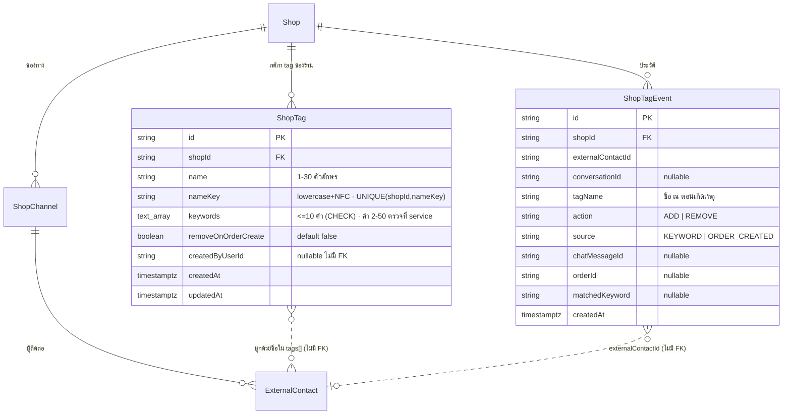

> **โมดูล:** 00083 - Auto Tag By Keyword · **ประเภท:** DATABASE Design · **เวอร์ชัน:** 1.0 · **สถานะ:** Draft (migration เขียนแล้ว ยังไม่ apply)

# DATABASE: Auto Tag By Keyword

## 1. Overview

เพิ่ม 2 ตารางใหม่ ทั้งหมด additive — ไม่ drop ไม่ alter ตารางเดิม ไม่ backfill. **ไม่แตะรูปแบบเก็บ tag ของห้อง**: tag ที่ติดอยู่ยังเป็น `ExternalContact.tags TEXT[]` (เก็บชื่อ ไม่มี FK) ตารางใหม่คือ "กติกาต่อชื่อ" + "ประวัติ"

- Store: PostgreSQL 16 ผ่าน Prisma · migration `prisma/migrations/20261021100000_00083_shop_tags/migration.sql`
- String + DB CHECK ไม่ใช้ Prisma enum (ตาม convention). ชื่อตารางใน Postgres = ชื่อ model (ไม่มี `@@map`)

## 2. ERD



## 3. Tables

### 3.1 `ShopTag`
- FK `shopId -> Shop.id` ON DELETE CASCADE (ลบร้านแล้วกติกาหาย)
- UNIQUE `(shopId, nameKey)` — nameKey = `name.normalize('NFC').toLowerCase().trim()` คำนวณใน service ทุกครั้งที่เขียน (ไทยไม่มีตัวพิมพ์ → ผลคือ unique ตามตัวอักษรเป๊ะ; อังกฤษไม่สนตัวพิมพ์ ตาม PRD §3.x)
- CHECK `char_length(name) BETWEEN 1 AND 30`; CHECK `cardinality(keywords) <= 10`
- เพดาน 50 tag/ร้าน, 20 tag ที่มีคำ, คำละ 2-50 ตัว = ตรวจใน service (นับข้ามแถวใน CHECK ไม่ได้) ใน transaction เดียวกับ insert
- `keywords` เก็บคำตามที่ร้านพิมพ์ (หลัง trim/ยุบช่องว่าง); การเทียบ (lowercase/NFC) ทำฝั่งตัวจับ
- ไม่ต้องมี index เพิ่ม: query หลัก "tag ทั้งหมดของร้าน" ใช้ prefix ของ unique index `(shopId, nameKey)`

### 3.2 `ShopTagEvent` (append-only)
- FK เดียว `shopId -> Shop.id` CASCADE. **`conversationId` / `externalContactId` / `chatMessageId` / `orderId` เป็น String เปล่าโดยตั้งใจ** — ประวัติต้องอยู่รอดเมื่อห้อง/ข้อความ/ออเดอร์ถูกลบ และไม่ถ่วงการลบเหล่านั้น. `tagName` เก็บชื่อ ณ ตอนนั้น (ลบ/เปลี่ยนชื่อ ShopTag แล้วประวัติไม่เปลี่ยน — จึงไม่ FK ไป ShopTag)
- CHECK `action IN ('ADD','REMOVE')`, `source IN ('KEYWORD','ORDER_CREATED')`
- ไม่เก็บเนื้อข้อความ (เก็บแค่ `matchedKeyword`)
- เขียนเมื่อ tag เปลี่ยนจริงเท่านั้น (UPDATE ... RETURNING คืนแถว → insert event; 0 แถว = ไม่เขียน)
- Index: `(shopId, createdAt)` รายการล่าสุดของร้าน · `(externalContactId, createdAt)` ประวัติต่อผู้ติดต่อ · `(chatMessageId)` กันเขียนซ้ำ/สืบต้นเหตุ · `(orderId)` สืบต้นเหตุ
- Retention: ไม่มี (ยังไม่มีหน้ารายงาน OOS-7) — ตารางโตตามจำนวนการเปลี่ยน tag ไม่ใช่จำนวนข้อความ

## 4. SQL ที่ service ใช้กับ `ExternalContact.tags`

ยืนยันจาก schema: `ExternalContact.tags String[] @default([])` (คอลัมน์ `"tags"`), ตาราง `"ExternalContact"`, เชื่อมร้านผ่าน `"shopChannelId" -> "ShopChannel"."id"` และ `"ShopChannel"."shopId"`. ห้อง: `Conversation.externalContactId` (ตรวจชื่อ field ใน schema ตอนเขียน service).

**ติด (อะตอมมิก ไม่ซ้ำ):**
```sql
UPDATE "ExternalContact" SET "tags" = array_append("tags", $1)
WHERE "id" = $2 AND NOT ($1 = ANY("tags"))
RETURNING "id";
```
คืน 1 แถว = ติดจริง → เขียน event ADD; 0 แถว = มีอยู่แล้ว ไม่เขียนอะไร

**ถอด:**
```sql
UPDATE "ExternalContact" SET "tags" = array_remove("tags", $1)
WHERE "id" = $2 AND $1 = ANY("tags")
RETURNING "id";
```

**เปลี่ยนชื่อทั้งร้าน (ใน transaction เดียวกับ update ShopTag):** แทนที่แล้ว dedup เก็บลำดับเดิม
```sql
UPDATE "ExternalContact" ec
SET "tags" = ARRAY(
  SELECT t FROM unnest(array_replace(ec."tags", $old, $new)) WITH ORDINALITY u(t, ord)
  GROUP BY t ORDER BY min(ord))
FROM "ShopChannel" sc
WHERE ec."shopChannelId" = sc."id" AND sc."shopId" = $shopId AND $old = ANY(ec."tags");
```

**ลบทั้งร้าน:** `SET "tags" = array_remove(...)` ด้วย join/WHERE เดียวกัน แล้ว `DELETE FROM "ShopTag"` ใน transaction เดียว

**นับห้องต่อ tag (รายการ tag ที่ยังไม่ลงทะเบียน):**
```sql
SELECT t AS name, count(*)::int AS rooms
FROM "ExternalContact" ec JOIN "ShopChannel" sc ON sc."id" = ec."shopChannelId",
     unnest(ec."tags") t
WHERE sc."shopId" = $1 GROUP BY t;
```
(ใช้ `$queryRaw` แบบ parameterized เท่านั้น ห้ามต่อสตริง)

## 5. Query impact
- ไม่มี index บน `ExternalContact.tags` และไม่เพิ่มรอบนี้ — เปลี่ยนชื่อ/ลบ/นับ สแกนผู้ติดต่อของร้านเดียวผ่าน `ShopChannel.shopId` (หน้าจัดการ tag เป็นงานนาน ๆ ครั้ง). ถ้าร้านใหญ่ช้า → ค่อยเพิ่ม GIN บน `tags`
- ตัวจับคำในเส้นทางส่งข้อความอ่าน `ShopTag` ของร้านเดียว (≤20 แถวที่มีคำ) ผ่าน unique index

## 6. Rollback note
Migration เป็น additive: ย้อนกลับ = `DROP TABLE "ShopTagEvent"; DROP TABLE "ShopTag";` (ต้องสั่งโดย Controller เท่านั้น — ทำลายประวัติ/กติกา). tag ในห้องไม่เสียเพราะอยู่ใน `ExternalContact.tags`. ปิดฟีเจอร์ได้โดยไม่ drop: ไม่มีแถว ShopTag ที่มีคำ = ตัวจับไม่ทำอะไร

## 7. Risks
- `tags` เป็นชื่อเปล่า: เปลี่ยนชื่อ/ลบต้องไล่ UPDATE ทั้งร้าน (ทำใน transaction; แถวมากอาจล็อกนาน)
- เปลี่ยนชื่อ ShopTag เป็นชื่อซ้ำกับ tag ที่ลงทะเบียน ถูกกันด้วย unique; ชื่อที่มีแต่ในห้องเก่ารวมให้ด้วย dedup SQL ข้างบน (Q-6)
- เพดานจำนวน tag/คำ ไม่มี DB บังคับข้ามแถว — race สองคำขอพร้อมกันอาจเกิน 50 ได้เล็กน้อย; service ควรล็อกแถว Shop (`SELECT ... FOR NO KEY UPDATE`) ตอนเพิ่ม/เปลี่ยนชื่อ/ลบ
- ประวัติไม่มี FK ไปห้อง/ออเดอร์ → id กำพร้าได้ (ตั้งใจ)
