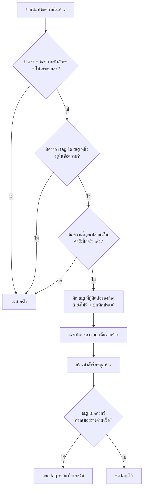

> **โมดูล:** 00083 - Auto Tag By Keyword
> **ประเภทเอกสาร:** Product Requirements Document (PRD)
> **เวอร์ชัน:** 0.1
> **วันที่จัดทำ:** 2026-10-21
> **สถานะ:** Approved v0.1 — user อนุมัติ 2026-10-21 ("ตามแนะนำครับ") รับมติเสนอ P-1..P-8 และข้อเสนอของ Q-1..Q-7 ทั้งหมด
> **เจ้าของเอกสาร:** BA + PO + PM

# PRD: ติด tag อัตโนมัติจากคำที่ร้านพิมพ์ + เมนูจัดการ tag

---

## Executive Summary

วันนี้ tag ในแชทเป็นของที่แอดมินติด/ถอดด้วยมือทีละห้อง และรายการ tag ของร้านไม่มีที่ให้จัดการ (ระบบแค่รวมชื่อที่เคยติดไว้ในผู้ติดต่อมาเป็นตัวช่วยพิมพ์) ผลคือร้านที่ใช้ tag เป็นเครื่องเตือนงาน เช่น "รอคีย์ออเดอร์" ต้องจำเองว่าห้องไหนลูกค้าสั่งแล้วแต่ยังไม่ได้สร้างออเดอร์ และต้องกลับมาถอด tag เองหลังสร้างออเดอร์ ซึ่งมักลืม

ฟีเจอร์นี้เพิ่ม 3 อย่าง:

1. **เมนู "จัดการ tag"** (หน้าใหม่ในกลุ่ม CHAT) — เห็นรายการ tag ของร้าน เพิ่ม/เปลี่ยนชื่อ/ลบได้
2. **ติดอัตโนมัติเมื่อร้านพิมพ์คำที่กำหนด** — ต่อ tag ตั้งคำได้หลายคำ เช่น ร้านตั้งคำ "สรุปออเดอร์" ให้ tag "รอคีย์ออเดอร์" เมื่อร้านส่งข้อความที่มีคำนี้ในห้องไหน ห้องนั้นถูกติด tag
3. **ถอดอัตโนมัติเมื่อสร้างคำสั่งซื้อ** — ต่อ tag มีสวิตช์ "ถอดเมื่อสร้างคำสั่งซื้อ" เมื่อสร้างคำสั่งซื้อที่ผูกกับห้องนั้น tag ถูกถอดเอง

ตรวจเฉพาะ **ข้อความที่คนฝั่งร้านพิมพ์** ไม่ตรวจข้อความลูกค้า และไม่นับข้อความที่ระบบส่งเอง (ตอบอัตโนมัติ · ผู้ช่วยอัตโนมัติ · แจ้งลูกค้าอัตโนมัติ 00078)

---

## 1. Business Goals & KPIs

### 1.1 เป้าหมายทางธุรกิจ

| เป้าหมาย | รายละเอียด |
|----------|-----------|
| **ไม่ลืมงานค้างหลังลูกค้าสั่ง** | ห้องที่ร้านสรุปออเดอร์ไปแล้วแต่ยังไม่ได้คีย์ ต้องมีเครื่องหมายให้เห็นและกรองได้โดยไม่ต้องจำเอง |
| **tag สะท้อนความจริง** | สร้างคำสั่งซื้อแล้ว tag "รอคีย์" ต้องหายเอง ไม่ค้างเป็นข้อมูลเท็จ |
| **ร้านคุม tag ของตัวเองได้** | มีที่เดียวสำหรับดู เพิ่ม เปลี่ยนชื่อ ลบ tag ของร้าน แทนที่จะพึ่งการพิมพ์ทีละห้อง |

### 1.2 ตัวชี้วัดความสำเร็จ (KPIs)

| KPI | คำอธิบาย | เป้าหมาย |
|-----|----------|---------|
| **ร้านที่ตั้งกติกาติดอัตโนมัติอย่างน้อย 1 tag** | นับร้านที่มี tag ที่มีคำอัตโนมัติ ÷ ร้านที่เชื่อมช่องทางแชท | > 0 ภายใน 2 สัปดาห์หลังเปิด |
| **ห้องที่ค้าง tag ที่ตั้งสวิตช์ถอดเมื่อสร้างออเดอร์ เกิน 3 วัน** | ห้องที่ยังมี tag นั้นอยู่ทั้งที่ลูกค้าไม่ได้เงียบ/ยกเลิก (วัดแบบหยาบ: อายุ tag > 3 วัน และยังไม่มีออเดอร์ผูกห้อง) | ลดลงเทียบก่อนเปิดใช้ |
| **สัดส่วน tag ที่ถูกถอดอัตโนมัติ** | จำนวนครั้งที่ถอดโดยระบบ ÷ (ถอดโดยระบบ + ถอดโดยคน) ของ tag ที่เปิดสวิตช์ | เพิ่มขึ้นต่อเนื่อง |

---

## 2. User Personas (กลุ่มผู้ใช้งาน)

### 2.1 เจ้าของร้าน / ผู้จัดการ (ตั้งค่า)

**ข้อมูลพื้นฐาน:** ร้านขายของออนไลน์ที่ใช้กล่องแชทรวม Messenger / Instagram / LINE เป็นหลัก ปิดการขายในแชท แล้วค่อยคีย์ออเดอร์ภายหลัง

**เป้าหมาย:** ให้แอดมินแชททุกคนเห็นตรงกันว่าห้องไหนต้องคีย์ออเดอร์ โดยไม่ต้องกำชับกันเอง

**จุดปวด:** ลูกค้าสั่งแล้วลืมคีย์ → ส่งของช้า/ตกหล่น · tag ที่ติดด้วยมือไม่สม่ำเสมอ แต่ละคนตั้งชื่อต่างกัน

### 2.2 แอดมินแชท (CHAT) / ผู้จัดการ (ใช้งานประจำวัน)

**เป้าหมาย:** เปิดกล่องแชทแล้วกรอง tag "รอคีย์ออเดอร์" เห็นงานที่ต้องทำทั้งหมด · พิมพ์สรุปออเดอร์ให้ลูกค้าตามปกติโดยไม่ต้องจำไปติด tag

**จุดปวด:** ต้องติด tag ด้วยมือทุกห้อง และถอดเองทีหลัง

---

## 3. Business Requirements

### 3.1 หน้า "จัดการ tag"

**ความต้องการ:**
- เมนูใหม่ "จัดการ tag" ในกลุ่ม CHAT ของเมนูผู้ขาย
- แสดงรายการ tag ของร้าน พร้อมจำนวนห้องที่ใช้ tag นั้นอยู่
- เพิ่ม tag ใหม่ · เปลี่ยนชื่อ · ลบ (ลบแล้ว tag หายจากทุกห้องของร้าน มีกล่องยืนยันบอกจำนวนห้องที่กระทบ)
- tag เดิมที่แอดมินเคยพิมพ์ติดไว้ในห้อง (ที่ยังไม่เคยลงทะเบียนในหน้านี้) ต้องโผล่ในรายการด้วย เพื่อให้จัดการได้โดยไม่ต้องสร้างใหม่

**Business Rules:**
- tag เป็นของ "ร้าน" ไม่ข้ามร้าน (00037: กล่องรวมหลายร้านต้องไม่ทำให้กติกาของร้านหนึ่งไปติดห้องของอีกร้าน)
- ชื่อ tag 1-30 ตัวอักษร (ตรงกับกติกา tag ผู้ติดต่อที่มีอยู่) · ชื่อซ้ำในร้านเดียวกันไม่ได้ (ไม่สนตัวพิมพ์เล็กใหญ่ของอังกฤษ)

**เหตุผล:** ปัจจุบันไม่มีที่ลบ/เปลี่ยนชื่อ tag เลย ชื่อผิดคำเดียวค้างอยู่ตลอดไป

### 3.2 กติกา "ติดอัตโนมัติเมื่อร้านพิมพ์คำ"

**ความต้องการ:**
- ต่อ tag ตั้ง "คำที่ทำให้ติด" ได้หลายคำ (ไม่ใส่เลย = tag ธรรมดา ติดด้วยมือเท่านั้น)
- เมื่อข้อความที่คนฝั่งร้านพิมพ์มีคำใดคำหนึ่ง ระบบติด tag นั้นให้ห้อง

**Business Rules:**
- ตรวจเฉพาะข้อความ **ร้านส่ง** ชนิดข้อความตัวอักษร ที่คนพิมพ์ (ไม่ใช่ระบบส่ง) — ไม่ตรวจข้อความลูกค้า
- จับแบบ "มีคำนี้อยู่ในข้อความ" ไม่สนตัวพิมพ์เล็กใหญ่ของอังกฤษ และไม่สนช่องว่างซ้ำ/ช่องว่างหัวท้าย
- ติดซ้ำไม่ได้ (ห้องที่มี tag อยู่แล้วไม่เกิด tag ซ้ำ)
- ถ้าแอดมินถอด tag เองแล้วร้านพิมพ์คำนั้นอีก → **ติดกลับ** (ถือเป็นสัญญาณรอบใหม่ทุกครั้ง)
- ข้อความที่ถูกสร้างเป็นคำสั่งซื้อจริงไปแล้วโดยฟีเจอร์ 00061 ในรอบเดียวกัน ไม่ต้องติด tag (กัน tag ค้างทั้งที่ออเดอร์เกิดแล้ว)

### 3.3 กติกา "ถอดเมื่อสร้างคำสั่งซื้อ"

**ความต้องการ:** ต่อ tag มีสวิตช์ "ถอดเมื่อสร้างคำสั่งซื้อ" — เปิดแล้ว เมื่อมีคำสั่งซื้อใหม่ที่ผูกกับห้องนั้น tag ถูกถอดเอง

**Business Rules:**
- นับเฉพาะคำสั่งซื้อที่ **ผูกห้องแชทนั้นโดยตรง** (สร้างจากฟอร์มในแชท หรือจากหน้าสร้างคำสั่งซื้อที่เลือกผูกห้อง) — คำสั่งซื้อที่จับคู่กับลูกค้าด้วยเบอร์โทรอย่างเดียวไม่ถอด
- ถอดเฉพาะ tag ที่เปิดสวิตช์ไว้ ไม่ว่า tag นั้นถูกติดโดยระบบหรือโดยคน
- ถ้าคำสั่งซื้อถูกยกเลิกภายหลัง **ไม่ติด tag กลับ**
- ร่างคำสั่งซื้อจาก 00061 (ยังไม่ใช่คำสั่งซื้อจริง) ไม่นับ — นับตอนร่างถูกเลื่อนเป็นคำสั่งซื้อจริง · คำสั่งซื้อจำลอง/ทดสอบไม่นับ
- คำสั่งซื้อลงวันที่ย้อนหลังนับ (ถือว่าสร้างแล้ว)

### 3.4 เปลี่ยนชื่อ / ลบ tag ต้องไล่ทุกห้อง

**ความต้องการ:** เปลี่ยนชื่อ/ลบ tag ในหน้าจัดการ ต้องมีผลกับทุกห้องของร้านที่ติด tag นั้นอยู่ทันที ไม่มีห้องที่ค้างชื่อเก่า

**เหตุผล:** tag ถูกเก็บเป็นชื่อบนข้อมูลผู้ติดต่อของแต่ละห้อง ไม่ใช่ตัวอ้างอิง ถ้าแก้แค่รายการ ห้องเก่าจะค้างชื่อเดิมและตัวกรองหาไม่เจอ

### 3.5 ร่องรอยขั้นต่ำ

**ความต้องการ:** เมื่อระบบติดหรือถอด tag เอง บันทึกไว้ว่า "ติด/ถอด tag อะไร ในห้องไหน เพราะข้อความไหน (หรือคำสั่งซื้อไหน) เมื่อไร และคำที่จับได้" เพื่อไล่สาเหตุเวลาแอดมินถามว่า "ทำไม tag นี้โผล่/หาย" — ไม่บันทึกเมื่อไม่มีอะไรเปลี่ยน (เช่น มี tag อยู่แล้ว)

---

## 4. Business Rules & Constraints

### 4.1 กฎทางธุรกิจหลัก

| กฎ | คำอธิบาย |
|----|----------|
| **ฝั่งร้านเท่านั้น** | ตรวจเฉพาะข้อความที่คนฝั่งร้านพิมพ์ — จากกล่องแชทของเรา หรือจากแอป Messenger/Instagram ของ Meta (กลับเข้ามาเป็น echo) |
| **ระบบส่งเองไม่นับ** | ตอบอัตโนมัติ · ผู้ช่วยอัตโนมัติ · แจ้งลูกค้าอัตโนมัติ · การ์ดภายในของ 00061 ไม่ทำให้ติด tag (กันวงจรและกัน tag ติดเพราะข้อความสำเร็จรูป) |
| **tag เป็นของร้าน** | กติกา/รายการอยู่ระดับร้าน ไม่ปนข้ามร้าน |
| **ติดซ้ำทุกครั้งที่เจอคำ** | แอดมินถอดเองแล้วเจอคำอีก → ติดกลับ |
| **ถอดผูกกับห้อง** | ถอดเฉพาะคำสั่งซื้อที่ผูกห้อง ไม่ถอดจากการจับคู่เบอร์ |
| **คำเดียวทั้งระบบ** | ป้าย/ชื่อ "tag" ใช้คำเดียวกันทุกหน้า (กล่องแชท · แผงลูกค้า · ตัวกรอง · หน้าจัดการ) — HR16 |

### 4.2 ข้อจำกัดทางธุรกิจ (ยืนยันกับโค้ดแล้ว 2026-10-21)

| ข้อจำกัด | รายละเอียด |
|---------|-----------|
| **ห้องแชทในแอป Deep (DEEP) ไม่มี tag** | tag เก็บที่ผู้ติดต่อภายนอก (Messenger/IG/LINE) ห้อง DEEP ที่ลูกค้าเป็นบัญชีในแอปไม่มีที่เก็บ tag เลย — ฟีเจอร์นี้ไม่ครอบคลุมห้อง DEEP |
| **LINE: ข้อความที่แอดมินพิมพ์ในแอป LINE OA เอง ระบบมองไม่เห็น** | LINE ไม่ส่ง echo ของข้อความขาออกกลับมา — ตรวจได้เฉพาะข้อความที่พิมพ์จากกล่องแชทของ Deep เท่านั้น (Messenger/IG ตรวจได้ทั้งสองทาง) |
| **ข้อความที่ส่งผ่านกล่องแชท Deep แล้ว echo ย้อนกลับ ไม่ถูกนับซ้ำ** | echo ของข้อความที่เราส่งเองชน id เดิมและถูกทิ้งก่อนบันทึก จึงไม่เรียกตัวตรวจซ้ำ |
| **ไม่ย้อนหลัง** | ข้อความที่ส่งไปแล้วก่อนเปิดกติกาไม่ถูกสแกน |

### 4.3 มติ user ที่ล็อกแล้ว (2026-10-21)

- ตรวจ keyword เฉพาะข้อความที่ร้านส่ง (รวม echo จากแอป Meta) ไม่ตรวจข้อความลูกค้า
- ถอด tag เมื่อสร้างคำสั่งซื้อที่ผูกห้องแชทนั้น (จากฟอร์มในแชท และหน้าสร้างที่ผูกห้อง) ไม่ถอดจากการจับคู่เบอร์
- UI = เมนู "จัดการ tag" หน้าใหม่ในกลุ่มตั้งค่าแชท: จัดการรายการ tag + ต่อ tag ตั้งคำ (หลายคำ) + สวิตช์ถอดเมื่อสร้างคำสั่งซื้อ

### 4.4 มติ (user รับรอง 2026-10-21)

| รหัส | มติเสนอ | เหตุผล |
|------|---------|--------|
| P-1 | tag ที่แอดมินถอดเองแล้วเจอคำซ้ำ → ติดใหม่ทุกครั้ง | ร้านพิมพ์ "สรุปออเดอร์" อีกครั้ง = รอบสั่งใหม่ |
| P-2 | ข้อความจากระบบเอง (`autoReplyKind` มีค่า ทุกชนิดรวมแจ้งลูกค้าอัตโนมัติ) ไม่นับ | ตรงกับตัวกรอง "บอทเป็นผู้ส่ง" ที่ 00061 ใช้อยู่ |
| P-3 | echo ที่ Meta ระบุว่าเป็น AI สร้าง (`ai_generated`) ไม่นับ | เป็นการตอบโดย Meta AI ไม่ใช่แอดมินพิมพ์ |
| P-4 | คำจับแบบ "มีคำนี้อยู่ในข้อความ" ใช้ตัวเทียบเดียวกับวลีจุดชนวนของ 00061 | ตัวเดียวกันตรวจข้อความฝั่งร้านอยู่แล้ว เก็บสัญลักษณ์ไว้ครบ ต่างจากตัวเทียบของตอบอัตโนมัติที่ออกแบบมาสำหรับข้อความลูกค้าและตัดวรรคตอนทิ้ง |
| P-5 | ตัวติด tag เรียกจาก 3 จุดเดียวกับ 00061 (กล่องแชทของเรา · คิวส่งออก · webhook echo) ผ่านฟังก์ชันเดียว | จุดเข้าตรงกับที่ร้านพิมพ์จริง และมีเทสกันจุดที่ 4 หลุดอยู่แล้ว |
| P-6 | หน้าจัดการ tag ใช้สิทธิ์กลุ่มตั้งค่าแชท (เจ้าของ + ผู้จัดการ) ทั้งดูและแก้; แอดมินแชท (CHAT) ยังติด/ถอด tag ต่อห้องได้เหมือนเดิม | เปลี่ยนชื่อ/ลบกระทบทุกห้อง และกติกาอัตโนมัติทำงานในนามร้าน (ไม่สร้าง capability ใหม่) |
| P-7 | ขีดจำกัด: tag ต่อร้าน ≤ 50 · tag ที่มีคำอัตโนมัติ ≤ 20 · คำต่อ tag ≤ 10 · แต่ละคำ 2-50 ตัวอักษร | กันข้อความสั้นเกินจนติดมั่ว (เช่น "ครับ") และกันการสแกนบานปลาย |
| P-8 | ไม่ใส่ tag ตัวอย่างให้ร้านเอง แสดงตัวอย่างในข้อความหน้าว่าง | ไม่เปลี่ยนข้อมูลร้านเงียบ ๆ |

### 4.5 คำถามเปิด — ปิดแล้ว 2026-10-21 ตามคอลัมน์ข้อเสนอทุกข้อ

| รหัส | คำถาม | ข้อเสนอ |
|------|-------|---------|
| Q-1 | แอดมินถอด tag เองแล้วร้านพิมพ์คำซ้ำ ติดกลับไหม | ติดกลับทุกครั้ง (P-1) |
| Q-2 | ข้อความที่ระบบส่งเอง (ตอบอัตโนมัติ · ผู้ช่วยอัตโนมัติ · แจ้งลูกค้าอัตโนมัติ) นับเป็น "ร้านส่ง" ไหม | ไม่นับ เฉพาะคนพิมพ์ (P-2) |
| Q-3 | ร่างคำสั่งซื้อจาก 00061 และคำสั่งซื้อที่ 00061 สร้างจริงอัตโนมัติ: ร่างไม่ถอด / สร้างจริงถอด ใช่ไหม | ร่างไม่ถอด จนกว่าจะถูกเลื่อนเป็นจริง; สร้างจริงถอด |
| Q-4 | แอดมินแชท (CHAT) ควรเห็นหน้า "จัดการ tag" แบบอ่านอย่างเดียวไหม | ยังไม่ให้เห็น (P-6) — ไม่มีมติเรื่อง capability ใหม่ |
| Q-5 | ต้องมีร่องรอยติด/ถอดอัตโนมัติ (ตารางเก็บประวัติ) ในรอบนี้ไหม และต้องมีหน้าให้ดูไหม | เก็บประวัติขั้นต่ำ ไม่ทำหน้าดู (ไล่ผ่านฐานตอนมีเคส) |
| Q-6 | เปลี่ยนชื่อ tag เป็นชื่อที่มี tag อื่นใช้อยู่แล้ว: ห้ามหรือรวม | ห้ามถ้าชื่อนั้นอยู่ในรายการที่ลงทะเบียนแล้ว; รวมให้ถ้าเป็นชื่อที่มีแต่ในห้องเก่า (ยังไม่ลงทะเบียน) |
| Q-7 | ตัวกรองกล่องแชทที่ผู้ใช้บันทึกไว้เป็นชื่อ tag เก่า หลังเปลี่ยนชื่อจะกรองไม่เจอ ต้องไล่แก้ค่าที่บันทึกไว้ด้วยไหม | ไม่ทำรอบนี้ แต่บอกในกล่องยืนยันว่าตัวกรองที่บันทึกไว้อาจต้องเลือกใหม่ |

---

## 5. Out of Scope (นอกขอบเขต)

| หัวข้อ | คำอธิบาย |
|--------|----------|
| **ห้อง DEEP (บัญชีในแอป)** | ไม่มีที่เก็บ tag; ถ้าจะทำต้องออกแบบที่เก็บ tag ระดับห้อง (Phase 2) |
| **ตรวจข้อความลูกค้า** | มติ user: ตรวจเฉพาะฝั่งร้าน |
| **LINE ที่แอดมินพิมพ์ในแอป LINE OA เอง** | ระบบไม่เห็นข้อความขาออกของ LINE (ข้อจำกัดของแพลตฟอร์ม) |
| **จับแบบ regex / ใกล้เคียง / AI** | รอบนี้ "มีคำนี้อยู่ในข้อความ" เท่านั้น |
| **ย้อนหลัง** | ไม่สแกนข้อความเก่า/ไม่ติด tag ให้ห้องเก่า |
| **ถอดจากเหตุการณ์อื่น** | ปิดงาน · ส่งของ · หมดเวลา — รอบนี้ถอดจากการสร้างคำสั่งซื้อเท่านั้น |
| **ถอดจากคำสั่งซื้อที่จับคู่เบอร์** | มติ user |
| **หน้าดูประวัติติด/ถอดอัตโนมัติ** | เก็บประวัติไว้ในฐานเท่านั้น (Q-5) |
| **สีของ tag / จัดเรียง / แท็กต่อหลายร้านพร้อมกัน** | ไม่มีใน PRD ปัจจุบัน |
| **ไล่แก้ค่าตัวกรองที่ผู้ใช้บันทึกไว้เมื่อเปลี่ยนชื่อ tag** | Q-7 |
| **การเปลี่ยนพฤติกรรม 00061** | 00061 ยังทำงานเดิมทุกประการ ฟีเจอร์นี้แค่ฟังข้อความชุดเดียวกัน |

---

## 6. Risks & Mitigation

### 6.1 ความเสี่ยงทางธุรกิจ

| ความเสี่ยง | ผลกระทบ | ระดับ | แนวทางแก้ไข |
|-----------|---------|-------|-------------|
| **คำกว้างเกินไปทำให้ติดมั่ว** (เช่น ตั้งคำ "ครับ") | ห้องเต็มไปด้วย tag ไม่มีความหมาย | กลาง | คำขั้นต่ำ 2 ตัวอักษร · หน้าจัดการมีข้อความอธิบาย "ติดเมื่อร้านพิมพ์คำนี้" · ถอด/ลบกติกาได้ทันที |
| **ลบ tag แล้วหายทุกห้อง** | งานค้างที่อ้าง tag หาย | กลาง | กล่องยืนยันบอกจำนวนห้อง · ย้อนกลับไม่ได้ ต้องพิมพ์ยืนยันหรือกดสองชั้นตามแพตเทิร์น Swal ของระบบ |
| **ร้านคาดหวังว่า LINE จับได้ทุกทาง** | แอดมินที่พิมพ์ในแอป LINE OA เองไม่ติด tag | กลาง | หน้าจัดการมีหมายเหตุสั้นแยกตามช่องทาง |
| **คนละคนถอด tag เอง แล้วระบบติดกลับ** | สับสน | ต่ำ | ร่องรอยบอกที่มา · ข้อความอธิบายในหน้า |

### 6.2 ความเสี่ยงทางเทคนิค

| ความเสี่ยง | ผลกระทบ | แนวทางแก้ไข |
|-----------|---------|-------------|
| **tag เก็บเป็นอาร์เรย์ชื่อบนผู้ติดต่อ ไม่มีตัวอ้างอิง** | เปลี่ยนชื่อ/ลบแล้วห้องเก่าค้าง | ไล่แก้ทุกผู้ติดต่อของร้านในทรานแซกชันเดียว (SRS ตัดสินวิธี) · เทส DB |
| **ติด/ถอดพร้อมกัน (ข้อความสองใบ, ผู้ใช้ติดด้วยมือ ขณะระบบติด)** | tag ซ้ำ/หาย | ทำเป็นคำสั่งอะตอมมิกต่อแถว ไม่อ่านแล้วเขียนทับทั้งอาร์เรย์ · idempotent |
| **ตัวติด tag กับ 00061 แข่งกัน** (ร้านพิมพ์สรุป → 00061 สร้างออเดอร์ทันที → ถอด tag ก่อนที่ตัวติดจะติด) | tag ค้างทั้งที่ออเดอร์เกิดแล้ว | ตัวติดเช็คก่อนว่าข้อความนี้ถูกเปลี่ยนเป็นคำสั่งซื้อจริงแล้วหรือไม่ (มีเทสบังคับ) |
| **จุดเข้าตรวจข้อความไม่ครบ** | บางทางพิมพ์ไม่ติด | ใช้ 3 จุดเดียวกับ 00061 + เทสไล่จุดเรียกเหมือนที่ 00061 ทำ |
| **ทำ webhook ช้า** | Meta retry | รันหลังตอบ webhook ไม่ await · กลืน error |
| **สิทธิ์/ข้ามร้าน** | กติการ้านหนึ่งติดห้องอีกร้าน | ทุก query ผูก shopId ของ "ห้อง/คำสั่งซื้อ" ไม่เชื่อค่าจาก client |

---

## 7. Glossary

| คำศัพท์ | ความหมาย |
|---------|----------|
| **tag** | ป้ายข้อความสั้นที่ติดที่ผู้ติดต่อของห้องแชท ใช้กรองกล่องแชท |
| **กติกาติดอัตโนมัติ** | ชุดคำที่ผูกกับ tag; ร้านพิมพ์ข้อความที่มีคำใดคำหนึ่ง → ติด tag |
| **ถอดเมื่อสร้างคำสั่งซื้อ** | สวิตช์ต่อ tag; มีคำสั่งซื้อใหม่ผูกห้องแล้วถอด tag |
| **ร้านส่ง / ฝั่งร้านพิมพ์** | ข้อความที่คนของร้านพิมพ์ ทั้งจากกล่องแชท Deep และจากแอป Meta (echo) — ไม่รวมระบบส่ง |
| **echo** | ข้อความที่ Meta ส่งกลับมาบอกว่าฝั่งเพจส่งข้อความไปแล้ว (รวมที่พิมพ์ในแอป Meta) |

---

## 8. Success Metrics

| ตัวชี้วัด | ค่าที่คาดหวัง | วิธีวัด |
|----------|---------------|--------|
| **ร้านที่ตั้งกติกาติดอัตโนมัติ** | > 0 ภายใน 2 สัปดาห์ | query บน prod (อ่านอย่างเดียว) |
| **ห้องที่ติด-ถอดอัตโนมัติครบวงจร** | มีเหตุการณ์ ติด และ ถอด คู่กันในประวัติ | นับจากตารางประวัติ |
| **ห้องค้าง tag > 3 วัน (tag ที่เปิดสวิตช์ถอด)** | ลดลง | query รายสัปดาห์ |

---

## 9. Dependencies & Assumptions

### 9.1 Dependencies

| ระบบ/ส่วนประกอบ | ความสัมพันธ์ |
|-----------------|-------------|
| **tag ต่อผู้ติดต่อ + CRM (00018)** | ที่เก็บ tag เดิม; ตัวช่วยพิมพ์ tag และตัวกรองกล่องแชทยังอ่านจากที่เดิม |
| **สร้างออเดอร์อัตโนมัติ (00061)** | ใช้จุดเข้าตรวจข้อความฝั่งร้านชุดเดียวกัน · ต้องไม่ชนกัน |
| **สิทธิ์ (00071)** | หน้าและ API ประกาศ capability ในทะเบียน route |
| **กล่องแชทรวมหลายร้าน (00037)** | tag/กติกาต้องไม่ข้ามร้าน |
| **เมนูผู้ขาย (seller-menu)** | เพิ่มรายการในกลุ่ม CHAT |
| **ส่งอัตโนมัติถึงลูกค้า (00078)** | ข้อความชนิดนี้ต้องไม่นับเป็น "ร้านพิมพ์" |

### 9.2 Assumptions

- tag ยังคงเก็บเป็นชื่อบนผู้ติดต่อ (ไม่เปลี่ยนโมเดลการเก็บ tag ต่อห้อง) — เพิ่มเฉพาะ "รายการ tag + กติกา" ของร้าน
- ผู้ติดต่อหนึ่งรายมีห้องเดียวต่อเพจ (ข้อมูลเดิมเป็นเช่นนี้) จึงถือ "ติด tag ที่ห้อง" = "ติดที่ผู้ติดต่อของห้อง"
- ร้านส่วนใหญ่ที่ใช้ฟีเจอร์นี้คือ ONLINE_SALES แต่หน้านี้เห็นได้ทุก vertical (เหมือนเมนูแชทอื่น) ไม่ซ่อนตาม vertical
- icon ของเมนูใหม่เลือกจาก tabler ที่ตรวจว่ามีจริงก่อนใช้ (HR12: ไม่แน่ใจ → ถาม)

---

## 10. Appendix

### 10.1 ตัวอย่าง User Journey

**Scenario: ร้านตั้ง "รอคีย์ออเดอร์"**

1. เจ้าของร้านเปิด จัดการ tag → เพิ่ม tag "รอคีย์ออเดอร์" → ตั้งคำ "สรุปออเดอร์", "ยอดรวม" → เปิดสวิตช์ "ถอดเมื่อสร้างคำสั่งซื้อ"
2. แอดมินพิมพ์ในห้องลูกค้า "สรุปออเดอร์ค่ะ ... ยอดรวม 590" → ห้องถูกติด tag "รอคีย์ออเดอร์"
3. แอดมินอีกคนกรองกล่องแชทด้วย tag นี้ เห็นห้องที่ต้องคีย์
4. แอดมินสร้างคำสั่งซื้อจากแผงในแชทของห้องนั้น → tag หายเอง

---

**หมายเหตุ:**
เอกสารนี้เป็นความต้องการทางธุรกิจ ไม่ลงรายละเอียดเทคนิค · FR/AC ดู [[BRD]] · technical spec ดู SRS (เขียนหลัง PRD+BRD ผ่าน และต้อง sync `docs/SRS.md` เพราะแตะ data model/API)
