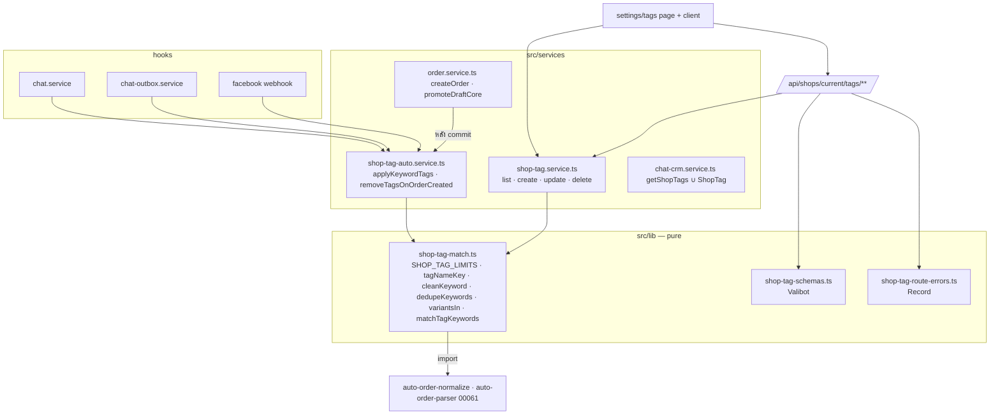
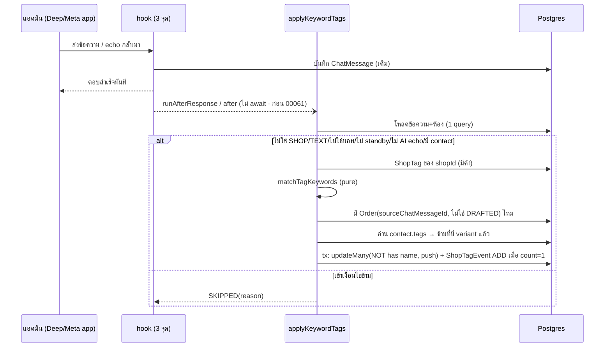
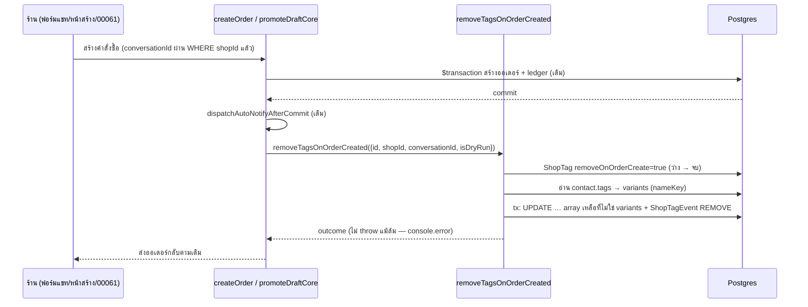
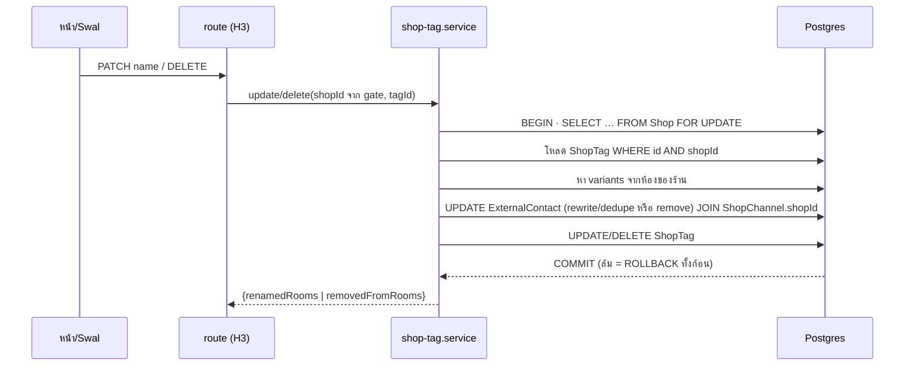

> **โมดูล:** 00083 - Auto Tag By Keyword · **ประเภท:** System Design Spec (SDS) · **เวอร์ชัน:** 1.0 · **วันที่:** 2026-10-21 · **สถานะ:** Draft (Planner เสนอ — Controller ล็อกก่อนแตก task)

# SDS: ติด tag อัตโนมัติจากคำที่ร้านพิมพ์ + เมนูจัดการ tag

## 1. ผลสำรวจโค้ด (ยืนยันแล้ว 2026-10-21 ใน worktree `safepay-00083`)

| ข้อ | ผล | หลักฐาน |
|---|---|---|
| ที่ออเดอร์จริงผูกห้อง | `createOrder` และ `promoteDraftCore` เท่านั้น | `order.service.ts:314` / `:862` · `:612` เขียน `conversationId` จากเธรดที่ผ่าน `WHERE shopId` |
| `booking.service` / `auction.service` | **ไม่เขียน** `conversationId` | grep `conversationId` = 0 ทั้งสองไฟล์ (สร้าง order ที่ `booking.service.ts:196`, `auction.service.ts:546`) |
| `iship.service` เรียก `createOrder` | ไม่ส่ง `conversationId` | `iship.service.ts:3324` (grep `conversationId` = 0) |
| 00061 `auto-order-detect.service.ts` | เขียน **DRAFTED** ด้วย `prisma.order.create` ตรง ๆ (`:245`, `:310`) · ถ้าครบ+ไม่ใช่โหมดทดสอบ เรียก `createOrder` (`:184`) · ปุ่ม "อ่านใหม่" เรียก `promoteAutoOrderDraft` (`:388`) → ผ่าน `promoteDraftCore` | — |
| จุดเรียกตรวจข้อความฝั่งร้านของ 00061 | `chat.service.ts:1037` · `chat-outbox.service.ts:365` · `api/channels/facebook/webhook/route.ts:396-410` | ทั้งสามเป็น `runAfterResponse(...)`/`after(...)` ไม่ await |
| เทสไล่จุดเรียกของ 00061 | `src/services/__tests__/auto-order-architecture.test.ts` — `ALLOWED_CALLERS` (บรรทัด 47-61) · `SHOP_MESSAGE_WRITERS` (235-249) · "ทั้ง 2 ตัวต้องเรียก…ไม่ await" (214-225) | ใช้เป็นแบบ |
| เทสไล่จุดสร้างออเดอร์ | `src/services/__tests__/order-no-write-paths.test.ts` (`CREATE_SITES` + `grep -rlE`) | ใช้เป็นแบบ |
| ตัวเทียบ | `normalizeTriggerPhrase` ใน `src/lib/auto-order-normalize.ts:25` (NFC→lower→ยุบช่องว่าง→trim, ไม่ลบสัญลักษณ์) · `matchesTriggerPhrase` ใน `src/lib/auto-order-parser.ts:148` (คืนวลีที่ match) | ใช้ซ้ำ ไม่เขียนใหม่ |
| IG | เข้า `facebook/webhook/route.ts` เส้นเดียวกัน — `provider = parsed.output.object === 'instagram' ? 'INSTAGRAM' : 'MESSENGER'` (บรรทัด 106) | — |
| LINE | webhook LINE รับขาเข้าลูกค้า ไม่มี echo/ไม่มี hook 00061 | `api/channels/line/webhook/route.ts` |
| `Conversation.externalContactId` | `String?` (schema `:1985`) · `@@unique([shopChannelId, externalContactId])` | — |
| `ExternalContact.tags` | `String[] @default([])` (`:1944`) | — |
| หลักฐาน echo | `ChatMessage.echoAiGenerated` / `echoHasAdminText` / `echoAppId` / `viaStandby` เขียนตอน ingest (`channel-chat.service.ts:1652-1661`) → ตัวติดอ่านจากแถวได้ ไม่ต้องรับ payload | — |
| ข้อความ Meta ภายใน | `type = META_NOTICE_TYPE` (ไม่ใช่ TEXT) → ถูกด่าน `NOT_TEXT` | `channel-chat.service.ts:1639` |
| ชื่อ route | `/api/tags` = tag สินค้า (public) — ชน · `/api/shops/current/**` = ธรรมเนียมตั้งค่าร้านปัจจุบัน (00078) ✔ · ไม่มี `/api/shops/current/tags` อยู่ก่อน | glob |
| ด่านสิทธิ์ | `H3: [O, M]` (`shop-permissions.ts:27`) · `X2: [O, M, C]` (`:57`) | — |
| ตัวช่วยพิมพ์ tag | `getShopTags` (`chat-crm.service.ts:11-22`) ← `/api/chat/tags` (X2) และ `follow-ups/page.tsx:98` | — |

## 2. Architecture

## 3. Component Design

| Component | ไฟล์ | หน้าที่ |
|---|---|---|
| ตัวเทียบ + กติกาชื่อ (pure) | `src/lib/shop-tag-match.ts` (ใหม่) | `SHOP_TAG_LIMITS` · `charLen` (code point) · `tagNameKey` · `cleanTagName` · `cleanKeyword` · `dedupeKeywords(raws)` · `variantsIn(tags, nameKey)` · `matchTagKeywords(rawBody, tags)` (เรียก `matchesTriggerPhrase`) |
| Schemas | `src/lib/shop-tag-schemas.ts` (ใหม่) | `ShopTagCreateSchema` · `ShopTagPatchSchema` (strictObject · ≥1 คีย์) · `ShopTagIdSchema` |
| Error mapping | `src/lib/shop-tag-route-errors.ts` (ใหม่) | `shopTagErrorResponse(e, tag)` — Map exhaustive |
| CRUD service | `src/services/shop-tag.service.ts` (ใหม่) | `ShopTagError(code)` · `listShopTags` · `createShopTag` · `updateShopTag` · `deleteShopTag` |
| Auto service | `src/services/shop-tag-auto.service.ts` (ใหม่) | `applyKeywordTags` · `removeTagsOnOrderCreated` |
| ตัวช่วยพิมพ์ tag | `src/services/chat-crm.service.ts` (แก้) | `getShopTags` union |
| Routes | `src/app/api/shops/current/tags/route.ts` · `.../tags/[tagId]/route.ts` (ใหม่) | gate H3 → Valibot → service → `jsonNoStore` |
| หน้า | `src/app/(paces)/seller/(dashboard)/settings/tags/{page,loading}.tsx` + `components/*` (ใหม่) | RSC เรียก `listShopTags` ตรง · client ยิง API |

## 4. Data Flow & Sequence

### 4.1 ร้านพิมพ์ → ติด tag

### 4.2 สร้างคำสั่งซื้อ → ถอด tag (TD-003)

### 4.3 เปลี่ยนชื่อ/ลบ

## 5. Technical Decisions

### TD-001: "tag เดียวกัน" ตัดสินที่ `tagNameKey` (JS) · เขียนด้วยชุดสตริงตรงตัว (SQL)
- **ทำไม:** `ExternalContact.tags` เป็นสตริงเปล่า ไม่มี FK — ห้องเก่ามีทั้ง `VIP`/`vip` ได้ ถ้าเทียบแค่ตรงตัว จะเกิดทางตัน (ลงทะเบียน `VIP` แล้ว `vip` ที่ค้างอยู่ลงทะเบียนไม่ได้เพราะ nameKey ชน และไม่มี id ให้ลบ/รวม) · เทียบใน SQL (`lower(normalize())`) เสี่ยง locale ของฐานไม่ตรง JS
- **วิธี:** list/apply/remove/rename/delete อ่านสตริงที่มีอยู่ → กรองด้วย `tagNameKey` ใน JS → ได้ชุด `variants` → ส่งเข้า SQL เป็น `text[]` (`tags && $variants`, `t <> ALL($variants)`)
- **ผลที่ยอมรับ:** list ต้อง group สตริงทั้งร้านหนึ่งครั้ง (งานนาน ๆ ครั้ง)

### TD-002: ติดด้วย `updateMany … tags:{ push }` + `NOT:{ tags:{ has } }` (อะตอมมิก ไม่ใช้ raw)
- Prisma ออก `array_append` ใน UPDATE เดียว และ `has` เป็น `@>` → ได้ `count` 1/0 เท่ากับ SQL ใน DATABASE §4 โดยไม่ต้อง `$executeRaw` (type-safe) · ห้ามอ่านแล้วเขียนทับทั้งอาร์เรย์ (เทสสแกนห้าม `data: { tags: [` ในไฟล์) · การอ่าน tags ก่อน (ขั้น 6) ใช้ตัดสิน variant เท่านั้น ไม่ใช่ฐานของการเขียน
- ถอด/rename/delete ใช้ `$executeRaw` เพราะ Prisma ไม่มี array remove

### TD-003: ตัวถอดอยู่ **หลัง commit นอก tx** ของ `createOrder` / `promoteDraftCore` (ตอบคำถาม BRD FR-008)
- **ทำไมไม่อยู่ใน tx:** คำสั่ง SQL ใดล้ม Postgres ทำ tx ทั้งก้อนเป็น aborted (25P02 — ข้อความเดียวกับคอมเมนต์ `order.service.ts:638-643`) การ try/catch ใน tx ช่วยไม่ได้ ⇒ "ถอดล้ม ต้องไม่ทำให้สร้างล้ม" ทำไม่ได้ใน tx · และ retry loop 5 รอบของ `createOrder` ครอบทั้ง tx ถ้าถอดอยู่ข้างใน จะ rollback/ทำซ้ำตามรอบ
- **ผลตามมา:** "สร้างล้ม = ไม่ถอด" ได้ฟรี (ไม่ถึงบรรทัดหลัง commit) · ช่องว่างที่ยอมรับ: process ตายระหว่าง commit กับถอด → tag ค้าง แอดมินถอดเองได้ (ไม่ใช่ข้อมูลหาย) · `await` ได้เพราะไวและกลืน error ในตัว (ต่างจาก `runAfterResponse` ที่ UI อาจ refetch ก่อนถอดเสร็จ)
- **ตำแหน่ง:** `order.service.ts` ต่อจาก `dispatchAutoNotifyAfterCommit(ledgerId);` ทั้งสองจุด (809 / 1054) ก่อน `return`
- **ทางเลือกที่ปัดตก:** ถอดผ่าน `ledger`-แบบ intent + sweeper (ใหญ่เกิน) · ถอดใน tx ด้วย savepoint (Prisma interactive tx ไม่รองรับ)

### TD-004: 3 จุดเรียก = ชุดเดียวกับ 00061 และบังคับด้วยเทสเทียบเซต
- เทสใหม่ `shop-tag-architecture.test.ts` สแกน `src/**` หาไฟล์ที่เรียก `detectAutoOrderTrigger(` กับ `applyKeywordTags(` (ตัด comment) แล้ว `expect(setA).toEqual(setB)` + ห้าม `await` + `ALLOWED_CALLERS` ของตัวเอง · **ไม่แก้ไฟล์เทสของ 00061** (ไม่แตะด่านเดิม)
- ด่านทั้งหมด (SHOP/TEXT/บอท/standby/AI echo) อยู่ **ในตัวติด** ไม่ไล่แปะทุกจุดเข้า (หลักเดียวกับ 00061)
- hook ที่ `chat.service` จบด้วย `NO_CONTACT` เสมอสำหรับห้อง DEEP (dead-by-design) แต่คงไว้ตามมติ P-5 + กัน `sendMessage` ถูกใช้กับช่องทางนอกในอนาคต
- เรียก 00083 **ก่อน** 00061 ในทุกจุด (R-1)

### TD-005: ใช้ `matchesTriggerPhrase` ของ 00061 ตรง ๆ (P-4)
- ได้ semantics เดียวกันโดยโครงสร้าง ไม่ต้องคอยซิงก์ · เทส parity บน corpus สุ่มยืนยัน `matchTagKeywords` ≡ `matchesTriggerPhrase` ต่อ tag
- แลกด้วยการ import ไฟล์ที่ลาก `parse-order-message` (pure, server) — ยอมรับ · ไฟล์ `shop-tag-match.ts` จึง **ห้ามถูก import จาก client component**

### TD-006: API อยู่ใต้ `/api/shops/current/tags` (ไม่ใช่ `/api/tags`)
- `/api/tags` = tag สินค้าแบบ public · `/api/shops/current/**` = ธรรมเนียม 00078 และมี `jsonNoStore`/`requireShopCapability` ใช้ซ้ำ · `[tagId]` เป็นชื่อ param ไม่ซ้ำกับ sibling dynamic ใดใน `current/`

### TD-007: tag ที่ยังไม่ลงทะเบียนจัดการด้วย "ลงทะเบียนก่อน (POST) แล้วค่อยแก้/ลบ" — ไม่เพิ่ม endpoint ตามชื่อ
- UI ทำสองคำขอต่อกันอย่างโปร่งใส · เมื่อร้านเต็มเพดาน 50 และต้องการลบ ghost: ได้ `TAG_LIMIT_REACHED` พร้อมข้อความ "ครบ 50 แล้ว ลบ tag ที่ไม่ใช้ก่อน" (ทางออกชัด) · ถ้า POST สำเร็จแล้ว DELETE ล้ม → ghost กลายเป็น registered ที่เห็นและลบได้ ไม่ใช่ข้อมูลหาย
- เหตุผลที่ไม่เพิ่ม `?name=`: endpoint ที่รับชื่อดิบ = ช่องให้ client ชี้สตริงที่ไม่ผ่าน `ShopTag` และเพิ่มพื้นที่ทดสอบ 2 เท่า

### TD-008: lock แถว `Shop` (`FOR UPDATE`) ตอน create/update — ไม่ lock ตอน delete
- เพดาน 50/20 นับข้ามแถว DB บังคับไม่ได้ (DATABASE §7) · ใช้ `SELECT id FROM "Shop" WHERE id=$1 FOR UPDATE` เป็นบรรทัดแรกใน tx · rename ใช้ lock เดียวกันเพื่อกัน rename ชนกัน

### TD-009: error ของ service = คลาสเดียว `ShopTagError(code)` + `Record<ShopTagErrorCode,…>`
- แก้คลาสบั๊ก "throw ใหม่ไม่มี route catch" (00003 `OutOfStockError`) ที่ต้นทาง: เพิ่ม code ใหม่โดยไม่เพิ่มรายการใน map = **tsc ไม่ผ่าน** · map เป็น `Map` (ไม่ใช่ object literal) กัน key ของ prototype · + เทสสแกน `throw new ShopTagError('X')` ทุกตัวต้องอยู่ใน union

### TD-010: หน้าเป็น RSC เรียก service ตรง; client ยิง API เฉพาะ mutation + refetch ก่อนเปิด Swal
- AC "กล่องยืนยันแสดงจำนวนห้องตรงกับจริง": ก่อนเปิด Swal ลบ/เปลี่ยนชื่อ ให้ `GET …/tags` ใหม่แล้วใช้ `rooms` ล่าสุดของแถวนั้น (ไม่ใช้ค่าจากตอนโหลดหน้า) · หลัง mutation `router.refresh()` (RSC) — ห้ามใช้ `router.refresh()` ใน `(chat)/**` (state snapshot 00082) แต่หน้านี้อยู่ `(dashboard)` จึงใช้ได้

### TD-011: เพดานส่งเป็น prop จาก server → client (ไม่ import `shop-tag-match` ใน client)
- ฟอร์ม client ใช้ Yup ตรวจความยาวเบื้องต้นด้วยค่าจาก prop `limits` (ที่มาเดียว `SHOP_TAG_LIMITS`) · dedupe/นับ code point แบบแท้จริงตัดสินที่ server เสมอ แล้วแสดงผลจาก response

### TD-012: ไม่แตะไฟล์เทสเดิมของ 00061 · ไฟล์เทสเดิมที่ต้อง "เพิ่มบรรทัด" (additive) มี 3 ตัว
- `src/lib/seller-menu.test.ts` (เพิ่ม slug) · `tests/integration/role-contract.test.ts` (เพิ่ม MATRIX GET) · `src/lib/__tests__/route-capability-inventory.test.ts` **ไม่ต้องแก้** (อ่านทะเบียนเอง) → งานที่แตะสองไฟล์แรกติดป้าย `แตะด่าน` ตามธรรมเนียม

## 6. รายการไฟล์ที่ต้องแตะ (absolute · บรรทัดอ้างอิงจาก worktree วันนี้)

| ไฟล์ | การกระทำ | จุด |
|---|---|---|
| `/Users/craftman/Projects/safepay-00083/src/lib/shop-tag-match.ts` | ใหม่ | — |
| `/Users/craftman/Projects/safepay-00083/src/lib/shop-tag-schemas.ts` | ใหม่ | — |
| `/Users/craftman/Projects/safepay-00083/src/lib/shop-tag-route-errors.ts` | ใหม่ | — |
| `/Users/craftman/Projects/safepay-00083/src/services/shop-tag.service.ts` | ใหม่ | — |
| `/Users/craftman/Projects/safepay-00083/src/services/shop-tag-auto.service.ts` | ใหม่ | — |
| `/Users/craftman/Projects/safepay-00083/src/services/chat-crm.service.ts` | แก้ | `getShopTags` บรรทัด 11-22 (เพิ่ม query `shopTag.findMany` + union) |
| `/Users/craftman/Projects/safepay-00083/src/services/chat.service.ts` | แก้ | import ใกล้บรรทัด 19 · เรียกหลังบรรทัด 1026 (`await pauseForHumanTakeover`) ก่อนคอมเมนต์ 00061 บรรทัด 1028 |
| `/Users/craftman/Projects/safepay-00083/src/services/chat-outbox.service.ts` | แก้ | import ใกล้บรรทัด 38 · เรียกก่อนบรรทัด 365 |
| `/Users/craftman/Projects/safepay-00083/src/app/api/channels/facebook/webhook/route.ts` | แก้ | import ใกล้บรรทัด 8 · เพิ่ม `after(() => applyKeywordTags(headMessageId).catch(...))` ในบล็อก if (396-410) ก่อน `after` ของ 00061 |
| `/Users/craftman/Projects/safepay-00083/src/services/order.service.ts` | แก้ | import ที่บล็อกต้นไฟล์ · `createOrder` หลังบรรทัด 809 · `promoteDraftCore` หลังบรรทัด 1054 |
| `/Users/craftman/Projects/safepay-00083/src/app/api/shops/current/tags/route.ts` | ใหม่ | GET, POST |
| `/Users/craftman/Projects/safepay-00083/src/app/api/shops/current/tags/[tagId]/route.ts` | ใหม่ | PATCH, DELETE |
| `/Users/craftman/Projects/safepay-00083/src/lib/route-capabilities.ts` | แก้ | หน้า: ต่อจากบรรทัด 131 (กลุ่ม `settings/*`) · API: ต่อจากบรรทัด 453 (กลุ่ม `shops/current/*`) |
| `/Users/craftman/Projects/safepay-00083/src/lib/seller-menu.ts` | แก้ | รายการเมนูหลังบรรทัด 177 · `BY_SLUG` ใกล้บรรทัด 1072 |
| `/Users/craftman/Projects/safepay-00083/src/lib/seller-menu.test.ts` | แก้ (additive) | รายการ slug ใกล้บรรทัด 98 |
| `/Users/craftman/Projects/safepay-00083/src/i18n/dictionaries/th.ts` | แก้ | `menu.settingsTags` ใกล้บรรทัด 181 · section `shopTags` ใกล้ `autoNotify` (191) |
| `/Users/craftman/Projects/safepay-00083/src/i18n/dictionaries/en.ts` | แก้ | mirror (`settingsAutoNotify` อยู่บรรทัด 308) |
| `/Users/craftman/Projects/safepay-00083/src/app/(paces)/seller/(dashboard)/_shared/getSellerPageTitle.ts` | แก้ | เพิ่ม `'/settings/tags'` ใกล้บรรทัด 46 |
| `/Users/craftman/Projects/safepay-00083/src/app/(paces)/seller/(dashboard)/settings/tags/page.tsx` | ใหม่ | RSC + `gatePage(session,'H3')` |
| `/Users/craftman/Projects/safepay-00083/src/app/(paces)/seller/(dashboard)/settings/tags/loading.tsx` | ใหม่ | skeleton |
| `/Users/craftman/Projects/safepay-00083/src/app/(paces)/seller/(dashboard)/settings/tags/components/*` | ใหม่ | `ShopTagsClient` · `TagEditorModal` (ชื่อ final ตาม Design Spec) |
| `/Users/craftman/Projects/safepay-00083/tests/integration/role-contract.test.ts` | แก้ (additive) | MATRIX ใกล้บรรทัด 294 |
| เทสใหม่ | ใหม่ | ดู [[TestCase]] §6 |
| `/Users/craftman/Projects/safepay-00083/docs/SRS.md` | แก้ | ดูหัวข้อ "ข้อความเพิ่มใน SRS.md" ของ phase |

**ไม่แตะ:** `prisma/schema.prisma` · migration (ล็อกแล้ว) · `updateOrder` / `cancelOrder` · `booking.service` / `auction.service` · `auto-order-*` (อ่าน/เรียกใช้ได้ แก้ตรรกะไม่ได้ — OOS-10) · `TagInput` / `CustomerCrmSection` / `chat-crm.service::updateConversationCrm` (OOS-11)

## 7. Error handling & Cross-file error mapping

| throw (ไฟล์ service) | route catch → HTTP |
|---|---|
| `ShopTagError('TAG_NAME_TAKEN')` — `shop-tag.service.ts` create/update | `tags/route.ts` POST · `tags/[tagId]/route.ts` PATCH → 409 (ผ่าน `shopTagErrorResponse`) |
| `ShopTagError('TAG_LIMIT_REACHED')` — create | POST → 409 |
| `ShopTagError('KEYWORD_TAG_LIMIT_REACHED')` — create/update | POST · PATCH → 409 |
| `ShopTagError('TAG_NOT_FOUND')` — update/delete | PATCH · DELETE → 404 |
| `ShopTagError('VALIDATION_ERROR')` — update/create หลัง dedupe | POST · PATCH → 400 |
| Prisma `P2002` (`ShopTag_shopId_nameKey_key`) | แปลงใน service เป็น `TAG_NAME_TAKEN` ก่อนหลุดออกมา |
| `applyKeywordTags` / `removeTagsOnOrderCreated` | **ไม่ throw** — ผู้เรียก (`runAfterResponse` / `.catch` / try-catch ในตัว) กลืนแล้ว `console.error('[shop-tag-auto] …')` → ไม่มี route ต้อง map และ `/api/orders` POST ไม่ต้องเพิ่ม branch |

## 8. Auth / permission
NextAuth session → `requireShopCapability(session,'H3')` (อ่านแถวสมาชิกสดทุกคำขอ) · service ไม่ตัดสินบทบาท (ธรรมเนียมเดียวกับ auto-reply: ตัดที่ route) · `shopId` ของทุก mutation มาจาก gate · query ทุกตัวผูก `shopId` ใน WHERE (โหลด tag `WHERE id AND shopId`; contact เข้าถึงผ่าน `ShopChannel.shopId`) · ตัวติด/ถอดรับเฉพาะ `chatMessageId` / ออเดอร์ที่ผ่าน WHERE shopId แล้ว ไม่รับ `shopId` จากผู้เรียก

## 9. Database impact
ไม่แตะ schema — **Controller dispatch `safepay-database` ก่อน dev เพื่อ apply migration `20261021100000_00083_shop_tags` ที่ local (ปักหมุด localhost:5434) + `prisma generate`** (HR14/15: prod ไม่ต้องสั่ง · local ต้อง apply เอง · migrate ล้ม = deploy ไม่ขึ้น) · ไม่มี index เพิ่ม (DATABASE §5)

## 10. Risks (สรุป — รายละเอียดใน [[SRS]] §8)
R-1 แข่งกับ 00061 · R-2 CRM PATCH เขียนทับอาร์เรย์ · R-3 rename ชนกับ apply · R-4 echo อัตโนมัติ native ของ Meta · R-5 rename/delete บนร้านใหญ่ · R-6 ศัพท์ tag/แท็ก

## 11. Implementation order
T0 migrate+generate → T1 libs → (T3 CRUD ∥ T4 auto) → (T5 hooks ∥ T6 order ∥ T7 API) → T8 UI (หลัง ux Design Spec) → T9 E2E/QA → T10 ปิดเอกสาร — ดูแผนใน Controller report
