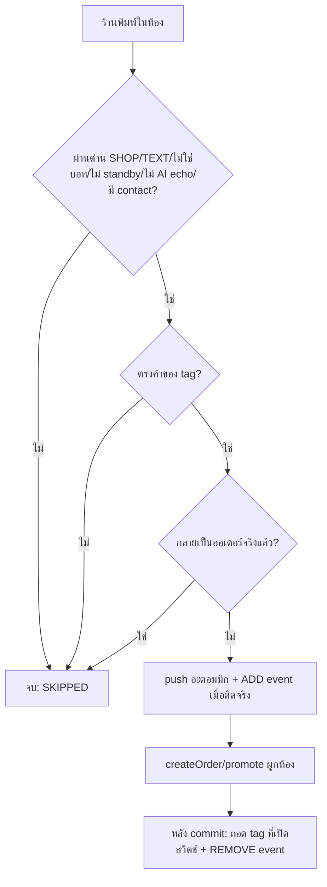

> **โมดูล:** 00083 - Auto Tag By Keyword · **ประเภท:** Test Case · **เวอร์ชัน:** 1.0 · **วันที่:** 2026-10-21 · **สถานะ:** Draft (ยังไม่เคยรัน)
> **เจ้าของเอกสาร:** QA

# Test Case: ติด tag อัตโนมัติจากคำที่ร้านพิมพ์ + เมนูจัดการ tag

---

## 1. Overview

- **ต้นทาง:** [[BRD]] FR-001..009 · BR-AT-01..30 · [[SRS]] AC-AT-01..57 · Scope S-1..S-8
- **ชนิด:** U = unit (pure) · DB = integration บน Postgres local · R = route/handler · A = สแกนซอร์ส/architecture · E = Playwright E2E · V = ตรวจสายตา (user)
- **สภาพแวดล้อม DB (HR13/14):** ไฟล์ `*.db.test.ts` ใช้รูปแบบ `describe.skipIf(!isLocal)` โดย `isLocal = /@(localhost|127\.0\.0\.1):5434\//.test(DATABASE_URL)` (แบบ `chat-desk-metrics-parity.db.test.ts`) · **ปักหมุด URL localhost:5434 ในคำสั่งรันทุกครั้ง** (`npm test` ในเครื่องนี้ชี้ Supabase prod ถ้าไม่ override) · อ่าน `docs/conventions/seed-and-env.md` ก่อนรัน
- **HR13 สร้าง/ล้างข้อมูล:** เทสสร้าง user/shop/shopChannel/externalContact/conversation/chatMessage ของตัวเองด้วย `randomUUID()` (มี **ร้านสอง** ร้านเสมอเพื่อพิสูจน์ไม่ข้ามร้าน) แล้วลบเฉพาะ id ที่สร้างใน `afterAll` เรียงลูก→แม่ (`shopTagEvent` where shopId in … → `order` ฯลฯ → `chatMessage` → `conversation` → `externalContact` → `shopChannel` → `shop`) · **ห้าม** `deleteMany()` เปล่า/TRUNCATE
- **`[blocker]`** = mutation test บังคับ: แก้โค้ดตามที่ระบุ ต้องรันให้เห็นแดงจริง แล้วคืนโค้ด (บันทึกผลใน retro) — mutation เงียบ = ชุด input อ่อน (conventions/mutation-silence-means-weak-corpus)
- **นอกขอบเขต:** ห้อง DEEP ที่มี tag · LINE ที่พิมพ์ในแอป LINE OA · หน้าดูประวัติ

---

## 2. Unit — ตัวเทียบ/กติกา (`src/lib/__tests__/shop-tag-match.test.ts`)

#### TC-001: มีคำอยู่ในข้อความ (substring)
- **Linked:** S-5 · AC-AT-35 · BR-AT-11
- **Steps:** tag คำ `สรุปออเดอร์` · body `สรุปออเดอร์นะคะ ยอด 590` / `ขอสรุป ออเดอร์` / `สรุปออเดอ`
- **Expected:** แรก match (keyword = `สรุปออเดอร์`) · สองและสาม ไม่ match

#### TC-002: ไม่สนตัวพิมพ์/ช่องว่างซ้ำ/หัวท้าย + NFC
- **Linked:** S-5 · AC-AT-35
- **Steps:** คำ `Order Now` · body `  order    NOW ` · คำไทยที่สระ/วรรณยุกต์ต่างลำดับ combining mark แต่ NFC เท่ากัน
- **Expected:** match ทั้งสอง

#### TC-003: `[blocker]` สัญลักษณ์ไม่ถูกลบ (ใช้ตัวเทียบของ 00061 ไม่ใช่ของ auto-reply)
- **Linked:** S-5 · P-4
- **Steps:** คำ `/go` · body `go` → ไม่ match · body `พิมพ์ /go เลย` → match
- **Mutation:** เปลี่ยน `shop-tag-match.ts` ให้ใช้ `normalizeMessage` ของ `auto-reply-normalize.ts` หรือ regex ตัดวรรคตอน → ต้องแดง

#### TC-004: หลาย tag ในข้อความเดียว · tag ไม่มีคำไม่เคย match
- **Linked:** S-5 · AC-AT-34
- **Expected:** คืนทุก tag ที่ตรง (เรียงตามลำดับที่ส่งเข้า) · `keywords=[]` ไม่ match แม้ body ว่าง/ยาว

#### TC-005: parity กับ `matchesTriggerPhrase`
- **Linked:** S-5 · P-4
- **Steps:** corpus 300 ข้อความสุ่ม (ไทย/อังกฤษ/สัญลักษณ์/ช่องว่างแปลก ๆ รวม U+00A0 U+200B U+3000) × ชุดคำ → `matchTagKeywords` ต่อ tag ต้องเท่ากับ `matchesTriggerPhrase(body, tag.keywords)` ทุกกรณี
- **Mutation:** เขียนเงื่อนไขเทียบของตัวเองใน `shop-tag-match.ts` (เช่น `body.toLowerCase().includes`) → corpus ต้องจับต่างได้ (ต้องมีเคส NBSP/ZWSP)

#### TC-006: `tagNameKey` / `variantsIn`
- **Linked:** AC-AT-03 · TD-001
- **Expected:** `tagNameKey(' VIP ')==='vip'` · NFC ต่างรูป key เท่ากัน · `variantsIn(['VIP','vip','x'], 'vip')` = `['VIP','vip']` · ไทยไม่ถูกแตะ

#### TC-007: `cleanKeyword` / `dedupeKeywords`
- **Linked:** S-4 · AC-AT-20
- **Expected:** `'  สรุป   ออเดอร์ '` → `'สรุป ออเดอร์'` · `['VIP','vip','  vip ']` → `['VIP']` (สะกดตัวแรก คงลำดับ) · คำที่ normalize แล้วว่าง/สั้นกว่า 2 ถูกตัดออกโดย schema (ไม่ใช่ที่นี่)

#### TC-008: นับ code point
- **Linked:** AC-AT-06
- **Expected:** ชื่อ 30 code point (รวม emoji astral) ผ่าน · 31 ตก · ตรงกับ `char_length` ของ DB (เทียบด้วยเคส DB ใน TC-017)

---

## 3. Unit — Schemas (`src/lib/__tests__/shop-tag-schemas.test.ts`)

#### TC-009: name
- **Linked:** S-1 · AC-AT-06
- **Expected:** `''`/`'   '` ตก · 1 ตัวผ่าน · 30 ผ่าน · 31 ตก · trim ก่อนนับ

#### TC-010: keywords
- **Linked:** S-4 · AC-AT-20
- **Expected:** 10 ผ่าน · 11 ตก · คำ 1 ตัวตก · 2 ผ่าน · 50 ผ่าน · 51 ตก · คำที่เป็น ZWSP ล้วน (ยาว ≥2 แต่ normalize แล้วว่าง) ตก

#### TC-011: strictObject / PATCH
- **Linked:** S-1
- **Expected:** body มี `shopId` หรือคีย์แปลก = ตก · PATCH `{}` ตก · PATCH `{removeOnOrderCreate:true}` ผ่าน · `tagId` ที่ไม่ใช่ uuid ตก

---

## 4. DB — CRUD (`src/services/__tests__/shop-tag.db.test.ts`)

#### TC-012: เพิ่ม + ชื่อซ้ำ (ไม่สนตัวพิมพ์อังกฤษ)
- **Linked:** S-1 · AC-AT-06,07
- **Steps:** create `VIP` → create `vip` ในร้านเดียวกัน → create `VIP` ในอีกร้าน
- **Expected:** ที่สอง `TAG_NAME_TAKEN` · ร้านอื่นสำเร็จ · แถว `nameKey='vip'`

#### TC-013: เพดาน 50 tag
- **Linked:** S-1 · AC-AT-08
- **Steps:** สร้าง 50 → สร้างที่ 51
- **Expected:** `TAG_LIMIT_REACHED` · count คงที่ 50 · ร้านอื่นไม่ถูกนับ

#### TC-014: เพดาน 20 tag ที่มีคำ + แก้ตัวที่มีคำอยู่แล้วต้องผ่าน
- **Linked:** S-1 · AC-AT-21
- **Steps:** 20 tag มีคำ → ตัวที่ 21 มีคำ (create) → ตัวที่ 21 สร้างแบบไม่มีคำแล้ว PATCH ใส่คำ → PATCH แก้คำของ tag ที่มีคำอยู่แล้ว
- **Expected:** สองแรก `KEYWORD_TAG_LIMIT_REACHED` · ข้อสุดท้ายผ่าน · tag ไม่มีคำสร้างได้แม้ครบ 20

#### TC-015: DB CHECK ชน (ชั้นสอง)
- **Linked:** S-1
- **Steps:** (ข้าม service) insert ตรง `name` 31 ตัว / keywords 11 ตัว ด้วย id ของเทส
- **Expected:** DB ปฏิเสธ (`ShopTag_name_len` / `ShopTag_keywords_max50`) — พิสูจน์ว่าไม่ได้พึ่ง service ชั้นเดียว

#### TC-016: `[blocker]` race สร้างพร้อมกันที่ 49 → ได้ 50 พอดี
- **Linked:** S-1 · TD-008 · AC-AT-08
- **Steps:** มี 49 · `Promise.all` create 5 ชื่อต่างกัน
- **Expected:** สำเร็จ 1 ล้ม 4 (`TAG_LIMIT_REACHED`) · count = 50
- **Mutation:** ถอด `FOR NO KEY UPDATE` ออกจาก `createShopTag` → ต้องแดง (เกิน 50)

#### TC-017: รายการ = ลงทะเบียน + ยังไม่ลงทะเบียน + variant
- **Linked:** S-3 · AC-AT-01..04
- **Steps:** ร้าน A: ห้อง 1 มี `["VIP","x"]` ห้อง 2 `["vip"]` ห้อง 3 `["ghost"]` · ลงทะเบียน `VIP` · ร้าน B มี `["VIP","other"]`
- **Expected:** A: `VIP` registered rooms=2 (นับรวม variant) · `x` `ghost` unregistered (rooms 1) · ไม่มี `other` · `registered:false` มี `id:null` · ร้าน B ไม่ปน

#### TC-018: rooms ไม่นับซ้ำเมื่อห้องเดียวมีหลาย variant
- **Linked:** AC-AT-03
- **Steps:** ห้องเดียว `["VIP","vip"]`
- **Expected:** rooms = 1 (ไม่ใช่ 2)

#### TC-019: เปลี่ยนชื่อไล่ทุกห้อง + dedupe + ร้านอื่นไม่ถูกแตะ
- **Linked:** S-3 · AC-AT-11,12,15
- **Steps:** ร้าน A tag `รอคีย์` ติด 3 ห้อง (ห้อง 3 มี `["รอคีย์ออเดอร์","รอคีย์","z"]`) · ร้าน B มีห้องที่ติด `รอคีย์` · rename → `รอคีย์ออเดอร์`
- **Expected:** ร้าน A ทุกห้องมี `รอคีย์ออเดอร์` ครั้งเดียว ไม่มี `รอคีย์` · ห้อง 3 = `["รอคีย์ออเดอร์","z"]` (ลำดับคงเดิม) · `renamedRooms=3` · ร้าน B ห้องยังเป็น `รอคีย์` ทุกตัวอักษร · `ShopTag.name/nameKey` ใหม่

#### TC-020: `[blocker]` เปลี่ยนชื่อ rollback ทั้งก้อนเมื่อล้มกลางทาง
- **Linked:** S-3 · AC-AT-14 · BR-AT-03
- **Steps:** ทำให้ขั้น update `ShopTag` ล้ม (spy `tx.shopTag.update` throw ครั้งเดียว) หลัง rewrite ห้องเสร็จ
- **Expected:** throw ออกมา · ทุกห้องยังเป็นชื่อเดิม · ShopTag ชื่อเดิม
- **Mutation:** ย้าย rewrite ห้องออกนอก `$transaction` → ต้องแดง

#### TC-021: เปลี่ยนเป็นชื่อที่ซ้ำ tag ลงทะเบียนอื่น / ชื่อที่มีแต่ในห้องเก่า / เปลี่ยนเฉพาะตัวพิมพ์
- **Linked:** AC-AT-13,16 · Q-6
- **Expected:** ชื่อ tag อื่น → `TAG_NAME_TAKEN` ห้องไม่เปลี่ยน · ชื่อที่มีแต่ในห้อง (unregistered) → รวมให้ (ห้องที่มีทั้งสองเหลือหนึ่ง) · `VIP`→`vip` ของตัวเอง ผ่านและห้องทุกตัวเป็น `vip`

#### TC-022: ลบ → หายทุกห้อง + กติกาหาย + ร้านอื่นไม่ถูกแตะ
- **Linked:** S-3 · AC-AT-17,18
- **Expected:** ห้องของร้านไม่มี tag (รวม variant) · แถว `ShopTag` ไม่มี · `removedFromRooms` = จำนวนที่ติดจริง · tag อื่นในห้องคงเดิมและลำดับเดิม · ร้านอื่นไม่เปลี่ยน · ลบแล้ว apply ไม่ใช้กติกานั้น

#### TC-023: id ของร้านอื่น / ไม่มี = `TAG_NOT_FOUND`
- **Linked:** S-1 · AC-AT-19
- **Expected:** update/delete ด้วย id ของร้าน B จากร้าน A → ไม่พบ · ข้อมูลร้าน B ไม่เปลี่ยน

#### TC-024: `getShopTags` union
- **Linked:** S-3 · AC-AT-09,57
- **Steps:** ลงทะเบียน `ใหม่` โดยไม่มีห้องไหนติด + ห้องมี `เก่า`
- **Expected:** คืนทั้งสอง เรียงไทย ไม่ซ้ำ · หลาย `shopIds` = union ทุกร้านใน scope แต่ไม่เกิน scope

#### TC-025: ค่าเริ่มต้น + บันทึกแล้วอ่านกลับตรง
- **Linked:** S-4 · AC-AT-22,23
- **Expected:** สร้างไม่ส่งสวิตช์ = `false` · PATCH `true` แล้ว list ได้ `true` · keywords ที่ส่ง `['A','a']` เก็บ `['A']`

---

## 5. DB — ตัวติด/ถอด (`shop-tag-auto.db.test.ts`) และ integration กับคำสั่งซื้อ (`shop-tag-order-removal.db.test.ts`)

ฟิกซ์เจอร์: ร้าน A + B · เพจ · ผู้ติดต่อ · ห้อง · `ChatMessage` ที่เขียนด้วย Prisma `create` เอง (ค่า `senderRole/type/autoReplyKind/viaStandby/echoAiGenerated` ตามเคส)

#### TC-026: ร้านพิมพ์ TEXT ที่มีคำ → ติด + event 1 แถว
- **Linked:** S-5, S-7 · AC-AT-24,51
- **Expected:** `APPLIED` · contact.tags มี tag · `ShopTagEvent` 1 แถว `ADD/KEYWORD` มี `chatMessageId` `matchedKeyword` `tagName` `conversationId` `externalContactId` `shopId` · ไม่มีเนื้อข้อความ (ตรวจทุกคอลัมน์ ไม่มีสตริงของ body)

#### TC-027: `[blocker]` ข้อความลูกค้าไม่ติด
- **Linked:** AC-AT-26
- **Mutation:** เปลี่ยน `senderRole !== 'SHOP'` เป็นไม่เช็ค → ต้องแดง

#### TC-028: `[blocker]` ข้อความบอท/ระบบไม่ติด (ทุกค่า `autoReplyKind`)
- **Linked:** AC-AT-27 · P-2
- **Steps:** `AUTO`, `AUTO_TEST`, `AUTO_NOTICE` (+การ์ดภายใน 00061 = `type` ไม่ใช่ TEXT)
- **Mutation:** ถอดเงื่อนไข `autoReplyKind` → ต้องแดงทั้งสามค่า

#### TC-029: `[blocker]` ไม่ใช่ TEXT ไม่ติด
- **Linked:** AC-AT-29
- **Steps:** IMAGE/STICKER/FILE/META_NOTICE ที่ body มีคำ
- **Mutation:** ถอดเงื่อนไข `type` → แดง

#### TC-030: `[blocker]` standby + AI echo ไม่ติด · echo มนุษย์ติด
- **Linked:** AC-AT-25,28,30 · P-3
- **Steps:** (ก) `viaStandby=true` (ข) `echoAiGenerated=true` (ค) echo ธรรมดา `echoAiGenerated=null/false` `echoAppId` ของ Page Inbox
- **Expected:** ก,ข ไม่ติด · ค ติด
- **Mutation:** ถอด `viaStandby` / `echoAiGenerated` ทีละตัว → ข้อที่ตรงต้องแดง

#### TC-031: ห้อง DEEP / ไม่มี contact → ไม่ error
- **Linked:** AC-AT-31
- **Expected:** `SKIPPED NO_CONTACT` · ไม่ throw · ไม่มี event

#### TC-032: ติดซ้ำไม่ได้ + ไม่เขียน event ซ้ำ
- **Linked:** AC-AT-32,37 · BR-AT-12
- **Steps:** เรียก `applyKeywordTags` กับข้อความเดิมซ้ำ 2 ครั้ง · แล้วข้อความใหม่ที่มีคำ (contact มี tag อยู่)
- **Expected:** tags มี 1 ตัว · event 1 แถวรวม (ครั้งหลังไม่เพิ่ม)

#### TC-033: `[blocker]` พร้อมกัน N=10 ไม่ซ้ำ
- **Linked:** AC-AT-37
- **Steps:** `Promise.all` 10 ครั้งกับข้อความเดียว และ 10 ข้อความต่างกันที่มีคำเดียวกัน
- **Expected:** tag 1 ตัว · event 1 แถว
- **Mutation:** เปลี่ยน `updateMany(NOT has … push)` เป็นอ่านแล้ว `update({tags:[...]})` → ต้องแดง

#### TC-034: ถอดเองแล้วเจอคำ → ติดกลับ
- **Linked:** AC-AT-33 · P-1
- **Steps:** ติด → ถอดมือ (`array_remove`) → ข้อความใหม่ที่มีคำ
- **Expected:** ติดอีก · event ADD 2 แถวรวม (คนละ chatMessageId)

#### TC-035: ติดด้วยมือพร้อมกันไม่ทำให้ tag มือหาย
- **Linked:** NFR §6.1 BRD
- **Steps:** `Promise.all` [apply, `externalContact.updateMany(push 'มือ')`]
- **Expected:** ทั้งสอง tag อยู่ (ไม่มีตัวใดหาย)

#### TC-036: variant ถือว่ามีแล้ว
- **Linked:** TD-001
- **Steps:** contact มี `vip` · กติกา `VIP` match
- **Expected:** ไม่ติด `VIP` เพิ่ม · ไม่มี event

#### TC-037: `[blocker]` ข้อความที่กลายเป็นคำสั่งซื้อจริงแล้ว → ไม่ติด
- **Linked:** AC-AT-36 · BR-AT-13
- **Steps:** (ก) มี `Order(sourceChatMessageId=msg, status=PENDING, createdVia=CHAT_AUTO_ORDER)` (ข) มีแค่ DRAFTED (ค) isDryRun
- **Expected:** ก ไม่ติด (`ORDER_ALREADY_CREATED`) · ข ติด · ค ติด
- **Mutation:** ถอดเงื่อนไข `status: { not: 'DRAFTED' }` → ก แดง; ถอด `isDryRun:false`→ ค แดง

#### TC-038: ไม่ข้ามร้าน
- **Linked:** AC-AT-40
- **Steps:** กติการ้าน B คำเดียวกับร้าน A · ข้อความในห้องร้าน A
- **Expected:** ติดเฉพาะ tag ของ A · ไม่มี event shopId=B

#### TC-039: ตัวติดล้ม ข้อความยังบันทึก/ส่งได้
- **Linked:** AC-AT-38
- **Steps:** spy `prisma.shopTag.findMany` throw → เรียกผ่าน `runAfterResponse`-แบบ wrapper / `.catch`
- **Expected:** ไม่มี unhandled rejection · ข้อความยังอยู่ · `console.error` ถูกเรียก

#### TC-040: ถอดเฉพาะ tag ที่เปิดสวิตช์ (สร้างผูกห้อง)
- **Linked:** S-6 · AC-AT-41
- **Steps:** ห้องมี `รอคีย์ออเดอร์`(สวิตช์เปิด) + `vip`(ไม่มีสวิตช์) + `ปิดสวิตช์` · `createOrder(shopId, {conversationId,…})`
- **Expected:** เหลือ `vip`,`ปิดสวิตช์` · event REMOVE/ORDER_CREATED 1 แถว `orderId` ตรง

#### TC-041: `[blocker]` ไม่ผูกห้อง (เบอร์ตรง) → ไม่ถอด
- **Linked:** AC-AT-42 · BR-AT-21
- **Steps:** `createOrder` ไม่ส่ง `conversationId` แต่ `buyerContact` ตรงกับเบอร์ของ contact
- **Expected:** tag อยู่ครบ · ไม่มี event
- **Mutation:** ให้ตัวถอดหา contact จากเบอร์/ลูกค้า → แดง

#### TC-042: `[blocker]` ร่าง 00061 ไม่ถอด · เลื่อนเป็นจริงถอด
- **Linked:** AC-AT-43 · BR-AT-22
- **Steps:** สร้างแถว DRAFTED ด้วย `prisma.order.create` (แบบ 00061) → tag อยู่ → `promoteDraftToOrder` และอีกใบ `promoteAutoOrderDraft`
- **Expected:** ก่อนเลื่อน tag อยู่ · หลังเลื่อน ถอด + event · ทั้งสองตัวห่อ
- **Mutation:** ลบการเรียกจาก `promoteDraftCore` → แดง; ลบจาก `createOrder` → TC-040 แดง

#### TC-043: `isDryRun` ไม่ถอด · ลงวันที่ย้อนหลังถอด · ยกเลิกภายหลังไม่ติดกลับ
- **Linked:** AC-AT-44..46
- **Expected:** `isDryRun:true` → ไม่ถอด · `createdAt` ย้อนหลัง (ใน window 90 วัน) → ถอด · `cancelOrder` แล้ว tag ไม่กลับ

#### TC-044: ห้องไม่มี tag นั้น = ไม่ error ไม่มี event · ร้านอื่นไม่ถูกแตะ
- **Linked:** AC-AT-47,48
- **Expected:** `SKIPPED/NO_MATCH`-ชนิดเดียวกัน, ไม่ throw · ผู้ติดต่อร้าน B ที่ติด tag ชื่อเดียวกันไม่เปลี่ยน

#### TC-045: `[blocker]` สร้างล้ม → tag ยังอยู่ · ถอดล้ม → สร้างสำเร็จ
- **Linked:** AC-AT-49 · BR FR-008
- **Steps:** (ก) `createOrder` ด้วย items ผิด/`OutOfStock` ให้ throw → ตรวจ tag (ข) spy `removeTagsOnOrderCreated` ภายใน (หรือ `prisma.shopTag.findMany`) throw → ตรวจว่าออเดอร์ถูกสร้างและ `createOrder` resolve
- **Mutation:** ย้ายการเรียกเข้าไปใน `$transaction` → (ข) ต้องแดง

---

## 6. Architecture / Static (`A`)

#### TC-046: `[blocker]` จุดเรียก = เซตเดียวกับ 00061
- **Linked:** AC-AT-39 · TD-004 · (`src/services/__tests__/shop-tag-architecture.test.ts`)
- **Steps:** สแกน `src/**/*.ts(x)` (ตัด comment, ตัด test) หาไฟล์ที่ `import {…detectAutoOrderTrigger}` + เรียก และที่ `import {…applyKeywordTags}` + เรียก
- **Expected:** เซตเท่ากัน (ยกเว้นไฟล์นิยามของแต่ละฝ่าย) = `chat.service.ts` · `chat-outbox.service.ts` · `api/channels/facebook/webhook/route.ts` · ไม่มีใครเรียก `applyKeywordTags` นอกเซต · ลบ hook ใดออก → แดง

#### TC-047: `[blocker]` ไม่ await
- **Expected:** `/await\s+applyKeywordTags/` ไม่พบในทั้งสามไฟล์ · ทุกจุดอยู่ใน `runAfterResponse(`/`after(` · webhook มี `.catch(`

#### TC-048: `[blocker]` ทุกเส้นทางที่ผูกห้องถูกไล่ครบ
- **Linked:** S-6 · AC-AT-50 · (`shop-tag-order-removal.db.test.ts` ส่วน static)
- **Steps:** ไฟล์ที่เรียก `removeTagsOnOrderCreated(` ต้องเป็น `order.service.ts` เท่านั้น และเรียก **2 ครั้ง** (createOrder, promoteDraftCore) · ทุกไฟล์ใน `CREATE_SITES` ของ `order-no-write-paths.test.ts` ที่ไม่ใช่ `order.service.ts` (`booking.service.ts`, `auction.service.ts`) ต้อง **ไม่มี** `conversationId` (ถ้าวันหนึ่งมี → เทสแดงให้มาตัดสินว่าต้องเรียกตัวถอดหรือไม่) · `updateOrder`/`cancelOrder` ไม่เรียก
- **Mutation:** เพิ่ม `conversationId:` ใน `booking.service.ts` สร้าง order → แดง

#### TC-049: `[blocker]` ตัวติด/ถอดไม่เขียนอาร์เรย์ทั้งก้อน
- **Linked:** AC-AT-37
- **Expected:** `shop-tag-auto.service.ts` ไม่มี `tags: [` / `tags: tags` / `data: { tags:` ที่เป็นการ set ทั้งอาร์เรย์ (อนุญาต `tags: { push` และ `tags: { has`) — สแกนหลังตัด comment

#### TC-050: ทุก `ShopTagError` code มี mapping
- **Linked:** TD-009
- **Expected:** ทุก `throw new ShopTagError('X')` ใน `shop-tag.service.ts` มี `X` ใน union และใน `shop-tag-route-errors.ts` ; `Record<ShopTagErrorCode,…>` คอมไพล์ผ่าน (tsc) ; ลบ code หนึ่งจาก map → tsc แดง

#### TC-051: client ไม่ import ไฟล์ server-only
- **Expected:** ไม่มีไฟล์ `'use client'` ใต้ `settings/tags/` import `@/lib/shop-tag-match` / `@/services/*` (ยกเว้น `import type`)

#### TC-052: HR gates ของหน้า
- **Expected:** `rg "from ['\"]react-toastify" "src/app/(paces)/"` = 0 · ไม่มี emoji ในไฟล์ใหม่ · ไม่มี arbitrary Tailwind ที่ไม่มี comment (HR7) · ฟอนต์ Anuphan (ไม่ใส่ `font-mono`)

---

## 7. Route / สิทธิ์ (`R`) — `src/app/api/shops/current/tags/__tests__/shop-tags-route.test.ts` + `tests/integration/role-contract.test.ts`

#### TC-053: บทบาท × route
- **Linked:** S-2 · AC-AT-05
- **Steps:** OWNER · MANAGER · CHAT · TECHNICIAN · BILLING ยิงทุก method
- **Expected:** OWNER/MANAGER ผ่าน · ที่เหลือ 403 `FORBIDDEN_ROLE` · ไม่มี session 401 · ไม่มีร้าน 404 · MATRIX ของ role-contract รวม GET `shops/current/tags`

#### TC-054: validation + ผลลัพธ์ HTTP
- **Linked:** API §4
- **Expected:** 400 `VALIDATION_ERROR` (ชื่อ 31 ตัว · คำ 1 ตัว · body มี `shopId`) · 409 ทั้งสามรหัส · 404 id ไม่ใช่ uuid/ร้านอื่น · 201/200 รูป response ตรงสัญญา · ทุกคำตอบมี `Cache-Control` มี `no-store`

#### TC-055: ร้านถูกล็อกแพ็กเกจ
- **Linked:** AC-AT-55
- **Expected:** GET ผ่าน · POST/PATCH/DELETE → 403 `SHOP_LOCKED` และไม่มีข้อมูลเปลี่ยน

#### TC-056: ทะเบียน
- **Expected:** `route-capability-inventory.test.ts` เขียว (ทุก key มีไฟล์จริง · เรียกด่านด้วย `'H3'` literal) · `seller-menu.test.ts` เขียวพร้อม slug ใหม่ · `isRegisteredPage('/settings/tags')` จริง และ `canSeePage('/settings/tags', ['CHAT'])` เท็จ, `['OWNER']`/`['MANAGER']` จริง

---

## 8. UI + E2E (`E` / `V`) — `e2e/auto-tag-00083.spec.ts` (Playwright บน `*.deepth.local:4000`)

ผ่าน `safepay-ux` Design Spec ก่อน build · หลัง build `/impeccable critique` + `clarify` (HR8)

#### TC-057: เมนูและสิทธิ์
- **Linked:** S-2 · AC-AT-05
- **Expected:** OWNER เห็นเมนูในกลุ่ม CHAT ทุก vertical (ทดสอบ ONLINE_SALES + SERVICE_QUEUE อย่างน้อย) · CHAT ไม่เห็นเมนู + เข้า URL ตรง = การ์ดไม่มีสิทธิ์ (ไม่ใช่หน้าว่าง) · icon จริง ไม่ใช่ emoji

#### TC-058: วงจรเพิ่ม/ตั้งคำ/สวิตช์/บันทึก/โหลดใหม่
- **Linked:** S-3, S-4 · AC-AT-06..10,20..23
- **Steps:** เพิ่ม `รอคีย์ออเดอร์` + คำ 2 คำ (รวมคำซ้ำที่ต่างตัวพิมพ์) + เปิดสวิตช์ → บันทึก → รีโหลด
- **Expected:** ค่าตรงเดิม · คำซ้ำถูกรวม · ข้อความภาษาไทยเมื่อชื่อซ้ำ/เกินเพดาน · มีข้อความอธิบาย "ติดเมื่อร้านพิมพ์ข้อความที่มีคำนี้" + หมายเหตุ LINE/คำสั้น · `pacesToast` ไม่มี emoji

#### TC-059: เปลี่ยนชื่อ/ลบ + กล่องยืนยันบอกจำนวนห้องตรงกับจริง
- **Linked:** S-3 · AC-AT-11,17
- **Steps:** seed 4 ห้องติด tag · เปิด Swal ลบ/เปลี่ยนชื่อ
- **Expected:** ข้อความมี "4 ห้อง" + "ย้อนกลับไม่ได้" + คำเตือนตัวกรองที่บันทึกไว้อาจต้องเลือกใหม่ (Q-7) · ยืนยันแล้วรายการอัปเดต · ตัวช่วยพิมพ์ tag ในแผงลูกค้าของห้องอื่นเห็นชื่อใหม่/ไม่เห็นชื่อที่ลบ

#### TC-060: tag ที่ยังไม่ลงทะเบียน
- **Linked:** AC-AT-02,10
- **Expected:** แถวมีป้าย "ยังไม่ได้ตั้งค่า" · ตั้งค่า/ลบทำได้ · ครบเพดาน 50 แล้วลบ ghost ได้ข้อความทางออกชัด

#### TC-061: ตัวกรองกล่องแชท + ตัวช่วยพิมพ์เห็น tag ที่เพิ่งลงทะเบียนทั้งที่ไม่มีห้อง
- **Linked:** AC-AT-09,57

#### TC-062: วงจรจริง (E2E ระดับ DB+UI)
- **Linked:** Scenario 1 BRD
- **Steps:** seed กติกา `รอคีย์ออเดอร์` (คำ `สรุปออเดอร์` · สวิตช์เปิด) + ห้อง Messenger ใน DB → เขียน `ChatMessage` ฝั่งร้านด้วย Prisma แล้วเรียก `applyKeywordTags` (สคริปต์ของเทส ไม่ผ่าน Meta) → เปิด inbox กรอง tag เห็นห้อง → สร้างคำสั่งซื้อจากแผงในแชทของห้อง → tag หาย
- **Expected:** ตรงตาม Scenario 1 ใน BRD · ประวัติ ADD แล้ว REMOVE ตามลำดับ

#### TC-063: จอ 3 ขนาด (user ตรวจเอง)
- **Linked:** HR8 · `feedback_user_does_visual_qa`
- **Expected:** ภาพ 390 / 768 / 1280 ของหน้า (มีข้อมูล · ว่าง · ครบเพดาน) + คอนทราสต์ ≥ 4.5:1 light/dark + แตะเป้า ≥ 44px บนมือถือ

#### TC-064: hook ของ Meta echo ผ่าน ingest จริง
- **Linked:** AC-AT-25
- **Steps:** ใช้รูป payload แบบ `meta-echo-ingest.test.ts` (`ingestInboundMessage` echo ฝั่งเพจ ไม่มี `ai_generated`) → ได้ `headMessageId` → `applyKeywordTags(headMessageId)`
- **Expected:** ติด · และ echo `ai_generated:true` ไม่ติด · IG (`provider='INSTAGRAM'`) เช่นเดียวกัน

---

## 9. Traceability Matrix

| Requirement | Test Case |
|---|---|
| FR-001 (S-2) | TC-017, 053, 056, 057, 060 |
| FR-002 | TC-012, 013, 024, 058, 061 |
| FR-003 | TC-019, 020, 021, 059 |
| FR-004 | TC-022, 023, 059 |
| FR-005 / FR-007 | TC-007, 010, 014, 025, 058 |
| FR-006 | TC-001..005, 026..039, 046, 047, 062, 064 |
| FR-008 | TC-040..045, 048, 062 |
| FR-009 | TC-026, 032, 040, 044 |
| BR-AT-11 / P-4 | TC-003, 005 |
| BR-AT-21 | TC-041 |
| S-1 | TC-009..016, 023 |
| S-2 | TC-053..057 |
| S-3 | TC-017..024, 059..061 |
| S-4 | TC-007, 010, 014, 025, 058 |
| S-5 | TC-001..005, 026..039, 046, 047, 049, 064 |
| S-6 | TC-040..045, 048 |
| S-7 | TC-026, 032, 040, 044 |
| S-8 | ตรวจ `diff` ชื่อไฟล์กับ template (HR11) + SRS.md sync |
| Mutation `[blocker]` ตาม baseline | TC-003, 016, 020, 027..030, 033, 037, 041, 042, 045..049 |

## 10. Flow

## 11. ผลล่าสุด
| Run | วันที่ | ผล | ผู้ทดสอบ |
|-----|--------|-----|----------|
| - | - | ยังไม่เคยรัน | - |

## 12. สรุป
64 เคสครอบคลุม S-1..S-8 · FR-001..009 · `[blocker]` mutation 21 ข้อ · DB test ทุกไฟล์ scope ด้วย id ที่เทสสร้างและมีสองร้านเสมอ
**Open Questions:** TC-062 ใช้สคริปต์เรียก `applyKeywordTags` แทนการยิง Meta จริง — การส่งข้อความจริงเข้า Messenger/LINE ยังไม่เคยทดสอบ (เป็น carry เหมือน 00080)
