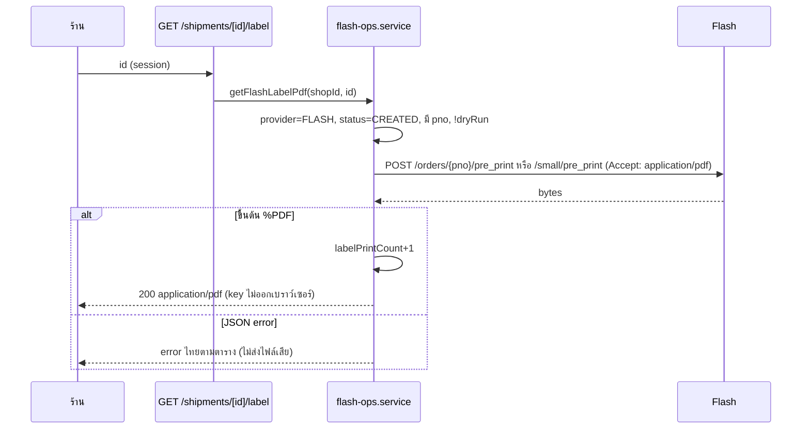

> **โมดูล:** 00084 Flash Express Direct Integration
> **ประเภทเอกสาร:** API Contract
> **เวอร์ชัน:** 0.1
> **วันที่จัดทำ:** 2026-10-22
> **สถานะ:** Draft
> **เจ้าของเอกสาร:** SA

# API Contract: Flash Express Direct Integration

---

## 1. Overview

API ของฟีเจอร์เชื่อม Flash ตรง: (ก) ฝั่งร้าน `/api/seller/flash/**` (Next.js 16 route handler บางๆ: guard → Valibot → service → JSON) (ข) webhook ขาเข้าจาก Flash (ค) cron สำรอง (ง) ส่วนที่แก้ของ route 00022/อื่นที่เกี่ยว · ผู้บริโภค: UI Paces ฝั่งร้าน · Flash Open API (ภายนอก) · Vercel Cron

- **เอกสารออกแบบต้นทาง:** [[SDS]] (§3 components, §8.3 error mapping)
- **Base URL:** ฝั่งร้าน `https://seller.<domain>` ผ่าน `/api/seller/flash/*` · webhook `https://<FLASH_WEBHOOK_BASE_URL|NEXTAUTH_URL>/api/webhooks/flash/{secret}`
- **Content-Type:** `application/json` (ใบปะหน้า `application/pdf`; webhook ขาเข้ารับ JSON หรือ `application/x-www-form-urlencoded`)
- **Convention:** ตอบสำเร็จเป็น JSON ตรง ๆ (view); ข้อผิดพลาดเป็น `{"error":{"code","message","missing?","retryable?"}}` เหมือน `ishipError`/`ishipJson` · ทุก response ฝั่งร้านมี `cache-control: private, no-store` · ทุก query มี `?shopId=` ได้ (ไม่ส่ง = ร้าน active) ตาม `readIShipShopIdFromQuery`

---

## 2. Authentication

| รายการ | ค่า |
|--------|-----|
| วิธี | NextAuth session (cookie แยกตาม subdomain) → `requireGeneralShop({ cap, shopId })` |
| ด่านบังคับ | สมาชิกร้านนั้นจริง (re-verify) · `Shop.vertical='ONLINE_SALES'` (ไม่ใช่ ⇒ 403 `NOT_ELIGIBLE`) · capability ตามตาราง §3 |
| OWNER-only | route ที่ทำเครื่องหมาย "+OWNER" ต้อง `effRoles` มี `OWNER` ไม่ใช่ ⇒ `403 FORBIDDEN_ROLE` (ผ่าน `forbiddenRoleResponse()`) |
| ไม่ผ่าน | 401 `{"error":{"code":"UNAUTHORIZED"}}` · 403 `FORBIDDEN` / `FORBIDDEN_ROLE` / `NOT_ELIGIBLE` |
| Webhook | `sha256(secret)` เทียบ `webhookSecretHash` + `mchId` + `sign` (SHA256 ของ `mchId`,`nonceStr`) — ไม่ใช้ session · prefix class WEBHOOK (ยกเว้น CSRF Origin-check ใน `proxy.ts` อยู่แล้ว) |
| Cron | `Authorization: Bearer ${CRON_SECRET}` เต็มสตริง · env ว่าง ⇒ 401 |

---

## 3. Endpoint List และ route-capabilities

| Method | Path | Cap (registry) | OWNER | คำอธิบาย |
|--------|------|----------------|-------|----------|
| GET | `/api/seller/flash/connection` | `S1` | — | สถานะการเชื่อมต่อ (+`available`) |
| POST | `/api/seller/flash/connection` | `S2` | ✓ | เชื่อม / เปลี่ยน key |
| DELETE | `/api/seller/flash/connection` | `S2` | ✓ | ถอนการเชื่อมต่อ |
| POST | `/api/seller/flash/connection/verify` | `S2` | — | ทดสอบ key ปัจจุบัน |
| GET | `/api/seller/flash/settings` | `S1` | — | ค่าตั้งต้น (mchId เต็มเฉพาะ OWNER) |
| PUT | `/api/seller/flash/settings` | `S2` | ✓ | บันทึกค่าตั้งต้น |
| POST | `/api/seller/flash/webhook/sync` | `S2` | ✓ | อ่าน/ตั้ง/ลองใหม่/ทับ webhook |
| GET | `/api/seller/flash/order-context` | `S1` | — | ข้อมูลแผงสร้างพัสดุ Flash ของออเดอร์ |
| POST | `/api/seller/flash/price` | `S1` | — | ราคาประมาณ |
| POST | `/api/seller/flash/shipments` | `S1` | — | สร้างพัสดุ |
| GET | `/api/seller/flash/shipments/preview` | `S1` | — | ตรวจ pno ก่อนผูก |
| POST | `/api/seller/flash/shipments/link` | `S1` | — | ผูก pno กับออเดอร์ |
| POST | `/api/seller/flash/shipments/[id]/retry` | `S1` | — | ลองใหม่ (FAILED เท่านั้น) |
| POST | `/api/seller/flash/shipments/[id]/cancel` | `S1` | — | ยกเลิก |
| POST | `/api/seller/flash/shipments/[id]/resolve` | `S1` | — | ออกจาก NEEDS_REVIEW |
| POST | `/api/seller/flash/shipments/[id]/unlink` | `S1` | — | เลิกผูก (LINKED) |
| GET | `/api/seller/flash/shipments/[id]/label` | `S1` | — | ใบปะหน้า PDF |
| GET | `/api/seller/flash/shipments/[id]/traces` | `S1` | — | ไทม์ไลน์ (ดึงสดถ้ายังไม่จบ) |
| POST | `/api/seller/flash/pickups` | `S1` | — | เรียกรถ |
| POST | `/api/seller/flash/pickups/[id]/cancel` | `S1` | — | ยกเลิกคำขอรถ |
| POST | `/api/webhooks/flash/[secret]` | (class WEBHOOK) | — | รับ webhook |
| GET | `/api/cron/flash-status-sync` | (class CRON) | — | poll สำรอง |
| **เปลี่ยน** GET | `/api/orders/[token]/shipment-evidence` | `S1` (เดิม) | — | เพิ่มแถว `flash_pod` |
| **เปลี่ยน** POST | `/api/seller/iship/labels/bulk` | `S1` (เดิม) | — | ใบ Flash เข้า `x-skipped-detail` |
| **เปลี่ยน** GET | `/api/chat/shop-context` | (เดิม) | — | เพิ่มบล็อก `flash` |

`route-capabilities.ts` entries (เพิ่มคู่กับไฟล์ route; key ต้องมีไฟล์จริง):

```ts
'src/app/api/seller/flash/connection/route.ts': { GET: 'S1', POST: 'S2', DELETE: 'S2', status: 'DECLARED' },
'src/app/api/seller/flash/connection/verify/route.ts': { POST: 'S2', status: 'DECLARED' },
'src/app/api/seller/flash/settings/route.ts': { GET: 'S1', PUT: 'S2', status: 'DECLARED' },
'src/app/api/seller/flash/webhook/sync/route.ts': { POST: 'S2', status: 'DECLARED' },
'src/app/api/seller/flash/order-context/route.ts': { GET: 'S1', status: 'DECLARED' },
'src/app/api/seller/flash/price/route.ts': { POST: 'S1', status: 'DECLARED' },
'src/app/api/seller/flash/shipments/route.ts': { POST: 'S1', status: 'DECLARED' },
'src/app/api/seller/flash/shipments/preview/route.ts': { GET: 'S1', status: 'DECLARED' },
'src/app/api/seller/flash/shipments/link/route.ts': { POST: 'S1', status: 'DECLARED' },
'src/app/api/seller/flash/shipments/[id]/retry/route.ts': { POST: 'S1', status: 'DECLARED' },
'src/app/api/seller/flash/shipments/[id]/cancel/route.ts': { POST: 'S1', status: 'DECLARED' },
'src/app/api/seller/flash/shipments/[id]/resolve/route.ts': { POST: 'S1', status: 'DECLARED' },
'src/app/api/seller/flash/shipments/[id]/unlink/route.ts': { POST: 'S1', status: 'DECLARED' },
'src/app/api/seller/flash/shipments/[id]/label/route.ts': { GET: 'S1', status: 'DECLARED' },
'src/app/api/seller/flash/shipments/[id]/traces/route.ts': { GET: 'S1', status: 'DECLARED' },
'src/app/api/seller/flash/pickups/route.ts': { POST: 'S1', status: 'DECLARED' },
'src/app/api/seller/flash/pickups/[id]/cancel/route.ts': { POST: 'S1', status: 'DECLARED' },
```

Webhook และ cron อยู่ใน `PREFIX_CLASSES` (`src/app/api/webhooks/`, `src/app/api/cron/`) จึงไม่ต้องเพิ่มรายการ · route ที่เป็น OWNER-only เรียก `requireFlashOwner(guard)` หลัง `requireGeneralShop` (เทสสแกนเนอร์ยังเห็น literal `cap: 'S2'`)

---

## 4. Endpoint Detail

### 4.0 Shared types

```ts
type FlashConnectionView = {
  available: boolean                       // isFlashDirectEnabled()
  connected: boolean
  status: "ACTIVE" | "TOKEN_INVALID" | "DISCONNECTED" | null
  merchantIdMasked: string | null          // "AB••34"
  merchantId: string | null                // เต็มเฉพาะ OWNER
  keyLast4: string | null
  lastVerifiedAt: string | null
  lastVerifyError: string | null           // ข้อความไทยของเรา
  senderComplete: boolean
  settingsComplete: boolean
  createMode: "AUTO" | "ASK" | "OFF"
  labelSize: "BIG" | "SMALL"
  webhook: { status: "NOT_SET" | "REGISTERED" | "FAILED" | "EXTERNAL"; registeredAt: string | null }
  lastPickup: {                            // ShipmentPickup FLASH ล่าสุดที่ไม่ CANCELLED/CLOSED · ไม่มี/ไม่เชื่อม = null
    id: string; status: string; ticketPickupId: string | null; currentTicketPickupId: string | null
    staffName: string | null; staffPhone: string | null; timeoutAtText: string | null
    ticketMessage: string | null; isDryRun: boolean; createdAt: string   // ISO
  } | null
}
// ไม่มี accessTokenEnc / envelope / key / webhookSecret / webhookSecretHash ในชนิดใด ๆ

type WebhookKind = "status" | "routes" | "weight" | "price" | "courier"
type WebhookReport = {
  status: FlashConnectionView["webhook"]["status"]
  kinds: { kind: WebhookKind; state: "EMPTY" | "OURS" | "OTHER_DEEP" | "EXTERNAL" | "UNKNOWN"; action: "SET" | "KEPT" | "SKIPPED" | "FAILED"; host?: string }[]
}

type ShipmentViewJson = /* ของ 00022 */ {
  provider: "ISHIP" | "FLASH"              // ใหม่ (เพิ่มใน lib/iship/context.ts)
  status: "PENDING" | "CREATED" | "FAILED" | "CANCELLED" | "NEEDS_REVIEW"
  // ... ฟิลด์เดิมทั้งหมด (trackingNo, carrierStatus, labelPrintCount, lastErrorCode, lastErrorMessage(ไทย), weight..., codAmount, paymentNotice?)
}
```

### 4.1 `GET /api/seller/flash/connection`
Cap `S1` · คืน `FlashConnectionView` (200) · `available:false` ⇒ UI ซ่อนปุ่ม/การ์ด (ไม่ใช่ error) · Error: 401/403

### 4.2 `POST /api/seller/flash/connection` (S2 + OWNER)

**Valibot (`src/lib/validations.ts`):**
```ts
export const FlashConnectSchema = v.object({
  mchId: v.pipe(v.string(), v.trim(), v.regex(/^[A-Za-z0-9_-]{2,32}$/, "รหัสร้านค้า (mchId) ไม่ถูกต้อง")),
  secretKey: v.pipe(
    v.string(), v.trim(),
    v.minLength(16, "Secret Key สั้นเกินไป กรุณาตรวจว่าคัดลอกมาครบ"),
    v.maxLength(128, "Secret Key ยาวเกินกว่าที่ระบบรองรับ"),
    v.regex(/^\S+$/, "Secret Key ต้องไม่มีช่องว่าง กรุณาคัดลอกใหม่"),
  ),
});
```
ลำดับ: gate → พิสูจน์ `warehouses` → ตรวจ mchId ซ้ำ → upsert → ลงทะเบียน webhook (best-effort)

**Response 201 (เชื่อมใหม่) / 200 (เปลี่ยน key ภายใต้ mchId เดิม):** `{ connection: FlashConnectionView, webhook: WebhookReport }`

**Errors:** 400 `INVALID_INPUT` · 403 `NOT_ELIGIBLE`/`FORBIDDEN_ROLE` · 404 `FEATURE_DISABLED` · 409 `MERCHANT_IN_USE` ("mchId นี้ถูกใช้งานอยู่กับร้านอื่น" — ไม่บอกร้าน) · 409 `MERCHANT_CHANGE_NOT_ALLOWED` · 422 `MERCHANT_NOT_FOUND` (1001) · 422 `SIGN_INVALID` (1002) · 429 `RATE_LIMITED` (key ผิด 1001/1002 ครบ 5 ครั้ง/15 นาที ต่อ user+ร้าน — ไม่ยิง Flash · `src/lib/flash/verify-rl.ts`) · 502/504 `UPSTREAM_ERROR`/`UPSTREAM_TIMEOUT` (**ไม่บันทึก**)

```json
// Request
{ "mchId": "AB1234", "secretKey": "<64 ตัว>" }
// Response 201
{ "connection": { "available": true, "connected": true, "status": "ACTIVE", "merchantIdMasked": "AB••34", "merchantId": "AB1234", "keyLast4": "a9f3", "createMode": "OFF", "labelSize": "BIG", "senderComplete": false, "settingsComplete": false, "lastVerifiedAt": "2026-10-22T09:00:00.000Z", "lastVerifyError": null, "webhook": { "status": "REGISTERED", "registeredAt": "2026-10-22T09:00:01.000Z" } },
  "webhook": { "status": "REGISTERED", "kinds": [ { "kind": "status", "state": "EMPTY", "action": "SET" } ] } }
```

### 4.3 `DELETE /api/seller/flash/connection` (S2 + OWNER)
ปิด webhook ที่ชี้มา Deep (best-effort) → ล้าง key → `DISCONNECTED` · 200 `{ "ok": true }` · ประวัติพัสดุคงอยู่ · Errors: 401/403/409 `NOT_CONNECTED`

### 4.4 `POST /api/seller/flash/connection/verify` (S2)
ไม่มี body · เรียก `warehouses` · 200 `FlashConnectionView` (`1001/1002` ⇒ status `TOKEN_INVALID` ในคำตอบ **ไม่ใช่ error**; timeout/อื่น ⇒ status เดิม + 502/504) · 409 `NOT_CONNECTED` · 429 `RATE_LIMITED` (โควตาเดียวกับ `POST /connection`; verify ที่ได้ `TOKEN_INVALID` นับเป็นความล้มเหลว 1 ครั้ง)

### 4.5 `GET|PUT /api/seller/flash/settings`
GET (S1) ⇒ `{ connection: FlashConnectionView, settings: FlashSettings }` · PUT (S2+OWNER) body `FlashSettingsSchema` ⇒ 200 `{ connection, settings }`

```ts
export const FlashSettingsSchema = v.object({
  senderName: v.nullish(shortText(120)),
  senderPhone: v.nullish(v.pipe(v.string(), v.regex(MOBILE_PHONE_RE, "เบอร์โทรไม่ถูกต้อง"))),
  senderAddress: v.nullish(shortText(255)),
  senderSubdistrict: v.nullish(shortText(100)),   // ตำบล -> srcDistrictName
  senderDistrict: v.nullish(shortText(100)),      // อำเภอ -> srcCityName
  senderProvince: v.nullish(shortText(100)),
  senderPostcode: v.nullish(thaiPostcode),
  defaultWeight: v.nullish(v.pipe(v.number(), v.minValue(0.01), v.maxValue(100))),
  defaultWidth: v.nullish(parcelDimCm),
  defaultLength: v.nullish(parcelDimCm),
  defaultHeight: v.nullish(parcelDimCm),
  defaultCategoryId: v.nullish(v.picklist([0,1,2,3,4,5,6,7,8,9,10,11,99])),
  optOnTime: v.optional(v.boolean()),
  optBoxShield: v.optional(v.boolean()),
  optIsInsured: v.optional(v.boolean()),
  optProductValue: v.nullish(v.pipe(v.number(), v.minValue(1))),
  defaultRemark: v.nullish(shortText(200)),
  createMode: v.optional(v.picklist(["AUTO", "ASK", "OFF"])),
  labelSize: v.optional(v.picklist(["BIG", "SMALL"])),
});
```
ไม่มี `defaultCodEnabled`, `optServiceType`, `defaultCourierCode` · Errors: 400 · 403 · 409 `NOT_CONNECTED`

### 4.6 `POST /api/seller/flash/webhook/sync` (S2 + OWNER)
```ts
export const FlashWebhookSyncSchema = v.object({
  overrideKinds: v.optional(v.array(v.picklist(["status","routes","weight","price","courier"])), []),
});
```
เรียกครั้งแรกไม่ส่ง `overrideKinds`: อ่านแล้วตั้งชนิดว่าง + ชนิดที่เป็น URL ของ Deep เอง (`OTHER_DEEP`) อัตโนมัติ · ชนิดที่เป็นของคนอื่นได้ `state:"EXTERNAL", action:"SKIPPED", host:"hooks.example.com"` (เฉพาะ host) · เจ้าของยืนยันแล้วเรียกซ้ำพร้อม `overrideKinds:["status"]` ⇒ ทับเฉพาะชนิดนั้น (`UNKNOWN` ถูกทับไม่ได้แม้ส่งมา) · 200 `{ connection, webhook: WebhookReport }` · ล้มทั้งก้อนเพราะ Flash ⇒ 200 พร้อม `webhook.status:"FAILED"` (ไม่ใช่ error; ปุ่มลองใหม่ = เรียกซ้ำ) · Errors: 403 · 409 `NOT_CONNECTED` · 400

### 4.7 `GET /api/seller/flash/order-context?orderId|orderToken` (S1)
คืน `FlashPanelJson`:
```ts
type FlashPanelJson =
  | (ShipmentContextJson & {                        // ของ 00022 (sender, receiver, items, codSuggested, defaults(courierCode=null), shipment)
      flashState: "READY"; provider: "FLASH"; labelSize: "BIG" | "SMALL"
      createMode: "AUTO" | "ASK" | "OFF"
      activeElsewhere: { provider: "ISHIP"; trackingNo: string | null; courierName: string | null } | null
      canShip: boolean
    })
  | { flashState: "UNAVAILABLE" | "NOT_CONNECTED" | "DISCONNECTED" | "TOKEN_INVALID"; orderId: string;
      shipment: ShipmentViewJson | null; activeElsewhere: ... | null }
```
`shipment` = ใบ **LATEST** ของออเดอร์ (ทุกผู้ให้บริการ) · 404 `NOT_ELIGIBLE` เมื่อออเดอร์ไม่ต้องจัดส่ง/ไม่พบ

### 4.8 `POST /api/seller/flash/price` (S1)
```ts
export const FlashPriceQuoteSchema = v.object({
  receiver: v.object({ district: shortText(120), province: shortText(120), postcode: thaiPostcode,
                       subdistrict: v.nullish(shortText(120)) }),
  weight: v.pipe(v.number(), v.minValue(0.01), v.maxValue(100)),
  width: v.optional(parcelDimCm)   // 1–300 ทศนิยม ≤2 (แก้ 2026-10-23) · payload ปัดขึ้นเป็นจำนวนเต็ม,
  length: v.optional(...), height: v.optional(...),
});
```
200 `{ totalBaht: number, pricingTable: "CONTRACT" | "STANDARD", estimate: true }` · ล้มทั้งสองตาราง ⇒ 422/502 พร้อมข้อความไทย (UI แสดงชื่อ+สาเหตุ ไม่ล้มแถว iShip) · `FEATURE_DISABLED` 404 · ที่อยู่ผู้ส่งอ่านจากการตั้งค่าเสมอ (ไม่รับจาก client) · 422 `INCOMPLETE_DATA` เมื่อผู้ส่งไม่ครบ

### 4.9 `POST /api/seller/flash/shipments` (S1)
```ts
export const FlashCreateShipmentSchema = v.object({
  orderId: v.optional(v.pipe(v.string(), v.uuid())),
  orderToken: v.optional(v.pipe(v.string(), v.minLength(4), v.maxLength(64))),
  receiver: v.optional(IShipReceiverPatchSchema),     // ใช้ของเดิม
  override: v.optional(v.object({
    weight: v.optional(v.pipe(v.number(), v.minValue(0.01), v.maxValue(100))),
    width/length/height: v.optional(parcelDimCm),
    categoryId: v.optional(v.picklist([0,1,2,3,4,5,6,7,8,9,10,11,99])),
    codAmount: v.optional(v.pipe(v.number(), v.minValue(0))),
    remark: v.nullish(shortText(200)),
    options: v.optional(v.object({ onTime, boxShield, isInsured: v.optional(v.boolean()),
                                   productValue: v.nullish(v.pipe(v.number(), v.minValue(1))) })),
  })),
});
```
ต้องมี `orderId` หรือ `orderToken` (ไม่งั้น 400) · **201** `ShipmentViewJson` ทุกผลลัพธ์ที่แถวถูกสร้าง (รวม `FAILED`/`NEEDS_REVIEW`; ความล้มเหลวอยู่ใน payload) · Errors: 404 `FEATURE_DISABLED`/`NOT_FOUND` · 409 `NOT_CONNECTED`/`SHIPMENT_EXISTS` (มีใบ active ของผู้ให้บริการใดก็ได้)/`NEEDS_REVIEW` · 422 `INCOMPLETE_DATA` (`missing[]` เป็นช่อง ๆ) · 403 `NOT_ELIGIBLE`

```json
// Response 201 (1003)
{ "id":"…","provider":"FLASH","status":"NEEDS_REVIEW","trackingNo":null,"lastErrorCode":"DUPLICATE_ORDER",
  "lastErrorMessage":"อาจมีพัสดุถูกสร้างไว้แล้วที่ Flash — ตรวจที่ Flash Printer แล้วใส่เลขพัสดุเพื่อผูก หรือยืนยันว่าไม่มีใบเดิมเพื่อเปิดใหม่" }
```

### 4.10 `GET /api/seller/flash/shipments/preview?pno=` (S1)
200 `{ pno, state: number|null, stateText, carrierStatus, carrierStatusText, routes:[{at,message}] (≤3) }` · 422 `NOT_MERCHANT_PARCEL` (1019) ข้อความ "เลขนี้ไม่ใช่ของบัญชี Flash ของร้านนี้" · 404 `PARCEL_NOT_FOUND` · pno format `^[A-Za-z0-9]{6,32}$` (ไม่ผ่าน ⇒ 400) · ไม่มี state ยัง (route ว่าง) ⇒ `state:null, carrierStatus:"order_success"`

### 4.11 `POST /api/seller/flash/shipments/link` (S1)
body `{ orderId?|orderToken?, pno }` · ด่าน: ออเดอร์ SHIPPED-mode · ไม่มีใบ active · `trackingNo` ซ้ำทั้งตาราง ⇒ 409 `PNO_TAKEN` · ตรวจ routes 1019 ⇒ 422 · สำเร็จ **201** `ShipmentViewJson{source:"LINKED"}` (`estimatedPrice` ว่าง)

### 4.12 `POST /api/seller/flash/shipments/[id]/retry` (S1)
ไม่มี body · เฉพาะ `FAILED`+FLASH · ผลเป็น 200 `ShipmentViewJson` (ล้มอีกก็ 200 พร้อม status) · `NEEDS_REVIEW` ⇒ 409 `NEEDS_REVIEW` · อื่น ⇒ 409 `INVALID_STATE` · id ของ ISHIP ⇒ 404

### 4.13 `POST /api/seller/flash/shipments/[id]/cancel` (S1)
200 `ShipmentViewJson{status:"CANCELLED"}` · `1015` ⇒ **409 `NOT_CANCELLABLE`** ข้อความ "ขนส่งรับของไปแล้ว…" สถานะคงเดิม · `LINKED` ⇒ 409 `INVALID_STATE` (ใช้ unlink) · `NEEDS_REVIEW` ⇒ 409 `NEEDS_REVIEW`

### 4.14 `POST /api/seller/flash/shipments/[id]/resolve` (S1)
```ts
export const FlashResolveSchema = v.variant("action", [
  v.object({ action: v.literal("LINK_PNO"), pno: v.pipe(v.string(), v.regex(/^[A-Za-z0-9]{6,32}$/)) }),
  v.object({ action: v.literal("REOPEN"), confirmNoExistingParcel: v.literal(true),
             override: v.optional(FlashCreateOverrideSchema) }),
]);
```
`LINK_PNO` ⇒ 200 `ShipmentViewJson{status:"CREATED"}` · `REOPEN` ⇒ 201 `ShipmentViewJson` ของ**ใบใหม่** (ใบเดิม CANCELLED พร้อมผู้ยืนยัน) · ใบที่ไม่ใช่ `NEEDS_REVIEW` ⇒ 409 `INVALID_STATE` · `confirmNoExistingParcel` ไม่ใช่ `true` ⇒ 400

### 4.15 `POST /api/seller/flash/shipments/[id]/unlink` (S1)
`source='LINKED'` เท่านั้น · ลบแถว · 200 `{ "ok": true }` (ไม่ยกเลิกพัสดุจริง) · อื่น ⇒ 409 `INVALID_STATE`

### 4.16 `GET /api/seller/flash/shipments/[id]/label` (S1)
200 `application/pdf` inline (`content-disposition: inline; filename="label-{id}.pdf"`, `NO_STORE`) · ขนาดตาม `labelSize` ของร้าน · เพิ่ม `labelPrintCount` · ไม่ใช่ PDF จริงจะไม่ส่งไฟล์ · Errors: 404 · 409 `INVALID_STATE` (CANCELLED/FAILED/NEEDS_REVIEW/dry-run/ไม่มี pno) · 409 `SIGN_INVALID`/`MERCHANT_NOT_FOUND` (key ใช้ไม่ได้ + สถานะบัญชีถูก mark) · 502/504

### 4.17 `GET /api/seller/flash/shipments/[id]/traces` (S1)
200 `{ events:[{status,statusText,statusDesc,location,occurredAt,source}], carrier:{status,carrierStatus,carrierStatusText,carrierStatusAt} }` · จบแล้วและมีเหตุการณ์ครบ ⇒ อ่านจาก DB อย่างเดียว · ดึงล้ม (ไม่ใช่ key ผิด) และมีของเก็บไว้ ⇒ คืนของเก็บไว้ · `events` ไม่รวม `source:"WEBHOOK_RAW"`

### 4.18 `POST /api/seller/flash/pickups` และ `/pickups/[id]/cancel` (S1)
```ts
export const FlashPickupSchema = v.object({
  parcelCount: v.pipe(v.number(), v.integer(), v.minValue(1), v.maxValue(100)),
  remark: v.nullish(shortText(200)),
});
```
POST ⇒ 201 `{ id, status, ticketPickupId, staffName, staffPhone, timeoutAtText, ticketMessage, isDryRun }` (ล้ม ⇒ แถว `FAILED` บันทึกแล้ว + error 4xx/5xx) · `1010` ⇒ 409 `PICKUP_PENDING` · ผู้ส่งไม่ครบ ⇒ 422 `INCOMPLETE_DATA` · cancel ⇒ 200 แถวที่อัปเดต (ใช้ `currentTicketPickupId`; 1011 ลองซ้ำครั้งเดียว) · `PICKUP_NOT_CANCELLABLE` 409

### 4.19 `POST /api/webhooks/flash/[secret]`

| กรณี | HTTP | Body (ตรงตัว) | เขียนข้อมูล |
|------|------|---------------|--------------|
| secret ไม่รู้จัก/บัญชี DISCONNECTED | 404 | (ว่าง) | ไม่ |
| body อ่านไม่ได้ทั้งก้อน/เกิน 256 KB | 200 | `{"errorCode":"1","state":"success"}` | ไม่ |
| `mchId` ไม่ตรงร้าน หรือ `sign` ผิด | 401 | `{"errorCode":"0","state":"unauthorized"}` | ไม่ |
| ร้านไม่ใช่ ONLINE_SALES | 200 | success | ไม่ |
| `pno` ไม่ใช่พัสดุของร้านใน Deep | 200 | success | ไม่ (นับใน log) |
| ประมวลผลสำเร็จ (รวมซ้ำ) | 200 | **`{"errorCode":"1","state":"success"}`** | ใช่ (idempotent) |
| DB/verify timeout/ข้อผิดพลาดชั่วคราวของเรา | 503 | `{"errorCode":"0","state":"retry"}` | ไม่ครบ — Flash ยิงซ้ำ |
| key ใช้ไม่ได้ระหว่างยืนยัน (1001/1002) | 200 | success | mark `TOKEN_INVALID` |

Header ตอบ: `content-type: application/json`, `cache-control: no-store` · รับ method อื่น ⇒ 405 อัตโนมัติ

**Payload (อนุมานจาก R§4.2 — ยืนยันใน P0-9):**
```json
{ "mchId": "AB1234", "nonceStr": "…", "sign": "…UPPERCASE64…",
  "data": { "pno": "TH…", "outTradeNo": "F…A1", "state": "5", "stateText": "Delivered", "stateDate": "1612762153",
            "returnedPno": "", "markerCategory": "", "…": "…" } }
```
ชนิด: `status`(0) `weight`(1) `price`(2) `courier`(3) `routes`(4) · `?k=` เป็นแค่คำใบ้ — ตัดสินจากรูปข้อมูลเป็นหลัก

### 4.20 `GET /api/cron/flash-status-sync`
200 `{ shops, shopsChanged, rowsChanged, failed }` (log `[flash-cron]`) · 401 · 500 `{error:"internal_error"}` · ตารางเวลา `*/5 * * * *` ใน `vercel.json`

### 4.21 ส่วนที่เปลี่ยนของ endpoint เดิม
- `POST /api/seller/iship/labels/bulk`: ใบ FLASH ในคำขอ ⇒ ไม่ถูกส่งให้ iShip; `x-skipped-detail` มี `{shipmentId, reason:"ใบปะหน้า Flash พิมพ์ได้ทีละใบ"}`; เลือกมีแต่ Flash ⇒ 409 `INVALID_STATE` ข้อความเดียวกัน
- `GET /api/orders/[token]/shipment-evidence`: แถว `reason:"flash_pod"` ⇒ `reasonText:"หลักฐานการส่ง (Flash)"`, `traces:[]`, เพิ่ม `pod:{signer,signerTypeText,podUrl,photos[],lat,lng,deliveredAt}`; แถวอื่นไม่มี `pod`; ยังไม่เลือก `parcel` ใน select
- `GET /api/chat/shop-context`: เพิ่ม `flash:{available:boolean, connected:boolean, createMode:"AUTO"|"ASK"|"OFF"}`; `ishipCreateMode`/`hasShipping` ยังหมายถึง iShip (`hasShipping` = iShip ACTIVE) และเพิ่ม `hasFlash`
- `GET /api/seller/iship/order-context`: ไม่เปลี่ยนสัญญา (ร้าน Flash-only ได้ `ishipState:"NOT_CONNECTED"` + `shipment` = ใบ LATEST ทุกผู้ให้บริการ)

---

## 5. Error Code Table

| Error Code | HTTP | ความหมาย |
|------------|------|----------|
| `INVALID_INPUT` | 400 | Valibot ไม่ผ่าน |
| `UNAUTHORIZED` | 401 | ไม่มี session |
| `FORBIDDEN` / `FORBIDDEN_ROLE` | 403 | ไม่ใช่สมาชิกร้าน / บทบาทไม่พอ (รวม OWNER-only) |
| `NOT_ELIGIBLE` | 403 | ร้านไม่ใช่ ONLINE_SALES หรือออเดอร์ไม่ต้องจัดส่ง |
| `FEATURE_DISABLED` | 404 | `isFlashDirectEnabled()` ปิดอยู่ |
| `NOT_FOUND` | 404 | ไม่พบออเดอร์/พัสดุ (รวม id ของ ISHIP) |
| `PARCEL_NOT_FOUND` | 404 | Flash ไม่พบ pno (1006) |
| `RATE_LIMITED` | 429 | key ผิดซ้ำเกินโควตาที่ `/connection` + `/connection/verify` (ไม่ยิง Flash) |
| `NOT_CONNECTED` | 409 | ยังไม่เชื่อม/ถอนแล้ว |
| `SHIPMENT_EXISTS` | 409 | มีพัสดุ active ของผู้ให้บริการใดก็ได้ |
| `NEEDS_REVIEW` | 409 | ใบรอตรวจมือ — ลองใหม่ธรรมดาไม่ได้ |
| `INVALID_STATE` | 409 | สถานะไม่รองรับการกระทำ |
| `MERCHANT_IN_USE` | 409 | mchId ใช้งานอยู่กับร้านอื่น |
| `MERCHANT_CHANGE_NOT_ALLOWED` | 409 | เปลี่ยน mchId ต้องถอนก่อน |
| `PNO_TAKEN` | 409 | pno ผูกกับออเดอร์อื่นแล้ว |
| `NOT_CANCELLABLE` | 409 | Flash รับของแล้ว (1015) |
| `PICKUP_PENDING` / `PICKUP_NOT_CANCELLABLE` | 409 | 1010 / 1011 |
| `MERCHANT_NOT_FOUND` / `SIGN_INVALID` | 422 (`/connection*`) · 409 (อื่น) | 1001 / 1002 |
| `INCOMPLETE_DATA` | 422 | ข้อมูลไม่ครบ/หน่วยไม่ตรง/COD ผิดกติกา (`missing[]` ถ้ามี) |
| `SENDER_ADDRESS_INVALID` / `RECEIVER_ADDRESS_INVALID` / `POSTCODE_INVALID` / `SENDER_OUT_OF_AREA` / `COD_NOT_ENABLED` / `INVALID_REQUEST` / `NOT_MERCHANT_PARCEL` | 422 | ตาม SRS Appendix A (ข้อความไทยบอกฝั่ง) |
| `DUPLICATE_ORDER` | 409 (เมื่อหลุดเป็น error) · ปกติอยู่ใน payload `status:"NEEDS_REVIEW"` | 1003 |
| `UPSTREAM_ERROR` / `UNKNOWN_CODE` | 502 | Flash ขัดข้อง/รหัสไม่รู้จัก |
| `UPSTREAM_TIMEOUT` | 504 | หมดเวลา |

โครง error: `{"error":{"code":"…","message":"<ไทย>","missing":["…"],"retryable":true}}` — **ไม่มี** ข้อความดิบจาก Flash, key, sign, URL webhook เต็ม

---

## 6. Sequence — พิมพ์ใบปะหน้า (ผ่านเซิร์ฟเวอร์เสมอ)



---

## 7. Traceability

| Endpoint | SDS | BRD FR |
|----------|-----|--------|
| connection / verify / settings | flash.service · TD-03 | FR-001/002/003/010 |
| webhook/sync | flash.service · §4.1 | FR-004 |
| order-context / price | flash.service · §3.2 | FR-011/030 |
| shipments (create/retry/resolve/link/unlink/preview) | flash-shipment.service · §4.2 · §8.2 | FR-020/021/022/023 |
| shipments cancel / label / traces | flash-ops.service | FR-050/040/060 |
| pickups | flash.service · TFR-015 | FR-051/052 |
| webhooks/flash | flash-status.service · §4.3 · TD-04/07 | FR-060/061/063/064 |
| cron | flash-status.service · TD-06 | FR-062 |
| labels/bulk · shipment-evidence · shop-context | §8.1 CS-15/§9 | FR-041/064/011 |

---

## 8. สรุป

สัญญานี้ให้ DEV สร้าง route ได้โดยไม่ต้องตัดสินรูป request/response ใหม่ — Valibot schema อยู่ใน `src/lib/validations.ts` ส่วน "feature 00084", map error ผ่าน `mapFlashError` ตัวเดียว (รวม delegate `IShipServiceError`), ลง `route-capabilities.ts` คู่ไฟล์ route

**Open Questions:**
- รูป payload จริงของ webhook/`routesBatch`/`infos` (P0-7/9/10) — ปรับ Valibot ฝั่งขาเข้าไม่ต้อง (ใช้ตัว parse ทน) แต่ fixture ต้องอัปเดต
- DD-1 (OWNER-only) และ DD-4/G-1 (audit) ตาม [[SDS]] §10
