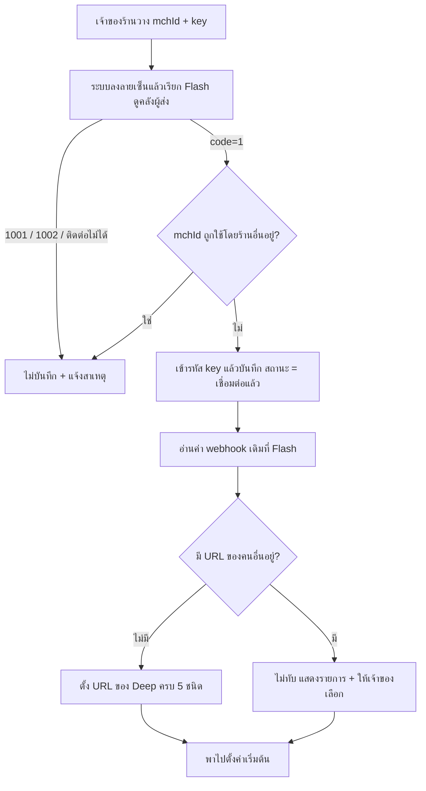
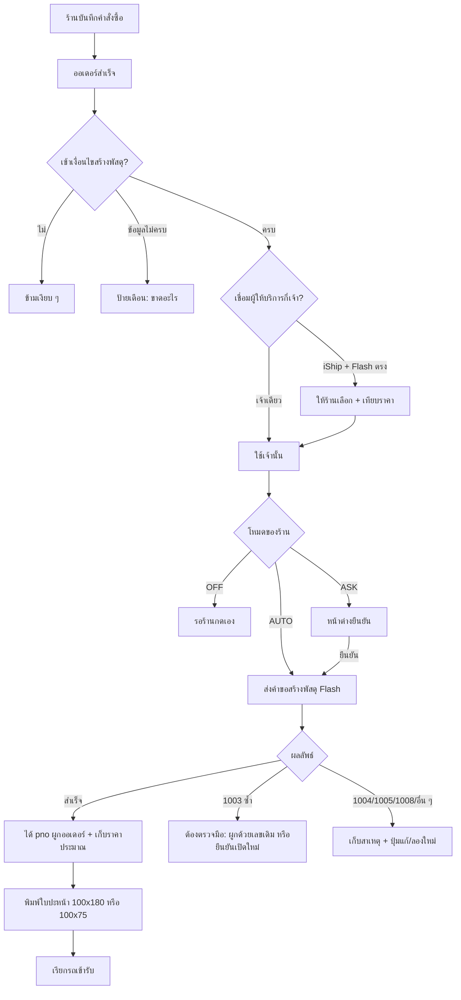
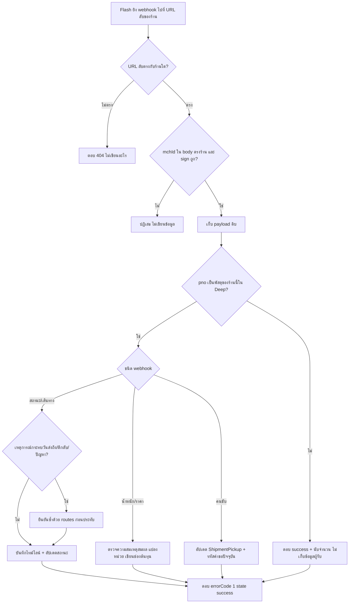
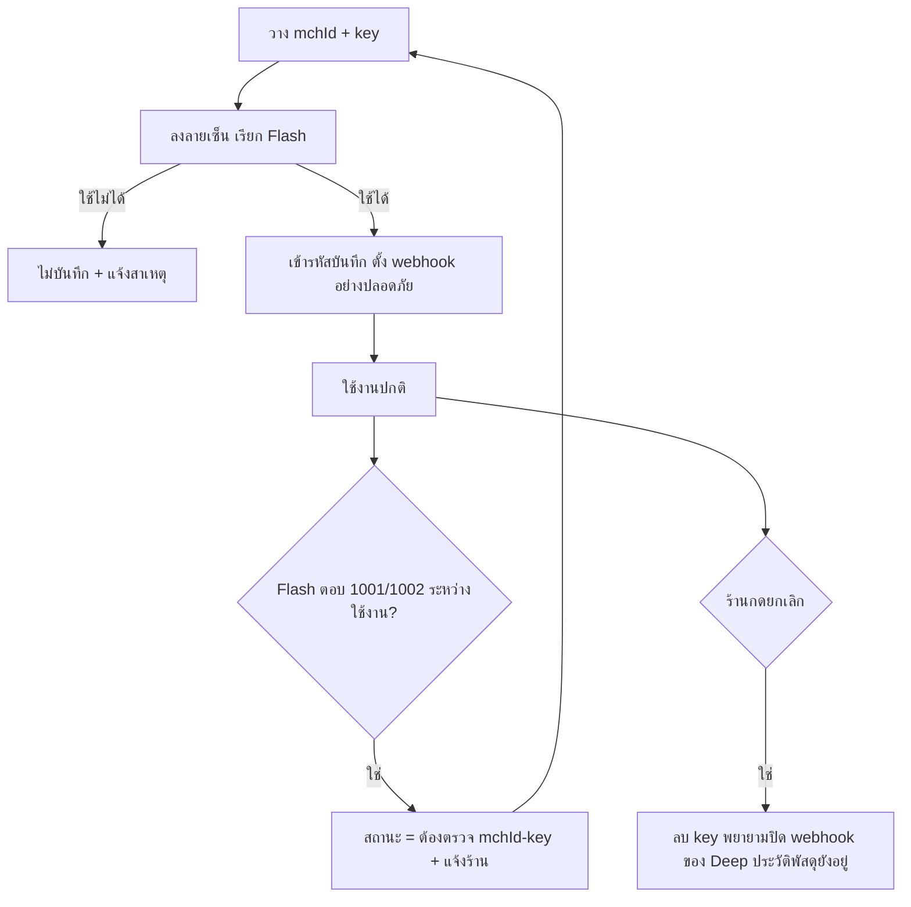

> **โมดูล:** 00084 — Flash Express Direct Integration
> **ประเภทเอกสาร:** Business Requirements Document (BRD) - NON-TECHNICAL
> **เวอร์ชัน:** 0.1
> **วันที่จัดทำ:** 2026-10-22
> **สถานะ:** Draft — รอ user review
> **เจ้าของเอกสาร:** BA (ดู [[Feature-Docs-Ownership]])
> **งานวิจัยต้นทาง:** `docs/research/2026-10-22-flash-express-open-api.md` (อ้างเป็น "R§n")

# BRD: เชื่อม Flash Express ตรง (Business Requirements Document)

---

## 1. บทนำ

### 1.1 วัตถุประสงค์ของเอกสาร

เอกสารนี้มีวัตถุประสงค์เพื่อ:
1. อธิบายความต้องการหลักของการเชื่อม Flash Express ตรง — ตั้งแต่การวาง mchId/key ของร้านเอง การเปิดพัสดุ การพิมพ์ใบปะหน้า การติดตามสถานะ ค่าส่งจริง ไปจนถึงหลักฐานการส่ง
2. กำหนดขอบเขตว่าอะไรอยู่ใน v1 อะไรไม่ทำ (โดยเฉพาะการปิดงาน COD อัตโนมัติที่ Flash ไม่เปิดช่องให้)
3. กำหนดกฎทางธุรกิจ `BR-FLASH-n` ที่ทดสอบได้ โดยอ้าง `BR-ISHIP-n` เมื่อใช้กฎของ 00022 ซ้ำ
4. สร้างความเข้าใจร่วมกันระหว่างทีมธุรกิจ ทีมพัฒนา และทีมทดสอบ ก่อนเขียนโค้ด

> **หมายเหตุเรื่องเลขกฎ iShip:** BRD 00022 ใช้เลข BR-ISHIP-51..54 ซ้ำสองกลุ่ม (กลุ่มเงินใน §8.5 กับกลุ่มสถานะพัสดุใน §13) เอกสารนี้อ้างเฉพาะ **BR-ISHIP-52/53 ของกลุ่มเงิน** (Deep ไม่ถือเงินค่าส่ง / ไม่แสดงยอดคงเหลือ) ถ้าอ้างกลุ่ม §13 จะระบุ "§13" กำกับ

### 1.2 ขอบเขตของระบบ

**การเชื่อม Flash Express ตรง** คือความสามารถที่ให้ร้านผูกบัญชี Flash ของตัวเอง (mchId + Secret Key) เข้ากับร้านบน Deep แล้วเปิดพัสดุ พิมพ์ใบปะหน้า ยกเลิก เรียกรถ และติดตามสถานะ/ค่าส่ง/หลักฐานการส่งจากหน้าจอเดียว โดยไม่ผ่าน iShip และใช้ควบคู่กับ iShip ได้ในร้านเดียวกัน

**เข้าสู่ระบบ (Input):**
- mchId + Secret Key ที่ร้านวางเอง (ได้จาก Flash)
- ค่าตั้งต้นของร้าน — ที่อยู่ผู้ส่ง, น้ำหนัก/ขนาดกล่อง, ประเภทสินค้า, บริการเสริม, โหมดสร้างพัสดุ, ขนาดใบปะหน้า
- ข้อมูลคำสั่งซื้อ — ผู้รับ ที่อยู่ รายการสินค้า ยอด COD
- เหตุการณ์ที่ Flash ยิงกลับมา (webhook 5 ชนิด) และผลจากรอบเช็คสำรอง

**ออกจากระบบ (Output):**
- เลขพัสดุ (`pno`) ผูกกับคำสั่งซื้อ
- ใบปะหน้า PDF 100×180 หรือ 100×75 มม.
- สถานะพัสดุ ไทม์ไลน์ ค่าส่งจริง น้ำหนักจริง ค่าธรรมเนียม COD
- หลักฐานการส่ง (POD)
- ข้อความผิดพลาดภาษาไทยที่ร้านแก้ต่อได้

**ระบบที่เกี่ยวข้อง:**
- ฟีเจอร์ 00022 iShip (ใช้ตาราง flow และตัวช่วยร่วมกัน)
- ระบบคำสั่งซื้อ (Order) / ร้านค้า (Shop) / สิทธิ์พนักงานร้าน (00012, 00071)
- หลักฐานข้อพิพาท (00055) · ปิดงานอัตโนมัติ (00039) · ต้นทุนและกำไร (00016, 00078)
- ระบบเข้ารหัสความลับเดิม
- ผู้ให้บริการภายนอก — Flash Express Open API (production และ training)

### 1.3 กลุ่มผู้ใช้งาน

| กลุ่มผู้ใช้ | บทบาท | สิทธิ์การใช้งาน |
|-----------|--------|----------------|
| **เจ้าของร้าน (OWNER)** | วาง/เปลี่ยน/ถอน mchId-key, ตั้งค่าเริ่มต้น, ตัดสินเรื่อง webhook เดิม, สร้าง/ยกเลิกพัสดุ, พิมพ์ใบปะหน้า, เรียกรถ | เต็มสิทธิ์ |
| **พนักงานร้าน (STAFF)** | สร้าง/ยกเลิกพัสดุ, พิมพ์ใบปะหน้า, เรียกรถ, ดูสถานะ | ใช้งานได้ ตั้งค่าและวาง key ไม่ได้ **ไม่เห็น key และ mchId เต็ม** |
| **ผู้ซื้อ** | ดูเลขพัสดุและชื่อขนส่งบน `/o/{token}` | อ่านอย่างเดียว ออเดอร์ตัวเอง |
| **แอดมิน Deep** | ดูสถิติ/ข้อผิดพลาดเชิงระบบ | อ่านอย่างเดียว **ไม่เห็น key ทุกกรณี** |
| **Flash Express (ระบบภายนอก)** | ยิง webhook เข้า endpoint ของร้านนั้น | เข้าได้เฉพาะ URL ลับของร้านนั้น และตอบรูปแบบที่ Flash กำหนด |

---

## 2. ความต้องการหลัก (Functional Requirements)

### 2.1 การเชื่อมต่อบัญชี Flash

#### FR-FLASH-001: เชื่อมต่อด้วย mchId + Secret Key ของร้านเอง

**User Story:**
> ในฐานะเจ้าของร้านที่มีสัญญากับ Flash ฉันต้องการวาง mchId และ Secret Key ที่ได้จาก Flash ลงใน Deep เพื่อเปิดพัสดุด้วยราคาสัญญาของตัวเองโดยไม่ผ่านคนกลาง

**Acceptance Criteria:**
- [ ] หน้าตั้งค่ามีการ์ด "Flash Express (บัญชีของร้านเอง)" แยกจากการ์ด iShip แสดงสถานะยังไม่เชื่อมต่อ พร้อมคำอธิบายว่าต้องมีบัญชี Flash Open API และขอ key จากเจ้าหน้าที่ Flash
- [ ] ช่อง Secret Key เป็นแบบปิดบังตัวอักษรและสลับมองเห็นชั่วคราวได้
- [ ] กดบันทึกแล้วระบบเรียก Flash ด้วยคำขอที่ต้องลงลายเซ็น (ดูรายการคลังผู้ส่ง) ก่อนเสมอ — ห้ามบันทึกโดยไม่พิสูจน์ (BR-FLASH-12)
- [ ] ไม่ผ่าน → ไม่บันทึก แสดงสาเหตุภาษาไทย แยก "mchId ไม่พบ" (1001) กับ "ลายเซ็น/key ไม่ถูกต้อง" (1002) กับ "ติดต่อ Flash ไม่ได้"
- [ ] ผ่าน → key ถูกเข้ารหัสเก็บ สถานะ "เชื่อมต่อแล้ว" หน้าจอแสดงได้แค่ 4 ตัวท้ายของ key และ mchId ที่ปิดบังบางส่วน
- [ ] mchId ที่เชื่อมกับร้านอื่นอยู่แล้ว → ปฏิเสธพร้อมข้อความที่ไม่เผยว่าเป็นร้านไหน (BR-FLASH-17)
- [ ] เชื่อมต่อ Flash ไม่ทำให้สถานะ/ข้อมูลการเชื่อมต่อ iShip ของร้านเปลี่ยน (BR-FLASH-19)
- [ ] คำตอบเซิร์ฟเวอร์ทุกเส้นทางไม่มี key (BR-FLASH-13)
- [ ] STAFF เข้าหน้านี้เห็นว่าเป็นสิทธิ์เจ้าของร้านและกดบันทึกไม่ได้ (ฝั่งเซิร์ฟเวอร์ปฏิเสธด้วย — BR-FLASH-03)
- [ ] ปุ่มเชื่อมต่อ Flash ตรงถูกซ่อนจากทุกร้านจนกว่าเทสลายเซ็นกับ test vector จริงของ Flash ผ่าน (BR-FLASH-63)

**Business Flow:**


**Example:**
```
ร้าน "ของฝากแม่ปุ๊ก" วาง mchId = AB1234, key (64 ตัวอักษร)
→ Deep เรียก /open/v1/warehouses ลงลายเซ็น → Flash ตอบ code=1 มีคลัง 1 แห่ง
→ บันทึก: "เชื่อมต่อแล้ว · mchId AB••34 · key ลงท้าย …a9f3"
```

#### FR-FLASH-002: ดูสถานะ / เปลี่ยน key / ยกเลิกการเชื่อมต่อ

**User Story:**
> ในฐานะเจ้าของร้าน ฉันต้องการเห็นว่าบัญชี Flash ยังใช้ได้ไหม เปลี่ยน key ใหม่ หรือถอดบัญชีออกได้เอง

**Acceptance Criteria:**
- [ ] การ์ดแสดงสถานะ 3 แบบ: เชื่อมต่อแล้ว / ต้องตรวจ mchId-key / ยังไม่ได้เชื่อมต่อ พร้อมปุ่ม "ทดสอบการเชื่อมต่อ" และเวลาตรวจล่าสุด
- [ ] เปลี่ยน key ใหม่ทับได้ภายใต้ mchId เดิม โดยผ่านการพิสูจน์เหมือนตอนสร้าง
- [ ] เปลี่ยน mchId ในการเชื่อมต่อเดิมไม่ได้ ต้องยกเลิกแล้วเชื่อมใหม่ (BR-FLASH-16)
- [ ] ยกเลิกการเชื่อมต่อต้องมีหน้าต่างยืนยัน (Sweet Alerts) บอกผลที่ตามมา: พัสดุที่ยังเดินทางจะหยุดอัปเดตและพิมพ์ใบปะหน้าไม่ได้
- [ ] ยกเลิกแล้ว key ถูกลบจริง ประวัติพัสดุ Flash ที่เคยสร้างยังอยู่ครบและเลข `pno` ยังแสดงได้ (BR-FLASH-15)
- [ ] ยกเลิกแล้วระบบพยายามปิด webhook ที่ Deep เคยตั้งไว้กับ Flash ถ้าปิดไม่สำเร็จไม่บล็อกการยกเลิก
- [ ] เมื่อใช้งานจริงแล้ว Flash ตอบ 1001/1002 สถานะเปลี่ยนเป็น "ต้องตรวจ mchId-key" อัตโนมัติและแจ้งร้าน (BR-FLASH-14)

#### FR-FLASH-003: จำกัดเฉพาะร้านสินค้า และแยกสิทธิ์เจ้าของ/พนักงาน

**User Story:**
> ในฐานะเจ้าของที่พัก/ร้านบริการ ฉันไม่ต้องการเห็นเมนู Flash เลย และในฐานะเจ้าของร้านสินค้า ฉันไม่ต้องการให้พนักงานเห็น key

**Acceptance Criteria:**
- [ ] ร้านที่ `Shop.vertical` ไม่ใช่ `ONLINE_SALES` ไม่เห็นการ์ด/เมนู/ปุ่ม Flash ใดเลย (ไม่ใช่แสดงแล้ว disabled) และทุกเส้นทางฝั่งเซิร์ฟเวอร์ปฏิเสธด้วย "ไม่มีสิทธิ์" (BR-FLASH-01/02)
- [ ] ร้านที่เชื่อม Flash แล้วเปลี่ยน vertical → ซ่อนและหยุดทำงาน แต่ข้อมูลการเชื่อมต่อและประวัติพัสดุไม่ถูกลบ (BR-FLASH-04)
- [ ] เส้นทางตั้งค่า/วาง/เปลี่ยน/ถอน key และเขียนทับ webhook ปฏิเสธ STAFF ฝั่งเซิร์ฟเวอร์
- [ ] แอดมิน Deep ไม่เห็น key ในหน้าจอ คำตอบ log หรือข้อความผิดพลาดใด ๆ (BR-FLASH-05)

#### FR-FLASH-004: ตั้งค่ารับแจ้งสถานะ (webhook) อัตโนมัติอย่างปลอดภัย

**User Story:**
> ในฐานะเจ้าของร้าน ฉันต้องการให้สถานะอัปเดตเอง โดยไม่ทำให้ระบบอื่นของฉันที่รับ webhook จาก Flash หยุดทำงาน

**Acceptance Criteria:**
- [ ] หลังเชื่อมสำเร็จ ระบบอ่านค่า webhook ที่ตั้งไว้ที่ Flash ก่อนเสมอ (`/webhook/setting/infos`)
- [ ] ชนิดที่ยังว่างหรือชี้มาที่ Deep อยู่แล้ว → ตั้ง/ยืนยัน URL ของ Deep ให้ ครบ 5 ชนิด (สถานะ · เส้นทาง · น้ำหนัก · ราคา · คนขับ)
- [ ] ชนิดที่ชี้ไป URL ของคนอื่น → **ไม่เขียนทับ** แสดงให้เจ้าของร้านเห็นว่าชนิดไหนชี้ไปที่ไหน (แสดงเฉพาะชื่อโฮสต์ ไม่แสดง path/โทเคน) และให้เลือก "คงเดิม (ใช้เช็คอัตโนมัติ)" เป็นค่าเริ่มต้น หรือ "เปลี่ยนมาใช้ Deep" พร้อมคำเตือน
- [ ] การลงทะเบียนล้มเหลวไม่บล็อกการเชื่อมต่อ: แสดงป้าย "ยังไม่ได้ตั้งรับแจ้งสถานะ ระบบจะเช็คเองทุก 15 นาที" และปุ่มลองใหม่
- [ ] ทุกการเปลี่ยน webhook บันทึกว่าใครทำ เมื่อไหร่ ชนิดไหน (BR-FLASH-79)

### 2.2 ค่าตั้งต้นของร้าน

#### FR-FLASH-010: ตั้งค่าเริ่มต้นสำหรับ Flash

**User Story:**
> ในฐานะเจ้าของร้าน ฉันต้องการตั้งที่อยู่ผู้ส่งและค่าเริ่มต้นไว้ครั้งเดียวสำหรับ Flash เพื่อกดสร้างพัสดุได้เร็ว

**Acceptance Criteria:**
- [ ] กรอกที่อยู่ผู้ส่งครบ (ชื่อ เบอร์ ที่อยู่ ตำบล อำเภอ จังหวัด รหัสไปรษณีย์) ด้วยช่องค้นหาที่อยู่ชุดเดียวกับ iShip และปุ่ม "ใช้ที่อยู่ที่ตั้งไว้กับ iShip" ถ้ามี
- [ ] ที่อยู่ผู้ส่งเป็นข้อมูลบังคับก่อนเปิดใช้การสร้างพัสดุ (เทียบ BR-ISHIP-30)
- [ ] ตั้งน้ำหนักเริ่มต้น (กก.) ขนาดกล่อง ประเภทสินค้า (รายการ 0–11, 99 ชุดเดียวกับ iShip) บริการเสริม (ส่งตรงเวลา, ประกันกล่อง, ประกันสินค้าพร้อมมูลค่า) และหมายเหตุถึงคนส่ง
- [ ] เลือกขนาดใบปะหน้าได้ 2 แบบ: **100×180 มม. (ค่าเริ่มต้น)** หรือ 100×75 มม.
- [ ] เลือกโหมด AUTO / ASK / OFF เฉพาะ Flash ได้ (ค่าเริ่มต้นเหมือน iShip ณ วันที่ส่งมอบ — SRS ยืนยันค่าจริงของ `createMode`) พร้อมคำเตือนค่าใช้จ่ายจริงในโหมด AUTO
- [ ] ข้อความอธิบายว่าน้ำหนัก/ขนาดที่กรอกเป็นค่าที่ร้านแจ้ง Flash ชั่งจริงแล้วคิดเงินต่างได้ (BR-ISHIP-34)
- [ ] ไม่มีค่าเริ่มต้น COD ระดับร้าน (BR-ISHIP-90)

#### FR-FLASH-011: เลือกผู้ให้บริการเมื่อร้านเชื่อมทั้ง iShip และ Flash ตรง

**User Story:**
> ในฐานะร้านที่ใช้ทั้งสองเส้นทาง ฉันต้องการเลือกชัดเจนว่าพัสดุใบนี้เปิดกับใคร และไม่สับสนระหว่าง Flash ผ่าน iShip กับ Flash บัญชีของฉันเอง

**Acceptance Criteria:**
- [ ] ฟอร์มสร้างพัสดุ (โมดัลหน้าออเดอร์และแผงในห้องแชท) มีตัวเลือกผู้ให้บริการเมื่อร้านเชื่อมมากกว่าหนึ่ง และไม่มีเมื่อเชื่อมเจ้าเดียว
- [ ] ผู้ให้บริการเริ่มต้นตามที่ร้านตั้ง ระบบไม่เปลี่ยนไปเจ้าที่ราคาถูกกว่าเอง (BR-FLASH-21)
- [ ] ชื่อต้องแยกออกชัด: "Flash (บัญชีของร้านเอง)" กับ "Flash ผ่าน iShip" ทั้งในฟอร์ม รายการพัสดุ และหน้ารายละเอียดออเดอร์
- [ ] ร้านที่เชื่อมเจ้าเดียวเห็นฟอร์มและพฤติกรรมเดิมทุกประการ (ไม่เกิด regression ของ iShip)

### 2.3 การสร้างพัสดุ

#### FR-FLASH-020: สร้างพัสดุ Flash จากคำสั่งซื้อ (โหมด AUTO / ASK / OFF และย้อนหลัง)

**User Story:**
> ในฐานะร้าน ฉันต้องการให้พัสดุ Flash เปิดจาก Deep ด้วยจังหวะเดียวกับที่ใช้กับ iShip เพื่อไม่ต้องเรียนรู้ขั้นตอนใหม่

**Acceptance Criteria:**
- [ ] โหมด AUTO / ASK / OFF ทำงานตาม FR-ISHIP-020/021 ทุกข้อ รวมถึงหน้าต่างยืนยันที่ใช้ Sweet Alerts พร้อมสรุป ผู้รับ ที่อยู่ น้ำหนัก COD บริการเสริม และราคาโดยประมาณ
- [ ] สร้างย้อนหลังจากหน้ารายละเอียดออเดอร์ได้ในทุกโหมด
- [ ] การสร้างออเดอร์ต้องสำเร็จเสมอ ไม่ว่า Flash จะตอบอย่างไร (BR-FLASH-20)
- [ ] เกินเวลารอ (timeout) ถือว่าล้มเหลวและลองใหม่ได้ ห้ามค้างหน้าจอร้าน
- [ ] สำเร็จแล้ว `pno` ผูกกับออเดอร์ทันที และถ้าออเดอร์เป็น ONLINE_SALES ที่ยังไม่เคยมีพัสดุ ตัวเลือก "เสนอให้เปลี่ยนเป็นจัดส่งแล้ว" ทำงานเหมือนพัสดุ iShip (ร้านกดเอง)
- [ ] ออเดอร์ที่มีพัสดุ active อยู่แล้ว (ของผู้ให้บริการใดก็ตาม) ไม่เปิดใบใหม่ แสดงใบเดิม (BR-FLASH-24)
- [ ] ที่อยู่ไม่ครบ/ไม่มีเบอร์ผู้รับ/ไม่มีที่อยู่ผู้ส่ง → ป้ายระบุช่องที่ขาด (BR-ISHIP-24/33)
- [ ] ข้ามเงียบ ๆ ตามเงื่อนไข BR-ISHIP-23 (NO_SHIPPING, BOOKING, DIGITAL, SERVICE, SUBSCRIPTION)
- [ ] บันทึกผู้กดสร้าง (null = ระบบสร้างเองในโหมด AUTO) และเวลา

#### FR-FLASH-021: พัสดุเก็บเงินปลายทาง (COD) และพัสดุไม่เก็บเงิน

**User Story:**
> ในฐานะร้านที่ขายแบบ COD ฉันต้องการให้ยอดเก็บปลายทางที่ส่งให้ Flash ตรงกับออเดอร์ทุกบาท

**Acceptance Criteria:**
- [ ] ระบบส่งธงเก็บเงินปลายทางทุกครั้ง (เก็บ/ไม่เก็บ) ไม่ปล่อยให้ว่าง
- [ ] ยอด COD มาจากวิธีชำระเงินของออเดอร์ใบนั้น ผู้ขายกรอกทับรายใบได้ และเว้นว่าง = ไม่เก็บ (BR-ISHIP-89/90/91)
- [ ] เมื่อเก็บ COD ต้องส่งรายการสินค้า 1–10 รายการ (จำนวนต่อรายการ 1–999) — ออเดอร์ที่มีรายการเกิน 10 รวมส่วนที่เกินเป็นรายการ "สินค้าอื่น ๆ" รายการสุดท้าย ผลรวมจำนวนต้องเท่าเดิม (BR-FLASH-25)
- [ ] ยอด COD เป็นจำนวนเต็มสตางค์ตรงตัว ห้ามคลาดจากการปัดเศษ (BR-FLASH-26)
- [ ] Flash ตอบ 1008 (ร้านยังไม่ได้เปิดบริการ COD) → ข้อความ "บัญชี Flash ของร้านยังไม่ได้เปิดบริการเก็บเงินปลายทาง ติดต่อ Flash" ไม่ลองซ้ำอัตโนมัติ
- [ ] ยอด COD ติดลบ (1009) ไม่ถูกส่งออกไปตั้งแต่ต้น (ตรวจก่อนส่ง)
- [ ] ถ้าออเดอร์ระบุ COD แต่พัสดุเปิดแบบไม่เก็บเงิน → เตือนเท่านั้น ไม่แก้ออเดอร์เอง (BR-ISHIP-52 §13)
- [ ] หน้าพัสดุ COD ของ Flash แสดงป้ายถาวร "Flash ไม่แจ้งการโอนเงิน COD — ตรวจยอดกับ Flash แล้วกดยืนยันรับเงินเอง" (BR-FLASH-49)

#### FR-FLASH-022: ลองใหม่โดยไม่ซ้ำ และการจัดการ "พัสดุซ้ำ" (1003)

**User Story:**
> ในฐานะร้าน ฉันไม่อยากเสียเงินสองรอบเพราะคำขอแรกหมดเวลาแต่ความจริงสำเร็จไปแล้ว

**Acceptance Criteria:**
- [ ] ลองใหม่จากใบที่ล้มเหลวใช้เลขอ้างอิง (`outTradeNo`) เดิมทุกครั้ง (BR-FLASH-22)
- [ ] ถ้า Flash ตอบสำเร็จ → ได้ `pno` ผูกตามปกติ
- [ ] ถ้า Flash ตอบ 1003 โดยระบบไม่มี `pno` อยู่ในมือ → สถานะ "ต้องตรวจมือ" ห้ามบอกสำเร็จ ห้ามสร้างเลขอ้างอิงใหม่เงียบ ๆ ปุ่ม "ลองใหม่" ธรรมดาถูกปิด (BR-FLASH-23)
- [ ] แทน "ลองใหม่" ร้านมี 2 ทาง: (ก) ผูกด้วยเลข `pno` ที่เห็นใน Flash Printer (FR-FLASH-023) (ข) ยืนยันว่า "ไม่มีพัสดุใบเดิมที่ Flash" แล้วเปิดใหม่ — ต้องมีหน้าต่างยืนยันเตือนว่าอาจเสียเงินซ้ำ
- [ ] ทางเลือก (ข) ใช้เลขอ้างอิงชุดใหม่ และบันทึกว่าใครยืนยัน เมื่อไหร่
- [ ] ระบบบันทึกเหตุการณ์ 1003 เพื่อใช้ถามความหมายกับ Flash

#### FR-FLASH-023: ผูกพัสดุ Flash ที่มีอยู่แล้วด้วยเลข pno (ทีละใบ) — ข้อเสนอ ตัดออกได้

**User Story:**
> ในฐานะร้านที่เปิดพัสดุไว้ใน Flash Printer แล้ว หรือเจอ 1003 ฉันต้องการใส่เลขพัสดุเพื่อผูกกับออเดอร์ใน Deep

**Acceptance Criteria:**
- [ ] ร้านพิมพ์เลข `pno` ลงในช่อง ระบบตรวจกับ Flash (`routes`) ว่าเลขนั้นเป็นของ mchId ของร้านนี้ (ถ้าไม่ใช่ Flash ตอบ 1019 → แจ้ง "เลขนี้ไม่ใช่ของบัญชี Flash ของร้านนี้")
- [ ] เลขที่ผูกแล้วกับออเดอร์อื่นของ Deep ผูกซ้ำไม่ได้ (เลขติดตามห้ามซ้ำทั้งระบบ)
- [ ] แสดงสถานะ/ไทม์ไลน์ปัจจุบันจาก Flash ก่อนให้ยืนยัน (กันผูกผิดใบ — บทเรียน PRD 00022 §11.4)
- [ ] ผูกแล้วถือเป็นพัสดุ `LINKED` เลิกผูกได้โดยไม่ยกเลิกพัสดุจริง
- [ ] ไม่มีรายการค้นหา/นำเข้าจำนวนมาก (Flash ไม่มี endpoint นี้)

### 2.4 ราคาโดยประมาณ

#### FR-FLASH-030: แสดงราคา Flash ตรงข้ามราคา iShip

**User Story:**
> ในฐานะร้านที่มีสัญญา Flash ฉันต้องการเห็นราคา Flash ของฉันเทียบกับขนส่งอื่นก่อนเลือก

**Acceptance Criteria:**
- [ ] แผงเทียบราคา/ฟอร์มสร้างพัสดุมีแถว "Flash (บัญชีของร้านเอง)" แยกจากรายการ iShip พร้อมป้าย "ประมาณการ"
- [ ] ป้ายบอกว่าราคาที่แสดงมาจาก "ตารางราคาสัญญา" หรือ "ราคามาตรฐาน" ห้ามเรียกราคามาตรฐานว่าราคาสัญญา (BR-FLASH-54)
- [ ] ประเมินไม่ได้ (Flash ตอบ error/ไม่ตอบ) → แสดงชื่อพร้อมสาเหตุ ไม่เดาราคา และไม่ทำให้แถวของ iShip ล้มตาม (เทียบ BR-ISHIP-36)
- [ ] ผลประเมินถูกบันทึกเป็น `estimatedPrice` ของพัสดุตอนสร้าง ส่วนความล้มเหลวของการประเมินไม่ขัดการสร้างพัสดุ
- [ ] ค่าประเมินที่เป็นสตางค์ในรูป string ถูกแปลงเป็นบาทถูกต้อง
- [ ] พัสดุที่ผูกด้วยเลข `pno` มี `estimatedPrice` เป็นค่าว่าง และไม่แสดงเป็น ฿0 (เทียบ FR-EXP-19 AC-09)

### 2.5 ใบปะหน้า

#### FR-FLASH-040: พิมพ์ใบปะหน้า Flash

**User Story:**
> ในฐานะร้าน ฉันต้องการพิมพ์ใบปะหน้าขนาดที่เครื่องพิมพ์ของฉันใช้จากหน้า Deep

**Acceptance Criteria:**
- [ ] ปุ่มพิมพ์อยู่ในส่วนการจัดส่งของหน้ารายละเอียดออเดอร์ แสดงเมื่อมีพัสดุ Flash ที่ใช้งานอยู่
- [ ] ได้ PDF ขนาดตามที่ร้านตั้ง (100×180 หรือ 100×75 มม.)
- [ ] ไฟล์ออกผ่านระบบของเรา key ไม่ปรากฏในเบราว์เซอร์ และเฉพาะเจ้าของ/พนักงานของร้านนั้นขอได้
- [ ] ตรวจว่าไฟล์ที่ได้เป็น PDF จริงก่อนส่งให้ผู้ใช้ (ถ้า Flash ตอบ JSON error ต้องแปลเป็นข้อความผิดพลาด ไม่ส่งไฟล์เสีย)
- [ ] พิมพ์ซ้ำได้ไม่จำกัด แสดง "พิมพ์แล้ว" พร้อมเวลาล่าสุด
- [ ] พัสดุที่ยกเลิกแล้วพิมพ์ไม่ได้ พร้อมเหตุผล
- [ ] พัสดุ `LINKED` พิมพ์ได้ถ้า key ของร้านยังใช้งาน

#### FR-FLASH-041: พิมพ์หลายใบพร้อมกันเมื่อมี Flash ปนอยู่

**Acceptance Criteria:**
- [ ] การเลือกพิมพ์หลายใบ (FR-ISHIP-031) ยังทำงานกับใบ iShip เหมือนเดิม
- [ ] ใบ Flash ที่ถูกเลือกไม่ถูกรวมในไฟล์ แต่ **ต้องแสดงรายการว่าถูกข้ามเพราะอะไร** ("ใบปะหน้า Flash พิมพ์ได้ทีละใบ") พร้อมลิงก์ไปพิมพ์ทีละใบ — ห้ามเงียบ
- [ ] (รอ user ยืนยันตามคำถามเปิดข้อ 3: v1 ไม่รวม PDF ของ Flash)

### 2.6 ยกเลิกพัสดุและเรียกรถ

#### FR-FLASH-050: ยกเลิกพัสดุ Flash

**Acceptance Criteria:**
- [ ] ปุ่มยกเลิกในส่วนการจัดส่ง มีหน้าต่างยืนยันพร้อมผลที่ตามมา
- [ ] สำเร็จ → สถานะยกเลิก พิมพ์ใบปะหน้าไม่ได้ และออเดอร์เปิดพัสดุใบใหม่ได้ (เลขอ้างอิงชุดใหม่)
- [ ] Flash ตอบ 1015 (รับพัสดุไปแล้ว) → "ขนส่งรับของไปแล้ว ยกเลิกจาก Deep ไม่ได้ ต้องติดต่อ Flash" สถานะพัสดุไม่เปลี่ยน
- [ ] ใบ `LINKED` มีปุ่ม "เลิกผูก" ที่ไม่ยกเลิกพัสดุจริงที่ Flash (เหมือน iShip)
- [ ] บันทึกว่าใครยกเลิกและเมื่อไหร่
- [ ] การยกเลิกพัสดุไม่ยกเลิกคำขอรถเข้ารับโดยอัตโนมัติ (คนละคำสั่ง)

#### FR-FLASH-051: เรียกรถเข้ารับพัสดุ Flash

**Acceptance Criteria:**
- [ ] ปุ่มเรียกรถอยู่ในหน้าตั้งค่าการจัดส่งของ Flash (ระดับที่อยู่ผู้ส่ง ไม่ใช่ระดับออเดอร์) ระบุจำนวนพัสดุโดยประมาณและหมายเหตุ
- [ ] มีหน้าต่างยืนยันก่อนส่งคำขอ
- [ ] สำเร็จ → แสดงหมายเลขคำขอ คนขับ (ชื่อ/เบอร์) ช่วงเวลาที่จะเข้ารับตามข้อความของ Flash และหมายเหตุของ Flash
- [ ] Flash ตอบ 1010 (มีงานรับค้างอยู่แล้วที่ที่อยู่เดียวกัน) → ข้อความอธิบายว่าต้องรอหรือยกเลิกงานเดิมก่อน
- [ ] ข้อมูลคนขับ/สถานะ/รหัสคำขอปัจจุบันอัปเดตจาก webhook คนขับ (BR-FLASH-84)

#### FR-FLASH-052: ยกเลิกคำขอเรียกรถ

**Acceptance Criteria:**
- [ ] ยกเลิกคำขอที่ยังไม่ถูกดำเนินการได้ ด้วยรหัสคำขอ **ปัจจุบัน** (ไม่ใช่รหัสแรก)
- [ ] Flash ตอบ 1011 → ระบบอ่านรหัสปัจจุบันล่าสุดจาก webhook คนขับแล้วลองอีกครั้งหนึ่ง ถ้ายังไม่ได้ บอกร้านตรง ๆ ให้ติดต่อ Flash
- [ ] บันทึกผู้ยกเลิกและเวลา

### 2.7 ติดตามสถานะ ต้นทุน และหลักฐานการส่ง

#### FR-FLASH-060: รับ webhook จาก Flash

**User Story:**
> ในฐานะร้าน ฉันต้องการให้สถานะ ค่าส่ง และน้ำหนักจริงอัปเดตเองจาก Flash โดยไม่ต้องกดเช็ค

**Acceptance Criteria:**
- [ ] มีช่องรับ webhook ของ Flash ที่ URL ลับเฉพาะต่อร้าน (เดาไม่ได้) และไม่ใช้ร่วมกับช่องของ iShip
- [ ] ตอบกลับ Flash ด้วยรูปที่ Flash กำหนดเท่านั้น: HTTP 2xx และ body `{"errorCode":"1","state":"success"}` เมื่อรับและจัดการแล้ว (BR-FLASH-71)
- [ ] ตรวจลายเซ็นของ webhook ด้วย key ของร้านที่ URL ชี้ และ `mchId` ใน body ต้องตรงกับร้านนั้น ไม่ตรง → ปฏิเสธ ไม่เขียนข้อมูล (BR-FLASH-72)
- [ ] เก็บ payload ดิบก่อนตรวจรูปแบบ เพื่อใช้ตรวจสอบเมื่อเอกสารไม่ตรงของจริง (BR-FLASH-76)
- [ ] ส่งซ้ำ (Flash ยิงจนกว่าจะได้ success) ไม่ทำให้ข้อมูลเพี้ยนหรือไทม์ไลน์บวม (BR-FLASH-74)
- [ ] `pno` ที่ไม่ใช่พัสดุที่สร้าง/ผูกผ่าน Deep (เช่น พัสดุที่ร้านเปิดนอก Deep) → ตอบสำเร็จเพื่อให้ Flash หยุดยิง แต่ไม่เก็บ payload/รูป/ชื่อผู้รับ เก็บแค่ตัวนับ (BR-FLASH-77)
- [ ] ความล้มเหลวชั่วคราวของเรา (ฐานข้อมูล) ตอบรูปที่ไม่ใช่ success เพื่อให้ Flash ยิงซ้ำ (BR-FLASH-71)
- [ ] เหตุการณ์ที่กระทบวันส่งถึง/ตีกลับ/ปัญหา ต้องยืนยันซ้ำกับ Flash (`/routes`) ก่อนประทับ (BR-FLASH-73)
- [ ] ค่าทุกตัวใน `data` เป็น string ตัว parse ต้องทนค่าว่าง/รูปเวลาหลายแบบ ถ้า parse ไม่ได้เก็บดิบไม่เดา (BR-FLASH-75)

#### FR-FLASH-061: แปลงสถานะ Flash เป็นสถานะที่ระบบแสดงอยู่แล้ว และไทม์ไลน์

**Acceptance Criteria:**
- [ ] สถานะ Flash 1–9 และ "ยังไม่มี route" ถูกแปลงเป็นรหัสสถานะเดิมตามตาราง BR-FLASH-41 ทำให้ป้ายสถานะ กองงานพัสดุมีปัญหา/ตีกลับ ไทม์ไลน์ แถบความคืบหน้า ใช้งานได้โดยไม่แก้ UI
- [ ] สถานะที่ไม่รู้จัก → ไม่เปลี่ยนสถานะเดิม เก็บค่าดิบ ไม่เดา (BR-FLASH-41)
- [ ] เหตุการณ์ราย route หนึ่งรายการ = หนึ่งแถวไทม์ไลน์ และ `routeAction` ถูกใช้แยกขั้นตอนโดยไม่ต้องจับคำในข้อความ
- [ ] สาเหตุที่ค้าง (`markerCategory` 14/40/17/23/25/26/29) แสดงเป็นข้อความไทย รหัสอื่นแสดงข้อความทั่วไป
- [ ] พัสดุตีกลับ (state 7) ที่ได้เลขใหม่ (`returnedPno`) ถูกติดตามกลับเข้าแถวเดิม ไม่สร้างพัสดุใหม่ในกองงาน (BR-FLASH-43)
- [ ] เวลาถึงมือ/เริ่มตีกลับ/มีปัญหา ถูกประทับครั้งเดียว ไม่เขียนทับ (ตามกติกา 00039)
- [ ] สถานะ Flash ห้ามสร้างสถานะ "ชำระเงินสำเร็จ" หรือ `codSettledAt` ไม่ว่าอินพุตใด (BR-FLASH-44)
- [ ] Flash ไม่เปลี่ยนสถานะออเดอร์ของ Deep ไม่ว่ากรณีใด (BR-FLASH-40)

#### FR-FLASH-062: เช็คสถานะสำรองเมื่อ webhook ไม่มา

**Acceptance Criteria:**
- [ ] cron เดิมของ iShip มีสาขา Flash: ดึงด้วยคำขอแบบหลายใบ (`routesBatch`, รวม `pno` ≤500 ตัวอักษรต่อคำขอ) เฉพาะพัสดุที่ยังไม่จบ
- [ ] จำกัดความถี่ 15 นาทีต่อร้าน (ตัวจับเวลาเก็บใน DB)
- [ ] พัสดุ COD ของ Flash ที่ถึงแล้ว ถือว่าจบสำหรับการ poll ไม่ถูกเช็คไม่รู้จบ (BR-FLASH-49)
- [ ] ร้านที่ key ใช้ไม่ได้ถูกข้าม และไม่ทำให้รอบ poll ของร้านอื่นล้ม
- [ ] ดึงสดตามคำขอผู้ใช้ ("ดูการเดินทางของพัสดุ") ทำงานได้เหมือน iShip

#### FR-FLASH-063: ค่าส่งจริง น้ำหนักจริง และค่าธรรมเนียม COD

**User Story:**
> ในฐานะเจ้าของร้าน ฉันต้องการเห็นต้นทุนจริงของพัสดุ Flash ในหน้ากำไรโดยไม่ต้องกรอกเอง

**Acceptance Criteria:**
- [ ] webhook ราคา → เก็บ `carrierPrice` (ตามนิยามที่เคาะแล้ว BR-FLASH-52) และ `codFee` แยกกัน ลงช่องเดิม
- [ ] webhook น้ำหนัก → เก็บ `actualWeight` (กรัม→กก.) และตั้งธงเกินน้ำหนัก/ขนาดเมื่อ Flash ชั่ง/วัดได้เกินที่ร้านแจ้ง แสดงเตือนร้าน
- [ ] ทุกหน้าที่ใช้ต้นทุนค่าส่ง (กำไร/แดชบอร์ด/ยอดขาย/รายงาน LINE) ใช้ตัวคำนวณกลางตัวเดิมและแสดงพัสดุ Flash ถูกต้อง โดยแยก "ราคาจริง" กับ "ประมาณการ" ชัดเจน (HR16)
- [ ] ห้ามเติมราคาจริงย้อนหลังด้วยการถามราคาประเมินใหม่ (BR-FLASH-53)
- [ ] ค่าที่ webhook ราคา/น้ำหนักไม่ผ่านเกณฑ์สมเหตุผล (ติดลบ ไม่ใช่ตัวเลข เกินเพดานที่กำหนด) ไม่ถูกเขียน แต่เก็บ payload ดิบไว้ตรวจ
- [ ] ผู้ซื้อไม่เห็นค่าส่งที่ร้านจ่าย (เหมือน iShip)

#### FR-FLASH-064: หลักฐานการส่ง (POD)

**Acceptance Criteria:**
- [ ] เมื่อสถานะเป็นส่งถึง (state 5) ระบบดึง `deliveredInfo` จาก Flash ครั้งเดียวต่อพัสดุ แล้วเก็บเป็นหลักฐาน: ผู้เซ็นรับและประเภทผู้เซ็น รูปลายเซ็น รูปถ่ายสูงสุด 2 รูป พิกัดพนักงาน เวลาส่ง
- [ ] เก็บเข้าที่เก็บหลักฐานข้อพิพาทเดิม (00055) ไม่สร้างตารางหลักฐานใหม่
- [ ] ดึงไม่สำเร็จ → บันทึกว่าพยายามแล้วล้ม (ไม่ปล่อยเงียบ) และลองใหม่ในรอบ poll ถัดไป
- [ ] เห็นเฉพาะฝั่งร้าน ผู้ซื้อไม่เห็น POD ใน v1
- [ ] รูปเก็บเป็นลิงก์ของ Flash ใน v1 และสถานะรูปที่เปิดไม่ได้ต้องไม่ทำให้หน้าล้ม

#### FR-FLASH-065: ผู้ซื้อเห็นเลขพัสดุ Flash

**Acceptance Criteria:**
- [ ] `/o/{token}` แสดงชื่อขนส่งและเลข `pno` คัดลอกได้ เหมือนพัสดุ iShip และไม่แสดงข้อมูลภายในของร้าน (ที่อยู่ผู้ส่ง ราคาค่าส่ง รหัสอ้างอิง ข้อความผิดพลาดดิบ)
- [ ] ยังไม่มีพัสดุ → ไม่แสดงส่วนนี้

### 2.8 ความปลอดภัยและการทดสอบ

#### FR-FLASH-070: ลายเซ็นและความลับ

**Acceptance Criteria:**
- [ ] ทุกคำขอออกไปลงลายเซ็นตามอัลกอริทึมของ Flash และผ่านเทสหน่วยกับตัวอย่างจากโค้ด demo ทางการ และ test vector ที่ยิงจริงกับ training (BR-FLASH-63)
- [ ] ฟิลด์ที่ว่าง/เป็น whitespace ล้วนถูกตัดออกจากลายเซ็นตามนิยามของ Flash แต่ยังส่งได้
- [ ] Secret Key และค่า sign ไม่ปรากฏใน log ข้อความผิดพลาด คำตอบ หรือ payload ที่เก็บ (BR-FLASH-66)
- [ ] ไม่มี credential จริงหรือของตัวอย่างของ Flash (รวมที่ฝังในโค้ด demo) อยู่ใน repo หรือเทส (BR-FLASH-62)

#### FR-FLASH-071: โหมดทดสอบ

**Acceptance Criteria:**
- [ ] ที่อยู่ปลายทางของ Flash (base URL) เป็นค่าตั้งค่าฝั่งเซิร์ฟเวอร์ ใช้ชี้ training ได้บน dev/QA
- [ ] โหมดจำลอง (dry-run) ห้ามเปิดบน production และพัสดุที่เกิดจากการทดสอบมีเครื่องหมาย `isDryRun` ถูกกรองออกจากสถิติทุกชนิด (BR-FLASH-60/61 อ้าง BR-ISHIP-60/61)
- [ ] การทดสอบสร้างพัสดุจริงบน production ต้องได้รับอนุญาตและยกเลิกทันที (BR-ISHIP-62)

---

## 3. Acceptance Criteria สรุป

### 3.1 การเชื่อมต่อบัญชี

**เมื่อระบบทำงานถูกต้อง:**
- ✅ ร้าน ONLINE_SALES เห็นการ์ด Flash แยกจาก iShip ร้านประเภทอื่นไม่เห็นเลข
- ✅ mchId/key ที่ผิดไม่ถูกบันทึกและแจ้งสาเหตุที่เข้าใจได้
- ✅ key เก็บเข้ารหัส ไม่มีทางอ่านค่าเต็มกลับจากหน้าจอหรือคำตอบใด ๆ
- ✅ mchId เดียวเชื่อมสองร้านไม่ได้
- ✅ เชื่อม Flash แล้ว iShip ของร้านเดียวกันทำงานเหมือนเดิมทุกประการ
- ✅ webhook เดิมของร้านที่ชี้ไประบบอื่นไม่ถูกเขียนทับโดยไม่ได้รับยืนยัน

### 3.2 การสร้างพัสดุ

**เมื่อร้านเปิดคำสั่งซื้อและเลือก Flash ตรง:**
- ✅ ออเดอร์บันทึกสำเร็จเสมอ
- ✅ ที่อยู่ส่งไปถูกช่อง (ตำบล→DistrictName, อำเภอ→CityName) และหน่วยถูกต้อง (กรัม, สตางค์)
- ✅ COD ส่งยอดตรงตามออเดอร์ทุกสตางค์ พร้อมรายการสินค้าไม่เกิน 10 รายการ
- ✅ กดซ้ำ/ลองใหม่ไม่เกิดพัสดุซ้ำ และ 1003 ไม่ถูกตีเป็นสำเร็จหรือเปิดใบใหม่เงียบ ๆ
- ✅ ออเดอร์มีพัสดุ active ได้ใบเดียวรวมทุกผู้ให้บริการ
- ✅ ราคาประมาณของ Flash แสดงแยกแถวและติดป้ายประมาณการ

### 3.3 ใบปะหน้า ยกเลิก เรียกรถ

- ✅ ได้ PDF ขนาดตามที่ร้านตั้ง key ไม่ปรากฏในเบราว์เซอร์
- ✅ ยกเลิกหลัง Flash รับของไปแล้วถูกปฏิเสธด้วยข้อความที่ถูกต้อง
- ✅ เรียกรถ/ยกเลิกรถใช้รหัสคำขอปัจจุบัน

### 3.4 สถานะ ต้นทุน และ POD

- ✅ webhook ตอบรูป body ที่ Flash กำหนดเป๊ะ และไม่เขียนข้อมูลถ้าลายเซ็น/mchId ไม่ตรง
- ✅ สถานะ Flash 1–9 แสดงในป้ายและไทม์ไลน์เดิมถูกต้อง · ไม่มีทางเกิด `payment_success` จาก Flash
- ✅ `carrierPrice` / `codFee` / `actualWeight` ถูกเขียนจาก webhook ถูกหน่วยและไม่ซ้ำ
- ✅ พัสดุ COD ที่ถึงแล้วไม่ถูก poll ไม่รู้จบ และมีป้ายให้ร้านยืนยันรับเงินเอง
- ✅ POD ถูกเก็บเมื่อส่งถึง ผู้ซื้อไม่เห็น

### 3.5 ความปลอดภัยและการทดสอบ

- ✅ เทสลายเซ็นผ่านทั้งกับตัวอย่าง demo ทางการและ test vector จาก training ก่อนเปิดให้ร้านเชื่อม
- ✅ ไม่มี credential จริงใน repo · dry-run เปิดบน production ไม่ได้
- ✅ พัสดุของ Flash ที่ไม่ได้สร้างผ่าน Deep ไม่ทำให้เก็บข้อมูลส่วนบุคคลเพิ่ม

---

## 4. Business Flows (กระบวนการทำงาน)

### 4.1 Flow หลัก: จากคำสั่งซื้อถึงใบปะหน้า Flash



### 4.2 Flow: รับ webhook จาก Flash



### 4.3 Flow: เชื่อมต่อ ตรวจ key และถอด



---

## 5. Use Case Scenarios (สถานการณ์การใช้งานจริง)

### Scenario 1: Best Case — ร้านมีสัญญา Flash เปิดพัสดุ COD แล้วจบด้วย POD

**ผู้เกี่ยวข้อง:** เจ้าของร้านเสื้อผ้า (ONLINE_SALES, เชื่อม Flash ตรงแล้ว, โหมด ASK)

**เงื่อนไขเริ่มต้น:**
- ตั้งที่อยู่ผู้ส่งครบ ขนาดใบปะหน้า 100×180 บริการ COD เปิดกับ Flash แล้ว

**ขั้นตอน:**
1. บันทึกออเดอร์ COD ยอด 890 บาท 2 รายการ
2. หน้าต่างยืนยันแสดงราคา Flash ตรง (ราคาสัญญา ประมาณการ) เทียบกับ iShip ร้านเลือก Flash ตรง ยืนยัน
3. ได้ `pno` พิมพ์ใบปะหน้า แปะกล่อง กดเรียกรถ
4. Flash ยิง webhook: รับของ → ระหว่างขนส่ง → ส่งถึง ไทม์ไลน์และป้ายสถานะเปลี่ยนเอง
5. Flash ยิง webhook ราคา: ค่าส่งจริงและค่าธรรมเนียม COD ปรากฏในหน้ากำไร
6. ส่งถึง → ระบบเก็บ POD (ผู้เซ็นรับ + รูป + พิกัด)
7. ร้านตรวจเงิน COD ที่ Flash โอนมา แล้วกดยืนยันรับเงินเอง

**ผลลัพธ์:**
- ร้านไม่ต้องเปิด Flash Printer เลย ยกเว้นตรวจเงิน COD

### Scenario 2: ร้านใช้ทั้ง iShip และ Flash ตรง

**ผู้เกี่ยวข้อง:** ร้านที่ส่ง J&T ผ่าน iShip และ Flash ตามสัญญา

**ขั้นตอน:**
1. ฟอร์มสร้างพัสดุมีตัวเลือกผู้ให้บริการ ค่าเริ่มต้น = ที่ร้านตั้ง
2. แผงเทียบราคาแสดง "Flash (บัญชีของร้านเอง)" แยกจาก "Flash ผ่าน iShip" ชัดเจน
3. ร้านเลือก J&T ผ่าน iShip สำหรับใบนี้ ใบถัดไปเลือก Flash ตรง

**ผลลัพธ์:**
- แต่ละใบผูกกับผู้ให้บริการที่ร้านเลือก บิลไปลงถูกที่ ออเดอร์หนึ่งใบมีพัสดุ active ได้ใบเดียว

### Scenario 3: ร้านเดิมมี webhook ไประบบอื่น

**ขั้นตอน:**
1. ร้านเชื่อม Flash ตรงสำเร็จ
2. ระบบเจอ webhook สถานะ/เส้นทางชี้ไปโฮสต์อื่น
3. ไม่ทับ แสดงรายการและค่าเริ่มต้น "คงเดิม ใช้เช็คอัตโนมัติ 15 นาที"
4. เจ้าของร้านเลือกคงเดิม

**ผลลัพธ์:**
- ระบบเดิมของร้านทำงานต่อ พัสดุใน Deep ยังได้สถานะจากรอบเช็ค (ช้ากว่า webhook)

### Scenario 4: Worst Case — คำขอสร้างพัสดุหมดเวลา แล้วเจอ 1003

**ขั้นตอน:**
1. ร้านกดสร้าง คำขอหมดเวลา ใบเป็น "ล้มเหลว"
2. กดลองใหม่ด้วยเลขอ้างอิงเดิม → Flash ตอบ 1003
3. ระบบเปลี่ยนสถานะเป็น "ต้องตรวจมือ" ปิดปุ่มลองใหม่ธรรมดา
4. ร้านเปิด Flash Printer เห็นพัสดุใบนั้นอยู่จริง ใส่ `pno` ผูก ระบบตรวจกับ Flash แล้วผูกสำเร็จ
5. (อีกทาง) ถ้าร้านไม่เห็นใบเดิม กด "ยืนยันว่าไม่มีใบเดิมแล้วเปิดใหม่" พร้อมหน้าต่างเตือนเรื่องเสียเงินซ้ำ

**ผลลัพธ์:**
- ไม่มีพัสดุซ้ำโดยร้านไม่รู้ตัว ออเดอร์ไม่เสียหาย

### Scenario 5: key ถูกเปลี่ยนที่ Flash ระหว่างใช้งาน

**ขั้นตอน:**
1. ร้านกดสร้างพัสดุ Flash ตอบ 1002
2. สถานะการเชื่อมต่อเปลี่ยนเป็น "ต้องตรวจ mchId-key" แจ้งเตือนร้าน
3. ออเดอร์ที่สร้างไปแล้วไม่กระทบ ร้านวาง key ใหม่ ผ่านการพิสูจน์ แล้วใช้ต่อ

### Scenario 6: ร้านไม่ได้เปิด COD กับ Flash แต่ออเดอร์เป็น COD

**ขั้นตอน:**
1. ร้านเลือกสร้างพัสดุ Flash ให้ออเดอร์ COD
2. Flash ตอบ 1008
3. ระบบแจ้ง "บัญชี Flash ของร้านยังไม่ได้เปิดบริการเก็บเงินปลายทาง" ไม่ลองซ้ำ ไม่เปิดพัสดุแบบไม่เก็บเงินแทนให้เอง

### Scenario 7: ที่อยู่ผู้รับไม่ตรงกับระบบ Flash

**ขั้นตอน:**
1. Flash ตอบ 1005
2. ระบบแจ้ง "ที่อยู่ผู้รับไม่ตรงกับข้อมูลของ Flash — ตรวจตำบล อำเภอ จังหวัด และรหัสไปรษณีย์" (ระบุว่าฝั่งผู้รับ) พร้อมปุ่มไปแก้ที่อยู่
3. ไม่ลองใหม่อัตโนมัติ

---

## 6. ความต้องการด้านคุณภาพ (Quality Requirements)

### 6.1 ความถูกต้องของข้อมูล
- ตำบลต้องไปเป็นตำบลของ Flash อำเภอต้องไปเป็นอำเภอ ไม่จับคู่ตามชื่อฟิลด์ และต้องมีเทสเฉพาะเป็นเงื่อนไขก่อนปล่อย (BR-FLASH-30)
- ชื่อจังหวัดที่ส่งต้องเป็นรูปสะกดที่ Flash รับ ยืนยันด้วย training (BR-FLASH-31)
- เงินและน้ำหนักแปลงหน่วยที่จุดเดียวและเป็นจำนวนเต็มตรงตัว (BR-FLASH-26)
- ยอด COD ที่ส่งต้องตรงยอดออเดอร์ทุกสตางค์
- ต้นทุนค่าส่งของพัสดุ Flash ต้องนิยามเดียวกับของ iShip (BR-FLASH-52, HR16)

### 6.2 ความรวดเร็ว
- การสร้างพัสดุมีเพดานเวลารอ เกินแล้วถือว่าล้มเหลว
- การบันทึกออเดอร์ไม่ช้าลงเพราะฟีเจอร์นี้
- webhook ต้องตอบเร็วพอที่ Flash ไม่ถือว่าล้มเหลว งานหนัก (ยืนยันซ้ำ ดึง POD) ทำหลังตอบหรือแยกคิวโดยไม่ทำให้ตอบช้า
- ใบปะหน้าและ POD ดึงเมื่อผู้ใช้ขอหรือเมื่อถึงเงื่อนไข ไม่ดึงล่วงหน้าทุกใบ

### 6.3 ความน่าเชื่อถือ
- Flash ล่มหรือตอบผิดต้องไม่ลามถึงการสร้างออเดอร์หรือการใช้งาน iShip
- ทุกความล้มเหลวกู้ได้ด้วยการลองใหม่โดยไม่เกิดพัสดุซ้ำ ยกเว้นกรณี 1003 ที่ให้ร้านตัดสิน
- webhook หายต้องกู้ได้ด้วยรอบเช็คสำรอง (Flash ส่งย้อนหลังไม่ได้)
- ฟีเจอร์ต้องเริ่มได้โดยยังไม่มีข้อมูลเดิมของ Flash ในระบบ และเชื่อมกับพัสดุ iShip ที่มีอยู่ได้โดยไม่ต้องแปลงข้อมูลเก่า

### 6.4 ความปลอดภัย
- key เข้ารหัสด้วยกลไกเดิม ไม่ปรากฏใน log/คำตอบ/ข้อความผิดพลาด/หน้าเว็บ/ตัวแปรสภาพแวดล้อมของเบราว์เซอร์
- ใบปะหน้าออกผ่านระบบเรา
- ตรวจสิทธิ์ 3 ชั้น: เป็นคนของร้านนี้ / ร้านเป็น ONLINE_SALES / คำสั่งที่ต้องเป็นเจ้าของร้าน
- webhook: URL ลับต่อร้านที่เดาไม่ได้ ตรวจ mchId และลายเซ็น ไม่เชื่อ `data` โดยไม่ตรวจสอบเมื่อกระทบเงินหรือการปิดงาน
- ข้อมูลส่วนบุคคลของผู้รับกรองที่ต้นทางฝั่งเซิร์ฟเวอร์ และไม่เก็บข้อมูลของพัสดุนอก Deep

### 6.5 ความสะดวกในการใช้งาน (Usability)
- ตั้งค่าครั้งเดียวใช้ได้ตลอด งานประจำวันจบด้วยการกดยืนยันครั้งเดียวต่อออเดอร์
- ข้อความผิดพลาดบอก "เกิดอะไรขึ้น" และ "ต้องทำอะไรต่อ" เป็นภาษาไทย ไม่ใช่ข้อความดิบจาก Flash (เก็บดิบไว้ให้ทีมงาน)
- เมื่อมีสองผู้ให้บริการต้องแยกชื่อให้ชัดจนไม่เลือกผิด
- ใช้งานบนมือถือได้จริง

---

## 7. ข้อจำกัด (Constraints)

### 7.1 ข้อจำกัดทางธุรกิจ
- ร้านต้องมีบัญชี Flash Open API และ key จาก Flash เอง Deep ไม่เปิดให้
- Deep ไม่ถือบัญชีหลัก ไม่ถือเงิน ไม่แสดงยอดเครดิต/เงินสดของบัญชี Flash
- ไม่มีสัญญาณการโอนเงิน COD จาก Flash — ปิดงาน COD อัตโนมัติไม่ได้
- ราคาที่แสดงเป็นค่าประมาณ
- ส่งในประเทศไทยเท่านั้น · 1 พัสดุ = 1 กล่อง
- ฟีเจอร์นี้ฟรี ไม่มีโควตา

### 7.2 ข้อจำกัดทางเทคนิค
- ทุกคำขอเป็น POST แบบ form-urlencoded พร้อมลายเซ็น SHA256 ตัวพิมพ์ใหญ่ (ไม่ใช่ HMAC) · ค่า path ไม่นับในลายเซ็น
- Flash ใช้กรัม/สตางค์ · Deep ใช้กิโลกรัม/บาท
- webhook ลงนามแค่ mchId+nonceStr · ต้องตอบ `{"errorCode":"1","state":"success"}` · ส่งย้อนหลังไม่ได้ · นโยบาย retry ไม่ระบุ
- ไม่มี endpoint ค้นพัสดุด้วย `outTradeNo` หรือรายการพัสดุ
- ใบปะหน้าเป็น PDF ทีละใบ · เอกสารระบุว่าใส่โลโก้/ชื่อสินค้าในใบปะหน้าไม่ได้
- ไม่ทราบ rate limit / IP allowlist
- เอกสาร Flash ขัดกันเองหลายจุด (R§5.4) ต้องยืนยันกับ training ก่อนถือเป็นจริง
- ระบบรันแบบไม่มีเซิร์ฟเวอร์ประจำ งานเบื้องหลังต้องสั้นและกู้คืนได้ ตัวจับเวลาเก็บใน DB
- ฐานข้อมูล dev/prod ต้องระวังการเปลี่ยนโครงสร้าง: การเปลี่ยน unique ของ `ShopShippingAccount` เป็น (shopId, provider) และ migration ทุกตัวต้องแจ้ง user ตาม HR15 ก่อน push `main`
- การทดสอบกับ training ต้องใช้ credential จากร้านนำร่อง (ทีมยังไม่มี)

---

## 8. กฎทางธุรกิจ (Business Rules)

> รูปแบบเดียวกับ BR-ISHIP-n · ทุกข้อทดสอบได้ · "อ้าง" = ใช้กฎของ 00022 ซ้ำโดยไม่คัดลอกเงื่อนไข (เทสของ 00022 ต้องยังเขียวด้วย)

### 8.1 กฎด้านสิทธิ์และขอบเขต

| รหัส | กฎ |
|------|-----|
| **BR-FLASH-01** | ใช้ได้เฉพาะร้าน `Shop.vertical = ONLINE_SALES` (อ้าง BR-ISHIP-01 — เอกสาร 00022 เขียนว่า GENERAL แต่ค่าจริงในสคีมาคือ ONLINE_SALES) ร้านประเภทอื่นไม่มีสิทธิ์ทุกช่องทาง |
| **BR-FLASH-02** | การซ่อนบนหน้าจอไม่ใช่การบังคับสิทธิ์ ทุกเส้นทางของฟีเจอร์นี้ต้องปฏิเสธฝั่งเซิร์ฟเวอร์ (อ้าง BR-ISHIP-02) ทดสอบด้วยการยิง API ตรงจากร้านประเภทอื่น |
| **BR-FLASH-03** | เฉพาะเจ้าของร้านวาง/เปลี่ยน/ถอน key และตัดสินเรื่องเขียนทับ webhook ได้ พนักงานใช้งานสร้าง/ยกเลิก/พิมพ์/เรียกรถได้ แต่ไม่เห็น key และ mchId เต็ม (อ้าง BR-ISHIP-03) |
| **BR-FLASH-04** | ร้านที่เปลี่ยนประเภทออกจาก ONLINE_SALES ให้ปิดและซ่อนฟีเจอร์ แต่ห้ามลบการเชื่อมต่อและประวัติพัสดุ (อ้าง BR-ISHIP-04) |
| **BR-FLASH-05** | แอดมิน Deep ต้องไม่เห็น Secret Key ไม่ว่ากรณีใด (อ้าง BR-ISHIP-05) |

### 8.2 กฎด้านการเชื่อมต่อ

| รหัส | กฎ |
|------|-----|
| **BR-FLASH-10** | ร้านหนึ่งมีการเชื่อมต่อได้ **1 บัญชีต่อผู้ให้บริการ** (iShip 1 + Flash ตรง 1) ใช้พร้อมกันได้ — แทนที่ขอบเขตของ BR-ISHIP-10 จาก "1 บัญชีขนส่งต่อร้าน" เป็น "1 บัญชีต่อผู้ให้บริการ" |
| **BR-FLASH-11** | ร้านใช้ `mchId` + key ของตัวเองเท่านั้น Deep ไม่ถือ mchId หลัก ไม่สร้าง sub-account |
| **BR-FLASH-12** | ห้ามบันทึก mchId/key โดยไม่ผ่านการพิสูจน์: ต้องเรียก Flash ด้วยคำขอที่ลงลายเซ็นและได้ `code=1` ก่อนเสมอ (เทียบ BR-ISHIP-11) |
| **BR-FLASH-13** | key เก็บแบบเข้ารหัสด้วยกลไกเดิม ห้ามเก็บ plaintext ห้ามเขียนลง log ห้ามส่งกลับ client หลังบันทึกแสดงได้เพียง 4 ตัวท้าย (เทียบ BR-ISHIP-12/13) |
| **BR-FLASH-14** | เมื่อ Flash ตอบ 1001 หรือ 1002 ระหว่างใช้งาน เปลี่ยนสถานะการเชื่อมต่อเป็น "ต้องตรวจ mchId-key" ทันทีและแจ้งร้าน (เทียบ BR-ISHIP-14) ข้อผิดพลาดชั่วคราวอื่น (timeout, 0, 1000) ห้ามเปลี่ยนสถานะนี้ |
| **BR-FLASH-15** | ยกเลิกการเชื่อมต่อ = ลบ key จริง ประวัติพัสดุ Flash ยังอยู่ครบและเลข `pno` ยังแสดง แต่พิมพ์ใบปะหน้า/สั่งการต่อ/อัปเดตสถานะไม่ได้จนกว่าจะเชื่อมใหม่ (อ้าง BR-ISHIP-15) |
| **BR-FLASH-16** | เปลี่ยน key ได้ภายใต้ mchId เดิม · เปลี่ยน mchId ไม่ได้ต้องถอนแล้วเชื่อมใหม่ (เพราะ Flash ตอบ 1019 เมื่อ `pno` ไม่ใช่ของ mchId นั้น พัสดุเก่าจะใช้ไม่ได้) |
| **BR-FLASH-17** | `mchId` หนึ่งเชื่อมต่อสถานะใช้งานกับร้าน Deep ได้ร้านเดียว บังคับที่ระดับฐานข้อมูล และข้อความปฏิเสธห้ามเผยว่าเป็นร้านไหน |
| **BR-FLASH-18** | ที่อยู่ปลายทางของ Flash (production/training) เป็นค่าตั้งค่าฝั่งเซิร์ฟเวอร์ ห้ามรับจากผู้ใช้ |
| **BR-FLASH-19** | การเชื่อม/แก้/ถอน Flash ห้ามเปลี่ยนสถานะ ข้อมูล หรือพฤติกรรมของการเชื่อมต่อ iShip ของร้านเดียวกัน และการหาบัญชีทุกจุดต้องระบุผู้ให้บริการ ไม่ใช้ `shopId` เดี่ยว |

### 8.3 กฎด้านการสร้างพัสดุ

| รหัส | กฎ |
|------|-----|
| **BR-FLASH-20** | ความล้มเหลวของการสร้างพัสดุ Flash ห้ามทำให้การสร้างคำสั่งซื้อล้มเหลว (อ้าง BR-ISHIP-21) · โหมด AUTO/ASK/OFF และเงื่อนไขข้ามเงียบ/ต้องเตือนใช้ตาม BR-ISHIP-20, 23, 24 |
| **BR-FLASH-21** | ผู้ให้บริการที่ใช้สร้างพัสดุ ร้านเป็นผู้เลือก ค่าเริ่มต้นตามที่ร้านตั้ง ระบบห้ามเปลี่ยนไปเจ้าที่ราคาถูกกว่าหรือเร็วกว่าโดยอัตโนมัติ |
| **BR-FLASH-22** | เลขอ้างอิง `outTradeNo` ที่ส่งให้ Flash = เลข idempotency ของพัสดุ (≤64 ตัวอักษร) การลองใหม่จากใบที่ล้มเหลวต้องใช้เลขเดิมเสมอ เลขใหม่เกิดได้เฉพาะหลังยกเลิกใบเดิมหรือหลังเจ้าของยืนยันตาม BR-FLASH-23 (เทียบ BR-ISHIP-25/26) |
| **BR-FLASH-23** | เมื่อ Flash ตอบ 1003 และระบบไม่มี `pno` ของใบนั้น: สถานะ "ต้องตรวจมือ" ห้ามนับเป็นสำเร็จ ห้ามเปิดใบใหม่เอง ปิด "ลองใหม่" ธรรมดา เปิดได้เฉพาะทาง (ก) ผูกด้วย `pno` ที่ตรวจกับ Flash แล้ว หรือ (ข) ร้านยืนยันชัดเจนว่าไม่มีใบเดิม โดยบันทึกผู้ยืนยันและเวลา |
| **BR-FLASH-24** | ออเดอร์หนึ่งใบมีพัสดุที่ยังไม่ถูกยกเลิกได้ 1 ใบต่อทิศทาง (ขาไป 1 + ขากลับ 1) **รวมทุกผู้ให้บริการ** บังคับที่ฐานข้อมูลตามดัชนีเดิม (อ้าง BR-ISHIP-22) การเปิด Flash ทับใบ iShip ที่ยัง active ต้องถูกปฏิเสธ |
| **BR-FLASH-25** | พัสดุ COD ต้องส่งรายการสินค้า 1–10 รายการ จำนวนต่อรายการ 1–999 ออเดอร์ที่มีรายการเกิน 10 รวมส่วนเกินเป็นรายการ "สินค้าอื่น ๆ" โดยผลรวมจำนวนเท่าเดิม ถ้าจำนวนต่อรายการเกิน 999 ให้ปฏิเสธก่อนส่งพร้อมข้อความระบุรายการ |
| **BR-FLASH-26** | แปลงหน่วยที่จุดเดียว: บาท→สตางค์ และ กก.→กรัม เป็นจำนวนเต็มตรงตัว (ไม่ผ่านทศนิยมลอย) ค่าที่ไม่เป็นจำนวนเต็มหลังแปลงถูกปฏิเสธก่อนส่ง ขากลับ (สตางค์→บาท, กรัม→กก.) ต้องแปลงกลับได้ค่าเดิม |
| **BR-FLASH-27** | ธงเก็บเงินปลายทางส่งทุกครั้ง · ยอด COD ตัดสินจากออเดอร์ใบนั้นเท่านั้น (อ้าง BR-ISHIP-89/90/91) · Flash ตอบ 1008 → ข้อความ "ยังไม่เปิดบริการ COD" ห้ามเปิดพัสดุแบบไม่เก็บเงินแทนเอง |
| **BR-FLASH-28** | บริการเสริมแปลงจากค่าที่ร้านตั้งชุดเดียวกับ iShip: ส่งตรงเวลา→ประเภทบริการเร่งด่วนของ Flash, ประกันกล่อง→Box Shield, ประกันสินค้า→ต้องมีมูลค่าที่เอาประกันเสมอ (ไม่มีมูลค่า = ปฏิเสธก่อนส่ง) |
| **BR-FLASH-29** | หมวดสินค้าใช้ชุดเดียวกับ iShip (0–11, 99) เพราะตรงกับ Article Category ของ Flash (R§6.1) ค่าที่ไม่อยู่ในชุดถูกปฏิเสธก่อนส่ง |

### 8.4 กฎด้านที่อยู่และข้อมูลขาออก

| รหัส | กฎ |
|------|-----|
| **BR-FLASH-30** | 🛑 **อำเภอ/เขต ของ Deep (`district`, `senderDistrict`) ต้องส่งเป็น `CityName`/`srcCityName` และ ตำบล/แขวง (`subdistrict`, `senderSubdistrict`) ต้องส่งเป็น `DistrictName`/`srcDistrictName` ของ Flash** ห้ามจับคู่ตามชื่อฟิลด์ ต้องมีเทสเฉพาะเป็นเงื่อนไขบังคับก่อนปล่อย (เทียบ BR-ISHIP-31/32) |
| **BR-FLASH-31** | ห้ามนำตัวแปลงชื่อจังหวัดของ iShip มาใช้ซ้ำ (แปลง "กรุงเทพ" เป็น "กรุงเทพมหานคร") รูปสะกดที่ส่งต้องเป็นรูปที่ Flash รับ ยืนยันด้วย training และเก็บในตารางแปลงจุดเดียว · 1004/1005 ห้ามลองใหม่อัตโนมัติ |
| **BR-FLASH-32** | รหัสไปรษณีย์ต้องเป็นตัวเลข 5 หลัก ตรวจก่อนส่ง (Flash ตอบ 1021 เมื่อผิด) |
| **BR-FLASH-33** | ที่อยู่ผู้รับต้องมีครบ ตำบล อำเภอ จังหวัด รหัสไปรษณีย์ เบอร์โทร จึงเปิดพัสดุได้ และต้องบอกช่องที่ขาด (อ้าง BR-ISHIP-33) ที่อยู่ผู้ส่งเป็นข้อมูลบังคับ (อ้าง BR-ISHIP-30) |
| **BR-FLASH-34** | ข้อผิดพลาดที่อยู่ต้องบอกฝั่ง: 1004 = ผู้ส่ง · 1005 = ผู้รับ · 1022 = ผู้ส่งอยู่นอกพื้นที่ให้บริการ · 1021 = รหัสไปรษณีย์ |
| **BR-FLASH-35** | น้ำหนักและขนาดที่ร้านกรอกคือค่าที่ร้านแจ้ง Flash ชั่ง/วัดจริงและคิดเงินต่างได้ ต้องสื่อสารให้ร้านทราบ (อ้าง BR-ISHIP-34) |
| **BR-FLASH-36** | ข้อความผิดพลาดต่อผู้ใช้เป็นภาษาไทยที่ร้านแก้ต่อได้ ข้อความดิบจาก Flash เก็บไว้ให้ทีมงาน ห้ามแสดงตรงต่อผู้ใช้ และต้อง redact key/sign ก่อนบันทึก รหัสที่ไม่รู้จักแสดงข้อความทั่วไปและเก็บรหัสดิบ |

### 8.5 กฎด้านสถานะและการปิดงาน

| รหัส | กฎ |
|------|-----|
| **BR-FLASH-40** | สถานะพัสดุ Flash เป็นคนละชุดกับสถานะคำสั่งซื้อของ Deep และ **ห้ามเปลี่ยนสถานะคำสั่งซื้อโดยอัตโนมัติ** ไม่ว่าสถานะหรือ webhook ใด (อ้าง BR-ISHIP-40/41/42/44) ฟีเจอร์นี้ไม่มีผลต่อ Trust Score |
| **BR-FLASH-41** | แปลงสถานะ Flash เป็นรหัสสถานะเดิมของระบบตามตารางด้านล่างเท่านั้น สถานะที่ไม่รู้จัก = คงสถานะเดิม เก็บค่าดิบ ไม่เดา (ตารางเป็นข้อเสนอ ต้องยืนยันกับ webhook ดิบจาก training) |
| **BR-FLASH-42** | เวลา "ถึงมือผู้รับ" "เริ่มตีกลับ" "ถึงร้านแล้ว" และ "มีปัญหาครั้งแรก" ประทับครั้งเดียวไม่เขียนทับ (ตามกติกา 00039) ถ้า Flash ไม่แจ้งเวลา เก็บว่าไม่ทราบ ห้ามเดา |
| **BR-FLASH-43** | พัสดุตีกลับ (state 7) ได้เลขใหม่ (`returnedPno`) · ต้องเก็บ `returnedPno` และจับ webhook/routes ของเลขใหม่กลับเข้าแถวพัสดุเดิม ห้ามสร้างพัสดุใหม่ · "ตีกลับถึงร้านแล้ว" จะสรุปจากเลขใหม่ที่ถึงสถานะส่งถึงเท่านั้น และต้องยืนยันกับ training ก่อนใช้ ถ้ายืนยันไม่ได้ ให้แสดง "ขนส่งไม่ได้แจ้งเวลา" |
| **BR-FLASH-44** | ไม่มีอินพุตใดจาก Flash ที่ทำให้เกิดสถานะ "ชำระเงินสำเร็จ" (`payment_success`) หรือค่า `codSettledAt` ได้ การปิดงาน COD อัตโนมัติ (BR-ISHIP-45 §13) ไม่ทำงานกับพัสดุ Flash · `codRefunded`/`codRefundedPno` เก็บดิบไม่ตีความ |
| **BR-FLASH-45** | `markerCategory` แสดงเป็นข้อความไทย: 14 ผู้รับเลื่อนวันรับ · 40 ไม่อยู่/ไม่รับสาย · 17 ปฏิเสธรับ · 23 ที่อยู่ผิด · 25 เบอร์ผิด · 26 ยอด COD ไม่ถูก · 29 เบอร์ไม่มีอยู่จริง · รหัสอื่น = ข้อความทั่วไป |
| **BR-FLASH-46** | route ว่างจนกว่า Flash จะรับพัสดุ (FAQ ของ Flash) ถือเป็นสถานะ "รอเข้ารับพัสดุ" ไม่ใช่ข้อผิดพลาด |
| **BR-FLASH-47** | รอบเช็คสำรอง: เฉพาะพัสดุที่ยังไม่จบ ใช้คำขอหลายใบ (`pnos` รวม ≤500 ตัวอักษร) จำกัด 15 นาทีต่อร้าน ตัวจับเวลาเก็บใน DB ร้านที่ key ใช้ไม่ได้ถูกข้ามโดยไม่กระทบร้านอื่น |
| **BR-FLASH-49** | พัสดุ COD ของ Flash จบสำหรับการ poll/ตามสถานะเมื่อถึงสถานะส่งถึง (ไม่รอ `payment_success` ซึ่งไม่มีวันมา) · UI ต้องแสดงป้ายคงที่ "Flash ไม่แจ้งการโอนเงิน COD — ร้านยืนยันรับเงินเอง" · ตัวตัดสิน "จบแล้ว" เดิมที่รอ `payment_success` ต้องรู้จักผู้ให้บริการและมีเทสว่าใบ Flash COD ไม่ค้างในกอง "รอเงิน COD" ตลอดกาล |

**ตารางแปลงสถานะ (BR-FLASH-41)**

| Flash `state` | ความหมาย | รหัสสถานะเดิมของระบบ | หมายเหตุ |
|---|---|---|---|
| (ไม่มี route) | สร้างแล้ว ยังไม่รับของ | `order_success` | BR-FLASH-46 |
| 1 | Picked up | `picked_up` | |
| 2 | In transit | `in_transit` | ใช้ `routeAction` แยกขั้น (เช่น ถึงคลัง) เป็น `with_branch` ได้ภายหลังถ้ายืนยันกับ training |
| 3 | On Delivery | `progress` | |
| 4 | Detained (ติดต่อผู้รับไม่ได้) | `issue` | ใกล้เคียงที่สุด |
| 5 | Delivered | `delivered` | ประทับ `deliveredAt` ครั้งเดียว หลังยืนยันซ้ำ |
| 6 | Problematic | `issue` | |
| 7 | Returned | `return` | เก็บ `returnedPno` |
| 8 | Closed (ปิดโดยข้อยกเว้น) | `close` | |
| 9 | Cancelled | `cancelled` | |

### 8.6 กฎด้านการรับ webhook

| รหัส | กฎ |
|------|-----|
| **BR-FLASH-70** | URL รับ webhook ของแต่ละร้านมี secret สุ่มที่เดาไม่ได้ (≥128 บิต) เก็บเป็นค่าแฮชฝั่งเรา ห้ามบันทึก URL เต็มลง log · secret ผิด = 404 ไม่มีการเขียนข้อมูล (เทียบแนวของ iShip) |
| **BR-FLASH-71** | ตอบ HTTP 2xx พร้อม body `{"errorCode":"1","state":"success"}` ทุกครั้งที่รับและจัดการเรียบร้อย (รวมกรณีตั้งใจทิ้งข้อมูล) · ความล้มเหลวชั่วคราวของเรา (เช่น ฐานข้อมูล) ตอบรูปอื่นเพื่อให้ Flash ยิงซ้ำ · ห้ามตอบ `{ok:true}` แบบ iShip |
| **BR-FLASH-72** | ตรวจ `sign` ของ webhook = SHA256 ของ `mchId=<m>&nonceStr=<n>&key=<key ของร้านที่ URL ชี้>` ตัวพิมพ์ใหญ่ และ `mchId` ใน body ต้องตรงกับร้านนั้น · ไม่ตรง = ปฏิเสธไม่เขียนข้อมูล |
| **BR-FLASH-73** | ลายเซ็นไม่ครอบ `data` จึงห้ามเชื่อ `data` เมื่อจะประทับ `deliveredAt` `returnStartedAt` `returnedAt` `problemAt` หรือเปลี่ยนสถานะเป็นสถานะปลายทาง: ต้องเรียก `routes` ของ Flash ยืนยันสถานะเดียวกันก่อน · ราคา/น้ำหนักยืนยันซ้ำไม่ได้ จึงรับเมื่อ `pno` เป็นพัสดุของร้านนั้นจริง และค่าผ่านเกณฑ์สมเหตุผล (ไม่ติดลบ เป็นตัวเลข ไม่เกินเพดานที่ SRS กำหนด) พร้อมเก็บ payload ดิบ · ความหมายของ `dataSign`/`dataJson` ที่เอกสารไม่อธิบายต้องยืนยันกับ training ก่อนนำมาใช้ |
| **BR-FLASH-74** | ประมวลผลซ้ำได้โดยผลเท่ากับครั้งเดียว: ไทม์ไลน์ใช้คีย์กันซ้ำ `"<routedAction>:<routedAt>"` สำหรับ routes และ `"<state>:<stateDate>"` สำหรับ status ตามดัชนี unique เดิมของไทม์ไลน์ |
| **BR-FLASH-75** | ค่าใน `data` เป็น string เป็นหลักและรูปเวลามีหลายแบบ (epoch วินาที ทศนิยม ข้อความ `YYYY-MM-DD HH:mm:ss`) ตัว parse ต้องทนทุกรูปและเมื่อ parse ไม่ได้เก็บดิบไม่เดา · ต้องรองรับชื่อฟิลด์ที่เอกสารเขียนไม่ตรงกัน (`routeAction`/`routedAction`) · ห้ามใช้รายการฟิลด์ที่ยอมรับแบบ whitelist ตายตัวตอนตรวจลายเซ็นขาเข้า |
| **BR-FLASH-76** | เก็บ payload ดิบก่อนผ่านตัวตรวจรูปแบบทุกครั้ง (redact เฉพาะข้อมูลอ่อนไหวตามที่กำหนด) เพื่อใช้เทียบเอกสารกับของจริง |
| **BR-FLASH-77** | webhook ของ `pno` ที่ไม่ใช่พัสดุที่สร้าง/ผูกผ่าน Deep ของร้านนี้ (เช่น ร้านเปิดนอก Deep) → ตอบ success แต่ห้ามเก็บ payload รูป ชื่อ หรือเบอร์ใด ๆ เก็บแค่ตัวนับ |
| **BR-FLASH-78** | ตัวรับ webhook ต้องไม่ใช้ร่วมกับตัวรับของ iShip และห้ามรวมเส้นทางโค้ดจนความเสียหายของฝั่งหนึ่งลามอีกฝั่ง |
| **BR-FLASH-79** | การตั้งที่อยู่รับ webhook กับ Flash: อ่านค่าเดิมก่อนเสมอ · ชนิดที่ชี้ไปที่อื่น **ห้ามเขียนทับ** เว้นแต่เจ้าของร้านยืนยันหลังเห็นว่าชนิดไหนชี้ไปที่ไหน (แสดงเฉพาะโฮสต์) · ล้มเหลวไม่บล็อกการเชื่อมต่อ (ใช้ poll แทน) · ทุกการเปลี่ยนบันทึกผู้ทำ ชนิด เวลา · ยกเลิกการเชื่อมต่อพยายามปิดเฉพาะชนิดที่ชี้มา Deep |

### 8.7 กฎด้านเงินและต้นทุน

| รหัส | กฎ |
|------|-----|
| **BR-FLASH-50** | ฟีเจอร์นี้ฟรี ไม่มีแพ็กเกจ ไม่หัก `SellerWallet` ไม่สร้างรายการเคลื่อนไหวเงินใด ๆ ใน Deep (อ้าง BR-ISHIP-50/51) |
| **BR-FLASH-51** | Flash เรียกเก็บเงินจากร้านโดยตรง (เงินสดหรือเครดิตตามสัญญา) Deep ไม่ถือเงินค่าส่ง ไม่รับประกันยอด COD และไม่แสดงยอดเครดิต/เงินสดคงเหลือของบัญชี Flash (อ้าง BR-ISHIP-52/53) |
| **BR-FLASH-52** | 🟡 **รอ user ยืนยัน (D-1)** นิยามต้นทุนค่าส่งของพัสดุ Flash ที่เสนอ: `carrierPrice` = freight + ค่าพื้นที่ห่างไกล + ค่าส่งด่วน + ค่าประกันมูลค่า + Box Shield + ค่าบรรจุภัณฑ์ + ค่าใบปะหน้า (ทุกอย่างที่ Flash เรียกเก็บร้านต่อใบ ยกเว้น COD) · `codFee` แยกเสมอ ไม่รวมใน `carrierPrice` (นิยามเดียวกับ iShip: เงินคนละก้อน คิดเป็น % ของยอด COD) · ทุกพื้นผิวที่แสดงต้นทุนใช้ตัวคำนวณกลางตัวเดิม ห้ามเขียนสูตรซ้ำ · หลังได้ราคาจริงจากใบแรกของ training/ร้านนำร่อง ต้องเทียบกับใบแจ้งหนี้ของ Flash ก่อนเปิดใช้เต็ม |
| **BR-FLASH-53** | ราคาโดยประมาณ (`estimatedPrice`) ใช้สำรองเท่านั้น มี `carrierPrice` เมื่อไหร่ใช้ตัวจริงเสมอ และหน้าจอต้องระบุว่าตัวเลขไหนยังเป็นประมาณการ · ห้ามเติมราคาจริงย้อนหลังด้วยการประเมินราคาใหม่ (อ้าง BR-ISHIP-34/35 และ FR-EXP-18/19) |
| **BR-FLASH-54** | แถวราคา Flash ตรงต้องบอกตารางราคาที่ใช้ (สัญญา/มาตรฐาน) · ขอราคาสัญญาก่อน ถ้าตอบไม่ได้ตกไปราคามาตรฐานพร้อมป้ายที่ตรงความจริง ห้ามติดป้ายราคาสัญญาให้ราคามาตรฐาน · ชื่อแถวแยก "Flash (บัญชีของร้านเอง)" กับ "Flash ผ่าน iShip" · การประเมินล้มเหลวไม่ทำให้รายการ iShip ล้ม (อ้าง BR-ISHIP-36) |
| **BR-FLASH-55** | น้ำหนักจริงจาก webhook (กรัม→กก.) เขียน `actualWeight` และตั้งธงเกินน้ำหนัก/ขนาดเทียบกับค่าที่ร้านแจ้ง ใน v1 รองรับพัสดุ 1 กล่อง |
| **BR-FLASH-56** | ผู้ซื้อไม่เห็นค่าส่งที่ร้านจ่าย รหัสอ้างอิงภายใน หรือข้อความผิดพลาดดิบ (อ้าง FR-ISHIP-042) |

### 8.8 กฎด้านใบปะหน้า ยกเลิก เรียกรถ และ POD

| รหัส | กฎ |
|------|-----|
| **BR-FLASH-80** | ใบปะหน้าออกผ่านระบบของเรา key ไม่ไปถึงเบราว์เซอร์ · ขนาดตามที่ร้านตั้ง (100×180 ค่าเริ่มต้น / 100×75) · ตรวจว่าเป็น PDF จริง (ขึ้นต้น `%PDF`) ก่อนส่งผู้ใช้ · เฉพาะเจ้าของ/พนักงานของร้านนั้น · พัสดุยกเลิกแล้วพิมพ์ไม่ได้ · เพิ่มจำนวนครั้งที่พิมพ์ทุกครั้ง (เทียบ FR-ISHIP-030) |
| **BR-FLASH-81** | พิมพ์หลายใบ: v1 ไม่รวมใบ Flash ในไฟล์เดียว ใบ Flash ที่ถูกเลือกต้องปรากฏในรายการ "ถูกข้ามเพราะอะไร" ห้ามหายเงียบ (เทียบ FR-ISHIP-031) |
| **BR-FLASH-82** | ยกเลิกพัสดุได้เฉพาะก่อน Flash รับของ · 1015 → ข้อความ "รับของไปแล้ว ต้องจัดการที่ Flash" และสถานะคงเดิม · ยกเลิกสำเร็จเปิดใบใหม่ได้ด้วยเลขอ้างอิงชุดใหม่ · บันทึกผู้ยกเลิกและเวลา (อ้าง BR-ISHIP-28) · ไม่ยกเลิกคำขอรถอัตโนมัติ |
| **BR-FLASH-83** | เรียกรถเป็นระดับที่อยู่ผู้ส่ง (ไม่ใช่ออเดอร์) · ต้องมีการยืนยันก่อน · 1010 (มีงานค้าง) → บอกให้รอหรือยกเลิกงานเดิม · บันทึกผู้เรียกและเวลา |
| **BR-FLASH-84** | รหัสคำขอรถเปลี่ยนได้เมื่อ Flash โอนงาน ต้องเก็บ `currentTicketPickupId` ล่าสุดจาก webhook คนขับ และใช้รหัสปัจจุบันตอนยกเลิก (1011 → อ่านรหัสล่าสุดแล้วลองอีกครั้งเดียว) · แปลงสถานะคำขอ: รอมอบหมาย→REQUESTED · รอรับ→ACCEPTED · รับแล้ว→CLOSED · โอนงาน→ACCEPTED (อัปเดตรหัส) · ยกเลิก→CANCELLED · ค่านอกชุดคงสถานะเดิม |
| **BR-FLASH-85** | POD ดึงจาก `deliveredInfo` หลังสถานะส่งถึงและผ่านการยืนยันซ้ำตาม BR-FLASH-73 · เก็บใน ShipmentEvidence (reason ตามกติกาเดิม ไม่ซ้ำต่อใบ) · ดึงไม่สำเร็จบันทึกว่าล้ม (ไม่ปล่อยเงียบ) · เห็นเฉพาะฝั่งร้าน · v1 เก็บลิงก์รูปของ Flash ไม่คัดลอกเข้า storage |

### 8.9 กฎด้านความปลอดภัยและการทดสอบ

| รหัส | กฎ |
|------|-----|
| **BR-FLASH-60** | โหมดจำลอง (dry-run) เปิดบน production ไม่ได้ ในโหมดจำลอง คำสั่งที่ก่อค่าใช้จ่ายจริง (สร้างพัสดุ เรียกรถ) ไม่ถูกส่งออกจริง (อ้าง BR-ISHIP-60) |
| **BR-FLASH-61** | พัสดุจากโหมดจำลองหรือ training มีเครื่องหมาย `isDryRun` ทั้งในข้อมูลและบนหน้าจอ และถูกกรองออกจากสถิติ/KPI ทุกชนิด (อ้าง BR-ISHIP-61) |
| **BR-FLASH-62** | ห้ามมี credential จริงหรือตัวอย่างของ Flash (รวมที่ฝังในโค้ด demo ของ Flash) อยู่ใน repo เทส fixture หรือ log · เทสใช้ key ปลอมและ test vector ที่ได้มาอย่างถูกต้องเท่านั้น · การทดสอบจริงบน production ต้องได้รับอนุญาตและยกเลิกพัสดุทันที (อ้าง BR-ISHIP-62) |
| **BR-FLASH-63** | **ด่านก่อนปล่อย:** ปุ่ม "เชื่อมต่อ Flash ตรง" ต้องถูกปิดสำหรับทุกร้านจนกว่า (ก) เทสหน่วยของลายเซ็นผ่านกับตัวอย่างจากโค้ด demo ทางการ และ (ข) ได้ test vector จริงจาก training ที่ยืนยันทิศเรียง การตัดค่าว่าง และการจัดการฟิลด์ JSON string (`subItemTypes`) แล้ว · ผลของ (ข) บันทึกในเอกสารก่อนปล่อย |
| **BR-FLASH-64** | ทุกคำขอไป Flash มี timeout ส่ง `Accept-Language: th` และตัวจับ error ที่แปลงรหัสตาม BR-FLASH-65 · ความล้มเหลวของ Flash ห้ามลามไปทำให้ iShip หรือการสร้างออเดอร์ล้ม |
| **BR-FLASH-65** | ตารางรหัสผิดพลาดของ Flash → หมวดของเรา: 1001/1002 → ข้อมูลเชื่อมต่อผิด (BR-FLASH-14) · 1004/1005/1021/1022 → ที่อยู่ไม่ผ่าน (BR-FLASH-34) · 1008 → ยังไม่เปิด COD · 1003 → พัสดุซ้ำ (BR-FLASH-23) · 1015 → รับของแล้ว · 1010/1011 → เรียก/ยกเลิกรถไม่ได้ · 1006/1019 → ไม่พบพัสดุ/ไม่ใช่ของร้านนี้ · 1007/1018/1009/1020 → ข้อมูลที่ส่งไม่ครบ/ไม่ถูกต้อง (ตรวจก่อนส่งเพื่อไม่ให้ถึง) · 0/1000/timeout → ระบบ Flash ขัดข้อง ลองใหม่ได้ · รหัสอื่น → ข้อความทั่วไป |
| **BR-FLASH-66** | key และค่า `sign` ห้ามปรากฏใน log, ข้อความผิดพลาด, คำตอบ, payload ที่เก็บ, หรือข้อมูลที่ส่งไปหน้าเว็บ · ทุกการกระทำที่ก่อค่าใช้จ่ายหรือเปลี่ยนการเชื่อมต่อ (สร้าง ยกเลิก เรียกรถ ตั้ง webhook เชื่อม/ถอด) บันทึกผู้ทำและเวลา (อ้าง BR-ISHIP-28) |
| **BR-FLASH-67** | ฟีเจอร์นี้ไม่เปลี่ยนพฤติกรรมของร้านที่ไม่ได้เชื่อม Flash แม้แต่น้อย และเทสของ 00022 ทั้งชุดต้องผ่านเท่าเดิมหลังเปลี่ยนโครงสร้างการเชื่อมต่อเป็นต่อผู้ให้บริการ |

---

## 9. อภิธานศัพท์ (Glossary)

| คำศัพท์ | ความหมาย |
|---------|----------|
| **Flash Express (Flash)** | ขนส่งเอกชนไทยที่ Deep เชื่อมผ่าน Open API ตรง |
| **mchId** | รหัสร้านค้าที่ Flash ออกให้ ใช้ในทุกคำขอและทุก webhook |
| **Secret Key (key)** | รหัสลับที่ใช้ลงลายเซ็น ได้จากเจ้าหน้าที่ Flash เท่านั้น |
| **sign / ลายเซ็น** | SHA256 ของพารามิเตอร์ที่เรียงตามชื่อ + `&key=...` เป็นตัวพิมพ์ใหญ่ |
| **pno** | เลขพัสดุของ Flash (`trackingNo` ของเรา) |
| **outTradeNo** | เลขอ้างอิงออเดอร์ฝั่งเรา ≤64 ตัวอักษร ใช้กันซ้ำ (`idempotencyKey`) ซ้ำ = Flash ตอบ 1003 |
| **webhook 5 ชนิด** | สถานะ(0) · น้ำหนัก(1) · ราคา(2) · คนขับ(3) · เส้นทาง(4) |
| **routes / routesBatch** | บริการติดตามรายใบ / หลายใบของ Flash |
| **deliveredInfo / POD** | หลักฐานการส่ง: ผู้เซ็นรับ รูป พิกัด |
| **estimate_rate** | ประเมินค่าส่งของ Flash (ประมาณการ) · ตารางราคามาตรฐาน=0 / สัญญา=1 |
| **/notify** | เรียกรถเข้ารับ แยกจากสร้างพัสดุ |
| **training env** | ระบบทดสอบของ Flash |
| **ตำบล / อำเภอ** | ดูกฎ BR-FLASH-30 (ชื่อฟิลด์ของ Deep กับ Flash ไม่ตรงระดับกัน) |
| **สตางค์ / กรัม** | หน่วยของ Flash (Deep ใช้บาท/กิโลกรัม) |
| **ออเดอร์ active shipment** | พัสดุที่สถานะไม่ใช่ยกเลิก ของออเดอร์ใบนั้น ต่อทิศทาง รวมทุกผู้ให้บริการ |

---

## 10. สรุป

เอกสาร BRD นี้อธิบายความต้องการหลักของ **การเชื่อม Flash Express ตรง** แบบไม่ใช่เทคนิค

**จุดเด่นของระบบ:**
- ร้านใช้ mchId + key ของตัวเอง ได้ราคาสัญญา ไม่ผ่านคนกลาง และ Deep ไม่ถือเงิน
- ใช้ร่วมกับ iShip ในร้านเดียวได้ โดยมีกฎกันเลือกผิดและกันเปิดพัสดุซ้ำข้ามผู้ให้บริการ
- สถานะละเอียดขึ้น มีค่าส่งจริง น้ำหนักจริง และ POD ไหลเข้าช่องเดิมของระบบ ทำให้หน้ากำไร กองงานพัสดุมีปัญหา และหลักฐานข้อพิพาทใช้ต่อได้
- ป้องกันกับดักที่รู้แล้วล่วงหน้า: ตำบล/อำเภอสลับ ชื่อจังหวัด หน่วยกรัม/สตางค์ webhook ที่ลายเซ็นไม่ครอบเนื้อหา การเขียนทับ webhook เดิมของร้าน และ 1003

**ผลลัพธ์ที่คาดหวัง:**
- ร้านที่มีสัญญา Flash จบงานส่งของในหน้าจอเดียวด้วยราคาสัญญา
- พัสดุ Flash มี event ติดตามเกือบทุกใบ (เป้า ≥95% เทียบกับ iShip ที่ ~36%)
- ไม่มีพัสดุซ้ำ ไม่มีเงิน COD ถูกนับว่าเข้าแล้วทั้งที่ยังไม่เข้า

**สิ่งที่ยังรอ user ตัดสินก่อนเริ่มเขียนโค้ด:** นิยามต้นทุน (BR-FLASH-52) · ร้านนำร่องและ credential training · การพิมพ์ Flash ทีละใบใน v1 · ค่าเริ่มต้นเมื่อมีสองผู้ให้บริการ · การยอมรับว่าไม่มีปิดงาน COD อัตโนมัติ (ดูรายการคำถามเปิดแยกจากเอกสาร)

---

**หมายเหตุ:**
สำหรับความต้องการทางธุรกิจระดับภาพรวม/personas/KPI ดู [[PRD]] ของโมดูลนี้
สำหรับ technical specification (architecture/API/data/NFR) ดู [[SRS]] ของโมดูลนี้ (เขียนหลัง user อนุมัติ PRD+BRD)
