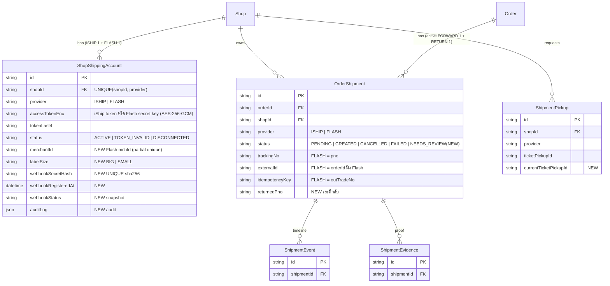

> **โมดูล:** 00084 Flash Express Direct Integration
> **ประเภทเอกสาร:** DATABASE Design
> **เวอร์ชัน:** 0.1
> **วันที่จัดทำ:** 2026-10-22
> **สถานะ:** Draft (รอ SDS/SRS · ยังไม่ได้ apply กับฐานใด ๆ)
> **เจ้าของเอกสาร:** SA / safepay-database

# DATABASE: Flash Express Direct Integration

---

## 1. Overview

ฟีเจอร์นี้ให้ร้าน `ONLINE_SALES` เชื่อม Flash Express ตรง (mchId + key ของร้านเอง) คู่กับ iShip ได้ในร้านเดียวกัน
โครงสร้างข้อมูล **ใช้ตารางของ 00022 เดิมทั้งหมด** ([[00022 - iShip Shipping Integration/DATABASE]]) และเพิ่มเฉพาะคอลัมน์ที่ขาดจริง — ไม่มีตารางใหม่

- **Store:** PostgreSQL 16 (Supabase) ผ่าน Prisma · migration ด้วย Prisma Migrate (เขียน SQL มือ)
- **เอกสารต้นทาง:** scope baseline S-2/S-6/S-12 · BRD §8 BR-FLASH-* · PRD §10.3-10.4 · research §6-7
- **หลักการ:** additive เท่านั้น · แถวเดิมทั้งหมดคือ `provider='ISHIP'` และไม่ถูกแตะ · ไม่มี RLS (authorization อยู่ที่ service layer)

### 1.1 การตัดสินใจหลัก

| # | ตัดสินใจ | เหตุผล |
|---|----------|--------|
| D-1 | `ShopShippingAccount`: ถอด `shopId @unique` ใส่ `@@unique([shopId, provider])` | ร้านเดียวมี ISHIP 1 + FLASH 1 พร้อมกัน (BR-FLASH-19) · DB กัน FLASH ซ้ำของร้านเดียวให้เอง |
| D-2 | key ของ Flash เก็บใน `accessTokenEnc` + `tokenLast4` เดิม ไม่เพิ่มคอลัมน์ enc | ความหมายตรงกัน (ความลับของการเชื่อมต่อที่ร้านวางเอง) ใช้ `token-crypto` ตัวเดียวกัน · แถวแยกกันด้วย `provider` อยู่แล้ว · เพิ่มอีกชุดจะมีสองที่ให้ลืม redact/ลบ |
| D-3 | `merchantId` (mchId) เป็นคอลัมน์ใหม่ ไม่ใช่ความลับ | ใช้ค้นร้านจาก webhook + ตรวจซ้ำข้ามร้าน · เห็นเต็มเฉพาะเจ้าของร้าน |
| D-4 | partial unique ของ mchId เฉพาะแถว FLASH ที่ไม่ DISCONNECTED | mchId ผูกได้ทีละร้าน (BR-FLASH-17) · ถอดแล้วร้านอื่นผูกต่อได้ · `TOKEN_INVALID` ยังจองอยู่ |
| D-5 | `webhookSecretHash` เป็น `@unique` (nullable) | หาร้านจาก path webhook ก่อนตรวจลายเซ็นด้วย key ของร้านนั้น (BR-FLASH-72) · เก็บแต่ hash |
| D-6 | สถานะ "ต้องตรวจมือ" = ค่า `OrderShipment.status = "NEEDS_REVIEW"` (ไม่มี migration) | `status` เป็น String ไม่มี CHECK · ยัง `<> 'CANCELLED'` จึงจองช่อง active ใน `OrderShipment_active_order_key` (กัน Flash ทับ/เปิดซ้ำ) · ไม่เข้า `ACTIVE_FORWARD_SHIPMENT` (`status='CREATED'`) จึงไม่ปนกองงาน/กำไร |
| D-7 | ผู้ยืนยันเปิดใหม่หลัง 1003 (ทาง ข) บันทึกใน `OrderEvent` ไม่เพิ่มคอลัมน์ | ตารางกิจกรรมมีอยู่แล้ว (actor + เวลา) |
| D-8 | `OrderShipment.returnedPno` + partial unique | ตีกลับได้เลขใหม่ · webhook ของเลขนั้นวิ่งเข้าแถวเดิม (BR-FLASH-43) |
| D-9 | ไม่เพิ่มคอลัมน์ `warehouseNo` / sort code | ที่อยู่ผู้ส่งใช้คอลัมน์เดิม · ข้อมูลใบปะหน้าเก็บใน `optionsSnapshot` (Json เดิม) |

---

## 2. ERD

---

## 3. Tables

### 3.1 `ShopShippingAccount` (PostgreSQL)

คอลัมน์เดิมทั้งหมดคงอยู่ (ที่อยู่ผู้ส่ง/ค่าตั้งต้น/`createMode`/`status` ใช้ซ้ำกับแถว FLASH) เปลี่ยน/เพิ่มดังนี้

| Column | Type | Null | Default | Key / หมายเหตุ |
|--------|------|------|---------|----------------|
| `shopId` | `text` | NO | - | FK → Shop (cascade) · **ไม่ unique เดี่ยวแล้ว** |
| `provider` | `text` | NO | `'ISHIP'` | `UNIQUE(shopId, provider)` |
| `accessTokenEnc` | `text` | NO | - | FLASH = secret key เข้ารหัส · ห้าม plaintext/log/ส่งกลับ client (BR-FLASH-13) |
| `merchantId` | `text` | YES | NULL | **NEW** · partial unique (§4) |
| `labelSize` | `text` | YES | NULL | **NEW** · CHECK `IN ('BIG','SMALL')` · NULL = BIG |
| `webhookSecretHash` | `text` | YES | NULL | **NEW** · UNIQUE |
| `webhookRegisteredAt` | `timestamp(3)` | YES | NULL | **NEW** |
| `webhookStatus` | `text` | YES | NULL | **NEW** · `NOT_SET` / `REGISTERED` / `FAILED` / `EXTERNAL` |
| `auditLog` | `jsonb` | YES | NULL | **NEW** (มติ G-1) · `[{at,userId,action,kinds?}]` ล่าสุด 50 รายการ · ไม่มีความลับ |

Prisma relation เปลี่ยน: `Shop.shippingAccount ShopShippingAccount?` → `Shop.shippingAccounts ShopShippingAccount[]` (ไม่มีโค้ดใน `src/` ใช้ relation นี้ — ยืนยันด้วย grep)

### 3.2 `OrderShipment` (PostgreSQL)

| Column | Type | Null | Default | หมายเหตุ |
|--------|------|------|---------|----------|
| `returnedPno` | `text` | YES | NULL | **NEW** เลขใหม่ที่ Flash ออกตอนตีกลับ (state 7) |
| `status` | `text` | NO | `'PENDING'` | เพิ่มค่า `NEEDS_REVIEW` (ไม่แก้ DB) |
| `provider` | `text` | NO | `'ISHIP'` | ค่า `'FLASH'` สำหรับใบ Flash |

การจับคู่ฟิลด์ Flash → คอลัมน์เดิม (ไม่เพิ่มคอลัมน์): `pno`→`trackingNo` · `outTradeNo`→`idempotencyKey` · `orderId` ฝั่ง Flash→`externalId` · ต้นทุน→`carrierPrice` · ค่าธรรมเนียม COD→`codFee` · น้ำหนักจริง→`actualWeight` · ประมาณการ→`estimatedPrice`

### 3.3 `ShipmentPickup` (PostgreSQL)

| Column | Type | Null | Default | หมายเหตุ |
|--------|------|------|---------|----------|
| `currentTicketPickupId` | `text` | YES | NULL | **NEW** รหัสคำขอปัจจุบันของ Flash (เปลี่ยนได้) · `ticketPickupId` เดิม = รหัสแรก |

---

## 4. Indexes

| Table | Columns | Type | Rationale |
|-------|---------|------|-----------|
| `ShopShippingAccount` | `(shopId, provider)` | UNIQUE (`ShopShippingAccount_shopId_provider_key`) | แทน `shopId_key` · `findUnique` ด้วย `shopId_provider` · prefix `shopId` รองรับหาตามร้าน |
| `ShopShippingAccount` | `(webhookSecretHash)` | UNIQUE | หาร้านจาก path webhook |
| `ShopShippingAccount` | `(merchantId) WHERE provider='FLASH' AND status<>'DISCONNECTED' AND merchantId IS NOT NULL` | **partial UNIQUE (SQL มือ)** `ShopShippingAccount_flash_merchant_key` | mchId ผูกได้ทีละร้าน (BR-FLASH-17) · Prisma ประกาศไม่ได้ — ห้าม `prisma db pull` |
| `ShopShippingAccount` | `(status)` | BTREE (เดิม) | cron sync |
| `OrderShipment` | `(returnedPno)` | BTREE (`OrderShipment_returnedPno_idx`) | Prisma `@@index` · lookup webhook เลขตีกลับ |
| `OrderShipment` | `(returnedPno) WHERE returnedPno IS NOT NULL` | **partial UNIQUE (SQL มือ)** `OrderShipment_returnedPno_key` | กัน webhook เข้าผิดแถว |
| `OrderShipment` | `(orderId, direction) WHERE status<>'CANCELLED'` | partial UNIQUE (เดิม ไม่แก้) | บังคับ 1 ใบ active/ทิศทาง ข้ามผู้ให้บริการ (BR-FLASH-24) — Flash ทับใบ iShip ถูกปฏิเสธที่ DB |
| `OrderShipment` | `(trackingNo) WHERE trackingNo IS NOT NULL` | partial UNIQUE (เดิม) | `pno` ห้ามซ้ำ |

หมายเหตุ webhook: ต้องค้น `trackingNo` **และ** `returnedPno` (สองคอลัมน์) — เลขตีกลับอาจชนเลขของใบอื่นในทางทฤษฎี ให้ service จัดลำดับ trackingNo ก่อน

---

## 5. Migration Plan

ไฟล์: `prisma/migrations/20261022120000_00084_flash_express/migration.sql` (เขียนมือ, `IF NOT EXISTS`/`IF EXISTS`)

### 5.1 ลำดับ

| ลำดับ | การเปลี่ยนแปลง | หมายเหตุ |
|-------|----------------|----------|
| 1 | `ADD COLUMN` 5 คอลัมน์บน `ShopShippingAccount` (nullable) | ไม่ rewrite ตาราง |
| 2 | สร้าง `UNIQUE(shopId, provider)` **ก่อน** แล้ว `DROP INDEX ShopShippingAccount_shopId_key` | ไม่มีช่วงไร้ unique · แถวเดิม (shopId ไม่ซ้ำ) ผ่านแน่ |
| 3 | UNIQUE `webhookSecretHash` + partial UNIQUE `merchantId` | คอลัมน์ใหม่ NULL ทั้งหมด ⇒ สร้างผ่าน |
| 4 | CHECK `labelSize` | additive ชนข้อมูลเดิมไม่ได้ (NULL ทั้งหมด) |
| 5 | `OrderShipment.returnedPno` + 2 index | |
| 6 | `ShipmentPickup.currentTicketPickupId` | |

ไม่มี backfill — ไม่มี rename enum/field (ต่างจาก OrderStatus redesign)

### 5.2 Rollback

ดูบล็อกท้าย migration.sql · ย้อนได้เฉพาะเมื่อยังไม่มีแถว FLASH · การลบแถว FLASH และ DROP COLUMN เป็น destructive ต้อง Controller สั่งชัด · โค้ดที่ query ระบุ provider ใช้กับ schema เก่าได้เพราะ ISHIP เป็น default

### 5.3 ผลกระทบ

- ไม่มี downtime · ตารางเล็ก (หนึ่งแถวต่อร้านที่เชื่อม) · `OrderShipment` เพิ่ม index สองตัวบน NULL เกือบทั้งหมด (ถูก)
- **Breaking ฝั่งโค้ด:** `findUnique/update/upsert({ where: { shopId } })` บน `shopShippingAccount` จะ **ไม่ผ่าน tsc** หลังแก้ schema (ไม่มี unique เดี่ยวแล้ว) — ดีที่ build จับให้ ต้องแก้ครบก่อน deploy · รายการ file:line อยู่ในรายงานส่งมอบ/SDS
- `findMany({ where: { status: 'ACTIVE' } })` ใน cron iship-status-sync จะได้แถว FLASH ปนและร้านซ้ำ — ต้องเติม `provider: 'ISHIP'` (ไม่ error ไม่ tsc จับ ⇒ เสี่ยงเงียบ)
- HR15: push `main` = `prisma migrate deploy` บน prod อัตโนมัติ · local ต้อง apply เอง · migrate ล้ม = deploy ไม่ขึ้น

---

## 6. Retention / ข้อควรระวัง

- **Retention:** ไม่เพิ่มตารางโตเร็ว · แถว FLASH `DISCONNECTED` เก็บไว้ (ล้าง key ตามเดิม) เพื่อประวัติ (BR-FLASH-15)
- **PII / ความลับ:** `accessTokenEnc` (key) เข้ารหัส ห้าม log/ส่งกลับ/แสดงแอดมิน (BR-FLASH-05/13) · `webhookSecretHash` เก็บ hash เท่านั้น · `merchantId` ไม่ใช่ความลับแต่ไม่เผยว่าซ้ำกับร้านไหน (BR-FLASH-17)
- **Unmanaged SQL:** partial index 3 ตัวของ 00084 (+ 2 ตัวเดิมของ OrderShipment) อยู่นอก Prisma DSL — `prisma db pull` / `migrate reset` จะทิ้ง ห้ามรัน (HR13/14)
- **Consistency:** แหล่งความจริงสถานะพัสดุ = Flash · เรา cache ใน `carrierStatus*` · ไม่แตะ `Order.status` (BR-FLASH-40)
- **ไม่มี RLS**

---

## 7. Traceability

| Table / ส่วนที่เปลี่ยน | ที่มา | สถานะ |
|------------------------|-------|-------|
| `ShopShippingAccount` (unique + คอลัมน์ Flash) | S-2 · BR-FLASH-13/16/17/19/72 | Draft |
| `OrderShipment.returnedPno` | S-12 · BR-FLASH-43 | Draft |
| `OrderShipment.status = NEEDS_REVIEW` | S-6 · BR-FLASH-23 | Draft |
| `ShipmentPickup.currentTicketPickupId` | research §7.2 · BR-FLASH-84 | Draft |

(SDS ของ 00084 ยังไม่มี — เติมคอลัมน์ component ภายหลัง · sync `docs/SRS.md` data model ใน task S-2)

---

## 8. สรุป

additive ล้วน: 9 คอลัมน์ใหม่ใน 3 ตาราง · unique ของ `ShopShippingAccount` ผ่อนเป็น `(shopId, provider)` · partial unique เพิ่ม 2 ตัว · ไม่มี drop ข้อมูล

**Open Questions:**
- ค่า `webhookStatus` และการรองรับ `EXTERNAL` ยืนยันกับพฤติกรรมจริงของ #17 หลังได้ training credential
- `NEEDS_REVIEW`: ให้ dev ไล่ทุกจุดที่แตก `status === 'FAILED'` (ปุ่มลองใหม่) ให้ไม่รวมค่านี้
